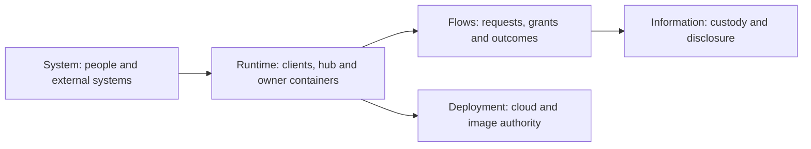

# System views

[Architecture](../README.md)

Each view answers a different engineering question. Start with the
[system overview](../system.md); use a detailed view when you need its boundary.

## Visual Map

| Question | View |
| --- | --- |
| Who interacts with One and Hussh? | [System](system.md) |
| Which components own execution and storage? | [Runtime](runtime.md) |
| How does a request move through the system? | [Flows](flows.md) |
| Where do images run, and who authorizes them? | [Deployment](deployment.md) |
| What can each participant read or disclose? | [Information boundaries](information-boundary.md) |

Use [module diagrams](../README.md#modules) for a particular feature. Keep diagrams
beside their owning contracts; do not infer installed availability from a box on a map.
