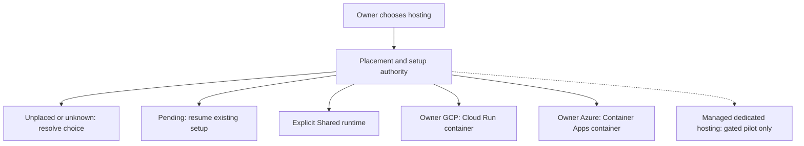
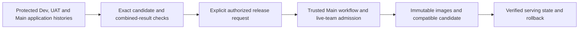

# Hosting and deployment

[System views](README.md) · [Hosting module](../modules/hosting.md)

Hosting is an explicit owner choice. Cloud placement, AI access and capability
admission are separate states. Source diagrams do not certify a serving image.

## Visual Map

## Placement and first use

The placement service distinguishes unknown, pending, BYOC, managed, Shared and
unplaced. **No assignment is not an implicit Shared choice.** Resume pending
provisioning through its recorded operation rather than allocating again.
Supported model access must verify before the corresponding execution is admitted.

GCP and Azure use the owner’s provider authority and the qualified deployment
configuration. Recovery storage, signed owner admission and exact installed-image
acceptance remain separate requirements. Browser shares the owner container;
Chromium sandbox is enabled on GCP and explicitly disabled on Azure.

## Puppy and direct connections

Puppy uses a signed owner/device binding and the pod’s authenticated relay. Its
server paths validate owner, deployment, scope and sequenced frames. Both
owner-cloud targets are represented by the private-runtime contracts. Shared and
unqualified managed hosting do not inherit Puppy access.

An implemented direct client or server route is not proof that the installed
Hermes and pod versions completed a real device journey. See
[Puppy acceptance boundaries](../modules/puppy.md) and
[operational acceptance](../../operations/acceptance/private-agents.md).

## Explicit application releases

A merge changes source only. Deployment is a separate authorized operation from
Main-owned tooling, with the selected application SHA, scope and image provenance
recorded independently. Dev and UAT retain their own source histories; UAT does
not require a preceding Dev deployment. Current production admission does not
require a preceding UAT deployment, but still requires its own exact-source,
compatibility, authorization and rollback safeguards.

Follow [CI and release control](../../operations/releases/ci.md),
[branch governance](../../operations/releases/branch-governance.md) and the
[Admin SOP](../../../.agents/skills/repo-operations/references/admin-release-sop.md).
Cloud credentials and environment identities are never interchangeable.
