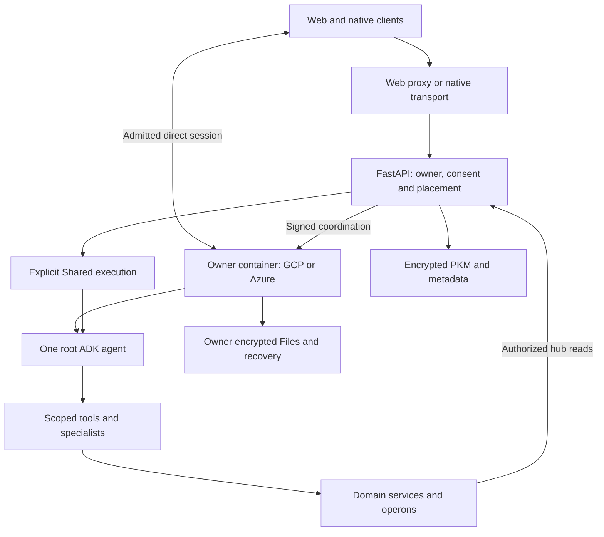

# Runtime composition

[System views](README.md) · [One module](../modules/one.md)

The app uses platform-aware services and transports. The backend owns policy and
persistence services. The selected execution runtime composes One and its scoped
specialists; a manifest alone does not establish that a capability is enabled.

## Visual Map

## Responsibilities and authority

- **Clients** own interaction, local unlock and approved client encryption. They
  call service boundaries rather than inventing backend authority.
- **The hub** resolves placement, verifies identity and scoped access, and records
  durable coordination. Owner pods do not receive the hub’s database credential.
- **One** owns root ADK coordination. The canonical tree lives in
  `consent-protocol/hushh_mcp/one_adk/`; legacy orchestrator descriptors are not
  another runtime owner.
- **Specialist tools** wrap bounded dispatch. Business logic belongs in operons;
  persistence remains with its service owner. Memory belongs to One rather than
  being subordinate to finance.
- **Owner storage** supplies the separately qualified Files and recovery boundary.
  It is not a transparent mirror of the hub database.

One and Browser share the same non-root owner container. They do not have a
process-isolation security boundary. See the [Browser contract](../modules/browser.md).
Puppy inference runs on the [bound trusted computer](../modules/puppy.md), not in
Shared or through an implicit cloud fallback.

[Agent hierarchy](../one/one-agent-hierarchy.md) owns detailed dispatch and scope
contracts. [Deployment](deployment.md) owns placement; [information boundaries](information-boundary.md)
explain storage, plaintext processing and disclosure.
