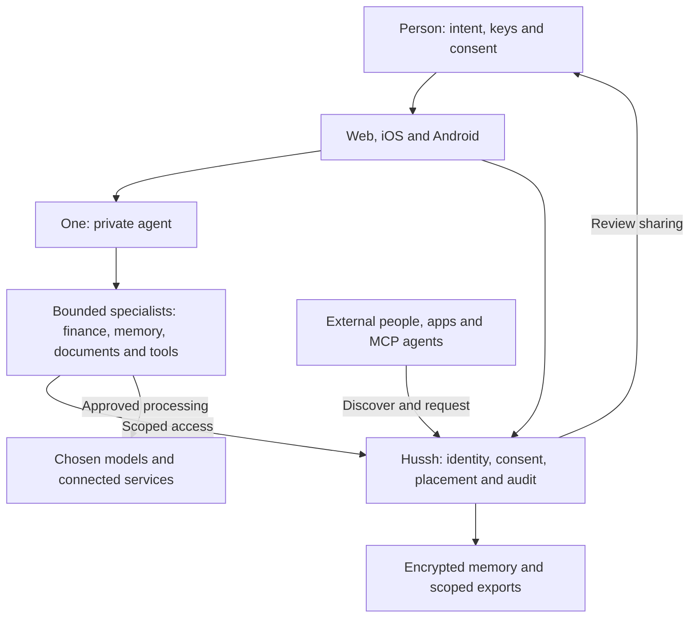

# People and system boundaries

[System views](README.md) · [Architecture](../README.md)

One connects a person to selected information and services. Hussh owns the
coordination and consent contracts; external systems retain their own custody
and processing boundaries.

## Visual Map

One is the root private-agent runtime. Specialists do not become independent
principals or inherit unrestricted access. An external requester receives only
the granted scope through the existing consent/export contract.

See [identity and consent](../modules/identity.md), [sharing](../modules/sharing.md)
and [information custody](information-boundary.md). Future partner systems and
new execution models belong in the [roadmap](../../roadmap/README.md).
