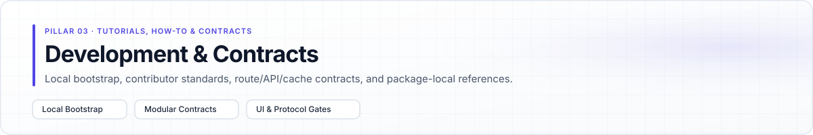
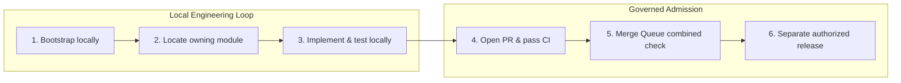

  <picture>
    <source media="(prefers-color-scheme: dark)" srcset="../assets/brand/pillar-development-dark.svg" />
    <source media="(prefers-color-scheme: light)" srcset="../assets/brand/pillar-development-light.svg" />
    
  </picture>

# Development

[Documentation](../README.md) · **Intent:** Tutorials, how-to guides & contracts

Build from the canonical branch for your work (`dev`, `uat`, or `main`), use the existing package owners, and validate every contract your change touches locally before pushing.

## Visual Map

## Core developer guides

| Goal | Intent | Start here |
| --- | --- | --- |
| Set up your machine and local services | `Tutorial` | [Getting started](guides/getting-started.md) · [Environments](../operations/environments.md) |
| Orient across the monorepo | `Explanation` | [Repository map](repository-map.md) · [Architecture modules](../architecture/README.md#modules) |
| Contribute cleanly and pass PR gates | `How-To` | [Contributor guide](../../contributing.md) · [Testing](../../TESTING.md) · [PR checklist](quality/pr-impact-checklist.md) |
| Read API, route, cache, and native contracts | `Reference` | [Technical references](references.md) · [Web & mobile docs](../../hushh-webapp/docs/README.md) · [Backend docs](../../consent-protocol/docs/README.md) |
| Author or evolve documentation | `How-To` | [Documentation standard](documentation.md) |
| Work with the coding-agent framework | `Reference` | [Engineering principles](engineering-principles.md) · [`.agents` guide](../../.agents/README.md) · [Framework checks](agents/README.md) |
| Keep local disk, worktrees, and dependencies healthy | `Reference` | [Worktree and dependency hygiene](worktree-and-dependency-hygiene.md) |

> [!NOTE]
> Release permissions, branch rules, and deployment workflows live exclusively in [Operations](../operations/README.md) so there is never a competing release procedure.

## Further reading

- [Guides Index](guides/README.md)
- [Hussh Mobile Index](mobile/README.md)
- [Quality and Design System Index](quality/README.md)
- [Streaming Index](streaming/README.md)

<strong>For coding agents: pre-PR verification entrypoints</strong>

- Route recurring tasks via `./bin/hushh agents route-task <workflow-id>`.
- Run `./bin/hushh docs verify` for doc edits, `npm run typecheck && npm run verify:ui-contracts` for frontend edits, and `pytest` + `mypy --config-file pyproject.toml --ignore-missing-imports` for backend edits before pushing.
- For multi-cloud storage, KMS custody, capability-prefix, or sandbox/BYOC changes, run `./bin/hushh protocol floci` ([Floci wire verification](quality/floci-multicloud-wire-verification.md)) before container builds or live cloud qualification.

