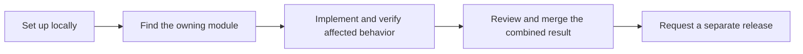

# Development

[Documentation](../README.md)

Build from the branch appropriate to your work, use the existing package owners,
and validate the contracts your change affects.

## Visual Map

- [Getting started](guides/getting-started.md) and [environment selection](../operations/environments.md).
- [Repository map](repository-map.md) and [architecture modules](../architecture/README.md#modules).
- [Contribution procedure](../../contributing.md), [testing](../../TESTING.md) and [change checklist](quality/pr-impact-checklist.md).
- [Technical references](references.md), [web/native implementation](../../hushh-webapp/docs/README.md) and [backend implementation](../../consent-protocol/docs/README.md).
- [Documentation authoring](documentation.md): canonical homes, navigation and verification.
- [Engineering principles](engineering-principles.md) and [coding-agent framework](../../.agents/README.md) and [framework verification](agents/README.md).

Release permissions and commands live in [Operations](../operations/README.md),
not in a competing contribution procedure.

## Further reading

- [Guides Index](guides/README.md)
- [Hussh Mobile Index](mobile/README.md)
- [Quality and Design System Index](quality/README.md)
- [Streaming Index](streaming/README.md)
