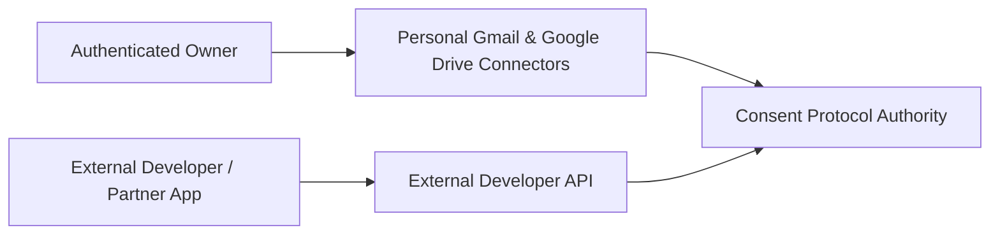

# Personal Mail, Drive & External Developer API Contracts

[API Contracts Hub](api-contracts.md) · [API Route Catalog](api-route-catalog.md)

**Status:** Live | **Intent:** Reference | **Audience:** Backend, Frontend, and External Integrators

Lifecycle contracts for owner-authorized personal Mail and Drive connectors, owner-local tasks, and external developer clients. See [API Contracts](api-contracts.md) for the shared token hierarchy and error envelopes.

## Visual Map



## Owner-local Calendar and email tasks

One's To-do list reads private Google metadata directly from the owner's signed,
pinned agent endpoint. These routes are mounted only by `pod_server.py` and admitted
by exact client/ingress allowlists, an app-role session with `pkm.read`, the current
owner, and a held incarnation. Admission is rechecked after provider work. Hub
consent tokens, device sessions and status-only sessions do not authorize content.

| Endpoint | Contract |
| --- | --- |
| `POST /api/one/pod/calendar/events` | Offset-aware `start_at`/`end_at`, at most seven days; up to five bounded primary-calendar pages, with explicit `truncated`. Returns task IDs bound to owner/account, title, times, status and a validated Meet URL. |
| `GET /api/one/pod/gmail/todos` | Up to 25 recent-thread reply tasks using the existing metadata-only reader. Returns opaque owner/account-bound keys, action titles, `complete` and `scope=recent_threads`; no provider IDs, snippets or message bodies. |

Responses are `private, no-store`. The ports use the owner's existing pod-sealed
Google grants and do not invoke a model, mutate Calendar/mail, or read hub content
tables. Provider grant failures remain distinct from app authentication failures.
The existing owner-cloud hosting restriction remains; managed-hosting Google reads
and private Calendar invitation actions are not enabled by these routes. Existing
owner agents need the updated image before the new paths can serve their app.

## Personal Mail / Drive connector lifecycle (UAT gated)

### Legacy owner-private MCP registration (compatibility only)

The readable private-registration path below is superseded by the owner's
browser-encrypted vault configuration. Do not apply migration 243 to enable new
custom connectors. Existing callers remain until replacement parity is proven;
their presence does not establish the intended custody architecture.

`POST /api/connectors/registrations` requires a Vault Owner token and accepts only
`registrationId` (a stable retry UUID), `displayName`, `endpoint`, and `authStyle`
(`api_key` or `oauth`). The server derives the owner and connector identity. It admits
public HTTPS endpoints on port 443 without URL credentials, query parameters, or
fragments; transport-time public-address validation is a separate required boundary.
Registration neither authenticates a provider nor grants tool execution permission.
The response is a safe connector summary with `registrationKind=private` and
`status=not_connected`, never endpoint or credential configuration.

`GET /api/connectors/features` is a private/no-store Vault Owner read of
`{features, driveAgentPackagesEnabled}` using the same rollout predicates as the
complete overview, without registry, OAuth, or provider-status reads. These flags
do not certify provider readiness or authorize a mutation. Deploy support before
first-party callers; the existing overview and its complete payload remain unchanged.

`GET /api/connectors` lists the operator-curated registry and the authenticated
owner's connection statuses; custom definitions are loaded separately from the
browser-encrypted vault. This overview does not require migration 243's private
registration columns. Legacy API-key connection lookup remains owner-scoped.
Repeating an unchanged registration UUID is idempotent;
changing its definition returns 409, as does exceeding 32 active private registrations.
Owner-scoped reads require migration 243; unavailable registry storage returns 503,
not a misleading empty catalog. Validation responses omit submitted input and use
`Cache-Control: no-store`.

Release caveat: environments already carrying legacy private registrations need
an explicit recovery/migration check before removing their old Settings entry
points. The curated overview is not proof that those records were migrated.

This is a backend registration boundary, not certification of custom OAuth,
Settings controls, ADK invocation, or native acceptance. Those remain separate gates.

### Owner-private MCP exact-call review

Founder decision 2026-09-27: calls on the person's own MCP connectors (vault
custom connectors and their own private registrations) run without review. There
is no first-call review, no review after third-party content, and no per-turn
unreviewed-call budget. What remains: credentials stay vault/server-held and are
redacted from results; only the turn's owner may use a connector
(`MCP_OWNER_MISMATCH`); a tool the owner blocked whose contract changed still
needs review; curated first-party rows keep exact-call review; and each
unreviewed call writes a metadata-only audit line before dispatch. The review
route below serves those remaining cases and resumes of reviews issued earlier.

`POST /api/connectors/{connector_id}/mcp/review` requires a Vault Owner token,
`conversationId`, namespaced `toolName`, and bounded JSON `arguments` (32 KB).
The request stream is capped at 64 KB before JSON parsing, with a five-second
body-read deadline; chunked input cannot bypass that cap.
It verifies the owner's connector configuration and encrypted ADK conversation,
resolves current credentials, rediscovers tools and validates the exact schema.
It issues metadata-only authority through the existing action ledger (migration
244), returning the complete arguments for transient browser review plus the
directive ID and expiry. It does not invoke the provider tool.

Vault-backed calls supply optional `connectorConfiguration`: one versioned
configuration for the exact connector, including its transient access credential.
The browser projection excludes OAuth refresh tokens; the server rejects them.
This field is excluded from model serialization and representation. The server
validates endpoint, owner, enabled state and credential expiry, and binds approval
to the complete configuration as well as the discovered tool revision. It does
not create a private registry row. Omission retains the legacy registration path
for compatibility. Client transport and backend review support are implemented;
Chat's authenticated workspace now loads these configurations from the encrypted
`runtime_secrets` domain using a forced coherent snapshot. Initial turns, action
resumes and connector review/confirmation reload the catalog and check the
authenticated owner and vault-session epoch before dispatch. Failed loading is
not treated as an empty catalog or a reason to fall back to private registration.
This is source-level integration, not verified live provider/native acceptance.

The existing Connectors panel includes a custom-server editor for public HTTPS
endpoints with no authentication or a supplied Authorization header. It writes
through browser-encrypted runtime settings, never the private-registration API,
and labels records as saved rather than connected. This editor does not yet
implement remote OAuth or persistent permissions management. Removal
requires an explicit confirmation and the displayed record revision, and deletes
only its encrypted vault settings; it does not revoke the provider's grant or
undo completed actions.
Those remain explicit integration gaps; do not advertise a saved definition as
a verified provider connection. Owner/vault guards fence preparation, dispatch,
retry and cache publication through the existing encrypted write service.

Block/Enable updates the existing encrypted `enabled` field with revision checks.
Blocked definitions are omitted from new turn projections, including credentials;
enabling restores Ask first, not standing execution permission. This does not
cancel an already-dispatched provider operation or revoke a provider grant.

Custom remote OAuth remains a separate, incomplete custody boundary. The legacy
`ExternalConnectorOAuthService.complete` writes to the server-owned credential
store and must not be reused unchanged for vault-owned custom connectors. The
installed MCP SDK's `OAuthClientProvider` supplies reusable protocol behavior.
`one_adk/mcp_oauth_storage.py` now implements its request-only TokenStorage port
over the existing expiring secret handoff, with single delivery of tokens and
registered client information for eventual browser-vault persistence. Focused
tests include a synthetic SDK authorization exchange, owner invalidation,
expiry, bounded storage and one-time delivery. This adapter is not yet wired
to a public login route; it does not establish browser or provider acceptance.
Callback and protected-resource/issuer discovery integration still need owner-bound
vault custody and endpoint protection. `ConnectOnlyMcpOAuthProvider` now restricts
OAuth retries to setup/read-only protocol methods, redacts the installed SDK's
auth logger messages and tracebacks, sanitizes propagated errors and bounds the
live flow by the attempt deadline. It compares the authorization metadata's issuer
to the exact advertised issuer before SDK URL normalization, requires S256 and
validates public HTTPS endpoint syntax before registration or authorization.
Metadata changes clear previously admitted endpoints; metadata GETs cannot carry
Authorization/Cookie headers, and credential POSTs use admitted endpoints only.
Admission validates the complete SDK `OAuthMetadata` model, then requires the
SDK's accepted metadata to equal that admitted model before registration or
authorization. This prevents malformed optional fields from causing a silent
SDK fallback beneath a raw-JSON endpoint whitelist. Successful delivery uses
the provider's `take_result()`, not the storage method directly: its terminal
cleanup clears both expiring storage references and SDK token/client copies.
Failure, cancellation and generator abandonment
clear the temporary storage. The synthetic tests exercise these boundaries, not
a public callback API. `McpOAuthCallback` binds the SDK-generated state and exact
advertised issuer to the workflow's verified owner and current-session guard.
It rejects replay and checks the guard again before delivering the code. The
`iss` callback parameter is required when metadata advertises support; whenever
present it must match exactly. `use_callback` installs this handoff before the SDK
starts and cannot be rebound during the flow. The authenticated routes below
establish owner/attempt authority and fail closed on lost worker continuity.
The adapter's `create_http_client`
uses the existing public-network transport with a 65,536-byte streamed response
limit. It requests identity encoding and rejects compressed responses before
decompression, keeping the bound meaningful. Redirects and environment proxies
remain disabled. Ordinary MCP clients retain their existing stream behavior;
this additional bound is specific to OAuth setup. Synthetic transport tests cover
exact-limit bodies, overflow, compression refusal and stream closure.

`one_adk/mcp_oauth_connection.py` composes the real SDK Streamable HTTP transport,
`ClientSession.initialize`, callback handoff and single-use result delivery into
one live attempt. It binds owner, connector and configuration revision, bounds the
attempt to five minutes, and closes temporary resources on completion/cancellation.
No product tool runs during connection. Tests use synthetic OAuth/MCP HTTP responses
with the real SDK; they do not prove public login, browser/native return or a real
Workspace server. The handshake closes local streams
without an OAuth-retried server-session DELETE; remote session expiry remains the
server's responsibility and needs provider acceptance.

The private `/api/connectors/{connector_id}/mcp/oauth/{begin,complete,cancel}`
POST routes require Vault Owner authority and accept only custom connector IDs.
`begin` receives endpoint and configuration revision; the server fixes the return
path to `/one/profile/connectors/oauth/return` on `APP_FRONTEND_ORIGIN`, never an
arbitrary client-supplied redirect. HTTPS is required except localhost in
development/test. The provider must admit that exact return URI too.
Attempts are process-local, expire after five minutes, and are bounded to two per
owner and 128 per worker. Completion claims an attempt once and binds owner,
connector, revision, SDK state and issuer. Its no-store result contains tokens and
client registration for **browser-encrypted vault delivery only**. Both proxy and
backend bound request bodies to 64KB. Restart or another worker fails closed;
multiworker affinity and aggregate admission remain deployment prerequisites.
Custom connector Settings now offers web Sign in when encrypted Chat recovery is
available. It starts the private attempt, saves the existing encrypted recovery
capsule plus opaque connector/revision references, and navigates in the same tab.
The shared return page distinguishes this marker from legacy provider flows,
removes callback query parameters, requires the same owner and an unlocked vault,
and completes once. It forces a fresh connector snapshot, checks the original
revision, and uses the existing CAS encrypted writer. Client registration and
refresh credentials remain vault-only; turn projections contain only the access
token and expiry. Missing/expired token lifetimes reject rather than inventing
one. A tool refresh follows save, with a distinct recoverable refresh-failure
message. This is covered by synthetic component/service tests, not live OAuth or
physical-device proof. The native app-owned HTTPS return is implemented, but
live physical-device proof and refresh-token renewal remain open; standard
OAuth support is not proof of Workspace server compatibility.

The adapter rejects preloaded tokens in a fresh provider. Do not load a vault refresh token into
a fresh SDK provider until the issuer/token-endpoint binding is verified: its
initial refresh can otherwise fall back to the MCP origin's `/token` endpoint.
Use OAuth only for a connection handshake, not mutating tool invocation, because
the SDK may replay the original HTTP request after authorization.
No static API-key form or Google provider token passthrough proves standard MCP
OAuth support. See the [MCP authorization specification](https://modelcontextprotocol.io/specification/2026-07-28/basic/authorization).

`POST /api/connectors/{connector_id}/mcp/catalog` takes a transient
`connectorConfiguration` under Vault Owner authority. Settings' explicit Refresh
tools action reloads the encrypted record and calls the same governed toolset as
Chat with execution disabled. The no-store response contains connector/configuration
revision and namespaced tool IDs, names, revisions, exact descriptor fingerprints,
and `ask_first` or `blocked` permission. Per-tool Block is an encrypted vault
preference bound to the exact discovered descriptor; Chat and call review filter
blocked tools before admission, while Settings still lists them for re-enablement.
Changed tool descriptors return to Ask first. Connector-wide Block remains separate.
It contains no tool results or credentials and issues no action approval.
Settings rejects mismatched or late responses and bounds the visible tool list.
Discovery uses the shared toolset's bounded pagination and timeout; an empty
catalog is distinct from failure. Provider notifications and persistent
allow-without-review remain unimplemented.

Protocol proof: `test_real_sdk_protocol_paginates_reviews_invokes_and_rejects_changed_tools`
in `tests/test_governed_mcp_toolset.py` uses a real MCP Server/ClientSession over
the SDK memory transport and the native ADK tool implementation. It verifies two
catalog pages, no invocation while application approval is pending, exact wire
tool/arguments on one permitted invocation, and rejection of an old tool after
catalog revision changes. Session acquisition and the approval decision are test
seams; this does not certify HTTPS, real consent-ledger approval, OAuth, browser,
or provider behavior.

Chat ingress accepts `forwardedProps.mcpConfigurations` only with current Vault
Owner authority. It removes that private field before handing the input to
AG-UI, validates the bounded catalog, and stages it in the existing process-local
secret store with a 60-second expiry and event-loop cleanup of abandoned
handoffs. Disabled connector credentials are excluded from browser projections.
The owner/conversation-bound reference is
consumed once and removed from state before the ADK bridge runs. The turn-local
toolset receives the configuration, rechecks authority per call, and closes at
turn completion. An explicit empty catalog cannot resurrect a custom connector
from the legacy database. Omitted catalogs retain compatibility behavior until
all compatibility callers have migrated. The authenticated Chat workspace sends
an explicit catalog, including an empty one. This server ingress is covered
by focused contract tests, not live provider or browser acceptance.

For a native ADK pending call, include `pendingHandle`. Review resolves its
owner/thread/tool/call-bound transient arguments and verifies both stored native
call identities and the current catalog. It returns the original directive,
never a second directive; send `{}` as `arguments` when fetching that preview.
Confirmation includes the same handle and exact reviewed arguments. A changed
directive, call, arguments or catalog is rejected. The native resume separately
checks the pending handle's function-call ID before consuming the receipt.

`POST /api/connectors/{connector_id}/mcp/confirm` accepts those same terms,
`directiveId` and strict boolean `confirmed=true`. It reconstructs current terms
and confirms only an exact, unexpired ledger match. The returned short-lived
receipt belongs in browser/request memory only—not Chat history, model input,
logs or persistent storage. The resumed native ADK tool must consume it once
before dispatch. There is no separate HTTP tool-execution endpoint.

Both routes use the existing Next connector proxy and return `no-store`, including
errors. Validation/errors never echo private input or provider diagnostics.
These endpoints currently admit owner-private configurations/registrations only; curated
Workspace adapters, Chat review-card/resume wiring and live acceptance remain
separate integration gates. Confirmation is not proof that a tool executed.

### Drive lifecycle

The Drive lifecycle extends the existing external-connector registry and credential store;
it does not migrate Gmail/Calendar credentials or change Firebase authentication. These
routes remain default-off and do **not** enable chat reads or indexing.

| Route | Authority | Contract |
| --- | --- | --- |
| `GET /api/connectors/features` | Vault Owner | Lightweight `{features,driveAgentPackagesEnabled}` rollout projection; private/no-store, no provider or registry reads. |
| `GET /api/connectors` | Vault Owner | Existing catalog/status plus redacted validation/revocation state, `available`, and computed rollout flags; deactivated Drive and a curated OAuth connector with an existing owner grant keep a recovery row with `available=false`. No endpoints, scopes, raw policy, provider subject or credentials. |
| `POST /api/connectors/google_drive/connect/oauth/start` | Vault Owner + UAT admission/connection flag | Registered `redirectUri`, optional `flow=web\|native`; returns authorization URL, opaque `attemptId`, connector and ten-minute expiry. |
| `POST /api/connectors/{connector_id}/connect/oauth/start` | Vault Owner + active operator registry row + provider OAuth secrets present | For a reviewed curated OAuth MCP connector, requires its exact registered web return URI and returns only a provider authorization URL, opaque attempt ID, connector ID and expiry. |
| `POST /api/connectors/oauth/complete` | Vault Owner | Dispatches the signed, atomically claimed owner attempt to its adapter. Drive uses verified Google identity/scopes; curated OAuth seals the owner-bound grant then verifies its MCP endpoint before reporting `connected`. |
| `POST /api/connectors/oauth/complete/web` | Verified Firebase identity matching an existing unexpired Vault-authorized Drive attempt | Requires `code`, signed `state` and matching opaque `attemptId` before exchange. Popup-only completion exception; no opener Vault Owner token transfer. |
| `GET /api/connectors/oauth/native/callback` | Signed state + atomic native attempt claim | Backend code exchange; encrypted pending credentials only. Fixed `hushh://connectors/return` handoff contains only opaque attempt/outcome. Invalid state has no redirect. |
| `GET /api/connectors/oauth/native/pending` | Original Vault Owner | Returns only the current opaque staged native `attemptId` and expiry for restart recovery. It never returns provider credentials, codes, tokens, subjects, or callback data. |
| `POST /api/connectors/oauth/native/finalize` | Original Vault Owner | Accepts `attemptId`; checks expiry, generation, client/redirect configuration and current rollout admission before activation. |
| `POST /api/connectors/google_drive/disconnect` | Vault Owner; remains available when rollout is off | Immediately disables local execution, invalidates attempts, clears credentials, then makes a bounded in-memory provider revocation attempt. Reports `revocationOutcome`; no background retry is promised. |
| `POST /api/connectors/{connector_id}/disconnect` | Vault Owner; curated OAuth recovery remains available when rollout is off or the row is inactive | Finds an operator-curated OAuth row even when inactive, invalidates its lifecycle state and scrubs the local credential. An unknown retired ID falls back only to owner credential scrubbing; it does not reactivate or execute any connector. |
| `POST /api/connectors/google_drive/picker/session` | Vault Owner + Picker cohort/flag | Exact registered web `origin`; verifies authenticated Drive About and fixed selected-file policy, then returns a ten-minute opaque selection session and the minimum short-lived Google access credential for the official Picker. Backend and web proxy both set `no-store`. No refresh token. |
| `POST /api/connectors/google_drive/documents/select` | Same Vault Owner + current single-use session + explicit `confirmed=true` | At most 25 unique candidate IDs. Revalidates fixed provider metadata/policy; atomically consumes the session and inserts encrypted internal catalog references in `queued` state. Does not claim indexing completed. |
| `POST /api/connectors/google_drive/picker/native/start` | Vault Owner + Picker cohort/flag | Requires the exact registered HTTPS callback. Starts a separate ten-minute PKCE One Picker attempt with only `drive.file`, `trigger_onepick=true`, and `allow_multiple=true`; returns an authorization URL, opaque attempt ID and expiry only. |
| `GET /api/connectors/google_drive/picker/native/callback` | Signed state + atomic native Picker attempt claim | Fixed Google HTTPS callback accepts the provider redirect server-side. It validates exactly `drive.file`, transiently exchanges the code, validates no more than 25 picked IDs with both the callback credential and the current verified connector credential, encrypts minimal staged metadata, then redirects only to `hushh://connectors/picker-return?attemptId=…&outcome=…`. It never persists the callback token, OAuth code, selected provider IDs, or a callback-account identity claim. Invalid state has no handoff. |
| `GET /api/connectors/google_drive/picker/native/pending` | Original Vault Owner | Returns only the current opaque attempt, expiry, owner-review display name/mime type, and opaque staging document handles. No provider IDs, codes, subjects, raw query data, or credentials. |
| `POST /api/connectors/google_drive/picker/native/confirm` | Original Vault Owner | Accepts only an opaque attempt ID and optional explicit `selected-files-background-v1` processing consent. Rechecks generation, credential version, policy, and current stored grant before atomically consuming the shared selection session and inserting catalog entries. Omitting consent cannot enable processing. |
| `POST /api/connectors/google_drive/picker/native/cancel` | Original Vault Owner | Idempotently removes the linked selection session and native attempt, suppressing late callback/confirmation results. |
| `GET /api/connectors/google_drive/documents` | Vault Owner | Owner-only internal document references, names and safe states. Available after grant rejection and with execution disabled; never provider file IDs or tokens. |
| `DELETE /api/connectors/google_drive/documents/{document_id}` | Vault Owner + explicit `confirmed=true` | Repeat-safe local removal, no Google mutation. Invalidates pending Picker sessions so in-flight selection cannot resurrect a removed source. Works without provider credentials or document decryption. |

Consent enters `verifying`, **not** `connected`. The fixed REST selected-file policy and
authenticated Drive About check precede the Picker session. A definitive refresh grant rejection yields
`needs_reauth`; transient failures preserve the encrypted grant. Refresh uses a 30-second
database lease and generation/version fencing. A pending revocation temporarily blocks
reconnection so an old revoke request cannot race a new grant.

The existing hosted runtime-config mechanism carries default-false `connections_panel_v2`,
`google_drive_connection`, `google_drive_picker`, `drive_document_indexing`, `gmail_chat_reads`, and `google_drive_chat_reads` with either an exact-UID cohort or explicit all-signed-in-UAT-users mode.
This is revision-owned configuration, not an instantaneous fleet-wide
flag service. Writes, user-facing downloads, connector voice execution and production remain
disabled. Status, recovery callbacks and disconnect remain reachable with their required
authority; an outstanding callback does not bypass activation eligibility.

Web OAuth accepts exactly identity scopes plus `drive.file`; broad Drive and combined Gmail
grants are rejected, including legacy cached credentials. The REST adapter has no scan or write
operation: selected metadata, Docs/Slides text export and bounded binary/text retrieval only.
It rejects redirects, compression, unsupported formats, shortcuts, CSE, missing/false download
or GenAI capabilities, and changed metadata after fetch. Requiring GenAI eligibility is our
conservative REST-index policy, not a claim that all Google REST calls require it.

Migration 228 adds an encrypted source catalog under separate `DRIVE_DOCUMENT_KEY_V1`, not
client-key PKM or OAuth credential storage. Source metadata is owner/document/generation bound;
source IDs are owner-keyed HMAC fingerprints. Disconnect/account switch atomically deletes
selected sources and sessions. This checkpoint stores no raw content, chunks or embeddings.

### Curated OAuth MCP connector rollout

HubSpot is the first curated OAuth MCP connector. Its initial contract is
**web onboarding and mobile use after a web connection**: native does not yet
own a curated OAuth callback. A non-terminal stored grant remains visible for
Disconnect if an operator deactivates the
registry row; it does not become connectable or executable again.

The checked-in UAT descriptor is not activation. An authorized operator must
run the descriptor's validation/probe/apply workflow against the intended UAT
registry, with the matching OAuth app callback and UAT-only secrets already
provisioned. Deployment does not apply that row implicitly. Source wiring for
the provider secrets is therefore not proof that the registry row is live.
Curated connectors are owner-initiated and available to every Vault Owner; an
environment without the provider's secrets or an active row never offers one.

Descriptor validation and runtime configuration admit only public HTTPS MCP,
authorization, and token endpoints: no credentials/userinfo, query/fragment,
non-443 port, loopback, private-address literal, or private DNS suffix.
For an enabled curated provider, reviewed runtime pins must also match its
endpoint, scopes, client-ID variable, and client-secret variable; an
operator-writable registry row alone cannot select another process secret.
Token exchange and refresh use the public-only transport with redirects and
environment proxies disabled, public-address DNS pinning, identity encoding,
and a bounded response before JSON parsing. Curated chat admission separately
requires a verified owner grant, the reviewed policy, and the connector's
allowlisted tools. Connecting a provider grants no unreviewed change: only tools
on a per-provider list reviewed in application code (never in the operator
registry), and which the server itself also marks read-only, run without a
per-call review card, each logged as an unreviewed read call. Every other tool,
including every write, needs exact-call review, and a provider absent from that
list keeps review on every call.

The existing left drawer mounts Chats and Connections together. Mail uses the existing
Gmail connection service; Drive uses a synchronously opened popup with exact origin/source/
attempt/expiry settlement checks and owner-status reconciliation. The exact callback shell
does not require an opener vault key; Firebase identity and the prior attempt authorize the
server completion. Other management routes retain their vault gates. The official web Picker
receives an in-memory short-lived token only, and selection needs a separate explicit owner
confirmation. Blocked popups remain in chat; no unencrypted full-page recovery is used.
Drive's popup marker has a local 9.5-minute correlation deadline so a device clock behind the
server cannot reject a newly created attempt before Google opens; the server still enforces
the OAuth attempt's ten-minute expiry during completion.
The opener removes its attempt marker on settlement, cancellation, expiry, or failed
navigation. The callback uses popup mode only when a live marker matches the signed
state's attempt ID; other full-page OAuth returns keep their own handoff.

Connecting Mail, Drive or Calendar from the chat drawer never navigates the chat window, so
the memory-only vault key, the chat and the open drawer survive. All three open their consent
window through one opener (`lib/connections/oauth-window.ts`): a sized popup, or a new tab
when the popup is refused, synchronously inside the click. Both settle through the same
contract: the existing callback page posts a redacted outcome to its exact same-origin opener,
and writes a same-origin storage hint for when Google's opener policy severs the opener. The
drawer accepts only the exact origin, the exact window and the exact attempt, before the
attempt expires, and then re-reads owner status; the settlement itself is never proof. When
both popup and tab are refused, Mail and Calendar stay in place and ask the person to allow
pop-ups. Drive may use its encrypted one-use recovery capsule for a full-page return, and fails
closed if the capsule cannot be saved. Native uses the platform Google sign-in sheet (Mail,
Calendar) or the system authentication browser with an app-link return (Drive); the WebView
does not reload. Callback URIs and scopes are unchanged.

The in-chat cards use the same path through `lib/connections/google-connect-in-place.ts`:
the Gmail send upgrade on a failed delivery or on the email draft card, the Gmail modify card
and the Calendar card One shows. Each opens Google's window inside the click and decides
success only from an owner status read that checks the requested permission. Status cannot
see a switched-off send, so a cancelled or failed Gmail send callback ends the attempt as not
connected even when status already shows the send scope. The delivery, Gmail modify and
Calendar cards stay cancellable while the window is open; the draft card does not offer Cancel
sign-in yet. A successful send upgrade reopens the reviewed draft, and nothing is sent until
the person sends it again. The Gmail modify and Calendar cards clear with a confirmation, as the old redirect
return did. Native Gmail modify is still web-only. `/one/calendar` settles through the same
handler and no longer reads `popup.closed`, which Google's opener policy makes unreliable. It
ends on the callback, an explicit Cancel sign-in, or a bounded expiry.

Native Drive authorization and native file selection use separate fixed registered backend HTTPS
callbacks. The One Picker path requests **only** `drive.file`; Google does not return OIDC identity
in that flow, so it never claims to identify the callback account. Its callback credential is
transient, validates the picked metadata only, and is discarded before the opaque
`hushh://connectors/picker-return` handoff. iOS presents it through
`ASWebAuthenticationSession`; Android uses Auth Tab with the documented Custom Tabs fallback.
The app validates the fixed Google authorization origin and opaque result, keeps browser/auth
interactions single-flight, and reconciles staged state only after the original Vault Owner is
current. The native return never replaces chat navigation or exposes an OAuth code, state,
provider identity, token, or selected file identifier to JavaScript.

Release prerequisites still include encrypted full-page recovery, ingestion/index/search/grants,
scheduled retention, authenticated mobile Picker acceptance, and OAuth callback ingress-log routing
evidence. Native Picker requires the fixed registered HTTPS callback plus the Google Picker API key
in the native shell; source-level handling does not prove either environment prerequisite.
Application redaction covers query `code`/`state`/`picked_file_ids` and Drive file-ID paths, but
does not sanitize platform-managed request logs.
See [Mail + Drive UAT acceptance](../../operations/integrations/mail-drive-uat-acceptance.md).

### Delegated Mail reads (default-off)

One's existing AG-UI typed-chat route can delegate `list_recent` (newest INBOX page, no
search expression, limit 1-25), `list_needs_reply`, `search_inbox`, `read_message` (the
newest one to five matches, with their text) or `read_thread` (the newest matching
conversation, its ten newest messages with their text) through the authored
Email specialist. An inbox search plan with no criteria is read as `list_recent`; the
reader itself still refuses an empty search expression. Each read is scoped to one mailbox (`inbox` by
default, `sent`, or `anywhere`; spam and trash are always excluded, and `list_needs_reply` is
inbox-only). Items carry an `unread` flag and, for sent mail only, a `recipient` label. The
planner receives the current time and the person's timezone, and calendar-date `after:` /
`before:` terms are rewritten to epoch seconds at local midnight in that timezone. Admission requires UAT rollout eligibility,
`gmail_chat_reads`, a current Vault Owner session and a manifest-declared invocation
capability bound to the same owner, task, call and expiry. Voice, arbitrary operations,
client-supplied delegated results and action plans cannot enter this path. Existing
Gmail credentials, receipt/sync routes, Calendar and reviewed sending are unchanged.

Metadata reads request fixed Gmail fields only: sender, subject, date and labels. The two
body reads use the same `gmail.readonly` grant and fetch `format=full`; the reader returns
readable text only (the `text/plain` part, else text extracted from `text/html` with
scripts, styles and links dropped), never attachments, snippets or ICS enrichment, capped
to a shared 16 KB of text per answer with `body_truncated` per message. Only the
tool-less interpreter sees body text; the planner and One never do. Reads default
to ten results (maximum 25; body reads default to one, maximum five), one page, per-message
fetches run concurrently (at most eight in flight, results kept in listing order), a
20-second provider deadline and a 256 KiB aggregate provider-response budget (4 MiB for
body reads). A no-tools interpreter returns a bounded answer
and ephemeral source references. The grant is rechecked before releasing results;
disconnect or credential changes suppress a late answer. The delegated path creates
no separate Email conversation and persists no Email turn.

Specialist results add optional `specialist_read.v1` structured data with safe status,
source references, truncation and explicit connect/reconnect actions. The frontend
accepts a strict display-only projection; it neither performs OAuth nor executes a
directive from retrieved content. The existing Connections drawer opens only after a
user presses its button. On reload, the final visible assistant answer may carry the
same redacted receipt in `metadata.specialist_read`; preambles and user turns do not.

Mail invocation tool arguments and raw responses are replaced with a redacted durable
projection, preserving call correlation and opaque thought signatures. Normal encrypted
assistant answers remain. One and specialist telemetry suppress content; export-time
exception sanitization and provider HTTP tracing suppression also cover SDK failure
paths. Tool execution closes before external Mail data enters the model and remains
closed for the rest of that SDK invocation. A new user turn starts a new invocation.
These controls are automated-test evidence, not authenticated provider/UAT acceptance.

### Reviewed Gmail mailbox changes

When the person asks to archive, label or unlabel, mark read or unread, or trash mail,
One calls `propose_gmail_mailbox_change` (typed chat, `gmail_chat_reads` admission). It
follows the Calendar proposal pattern: the server resolves the exact messages (one page,
at most 25) under the read grant, stores a ten-minute `gmail_mailbox_action_proposals`
row holding only message and label IDs bound to the Gmail account, and puts the review
card in `hussh:pending_directive:gmail_mailbox` (`gmail.execute_mailbox_proposal`,
listing sender and subject per message). The tool result returned to the model holds
only a status and count, never mail text. Nothing changes until the owner presses the
card's control, which calls `/api/one/email/mailbox/execute`. Labels resolve by name to
the owner's own labels, plus Starred and Important. Without `gmail.modify` the tool
returns a `gmail.connect` card (purpose `modify`) that requests that one scope
incrementally (`include_granted_scopes=true`) on the web; read-only connections are never
asked for it. `gmail.modify` is a Google restricted scope and needs Google's
restricted-scope verification before production use. Native Google sign-in does not yet
request it.

### Owner-confirmed Gmail To-do follow-ups

An owner may explicitly ask One to prepare Gmail follow-ups for the encrypted
`one_todos` domain. `propose_gmail_todo` resolves bounded Gmail metadata under
the existing typed-chat read admission, then shows the exact selected emails in
an owner confirmation card. Confirmation writes only an opaque proposal item
identifier and the owner-visible follow-up title to the encrypted list; Gmail
message identifiers, bodies, and received timestamps are never treated as a
task due date or saved in the To-do record.

### Owner Drive four-group folders

`/api/connectors/google_drive/groups` uses a current Vault Owner, derives the owner
from that credential, and rechecks it after storage I/O. Responses and authored
errors are `private, no-store`. With `DRIVE_FOUR_GROUP_INDEX_ENABLED` off (the
default), every endpoint returns 404 before storage construction. This is a
virtual, sealed server index; it never mutates Drive, writes PKM or grants sharing.
An enabled global switch still requires the existing environment-specific owner
cohort; admission is rechecked after storage I/O and before lease renewal/commit.
The existing connector catch-all web proxy forwards these endpoints. The Google
Drive detail renders Data packets below Trusted documents on web and native.
Content routes also require current shared-runtime placement; moving to a private
runtime during a read prevents delivery of hub file names.

| Method / suffix | Contract |
| --- | --- |
| `GET /` | `{status,groups,folders}`. `groups` is the four-item `{shelf,name}` catalog from `folders.json`, including empty categories. Status includes `enabled,state,revision,timeZone,listedFiles,indexedFiles,counts,listingComplete,limited,lastRunAt,modelVersion`; state is `off`, `paused`, `indexing`, `incomplete` or `ready`. Folders contain `shelf,name,period,fiscalYear,fiscalQuarter,count`. |
| `POST /processing` | `{enabled:boolean,disclosure?:string,timeZone:string}`; strict boolean, no extra fields. Enabling requires the exact `drive-four-group-v1` disclosure and a valid IANA zone. Returns `{enabled,revision}`. Disabling pauses preparation without deleting entries. |
| `GET /{shelf}/files?period=…&cursor=0&limit=50` | One of the four group IDs or `kept`; optional period `FY26-Q1` or `undated`, omitted for the whole shelf and always omitted for `kept`. Returns `{items,nextCursor,total}`; limit 1–100, non-negative integer offset cursor. Items contain `ref,title,mimeType,viewUrl,day,dayBasis,modifiedTime,shelf,candidate,confidence,reason,groupSource`. No text starts, vectors or provider file ID field. Offset pages are a current view, not a frozen snapshot. |
| `POST /erase` | `{confirmed:true}`; repeat-safe owner erase, returns `{removed}`. Deletes entries, withdraws opt-in and invalidates in-flight work. No provider call. |

The live Drive policy and generation remain authoritative. Background OFF pauses
preparation; opt-in, background revision, lease expiry and connection changes fence
late commits. Only a complete, uncapped listing permits deletion of absent files.
The fiscal rule is title date, created time, then modified time in the owner's
zone. Kept files have no fiscal folder. See [implementation and local release
registration](../one/drive-four-group-index.md#slice-3-storage-worker-and-owner-api).

### Financial packet scalar summary visibility

Scalar financial summaries default ON under the explicit product policy
`drive-financial-summary-default-v1`. One owner switch covers every prepared and
future financial period. A saved OFF survives reconnect and freezing; background
preparation remains an independent choice. These metadata routes return
`private, no-store` and use the existing connector catch-all proxy on web/native.

| Method / path | Authority | Contract |
| --- | --- | --- |
| `GET /api/connectors/google_drive/sharing/financial-summary-preference` | Current Vault Owner | `{enabled:boolean,revision:number,disclosure:"drive-financial-summary-default-v1"}`. Unconfigured defaults to ON/revision zero. Reads no files and starts no preparation; available after source access loss. |
| `PUT /api/connectors/google_drive/sharing/financial-summary-preference` | Current Vault Owner | Strict `{enabled:boolean,expectedRevision:number,disclosure:"drive-financial-summary-default-v1"}`. Atomically changes the owner flag; stale revision returns `409 listing_changed`. OFF remains available after revoke/pause; ON requires verified live Drive. |
| `GET /api/one/people/{person_ref}/financial-packets` | Current Firebase identity | Up to 25 scalar summaries and `nextCursor`. Current active public profile, source generation, feature admission and owner visibility are required; no accepted relationship is needed to see these scalars. |

The public allowlist contains opaque packet/version, controlled title/category,
period/timezone, discovery count/basis/completeness/update time, nullable exact
`saleDocumentCount`, bounded price/currency and availability/action. It excludes
filenames, Drive identifiers/links and contents. Source permission, accepted
connection, exact-version owner approval and purchase/delivery checks still
govern private access. The old per-period publication endpoint is a compatibility
facade and cannot widen a saved owner OFF through its legacy disclosure. See the
[owning visibility contract](../../architecture/one/drive-public-financial-summary.md).

### Owner Drive searches

`/api/connectors/google_drive/searches` requires a current Vault Owner and private/no-store responses.
`POST` records consent only for continuing this metadata search. It never enables document-request
preparation, downloads content, indexes documents, or grants sharing permissions.

| Method / suffix | Contract |
| --- | --- |
| `POST /` | `{clientRequestId,query,backgroundConsent:true,timezone}`; idempotent by owner, request ID and original query/timezone. The Documents planner runs once, then the frozen search is checkpointed. Returns initial job progress after at most one 25-file page. Another active search returns `409 search_in_progress`. |
| `GET /` | Up to 20 unexpired searches belonging to the current owner, newest first. |
| `GET /{id}` | `{jobId,status,revision,matched,pagesScanned,incompleteSearch,canStop,createdAt,updatedAt,expiresAt,errorCode}`. Status is `queued`, `running`, `completed`, `stopped`, `failed`, or `limited`. |
| `GET /{id}/results?cursor=…` | Up to 25 metadata records (`position,id,name,mimeType,modifiedTime,openUrl`), result count, revision and opaque `nextCursor`, bound to owner and search. `position` is a stable, one-based result reference within the job. Requires the same active Drive connection generation. |
| `POST /{id}/stop` | Empty body; invalidates the lease atomically. Late provider responses cannot append. Cancellation remains available after search-feature or provider-access revocation. |

Search jobs retain encrypted queries/checkpoints and result metadata for 24 hours, with one active
job per owner and a 10,000-file cap. Each worker slice processes at most four 25-file pages or 90
seconds, checkpoints every page, and resumes through the existing Drive suggestions worker.
A queued slice wakes its successor; the scheduler remains the recovery path. Search-only consent
survives tab closure; Stop, connection changes and account deletion fence subsequent collection.
Expired records are excluded from reads before bounded cleanup removes them.

The recent-results panel is an operational cache, not PKM or a document index. Its
query/checkpoint/results use a server-held Drive encryption key, so autonomous
searches that survive tab closure must not be described as strict client-key
zero knowledge. It never writes Drive listings into `source_library`. When an
owner selects a result for One chat, the client forwards only `{jobId,position}`
for that turn. The chat route treats this pointer as untrusted and checks the
owner session. The selected-result tool checks current owner and connection
generation, resolves the saved positive result, and verifies the exact file
with live Drive metadata before providing it to One. A stale,
deleted, inaccessible, or expired result is refused; cached absence never proves
that a file does not exist. Selection alone does not read content or grant sharing;
an explicit read request may fetch content after a fresh access check, and sharing
still requires the existing review and Share action.

The REST compiler uses exact `name =` for literal titles before pagination, Google's token/phrase
full-text rules for topics and dates, and preserves provider relevance order. It searches the user
corpus first, then bounded shared-drive corpora, deduplicating by file ID. Duplicate filenames stay
distinct. Empty pages with cursors continue; `incompleteSearch` and any bounded coverage become
visible incomplete results, never proof of absence. Existence queries return metadata without
exports. Optional content-read failure preserves successful siblings. Sharing remains the existing
reviewed exact-ID permission flow below.

### Reviewed sharing of a complete Drive search

`/api/connectors/google_drive/sharing/bulk` is a separate owner-approved lane for
sharing *all matches of one saved search* with the owner's eligible Trusted circle.
The search job is only metadata collection authority. A running, stopped, failed,
limited, expired, or `incompleteSearch` result cannot be represented as “all.”
Every route is Vault Owner authenticated and private/no-store; the browser sends
only opaque job/share IDs, never a list of Drive IDs or recipient emails.

| Method / suffix | Contract |
| --- | --- |
| `POST /` | `{searchJobId,clientRequestId,audience:"trusted_circle"}`. Idempotently freezes the completed result IDs and currently eligible, verified recipient identities under an exact review digest. No Google permission or recipient message is created. |
| `GET /` and `GET /{id}` | Owner's recent review and durable share status: file/recipient counts, exclusions, review revision/digest, and separate queued, confirmed, already-present, skipped, failed, and uncertain effect counts. An uncertain provider write requires review; a queued approval is never called delivered. |
| `GET /{id}/files?cursor=…` | Owner-only, 25-file pages from the frozen encrypted manifest before and after approval. Each file includes bounded per-recipient `outcomes` with recorded status, an allowlisted `reasonCode` released apps parse and, for a newer code, the exact additive `reasonDetail`; original links remain available. No content downloads. |
| `POST /{id}/approve` | `{revision,reviewDigest,confirmed:true}` from the current exact-set review. HTTP 202 queues file-by-recipient Viewer grants; it does not mean Google access or notification has succeeded. |
| `POST /{id}/retry` | `{revision,reviewDigest,confirmed:true}` explicitly requeues only a pre-POST `skipped/provider_unavailable` effect with no receipt or lease, in the same frozen manifest. Requires a current owner, exact revision/digest, live connection generation, current recipient relationship and unexpired originating request. Confirmed, stopped, and uncertain effects are never replayed. Returns HTTP 202. |
| `POST /{id}/stop` | Empty body; fences remaining grants. Already confirmed Google permissions remain and are reported honestly. |
| `GET /received` and `GET /received/{id}/files?cursor=…` | Current recipient's collection and 25-file pages of *confirmed* original-file links only. The recipient needs a current verified email, not a Drive connector. A changed identity cannot read the old collection. |

Approval creates a durable per-file, per-recipient ledger. Bounded workers recheck
the owner's Drive generation and live file access, current Trusted membership,
and the recipient's verified email before each grant. Ambiguous provider outcomes
are reconciled by read before any retry; successful grants are not repeated.
Google's per-file notification email is disabled for this bulk lane so thousands
of files do not produce thousands of emails. A recipient gets one in-app summary
with a collection of links after confirmed grants; a failed or pending grant never
appears as delivered. Search results are not a transactionally consistent Google
Drive snapshot: the reviewed set is frozen, and files changed or removed before
execution are skipped and counted. The encrypted operational manifest is separate
from PKM and is not a strict client-key zero-knowledge store.
Only one bulk share can be prepared for a saved search, including across chats or
repeated requests with different client IDs; reopening recovers the same review
or progress rather than queueing duplicate grants.

Google's answers to a grant are classified, never echoed. `invalidSharingRequest`,
which Google also returns after a successful share whose email could not be sent,
is uncertain: read-only reconciliation records the exact requested Viewer grant as
a confirmed grant that Stop and expiry can remove. Without that grant the effect
fails as `recipient_needs_google_account` (the address is not a Google account;
per-file email stays off), `drive_policy_blocked` (Workspace or shared-drive
sharing rules) or `permission_rejected`. `sharingRateLimitExceeded` returns the
effect, and the rest of its batch, to the queue. The wait follows the effect's
attempt number (5, 10, 20, then 40 minutes), and each retry repeats the absence
check before any POST. Refusals share the effect's five attempts with its other
retryable failures and reconciliation reads, so a refusal on the fifth attempt
fails as `sharing_rate_limited`. A reconciliation read that fails for a passing
reason (quota, 5xx, timeout) never settles an uncertain effect: it stays `unknown`
and is read again, with longer waits up to an hour, until a read settles it. The
exact-file lane counts its own refusals instead (a fifth refusal settles), and a
grant waiting out the limit releases its file claim, so a confirmed Stop's removal
or another grant of that file never waits on the timer.

`issues[].reasonCode` and a file outcome's `reasonCode` use only the codes every
released app parses, because native apps bundle their web assets and refuse any
other code. A newer code arrives there as its nearest known one
(`recipient_needs_google_account` and `drive_policy_blocked` as
`permission_rejected`, `sharing_rate_limited` as `provider_unavailable`). The exact
code is additive: `issueDetails: [{reasonCode,count}]` beside `issues`, and
`reasonDetail` on a file outcome, present only when they differ. Clients use them
only when they know every code, and otherwise keep the known codes.

Owner status includes `issues: [{reasonCode,count}]`, `retryableCount` and `canRetry`.
The displayed partition is `shared + alreadyShared + skipped + failed + needsReview
+ unknown + pending = total`; `processed` counts terminal effects, including failures,
and is never used as a delivered count. After explicit approval, request delivery
includes `bulkStatus`, the same recipient-scoped `counts`, and aggregate safe `issues`.
B receives no failed candidate names or private search metadata. A stopped job keeps
its stopped status while in-flight effects settle; the originating request then moves
out of approved and publishes its final outcome. Stop, settlement and retry lock the
bulk parent before its effects. A retry emits a new request revision without changing
the reviewed file/recipient manifest.

#### Complete search for a document request

An incoming document request can use the same checkpointed Drive REST search and
bulk grant worker, bound to that request's single verified recipient. This path
starts only under the owner's current authority. It searches metadata in bounded
pages across the owner's files and shared drives, retains encrypted result rows,
and lets the owner leave the review screen while collection continues. A request
search is separate from generic Trusted circle bulk sharing: it never broadens
the recipient list. Ordinary live requests with earlier small reviews switch to
the complete search when the owner opens them; explicit owner-selected exact
file reviews retain their original selection.

Every recipient file request requires the requester to supply both exact
`periodStart` and `periodEnd` calendar dates (`YYYY-MM-DD`) before creation.
Missing dates return `422 date_range_required`; the private agent asks for both
dates and checks that they appear in the user's current message before staging
the card. This includes relative day, week, and month wording. Existing queued
automatic requests without saved dates cannot continue searching or grant
Viewer access through the request-bound bulk worker. Owner-approved exact-file
grants retain their explicit file selection, including already approved legacy
operations. Owner-initiated shares of already selected exact files are exempt.
The frozen range is applied to each candidate's title date first, then its
creation or modification date.

| Method / suffix under `/sharing/requests/{id}` | Contract |
| --- | --- |
| `POST /search` | Start or resume the request-bound metadata search. The request ID is the idempotency key; no content or permission is read or written. |
| `GET /search` | Owner-only checkpoint status, including matched count, unavailable shortcut count, pages scanned, incomplete flag, terminal error and optional `coverage` describing corpus, file kind, frozen date range/basis, scan/exclusion counts and provider page exhaustion. A running or incomplete search cannot be approved as the full set. |
| `GET /search/files?cursor=…` | Owner-only pages of matching file metadata with stable positions for review. The list may grow until the search completes. |
| `POST /bulk` | Freeze the completed search for this request's verified recipient, omitting owner-deselected and unavailable shortcut positions. Returns the exact review digest and selected count; no permission is created. |

The owner approves the frozen review through `/sharing/bulk/{shareId}/approve`
with `confirmed: true`.
That HTTP 202 response means queued, while the bulk worker confirms or reports
each Google Viewer grant. The original request and recipient delivery status
follow those effects; pending or failed files never appear as delivered. Request
cancellation, expiry, connection changes, and a changed recipient fence further
search and sharing. Search results are Drive metadata matches for owner review,
not proof that every document's contents cover a requested period. The existing
owner search operational cache uses server-held encryption and is not strict
client-key zero knowledge, as described above.

Request searches preserve shortcut target metadata through the actual REST projection,
resolve targets and folder shortcuts, and traverse matching meeting-folder descendants
with durable encrypted cursors. Document-like note formats include Google Docs, PDF,
plain text and Word documents; recordings are excluded from a notes request. Topic
matching uses Drive's file search and existing meeting-note eligibility. The period
uses a date in the file title first, then creation/modification metadata; it is not a
content-date verification. Provider pagination is exhausted across the user corpus
and each member shared drive, including empty pages with continuation tokens; folder
or result bounds and `incompleteSearch` prevent an exhausted-coverage claim. Every
selected result is an original file deduplicated by ID. Link-shared originals use
Google's resource-key header for metadata and permission operations; keys remain
inside encrypted operational metadata. Only documented rate-limit reason codes on
a bounded 403 response are treated as transient. An uncertain permission POST is
reconciled with reads rather than automatically repeated.

### Two-month Drive packets (UAT)

`features.drive_period_packets` admits the separate `DRIVE_PERIOD_PACKETS_ENABLED`
capability in UAT. It does not enable the retired content collection, extraction,
four-group classifier or legacy package builder. Proactive enrollment currently
prepares Financial statements; the other authored category templates are separate.
Each category has an independent calendar-pair packet: January–February through
November–December. Enrollment is bounded to elapsed/current pairs of the current
year. Owners can search current pairs immediately; only final sale versions wait for closure.
Heads record an explicit UTC calendar boundary; the period window is displayed
with each packet rather than inferred from the viewer's timezone.
Explicit background OFF, connector revocation, owner placement and account erasure
remain execution fences. Default enrollment records a product policy, not an owner
acceptance or permission grant.

Financial preparation uses the versioned `financial-records-v1` predefined query;
it does not invoke Azure planning. Custom requests retain their Azure planner.
The existing discovery
compiler, Drive pagination and owner-search leases collect metadata without reading
document bodies or running another content assessor. Only a complete closed search
can freeze a packet; incomplete, failed and over-limit searches cannot authorize a sale.
Usable partial originals remain visible in the owner's separate preview.
Frozen membership and query provenance live encrypted in the existing packet
version store, independently of temporary search results. A selected metadata date
window is not a claim about statement reporting coverage.

`GET /api/connectors/google_drive/sharing/packets` retains its legacy packet shape
and adds a discriminated `kind: "provider_discovery"` item with `category`,
`periodStart`, `periodEnd`, `timezone`, server lifecycle state, fixed `priceCents:500`,
and recipient-bound `requestId`/`purchaseState`. Unfrozen heads have version zero;
initial frozen heads have version one. A newer complete search may append a new
immutable version only for an empty unavailable financial sale with no request
references; earlier versions and listing permissions remain unchanged. Owner-only
contents contain bounded original links.
Visitors receive only summaries admitted by the owner's explicit listing audience,
including separately authorized public summaries. Private filenames and links are
never included in an unpurchased public summary. A connection remains required to request purchase.

Owner preview uses `POST /sharing/packets/{id}/preview` with `{refresh:false}`
on opening a period and `{refresh:true}` for an explicit refresh. It derives the
owner from the current vault authority, accepts no counterparty identifier, and
runs at most a 25-second slice through the existing planner/search queue. Polling
and result paging use `GET /sharing/packets/{id}/preview?cursor=...` without
starting work. Current and historical ranges are searchable; own previews neither
charge nor grant permissions. An open completed preview is reused for five minutes;
explicit refresh or a later open can rotate its unfrozen search revision. The first
post-closure scan must start after the boundary before a sale version can freeze.

Owner-only `preview` reports `status`, `revision`, nullable `matched`, `complete`,
`stale`, `updatedAt` and safe `errorCode`. Detail reads add up to 25 original links,
shareability notes, an opaque cursor and a `limited` marker. Unknown is not zero;
only completed discovery can establish an empty search. Files the owner can open
but cannot re-share remain in this preview, independently of sale eligibility.
The last usable first 120 results are retained encrypted in the existing head build
envelope through retries and temporary-job expiry. A live job pages the full saved
result set; an expired snapshot explicitly identifies any remaining uncached files.
Frozen versions and completed purchases are not rewritten. No new index or content
assessment is introduced. A failed provider search cannot become a successful result.

Provider file titles use the adapter's bounded UTF-8 metadata contract; the shorter
caller-supplied exact-title query limit is not a file admission limit. Original
names remain unchanged in encrypted source metadata. Packet display labels use
the existing 255 UTF-16-unit browser limit, with an ellipsis for longer names.
A legacy
financial search marked incomplete without a typed reason can replay its frozen
query once, preserving its job, original rows and positions. Due exhausted heads
receive one migration claim only for their exact current-revision child. Replay
revalidates current owner/background authority, generation, origin and head lease.
Continued incompleteness is `search_incomplete`, not completion or an empty result;
the recorded replay marker survives later recovery paths.

Listing and purchase use the existing `/sharing/packets/{id}/listing` and
`/sharing/packets/{id}/requests` endpoints. The new admission cannot reactivate a
legacy content packet. Every purchase binds the exact packet version, manifest
digest, listing revision, 500-cent price and verified recipient. The normal exact
owner Allow, one-time checkout, recipient-access preflight and permission worker
remain authoritative. Repeat purchases resume their existing request. All-existing
access completes without a charge; mixed and unknown access retain their existing
review/refusal behavior. Disabling payments blocks new period listings and purchases
while retaining owner previews; it never silently makes advertised paid packets free.
There is no recurring charge or automatic addition of the
next period's files. Provider-search package summaries use
`confidenceBasis:"provider_search"`, null model scores and zero assessed documents;
buyer disclosures report unknown content coverage and an explicit search-only
limitation. A provider-search disclosure cannot claim verified content periods.

### Device-encrypted One document copies

Existing `/sharing/requests` Drive requests keep their original contract. The
additive `/sharing/delivery-requests` facade accepts `receiveThrough: "one" |
"both"`; it never enrolls the legacy automatic preparation worker. Both parties
can use the environment-wide `PROTECTED_DOCUMENT_DELIVERY_ENABLED` capability;
there is no account cohort or A/B experiment. Turning admission off preserves issued readers,
revocation, financial reconciliation and cleanup.

B accepts the versioned activity notice and supplies the current public connector
key. A separately approves exact selected PDF files, price, deadline and hosted-copy
consent. Drive connection, Trusted status and B's request are not A's copy consent.
A's browser reads authorized source bytes directly from Google, creates a separate
watermarked raster PDF, and encrypts originals, renditions and metadata locally.
The server stores ciphertext and recipient/owner-recovery key envelopes. The
existing server-readable Drive processing lane remains a separate trust boundary.

All routes below use `/api/connectors/google_drive/sharing`, participant-scoped
current vault authority, bounded payloads and `private, no-store`. Request creation
and payment also require matching Firebase identity. B's One-only delivery does not
require Google content OAuth. `both` additionally uses the existing verified Google
recipient and managed permission worker.

| Method / suffix | Contract |
| --- | --- |
| `GET /delivery-readiness` | Current environment/schema/storage qualification, PDF/size limits and versioned notices. `nativeViewerEnabled:false` until native download qualification. |
| `POST /delivery-requests` | B's delivery preference, explicit activity consent and exact public key binding. Returns the existing request reference plus `delivery`. |
| `GET /requests/{id}/delivery/terms` | Participant projection of exact revision, selected files, amount, deadline, content/terms/package commitments, delivery summary and independent revoke states. Source custody fields remain A-only. |
| `POST /requests/{id}/delivery/approve` | A-only `phase:prepare` with exact files, copy consent and terms; then `phase:final` with the prepared terms/package digests. Neither click substitutes for the other. |
| `POST /requests/{id}/delivery/source-session` | A-only temporary Google credential after exact preparation consent, bound to current connection generation and revision. Original bytes never pass through this endpoint. |
| `GET /requests/{id}/delivery/recipient-key` | Exact pinned public key; `purpose=recovery` requires B's proven replacement key. |
| `POST /requests/{id}/delivery/key-challenge` | Single-use, five-minute X25519 possession challenge bound to B, request and key. Never sends a private key. |
| `POST /requests/{id}/delivery/uploads`, `PUT …/uploads/{uploadId}`, `POST …/uploads/{uploadId}/finalize` | Reserve a descriptor, upload raw bounded ciphertext, and verify size/hash/object generation before staging. No public object URL. |
| `POST /requests/{id}/delivery/package` | A stages the canonical content commitment, exact terms, wrapped keys and package commitment. Prepayment responses withhold all B key envelopes. |
| `POST /requests/{id}/payment/checkout` | New modes require exact `acceptedTermsRevision`, `acceptedTermsDigest`, `acceptedPackageDigest` plus recent B possession proof. Legacy omitted-body checkout remains compatible. |
| `GET /requests/{id}/delivery/package`, `GET …/artifacts/{artifactId}` | B-only paid active entitlement; authenticated ciphertext response. A receipt for each file releases its keys once. In `both`, that file also needs the actual durable Drive permission receipt. Metadata may describe pending files without releasing their keys. |
| `GET/POST /requests/{id}/delivery/activity` | Bounded owner/recipient timeline; server authorizations and ciphertext retrieval differ from client-reported render/download handoff. No claim to detect screenshots, saved-file forwarding or exact physical location. |
| `POST /requests/{id}/delivery/revoke` | Explicit `scope:one|drive|both`; blocks future hosted reads immediately and queues removal of proven app-created Drive permissions. Pending provider removal is not completed removal. |
| `GET /requests/{id}/delivery/owner-package`, `POST …/recovery-amendment` | A-device rewrap of unchanged ciphertext for B's proven replacement key. Preserves original paid commitment, price, files, rights and deadline; never charges again or restores revoked/expired access. |

The HTTPS entry `/one/documents/open?ref=<opaque-request-uuid>` contains no key,
token or source locator. One sign-in and vault unlock remain required; forwarding
the URL does not grant access. Browser downloads preserve original bytes separately
from the watermarked copy. A downloaded original or screenshot cannot be recalled.
Initial qualification covers browser PDFs up to 4 MiB/file, 25 files, 40 pages/PDF
and 32 MiB ciphertext/request. Availability is for every authenticated user in the
released environment. Native preparation/viewer remains an explicit parity gap
with browser handoff, rather than a claim of verified device support.

Migration 424 owns the request-bound encrypted artifact inventory, access receipts,
activity and retained financial/cleanup obligations. Runtime bucket admission pins
a dedicated private GCS bucket's creation identity, public-access prevention,
uniform access and no retained-version/hold policy. Exact-generation erasure and
uncertain upload reconciliation must complete before cleanup claims removal.
See the [implementation contract](../../architecture/one/protected-document-delivery.md) for digest
binding, recovery, rollout and verification ownership.

### Exact-file Drive sharing (default-off)

All routes below use `/api/connectors/google_drive/sharing` and require a current Vault
Owner. Responses and validation failures are private/no-store; provider payloads, file IDs,
tokens, subjects and endpoints are not returned. Mutations derive owner/generation server-side.

| Method / suffix | Authority and result |
| --- | --- |
| `POST /owner/compile/stream` | A-only original-note compilation, separate from consent-sheet preparation and Google sharing. Body `{message,window:{start_date,end_date,timezone}}` uses the canonical named 1–31-day query and fixed local-calendar window from A's successful metadata listing. The server checks the window's span, offset and age before work. Discovery combines a creation-time window, a bounded full-text token search, and children of up to three matching named folders; exact local title/date or verified folder/date filtering follows. Folder children must be Google Docs with a Gemini-note or requested meeting-subject title, and obvious non-note titles are excluded from meeting-note title results too. Excluded ambiguous files and search truncation force partial status. The current Vault Owner and live Drive grant are checked before work, per Google read, and before each private Markdown/complete frame. `text/event-stream` sends `stage {phase}` (`starting`, `searching`, `fetching`, `finalizing`), `file {phase:"fetching",completed,total,failed}` with counts only, `heartbeat`, then ordered `markdown {index,text}` chunks and `complete {status,matched,included,failed,truncated}`. Missing `complete` means interruption and the client discards accumulated Markdown. An `error {code,message}` carries no provider payload. Up to 40 files are read with four concurrent fenced Google REST reads; Markdown is capped at 2 MB with explicit partial coverage. No index, model, persistent artifact, Viewer permission or B disclosure is created. Disconnect cancels this read-only job. |
| `POST /requests` | B's recent verified Google Firebase identity must match B's Vault Owner; an active A/B connection is required. Accepts an opaque client request ID, exactly one of `ownerUserId` or `ownerPersonRef`, and purpose/period. Every recipient file request requires both period dates or returns `422 date_range_required`. Public person references resolve server-side; no internal UID is exposed in the profile. B need not connect Drive. |
| `GET /requests` | Participant-scoped incoming/outgoing metadata, bounded pagination; never private candidates. |
| `GET /requests/{id}` | Participant-only generic status and server-derived `direction`. Preparation and private review remain pending to B; a deep link never grants owner review authority. |
| `GET /requests/{id}/review` | A-only current private review; exact documents, coverage, recipient and review digest. Also `ownerAllowed`, `allowAvailable` (a read-only preview of the `/allow` checks below), `paymentRequired` and `priceCents` (A's price once allowed, else null). Before a request-bound search starts, the durable fields are only `search: null` and `bulkShare: null`. |
| `POST /requests/{id}/prepare` | A-only foreground preparation with a current owner-token callback; empty body. Returns only `{status}`: `review_ready`, `no_ready_files`, `unavailable` or `not_claimed` (worker holds the lease). Bounded to 160 seconds. |
| `POST /requests/{id}/prepare/stream` | Same authority and preparation as `/prepare`, as `text/event-stream` (`private, no-store, no-cache, no-transform`). Frames: `stage` (`starting`, `searching`, `choosing`, `checking`), then one `complete {status}` after the review commits or `error {code, message}` from the public error map, plus `heartbeat`. No frame carries files, ids, content or coverage. A stream that ends with no terminal frame (owner authority ended mid-run, or the 190 second stream deadline) means: read `GET /requests/{id}`. A process at its stream capacity answers `503 sharing_unavailable` before the stream opens; clients then use `/prepare`. Closing the tab, locking the vault or signing out never stops a started preparation (same as `/prepare`); token expiry or revocation, account deletion, decline and refresh stop it within the 160 second budget. |
| `POST /requests/{id}/review/refresh` | A's current revision cancels unused review authority and queues preparation again. |
| `POST /requests/{id}/approve` | A's exact revision, digest, document IDs and strict `confirmed=true`; atomically claims confirmation and records work. HTTP 202 means pending, not shared. |
| `POST /requests/{id}/allow` | Owner revision-bound Allow: `{revision, amountCents?, confirmed: true, oneCopyAccepted?}`. Current cents-priced requests accept integer 50–50000 cents; sealed historical whole-dollar requests retain their rule, projected as `wholeDollarPrice` in review. Paid requests require a price; free requests reject one. A combined One-copy request projects `oneCopyRequested` in owner review and requires explicit informed `oneCopyAccepted: true`, including Trusted contacts. Missing or unexpected copy acceptance retains `422 invalid_argument` with additive fixed `reason=owner_copy_consent_missing` or `owner_copy_consent_unexpected`; no approval or order is committed. Current owner, Drive, relationship, period, revision and request-state gates remain authoritative. HTTP 202 accepts work, not delivery: existing background search/payment preparation continue, and grants require verified settlement. Same-price retries preserve the original consent/order; incompatible decisions return `409 request_already_decided`, stale revision `409 review_changed`. Disconnect/revocation withdraws authority. |
| `POST /requests/{id}/decline` | A's revision-bound decision; no provider call. A paid or already shared request returns `409 request_paid`. |
| `POST /requests/{id}/cancel` | B's revision-bound withdrawal of a pending, preparing, review-ready or approved request; no Google call. A paid or already shared request returns `409 request_paid`. Payment effects are in [Document request prices and payouts](api-referrals-and-plg.md#document-request-prices-and-payouts). |
| `GET /requests/{id}/delivery` | Recorded per-file outcomes. B's current verified Google identity is revalidated; only successfully delivered originals have links. These are not live ACL guarantees. |
| `POST /requests/{id}/revocation/prepare` | A's fresh review of recorded Hussh-managed direct Viewer grants under the current matching Google account. |
| `POST /requests/{id}/revocation/confirm` | Exact revocation revision, directive, digest, grant IDs and strict confirmation; queues removal, never adopts pre-existing grants. |

Drive questions (`/queries`) are a separate, slimmer lane in `drive_live_query_requests`: B asks,
A allows or denies, and nothing reads A's Drive before Allow. No preparation worker scans this
table.

| Method / suffix | Authority and result |
| --- | --- |
| `POST /queries` | B's Vault Owner and an active A/B connection; no Google identity needed. Accepts an opaque client request ID, exactly one of `ownerUserId` or `ownerPersonRef`, and one `query` (≤2000 characters, ≤2048 UTF-8 bytes). Stores it sealed as `pending`; no Drive I/O, no worker wake. A new question queues one opaque `document_share_question` notification for A in `drive_query_events` (ids and a closed type only); a retried send queues nothing. Idempotent per client request ID. |
| `GET /queries` | Participant-scoped incoming/outgoing questions, bounded pagination. |
| `GET /queries/{id}` | A or B only: status, the question, and the answer (text plus file titles) once answered. The failure reason after a failed Allow is A-only. A also receives `answer.selectedFileRefs` (null before sharing). Reopening A's answered card can link an already committed approval; GET never prepares or approves files. |
| `POST /queries/{id}/allow` | A's exact revision and optional IANA `timeZone`. Claims the unexpired question once, then runs A's own bounded live chat turn (`DriveChatService.run_live_query`) under A's current authority, fenced on every step. Stores answer text and titles only; B never receives Drive links, file IDs or dates. When the question carries search words (and no exact title), the tool-less selector gene `agent_documents_live_select` judges the keyword-found files from metadata before any title is released; B receives only the titles it chose, worded as judged from names, types and dates (not opened), or the no-clear-match text when it chose none. A date-only listing (no search words) and a resolved exact-title match skip the selector, record the skip as `metadata_listing` / `exact_title`, and release the found titles worded as found, not judged. An explicit `none_relevant` interpreter answer is stored as answered with no titles. When some matching files couldn't be read, a connection's answer adds only a count, never which files or why. A selector failure or invented reference fails closed like any other failed run. A failed run returns the question to `pending` with `reconnect_required` or `drive_query_unavailable`. A stored answer queues one opaque `document_share_answered` notification for B. |
| `POST /owner-shares` | A's Vault Owner. Exactly one audience: `recipientPersonRef` (resolved server-side to an active connection), or `audience: "trusted_circle"`. For the circle, only actual active Trusted members A accepted by request or invite (`direct_request`, `legacy_invite` origins), admitted to sharing, with one Google identity, at most 10, receive a row. An accepted connection with no active Trusted membership is excluded; connection status never implies Circle membership. Everyone else is returned as `excluded` with a closed reason (`not_connected`, `contacts`, `circle`, `imported`, `unavailable`, `no_google_account`, `limit`), and each recipient is then shared with through their own `/owner-shares/{id}/share`. An opaque client request ID, the files in A's words (`query`, ≤2000 characters) and optional IANA `timeZone`. Runs A's own bounded live chat turn once under A's authority and seals the found files (at most 8, no folders) in `drive_owner_shares`; returns them by reference (`f1`..`f8`), names and dates only, never Drive ids. Nothing is shared and B is not told. A retried client request ID returns the first search without searching again; cached unshared recipients must still be eligible. Committed approvals are recovered into existing receipts. Owner rows and circle recipients expose `selectedFileRefs` (null before a Share attempt) and `selectionExpired`; a reserved selection stays fixed across retries and an expired unapproved attempt requires a new share request. No match returns `no_match` with A's own answer text. |
| `POST /owner-shares/{id}/share` | A's Vault Owner and 1–8 unique `fileRefs` from that search (valid for one hour). Shares exactly those files with the connection as Viewer through the owner-initiated exact-file lane (B's verified Google identity, owner-selected review, A's ledger approval, permission worker); B gets the document-share notifications. Unknown refs, another owner or an expired search are refused. The first attempt atomically reserves the exact references and a stable downstream client key; repeated/concurrent taps resume that request, return its approved receipt, or report `drive_share_in_progress` (409) while another preparation owns the lease. A lost response never creates another approval. Expired reservations may recover an already-committed receipt but cannot authorize new work. |
| `POST /queries/{id}/share` | A's Vault Owner and 1–8 unique `fileRefs` from the answered question. Atomically seals canonical selected refs and a private random downstream client key once before any effects. Same-selection retries resume the same approval or return its receipt; different refs are refused. The private key and refs are never returned to B. A lost approval response or receipt write is recovered on retry or owner status read without another approval. The question’s seven-day decision expiry does not expire its answered files; the downstream request and review retain their own authority bounds. |
| `POST /queries/{id}/deny` | A's revision-bound decision; no Drive I/O. Queues one opaque `document_share_declined` notification for B. |
| `POST /queries/{id}/cancel` | B's revision-bound withdrawal of a pending or running question; requester only; no Drive I/O. A running Allow is fenced, so no answer is stored. Idempotent once cancelled. |

Background suggestions require current durable per-file processing consent and a short-lived
request lease. The authored interpreter has no tools, owner session or permission authority.
It may propose only observed document/source references, and every read input is checked again
under publication locks, including when no file is suggested. Fixed finite workers process
queued approvals; timeout outcomes reconcile with reads, never blind mutation retries.

Disconnect disables One and deletes its index, not existing Google sharing. Encrypted management
receipts remain for separate removal. Google originals remain in A's Drive and later edits remain
visible until access is removed; unrelated inherited/group access can remain. Notification,
native UI/recovery, deployed worker isolation and authenticated A/B acceptance are still
release prerequisites. No production flag is enabled by these source changes.

Consent Center's existing investor surfaces add metadata-only document rows with opaque
`document_share_request:<uuid>` selection IDs, exact counts and bounded previews. Recorded
Google outcomes, not approval acceptance, determine Active access. The additive
`drive_projection_available` distinguishes a pre-migration deployment from an installed
empty domain; database errors are not reported as authoritative zero. No encryption key,
provider call or private file/recipient data enters this projection. Existing permissions
remain discoverable when execution is disabled. The generic PKM decision handlers and
voice controls exclude these rows. Only the private, vault-guarded review can submit exact
approval/removal terms; status refresh never executes a decision. Those details remain in
component memory and are dropped on lock/owner change, not stored in the consent cache.

`GET /api/consent/center/list?surface=pending&request_view=sent` adds B's pending document
requests to the existing Consent Center Requests pane. Its metadata-only page/count is
separate from Received and Needs You; the default summary still counts incoming requests
only. Sent remains discoverable after disconnect or a feature pause. The UI uses
`requestView=sent`, not the legacy RIA route. Connected person profiles offer a default-off
request form with same-current-user Google reauthentication and independent Firebase/Vault
headers. An unchanged in-memory retry reuses its client request ID; lock clears the draft.
Web uses Firebase popup reauthentication; native uses the additive
`HushhAuth.reauthenticateGoogleIdentity({expectedUserId})` bridge. iOS/Android capture
the existing native Firebase user and linked Google subject, reauthenticate that user
without replacement sign-in, then return only `{userId,idToken}` with fresh Firebase proof.
Interactive native auth is single-flight on the main thread. Three callback stages check
owner/session identity, deadline and single settlement; Android retains a timed-out result
slot until the outstanding provider callback drains. Lock/session changes suppress the JS
result and POST. No new credential persistence, cached-token fallback or React identity
publication is introduced. Older shells fail closed with bounded retry/update guidance.
This identity check grants no Drive scopes, consent or file permissions.

Migration 234 separates A's minimal removal receipts from B's removable private request.
Account reset/erasure removes request narratives, reviews, B's app identity and raw ACL snapshots;
only encrypted facts necessary for A to inspect/remove recorded Google permissions remain.
Owner-only management entries remain discoverable after that cleanup. A's own erasure removes
credentials, index and receipts; reset retains only revoked monotonic generation/version counters.
An uncertain already-dispatched write leaves an ownerless keyed file fence, never an automatic
retry or age-based permission release. That file requires management in Google. The fence keeps
no raw file ID, user ID or recipient and must survive file-lock-key rotation; it is not a claim
that account erasure revoked external access or established a legal retention policy.

## External Developer API

### Consent Flow

External developers (MCP agents, third-party apps) use the `/api/v1` endpoints:

```
1. GET /api/v1/user-scopes/{user_id}
   Header: Authorization: Bearer <developer-token>
   → Returns: { user_id, available_domains, scopes, scope_entries }

2. For an owner-provided public-profile handle, POST /api/v1/public-profile-export
   Header: Authorization: Bearer <developer-token>
   Body: { user_id, public_profile_handle }
   → Returns: { projection_payload, projection_hash, projection_version }
   → This resource is independent of PKM discovery and encrypted consent; an audit event is recorded.

3. POST /api/v1/request-consent
   Body: { user_id, scope, reason, approval_timeout_minutes, connector_public_key, connector_key_id, connector_wrapping_alg }
   → Returns: { request_id, status: "pending" } or an immediate reuse payload with
     { requested_scope, granted_scope, coverage_kind, covered_by_existing_grant }.

4. Optional realtime wait: GET /api/v1/consent-events
   Header: Authorization: Bearer <developer-token>
   Query: ?user_id=<user_id>&request_id=<request_id>
   → SSE events:
     - `snapshot`: current request state
     - `consent_update`: request state change, including `consent_token` only when `status="granted"`
     - `heartbeat`: keepalive while waiting
   → The stream is bound to the authenticated developer app and closes on terminal consent states.
   → Query-string authentication is rejected.

5. User receives FCM notification → approves in app

6. Poll fallback: GET /api/v1/consent-status
   Query: ?user_id=<user_id>&request_id=<request_id>
   → Returns pending/granted/denied/expired status. `consent_token` is null until granted.

7. POST /api/validate-token
   Body: { token: "<consent-token>" }
   → Returns: { valid, user_id, scope, expires_at }

6. POST /api/v1/scoped-export
   Header: Authorization: Bearer <developer-token>
   Body: { consent_token, expected_scope, connector_id, connector_public_key, connector_key_id }
   → Returns: { encrypted_data, iv, tag, wrapped_key_bundle, export_revision, export_refresh_status }
   → Connector unwraps and decrypts locally, then narrows to the approved workflow payload before any partner handoff
```

For MCP hosts, the recommended consumption surface is:

`search_user_scopes` → `request_consent` → `check_consent_status` → `get_encrypted_scoped_export(expected_scope=original_scope)`

The MCP lifecycle keeps caller identity as input-only information. It returns
`request_ref` while approval is pending and `grant_ref` after approval; consent
tokens and internal user identifiers stay inside the backend. The raw HTTP
contract above remains available for direct integrations.

Coverage rules:

- broader active grant → narrower ask: reuse immediately
- narrower active grant → broader ask: requires fresh approval
- exact duplicate pending request → reuse the existing request_id
- broader-token reuse must still return the narrower requested slice when `expected_scope` is supplied
- partner persistence is not implied by export access; partner CRMs may store consent/audit metadata and narrow approved workflow fields only under explicit purpose, consent, retention, masking/encryption, deletion, and audit policy

Production policy:

- `/api/v1/*` is enabled in production, matching UAT (`DEVELOPER_API_ENABLED=true`, sourced from `BACKEND_RUNTIME_CONFIG_JSON`; see [env-and-secrets.md](../../operations/configuration/env-and-secrets.md)).
- When the developer API is off in a given environment, every `/api/v1/*` route returns `410` with `{"error_code":"DEVELOPER_API_DISABLED_IN_PRODUCTION","message":"Developer API is disabled in production."}` (or the non-production variant of that error code).
- Developer principals are DB-backed records issued via the registry service (`hushh_mcp/services/developer_registry_service.py`), not a static `DEVELOPER_REGISTRY_JSON` env var.

### Available Scopes

```
pkm.read
pkm.write
attr.{domain}.*
attr.{domain}.{subintent}.*
attr.{domain}.{subintent}.{attribute}
```

Scope strings are dynamic. Do not hardcode domain keys. Discover user-available scopes via:

- `GET /api/pkm/scopes/{user_id}`
- `GET /api/v1/user-scopes/{user_id}` with `Authorization: Bearer <developer-token>`
- `search_user_scopes(user_identifier, query?, domain?)` in MCP; omit `query` to list all available scopes with pagination

### Token Format

```
HCT:<base64(user_id|agent_id|scope|issued_at|expires_at)>.<hmac_sha256_signature>
```

### Error Responses

| Status | Meaning                  | Action                                |
| ------ | ------------------------ | ------------------------------------- |
| 401    | Missing or invalid token | Re-authenticate or re-request consent |
| 403    | Insufficient scope       | Request additional scopes             |
| 404    | Resource not found       | Verify user_id or resource exists     |
| 410    | Endpoint deprecated      | Use the replacement endpoint          |
| 429    | Rate limited             | Back off and retry                    |

---

## HushhTech UAT Product Client

The complete boundary is [hushh-tech-uat-client.md](../../architecture/hushh-tech-uat-client.md).
These routes are UAT-only, disabled by default, and accept only a synthetic
Firebase UID cohort. Production and Supabase stay unchanged.

| Method | Route                                                     | Required proofs                                                               | Result                                                        |
| ------ | --------------------------------------------------------- | ----------------------------------------------------------------------------- | ------------------------------------------------------------- |
| `POST` | `/api/v1/products/hushh-tech/launch/authorize`            | Research Firebase ID token; exact audience, redirect, and S256 challenge      | 60-second single-use code                                     |
| `POST` | `/api/v1/products/hushh-tech/launch/exchange`             | code, verifier, exact audience and redirect                                   | product-bound Firebase custom token and link state            |
| `GET`  | `/api/v1/products/hushh-tech/link/status`                 | Firebase ID token plus server-only HushhTech developer token                  | `READY` or `LINK_REQUIRED`                                    |
| `POST` | `/api/v1/products/hushh-tech/link/verify`                 | recent Firebase authentication, product token, synthetic legacy-session proof | active UID-to-legacy-UUID link or `LINK_CONFLICT`             |
| `POST` | `/api/v1/products/hushh-tech/link/revoke`                 | recent Firebase authentication plus product token                             | revoked link and `LINK_REQUIRED` state                        |
| `GET`  | `/api/v1/products/hushh-tech/compatibility/{record_type}` | Firebase ID token plus product token                                          | one allowlisted synthetic record or a typed fail-closed state |

Email, phone, Apple relay address, and provider identifiers are never mapping
keys. Link and compatibility routes accept only the exact developer app with
the `hushh_tech_client` tool group and no broader capability.
