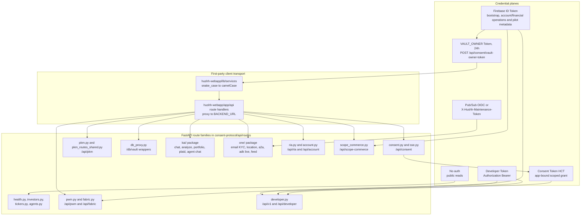

# API Contracts

[Architecture](../../architecture/README.md)

## Visual Map

Which credential plane authorizes which FastAPI route family, and how first-party
clients reach them through the Next.js proxy layer.



---

## Modular API Contract Modules

This overview page holds the core token hierarchy, Kai Market Insights v2 additive payload markers, standard response envelopes, and endpoint authoring rules. Domain-specific route tables and deep feature contracts are split into focused sibling modules in this directory:

| Module | Scope |
| --- | --- |
| [API Route Catalog](api-route-catalog.md) | Complete route categories across public, owner, consent, PKM, Wallet, One, Kai, and internal endpoints. |
| [Personal Mail, Drive & External Developer API](api-connectors-and-external.md) | Personal Mail/Drive connector lifecycles, owner-local calendar/email tasks, External Developer API, and HushhTech client contracts. |
| [One Feature & Sharing API Contracts](api-one-capabilities.md) | Connections discovery, finance sharing, private memory preparation, Puppy cancellation, phone retention, Circle Wars, and pod processing consent. |
| [Referrals & PLG Evidence Contracts](api-referrals-and-plg.md) | Referral dashboard reads and One PLG pilot task evidence contracts. |

## Token Hierarchy

### Independent web email login

`/api/auth/email/*` uses browser-bound public authentication challenges, separately
from vault/consent access. Thin Next proxies preserve the same paths and no-store
responses. See [Independent Email Authentication](../../architecture/identity/independent-email-auth.md).

| Endpoint | Request and result |
| --- | --- |
| `GET /api/auth/email/capabilities` | Runtime availability; no credentials or private policy evidence. |
| `POST /api/auth/email/request` | `email`, memory-held `browser_binding`, idempotent `request_key`; current domain approval creates an opaque challenge and encrypted outbox. |
| `POST /api/auth/email/resend` | Same bounded request shape with a new request key after cooldown; aggregate budgets remain. |
| `POST /api/auth/email/verify` | `challenge_id`, six-digit `code`, `browser_binding`; atomic proof returns a Firebase custom token for the same verified primary-email UID; no second provider login. |

Pending domain review returns `202` with no sendable challenge, a denied domain `403`,
rate limits `429` and unavailable dependencies `503`. No response before mailbox proof
reveals account existence. Validation errors never echo input secrets. Successful
login grants identity only; the vault and scoped consent retain their own gates.

All data access is gated by consent tokens. Firebase auth is only used to bootstrap the initial VAULT_OWNER token.

Founder-language note:

- `Capability Tokens` are the architecture headline
- this file keeps the runtime labels `VAULT_OWNER`, `consent-token`, and `developer token` because readers need the exact wire contract
- `PCHP` maps here to the `/api/v1/request-consent`, `/api/v1/consent-status`, and `/api/v1/scoped-export` flow

```
Firebase Sign-In
      │
      ▼
POST /api/consent/vault-owner-token  (Firebase Bearer)
      │
      ▼
  VAULT_OWNER Token (24h)
      │
      ├── All vault/data operations
      ├── Agent operations
      └── Can delegate scoped tokens to MCP agents (7d)
```

| Token Type         | Purpose                            | Duration | Auth Format                                    |
| ------------------ | ---------------------------------- | -------- | ---------------------------------------------- |
| Firebase ID Token  | Identity verification only         | 1 hour   | `Bearer <firebase-id-token>`                   |
| VAULT_OWNER Token  | Consent + identity for all data    | 24 hours | `Bearer <vault-owner-token>`                   |
| Agent Scoped Token | Delegated MCP agent access         | 7 days   | `Bearer <consent-token>`                       |
| Developer Token    | External API and remote MCP access | N/A      | `Authorization: Bearer <developer-token>` only |

---

### Hosting management and update compatibility

Completed owners entering cloud setup directly receive a same-route Hosting
return target. Explicit invitation/setup origins are preserved; unfinished
onboarding still uses the setup hub. Finish appears only after verified hosting
and AI readiness. The changed `setup.finish_cloud` meaning retires its exact
previous capability revision; a stale action resumes through a fresh assessment.

Personal-agent status may include `updateBlockedReason`: `UPDATE_IN_PROGRESS`,
`RELEASE_UNVERIFIED`, `INSTALLED_RELEASE_UNVERIFIED`, or
`PREDECESSOR_NOT_QUALIFIED`. This explains an existing installation refusal; it
does not grant upgrade authority. A verified private AI check displays its actual
model/deployment. The hub's Shared model catalog is not an Azure pod catalog.

### Owner cloud removal and inspection

- `GET /api/one/personal-agent/removal`: Firebase-owner, no-store discovery.
  Returns `{available, provider}` only for the installed schema and recorded
  GCP/Azure home, including qualified interrupted Azure setup. No provider calls,
  reservations or mutations; missing/old schema does not offer the control.
- `POST /api/one/personal-agent/removal`: current vault-owner authority. Strict
  phases `inspect`, `status`, `approve`, `execute`, `finalize`; exact operation and
  plan digest plus explicit contents/retention confirmation are required for
  destructive work. Uses the existing erasure executor; never calls full account
  deletion. Successful finalization returns `{status:"cloud_removed",
  operationId, accountRetained:true, hostingMode:"unplaced"}` only for that exact
  released identity. A stale replacement, uncertain outcome or changed approval
  returns a bounded 409 and retains recovery custody.
  Historical recovery status may include `nextEligibleAt`, a UTC recheck hint
  derived from complete native retention observations bound to the recorded
  resource identities. It never establishes absence, approval or completion.
  The interface retains verified progress and defers repeat approval while that
  wait is active. Historical operator recovery retains its separate executor
  qualification; status and refresh do not start or replay provider work.
- `GET /api/one/personal-agent/hosting/inspection`: Firebase-owner, read-only
  control-plane observation of the recorded service and historical receipt
  coverage. Returns `connected`, `starting`, `absent`, `ownership_unverified`,
  `cleanup_pending` or `unverified`, plus bounded previous-home metadata. A denied
  read is never absence. This neither wakes nor repairs/deletes the pod.

These routes use the existing One proxy and exact owner authority. Inspection and
removal remain available when new provisioning is disabled. GCP destructive work
still requires the independent substrate-teardown control before reservation or
provider effects. Cloud removal requires the installed lifecycle schema; native
execution and broad orphan scanning are not qualified. See the [deletion runbook](../../operations/identity/account-deletion-rollout.md#remove-cloud-while-keeping-the-account).

## Kai Market Insights v2 Payload (Additive)

`GET /api/kai/market/insights/{user_id}` returns additive sections for `/kai`:

- `layout_version`
- `hero`
- `watchlist`
- `movers`
- `sector_rotation`
- `news_tape`
- `signals`
- `meta.symbol_quality`
- `meta.filtered_symbols`
- `meta.provider_status`

Backward-compatible sections remain present while migration is active:

- `market_overview`
- `spotlights`
- `themes`

The Market benchmark strip uses index levels: S&P 500 (`^GSPC`), NASDAQ
Composite (`^IXIC`), Dow Jones (`^DJI`) and Russell 2000 (`^RUT`). Volatility
uses `^VIX`. These symbols use the public Yahoo chart adapter; an unavailable
index never falls through to Finnhub/FMP equity plans or affects their cooldowns.

Each benchmark row includes `symbol`, `as_of` (provider quote time, nullable),
`retrieved_at`, `is_delayed`, optional `quote_delay_minutes`, and `market_state`
(`open`, `closed`, or null). Retrieval time does not imply a live quote.
`delta_pct` stays null when the previous close is missing. Unknown delay stays
null; a delay flag may also reflect a quote over ten minutes old during its
reported regular session. Closed sessions are labeled separately. Index
sparklines use the same response's observed intraday closes; missing history
remains unavailable. Cached levels retain their original quote time and are
labeled as cached. Server home v5, macro v2 and client market-home v5 cache
names exclude earlier ETF snapshots. Web and native use the same response
contract through `ApiService`.

### Market company facts and sector periods

Stock browsing now lives in Finance's **Stocks** tab (`/one/kai?tab=analysis`),
alongside the existing research preview and saved analysis. Market keeps indices,
news, sectors, and movers. Both tabs share one resource/source-selection owner;
the stock list is absent from active debates and saved-result drill-ins.
Public browsing and company facts remain available while Vault is locked;
saved analysis and starting a debate retain their existing unlock requirements.
Stock facts load separately through
`GET /api/kai/market/company-facts/{user_id}?symbols=AAPL,MSFT`. Firebase
authentication must match the path owner. At most eight validated symbols are
accepted per request, with four provider calls in flight; the existing
`ApiService` splits visible stock pages into bounded batches on web/native.
Public company facts use a separate six-hour fresh/24-hour stale cache, so a
price-only quote cache cannot suppress market cap, P/E (TTM), P/B, total
debt/equity, or the provider company description. Unknown ratios are null.
Debt/equity is a multiple (Yahoo's reported percentage divided by 100).
Provider retrieval time and financial period end remain separate.

Stock detail reads `GET /api/kai/market/history/{user_id}?symbol=AAPL`
through the existing Kai catch-all proxy and platform-aware `ApiService`.
Firebase authentication must match the path owner before any cache/provider
work. One uppercase symbol (at most 16 characters) and a recognized US exchange
in the symbol master are required; unsupported listings return 422.
The response contains `symbol`, `currency: "USD"`, `interval: "1d"`,
`points: [{t, p}]` (Unix seconds and observed closes), `retrieved_at`, `stale`,
and `unavailable`. At most 32 observations are returned from the existing
month history fetcher. This is daily history, independent of the spot quote;
it does not supply intraday candles or an earnings calendar.
The shared L1/L2 owner uses `stock_history:v1:{symbol}:1mo`, a two-minute
fresh window and seven-day stale-on-error window. The fetch closure refuses
provider work outside the existing regular-session policy, including cold
misses. A closed cold miss returns an empty unavailable result. The frontend
preserves retrieval/cache status, aborts a dismissed selection, and offers only
ranges containing at least two observations. No new provider or scraper is added.

Sector rows now include `change_1w_pct`, `period_start_1d`, `period_start_1w`,
`period_end` and `basis`. Both periods use observed sector ETF closes; one
week spans five trading-session returns. Missing weekly observations stay
unavailable. Daily fallback feeds do not acquire a synthetic weekly value.
`sectors:v2:us` excludes prior daily-only snapshots. News rows preserve an
optional HTTPS `image_url`; unavailable or broken images use a neutral cover.

Market news preserves NewsAPI article images. When Finnhub supplies a Yahoo
publisher logo, fixed-host Yahoo search and RSS metadata enrich exact matching
article URLs, UUIDs, or Finnhub publisher-URL digests. Headlines, source, ordering
and story links stay unchanged; no title matching or article HTML scraping is
used. `image_url` carries the original photo and optional `image_thumbnail_url`
carries its smaller provider resolution for compact mobile rows. Unmatched
articles keep an empty image rather than a channel logo. Home/news/feed v5
cache names exclude earlier image-less snapshots.

### Kai Market News Feed (Cursor Snapshot)

`GET /api/kai/market/news/baseline/{user_id}` serves the authenticated public baseline feed. `GET /api/kai/market/news/{user_id}` serves a vault-owner-scoped feed for up to three validated symbols. Both return the same bounded envelope:

- `items`: normalized provider headlines only (`symbol`, `title`, optional `summary`, `url`, `published_at`, `source_name`, `provider`)
- `next_cursor` and `has_more`: opaque cursor pagination over one server-side snapshot
- `snapshot_id`: must match the snapshot encoded in `next_cursor`; a changed snapshot returns `409`, so a client restarts at page one instead of mixing editions
- `cache`: bounded cache tier/age/hit metadata and `stale`
- `provider_status`: provider health metadata only

The server resolves at most three symbols with bounded fanout, caches the normalized bundle for ten minutes fresh and thirty minutes stale, and slices later pages from that cached bundle. Paging must not trigger a second provider fanout. Provider resolution is strict priority fallback (Finnhub, then PMP/FMP, NewsAPI, Google News RSS); PMP/FMP news calls share the FMP request budget and honor provider cooldowns.

### Ticker Enrichment Fields (`/api/tickers/search`, `/api/tickers/all`)

Each ticker row can include:

- `sic_code`
- `sic_description`
- `sector_primary`
- `industry_primary`
- `sector_tags`
- `metadata_confidence`
- `tradable`

### Analyze Stream Terminal Decision Metadata

Terminal `decision` events from `/api/kai/analyze/stream` include:

- `short_recommendation`
- `analysis_degraded`
- `degraded_agents`
- `company_strength_score` (0-10 deterministic score)
- `market_trend_label`
- `market_trend_score` (0-10 deterministic score)
- `fair_value_label`
- `fair_value_score` (0-10 deterministic score)
- `fair_value_gap_pct`
- `analysis_updated_at` (UTC ISO-8601)
- `stream_id`
- `llm_calls_count`
- `provider_calls_count`
- `retry_counts`
- `analysis_mode`

These fields are additive to the canonical decision payload and mirrored in `raw_card` where applicable.

### Portfolio Import Stream Terminal Diagnostics (V2)

Terminal payload from `POST /api/kai/portfolio/import/stream` now includes:

- `portfolio_data_v2` (canonical app-consumed portfolio payload)
- `raw_extract_v2` (raw single-pass LLM extraction snapshot)
- `analytics_v2` (materialized dashboard/debate/optimize metrics)
- `quality_report_v2` (deterministic quality report and gate output)
- `timings_ms` (phase timings, includes `total_ms`)
- `token_counts` (phase -> `{chunks, thoughts}`; import thoughts are suppressed for investor-facing output)
- `coverage_metrics` (positions availability coverage checks)
- `quality_gate`:
  - `passed`
  - `holdings_count`
  - `placeholder_symbol_count`
  - `account_header_row_count`
  - `core_keys_present`
  - `rows_with_symbol_pct`
  - `rows_with_market_value_pct`

If import cannot proceed, terminal events are:

- terminal `error` with `code=IMPORT_JSON_INVALID` (invalid/non-JSON extractor output)
- terminal `error` with `code=IMPORT_SCHEMA_INVALID` (missing required top-level keys)
- terminal `error` or `aborted` with `code=IMPORT_NO_HOLDINGS` (no confirmed holdings available)

No silent success is emitted on terminal failures.

---

## Response Format

### Circle member chat

Ordinary named Circles expose member chat through the existing One JSON proxy
on web and `ApiService.apiFetch` / Capacitor HTTP on iOS and Android. Trusted
and SMS system Circles are excluded because their rosters have different
visibility contracts. Every endpoint requires a current `VAULT_OWNER` token;
the authenticated owner determines the user, and an active Circle membership
must match the recipient envelope's current `joined_at` generation. Joining
or rejoining starts a new history window.

| Method | Endpoint | Contract |
| --- | --- | --- |
| GET | `/api/one/circles/{circle}/chat` | Current public-key roster/version, unread count, latest sequence and mute state |
| GET | `/api/one/circles/{circle}/chat/messages` | Ascending visible messages; exclusive `before` or `after` sequence cursor; 40 default, 50 maximum |
| POST | `/api/one/circles/{circle}/chat/messages` | Client UUID, roster version, encrypted content/image and exactly one key wrap per current member, including sender |
| POST | `/api/one/circles/{circle}/chat/messages/resolve` | 1–40 message UUIDs; returns only independently authorized encrypted originals, without attachment bytes or identity photos |
| POST | `/api/one/circles/{circle}/chat/messages/updates` | 1–600 loaded/quoted message UUIDs; bounded revision, hidden and tombstone metadata plus unavailable IDs; repairs missed mutation doorbells |
| PATCH | `/api/one/circles/{circle}/chat/messages/{message}` | Original sender only; encrypted content, fresh IV and expected revision; retains original key envelopes, audience and attachment bytes |
| DELETE | `/api/one/circles/{circle}/chat/messages/{message}` | `scope: me` hides only the caller's copy; `scope: everyone` requires the sender's encrypted tombstone and expected revision |
| GET | `/api/one/circles/{circle}/chat/messages/{message}/image` | Separately authorized encrypted image bytes; images are omitted from transcript pages |
| GET | `/api/one/circles/{circle}/chat/wait?after={sequence}` | Twenty-second JSON long poll over the existing PostgreSQL user-state event bus; subscribe before revision read, reauthorize before response, disconnect cleanup, four waits per user per worker; `changed` distinguishes matching doorbells from idle timeouts |
| GET | `/api/one/circles/{circle}/chat/keys/{key}` | Owner-only vault-encrypted historical key backup, only for an accessible current-generation message; active/rotated keys, never revoked keys |
| POST | `/api/one/circles/{circle}/chat/read` | Visible sequence watermark; atomically marks recipient messages and derived Feed rows read |
| PUT | `/api/one/circles/{circle}/chat/preferences` | `muted` disables queued system pushes while preserving chat and Feed |
| PUT / DELETE | `/api/one/circles/{circle}/chat/messages/{message}/reactions/{emoji}` | Add/remove the caller's exact emoji on a currently visible message; idempotent, multiple choices per caller; returns authoritative counts and viewer flags |
| PUT | `/api/one/circles/{circle}/photo` | Current owner of an active ordinary circle saves/removes a normalized PNG/JPEG/WebP data URL; bounded private overview response |

Transcript pages deduplicate identity photos in `senders` and cap their combined
UTF-8 size at 2 MB, falling back to initials without dropping messages. The
optional paired `receiptAfter` / `receiptThrough` range refreshes sender-only
receipt metadata for the loaded window even when no new messages arrive.
Messages may carry `replyToMessageId`, authenticated inside encrypted content.
The server validates that target against the sender's original recipient epoch.
Pages include one-level `replyTargets` only when each viewer independently has
access to the original; hidden, erased or inaccessible targets show an unavailable
preview. No plaintext quote or copy of historical content is sent to new members.
The UUID reference remains after source erasure so surviving replies still decrypt.

Migration 357 must precede backend/client message-action rollout. Content edits
use the original v1 key and AAD with a fresh IV; no current-roster resealing occurs.
Strict mutation bodies cannot replace recipient envelopes, attachments or sender
identity. Revision comparison rejects concurrent stale edits; an identical sealed
retry succeeds. Original send fingerprints remain unchanged, and a delayed send
retry projects the current edited/deleted state. Delete-for-everyone replaces
content with a client-encrypted tombstone readable by older v1 clients and removes
attachment bytes, reactions and pending previews. Delete-for-me retains recipient
epochs and existing read timestamps, without fabricating a read receipt. Both
delete scopes remove the matching Feed projection and reconcile the specific
notification/badge without clearing other unread messages. Mutation doorbells
contain metadata only; clients also reconcile loaded history every five seconds
and fence delayed responses by revision/visibility. Already downloaded copies
cannot be recalled. Schema rollback refuses to drop action metadata once used;
keep migration 357 in place when rolling back application code. Empty feature
storage can roll back without changing existing ciphertext or recipient envelopes.

Reaction choices use the fully qualified Unicode Emoji 17.0 catalogue in
`consent-protocol/hushh_mcp/data/emoji-reactions.v1.json`; the frontend projection
is generated by `consent-protocol/scripts/generate_emoji_reactions.py`. Standalone components,
arbitrary text and multiple emoji sequences return a private 422. Skin tones,
flags and joined sequences are supported. Migration 350 must precede the full
picker/backend rollout. Rollback refuses to discard newer reaction choices.
New messages persist the original non-sender recipient count; legacy audiences
remain unknown. Blue double checks mean every original recipient acknowledged
the message. Partial reads and unknown/empty audiences remain sent. Removed
accounts cannot shrink the denominator. Receipt doorbells reach only senders
whose current membership generation still authorizes that message.

Chat and Members share a retained conversation: switching panes preserves
drafts and uncertain retries. Sender avatars/names, automatically loaded inline
images, an attachment preview and an in-app viewer use shared UI primitives.
Visible foreground thumbnails own their decrypted blobs and revoke URLs when
hidden or access is lost; downloads have two scheduler slots. Native physical
requests remain awaited after logical cancellation. Open owned dialogs block
read acknowledgements, as do unresolved incoming decryption failures, including
after the rendered 300-message window trims older rows.

Circle chat `messages` also returns current-membership activity in `events`.
Migration 362 adds nullable `batch_id` to membership events. One reviewed
multi-person add writes a fresh batch UUID across its members, including actions
processed in several 20-person chunks; the response exposes it as optional
`batchId` for the client to show one line with each authorized member's safe
display label. The server includes the complete oldest returned batch when the
200-event window cuts through it. Separate actions and historical rows with no
batch marker remain separate. Existing clients ignore the extra field, while
new clients accept responses without it. Deploy migration 362 before the backend;
rolling back the app is safe, but rolling back the migration discards grouping
markers and restores the earlier trigger before dropping the column.

Circle photos reuse the 256px profile picker but mutate the circle identity.
The API verifies and decodes a single PNG, JPEG or WebP frame up to 512 by 512
pixels and 300 KiB (410,000 encoded characters), bounds the request to 430,000
bytes and never echoes rejected
input. Private list/detail/overview projections carry the photo; public invite
previews do not. Photo doorbells refresh circle state without creating Feed
activity. List projections cap their combined photo bytes at 2 MB and retain
all circles with a fallback icon; single-circle overview returns the full photo.
Soft deletion clears the photo; account lifecycle erasure removes the
owned circle. Photos are private circle metadata, separate from encrypted chat
attachments. This bounded photo action remains separate from reviewed rename
commands and their immutable command bindings.

The new chat wire uses camelCase directly on all surfaces. Clients encrypt a
fresh AES-256-GCM content key per message, wrap it to every recipient using the
existing vault-synced P-256 recipient keys, and authenticate Circle, client
message ID, sender, recipient and payload kind as additional data. Text, image
bytes, filename and MIME metadata remain encrypted. Feed carries Circle identifiers
and generic activity. System pushes may carry a sender-sealed bounded snippet
and server-sealed canonical identity, both encrypted to independent installation
preview keys. Missing keys retain a generic alert. This reuses the existing authenticated
key directory; it does not introduce key verification or a ratcheting protocol.

Native push token teardown uses `HushhNotifications.deletePushToken()`, which
resolves after the Firebase SDK completes deletion on iOS and Android. Native
token retrieval waits for an already-started deletion so a rapid account switch
cannot register an installation token that logout later invalidates. Preview key
removal remains immediate and independent of network completion.

Native registration also reports optional `registered`/`degraded` provider
results and chat-preview custody readiness. Generic registration can survive
preview preparation failure, but the client must retry rather than advertise
working chat push. Android exposes optional `chatAlertsEnabled` and
`chatSoundsEnabled` independently of ordinary activity/emergency channels.

Direct-message SSE emits a metadata-only `resync` frame (`{}`) immediately after
subscribing and after listener recovery/overflow. Consumers reload their current
authorized inbox/thread; no queued content or actor identity travels in a reset.
Circle long polling likewise treats a reset as invalidation of all chat snapshots,
and rechecks current membership before responding. The direct push worker reuses
its committed doorbell, respects the existing two-second read grace, and drains
full batches without an idle poll. A chat intent is sent only when an owner/event
acceptance receipt exists; no-device/all-stale attempts retain bounded retry.

Images are passive JPEG/PNG/WebP files up to 5 MiB and messages contain at most
4,000 characters. Both API layers bound chat requests to 7,250,000 bytes.
Validation and database errors never echo rejected payloads. Responses are
private/no-store. Native long polling receives complete JSON, so it does not
depend on streamed fetch through the native bridge. Five-second foreground
polling repairs missing events; native lifecycle and browser visibility suspend
work, with catch-up on resume. Busy doorbells coalesce at a 250 ms cadence with
one trailing refresh; gaps beyond five pages continue immediately. Automatic
state/message/wait/read budgets are 1,200 per minute per authenticated owner
(four sessions at four refreshes per second, plus manual headroom). Sending
retains 30/minute and 1,000/day; automatic image downloads allow 120/minute. These are
bounded budgets, not an unlimited throughput or global latency guarantee.
Native waits stay awaited after a pause because Capacitor cannot cancel the
underlying request. Read doorbells expose only `readChanged` metadata and
invalidate subset-read Feed projections; pre-read responses cannot restore
cleared cache or clear unrelated unread activity.

Identical retries return the existing message; altered payloads or membership
generations reject that UUID. Membership and nonblocking key locks serialize
send authorization without inverting the key-registration lock order. Message,
recipient wraps, Feed rows and event doorbells commit together. Pushes use a
bounded five-attempt lease with generic content; provider acceptance is not a
recipient read receipt. Leaving suppresses old unread Feed activity and pushes;
deleting a Circle erases its message/image store. Reset/full-account cleanup
also erases authored messages and recipient-owned wraps/preferences.

Migrations `265_circle_chat.sql` and `266_circle_chat_presentation.sql`, their rollbacks, the release manifest and UAT
schema contract travel together. Deploy the migration before the updated
backend, then the web/native bundle. The rollback removes chat and its derived
Feed projections; restoring erased history requires a database backup.

Core proofs: `tests/test_circle_chat.py` runs against the existing isolated
PostgreSQL CI service and tests concurrent retry, membership-generation privacy,
image authorization, key contention, cursor pagination, leases, mute, deletion,
tombstones and migration replay. The existing encryption, native notification
routing and Feed-renderer tests cover authenticated client encryption, recovery
and safe destinations. Native simulator/device verification remains a separate
release check; browser WebKit is not an iOS device test.

Backend returns **snake_case**. Frontend transforms to **camelCase** in the service layer.

```
Backend:  { "user_id": "abc", "domain_summaries": {...} }
Service:  { userId: "abc", domainSummaries: {...} }
React:    Uses camelCase throughout
```

Plugins requiring camelCase transformation: PersonalKnowledgeModel, Kai.

---

## How to Add a New Endpoint

1. Create route function in `consent-protocol/api/routes/{module}.py`
2. Add auth dependency (`require_vault_owner_token` / `verify_firebase_bearer`)
3. Use service layer for all DB access (never direct SQL)
4. Register router in `server.py`: `app.include_router(router)`
5. Create Next.js proxy: `hushh-webapp/app/api/{path}/route.ts`
6. Create Capacitor plugin: iOS Swift + Android Kotlin
7. Add service method: `hushh-webapp/lib/services/{name}-service.ts`
8. Update app navigation truth when needed: `hushh-webapp/lib/navigation/routes.ts`
9. Verify route/docs alignment: `bash scripts/ci/docs-parity-check.sh`

See [Tri-flow parity](../mobile/tri-flow-parity.md) for the full pattern, the
declaration contract, and the gates that enforce it. The earlier link targeted
a nonexistent anchor; the parity document is now the canonical definition.

---

## See Also

- [Personal contact invitations](../../product/connections/contact-invitations.md) — client-only recipient callback and native composer contract; contact-sync HTTP payloads remain unchanged.

The invitation bridge preserves `composeSms({ recipient, body })` and adds
`composeSmsBatch({ recipients, body })` for one user-confirmed native draft with
1–15 unique E.164 numbers and a common body (maximum 2,000 UTF-16 units).
`getCapabilities()` adds optional `maxSmsRecipients`; only affirmative SMS support
and an integer maximum of at least 15 enable the batch path. Legacy binaries
remain unsupported for batch, with copy/update recovery. Web uses one in-memory
BCC email draft for 1–15 validated email destinations. Composer launch/Send
results never establish delivery. No new HTTP endpoint or backend SMS provider
is involved; see the guide for privacy, cancellation and compatibility contracts.


- [Architecture](../../architecture/system.md) -- System overview and tri-flow
- [Personal Knowledge Model](../../../consent-protocol/docs/reference/personal-knowledge-model.md) -- Data storage endpoints
- [Consent Protocol](../../../consent-protocol/docs/reference/consent-protocol.md) -- Token lifecycle

### Connect directory request budgets

Directory browsing (empty or whitespace query) and nonempty searches have
separate daily budgets per caller: 3,000 per day for browsing and 500 per day for
search. Both modes share the 60-per-minute ceiling. The existing visibility rules
and 50-profile page bound are unchanged. Browsing pages the list the person
already sees and is not a lookup by email or phone, so it carries the larger
budget; it has to outlast a foregrounded client that refreshes the list on a timer
(two pages a minute is 2,880 a day).

Idle Connect repair polls refresh connections without issuing another directory
search. Passive triggers (window focus, reconnect, returning to the app) reread the
directory only when its last read is more than two minutes old; graph changes,
mutations and explicit actions always refresh it. The client keeps the last
browse first page for the session, paints it on a revisit, and keeps it on screen
when a refresh is refused (HTTP 429), so people already shown are never replaced
by an error. The People list is never padded with the person's own connections:
it lists people they are not yet connected to. With nothing saved, a refused read
shows a neutral "taking a moment" row and is retried quietly with growing pauses;
there is no retry button for a rate limit. Only a real failure shows an
unavailable row with a retry action.

### Connect directory mutual connections

Directory rows additionally return `mutualConnectionCount` and optional
`mutualConnectionPreview` (`displayName`, `photoUrl`, `publicPersonRef`), plus
`mutualConnectionPreviews` containing up to two eligible public identities. The
singular field remains the first eligible preview for existing clients. The same
metadata is returned on mutual-list and network-list rows, with viewer-relative
`relationship` (`none`, `pending_outgoing`, `pending_incoming`, `connected`).
Preview reads are batched across at most 50 page rows and 100 selected identities;
final graph, block, profile and reference checks reject mid-read changes with 503.
Counts use distinct shared
neighbors across active canonical connections, scoped to the returned page,
excluding blocked relationships. A bounded batch lookup resolves shared peers
through the canonical directory's live visibility and account checks, independent
of the current page or search. Eligible previews show an avatar and name; the
public person reference opens the existing profile route. If the selected peer
is hidden or disabled, only the count is shown. No raw peer IDs or contact details
are added. Existing
masked email/phone visibility remains unchanged. The Next proxy and native HTTP
transport forward these additive fields. Older servers omit them; clients omit
the badge rather than inventing a mutual relationship. No migration is required.

The authenticated, private/no-store person-context lookup also returns the
canonical `publicPersonRef`. UID-only portrait entry points use this reference
to open the existing shared profile preview; they never reinterpret a UID as a
public reference. Connection requests continue through the existing authenticated
`POST /api/one/people/{person_ref}/connection` endpoint.

### Private email send recovery

An admitted owner app session may read `GET /api/one/pod/actions/{gmod_id}/status`
with `pod.act` authority and the current held incarnation. The response contains
only the matching proposal ID, `gmail_mailbox` kind and prepared, expired, sent
or outcome-unknown state. It reads the existing sealed proposal ledger and never
contacts Google, dispatches an action or falls back to the hub. Executing or failed
settlement remains uncertain; only durable executed settlement proves delivery.
Unknown, foreign and non-send proposals are unavailable.
