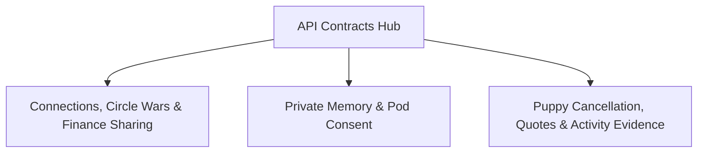

# Hussh One Feature & Sharing API Contracts

[API Contracts Hub](api-contracts.md) · [API Route Catalog](api-route-catalog.md)

**Status:** Live | **Intent:** Reference | **Audience:** Backend, Frontend, Mobile, and Coding Agents

Feature-level API invariants for connection discovery, finance sharing, private memory preparation, Puppy cancellation, phone verification retention, Circle Wars, and pod memory consent. See [API Contracts](api-contracts.md) for core token and response schemas.

## Visual Map

## Connection network discovery

These Firebase-authenticated reads bind the viewer to the verified session and
return `private, no-store`. Web uses the existing `/api/one/[...path]` proxy;
iOS and Android use the same endpoints through `ApiService.apiFetch`.

| Endpoint | Contract |
| --- | --- |
| `GET /api/one/connections/network/summary?person_ref=<UUID>` | Eligible public identity, viewer-relative `networkDegree` (`1`, `2`, `3`, or `null`), existing mutual count/preview, and `canBrowseConnections`. No internal identity, graph path, email, phone, or consent contents. |
| `GET /api/one/connections/network` | Optional `person_ref` selects that person's shared list; omission discovers the viewer's extended network. Optional `degree=1\|2\|3` selects an exact shortest qualified distance; `query` is a name search (160 characters), `page>=1`, `limit=1..50` (20 by default). Returns eligible public people, degree, page, and `hasMore`; filtering precedes logical pagination. |
| `GET /api/one/connections/network/visibility` | The caller's own `shareConnectionList` preference. Missing or existing accounts default to false. |
| `PATCH /api/one/connections/network/visibility` | `{ "share_connection_list": boolean }` changes only the authenticated caller's preference. Account reset clears this permission. |

A wider list requires its owner's explicit opt-in and the viewer's current active
direct connection. Every page rechecks owner permission, peer edges, profile
lifecycle and blocks after directory work. Unavailable, blocked and unauthorized
targets share a neutral 404. Mid-read invalidation returns retryable 503 instead
of disclosing a stale page or silently thinning pagination.

Mutuals remain people directly connected to both viewer and target; their existing
count can exceed the number of viewable profiles. Pending requests, contact books,
trusted designations and Circle membership alone do not count as graph edges.
First degree is a direct active connection. Second degree follows the existing
shared-neighbor visibility contract. Third degree requires both intermediaries
to enable sharing; it exposes a distance only. `null` does not prove that no
connection exists. Anonymous public profiles remain unchanged.

Discovery admits at most 4,000 live eligible nodes and 12,000 edges, uses a
cooperative twelve-second traversal budget and scoped eight-second SQL statement
timeouts, and fails retryably when it cannot qualify the result. Firebase account
eligibility retains the canonical directory's bounded cache semantics. No graph
inventory is persisted in the browser or returned as connecting paths.

The new visibility write remains an unbound discovered API in the capability
catalog. The existing evolution ledger retires Connections setup graph revisions
`9ea5b914a24b6f47` and `ac971edb713a113d` rather than carrying an older workflow's
authority into a new write inventory. This also retires the first revision's
compatible predecessors for that workflow. Existing persisted connections and
setup state are unchanged; an old workflow must be freshly admitted.

## Feed counterpart profile presentation

Feed metadata may include `counterpart_person_ref`, resolved at read time from
the viewer-scoped retained counterpart mapping and `actor_profiles`. This is
the same public reference accepted by `/people/[personRef]`; internal user IDs
remain excluded from the Feed DTO. Missing or erased profiles clear the
reference, including when the older-schema fallback runs. Profile viewing uses
the existing public profile and authenticated relationship/consent endpoints;
it grants no access to shared information by itself. No schema migration or new
route is required.

## Finance sharing with connections

`FinanceSharingService` uses `ApiService.apiFetch` on Web, iOS and Android.
Web forwards through `/api/one/[...path]`; native calls the same hub endpoints
through the existing platform-aware transport. No new native plugin is needed.
All routes require matching Firebase identity and `X-Hushh-Consent` vault-owner
authority and return `private, no-store` responses with scrubbed errors.

| Endpoint | Contract |
| --- | --- |
| `POST /api/one/finance/shares` | Confirm one immutable policy and recipient-encrypted view per selected connection; exact request-ID retries return the original grants. |
| `GET /api/one/finance/shares?direction=outgoing\|received&cursor=…` | Participant-bound metadata history; 50 items, opaque UUID cursor. History does not authorize a read. |
| `GET /api/one/finance/shares/{grantId}` | Recheck recipient/owner, connection, blocks, active recipient key, current expiry and revocation before returning that participant's ciphertext copy. |
| `PUT /api/one/finance/shares/{grantId}` | Owner-only ongoing update with `expectedRevision`; immutable policy and recipient key, active lifetime, CAS and revocation checks. Snapshots reject updates. |
| `DELETE /api/one/finance/shares/{grantId}` | Owner-only terminal stop for one recipient; clear its ciphertext. |

Create accepts `requestId`, `policy`, `ownerConfig`, and 1–20 recipient entries
(`grantId`, `personRef`, `envelope`, `ownerEnvelope`, `contentHash`). The strict
version-1 policy contains `mode`, selected `sections`, encrypted-configuration
`selectionHash`, `showAmounts`, canonical `model_processing`, and
`durationSeconds` (3600, 86400, 604800; null only for explicit ongoing access).
Lifetimes begin at the server-confirmed creation time. Contents and source/account
locators are encrypted on the owner client; the server stores no financial
plaintext. The 4 MB request budget and individual envelope bounds apply on both
backend and proxy. Raw financial PKM scopes remain blocked.
Both configuration and content digests include independent random 256-bit
commitment nonces inside their encrypted payloads. Metadata cannot test guesses
of selected notes or financial figures. Unselected notes and stock selections
are removed from the owner configuration; unchanged information does not publish
a new revision merely because a nonce changes. An explicitly approved One review
checks the exact content commitment, then strips its nonce before model input.

Recipient views expose only the selected curated sections. Amounts-off exports
exclude structured balances, dollar gains, quantities, prices and cost basis;
history is rebased to percentage balance change. It is not investment return.
Current sharing supports USD portfolios and refuses known mixed/foreign currency.
Missing saved history remains unavailable. Account identifiers, transactions and
provider credentials never enter the structured export; an explicitly selected
owner note is shared as written.

One review is an explicit `financeShare` forwarded input on the existing agent
chat transport, bound to `grantId`, `revision` and exact `projectionText` digest.
Only the authenticated recipient with current owner model-processing permission
may submit it. The current recipient processing-provider approval still applies.
The signed private-pod consent metadata feed accepts `finance:{grantId}:{revision}`
references with fresh nonces; it carries policy/digest/lifecycle metadata only.
`GET /api/one/pod/owner-feed/consent` uses the same `ConsentReadReference`
validation as the pod client: an ordinary bundle UUID or a Finance reference
with a positive revision of at most nine digits. Malformed references return
422 before the signed feed is read; accepted references still require the
existing owner binding and current recipient processing permission.
Existing shared-context tool blocking, request-secret lifetime and history/model
redaction apply. Authority is checked again around model generation.
The consent reply uses LOW reasoning, accepted by both managed text adapters,
with thoughts disabled and function calling set to NONE. Provider selection and
the current sharing authority remain unchanged.

Migration 433 qualifies the grant/request tables and terminal disconnect/block
guards. Rollback is code-only and preserves issued encrypted objects. Expired
ciphertext is cleared on access/history reconciliation; dormant ciphertext and
confirmation metadata remain until reconciliation or account erasure. Production
qualification must separately verify the migration, exact authenticated
two-person journey, platform transport and current processing-provider approval.

## Public market quotes

`GET /api/market/quotes?symbols=ADBE` reuses the shared public quote provider
and L1/L2 cache, without owner, holdings or vault context. Web reaches it through
the fixed Next.js proxy at the same path; native uses the existing ApiService
backend transport. The proxy forwards neither owner authorization nor cookies.
The quote row retains `price`, legacy `change_percent`, `company_name`, and
`source`, and adds nullable `change_pct` and provider `quoted_at`, plus
`is_stale`, `is_delayed`, and `market_state`. Retrieval time never becomes
quote time. Empty provider refreshes retain eligible cached prices; a cold
closed-market request returns 503 without calling providers. Daily historical
observations remain a separate contract.

## Request-specific revocation

`POST /api/consent/revoke` preserves the optional `requestId` from the web client
through the Next.js proxy to the canonical lifecycle service. A supplied selector
must be a nonempty string of at most 128 characters; invalid selectors refuse
before forwarding. Omitting it retains the existing scope-wide operation.
The vault-owner token still authorizes only the authenticated owner's grants.
Never discard a supplied selector and silently widen the requested revocation.

## Azure software-update continuation

An `upgrade_started` result from the existing Azure authorization-completion
route includes the launched `jobId` and, when available, the approved
`operationId` and `releaseId`. Clients retain that tuple through popup handback
and status following. Older responses without the tuple remain readable but
cannot establish verified completion.

Completion requires `installedReleaseVerified` and a `completedUpdate` receipt
matching the followed operation, release and installed image digest, with a
verified pod incarnation and timestamp. A recorded job, version label or newer
available offer is insufficient. See the
[existing-pod update runbook](../../operations/hosting/dev-pod-first-light-runbook.md).

### Pod maintenance recovery

The existing machine-authenticated `/api/one/pod/upgrade/{prepare,status,release}`
family retains exact pod-incarnation checks. Status distinguishes current-runtime
`idleReceipt` from `retainedIdleRecord`, the sealed cursor preserved across restart.
`releaseReceipt` identifies the last sealed release and its operation.

Release accepts an optional `expectedIdleRecord: {seq, sha}`. The pod compares it
atomically with its retained cursor. A retry returns the same sealed receipt only
for the same operation and checked cursor, with no newer active fence. A lost
append response is reconciled from the sealed log before work is admitted.
Cursor-checked terminal releases cannot be reopened by a repeated prepare request.
Existing failed-update callers may omit the cursor and retain their retry contract.

This is a control-plane contract, with no browser proxy or native-plugin change.
It does not prove VM image, identity or encrypted recovery by itself; the caller
must establish those before release. See the
[Browser runtime lifecycle](../../../consent-protocol/docs/reference/private-browser-runtime.md).

## Consumer scope commerce

`/api/scope-commerce` uses Firebase identity for account, tariff, quote, human
purchase confirmation, funding, payouts and buyer cancellation. Inactive owner
approval, export context/preparation/staging and owner revocation require
vault-owner authority. Financial confirmation alone never releases information:
access additionally requires canonical consent and a staged v2 export at the
server-fixed activation time. The reconciliation worker uses dedicated Google
OIDC, independently of purchase admission.

Authenticated `GET /api/scope-commerce/readiness` and the additive `account.readiness`
projection distinguish free-sharing controls, locally configured/persisted
platform readiness, seller eligibility and action capabilities. These reads
perform no wallet bootstrap or provider I/O. An unset or explicitly free tariff
keeps the existing consent flow without Stripe; owners can reset an exact tariff
to free while paid admission is unavailable. Positive tariffs fail closed and
never become free because setup is missing. Accepted quotes retain their terms.
Existing financial obligations and access enforcement survive an admission pause.

Owner-bound `GET /api/pkm/scopes/{user_id}` includes an authoritative `scope_handle`
on each compact `scope_entries` row. It preserves the registry handle when present
and otherwise uses the canonical owner/scope fallback. Memory and chat consume this
metadata to review an eligible whole-bundle tariff; they never invent domain handles
or infer a wildcard from child sections. Existing vault-owner matching, exposure
rules and restricted-domain policies remain authoritative. The web proxy and native
transports preserve the additive metadata without a separate payment endpoint.

Authenticated `POST /api/scope-commerce/payouts/manage` accepts an empty object
and returns a short-lived Stripe Express login URL for the caller's existing
information-access payout account. The server checks the pinned platform, test/live
mode and current source binding before and after provider I/O. Caller-supplied
account identifiers are rejected. No login URL is persisted in the financial
journal, and creating it neither transfers funds nor proves settlement. The
existing fenced management window keeps the initiating vault session in memory.

The package-local [consumer scope commerce reference](../../../consent-protocol/docs/reference/consumer-scope-commerce.md)
owns the wire families, exact scope binding, hosted return, configuration,
financial lifecycle and verification limits. The Next proxy preserves the same
snake-case contract; native transport uses the existing direct backend service.

## Private Memory preparation

An admitted app-role session can call `POST /api/one/pod/memory/proposals`
with the existing PKM preparation request and response shapes. The exact ingress
entry requires `pkm.read`, the current held incarnation and a matching owner ID.
The pod runs the existing authored structure and reconciliation agents against
its owner's selected model, with bounded admission and disconnect cancellation.
AI selection changes invalidate preparation and process-memory continuation
reuse. Failed provider preparation refuses rather than selecting managed inference.
Each attempt past the feature gate, admission refusals included, writes the same
content-free `pkm.memory_proposal.outcome` line as the hub, with `route=pod`.
The hub writes its line only for attempts that pass authentication, placement and
request validation; refusals before the handler appear only in the request
summary. Status `0` (`cancelled`) records a handler cancelled before it finished,
such as the pod's queued-request disconnect check, and an omitted or null
`capture_source` logs as `unspecified`. On the pod, `queue_timeout` means the
150-second command budget ran out before admission, so no provider was called.
`provider_unavailable` means a provider error, or that budget running out after
admission. `model_unselected` counts only the owner-selection and unsupported-model
refusals: a pod with no runtime model logs `unavailable`, and one with no model
access logs `failed`.

The owner app routes private notes directly to this door; unplaced or unresolved
hosting refuses before transmission. The browser separately fetches authorized
exact-section sharing metadata from the hub and requires review for affected
recipients. Missing or malformed metadata blocks preparation. Information stays
in the owner runtime and browser; encryption and confirmed commits retain their
existing authority. Older pods require the governed owner update flow; no hub
fallback is available for private notes.

## Direct Puppy turn cancellation

An admitted app-role pod session can call
`POST /api/one/pod/turn/cancel` with `{requestId, puppyDeviceId}`. The request ID
must match the originating `/api/one/pod/turn/stream` `X-Request-ID` header.
Cancellation is bound to the verified owner, pod key/incarnation, app subject,
device and request; a different app subject cannot cancel another turn.
The route retains the held-incarnation check and does not grant device settings
or hub authority. It is an exact pod ingress allowlist entry.

`state: stopped` means the matching producer settled after cancellation, including
its broker cleanup and admission release; it is not a device acknowledgement.
Absent, completed or mismatched turns return `state: unconfirmed`. The browser
bounds the stop wait and displays uncertainty rather than claiming success.
See the [stream implementation](../streaming/streaming-implementation-guide.md#direct-puppy-streams).

## Verified account phone retention

`POST /api/account/identity/refresh` remains Firebase-authenticated. Ordinary
refreshes, including forced/strict reads and display-name synchronization,
preserve a complete verified phone in the serialized identity writer. A delayed
provider snapshot cannot replace a newer committed E.164 number.

Web, iOS, and Android confirm ordinary SMS challenges with Identity Platform.
Clients include the current user's ID token so Firebase links or updates the
number on that UID. Clients check the returned UID and number and discard the
returned session tokens. They reload the existing user to keep its independent
sign-in. Native `startPhoneLinkVerification` binds the challenge to the captured
user, attempt and link intent. Older binaries lack this distinct method and
refuse before SMS dispatch; clients never fall back to the legacy proof method.
The legacy Android proof method remains manual-only.

On a provider link conflict, the verified `temporaryProof` continues through the
existing isolated proof service instead of replaying the SMS code. Its phone
ID token stays in memory, bound to the current user, phone and verification
attempt. It is cleared on resend, retirement, owner change, unmount or success.
Ordinary successful links never create a secondary sign-in session.

After linking, clients send `{ "verified_phone_number": "+…" }` through the
existing account proxy or shared native transport. The backend reads the current
Firebase user, checks the authenticated UID and exact phone, and saves the claim
for the same application owner. Conflicting ownership or a changed provider
number returns 409. Provider or persistence unavailability returns 503. Retry
reloads the current Firebase user so a committed link can be finalized without
consuming another code. Firebase and Hussh save separately, and the client
reports verification success only after both writes succeed. A client keeps one
confirmation in flight per Firebase UID through both writes. Concurrent
replacements on separate devices can require another read and retry.

Account restore and phone consumers use the committed application claim. A raw
Firebase phone does not establish that claim. A confirmed same-owner number
can remain visible during a temporary lookup failure. The fixed-code fixture
transport remains application-only. The isolated phone proof and claim endpoints
remain available to the recovery and compatibility flows that use them. An
expired challenge retires only its captured owner and attempt. Missing local
state is `phone-verification-required`, distinct from provider `code-expired`.

When a legacy app claim belongs to a different active owner, the app write
refuses the claim even if Firebase accepted the link. That result requires
reconciliation of the two records before release to accounts with unresolved
legacy ownership. Qualify real SMS on an isolated Firebase test project or
with explicitly designated test accounts when environments share Firebase.

## Messages unread action count

`GET /api/one/messages/unread-count` requires the existing Firebase ID token
and returns only `{ "unreadCount": number }` with `Cache-Control: private,
no-store`. The owner comes from verified authentication, never a caller-supplied
user ID. Web uses the existing `/api/one/[...path]` proxy; native uses the shared
`ApiService` HTTP transport.

The Messages roster tile uses this exact total of received unread People and
Circle messages, including totals above 100. The calculation reuses the native
notification badge's owner/membership/deletion filters without its display cap;
it reads no message bodies and changes no read state. Empty means zero; a failed
request retains the previous verified count or an unresolved indicator.

The home counter rechecks on shared Feed and direct-message invalidations,
focus, foreground, visibility and connectivity recovery. It uses the existing
visible-page 45-second shared clock as a fallback, including cross-device web
reads that do not emit a Feed change. Existing conversation visibility and
read-through boundaries remain authoritative for clearing unread messages.

## Circle Wars weekly participation

Migration 358 extends `one_referral_circle_selections` and
`one_referral_circle_contributions`; it does not introduce another referral or
coin ledger. `one_referral_circle_teams` holds random public aliases per existing
reward-round ID. The active program schedule owns the deadline and timezone;
physical prize activation remains independent of team participation.

All `/api/one/referrals/circle-wars` routes require a `VAULT_OWNER` bearer token
and return `Cache-Control: private, no-store` through the existing web/native
`apiJson` transport:

| Method and suffix | Contract |
| --- | --- |
| GET (base) | Current persisted round and caller's optional selection. Optional `week` is a historical reward-round UUID. |
| POST `/participation` | `{circle_id: UUID, consent: true}`; strict consent, no extra fields, active existing Circle membership. Same-team retry is idempotent; switching that week returns 409. |
| GET `/leaderboard` | `limit` 1–100, nonnegative `offset`, optional historical `week`; global ranks, total and pagination. |
| GET `/circles/{circle_id}` | Caller-authorized Circle statistics; unauthorized names and IDs remain private. |

Qualification snapshots eligible weekly selection into the existing durable
scoring job. The existing worker settles one raw team contribution per
relationship alongside individual awards. Referrals opened before opt-in,
nonmembers and inherited genealogy never imply consent. Late jobs retain their
round; revoked relationships stop counting. Existing deletion cascades apply.
Legacy Firebase-only Circle previews remain closed for older clients; the active
dashboard uses these owner-authorized endpoints.

The You card and Ranking/Circles pane reuse existing Circle creation and invite
links. Invite opens the shared native/Web Share flow directly, falling back to
copying the link on devices without a share sheet. Other teams expose random
aliases; authorized members see Circle names.
Rewards and individual rankings retain their existing behavior. SSE and visible
polling refresh team standings and rollover. Rollback disables new snapshot and
notification triggers while preserving bounded history, awards and claims.

Both ranking views request ten entries per page. Individuals retain the
published `snapshot_id` across cursor reads; a pruned snapshot restarts the
latest list. An off-page owner has a shortcut to their ranked page rather than
an eleventh list entry. Circles use the existing offset and `has_more` contract.
Circle deadlines use the persisted round and database clock independently of
prize activation. Current-round reads retry once if the DB read crosses cutoff,
then return retryable 503 `COMPETITION_WEEK_CHANGED`; historical reads stay fixed.
Clients anchor the deadline at response receipt using a monotonic clock and
refresh at cutoff, with normal polling as recovery.

The existing referral lifecycle PostgreSQL suite covers weekly opt-in,
concurrent selection, no retroactive credit, delayed settlement, privacy,
revocation, history, owner API authority and migration replay. Run with
`ONE_COMMAND_TEST_DATABASE_URL` pointing to disposable PostgreSQL; CI includes
this suite. Circle interaction tests and `verify:referral-dashboard` cover the
frontend. Live browser qualification also needs matching nonproduction Firebase
and backend configuration, a migrated database and a fresh invitee account.

> Complete endpoint reference, authentication model, and developer integration guide.

## Individual referral profile portraits

`GET /api/one/referrals/leaderboard` adds optional nullable `photo_url` to both
`entries` and the off-page `viewer` row. It follows the same viewer-permitted
directory projection as `display_name`; chosen public aliases remain unlinked
to account portraits. Unavailable identities have no portrait. The owner row
uses its existing provider-profile projection. Existing custom raster image
URLs are preserved. Clients show a fallback avatar when the field is absent or
the image cannot load. Snapshot scores, ranks, authentication and pagination
are unchanged; the web/native proxy passes this additive field through.

---

## Private-pod memory processing consent

`POST /api/one/u/{hushh_id}/memory/provider-grant` is owner-authenticated metadata
coordination. It authorizes the exact owner and HushhID before issuing the existing
five-minute `cap.memory.provider.process` grant, returns its token and expiry with
`Cache-Control: no-store`, and never invokes the pod or reads private memory.
The app keeps the grant in memory and applies it directly to
`POST /api/one/pod/memory/provider-consent` using its signed owner session.
Both authorities remain mandatory. Account or vault changes stop dispatch.
Withdrawal sends `{granted:false}` directly without obtaining a hub grant;
`GET /api/one/pod/memory/status` also uses the owner session. Legacy relay routes
remain compatible with older clients; private callers never fall back to them.
Web, iOS and Android share this service-layer transport and its exact route allowlist.
