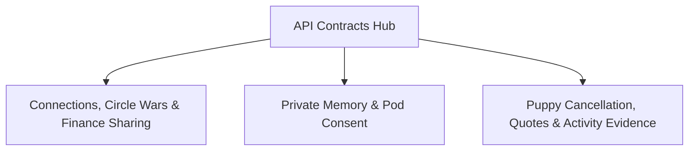

# Hussh One Feature & Sharing API Contracts

[API Contracts Hub](api-contracts.md) · [API Route Catalog](api-route-catalog.md)

**Status:** Live | **Intent:** Reference | **Audience:** Backend, Frontend, Mobile, and Coding Agents

Feature-level API invariants for connection discovery, finance sharing, private memory preparation, Puppy cancellation, phone verification retention, Circle Wars, and pod memory consent. See [API Contracts](api-contracts.md) for core token and response schemas.

## Visual Map

## Metrics aggregate source

`POST /api/one/metrics/adoption` is a server-only read for Metrics #184. It is
not a browser/native owner export, account directory, campaign or mail endpoint.
The Metrics collector signs its exact JSON bytes with HMAC-SHA256 over
`metrics-one-aggregate-v1:{timestamp milliseconds}:{body}` in
`X-Metrics-Timestamp` / `X-Metrics-Signature`. The timestamp must be within one
minute; the body is bounded to 2,000 bytes. PLG signing credentials are not reused.

The production route is default-off. Admission requires all of:

- `ONE_METRICS_ADOPTION_ENABLED=true`, production auth lane and exact
  `GOOGLE_CLOUD_PROJECT=hushh-pda`; other lanes cannot borrow production records.
- A separately managed `ONE_METRICS_ADOPTION_SECRET` and explicit approved
  `ONE_METRICS_ADOPTION_BINDING_JSON`. No setting/key is installed by this code.
- Binding fields `approved`, `definitionVersion`, `sourceGeneration`,
  `scopeDigest`, `populationPolicyRevision`, `reconciliationDigest`, `coverageFrom`.
  The generation/scope/version must match the request and the population revision
  must match the existing current reporting policy. An evidence digest is not
  proof that its underlying reconciliation passed; activation requires review.

UAT is separately default-off and requires the exact `hushh-pda-uat` project and
`uat` auth lane, `ONE_METRICS_UAT_ADOPTION_ENABLED=true`, its own
`ONE_METRICS_UAT_ADOPTION_SECRET`, `ONE_METRICS_UAT_ADOPTION_BINDING_JSON` and
`ONE_METRICS_UAT_REPORTING_POLICY_JSON`. UAT signs with the distinct
`metrics-one-aggregate-uat-v1` purpose. Its binding additionally pins the UAT
database name and user. Each request constructs a bounded pool against the fixed
UAT Cloud SQL socket, verifies each connection's database and user, and closes
the pool. Firebase must be the UAT project; production identity, policy and key
are never fallback sources. The managed socket mount must be checked against the
UAT instance during release. An explicit UAT policy with all three exclusion
arrays empty includes every otherwise eligible registered UAT account. Missing
or malformed policy is rejected. Disabled, deprovisioned and deleted accounts
remain ineligible. These settings remain disabled until separately
reconciled and accepted; UAT activity is test activity, not customer adoption.

The request contains exactly `period: {startDate,endDate,timezone}`,
`definitionVersion`, `sourceGeneration`, `scopeDigest`. Dates use complete source
calendar days and a half-open timestamp interval, including DST days. Only recent
windows within seven days and the explicitly reviewed coverage start are admitted.
There is no owner/account override or source URL/query supplied by the caller.

The proposed meaningful-activity definition is a persisted successful assistant
reply to a persisted user message, or a confirmed domain effect. Page views,
health pings, client observations and provider returns alone do not qualify.
Effects reuse `plg_outcomes.value_summaries(..., 'agent_one', ...)` and its existing
source-owned proof/deduplication rules; a Mail/KYC effect is not counted twice.
Accounts are stable source IDs, not devices or inferred unique people.

The backend retains all identity and effect records. It applies existing current
Firebase eligibility, canonical identities, verified aliases, staff/test
exclusions and deletion barriers before counting. The first connection retains
canonical READ COMMITTED lifecycle/identity locks; a second read-only REPEATABLE
READ transaction supplies one coherent business-record snapshot. Candidate
membership is rechecked in that snapshot. Identity/policy/binding changes refuse
the result. No source RLS policy, grant, table, retention or record is modified;
an RLS-filtered role must fail rather than return a misleading global zero.

Fifty candidate accounts is the existing lifecycle/identity helper boundary, not
a sample or a new numerical operating target. Overflow or an existing domain
adapter's limit refuses the whole result. This candidate therefore does not yet
establish large-population capacity. Five-second SQL/one-second lock bounds and
the twenty-second overall ceiling are safety bounds requiring native workload
qualification before activation, not accepted performance objectives. The read
can reserve two existing pool connections; qualify concurrency accordingly.

The response contains only the two aggregate metric values and their
`coverage/unit/basis`, source generation/scope/definition, requested period,
source snapshot/check timestamps and reconciliation status. Coverage remains
**partial**: retained positive records do not prove complete capture or historical
deletion/identity coverage. Missing observations never establish inactivity.
No user ID, email/phone, prompt, result body, effect key or resource handle leaves
the backend. The database snapshot time is not an all-device ingestion watermark.

All responses are `private, no-store`. Disabled scope is 404, bad signature 401,
invalid request 400 and unavailable/changed/overflow source 503, with neutral
messages. No web/native proxy is added: this is the collector-to-backend paired
contract in Metrics PR #186. There is no collection schedule or sending path.

Source implementation/testing is separate from definition review, independent
native fixed-period reconciliation, reviewed source activation and exact-source
backend release. Do not enable the collector binding or claim Metrics live-data
acceptance from fixture tests alone. BigQuery stays off; CI/CD remains unchanged.

## Connection network discovery

These Firebase-authenticated reads bind the viewer to the verified session and
return `private, no-store`. Web uses the existing `/api/one/[...path]` proxy;
iOS and Android use the same endpoints through `ApiService.apiFetch`.

| Endpoint | Contract |
| --- | --- |
| `GET /api/one/connections/network/summary?person_ref=<UUID>` | Eligible public identity, viewer-relative `networkDegree` (`1`, `2`, `3`, or `null`), mutual count with up to two previews (`mutualConnectionPreviews`; `mutualConnectionPreview` is the first), `canBrowseConnections`, and nullable `visibleConnectionCount`. The count uses the unfiltered shared list's eligibility, excludes the viewer, and caps at 501 for the **500+** label. No internal identity, graph path, email, phone, or consent contents. |
| `GET /api/one/connections/network` | Optional `person_ref` selects that person's shared list. Omission discovers the viewer's network. Optional `degree=1\|2\|3` selects the exact shortest eligible distance over active accepted connections. Both intermediaries on a third-degree path must allow discovery. `query` searches names within that graph set (160 characters), `page>=1`, `limit=1..50` (20 by default). Returns eligible public people, degree, relationship, mutual metadata, page, and `hasMore`. The legacy `include_suggestions` flag is accepted and has no effect. A viewer with no eligible paths receives an empty list. Direct, second-degree, fourth-degree and unrelated people are excluded from the third-degree filter. Current eligibility and path permissions are rechecked after profile loading. The service refuses a result whose degree or permission changed during the read so that the caller can retry. |
| `GET /api/one/connections/network/visibility` | The caller's own extended network discovery preference, retaining the compatibility key `shareConnectionList`. Missing or existing accounts default to false. This preference does not restrict accepted direct connections from viewing the caller's eligible connection count and list. |
| `PATCH /api/one/connections/network/visibility` | `{ "share_connection_list": boolean }` changes only the authenticated caller's extended network discovery preference. Account reset clears this permission. |

A person's connection count and list require the viewer's current accepted active
direct connection, without a separate sharing opt-in. Every page rechecks that
relationship, peer edges, profile lifecycle and blocks after directory work. Unavailable, blocked and unauthorized
targets share a neutral 404. Mid-read invalidation returns retryable 503 instead
of disclosing a stale page or silently thinning pagination.

The summary applies the same accepted direct relationship requirement to its count.
A zero means the viewer can browse a list with no eligible peers. A null means the count is
unavailable. List pagination continues past the display cap.

Mutuals remain people directly connected to both viewer and target; their existing
count can exceed the number of viewable profiles. Pending requests, contact books,
trusted designations and Circle membership alone do not count as graph edges.
First degree is a direct active connection. Second degree follows the existing
shared-neighbor visibility contract. Third degree requires both intermediaries
to enable sharing; it exposes a distance only. `null` does not prove that no
connection exists. Anonymous public profiles remain unchanged.

Discovery admits at most 4,000 live eligible nodes and 12,000 edges, uses a
cooperative twelve-second traversal budget and scoped eight-second SQL statement
timeouts, and fails retryably when it cannot qualify the result. Firebase account
eligibility retains the canonical directory's bounded cache semantics. No graph
inventory is persisted in the browser or returned as connecting paths.

The new visibility write remains an unbound discovered API in the capability
catalog. The existing evolution ledger retires Connections setup graph revisions
`9ea5b914a24b6f47` and `ac971edb713a113d` rather than carrying an older workflow's
authority into a new write inventory. This also retires the first revision's
compatible predecessors for that workflow. Existing persisted connections and
setup state are unchanged; an old workflow must be freshly admitted.

## Feed history and search

Feed adds owner-scoped read adapters; source features retain their existing write
contracts, persistence, consent and provider behavior.

| Method | Path | Authority / result |
| --- | --- | --- |
| POST | `/api/one/feed/search` | Firebase owner; bounded labels and agent/person/date criteria before stable pagination. No read acknowledgement. |
| GET | `/api/one/feed/{item_id}/activity` | Firebase owner; exact grouped current summary and immutable dated steps. |
| GET | `/api/one/feed/live` | Firebase recipient; current confirmed SOS incidents, independent of normal history. At most 100 per page; explicit next cursor. |
| POST | `/api/one/feed/funding-history` | Matching Firebase and vault owner; existing recorded transfer states only. |
| POST | `/api/one/feed/files/{audience}/search` | `owner` requires existing content-owner admission; `requester` requires vault owner plus participant, current identity, payment and file access. |
| POST | `/api/one/feed/files/{audience}/file` | Same authority, with exact request/file reference and fresh source reread. |

Authenticated responses are private/no-store. Filename criteria stay in POST
bodies; encrypted candidates are bounded to 100 per scan and 20 returned matches.
A continuation can exist with no matching file on the current scan. These readers
never pay, reconcile, share, import, save reports or alter notification settings.
The first Feed page includes `live_incidents: {items, next_cursor}`; ordinary
history cursors and read/clear snapshots do not hide active incidents.

## Feed counterpart profile presentation

Feed metadata may include `counterpart_person_ref`, resolved at read time from
the viewer-scoped retained counterpart mapping and `actor_profiles`. This is
the same public reference accepted by `/people/[personRef]`; internal user IDs
remain excluded from the Feed DTO. Missing or erased profiles clear the
reference, including when the older-schema fallback runs. Profile viewing uses
the existing public profile and authenticated relationship/consent endpoints;
it grants no access to shared information by itself. No schema migration or new
route is required.

## Finance sharing with connections

`FinanceSharingService` uses `ApiService.apiFetch` on Web, iOS and Android.
Web forwards through `/api/one/[...path]`; native calls the same hub endpoints
through the existing platform-aware transport. No new native plugin is needed.
All routes require matching Firebase identity and `X-Hushh-Consent` vault-owner
authority and return `private, no-store` responses with scrubbed errors.

| Endpoint | Contract |
| --- | --- |
| `POST /api/one/finance/shares` | Confirm one immutable policy and recipient-encrypted view per selected connection; exact request-ID retries return the original grants. |
| `GET /api/one/finance/shares?direction=outgoing\|received&cursor=…` | Participant-bound metadata history; 50 items, opaque UUID cursor. History does not authorize a read. |
| `GET /api/one/finance/shares/{grantId}` | Recheck recipient/owner, connection, blocks, active recipient key, current expiry and revocation before returning that participant's ciphertext copy. |
| `PUT /api/one/finance/shares/{grantId}` | Owner-only ongoing update with `expectedRevision`; immutable policy and recipient key, active lifetime, CAS and revocation checks. Snapshots reject updates. |
| `DELETE /api/one/finance/shares/{grantId}` | Owner-only terminal stop for one recipient; clear its ciphertext. |

Create accepts `requestId`, `policy`, `ownerConfig`, and 1–20 recipient entries
(`grantId`, `personRef`, `envelope`, `ownerEnvelope`, `contentHash`). The strict
version-1 policy contains `mode`, selected `sections`, encrypted-configuration
`selectionHash`, `showAmounts`, canonical `model_processing`, and
`durationSeconds` (3600, 86400, 604800; null only for explicit ongoing access).
Lifetimes begin at the server-confirmed creation time. Contents and source/account
locators are encrypted on the owner client; the server stores no financial
plaintext. The 4 MB request budget and individual envelope bounds apply on both
backend and proxy. Raw financial PKM scopes remain blocked.
Both configuration and content digests include independent random 256-bit
commitment nonces inside their encrypted payloads. Metadata cannot test guesses
of selected notes or financial figures. Unselected notes and stock selections
are removed from the owner configuration; unchanged information does not publish
a new revision merely because a nonce changes. An explicitly approved One review
checks the exact content commitment, then strips its nonce before model input.

Recipient views expose only the selected curated sections. Amounts-off exports
exclude structured balances, dollar gains, quantities, prices and cost basis;
history is rebased to percentage balance change. It is not investment return.
Current sharing supports USD portfolios and refuses known mixed/foreign currency.
Missing saved history remains unavailable. Account identifiers, transactions and
provider credentials never enter the structured export; an explicitly selected
owner note is shared as written.

One review is an explicit `financeShare` forwarded input on the existing agent
chat transport, bound to `grantId`, `revision` and exact `projectionText` digest.
Only the authenticated recipient with current owner model-processing permission
may submit it. The current recipient processing-provider approval still applies.
The signed private-pod consent metadata feed accepts `finance:{grantId}:{revision}`
references with fresh nonces; it carries policy/digest/lifecycle metadata only.
`GET /api/one/pod/owner-feed/consent` uses the same `ConsentReadReference`
validation as the pod client: an ordinary bundle UUID or a Finance reference
with a positive revision of at most nine digits. Malformed references return
422 before the signed feed is read; accepted references still require the
existing owner binding and current recipient processing permission.
Existing shared-context tool blocking, request-secret lifetime and history/model
redaction apply. Authority is checked again around model generation.
The consent reply uses LOW reasoning, accepted by both managed text adapters,
with thoughts disabled and function calling set to NONE. Provider selection and
the current sharing authority remain unchanged.

Migration 433 qualifies the grant/request tables and terminal disconnect/block
guards. Rollback is code-only and preserves issued encrypted objects. Expired
ciphertext is cleared on access/history reconciliation; dormant ciphertext and
confirmation metadata remain until reconciliation or account erasure. Production
qualification must separately verify the migration, exact authenticated
two-person journey, platform transport and current processing-provider approval.

## V1 chat memory preparation

`POST /api/one/agent-chat` accepts the current owner's
`forwardedProps.emailMemoryProjection` with a declared `budget_chars` of up to
96,000 UTF-16 code units, matching the complete `one_memory.markdown` document.
The document must fit both that declared budget and the server maximum. Email
session reads and prompt preparation use the same memory bound without truncation.
Owner matching, strict projection fields and request-only secret references remain
required; the separate 18,000-character draft and 2,048-character fact-write limits
are unchanged.

`POST /api/pkm/memory/rewrite` admits a matching Shared vault owner; the private
owner equivalent is `POST /api/one/pod/memory/rewrite`, with app-role `pkm.read`
admission, held owner incarnation and AI-selection checks before and after inference.
The request contains `user_id`, `current_markdown`, incremental `messages`
(`id`, `conversationId`, `role`, `content`), and `max_tokens`. Whitespace-only messages are
rejected during request validation before inference. Meaningful Markdown
indentation is preserved, and `current_markdown` may be empty for initial memory.
The response is
`{markdown}`: a proposed complete document with no persistence authority. The
client validates and atomically commits ciphertext and its source checkpoint
through the existing PKM writer. Invalid generation returns a bounded failure;
there is no partial replacement or client-visible success before storage ACK.
The platform-aware PKM proxy/native transport and explicit pod allowlists own
placement; unknown/private owners never fall back to Shared inference.

## Public market quotes

`GET /api/market/quotes?symbols=ADBE` reuses the shared public quote provider
and L1/L2 cache, without owner, holdings or vault context. Web reaches it through
the fixed Next.js proxy at the same path; native uses the existing ApiService
backend transport. The proxy forwards neither owner authorization nor cookies.
The quote row retains `price`, legacy `change_percent`, `company_name`, and
`source`, and adds nullable `change_pct` and provider `quoted_at`, plus
`is_stale`, `is_delayed`, and `market_state`. Retrieval time never becomes
quote time. Empty provider refreshes retain eligible cached prices; a cold
closed-market request returns 503 without calling providers. Daily historical
observations remain a separate contract.

## Request-specific revocation

`POST /api/consent/revoke` preserves the optional `requestId` from the web client
through the Next.js proxy to the canonical lifecycle service. A supplied selector
must be a nonempty string of at most 128 characters; invalid selectors refuse
before forwarding. Omitting it retains the existing scope-wide operation.
The vault-owner token still authorizes only the authenticated owner's grants.
Never discard a supplied selector and silently widen the requested revocation.

## Azure software-update continuation

An `upgrade_started` result from the existing Azure authorization-completion
route includes the launched `jobId` and, when available, the approved
`operationId` and `releaseId`. Clients retain that tuple through popup handback
and status following. Older responses without the tuple remain readable but
cannot establish verified completion.

Completion requires `installedReleaseVerified` and a `completedUpdate` receipt
matching the followed operation, release and installed image digest, with a
verified pod incarnation and timestamp. A recorded job, version label or newer
available offer is insufficient. See the
[existing-pod update runbook](../../operations/hosting/dev-pod-first-light-runbook.md).

### Pod maintenance recovery

The existing machine-authenticated `/api/one/pod/upgrade/{prepare,status,release}`
family retains exact pod-incarnation checks. Status distinguishes current-runtime
`idleReceipt` from `retainedIdleRecord`, the sealed cursor preserved across restart.
`releaseReceipt` identifies the last sealed release and its operation.

Release accepts an optional `expectedIdleRecord: {seq, sha}`. The pod compares it
atomically with its retained cursor. A retry returns the same sealed receipt only
for the same operation and checked cursor, with no newer active fence. A lost
append response is reconciled from the sealed log before work is admitted.
Cursor-checked terminal releases cannot be reopened by a repeated prepare request.
Existing failed-update callers may omit the cursor and retain their retry contract.

This is a control-plane contract, with no browser proxy or native-plugin change.
It does not prove VM image, identity or encrypted recovery by itself; the caller
must establish those before release. See the
[Browser runtime lifecycle](../../../consent-protocol/docs/reference/private-browser-runtime.md).

## Consumer scope commerce

`/api/scope-commerce` uses Firebase identity for account, tariff, quote, human
purchase confirmation, funding, payouts and buyer cancellation. Inactive owner
approval, export context/preparation/staging and owner revocation require
vault-owner authority. Financial confirmation alone never releases information:
access additionally requires canonical consent and a staged v2 export at the
server-fixed activation time. The reconciliation worker uses dedicated Google
OIDC, independently of purchase admission.

Authenticated `GET /api/scope-commerce/readiness` and the additive `account.readiness`
projection distinguish free-sharing controls, locally configured/persisted
platform readiness, seller eligibility and action capabilities. These reads
perform no wallet bootstrap or provider I/O. An unset or explicitly free tariff
keeps the existing consent flow without Stripe; owners can reset an exact tariff
to free while paid admission is unavailable. Positive tariffs fail closed and
never become free because setup is missing. Accepted quotes retain their terms.
Existing financial obligations and access enforcement survive an admission pause.

Owner-bound `GET /api/pkm/scopes/{user_id}` includes an authoritative `scope_handle`
on each compact `scope_entries` row. It preserves the registry handle when present
and otherwise uses the canonical owner/scope fallback. Memory and chat consume this
metadata to review an eligible whole-bundle tariff; they never invent domain handles
or infer a wildcard from child sections. Existing vault-owner matching, exposure
rules and restricted-domain policies remain authoritative. The web proxy and native
transports preserve the additive metadata without a separate payment endpoint.

Authenticated `POST /api/scope-commerce/payouts/manage` accepts an empty object
and returns a short-lived Stripe Express login URL for the caller's existing
information-access payout account. The server checks the pinned platform, test/live
mode and current source binding before and after provider I/O. Caller-supplied
account identifiers are rejected. No login URL is persisted in the financial
journal, and creating it neither transfers funds nor proves settlement. The
existing fenced management window keeps the initiating vault session in memory.

The package-local [consumer scope commerce reference](../../../consent-protocol/docs/reference/consumer-scope-commerce.md)
owns the wire families, exact scope binding, hosted return, configuration,
financial lifecycle and verification limits. The Next proxy preserves the same
snake-case contract; native transport uses the existing direct backend service.

## Private Memory preparation

An admitted app-role session can call `POST /api/one/pod/memory/proposals`
with the existing PKM preparation request and response shapes. The exact ingress
entry requires `pkm.read`, the current held incarnation and a matching owner ID.
The pod runs the existing authored structure and reconciliation agents against
its owner's selected model, with bounded admission and disconnect cancellation.
AI selection changes invalidate preparation and process-memory continuation
reuse. Failed provider preparation refuses rather than selecting managed inference.
Each attempt past the feature gate, admission refusals included, writes the same
content-free `pkm.memory_proposal.outcome` line as the hub, with `route=pod`.
The hub writes its line only for attempts that pass authentication, placement and
request validation; refusals before the handler appear only in the request
summary. Status `0` (`cancelled`) records a handler cancelled before it finished,
such as the pod's queued-request disconnect check, and an omitted or null
`capture_source` logs as `unspecified`. On the pod, `queue_timeout` means the
150-second command budget ran out before admission, so no provider was called.
`provider_unavailable` means a provider error, or that budget running out after
admission. `model_unselected` counts only the owner-selection and unsupported-model
refusals: a pod with no runtime model logs `unavailable`, and one with no model
access logs `failed`.

The owner app routes private notes directly to this door; unplaced or unresolved
hosting refuses before transmission. The browser separately fetches authorized
exact-section sharing metadata from the hub and requires review for affected
recipients. Missing or malformed metadata blocks preparation. Information stays
in the owner runtime and browser; encryption and confirmed commits retain their
existing authority. Older pods require the governed owner update flow; no hub
fallback is available for private notes.

## Direct Puppy turn cancellation

An admitted app-role pod session can call
`POST /api/one/pod/turn/cancel` with `{requestId, puppyDeviceId}`. The request ID
must match the originating `/api/one/pod/turn/stream` `X-Request-ID` header.
Cancellation is bound to the verified owner, pod key/incarnation, app subject,
device and request; a different app subject cannot cancel another turn.
The route retains the held-incarnation check and does not grant device settings
or hub authority. It is an exact pod ingress allowlist entry.

`state: stopped` means the matching producer settled after cancellation, including
its broker cleanup and admission release; it is not a device acknowledgement.
Absent, completed or mismatched turns return `state: unconfirmed`. The browser
bounds the stop wait and displays uncertainty rather than claiming success.
See the [stream implementation](../streaming/streaming-implementation-guide.md#direct-puppy-streams).

## Verified account phone retention

`POST /api/account/identity/refresh` remains Firebase-authenticated. Ordinary
refreshes, including forced/strict reads and display-name synchronization,
preserve a complete verified phone in the serialized identity writer. A delayed
provider snapshot cannot replace a newer committed E.164 number.

Web, iOS, and Android confirm ordinary SMS challenges with Identity Platform.
Clients include the current user's ID token so Firebase links or updates the
number on that UID. Clients check the returned UID and number and discard the
returned session tokens. They reload the existing user to keep its independent
sign-in. Native `startPhoneLinkVerification` binds the challenge to the captured
user, attempt and link intent. Older binaries lack this distinct method and
refuse before SMS dispatch; clients never fall back to the legacy proof method.
The legacy Android proof method remains manual-only.

On a provider link conflict, the verified `temporaryProof` continues through the
existing isolated proof service instead of replaying the SMS code. Its phone
ID token stays in memory, bound to the current user, phone and verification
attempt. It is cleared on resend, retirement, owner change, unmount or success.
Ordinary successful links never create a secondary sign-in session.

Linked-account deletion is a separate contract: confirming deletion links no
phone to the surviving account. It releases the consumed proof and requires a
fresh verification afterward. An uncertain confirmation uses the existing
read-only recheck; it never replays deletion or reuses the spent SMS proof.

After linking, clients send `{ "verified_phone_number": "+…" }` through the
existing account proxy or shared native transport. The backend reads the current
Firebase user, checks the authenticated UID and exact phone, and saves the claim
for the same application owner. Conflicting ownership or a changed provider
number returns 409. Provider or persistence unavailability returns 503. Retry
reloads the current Firebase user so a committed link can be finalized without
consuming another code. Firebase and Hussh save separately, and the client
reports verification success only after both writes succeed. A client keeps one
confirmation in flight per Firebase UID through both writes. Concurrent
replacements on separate devices can require another read and retry.

Account restore and phone consumers use the committed application claim. A raw
Firebase phone does not establish that claim. The auth context can retain a
known same-owner app claim during a temporary lookup failure. The fixed-code
fixture transport remains application-only. Isolated phone proof remains
available to recovery flows. A legacy client cannot write a new claim through
`/phone/claim` until it links the number to the signed-in Firebase UID. Qualify
the updated native clients and frontend before rolling out that enforcement.

`GET /api/account/identity` reads only the authenticated application owner's saved
identity through the read-only Firebase dependency. It returns
`{success, user_id, identity}` with `Cache-Control: private, no-store`. An absent
record stays `identity: null`. This request performs no Firebase synchronization
or claim write. Reviewer phone hydration uses this read and retains the existing
owner, generation and publication-order checks, plus the identity-cache subscription.
Read-only reviewer activity collection is suppressed at scope capture and dispatch.

After an occupied-number deletion is admitted, the consumed real-SMS proof never
authorizes a follow-up claim. The interface reports deletion requested and requires
fresh verification; an uncertain deletion response is reconciled by observation.
Configured test numbers use a new server-bound challenge through the existing
qualified test transport. An
expired challenge retires only its captured owner and attempt. Missing local
state is `phone-verification-required`, distinct from provider `code-expired`.

When a legacy app claim belongs to a different active owner, the app write
refuses the claim even if Firebase accepted the link. That result requires
reconciliation of the two records before release to accounts with unresolved
legacy ownership. Qualify real SMS on an isolated Firebase test project or
with explicitly designated test accounts when environments share Firebase.

## Messages unread action count

`GET /api/one/messages/unread-count` requires the existing Firebase ID token
and returns only `{ "unreadCount": number }` with `Cache-Control: private,
no-store`. The owner comes from verified authentication, never a caller-supplied
user ID. Web uses the existing `/api/one/[...path]` proxy; native uses the shared
`ApiService` HTTP transport.

The Messages roster tile uses this exact total of received unread People and
Circle messages, including totals above 100. The calculation reuses the native
notification badge's owner/membership/deletion filters without its display cap;
it reads no message bodies and changes no read state. Empty means zero; a failed
request retains the previous verified count or an unresolved indicator.

The home counter rechecks on shared Feed and direct-message invalidations,
focus, foreground, visibility and connectivity recovery. It uses the existing
visible-page 45-second shared clock as a fallback, including cross-device web
reads that do not emit a Feed change. Existing conversation visibility and
read-through boundaries remain authoritative for clearing unread messages.

## Circle Wars weekly participation

Migration 358 extends `one_referral_circle_selections` and
`one_referral_circle_contributions`; it does not introduce another referral or
coin ledger. `one_referral_circle_teams` holds random public aliases per existing
reward-round ID. The active program schedule owns the deadline and timezone;
physical prize activation remains independent of team participation.

All `/api/one/referrals/circle-wars` routes require a `VAULT_OWNER` bearer token
and return `Cache-Control: private, no-store` through the existing web/native
`apiJson` transport:

| Method and suffix | Contract |
| --- | --- |
| GET (base) | Current persisted round and caller's optional selection. Optional `week` is a historical reward-round UUID. |
| POST `/participation` | `{circle_id: UUID, consent: true}`; strict consent, no extra fields, active existing Circle membership. Same-team retry is idempotent; switching that week returns 409. |
| GET `/leaderboard` | `limit` 1–100, nonnegative `offset`, optional historical `week`; global ranks, total and pagination. |
| GET `/circles/{circle_id}` | Caller-authorized Circle statistics; unauthorized names and IDs remain private. |

Qualification snapshots eligible weekly selection into the existing durable
scoring job. The existing worker settles one raw team contribution per
relationship alongside individual awards. Referrals opened before opt-in,
nonmembers and inherited genealogy never imply consent. Late jobs retain their
round; revoked relationships stop counting. Existing deletion cascades apply.
Legacy Firebase-only Circle previews remain closed for older clients; the active
dashboard uses these owner-authorized endpoints.

The You card and Ranking/Circles pane reuse existing Circle creation and invite
links. Invite opens the shared native/Web Share flow directly, falling back to
copying the link on devices without a share sheet. Other teams expose random
aliases; authorized members see Circle names.
Rewards and individual rankings retain their existing behavior. SSE and visible
polling refresh team standings and rollover. Rollback disables new snapshot and
notification triggers while preserving bounded history, awards and claims.

Both ranking views request ten entries per page. Individuals retain the
published `snapshot_id` across cursor reads; a pruned snapshot restarts the
latest list. An off-page owner has a shortcut to their ranked page rather than
an eleventh list entry. Circles use the existing offset and `has_more` contract.
Circle deadlines use the persisted round and database clock independently of
prize activation. Current-round reads retry once if the DB read crosses cutoff,
then return retryable 503 `COMPETITION_WEEK_CHANGED`; historical reads stay fixed.
Clients anchor the deadline at response receipt using a monotonic clock and
refresh at cutoff, with normal polling as recovery.

The existing referral lifecycle PostgreSQL suite covers weekly opt-in,
concurrent selection, no retroactive credit, delayed settlement, privacy,
revocation, history, owner API authority and migration replay. Run with
`ONE_COMMAND_TEST_DATABASE_URL` pointing to disposable PostgreSQL; CI includes
this suite. Circle interaction tests and `verify:referral-dashboard` cover the
frontend. Live browser qualification also needs matching nonproduction Firebase
and backend configuration, a migrated database and a fresh invitee account.

> Complete endpoint reference, authentication model, and developer integration guide.

## Individual referral profile portraits

`GET /api/one/referrals/leaderboard` adds optional nullable `photo_url` to both
`entries` and the off-page `viewer` row. It follows the same viewer-permitted
directory projection as `display_name`; chosen public aliases remain unlinked
to account portraits. Unavailable identities have no portrait. The owner row
uses its existing provider-profile projection. Existing custom raster image
URLs are preserved. Clients show a fallback avatar when the field is absent or
the image cannot load. Snapshot scores, ranks, authentication and pagination
are unchanged; the web/native proxy passes this additive field through.

---

## Private-pod memory processing consent

`POST /api/one/u/{hushh_id}/memory/provider-grant` is owner-authenticated metadata
coordination. It authorizes the exact owner and HushhID before issuing the existing
five-minute `cap.memory.provider.process` grant, returns its token and expiry with
`Cache-Control: no-store`, and never invokes the pod or reads private memory.
The app keeps the grant in memory and applies it directly to
`POST /api/one/pod/memory/provider-consent` using its signed owner session.
Both authorities remain mandatory. Account or vault changes stop dispatch.
Withdrawal sends `{granted:false}` directly without obtaining a hub grant;
`GET /api/one/pod/memory/status` also uses the owner session. Legacy relay routes
remain compatible with older clients; private callers never fall back to them.
Web, iOS and Android share this service-layer transport and its exact route allowlist.

## Own activity evidence

The separately signed `owner-uat`, `permission-uat` and `snapshot-uat` endpoints
are read-only and require the exact UAT project, runtime lane, collection/export
flags and separate credential. UAT admits all registered owners without an
account-ID tester list; anonymous identities cannot enter activity collection.
The production all-registered flag remains off in UAT. The Matrix
session supplies only its verified email hash; cached identity data selects a
candidate through a bounded two-row hash lookup, but current Firebase verified identity and lifecycle/epoch checks
authorize the result. Ambiguous candidates fail closed. Owner reads require no
marketing subscription and carry `readAuthority=verified_owner` plus the hashed
`ownerEpoch`; they never carry delivery authority. Identity changes and account
reset during a snapshot invalidate it. No raw email or private content is exported.
Production marketing/reporting contracts remain separate.

Memory's explicit export, edit, delete, preparation, section retry and reviewed
save controls report paired `pkm.*` client attempts under Personal Information.
They retain the original owner and admission generation and expose only a closed
action ID, opaque operation ID and phase. Their authored action contracts remain
manual-only; observation does not add an executor or authorize a write or email.
Preparation is distinct from saving. Partial saves, expired authority, transport
timeouts and an unacknowledged file handoff remain unknown. A confirmed write is
not changed to failure by a later metadata refresh. Existing aggregate Memory
observations remain unpaired and cannot create additional attempt emails.

Manual KYC profile imports in Mail and Email setup report `kyc.save_profile`
under KYC. Both preserve the originally admitted owner and generation. Local
Memory staging does not settle the attempt: the existing encrypted-write queue
notifies a RAM-only, zero-payload observer after a write acknowledgement or its
existing commit-receipt recovery. A confirmed write remains returned if local
checkpoint cleanup needs retry; that retry cannot emit the outcome twice. A
fully synced, already persisted no-op may return, while a duplicate of pending
work remains unknown. Explicit no-write preparation rejection is blocked;
transport loss, retired ownership, reset and page exit never infer a terminal
outcome. Observers are not persisted or replayed after reload, and observer
errors cannot change the product's result. These observations add no email
permission and do not cover every KYC action or prove live delivery.

World Model confirmation, rejection, edit and removal report under Memory.
The shared web and native controller returns an attempt only after the current
owner’s existing encrypted memory decision has been verified. A lost commit
acknowledgement or retired owner remains unknown. Reports carry action metadata
only. Fact keys, wording and evidence never enter PLG or its email body.

The Mail workspace reports an explicit retry of saved receipt restoration as
`profile.gmail.restore_saved_receipts` under Email. A current, verified saved
snapshot is required for a returned outcome. Confirmed unavailable storage or
invalid receipt binding can report failure. Missing snapshots, expired reads
and retired owners or account/vault scopes supply no terminal outcome.
Automatic hydration and the follow-up sync do not create another attempt.
Only activity metadata is reported, with no receipt or account data.

Manual Calendar connection and disconnection report against the original attempt.
Terminal returns require an acknowledged connection or confirmed disconnection.
Meeting file upgrades wait for the matching grant. An expired popup, a lost
response, a handoff that leaves the page, and a same-window reload can leave the
attempt unknown. Calendar reports contain no Google account or event details.

Dev uses the same owner/epoch read contract at `owner-dev`, `permission-dev` and
`snapshot-dev`, with matching distinct HMAC purposes. It requires exactly
`ENVIRONMENT=dev`, `GOOGLE_CLOUD_PROJECT=hushh-pda-dev`,
`ONE_PLG_ACTIVITY_ENABLED=true`, `ONE_PLG_ACTIVITY_DEV_ENABLED=true`,
`ONE_PLG_DEV_EXPORT_ENABLED=true`, a separate `ONE_PLG_DEV_EXPORT_SECRET`, and
`ONE_PLG_ACTIVITY_DEV_ACCOUNT_IDS` (1–100 explicit owners). All-registered
collection stays off. No UAT, Production, marketing or worker key can authorize
Dev reads. A legacy Dev revision labelled UAT fails closed; canonical Dev rollout
must establish the correct lane before activation. Local mocks do not prove that
rollout, and no environment is enabled by these source defaults.

Production own reads use separate `owner`, `permission-owner` and `snapshot-owner`
routes, signed with `owner.production.{owner,permission,snapshot}` purposes. They
require the production lane/project, `ONE_PLG_OWNER_EXPORT_ENABLED=true`, enabled
activity collection, `ONE_PLG_OWNER_ACCOUNT_IDS` (1–100 owners), and a distinct
`ONE_PLG_OWNER_EXPORT_SECRET`. Marketing, UAT read and email-worker credentials
cannot authorize them. They apply the same verified-owner and reset-epoch checks;
no marketing opt-in is needed to see one's own activity. These flags are off by
default and this contract does not establish a deployed source or complete capture.

## Optional agent-attempt emails

The account screen owns an explicit, default-off activity-email choice at
`GET/PUT /api/one/plg/attempt-email/preferences`. It is separate from marketing
permission and accepts no recipient or account override. A fresh verified owner
email, current activity epoch and environment/project
admission are required to enable it. Opt-out remains available when rollout is off.
UAT permits every registered owner to make that choice; Dev and Production keep
their configured recipient cohorts. Removing the UAT list never enables a
preference automatically. Selection remains bounded to 20 pending deliveries,
and every claim rechecks the current preference, recipient and lifecycle.
The worker accepts exact Dev, UAT or Production project/lane pairs. Dev responses,
signatures and unsubscribe links bind only to the Dev backend
`https://consent-protocol-aqahj4iyha-uc.a.run.app`; it cannot borrow UAT authority.
Manual-only controls cannot be submitted by an agent. The setting is operational
permission metadata, not Live Memory, PKM content or a shareable `attr.*` scope.

Migration 450 atomically queues the first accepted correlated client terminal
report for each owner/epoch/attempt. Duplicate phases cannot create more emails;
SDK/tool reports and uncorrelated observations do not enqueue. This inherits
best-effort observation coverage and its existing collection limits. It does not
establish universal attempt capture or a delivery-time guarantee.

Separately signed, environment-bound `attempt-email/pull`, `claim` and `settle`
ports give a trusted worker one send grant after checking current permission,
verified recipient, lifecycle and epoch. Read-export keys cannot call them. Only
closed catalog labels and reported status are returned; no prompts, tool inputs,
results or freeform mail fields. A lost claim or submission becomes uncertain and
is never automatically retried. Provider acceptance must not be called Inbox delivery.
The Matrix worker uses these ports and the existing fixed single-recipient Gmail
sender. Deployment, actual Inbox/feedback evidence and delivery latency remain
release prerequisites; these source ports alone do not send email.
Settlement carries only delivery/claim IDs and provider outcome. One derives the
owner from its durable row, validates the exact claim and retires acknowledgements
for reset/erased rows without recreating state. Matrix durably retains bounded
opaque receipts before acknowledgement and replays them after restart before new
provider work; no owner identity or message content is needed in that queue.

Migration 451 adds actual provider-message binding and durable bounce suppression.
Signed `attempt-email/feedback-state` and `feedback-apply` expose only bounded
provider references, RFC message IDs and recipient hashes. A matched hard-failure
report disables future activity emails, including re-enrollment; reports cannot
enroll anyone or assert positive Inbox delivery. A sending/uncertain reservation
without a durable acceptance holds feedback progression. Positively correlated
hard failures still suppress their current owners while unrelated unsettled,
unbound or lifecycle-blocked reports keep the page replayable. Replaying that
page cannot increment an already-blocked preference again. Exact acceptance binding
precedes history processing so out-of-order reports remain replayable. The worker
may acknowledge receipts and stop reports after new enrollment is disabled.

Only a definite pre-submission/provider rejection may settle with
`notSubmitted=true` and no provider ID. It releases the exact current claim for a
later paced cycle, at most three claims total. It cannot release an uncertain or
accepted submission, or a newer claim. Ambiguous sends remain held. The rollback
refuses to discard retry counts, bindings or suppression evidence.

Unsubscribe links bind the exact permission generation. GET shows confirmation;
POST revokes that choice, so email scanners and stale links cannot disable a later
re-enrollment. Reset disables the preference and erases its outbox. Full account
tombstones erase both; phone-orphan intent does not revoke an established choice.
The down migration refuses nonempty state. Disable admission/dispatch for a
behavioral rollback; do not discard preferences or uncertain-send receipts.
### Isolated UAT people and attempt directory

`POST /api/one/plg/audience-uat` is a private, read-only directory for the
authenticated Matrix UAT workspace. It uses the same bounded filters, identity
projection, seven-day attempt summaries and cursor expiry as `/audience`, with
the distinct HMAC purpose `audience-uat` and project-bound UAT cursors. It requires
the UAT auth lane, project `hushh-pda-uat`, enabled UAT activity admission,
an explicit directory activation and a separate 32+ character directory key.
The legacy pair is `ONE_PLG_UAT_AUDIENCE_ENABLED=true` with
`ONE_PLG_UAT_AUDIENCE_SECRET`; the mounted UAT configuration below carries the
same separate authority without an additional deploy binding. Owner-read, delivery and Production keys cannot
authorize this directory. Firebase traversal and indexed identity lookups must
use the UAT project; there is no fallback to Production.

All current registered UAT accounts, including team accounts, are eligible after
deletion/generation barriers. Disabled, deleted and anonymous accounts remain
excluded. The version 2 response has `environment: "uat"`,
`customerReporting: false` and `deliveryAuthorized: false`. Registration and
directory visibility never opt anyone into email. Only whitelisted identity and
activity metadata is returned; prompts, provider payloads and auth export fields
are excluded. Missing or capped capture remains unknown. This source addition
does not enable any runtime flag, provision secrets, or change release tooling.

### PLG release configuration

The existing `ONE_PLG_UAT_EXPORT_SECRET` mount also accepts a bounded JSON
envelope with exactly `version: 1`, `environment: "uat"`,
`project: "hushh-pda-uat"`, `ownerReadKey`, `audienceReadKey` and the boolean
`audienceEnabled`. Generate independent random owner and directory keys and
store the envelope only in that UAT Secret Manager resource. Configure Matrix's
separate UAT owner and audience secret resources with their respective key,
never the envelope. Neither value may equal a delivery or Production key.

This is application configuration through the existing mounted secret; no
workflow, deployment binder or runtime-config writer change is needed. Existing
UAT collection/export flags and exact lane/project checks still apply. The
directory is off unless `audienceEnabled` is explicitly true. Activity emails
retain their independent worker key, runtime switch and per-owner choice.
Malformed/duplicate/foreign-lane fields, extra fields, oversized values, reused
keys or mixed envelope and legacy audience settings close the reads. Flat owner
keys and the legacy explicit directory pair retain their previous behavior.
Disabling only `audienceEnabled` preserves owner reads; rotating the envelope
requires matching the independent Matrix keys before accepting live reads.

Dev/UAT own-activity rollout uses the canonical backend runtime configuration
writer and `deploy/plg/bind_secrets.sh`. The structured flags
`one_plg_dev_export_enabled`, `one_plg_activity_dev_enabled`,
`one_plg_uat_export_enabled`, `one_plg_activity_uat_enabled`,
`one_plg_owner_export_enabled` (Production only) and
`one_plg_attempt_email_enabled` default false. Explicit existing choices survive
sync only for their exact environment/project; foreign-lane activation is
rejected. The common `one_plg_activity_enabled` flag still applies, and Dev/UAT
also require their own activity flag with all-registered off.

Secrets and account cohorts are direct Secret Manager mounts, never fields in
the structured runtime configuration. Dev mounts only its DEV read/cohort
names, UAT only UAT, and Production retains its existing campaign mounts plus
independent OWNER names. Each project may mount its own
`ONE_PLG_ATTEMPT_EMAIL_SECRET` and `ONE_PLG_ATTEMPT_EMAIL_ACCOUNT_IDS` only when
the versions are enabled. UAT no longer requires or uses its activity/attempt account-ID
cohort mounts; Dev/Production retain those restrictions. Existing deployment
preflight may still require the older cohort setup until its owner reconciles
that separately; no CI/CD changes are included in this application change.
Preview secret namespaces cannot borrow canonical PLG credentials.
A mount cannot enroll an owner or activate delivery; current
verified identity, owner epoch, explicit per-attempt choice and the separately
qualified Matrix worker remain required. Keep the attempt key available for
generation-bound unsubscribe even when new delivery is disabled.

### Portfolio import incremental progress

The import envelope remains `1.0`. Optional `progress.extraction_update` v1
publishes immutable source units and known facts; `progress.extraction_reset`
invalidates provisional units before the ambiguity fallback. See the canonical
[streaming contract](../streaming/streaming-contract.md#incremental-portfolio-extraction).
Final `complete` retains the portfolio, quality and explicit-save contract.
Extraction diagnostics include unit count, source, fixed fallback reason,
first-result latency (when a unit was published), and total duration. These are
observations rather than a five-second SLA.

## Optional advisor service matching

Finance advisor discovery's **All** tab offers **Recommend advisor**. The existing
`POST /api/one/finance/advisor-reviews/candidates` accepts
`{"scope":"recommended","service":"portfolio_management"}`. The other service
IDs are `retirement_planning`, `tax_planning`, and `estate_planning`.
An optional `query` filters advisor names before the recommendation limit;
`scope: "global"` with an empty query lists all eligible platform RIAs by name.
The UI loads further All results while scrolling, without pagination controls.
Existing Firebase and matching vault-owner authorization remain required.
Unknown fields, including persona and portfolio payloads, are rejected.

The server reads the existing RIA profile's `services_offered` array. It applies
declared-service aliases, advisor verification, test-profile exclusion, bilateral
blocks and existing open-review exclusion inside the canonical Connect directory query
before pagination. Tied service matches use a stable owner/service permutation;
the order is not a quality assessment. Candidate records add `servicesOffered`;
missing legacy values become an empty list. Existing discovery scopes retain
their behavior. Web and native use the same `ApiService` request and endpoint.
Accepted reviews stay in the existing workspace; unexpired pending requests are
not suggested again. An expired pending invitation may be retried. A connection
alone does not exclude an advisor. Off-platform regulatory records are not
invented as secure in-app recipients; a receiving key is still required to send.

The optional `financial.profile.preferences.advisor_service` is saved through
the existing encrypted merged-profile writer. It is excluded from the public
profile summary. The choice is read only after opt-in. Persona and portfolio
context remain client-side and do not affect ordering without corresponding
structured advisor evidence. Matching makes no model or advisor-enrichment call; existing live-account checks still apply. Selecting
a match opens the existing introduction/snapshot review; explicit approval and
Send remain necessary. Closing, vault retirement and owner changes retire
pending recommendation results. No schema migration or advisor-flow change is
required. Removing the launcher rolls back the feature; older profile editors
preserve the optional preference.
