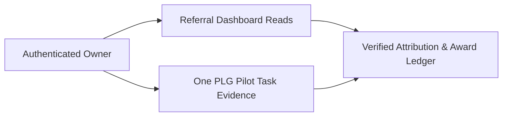

# Referrals & PLG Evidence API Contracts

[API Contracts Hub](api-contracts.md) · [Referral Backend](../../architecture/one/referral-backend.md)

**Status:** Live | **Intent:** Reference | **Audience:** Product, Backend, and Growth Engineering

Contract details for referral dashboard reads and One PLG pilot task evidence. See [API Contracts](api-contracts.md) for the shared token hierarchy and response format.

## Visual Map

## One PLG pilot task evidence

The server caller and isolated Firestore consumer are maintained in the
[private PLG dashboard integration PR](https://github.com/hushh-labs/hussh-matrix-dashboard/pull/124).
Release the two services independently through their existing approved paths;
adding this contract does not enable the exporter or campaign delivery.

`POST /api/one/plg/snapshot` is a server-only integration hidden from public
OpenAPI. It requires `ONE_PLG_EXPORT_ENABLED=true`, production runtime identity,
dedicated `ONE_PLG_EXPORT_SECRET` (at least 32 characters), and private
`ONE_PLG_EXPORT_ACCOUNT_IDS` (1–100 explicitly enrolled production customer
Firebase UIDs), or the canonical recorded-permission cohort when
`ONE_PLG_SUBSCRIPTION_ENABLED=true`. The snapshot remains server-only. Login, legal
acceptance and shared Firebase membership do not establish marketing consent.
Snapshot account IDs use the same opaque 1–128-character Firebase UID contract
as recorded-permission enrollment. Punctuation is preserved; the signed request,
enrolled-account allow-list and permission checks still authorize each owner.

`X-PLG-Timestamp` (13-digit Unix milliseconds, within five minutes) and
`X-PLG-Signature` authenticate HMAC-SHA256 over
`snapshot\n<TIMESTAMP>\n<EXACT_RAW_JSON_BODY>`. Wrong purposes and bodies fail.
Bodies have a 16,000-byte limit and contain 1–20 distinct accounts:
`{ "accounts": [{ "accountId": "<enrolled UID>", "journey": "memory",
"since": "<timezone-qualified ISO timestamp>" }] }`. Journey is `memory` or
`mail`; since must be within seven days. Unlisted UIDs and more than 100 task
results per account fail the entire batch. Read-only replay cannot send email.

The version-1 response includes `environment: "production"`, `retainedOnly:
true`, `asOf`, and matching accounts with original `since`, `deleted` and
`tasks: [{ actionId, occurredAt }]`. Task IDs are opaque SHA-256 values. Memory
requires committed mutations with matching confirmed content-write provenance;
upgrades and maintenance writes are excluded. The writer now records its existing
validated authorization mode as derived provenance, preserving the prior request
fingerprint for cross-release retries. Only explicit `owner_confirmed` writes
with an exact owner/domain/plan-derived commit ID qualify. Historical rows
without that mode remain unclassified; automatic saves and source refreshes
never become deliberate usage. Mail requires durable `sent` state
and a provider message ID; uncertain and scheduled background sends are excluded
so a background worker cannot count as the owner's returning usage. No content, domains,
email addresses, recipients, subjects or bodies leave the backend. Existing
account-deletion tombstones take priority over task export.

Retained rows prove positive outcomes only. Empty results do not prove signup,
complete feed coverage or inactivity: retention, domain deletion and resets can
remove rows. The consumer must not emit complete observations from this
projection. Setup, failure, support and canonical enrollment remain separate
producers. Version 1 remains compatible; the version 2 observation extension
below introduces migration 365.

The Memory projection uses a correlated event lookup for each committed
revision, with a planner boundary that retains every matching audit event.
Migrations 407–408 add and validate the nonunique, partial text-revision index
on `pkm_events`. This preserves the confirmed-provenance filters, duplicate
deduplication, date window, owner isolation and per-owner overflow sentinel.
Generic 25-owner plans must not flatten the lookup into repeated scans of a
heavy owner's complete event history. The five-second query budget is unchanged.

A concurrent build interrupted before completion can leave an invalid index.
Validation 408 rejects missing, invalid and incompatible same-named indexes,
including a different predicate or key definition. Stop overlapping migration
runners, inspect the exact index, and use the authored rollback 407 followed by
407 outside a transaction and validation 408 under the canonical migration
authority. Do not automatically drop a valid incompatible index or edit accepted
ledger checksums. Application rollback may retain this compatible index.

Both the query and index are required for the qualified heavy-history repair.
An index-only operation does not release the new query or prove the complete
directory works. Deploy through the normal UAT/production gates at a qualified
main SHA. If that SHA also contains unrelated unreleased changes, qualify the
complete release delta; a partial schema repair must never claim the full
migration head or authorize an unqualified application upgrade.

Responses are `private, no-store`: sanitized 400 for invalid requests or result
limits, 401 for signatures, 404 for disabled/nonproduction configuration, 413
for request size, and 503 for source failures. Reads are bounded; synchronous
deletion/read barriers are held for each bounded transaction. Production deployment optionally binds
the two dedicated secrets; `one_plg_export_enabled` in existing
`BACKEND_RUNTIME_CONFIG_JSON` maps the enable flag, which defaults off.

### Optional email preference and subscription projection

`GET /api/one/plg/preferences` and `PUT` use the existing Firebase owner
authentication boundary, independently of a vault unlock. Web uses the existing
One catch-all proxy; native uses the same platform-aware API service. Reads do
not create a preference, enroll anyone, or assume that a missing record is
permission. Signed-in setup and Your account load the saved state, stage changes,
and require a separate manual Save. Setup completion is independent of this
optional form. Voice and Search may navigate to it but cannot submit permission.

The strict PUT body is `{enabled, frequency, expectedRevision,
disclosureVersion, surface}`. Frequency is `daily`, `weekly`, or `updates`;
disclosure version is `one-email-updates-v1`; surface is `setup` or `account`.
No UID, email, chosen time or generation is accepted from the caller. A positive
choice checks the current verified Firebase email and binds its lowercase SHA-256
hash. Opting out requires no identity-provider lookup. The server records the
choice time and a monotonic revision. Stale revisions return 409
`preference_conflict`; an unverified recipient returns 409
`verified_email_required`. Uncertain failures return a sanitized 503 and the UI
requires a fresh read before another save. All responses are private/no-store.

Migration 370 stores this operational permission outside PKM/Live Memory and
atomically coalesces one pending hash-only change per account. Product reset
preserves the choice. Full deletion erases the preference and produces a durable
hash-only erasure; migration 201 guards prevent resurrection. Browser roles have
no access. Nonempty permission or change state makes rollback refuse rather
than silently lose opt-outs.

The private production-only `/api/one/plg/subscriptions/{pull,ack,revoke,check}`
POSTs require `ONE_PLG_SUBSCRIPTION_ENABLED=true`, project `hushh-pda`, and the
separate 32+ character `ONE_PLG_SUBSCRIPTION_SECRET`. They use the existing raw-body
HMAC envelope with purposes `subscriptions.pull`, `.ack`, `.revoke`, `.check`.
They are hidden from OpenAPI and default disabled. `pull` accepts exactly `{}`,
returns at most 25 changes, and rechecks deletion/revision after bounded identity
lookups. `enabled` is the recorded choice; `eligible` separately describes the
currently verified recipient. Only eligible records contain UID/email/name.
Availability can recover at the same canonical revision; consumers must apply
its fresh `checkedAt` without inventing a new choice. Acknowledged records are
eligible for reconciliation after one hour. Bounded pulls reserve at least five
slots for indexed reconciliation; backlog can delay a particular account.
Exact-revision acknowledgements cannot clear newer changes.

`ack` accepts `{changes:[{accountHash,revision}]}` after durable consumer commit.
`revoke` accepts `{accountHash,generation}` and can only disable that opt-in
generation. Frequency edits retain the generation; a fresh explicit re-opt-in
renews it. `check` accepts `{accountId,generation,emailHash,revision}` and returns
`{allowed,erased}` after fresh permission, lifecycle and recipient checks. A
frequency edit invalidates an older send decision even with the same generation.
No request sends email. The consumer must synchronize permission before evidence,
exclude revoked/ineligible contacts from snapshot batches, and perform `check`
immediately before a provider attempt. Provider calls already in flight cannot
be made atomic with a separate permission database transaction.

The feed is a producer contract; its existence does not establish that Matrix
has migrated its pilot capacity, consumed it, or enabled live delivery. Deployment
must verify the paired consumer, storage capacity, signing-secret binding and
controlled acceptance before enabling automatic enrollment.

### All-agent activity, version 2

Set `X-PLG-Version: 2` or JSON `version: 2` to negotiate the expanded contract.
`accounts: []` returns the catalog without opening a database. Nonempty requests
still require the signed enrolled-account allowlist and seven-day window.
Journey additionally accepts a canonical authored `agent_*` ID. The catalog is a
derived measurement projection of the product-agent registry, capability graph, action gateway
and closed frontend observability enums, with a content revision. It does not
register tools, route requests, enable unavailable agents or grant permissions.

Version 2 returns matching accounts with `tasks: []`, `verified` aggregate rows
and `activity`. Every public agent declares a static `outcome` contract in the
catalog (`status`, `proof`, `label`, `reason`). Internal agents declare `internal`,
with no separate activation journey. Availability remains a separate product flag.
Verified rows contain `agentId`, exact `proof`, count, first/last timestamps and
UTC days, maximum 1000 distinct effects per group. Generic execution or app
reports never become verified value. No effect IDs leave the version-2 projection.

| Public agent | Narrow verified value and source |
| --- | --- |
| Memory | Owner-confirmed PKM mutation with exact owner/domain/plan commit binding |
| Mail | Immediate provider-confirmed send; scheduled/uncertain sends excluded |
| Calendar | Provider-acknowledged reviewed create/reschedule/cancel or changed RSVP; no-op RSVP excluded |
| Kai | Confirmed financial save attributed to `kai_analysis_completion`; proves saved analysis, not a trade or model correctness |
| Career | Confirmed professional save attributed to `career_resume_owner_review`; proves reviewed resume saved, not application submission |
| Wallet | Confirmed wallet commit linked to an activated owner card registration; projection refresh/reservation excluded |
| KYC | Information-request workflow linked to canonical same-owner/thread confirmed immediate Mail send; not identity verification |
| Nav | Explicit owner approval/denial of a pending sharing request, persisted audit with server-derived canonical owner and decision; excludes token reuse/automatic revocation |
| Location | Domain command receipts, or newly committed direct private share/nearby check-in; no automatic envelope refresh or command replay/no-op checkout/contact change |
| Documents | Approved review and consumed directive bound to a successful permission grant with sealed provider receipt; automatic rules/preexisting permissions excluded |
| Connected Systems | Same-owner/intent/approval mutation plus successful provider readback; earliest successful audit per intent, excluding generic MCP success |
| One | Union of distinct effects above; shared Memory/Kai/Career/Wallet commits and Mail/KYC sends count once |

Migration 367 adds a service-only RLS receipt store for domain effects whose
working rows are short-lived (Calendar, explicit Nav decisions, direct Location).
The store contains opaque effect hashes and static proof identifiers, seven-day
TTL and maximum 500 receipts per owner/UTC day. Domain writers pin the observation
epoch before the effect, and write only after authoritative success. Delayed
callbacks cannot refresh their epoch after reset. Bounded optional receipt failure
cannot change the domain result, retry a provider operation or grant authority.
Nav additionally re-reads its persisted owner-stamped audit before recording.
KYC gains a nullable canonical send-action association; no historical association
or outcome is guessed. Source limits/cap saturation mark audience counts limited;
the signed pilot snapshot fails atomically on truncated evidence.

Release the backward-compatible Matrix proof consumer first, then migration367,
then backend writers/readers. Retain version1 Memory/Mail compatibility. Rollback
the backend writer before dropping the registered migration367 schema; the Matrix
consumer continues accepting older catalogs and legacy Memory/Mail proofs. Reset
clears new receipts under the existing barrier; account deletion cascades through
the observation epoch. Maintenance reserves bounded capacity for receipt TTL
purging so busy observation cleanup cannot starve it. Existing consent, OAuth,
agent routing and action settlement remain their original authorities.
`activity` contains `enabled`, `mode: best_effort`, `limited`, `startedAt`, an
opaque epoch hash, and bounded rollups by agent/action/source/phase. Sources are
`client_reported` and `execution_observed`; phases are started, returned, failed,
cancelled and blocked. A return is not proof of a domain effect. Deleted accounts
have no activity. Collection disabled or not started remains unknown. Disabling
collection also hides retained observations from export.

`GET /api/one/plg/activity` admits an observation epoch; `POST` reports only
`generation`, random `operationId`, registered `actionId` and phase. These hidden
routes require read-only verified Firebase identity; the UID and client source
are derived by the server. Extra fields and client attempts to report SDK
identifiers fail. Browser and native callers use the existing API transport and
One catch-all proxy. Reporting never bootstraps an account or sends a campaign.

Private product activity admission advertises optional `resultVersion: 1` wire
support. Only governed client event observations may provide nullable `result`
(`success`, `error`, `expected_error`); other values are rejected. The optional
`one_product_activity_observations.event_result` expansion preserves old rows as
unknown. Missing expansion or rollback uses the legacy insert without interrupting
capture. Result never changes receipt identity or overwrites an existing receipt.
Neither phase nor result proves a domain-confirmed effect; retention, enrollment,
owner admission and access remain unchanged.

`ONE_PLG_ACTIVITY_ENABLED=true` additionally gates collection to production and
the same explicit pilot UID allowlist. It defaults false. SDK plugins observe
admitted root/specialist/gene runs and tools without reading prompts, arguments,
responses or errors. Unknown private MCP tools use one fixed catalog bucket.
Warmup and anonymous/Firebase-only introductory runs are excluded. Frontend
gateway actions retain synchronous trusted browser activation; event collection
uses closed identifiers only and is independent of GA sampling.

Migration 365 creates two service-only RLS tables. Hashed observation IDs dedupe
replays; writes serialize a maximum 500 rows per owner per UTC day. Reads exclude
seven-day expired rows; the existing authenticated Drive work drain purges up to
1000 expired rows per pass. A rolling window may span eight UTC dates, bounded
at 4000 retained observations. Retired/reowned identifiers are omitted and mark
coverage limited. Collection is best effort: timeouts, capacity drops and missing
history cannot establish inactivity or complete app-wide DAU.

Reset rotates the epoch under the existing writer barrier and clears rows;
full account deletion erases both tables. SDK invocations pin their epoch once
before execution. Browser dispatches pin the initiating account, local reset
generation and admission promise. Account switches and local resets discard
stale callbacks. A previously resolved admission keeps its epoch, so a later
remote reset rejects those reports. Cold admission first processed after a
remote reset belongs to the new observation window; browser reports use server
receipt time and do not prove when execution began. Observation SQL has statement
and lock deadlines.
New client operations refresh admission after at most one minute, recovering
eligibility changes, temporary admission failures and cross-device resets.
Pending terminal reports remain bound to their original admission promise.
Apply the migration and verify schema/deletion/retention checks before enabling
the flag. Rollback: disable collection, then use the registered migration365
rollback; original task exports remain available in version 1. No infrastructure,
collection or marketing delivery is activated by this PR.

### Private registered-account audience and correlated attempts

`POST /api/one/plg/audience` is a separate, private read contract for Matrix's
role-protected PLG people view. It requires production lane, project `hushh-pda`,
`ONE_PLG_AUDIENCE_ENABLED=true` and dedicated `ONE_PLG_AUDIENCE_SECRET` (32+
characters). The existing timestamp/body signature uses purpose `audience`;
snapshot, sync, enrollment and delivery credentials do not grant this authority.
The response and all errors are private/no-store; validation and source errors
never echo contact details. The route is hidden from public OpenAPI.

Request: `{agentId, segment, query, graceMinutes, cursor}`. The agent must exist
in the generated catalog; segments are `all`, `possible_incomplete`, `failed`,
`blocked`, `cancelled`, `returned`, `verified`, `unknown` and `in_progress`.
Query is at most 100 characters, grace is 15–1440 minutes (default 60), and
cursor is optional. A page traverses at most 25 current Firebase records.
Disabled, deprovisioned, unclassified/anonymous and tombstoned accounts are
excluded. Customer reporting additionally requires a saved production canonical
contact and the secret-backed staff/test policy below. This is account-level
production membership evidence, not proof of unique people, deliberate usage or
marketing eligibility. Source failures fail the page with sanitized 503.

Only explicit Firebase getters are projected. Exported SDK records, password
hashes/salts, custom claims, tokens and provider objects are never serialized.
Canonical identity row presence owns the entire saved name/email/phone projection;
null or cleared fields never fall back to stale provider fields. Auth-only
accounts without a production canonical contact are withheld from customer reporting.
Only verified full E.164 phone numbers are shown; a number bound to another
canonical owner suppresses provider fallback. Lifecycle barriers (171 then 198),
the existing phone-claim lock (namespace 0), shared identity row locks and epoch
locks fence deletion, transfer and reset races. No identity is written.

Response includes the catalog, fixed seven-day `windowStart`/`asOf`, `scanned`,
`excluded`, bounded `rows` and `nextCursor`. Each row contains account ID,
selected agent, nullable identity fields with source/verification flags,
activity coverage/counts/timestamps/action ID and verified outcome support.
Positive attempt-status filters (`failed`, `blocked`, `cancelled`, `returned`,
`possible_incomplete`, `in_progress`) first select matching retained, correlated,
current-epoch attempts, then read at most 25 matching registered identities.
They do not stop after walking unrelated registry pages. Remaining filters apply
to each registry page; an empty matching page can have a continuation.
When generation admission is enabled, directory identities project to their current
active application owner. Retained attempts resolve their exact captured owner
back to Firebase for identity reads; they never move to a replacement account.
Retired, deleted, unregistered and internally excluded matches are still withheld,
and continuation survives pages consisting entirely of withheld candidates.
`scanned` counts source candidates including these exclusions. Switching from a
previous registry-based status cursor requires a fresh search.
No global filtered total or stable directory snapshot is claimed. The signed
cursor binds all filters, production project, page size and activity anchor and
expires after 15 minutes. Directory identity remains current on every page;
directory mutations can change traversal. No full-audience Firestore import occurs.

Migration 366 adds an opaque phase-independent `operation_key` for new SDK and
gateway observations. Correlation is bounded by owner, epoch, agent, action and
source; one invocation's return cannot close a different invocation. Historical
phase hashes and independent `observation:*` reports remain uncorrelated.
Tools remain separate observations. A correlated start with no terminal after
the selected grace is **possible incomplete**, never confirmed abandonment.
Recent unmatched starts are in progress. Returns/failures are observations,
not unique user attempts: browser and SDK observations can cover the same user
action. Return/failure timestamps use the selected terminal receipt even when a
start report arrives later at the server. Last observation can therefore be a
later start. Verified value uses the public-agent outcome contracts above;
internal stages do not manufacture separate business completions. Capacity-limited,
not-started, reset and disabled coverage remains explicit. Disabling collection
hides retained execution counts, timestamps and behavioral segments.

`ONE_PLG_ACTIVITY_ALL_REGISTERED=true` expands the existing collection scope
only with `ONE_PLG_ACTIVITY_ENABLED=true`, production lane and project
`hushh-pda`. Admission and writes additionally require a canonical registered
contact (nonempty email or verified phone); an anonymous UID/spine alone is
insufficient. Auth-only accounts are withheld from customer reporting while normal identity
warmup has not yet established that baseline. With this flag off, the original
1–100 UID pilot behavior is preserved. Both new flags default false. The existing
500-observation/day cap, seven-day TTL, reset/deletion and service-only RLS remain.

This read does not enroll contacts, change campaign addresses, grant messaging
permission, send messages or alter aggregate DAU/retention. Matrix consumes it
on demand with its own audience key. Release migration 366 before compatible
writers and readers, then verify prerequisites before separately enabling flags.
Rollback: disable expanded collection/audience, deploy the previous writer that
does not reference `operation_key`, then apply the registered 366 rollback.
Reapplying 366 leaves retained rows uncorrelated; it cannot reconstruct history.

### Customer reporting exclusions

`POST /api/one/plg/customer-cohort` is a private read projection for aggregate
customer reporting. It shares audience read authority with the distinct HMAC
purpose `customer-cohort`; it grants no campaign, write or sending authority.
Production project/lane checks apply. Each page scans at most 50 canonical
production identities in indexed primary-key collation order, checks current Firebase
registration, provider identifiers, verified aliases and deletion barriers, and
returns only eligible analytics hashes and Firebase creation timestamps (nullable).
The hash matches the client contract: first 32 hexadecimal characters of SHA256
of `hushh-observability-v1:<uid>`. No names, raw UIDs, emails, phone numbers, tokens
or denied identifiers are exported. AES-GCM cursors hide the keyset position and
bind the policy revision and ten-minute traversal window. Traversal is live,
not a transaction-wide snapshot. Missing pages, source failures or policy drift
must withhold the full aggregate, never publish partial zeros. The consumer must
enforce expiry and apply positive account membership before event aggregation;
anonymous events cannot be attached retrospectively through device identifiers.
Registration dates must not be inferred from identity-cache creation timestamps.

The audience reader requires `ONE_PLG_REPORTING_POLICY_JSON`, stored in Secret
Manager and bound by the existing production PLG deploy helper. The strict JSON
schema is `{version:1, excludedAccountIds:[], excludedEmails:[], excludedDomains:[]}`.
Use confirmed exact identities and company domains; never commit the roster or
classify a name as fake. Existing inner-team, senior-team and QA email rosters and
`REVIEWER_UID` also contribute to the policy. Missing/malformed policy fails closed.

Exclusions compare canonical email, current Firebase email, linked-provider emails
and active verified aliases. A production canonical email or verified E.164 phone
is required; sharing Firebase authentication alone does not prove production
membership. Auth-only accounts are unverified, not automatically UAT-only.
Excluded identities are filtered before activity/outcome queries. Collection,
product access, canonical identities and account lifecycle are unchanged.

Audience responses include `customerReporting:{scope:"production_registered_contacts",
policyRevision:<sha256>}`. Snapshot callers request `customerReporting:true` for
the same policy/proof and per-account `reportingEligible` boolean. Excluded rows
carry empty tasks/outcomes and no activity, with `deleted:false` unless a real
lifecycle tombstone exists. Snapshot identity resolution is a bounded read-only
Firebase lookup, fails on unavailable/wrong-project identity sources, and never
serializes auth export fields. Legacy snapshot callers retain the existing contract.

Matrix PR #133 requires these proofs, invalidates classification when a recipient
changes, fences concurrent source reads, and withholds proofs from old policy
revisions or older than 24 hours. Stage the policy and release/verify this backend
before deploying that strict consumer. Policy exclusion is not account deletion,
and no missing historical activity is synthesized. Disabling the audience reader
or reverting both reader/consumer together is the safe reporting rollback.

## Referral dashboard reads

`/one/referrals` uses the existing web proxy and native `ApiService` transport.
Firebase authentication derives the owner; client payloads cannot select one.

- `GET /api/one/referrals/points` returns equal `{points, coins}` compatibility
  aliases of lifetime `SUM(points)`. Never add the aliases.
- `GET /summary` adds canonical `joined_count` and matching `total_count` for
  distinct registered identities with valid bound attribution. Qualification
  fields and Recent Referrals retain actual status; invitations do not count.
- `GET /milestones` returns `joined_referral_count`, separate
  `lifetime_qualified_count`, `progress_basis: joined_referrals`, persisted
  `earned`, server-owned `available_milestones`, and next unreached/unearned
  `next_milestone`. Joined progress does not grant a claim entitlement.
- `GET /leaderboard` refreshes shared cumulative Coins snapshots independently
  of weekly prizes, with deterministic ties and off-page viewer lookup.
  `snapshot_id` pins continuation pages.
  Chosen public aliases retain priority. Otherwise, nullable `display_name`
  comes from the existing viewer-permitted Connect directory. Hidden, inactive
  and unresolved people remain anonymous. The viewer may see their own profile
  name; no peer identifiers or contact details are returned.
- `POST /app-open` retains its compatibility path but records visible dashboard
  visits with `{surface:"referral_dashboard"}`. Legacy unmarked app opens return
  a read-only status. One owner/date in Asia/Kolkata is recorded atomically, returning
  streak, `server_now` and `next_day_at`. `GET /engagement` awards nothing.
- `GET /challenge` returns persisted Monday/Kolkata round bounds and fresh server
  time after database work. `active` and `campaign_active` both mean enabled
  weekly prizes in an open round; `calendar_active` only describes the schedule.
  `weekly_prizes_enabled` remains the explicit campaign setting. Reads never
  enable prizes. A wait across cutoff resolves the next round before responding.
  `server_processing_ms` lets clients estimate response transit separately from
  server work, then advance `server_now` using a monotonic receipt anchor. The
  dashboard shows one weekly-prize countdown with days/hours/minutes/seconds;
  disabled, unknown or invalid timing never falls back to a device clock.
  Activation sends the allowlisted global `weekly_prizes_enabled` referral
  doorbell so open dashboards re-read state; it carries only that reason.
- `GET /policy` supplies active amounts through compatible `points` keys,
  streak/schedule rules and flash/prize availability. UI calls amounts Coins.
- `GET /transactions` returns owner-only cursor history; row `coins` aliases
  earned `points`, preserving stored historical columns.
- `POST /activity` reconciles only an existing server-persisted event for its
  owner. Client award amounts are rejected.
- `POST /rewards/claim` atomically claims a recorded owner entitlement. Unearned
  and duplicate claims return 409; approval/fulfillment remain separate.
- `GET /circle` returns `{circle_id:null,status:preview,competition_active:false}`.
  Circle leaderboard reads return no teams while accepted referral-team
  membership is unavailable. `POST /circle` returns 409 `REFERRAL_CIRCLE_PREVIEW`.
  Genealogy/contribution records and protected-information permissions remain.

Migration 349 adds dashboard attendance and settings v5 without rewriting
awards or entitlements. See [the referral contract and audit](../../architecture/one/referral-backend.md)
for catalogue, rollback, Circle League preview and deployment boundaries.

### Document request prices and payouts

All owner setup, pricing and earnings routes require the current Vault Owner;
responses are private/no-store. The web connector proxy preserves `PUT` for
`/api/connectors/google_drive/sharing/pricing`.

| Route | Contract |
| --- | --- |
| `GET /api/connectors/google_drive/sharing/pricing` | Owner's `{enabled,amountCents,version}` default. Disabled means ask per request; it never authorizes a fallback charge. |
| `PUT /api/connectors/google_drive/sharing/pricing` | `{enabled,amountCents,expectedVersion}`; whole USD dollars from $1 to $500. Concurrent edits fail with `price_changed`; existing orders keep their amount. |
| `POST /api/connectors/google_drive/sharing/requests/{id}/price` | Owner's `{revision,amountCents,confirmed:true}` for a pending Trusted request without a price. Sets this request's quote, without extending sharing consent or replacing current trust checks. Refuses stale, closed, already searched or ordered requests. |
| `GET /api/one/payouts/account?fresh=true` | Current `stripeMode` and safe Connect readiness booleans/status, verified with Stripe. Optional default USD bank display name/last four/status, `bankStatus`, `canManageBank`, `verification` (state, due date, what Stripe needs, in plain codes) and `payoutSchedule`. A masked status is cached 30 s per owner, mode and account; `fresh=true` (a return from Stripe, Retry) reads Stripe directly. Display only: money paths re-verify. No provider account ID or banking credentials. |
| `POST /api/one/payouts/account/onboard` | One US Express account per owner and Stripe mode; a fresh Stripe setup URL returns to Profile → Payouts. Optional strict body `{attempt_id: UUID, purpose?: "verify"}` correlates the hosted return with `source=documents`; `purpose:"verify"` opens Stripe's update flow for details Stripe needs. Legacy calls without a body remain supported. Test setup never satisfies live readiness. |
| `POST /api/one/payouts/account/manage` | A fresh Stripe Express login link for the authenticated owner's existing US Express account, including restricted accounts needing bank repair. Deleted/non-US/non-Express accounts are rejected. No caller-selected destination account. |
| `GET /api/one/payouts/account/earnings?cursor=…&mode=live\|test` | Owner-scoped document transactions, at most 20 per page, newest first; opaque request UUID cursor; `mode` defaults to the payment mode. Shows gross, refund, 3% commission, actual allocated processing fee, net earnings, reversal and delivery counts. Unknown amounts remain null. |
| `GET /api/one/payouts/account/bank-payouts?cursor=…` | Up to 20 recorded Stripe bank payout statuses per page with `nextCursor`. Each keeps the masked bank it was sent to (write-once), the payout method, Stripe's bank trace and reconciliation status, and when the status changed; a same-status provider update still applies. An account transfer is never reported as a bank deposit. |
| `GET /api/one/payouts/account/balance` | The owner's Connect balance for the configured mode: `{stripeMode, currency, accountLinked, inStripeCents, availableCents, pendingCents, nextAvailableOn, nextAvailableCents, asOf, stale}`. An unlinked owner gets zeros with `accountLinked:false`. Snapshot read; refreshes from Stripe inline (single flight, at most 2.5 s) only when stale; 503 `BALANCE_UNAVAILABLE` otherwise. |
| `GET /api/one/payouts/activity?kind=&mode=&cursor=&limit=&since=` | One owner-scoped, newest-first list of earnings, coin redemptions, bank deposits and adjustments (`kind` all, earning, redemption, deposit, adjustment or coins; `limit` 20, at most 50; opaque cursor). Held money carries `review: {reason, nextStep}` from a closed vocabulary, never provider text. `balanceAfterCoins` is the ledger balance after that row, not the available balance: reservations and holds are not ledger rows. `sourceItemCount` is the raw page row count before client presentation filters; a strict memory source read requires it to equal the returned `items.length`. `since=` (never with `cursor`) rereads from 30 s before that time and returns at most 100 changed rows; more than that returns `reset:true` and no rows. Deposit IDs keep their `po_`; no other provider ID is returned. 422 `INVALID_ACTIVITY_QUERY` on unknown filters, 422 `INVALID_CURSOR` for a cursor from another owner, mode, kind or signing key. The web client refuses a page whose `schemaVersion` is not 1, whose `mode` or `kind` differs from the query, or whose `nextCursor` repeats the cursor it sent; drops rows that break amount, ID or mode rules; never displays provider IDs; and merges pages by ID. |
| `GET /api/one/payouts/activity/{itemId}` | One receipt for the authenticated owner: amounts, fees, status timeline, masked bank and a Hussh reference `HC-XXXXXXXX` for support. No `acct_`, `ch_`, `pi_`, `tr_` or `trr_` IDs. Another owner's item is 404 `ACTIVITY_ITEM_NOT_FOUND`. |
| `GET /api/connectors/google_drive/sharing/requests?direction=outgoing`, `GET …/requests/{id}`, `GET …/requests/{id}/delivery` | For the requester of a request that requires payment, each also carries `payment`, the requester payment view: `{state, amountCents, currency, checkoutExpiresAt, requestExpiresAt, refund, nextAction, withdrawn}`. `state` is `none`, `awaiting_owner`, `preparing`, `payable`, `link_expired`, `request_expired`, `paid`, `refund_pending`, `refunded`, `partially_refunded` or `closed`; `nextAction` is `pay`, `wait_owner`, `new_request` or `none`. Money states win, so a late payment on a closed request never reads as unpaid or closed. Free requests and the owner's view keep their old shape. No provider IDs, owner earnings or file details. |
| `GET /api/connectors/google_drive/sharing/requests/{id}/payment` | Requester only. Adds `paymentView`, the same payment view, beside the existing quote and status fields. |
| `POST /api/connectors/google_drive/sharing/requests/{id}/cancel` | The requester withdraws a pending, preparing, review-ready or approved request that is not paid. A paid or refunded order, or any file share already sent to Google, returns 409 `request_paid` on every attempt; the owner's `/decline` uses the same check. Repeating a completed withdrawal returns the cancelled request. In one transaction, queued shares stop, queued grants are retired, the unpaid order expires (its session kept) and an unpaid owner earning becomes void. The response carries `payment` when the request requires payment. After commit, an open Checkout is expired at Stripe, best effort; it never fails the withdrawal. If Stripe reports the session already paid, `payment.state` is `refund_pending`. A payment that completes after withdrawal settles as `request_closed` and is refunded in full. |
| `POST /api/connectors/google_drive/sharing/requests/{id}/review-request` | The requester asks the owner to review files that were not shared, at most three times per request; queues the owner's notification. |
| `GET /api/connectors/google_drive/sharing/recipient-identity` | The Google account a new request's files would be shared with: `{email, provider}`. |
| `GET /api/connectors/google_drive/sharing/requests/{id}/shared-files?cursor=` | Owner only; anyone else gets 404 `request_unavailable`. The files One shared for the request, 50 per page: `{requestId, recipientLabel, sharedCount, files: [{fileRef, name, modifiedTime, status, removable, undoable}], nextCursor, undoSeconds}`. `status` is `shared`, `had_access`, `removing`, `removed` or `needs_attention`. Names are the owner's own files. |
| `POST /api/connectors/google_drive/sharing/requests/{id}/shared-files/remove` | Owner only. Body `{fileRef}`. Queues removal of the requester's access to that one file in the existing bulk-removal queue, due after `undoSeconds`; the scheduled Drive drain deletes the permission. Idempotent. A permission One did not create returns 409 `no_revocable_permissions`. No Drive call or wake runs in the request. The file leaves the requester's list at once. |
| `POST /api/connectors/google_drive/sharing/requests/{id}/shared-files/restore` | Owner only. Body `{fileRef}`. Undo: cancels a removal no worker has claimed; once claimed it returns 409 `revocation_pending`. |

New paid requests carry a sealed owner-settlement requirement. Missing payout
readiness, missing price or paused enrollment leaves them waiting without
preparation or Checkout. Optional `ownerPayoutAccountReady`,
`ownerPriceRequired` and `paymentsReady` fields let Feed show the correct next
step. A quote's amount may be null while the owner has not set a price. A payable
order must have a concrete validated amount. Non-trusted requests still require
owner Allow with a request-specific price; a stored default never supplies
consent. Trusted requests use the saved default or an explicit per-request quote.

Saving a price or verifying payout setup wakes eligible waiting requests; both
participants re-read authoritative state through the document Feed stream.
Reconnect sends a reset, and scheduled workers recover missed wakes. Migration
297 caches full US transfer/payout readiness conservatively and emits an owner
Feed reset after an earning's status changes. Price selection, setup completion,
a browser return and a stream notification never prove payment or delivery.

For ordinary automatic requests, a completed, nonincomplete final selection of
at most 120 discovered matches can finish without payment when fresh Drive ACL checks prove
the requester already has access to every file. Current Allow/Trusted authority,
connection generation, source versions and exact recipient are revalidated.
`POST /api/connectors/google_drive/sharing/requests/{id}/payment/checkout`
then returns `{requestId,existingAccess:true}` (HTTP 200) instead of a Stripe URL.
Both checkout callers refresh the current request; they do not redirect or show
an error. Delivery adds `noChargeReason:"existing_access"`. Normal outcome events
and unmanaged `preexisting` receipts expose all original links in the current
request and Feed; this does not create new Google permissions.

An existing bound Stripe checkout must first be proven expired and unpaid.
Allocated-but-unbound attempts, paid or uncertain provider outcomes cannot waive
payment. Session/attempt IDs remain retained; a durable obligation waiver marker
allows signed late money to be refunded once, including after account erasure.
No completed payment or sharing history is rewritten. The normal paid streaming
flow remains available before the final set is known; already-paid requests do
not retroactively become free.

The delivery-confirmed owner settlement and proportional-refund rules are in
[Drive request payment gate](../../operations/integrations/drive-request-stripe-paywall.md).

### Calendar Invitations review and chat continuation

`attendance/review` adds `response_status` (`accepted`, `declined`, or `tentative`,
default `declined` for existing Schedule callers), exact `calendar_id`, and optional
`expected_account_email`. `mail_only_retry:true` is limited to an already-declined
invitation and one reviewed organizer note. Preparation and confirmation both
verify the current declined attendance; confirmation never patches Calendar and
refuses a changed invitation before Mail delivery. The review seals source calendar, event instance, response,
ETag and current owner/account/grant binding; organizer events, recurrence masters,
omitted/ambiguous attendees and cross-account selections fail closed. Accept reviews
include all-calendar overlaps, and confirmation rejects newly observed conflicts.
Only the connected email's attendee is patched (`attendeesOmitted: true`, `If-Match`);
no meeting is created, moved, cancelled or replaced. Read-only calendar ACLs disable
RSVP controls. Existing review metadata/idempotency storage is reused; no migration.

`offer_times` requires decline, a chosen date/window/duration and editable message.
The existing availability and reviewed Mail services prepare the organizer's exact
message and a recipient-accessible, expiring `/calendar/reschedule` capability.
Confirmation reports RSVP and Mail separately; unknown delivery is never retried
silently. The organizer chooses/replies and updates their own invitation.

One's typed `calendar_invitations` read and client-only `open_calendar_invitation`
use private owner/conversation/grant-bound ordinal offers. Provider content keeps the
external-read barrier; review capabilities remain only in browser memory. Chat
retains the vault-owner attendance route for organizer Mail. The `/one/calendar`
workspace uses Firebase-authorized RSVP, organizer Mail, and conflict review routes
with live owner-bound Google grants and sealed one-time confirmation. Both surfaces
reuse the invitation components. Direct workspace actions change provider Calendar
and Gmail records only; they do not write PKM or Live Memory. The owner sees the
refreshed Calendar state after confirmation. Realtime
Talk to One's `calendar.invitation.review` handoff forwards the original request (or
an explicitly selected, current offered event) into the existing conversation. It
grants no RSVP/Mail authority and never navigates to `/one/calendar` for an action.

### Calendar Insights and meeting artifacts

Calendar's existing `/one/calendar` shell has an Insights state and nested meeting
library/detail states. `POST /api/one/calendar/insights` and `/meetings` accept
`date` and `time_zone`; first-party Firebase identity plus the live owner-bound
Calendar grant authorize these read-only calls. The library checks six recent
candidates per page in a 30-day window (`page`, zero-based; `next_page` in the
response), and declares incomplete provider coverage. Filters
use verified Meet artifact kinds, not filename guesses. Calendar attachments
remain explicitly labelled linked files until a Meet resource verifies their kind.

`POST /api/one/calendar/meetings/detail` accepts `calendar_id`, `event_id` and
`expected_account_email`. It re-reads that exact Calendar event, uses only its
provider conference ID/attachment IDs, refuses ambiguous conference matches, and
rechecks the current Drive subject, generation, policy and each file's access.
`/meetings/context` additionally requires matching vault-owner authority through
`X-Hushh-Consent`; it freshly reads source text and references for one existing-chat
turn. The handoff carries IDs only. The chat turn attaches authorized source text,
disables automatic PKM capture and refuses `pkm.add` for this context. Retry retains
meeting provenance and rechecks source access; restored attachments without live
selection provenance require reopening Calendar. These reads
perform no ingestion, Memory write, schema change or scheduling action.

Detail availability is per artifact kind: available, processing, not generated
(only after a successful complete Meet list), permission required, unavailable,
or provider error. Drive 403 is permission required; 404/410 may mean deleted or
not shared and never proves that a meeting was not recorded. Supported text is
read from Drive afresh; explicit Decisions/Follow-ups sections are quoted with
source links, never invented. Account/generation changes discard read content.

Opening Insights, returning to the tab, window focus, network reconnection and
manual Refresh fetch fresh provider state. Library/detail polls at one-minute
intervals, at most five times per entry/resume/manual refresh; hidden/offline
pages stop and abort pending reads. Refresh clears displayed source content and
replaces page one, removing stale, revoked or deleted artifacts. Chat unlock
retries retain owner/conversation identity and await that conversation's restore;
meeting source attachments cannot enter generic edit/resend or draft recovery.

All responses use `private, no-store`. The existing catch-all One proxy and
platform-aware `ApiService` own web/native transport. No new native bridge is
introduced. Back unwinds detail → library → Insights within the Calendar shell.

Live-provider acceptance remains necessary: existing Calendar OAuth does not
request Meet scopes. Actual bearer scopes are inspected; missing Meet access
shows permission-required without claiming an ordinary Calendar reconnect fixes
it. Drive uses the separate existing connector and must have the same verified
Google subject. Workspace recording/notes availability, per-file sharing,
`canDownload`/`canAccessViaGenAi`, revoked grants and processing/expired artifacts
must be exercised on authorized provider accounts. No real provider credentials
or private meetings are part of the synthetic regression fixtures.

Provider contracts: [Meet conferences](https://developers.google.com/workspace/meet/api/reference/rest/v2/conferenceRecords/list)
and [Meet artifacts](https://developers.google.com/workspace/meet/api/guides/artifacts).

### Optional adviser claim readiness

`POST /api/ria/claim/lookup` retains HTTP 503 with a safe `{detail:{code,message}}`
when optional profile claiming is unavailable. `RIA_CLAIM_NOT_CONFIGURED` means
its identity-service configuration is absent; `RIA_REGISTRY_UNAVAILABLE` means
that configured dependency failed. Neither is a no-match result. Existing
one-time onboarding probes and explicit claim retries keep their current flow.

### Location and consent summary read projections

The Consent Center summary uses the Location contributor's narrow count
projection. It retains the full state's owner-bound, capped rowsets and expiry
mappers, without loading picker recommendations, recipient keys or standing
preferences. Full lists and strict complete source inventory keep their existing
contracts. Healthy auxiliary Location and recommendation reads use one bound
SQL statement per projection group; optional schema failures fall back to
independent section reads with a sanitized `one_location.read_batch_fallback`
warning. Standing-preference failures still fail visibly. Query budgets and
latency targets require request-level runtime verification; batching alone does
not prove those targets.

### Opt-in area discovery (website caller; One app unchanged)

`GET /api/one/area-discovery/me`, `PUT /api/one/area-discovery/me` and
`POST /api/one/area-discovery/search` use Firebase owner
identity and the existing One identity/vault enrollment. They expose no protected
PKM information and require no new onboarding. The website proxies only these
allowlisted paths through `/api/marketplace`.

PUT accepts `enabled`, `postalCode`, `expectedRevision`, `consentVersion` and
`adultConfirmed`. Enabling requires explicit version `one-area-discovery-v1`, a
five-digit US ZIP, and a fresh explicit 18+ self-confirmation. This is not verified
age. No date of birth leaves the encrypted profile. A stale revision returns409;
clients refresh and require a new deliberate choice. Off does not require ZIP,
adult confirmation, Firebase profile lookup or vault unlock; it removes searchable
area and current consent/attestation timestamps. Owner identity authentication and
account deletion barriers always apply.

Search takes `{postalCode, page}` in a JSON body so the ZIP is absent from access-log URLs. It accepts no name, age or other narrowing filters. It returns only existing
shared names, user identifiers and connection relationship labels. Opted-out,
deleted, disabled, unnamed and unenrolled accounts cannot contribute to the floor
of ten eligible *other* people, evaluated before pagination. Below the floor, the
same empty suppressed response is used for zero through nine. Area matching is exact US ZIP; neighbouring-area expansion is not part of this contract. There are at most
five 20-person pages, a 500-candidate work cap, and 30 searches per account/UTC day
charged atomically in Postgres. No counts, ZIP values or private details appear
in results. No export endpoint exists. Account identity lookup failures fail
closed. Area opt-in is distinct from ordinary name search and GPS sharing.

Consent rows are share-locked while projecting each response. Opt-out serializes
with already admitted reads; every search starting after opt-out commits excludes
the withdrawn row. Previously delivered names cannot be recalled. Existing One
app contracts, name directory behavior, location grants and native UI are unchanged.

### Phone conflict recovery and trusted-device boundary

Across Web, iOS and Android, a verified phone number can belong to only one active email account.
A number already linked to another account cannot be transferred or reclaimed
using SMS possession or a configured test code. The conflict offers **Sign in to
existing account** and **Use a different number**, without revealing that
account's email, name, identifiers, devices or information. Recovery uses the
existing opaque fifteen-minute continuation and requires independent sign-in to
the matching original account. The continuation grants no account authority.
Same-owner retries and replacement with an unoccupied number remain supported.
Proper full-account deletion releases its number through the existing lifecycle;
this rule does not permanently reserve phone numbers or merge accounts by email.

Existing original-owner deletion and trusted-device review require that owner's
independent authentication and retain their confirmation and proof boundaries.
Historical recovery links remain supported. Phone-origin proof cannot admit a
primary application session, enumerate another owner's information, mint an
owner capability, or approve a new trusted device.

`POST /api/account/phone/recovery/continuations` accepts the selected `recover`,
`delete` or `revoke` action and normalized phone. Its response is deliberately
indistinguishable for absent and occupied bindings. `GET` of the opaque ID returns
`awaiting_previous_sign_in`, `ready`, `expired` or `stale`; only `ready` includes
the action and masked own-account hint. Neither endpoint transfers ownership,
deletes an account, enumerates another person's devices or creates an owner token.
An optional `continuation_id` on the existing account-deletion contracts is
revalidated against current binding revision and account generation before erasure.

Own-device revocation prepares a five-minute operation through
`POST /api/account/trusted-devices/{device_id}/revoke/prepare`. It requires an
independent Google/Apple session and an existing verified own-phone binding.
Confirmation through the matching `/revoke/confirm` endpoint, or the existing
`DELETE /api/account/trusted-devices/{device_id}`, requires the operation ID,
literal `confirmed: true`, and exactly one fresh `phone_id_token` or configured
own-fixture `test_code`. The configured fixture code is read through the existing
server test transport; no code is hardcoded or turned into cross-owner authority.
Real proof must follow preparation, satisfy the existing five-minute authentication
age, match the stored number and pass provider fictional-number checks. Preparation
returns server-computed `proof_wait_ms` (0–1000); clients wait before requesting
SMS so second-granular Firebase `auth_time` cannot predate preparation. A unique
stable proof-event digest prevents replay across device operations.
`GET /api/account/trusted-devices/revocations/{operation_id}` reads progress and
may settle already-revoked cleanup; it never repeats primary revocation.
Prepared GET/list reads never cancel another tab's challenge.
`POST /api/account/trusted-devices/revocations/{operation_id}/cancel` explicitly
fences a prepared operation before reporting `not_started`.
Unknown dispatches remain visible and require status reconciliation or support.
A completed hub receipt is separate from signed pod-delivery completion.

`POST /api/account/phone/claim` refuses an occupied number with HTTP 409
`PHONE_ALREADY_VERIFIED`. The canonical writer checks ownership under the shared
per-phone advisory lock and ordered row locks, so concurrent real, native,
configured-test, and background claims cannot displace another active account.
The existing partial unique verified-phone index remains authoritative; no new
email index or phone-to-email history reservation is introduced.

The compatibility `/phone/transfer/prepare` and `/phone/transfer/confirm` endpoints
also refuse with `PHONE_ALREADY_VERIFIED`, before provider proof, intent creation,
capability revocation or ownership changes. Previously prepared transfers cannot
be confirmed. Owner-scoped `GET /phone/transfer/{transfer_id}`, existing committed
provider-effect settlement, notices and erasure fences remain supported. Release
must drain older producer revisions; do not reverse historical committed effects.

Phone-proven linked-account deletion is disabled in every environment, even if
`HUSHH_PHONE_LINKED_DELETION_ENABLED` is set. Both new preparation and confirmation
of old prepared operations refuse with `PHONE_LINKED_DELETION_UNAVAILABLE` before
proof or erasure dispatch. A caller cannot delete another email account to claim
its number. Historical linked-deletion status and cancellation remain available.
The original owner may still independently sign in and use ordinary account
deletion; no live account or existing phone binding is changed by this release.

## Metrics feature activity

`POST /api/one/metrics/adoption` accepts a separate signed request variant with exactly
`reportKind: "feature_observations"`, `definitionVersion: "1"`, the existing
period/generation/scope fields, and integer `cutoffAt` UTC epoch milliseconds.
This does not change the native adoption v1/v2 request, binding or saved reports.
An independently approved `ONE_METRICS_FEATURE_OBSERVATIONS_BINDING_JSON`, or
`ONE_METRICS_UAT_FEATURE_OBSERVATIONS_BINDING_JSON`, is required. Its exact fields
are `approved: true`, `reportKind: "feature_observations"`, `definitionVersion: "1"`,
`sourceGeneration`, `scopeDigest`, `populationPolicyRevision`,
`reconciliationDigest` and `coverageFrom`; UAT additionally requires exact
`databaseName` and `databaseUser` pins. The existing lane,
project, enabled flag, HMAC purpose, signing secret and reporting policy remain
authoritative. The existing secret-backed runtime JSON can hydrate these optional
bindings using `one_metrics_feature_observations_binding_json` or
`one_metrics_uat_feature_observations_binding_json`; explicit existing env values
keep precedence. No deployment tooling or HMAC mount changes are needed. Missing
approval stays unavailable. No activation is installed.

Only UTC windows of 7, 14, 30 or 90 selected days within the existing 90-day
lookback are accepted. `cutoffAt` is exclusive: a closed window ends at the next
UTC midnight; a current-day window needs a collector-frozen cutoff no more than
60 seconds old and no later than the source clock. At UTC midnight, clamp the
current cutoff to that day's start. It is not an account override or browser
query knob. Source-observation reads use `< cutoffAt`; existing inclusive native
outcome adapters receive the preceding microsecond.

The aggregate applies the same current registered identity, reporting exclusions,
lifecycle/deletion barriers, UAT database authority and 5,000-candidate overflow
sentinel. It admits one read through the existing aggregate lock/pool and keeps
five-second SQL, one-second lock and twenty-second total deadlines. The additional
candidate branch is expiry/time bounded through the existing expiry index. SQL
materializes at most 100,001 retained rows, rejects more than 100,000, and refuses
more than 256 reviewed feature rows. The response ceiling is 262,144 bytes.
Neither retention nor collection enrollment, schema, IAM, services or BigQuery is
changed. Query workload remains subject to source qualification before approval.

The response includes exact `period`, `cutoffAt`, generation/scope,
`catalogRevision`, `sourceCheckedAt`, `sourceWatermark`, and `reconciled`.
`catalogRevision` identifies the compiled reviewed action catalogue.
`coverage` has `mode: "best_effort"`, `retentionDays: 7`, integer UTC-ms
`retainedFrom/retainedThrough`, `windowFullyRetained`, candidate-population
`eligibleAccounts/captureEnabledAccounts`, `dailyCappedAccounts`, and
`unmappedObservations`. These are candidate counts, not the total registered
population. An older selection exposes its retained intersection and never
claims complete 14/30/90-day capture. Epoch resets, best-effort transport and
previously expired records cannot be reconstructed by this read.

`totals` contains independently deduplicated `observedAccounts`, `observations`
and `correlatedAttempts`. Each `features` row contains reviewed `actionId`,
`agentId`, `source`, `label`, `kind`, distinct `observedAccounts` across phases,
`allSourceObservedAccounts` independently deduplicated across reviewed sources,
`observations`, `uncorrelatedObservations`, and five `phases` with integer
`accounts/observations`. Each row also contains four `results` groups with the
same count shape: `success`, `error`, `expected_error`, `unclassified`. Only the
explicit optional `event_result` metadata supplies those groups. A bounded schema
read selects one of two fixed query variants: absent column means all
unclassified; an exact text column allows its finite explicit values. A wrong
column type refuses the read. There is no startup dependency, migration,
backfill, or inference from legacy phases. Result-user groups overlap and are
never summed to derive feature users. These are reported results, separate from
domain-confirmed effects. `attempts` contains `started`, `returned`, `failed`,
`cancelled`, `blocked`, `possibleIncomplete` and `inProgress`. Only non-null
operation keys correlate attempts; generic observations remain uncorrelated.
`byAgent` independently groups reviewed agent IDs with distinct `observedAccounts`,
`observations` and `correlatedAttempts`; feature-user counts are not added to
derive agent users. At most 128 observed agents and 4,096 compiled action
descriptors are admitted. Phase/source users are never added to derive unique feature users. Distinct
client/runtime action IDs are not aliases merely because their labels match.
Unknown, retired or reowned catalogue records contribute only to the aggregate
unmapped count; their raw IDs and owner information are not exported.

`confirmed` separately returns `coverage: "partial"`, `outcomeAccounts`,
`confirmedOutcomes` and the native ten-agent `bySubagent` counts, using unchanged
domain proof and deduplication rules over the selected window. These subagent
counts are non-additive: a reviewed effect can support several agent proofs.
A generic `returned` phase is not a verified business success. Legacy `failed`
records can include pre-change expected-error blocks; missing observations are
not failures, inactivity, or inferred cancellations. Neither observed phases nor
attempts are joined to effects in a way that multiplies counts. No owner ID,
operation key, content, recipient or attachment information leaves the source.
