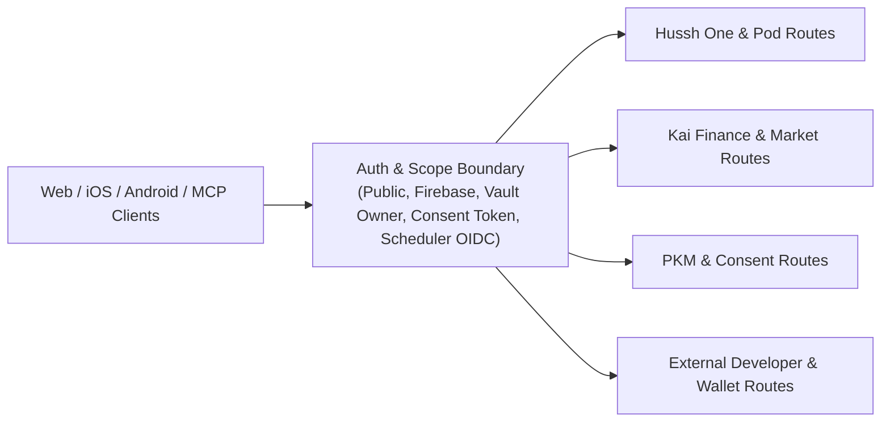

# API Route Catalog

[API Contracts Hub](api-contracts.md) · [Development](../README.md)

**Status:** Live | **Intent:** Reference | **Audience:** Backend, Frontend, Mobile, and Coding Agents

Complete endpoint catalog organized by authentication boundary and domain. For token hierarchy, response envelopes, and Kai Market Insights v2 markers, return to [API Contracts](api-contracts.md).

## Visual Map



## Route Categories

### One business suggestion completion

`GET /api/one/business/suggestion` and `POST /api/one/business/suggestion/complete`
require `VAULT_OWNER`; the authenticated subject is the sole account authority.
Completion accepts `{commits:[{domain,plan_id}]}` (1–64 distinct receipts). The
server verifies every owner-bound mutation commit and matching confirmed
`business_profile_review` content-write event before setting the permanent
`vault_keys.one_business_profile_saved` flag. It returns `{saved:true}`; uncommitted
receipts return 409 and unavailable storage returns retryable 503. Repeat
completion is idempotent. Responses are private and non-cacheable.

After completion, discovery returns its existing empty `no_match` envelope
before accessing Firebase or the directory. Review, Later, failed and partial
saves never set the flag. A lost completion response retains the acknowledged
encrypted review job so retry marks completion without replaying PKM writes.
This is UI progress for Magic Intelligence's optional Business subsection,
independent of personality progress and personal-profile saves; it does not
verify business ownership. Migration
`306_one_business_profile_saved.sql` must precede application rollout. There is
no historical event-only backfill, because one event can represent a partial
multi-card review. Web uses the existing One catch-all proxy; iOS and Android
use the same endpoint through the existing platform API transport.

### Hussh Coins earnings and sandbox redemption

Owner-only `VAULT_OWNER` endpoints under `/api/one/payouts`:

- `GET /hashcoins`: integer real and sandbox balances, reserved amounts, holds,
  fixed `coinsPerDollar=100`, payout mode and recent redemption status/history.
  Each hold carries a closed `reason` and `nextStep`; `redeemableCoins` excludes held coins.
- `POST /hashcoins/redeem`: `{amountCoins, clientRequestId, mode:"test"}`; strict
  integer bounds, owner-isolated idempotency and durable reservations. Returns
  pending, succeeded, failed or unknown. Success confirms a test Stripe transfer,
  never a real bank deposit. `mode:"live"` fails closed in this release.
- Existing account/onboard/manage/bank-payout endpoints use the explicitly
  configured Connect mode. Existing earnings history retains its payment mode.
- `GET /account/bank-payouts` reads the authenticated owner's mode-bound local
  ledger without provider credentials or webhook signing secrets. Provider
  operations and webhook verification retain their credential requirements.
- `POST /connect/sandbox-webhook`: public ingress with mandatory raw-body Stripe
  signature and test-mode/account validation. Legacy live webhook is unchanged.

Hussh Coins balances derive from immutable delivery-settled credits and compensating
entries. A sandbox redemption never updates a live balance or an old payout.
See [the document payment contract](../../operations/integrations/drive-request-stripe-paywall.md).

### Living source connector change journal

`GET /api/one/source-journal/connectors?after=0&limit=100` requires the
`VAULT_OWNER` token and returns `private, no-store`. `after` is a nonnegative
decimal cursor and `limit` is 1–100. All cursor and sequence fields are decimal
strings so native and JavaScript clients retain PostgreSQL `BIGINT` precision.
The response contains `events` with `eventId`, `sequence`, `sourceId`,
`operation` (`changed` or `deleted`), `schemaVersion` and `occurredAt`, plus
`nextCursor`, `headCursor`, `earliestCursor`, `hasMore` and `resetRequired`.
`earliestCursor` is the oldest cursor from which continuous replay is possible;
at most 2,048 hints per owner are retained. An old, future or discontinuous
cursor returns no events and `resetRequired:true`; the client must verify a
complete authoritative connector overview before checkpointing `headCursor`.
An account reset erases event content and advances a persistent cursor barrier,
including when that owner had no prior journal row. Full account erasure removes
the journal and suppresses later source writes for the deleted identity.
Hints carry no status, credential, account label, scope or provider payload,
and neither authorize sharing nor update encrypted memory on their own.
Invalid cursors and limits return a private 422; unavailable storage returns a
private 503. Web uses the existing `/api/one` catch-all proxy; native clients
use the same backend route.

### Hosted Live Memory pilot review intent

`GET`, `POST` and `DELETE /api/one/hosted-memory/pilot` require the authenticated
owner's `VAULT_OWNER` token and return `private, no-store`. There is no owner ID
in the URL or request body. `POST` accepts only
`{"sourceKind":"curated_oauth_connector","sourceId":"hubspot","reviewVersion":"hosted_memory_pilot.v1","expectedGeneration":"0","acknowledgeHostedCustody":true,"acknowledgeSourceScope":true}`.
`sourceId` must identify a checked-in curated OAuth MCP provider that is still
active in the operator-owned reviewed connector catalog. The selected provider
is pinned to this grant generation. A different provider requires a new review
generation and erases the preceding staged envelope.
Unknown fields, including attempted vault keys or owner tokens, are rejected
with a private 422. The response contains `status` (`off`, `pending`, `expired`,
or `revoked`), an opaque `grantId`, decimal-string `generation`, selected source,
review version and timestamps. `expectedGeneration` must match the current
decimal-string generation from GET; the first request uses `"0"`. A delayed
pre-revocation POST receives a private 409 and cannot rearm the row.
It always reports `captureEnabled:false` and `workerPaired:false`. A pending
review expires after 15 minutes. Repeating POST within that window is
idempotent at the current generation; a fresh request after expiration or
revocation gets a new grant ID and higher generation. DELETE is idempotent and
advances the generation on the first revocation; if no review row exists yet,
it creates a revoked generation-1 fence so a delayed initial POST cannot
restore pending intent. Owner account reset erases the
pending record; full account erasure cascades from `vault_keys`.

`PUT /api/one/hosted-memory/pilot/envelope` requires the same owner token and
stages one owner-encrypted `connector_status.v1` snapshot for the selected
provider. Its strict body has `grantId`, decimal-string `expectedGeneration`,
`sourceKind`, `sourceId`, `scope`, `envelopeVersion` (`aes256gcm.pilot.v1`),
decimal-string `expectedRevision`, UUID-v4 `keyId`, unpadded URL-safe base64
`nonceBase64Url` (12-byte AES-GCM IV), `ciphertextBase64Url` (ciphertext with
16-byte tag), and lowercase-hex `aadSha256`. The UTF-8 AAD is exactly
`hushh-hosted-source-v1\n` + unpadded base64url(owner UID) + `\n` + grant UUID
+ `\n` + decimal generation + `\n` + source ID +
`\nconnector_status.v1\n` + decimal new revision, without a trailing newline.
The owner encrypts with a locally owner-wrapped pilot key and a fresh random IV
for every revision. The server verifies the AAD digest, grant, source and
revision, but cannot inspect the encrypted status. It rejects reuse of the
immediately preceding `(keyId, nonce)` pair; the client remains responsible
for never reusing a key and IV across older revisions. A successful PUT and
`GET /api/one/hosted-memory/pilot/envelope` return exact ciphertext, digest,
revision and source metadata with `private, no-store` and
`captureEnabled:false`, `workerPaired:false`. Stale or changed grants return
private 409; malformed envelopes return private 422; absent current ciphertext
returns private 404.
The owner-side plaintext status before encryption uses
`not_connected|connected|verifying|needs_reauth|revoked|error`; `not_connected`
is an authoritative tombstone for future client projection merges.
The server cannot infer or validate any of these values from ciphertext.

Review and owner staging store no vault key, owner token, plaintext source value,
DEK, wrapped key, attestation or runtime credential. No route activates a worker,
releases a key, or authorizes closed-app source reads. A pending review expires
after 15 minutes and immediately blocks envelope readback and new staging.
The encrypted row remains in storage after expiry until renewed review, source
switch, revocation, account reset or full erasure; no expiry purge runs yet.
Grant change and revocation erase that row transactionally. A missing or
unavailable table returns a private 503 rather than claiming capture is active.
The owner-facing enrollment and separately reviewed key-custody protocol in
[the hosted custody ADR](../../architecture/hosted-confidential-memory-custody-adr.md) remain
future work.

### Wallet Profile lifecycle

The Wallet cards surface and `/one/wallet-card` share the same identity pass
authority. Owner endpoints under `/api/one/wallet-card` require the existing
`VAULT_OWNER` token and an exact owner match. `POST /ensure` accepts `userId`,
optional `cardPayload`, `avatarUrl` and a known `shareToken`; it creates only a
missing profile from account basics and returns the existing mutation response.
It preserves edits, pause, removal and the current QR during repeat/concurrent
requests. An authenticated owner can recover a new token from its encrypted
envelope or adopt a valid legacy device token; the envelope never leaves the
service. `GET` remains the status/snapshot read. Existing save, preview,
pause/resume, rotate, revoke, public resolve and signed pass routes remain the
same. The `username` payload field is optional and server-validated (3–30
lowercase letters/digits/single internal dots, reserved/blocked labels rejected).

Public QR resolves count aggregate visits only, without identifying scanners.
Profile and NWS share that QR and its scan counters. Owner-confirmed QR rotation
invalidates the old token and atomically resets `scanCount` and `lastScannedAt`
for the replacement, while preserving the profile and pass serial. Delayed
scans presenting the old token cannot increment the replacement's counter.

Referral has a separate invitation QR. Authenticated `POST
/api/one/referrals/rotate` accepts `{slug}` for the currently presented link,
derives the owner from Firebase authentication, and returns the current referral
summary. Disabling the old code and minting its replacement commit together;
allocation failure rolls back both. A stale/repeated request cannot disable a
newer replacement. Link opens and last opened apply to the current code only;
earned referrals, accepted invitations, relationships and credits are retained.
The existing One proxy and native API transport carry the same contract.
Saved payment-card secrets remain in the encrypted `wallet` PKM domain.
Temporary sharing of manually added cards uses the existing direct-message
transaction, connection/block checks and durable Feed projection. A successful
share creates a recipient-specific grant and an opaque message reference
atomically. Feed displays “[Sender name] shared their card with you” and a
“View card” action for both ordinary connections and Trusted Circle recipients.
The grant is resolved from recipient-bound server records, never message text
or persisted Feed metadata. Each share remains separate from ordinary chat
grouping. Failed transactions create neither a grant nor a notification.

The `/api/one/wallet/card-access` endpoints are:

| Method | Suffix | Authority and behavior |
| --- | --- | --- |
| GET | `/networks` | Matching Firebase identity and vault-owner consent; supported canonical network identifiers. Independent of temporary-sharing rollout. |
| POST | `/networks/resolve` | Same owner authority; transient six-digit issuer prefix and strict integer card length, optional selected network. No payment credentials accepted, persisted, logged or sent to a provider. Returns normalized `network`, `source`, and ambiguous `candidates`. |
| POST | `/artwork/resolve` | Matching Firebase identity and vault-owner consent. Only six/eight-digit IIN, strict PAN length and optional selected network. Approved-catalog candidates, honest unconfigured fallback; exact product/variant requires authorized proof. No full credentials, names or photos accepted or echoed. |
| POST | `/artwork/banks` | Same owner authority. Strict network, optional country, opaque issuer/country bank key, bounded offset and strict `automatic` boolean only. Default returns approved cosmetic bank choices. `automatic=true` returns network-wide illustrations in pages of 24 with `selectionBasis=network_illustration`, no bank key or separate picker confirmation; Add remains the owner-confirmed encrypted save. Other/unknown returns no automatic artwork. No exact proof or card credentials. Uses existing private asset/validation endpoints. |
| GET | `/artwork/assets/{sha256}` | Same owner authority. Current approved, digest-bound local PNG/JPEG/WebP; 512 KB maximum; private/no-store/nosniff. |
| POST | `/artwork/validate` | Same owner authority. At most 24 explicit catalog/issuer/product/variant/digest references under the private 16 KB cap. `purpose=selection` (default) requires current catalog version, selectable asset and complete provider snapshot. `purpose=saved` validates an immutable saved reference independently of unrelated catalog versions. Both require current approval, grant and rights. No stored owner image or card ID is disclosed. See [provider contract](../../architecture/one/wallet-artwork-providers.md). |
| POST | `/registrations` | Matching Firebase identity and vault-owner consent reserve a server card ID. Only a subsequent canonical Wallet PKM mutation activates manual origin. |
| GET | `/cards/{card_id}` | Owner-only sharing readiness and grant status, newest first in pages of 20. Optional `cursor` is the last grant ID; `nextCursor` and `hasMore` describe the next page, and each grant includes ISO `createdAt`. Cursors resolve only within the authenticated owner and card. No card-verification prompt is required. Older saved cards register through an owner-confirmed Wallet metadata refresh when shared. |
| GET | `/requests` | Matching Firebase and vault-owner identity; pending incoming Wallet requests only. Optional owner-bound UUID `cursor`, `limit=1..100`; returns metadata-only `items` (`id`, `createdAt`, `expiresAt`), `hasMore`, `nextCursor`. Requires current connection, no blocks, recipient-visible message and unexpired request. Pure read; never expires or mutates requests. |
| GET | `/connections` | Owner-only searchable active connections with explicit Trusted Circle membership. |
| GET | `/profile` | Matching identity and vault-owner consent; current canonical Profile Card eligibility and server-issued card ID, without profile contents. |
| GET | `/history` | Participant-only unified ledger. `direction=outgoing\|received`, optional `cardType=payment\|profile`, `limit=1..100` (default 20), and participant/filter-bound `cursor`. Returns `items`, `hasMore`, `nextCursor`, `serverNow`. |
| GET | `/history/{grant_id}` | Matching identity and vault-owner consent; outgoing or received grant detail only for that participant, with lifecycle activity. |
| POST | `/cards/{card_id}/grants` | Owner-only, idempotent, per-recipient 5/10/15-minute grants and transactional messages. |
| DELETE | `/grants/{grant_id}` | Owner-only revocation. |
| GET | `/grants/{grant_id}` | Authenticated recipient-only view; checks expiry, revocation, origin and relationship. |
| POST | `/grants/{grant_id}/verify` | Fresh same-user Firebase provider authentication after the server challenge for non-trusted recipients. |

Responses are private and non-cacheable. The encrypted server projection contains
network, last four digits, expiry and normalized issuing region. New grant requests
may also provide `encryptedCards`, an exact map of selected person references to
bounded `hushh-wallet-card:v1:` recipient envelopes (maximum 4096 characters each,
20 recipients, 96 KiB request limit). Plaintext PAN, CVV, PIN and vault keys remain
forbidden. Each recipient's envelope is stored only in that grant's encrypted
contents, never notifications or Feed metadata. Authorized active views return
`encryptedCard` and the authenticated owner's `senderUserId` for client decryption;
denied, expired and revoked views return neither. Old grants remain masked. Removing the
card revokes access. Explicit owner-added Trusted Circle members skip additional
verification; ordinary connection mirror records do not grant this exemption.

Rollout requires migration `302_wallet_temporary_card_access.sql`, the existing
direct-message encryption key and `WALLET_CARD_ACCESS_ENABLED=true` (default off).
The backend Cloud Build substitution `_WALLET_CARD_ACCESS_ENABLED` explicitly
binds this flag so replacement environment deployments preserve its setting.
The UAT workflow enables it with the existing UAT encryption-key binding;
`WALLET_CARD_ACCESS_UAT_ENABLED=false` is the UAT rollback switch. The workflow
omits the substitution when an older selected build config does not declare it.
Other deploy lanes retain the default-off setting until their own prerequisites
are provisioned. HTTP 503 distinguishes `WALLET_CARD_ACCESS_DISABLED` (flag off)
from `WALLET_CARD_ACCESS_NOT_READY` (required sharing schema absent). Unexpected
storage failures retain the generic `WALLET_CARD_ACCESS_UNAVAILABLE` failure.
The sharing-history client retains verified history and pauses automatic focus,
visibility and timer refresh only for the two explicit readiness reasons. Manual
retry, a confirmed sharing change, or a new owner/vault session can read again;
no readiness result is stored in browser persistence.
After these changes land on green `main`, dispatch **Deploy to UAT** with scope
`auto` and that exact commit SHA; confirm the resolved scope includes both the
backend flag and the Wallet readiness UI. Verify sharing readiness, creation, recipient access and revocation
with an owner-added card and an authorized test connection. Changing the rollback
variable takes effect on the next backend deployment, not immediately.
The PKM commit derives an encrypted sharing projection from validated card
summaries after client metadata normalization. It binds each envelope to the
owner and card ID; activation additionally requires the current committed
manifest revision. Confirmed Wallet mutations register existing owner-entered
payment cards automatically; unknown references, system cards and other owners'
cards remain excluded. Manifest metadata may include this
encrypted projection, never plaintext card credentials. Random encryption
nonces are excluded from mutation retry fingerprints. Missing keys leave the
owner's save available but sharing unavailable. Existing encrypted records are
never classified by a bulk database backfill; the owner's Share action refreshes
their canonical Wallet metadata, preserving the original card details.
The native viewer stays unavailable until active capture protection is supported.
The browser viewer clears on hide/expiry and offers no copy, export or print,
but cannot prevent device screenshots or external cameras. Old encrypted-copy
readers and owner receipts remain compatible; previously sent copies cannot be
recalled. The canonical Wallet Profile Card also supports private recipient grants
after migrations 322–325. Its current selected public-field projection is intersected
with the fields permitted at creation; removing a field immediately removes it from
the next read, and adding a field cannot widen an existing grant. Pause makes reads
unavailable; revocation, source replacement and deletion terminate existing grants.
System Agent One Profile, Referral, NWS and received-card resharing gain no permissions.
Public QR links retain their separate, anonymous aggregate-visit behavior.
History contains masked card descriptors, public participant references and names,
creation/expiry/duration, immutable creation trust, verification posture/time,
revocation/last-view times and bounded lifecycle events. Unknown historical creation
trust is `null`/`legacy_unspecified`, never inferred from today's membership.
`SHARE_DELIVERED` means the Messages/Feed transaction accepted delivery, not a push
provider receipt. Expiry is enforced by the database clock on every access;
`SHARE_EXPIRED` is recorded lazily once when the grant is read or listed.
See [universal sharing operations](../../architecture/one/wallet-sharing.md) for migration,
compatibility, verification and rollback details.
See [Wallet](../../architecture/one/wallet.md) and the
[Wallet Profile contract](../../architecture/one/wallet-profile-card.md).

### Public (No Auth)

| Method | Path                                      | Description                                                                                             |
| ------ | ----------------------------------------- | ------------------------------------------------------------------------------------------------------- |
| GET    | `/health`                                 | Detailed health check with agent list                                                                   |
| GET    | `/health/ready`                           | Dependency readiness with bounded advisory signals                                                     |
| GET    | `/api/kai/health`                         | Kai subsystem health                                                                                    |
| GET    | `/api/investors/search?q={name}`          | Fuzzy search investors by name                                                                          |
| GET    | `/api/investors/{investor_id}`            | Full investor profile by ID                                                                             |
| GET    | `/api/investors/cik/{cik}`                | Investor profile by SEC CIK                                                                             |
| GET    | `/api/investors/stats`                    | Investor database statistics                                                                            |
| GET    | `/api/tickers/search?q={query}&limit={n}` | Public ticker search with enrichment metadata                                                           |
| GET    | `/api/tickers/all`                        | Full ticker universe export with enrichment metadata                                                    |
| POST   | `/api/validate-token`                     | Validate a consent token                                                                                |
| GET    | `/api/app-config/review-mode`             | Review mode toggle (enabled only)                                                                       |
| POST   | `/api/app-config/review-mode/session`     | Non-production reviewer mint: a supplied `reviewer_uid` must name the configured reviewer paired with its passphrase; unknown or mismatched identities fail closed. Legacy callers may omit the UID and authenticate by configured passphrase. |

`GET /health/ready` gates shared-runtime readiness on the database and production
Firebase Admin configuration. In UAT and production only, its
`checks.phone_test_transport` is `healthy` or `unavailable`, using the recorded
phone transport's canonical configuration prerequisites. This advisory value
never changes HTTP readiness or removes ordinary authentication traffic. It
exposes no configured values, counts, or identifiers and issues no challenge or
SMS. `healthy` establishes configuration availability, not phone ownership,
successful confirmation, identity persistence, or real SMS delivery. The field
is absent outside those environments and on private pods; `/health` is unchanged.

### Developer API (Developer Token / Developer API Enabled)

| Method | Path                            | Description                                                                                                                                                                                                                                                                           |
| ------ | ------------------------------- | ------------------------------------------------------------------------------------------------------------------------------------------------------------------------------------------------------------------------------------------------------------------------------------- |
| GET    | `/api/v1`                       | Developer API root summary (`410` when developer API disabled)                                                                                                                                                                                                                        |
| GET    | `/api/v1/list-scopes`           | Generic dynamic scope catalog (`410` when developer API disabled)                                                                                                                                                                                                                     |
| GET    | `/api/v1/tool-catalog`          | Public-beta or app-filtered tool visibility                                                                                                                                                                                                                                           |
| GET    | `/api/v1/user-scopes/{user_id}` | Discover materialized dynamic user scopes for one user; reserved empty PKM shapes are omitted (requires `Authorization: Bearer <developer-token>`)                                                                                                                                    |
| GET    | `/api/v1/consent-status`        | Check app-scoped consent status by scope or request id                                                                                                                                                                                                                                |
| POST   | `/api/v1/request-consent`       | Create or reuse consent for one currently materialized/discovered `attr.*` scope or approved capability such as `cap.one.invoke`; empty dynamic scopes fail before pending/active reuse while static capabilities are unaffected (requires `Authorization: Bearer <developer-token>`) |
| POST   | `/api/v1/public-profile-export` | Read an owner-published public-profile resource by opaque handle; records audit metadata and never returns raw PKM                                                                                                                                                                    |
| POST   | `/api/v1/scoped-export`         | Fetch encrypted consent export metadata and ciphertext for an approved developer grant                                                                                                                                                                                                |

### Developer Portal (Firebase Sign-In / Self-Serve)

| Method | Path                               | Description                                                           |
| ------ | ---------------------------------- | --------------------------------------------------------------------- |
| GET    | `/api/developer/access`            | Read the self-serve developer workspace for the signed-in Kai account |
| POST   | `/api/developer/access/enable`     | Create the self-serve developer app and first active token            |
| PATCH  | `/api/developer/access/profile`    | Update the app identity shown during Kai consent review               |
| POST   | `/api/developer/access/rotate-key` | Revoke the current developer token and issue a replacement            |

### Debug (Dev Only)

| Method | Path                      | Description                                                |
| ------ | ------------------------- | ---------------------------------------------------------- |
| GET    | `/debug/diagnostics`      | Registered route diagnostics (returns `404` in production) |
| GET    | `/debug/consent-listener` | Consent listener diagnostics (returns `404` in production) |
| GET    | `/api/_debug/firebase`    | Firebase debug endpoint (returns `404` in production)      |

### Firebase Auth (Bootstrap)

`POST /api/consent/vault-owner-token` accepts `{userId, renewalOfToken?}`.
Omitting `renewalOfToken` retains the existing explicit local-unlock issuance
contract; the server verifies Firebase identity, not a new vault-key proof.
While the same verified user remains locally unlocked in one app document,
clients renew with the prior owner token. Renewal requires a signed, same-user,
non-device `self` / `vault.owner` grant and its intact canonical
`internal_access_events` lineage. Expired evidence may renew, but never authorizes
a data request. Any later owner revocation permanently rejects that lineage,
including after a different explicit unlock. Renewal and owner revocation use
one Postgres transaction lock; no new session store or key persistence is added.
Invalid/revoked renewal returns `403 AUTH_VAULT_OWNER_INVALID`; ledger uncertainty
returns no-store `503 AUTH_ACCOUNT_STATUS_UNAVAILABLE` without bootstrap fallback.
Web proxy and iOS/Android plugins preserve these typed errors. A reload/new app
document starts locked; short interruptions and route changes retain the local
key, with unavailable authority gated for retry.

For self-owner grants only, multiple signed grants in the intact lineage remain
usable up to each token's **original** expiry; renewing does not extend old
credentials. This tolerates a lost response or another tab renewing. Delegated
and device capabilities keep their latest-token validation rules. A successful
renewal adds `renewalValidated: true`; clients reject missing/false acknowledgment.
Deploy the backend before the matching web/native clients and coordinate rollback:
an older backend ignores the new input and must not be used for renewal traffic.
The acknowledgment fails closed on receipt but cannot prevent an older server
from attempting its legacy issuance before returning the incompatible response.

| Method | Path                                                  | Description                                                                                                                                                     |
| ------ | ----------------------------------------------------- | --------------------------------------------------------------------------------------------------------------------------------------------------------------- |
| POST   | `/api/consent/vault-owner-token`                      | Issue VAULT_OWNER token                                                                                                                                         |
| POST   | `/api/consent/vault-owner-token/device`               | Issue a 15-minute device-bound VAULT_OWNER token after Firebase auth and a signed one-time device challenge                                                     |
| POST   | `/api/account/trusted-device-authorizations`          | Approve a UAT-flagged PKCE-bound Hermes installation for the signed-in account                                                                                  |
| POST   | `/api/account/trusted-device-authorizations/exchange` | Consume a one-time PKCE code and return a Firebase custom token, registered device identity, and server-verified account email for local trusted-device display |
| GET    | `/api/account/trusted-devices`                        | List signed-in account device metadata and revocation status                                                                                                    |
| POST   | `/api/account/trusted-devices/{device_id}/challenge`  | Create a short-lived device proof-of-possession challenge                                                                                                       |
| DELETE | `/api/account/trusted-devices/{device_id}`            | Revoke the device and its device-bound owner capabilities                                                                                                       |
| POST   | `/api/notifications/register`                         | Register FCM push token                                                                                                                                         |
| DELETE | `/api/notifications/unregister`                       | Unregister FCM tokens (logout)                                                                                                                                  |
| POST   | `/api/kai/consent/grant`                              | Grant consent for Kai scopes                                                                                                                                    |

### Private Agent Space Name

`GET` and `PUT /api/one/personal-agent/space-name` require Firebase owner
authentication and the existing personal-agent feature flag. PUT accepts
`spaceName`, validates the handle, and updates only the existing owner row's
`space_id`. It preserves pod status, custody, billing identity and lifecycle
timestamps. An absent or concurrently deleted row returns the existing
`409 NO_AGENT`; naming cannot create a registry row.

### WorkOS enterprise SSO (flagged)

Gated by `WORKOS_SSO_ENABLED` (default off). While off, every sign-in route answers `404` (the webhook too, until `WORKOS_WEBHOOK_SECRET` is provisioned; after that it keeps deprovisioning, so turning sign-in off as a rollback never drops offboarding) and Firebase sign-in is unchanged. SSO proves identity only: a successful exchange returns a Firebase custom token and grants no role, consent, or vault access. WorkOS is the authority for organizations, DNS-verified domains and connections; there is no Hussh-side registry or table. See the [ADR](../../architecture/enterprise-sso-workos-adr.md). Both sign-in routes are rate limited per client IP.

| Method | Path | Auth | Purpose |
|--------|------|------|---------|
| POST | `/api/auth/sso/start` (JSON body `{email}` or `{organization_id}`, optional `origin`) | None | Ask WorkOS which organization has verified the email's domain and has not had SSO switched off, and return `{authorization_url, state, organization}`. Free-mail domains, unknown domains and organizations whose connections are all inactive return `404 sso_not_available`. |
| POST | `/api/auth/sso/exchange` | None (one-time WorkOS code + signed state) | `{code, state}` returns `{custom_token, user_id, is_new_account, organization}`. The client signs in with the custom token. The IdP's name fills the Firebase display name only when the account has none. Refusals: `sso_state_invalid`, `sso_code_invalid`, `sso_org_mismatch`, `sso_org_not_enabled`, `sso_domain_not_verified`, `sso_deprovisioned`, `sso_email_conflict`, `sso_account_conflict`, `sso_account_deleted`. |
| POST | `/api/webhooks/workos` | `WorkOS-Signature` over the raw body (180 s window) | Directory Sync deprovisioning. `dsync.user.deleted` and `dsync.user.updated` with `state: inactive` or `suspended` mark the person deprovisioned and refuse later sign-in through the organization. An account SSO created is also disabled, its refresh tokens revoked and its consent grants revoked; an existing personal account that SSO only linked has its sessions revoked and is otherwise left alone. Every step is idempotent, so redelivery repeats harmlessly. Other events are acknowledged and ignored. |

The custom token carries exactly `auth_provider=workos` and `workos_org_id`. The browser must compare the returned `state` to the value it stored before redirecting, then pass it back to the exchange.

### Chat push device registration

`POST /api/notifications/register` uses Firebase authentication and verifies the
body's `user_id` against the authenticated account. Its body is
`{user_id, token, platform, device_id?, preview_key_id?, preview_public_key?}`.
Installation and preview identifiers are UUIDs. The preview public key is a
canonical base64url raw uncompressed P-256 point (87 characters); its key ID
and public key must be supplied together. It opens notification previews only
and grants no vault or chat-history access. A stable installation can rotate
its FCM token; a token or installation belongs to one account at a time.
Multiple installations on the same platform remain registered independently.
`DELETE /api/notifications/unregister` accepts `{user_id, device_id?, platform?}`;
`device_id` removes only this account's installation. Legacy platform/all-account
removal is retained for older clients. New clients always pass their installation.

Circle chat state includes `notificationDevices` for current other members
(`userId`, `keyId`, `publicKey`, bounded to 500 installations). The optional
`notificationPreviews` message field maps preview key UUIDs to sealed envelopes,
with at most 500 entries, 2600 characters per envelope and a 9 MiB total request
limit including encrypted photo content. Normal Circle message access continues
to require current membership and VAULT_OWNER authorization. Sender clients seal
only a short message preview for each installation; the server separately seals
canonical sender/Circle identity, preventing sender-supplied identity spoofing.
New keys or old clients without a preview receive a generic alert.

Migration `290_chat_push_delivery.sql` adds the transactional direct-message
outbox, per-installation provider-acceptance ledger and preview metadata. Apply
it before running the new workers. `PushTokensService` owns the additive
`user_push_installations` registry and maintains the `user_push_tokens` legacy
projection with its original `UNIQUE (user_id, platform)` conflict target. Serving
older handlers and an unmodified backend rollback can still register tokens.
A database reconciliation trigger revokes the former account's registration
when an older handler transfers a token; a unique legacy token fence rejects
unseen concurrent claims. Device transfers retire the old token's projection,
including when the token changes. New readers prefer installation rows and
deduplicate legacy projections; device unregister and stale-token cleanup remain
owner-scoped and restore a surviving device's legacy projection. Full-account
tombstones also erase both registries beneath older erasure handlers. SQL
rollback removes the new outbox/ledger and Circle
preview column while retaining the compatible registry and ownership bridge.
Existing account-deletion write guards and erasure paths cover both registries. See
[Feed notification model](../../architecture/one/feed-notification-model.md#device-system-chat-notifications)
for rendering, privacy, retries and native release verification.

### One Person Request History

Chat records an inline scope-discovery send through
`POST /api/one/agent-chat/history/{conversation_id}/information-requests`.
It requires the requester's VAULT_OWNER token and accepts only
`source_activity_id`, `bundle_id`, and `idempotency_key` from the confirmed
request. The server verifies that the conversation and discovery belong to the
owner, that the request ledger binds the key to that bundle and recipient, and
derives an allowlisted submitted-card descriptor from current request metadata.
One deterministic, content-less encrypted ADK session event is appended per
discovery card; retries return that event without a second request or card.
Chat history suppresses the superseded discovery card and restores the
submitted descriptor. This history receipt is presentation-only: grant status
and encrypted exports must still be reread under current authority, and no
vault key, connector credential, scope payload, or decrypted value is stored.

#### Continuing the asking chat after an answer

When the other person approves, declines, lets a chat-sent request expire, or
later ends access, the requester's app opens one follow-up turn in the same
conversation with
`forwardedProps.consentContinuation = {bundleId, outcome, sharedInformation?}`
and the fixed message for that outcome:

| `outcome` | Fixed message |
| --- | --- |
| `granted` | `Consent approved` |
| `partially_granted` | `Partly approved` |
| `denied` | `Request declined` |
| `expired` | `Request expired` |
| `revoked` | `Access ended` |

`POST /api/one/agent-chat` admits it only with the requester's VAULT_OWNER token
and chat key, only in the conversation that recorded the submission, only when
the ledger's current outcome for that bundle (`progress.outcome`, read as the
requester) equals `outcome`, and only once per bundle (`409` otherwise). The one
exception: a bundle continued with `granted` or `partially_granted` may be
continued once more with `expired` or `revoked`. A client that sends `granted`
for a partial answer is admitted and recorded as `partially_granted`. The model
is told which fields were shared and which were not. No tool runs in that turn
(tool calling mode `NONE`) and it runs at the lowest thinking level the model
accepts. `sharedInformation` is accepted only for `granted`/`partially_granted`
(≤ 12,000 characters), is the text the requester's device decrypted from the
approved export, and is held as a 10-minute in-memory request secret; session
state carries only its reference. Anything else returns `400`/`409`.
**Sensitive values never reach the model (CONTRACT-2 C7).** The device sends a
sensitive item's field-name outline instead of its values. Admission enforces
it again before the text is stored: each line of an item whose
`sensitivity` is `sensitive` (or missing) becomes
`- <label>: N fields (<names>). Sensitive: shown to the person in the secure card on their device; the values are not shared with you.`,
built from key names only, and a line no `standard` item claims is dropped.
**Field level (2026-09-29).** A `standard` item is checked line by line with
`hushh_mcp/consent/field_sensitivity.py` `field_sensitivity(key_path, value)`:
an identifier-class key on the line's path (SSN, SIN, national id, tax id, TIN,
EIN, FEIN, ITIN, passport, driver license, account or routing number, IBAN, card
number, CVV, date of birth, government id numbers, security answers, anything
secret-shaped) or an identifier-shaped value (an SSN, an EIN, a Luhn-valid card
number, an IBAN, a credential string) removes that line and names the field in
`- <label>: sensitive field(s) (<names>). Shown to the person in the secure card on their device; the values are not shared with you.`
The rest of the item still reaches the model. Unknown keys in a standard item
stay standard. The words, phrases and value patterns live in
`contracts/consent/field-sensitivity.v1.json` (backend copy under
`consent-protocol/contracts/consent/`), so the client applies the same rule
before it builds `sharedInformation`. Measured cause: in localhost acceptance
run 4 the same EIN was sensitive under "Tax record" and standard as "Fein" under
"Legal entity information".
It logs `one.consent_sensitive_stripped count=<lines>` (a count only). The
turn's instruction names those items and tells One the values are in the secure
card above, never to guess or restate them. Every outline the model's block
carries is also listed in the instruction as shared but hidden
(`Shared with the person but hidden from you, with values only in the secure card above: Tax record (Filing year, Refund).`),
and One is told to answer the rest from the values and say those parts are in
the secure card, never that they were not shared. A declined request's turn
offers exactly one concrete alternative (a narrower item, or asking later).
`GET /api/one/agent-chat/history/{conversation_id}` returns `consentOutcomes`
(`{bundleId: outcome}` for bundles already continued), `consentAccessEnded`
(`{bundleId: "revoked"|"expired"}`), and restores the follow-up message as a
`selection` chip.

**Redaction after access ends (CONTRACT C3).** Every turn that ran while a
bundle's shared information was live in the conversation (the answer turn and
later turns until access ends) is recorded against the bundle in sealed session
state. Before each later model call the server re-reads the bundle as the
requester; once access has ended (`revoked`, `expired`, or `progress.ended_at`
set) it replaces those turns' model-side content in the model request with
`Access to <labels> from <name> ended; do not use or repeat it.` Turns are
located by identity: the person's own messages in the request are aligned in
order with the sealed session's user events, and everything else between two
of them belongs to that turn. If a tagged turn cannot be located, that bundle
fails closed and every model-side content from its first tagged turn onward is
replaced. A fenced shared block, or a tool payload naming an ended bundle, is
replaced wherever it appears. Each model call logs
`one.consent_redaction bundles=… tagged_turns=… replaced=… mode=identity|fail_closed`
(bundle ids and counts only). Stored sealed events are not modified.

The continuation record (`temp:hussh:consent_continuation`) belongs to its
answer turn only. The encrypted session store never seals `temp:` state and
drops any it finds in an older row; a shared continuation record seen in any
later invocation is refused (`one.consent_continuation_stale`), and a fenced
shared block is stripped from any other turn's instruction. Measured
2026-09-28: before this, the sealed record re-rendered the shared block into
every later turn for its 10-minute lifetime, blocked their tools, and skipped
the revoke check. In the history response, those turns' assistant
messages carry `metadata.consentBundleId` and
`metadata.consentAccess = {bundleId, state: "live"|"ended", outcome, personName, labels}`;
once ended the message's `content` is `""`, its cards and activity are dropped,
`metadata.consentAccessEnded` is `true`, and only one such message is returned
per turn. The status chip carries `consentBundleId` (and `consentAccessEnded`).

#### Request progress (CONTRACT C1)

`GET /api/one/information-requests/{bundle_id}` (VAULT_OWNER, requester-bound)
is polled while a request is open, so it reads three indexed queries whatever
the item count: the bundle joined with its items, the items' state transitions
(each item's status is its latest transition, the same rows `progress` is built
from), and the owner-scoped delivery records (`internal_access_events` by
`(user_id, action)`). It loads no catalog, profile or export. Measured
2026-09-29 against UAT through the local proxy: 5 to 6 round trips (growing with
item count) and 1.29 s to 1.73 s median before; 3 round trips and 0.84 s after.
It keeps `bundleId, personRef, purpose, durationSeconds, cancelled, items` and adds:

```json
"progress": {
  "requested_at": "iso",
  "delivered_at": "iso|null",
  "seen_at": "iso|null",
  "decided_at": "iso|null",
  "outcome": "pending|granted|partially_granted|denied|expired|revoked|cancelled",
  "access_ends_at": "iso|null",
  "ended_at": "iso|null",
  "fields": [{"scope": "attr.food.preferences.*", "label": "Food preferences", "sensitivity": "sensitive|standard", "status": "pending|granted|denied|expired|revoked|cancelled"}]
}
```

`delivered_at` is the first `NOTIFICATION_SENT` and `seen_at` the first
`NOTIFICATION_OPENED` for any field. `decided_at` is set once no field is
pending. `access_ends_at` is when current access ends. `ended_at` is when access
that was granted ended (revoked or ran out); it stays `null` for a request that
expired before a decision. `revoked` (the owner ended it) is never reported as
`expired` (time ended it). `cancelled` means the requester withdrew. Labels come
from `hushh_mcp/consent/scope_labels.py`. A field in a credential domain is
refused at creation with `403` even if a catalog offered it.

`sensitivity` (on `items[]`, `progress.fields[]`, catalog items, viewer-profile
grants and the shared-with-me card) comes from one server function,
`hushh_mcp/consent/scope_sensitivity.py` `scope_sensitivity(scope, pkm_tags)`.
It is `sensitive` for the tax, financial or banking, identity or government-id,
health or medical, and credentials domains (by registry key or by the words of
a dynamic domain or path), for any scope a PKM tag (`restricted`,
`confidential`, `sensitive`) marks, including a wildcard over a tagged branch,
for any scope whose path holds an identifier-class key (`attr.legal_entity.entity.fein`),
and for anything that is not a well-formed `attr.<domain>` scope. Everything
else is `standard`. A stored `standard` never downgrades it.

Labels: a stored label that is mechanical ("Tax Record Domain", "Fein",
"Naics code") is replaced. A whole dynamic domain whose name is already a
specific thing reads as that thing ("Tax record", "Legal entity"); a registry
domain reads "Food & dining information". Field keys and enum values with a
fixed human name ("Federal EIN", "Industry code (NAICS)", "C corporation") come
from `contracts/consent/field-labels.v1.json`, which the secure card should
read too. The requester-facing catalog drops record-keeping rows ("Schema",
"Last updated", "Holdings is editable", "Connection count") the way it drops a
record's schema fields, and "tax", "tax return", "refund", "irs" and "filing"
reach a tax record by synonym; a question that says any of them never reaches
a financial row by synonym alone (a tax question proposes the tax record, never
Portfolio).

#### Outcome doorbell: `information_request_updated` (CONTRACT C2)

This is the single, canonical event a requester (and later the requester's pod
agent) consumes: `(requester_user_id, bundle_id, outcome, at)`. The consent
listener emits it to the requester over FCM data and the authenticated consent
SSE stream for `CONSENT_GRANTED`, `CONSENT_DENIED`, `TIMEOUT`, `REVOKED` and
`CANCELLED` rows of a person-to-person bundle, including each field of a
partial answer. Payload (identifiers and words only, never a scope, label or
value):

```json
{"type": "information_request_updated", "bundle_id": "uuid", "request_id": "one_person_…",
 "action": "CONSENT_GRANTED|CONSENT_DENIED|TIMEOUT|REVOKED|CANCELLED",
 "outcome": "pending|granted|partially_granted|denied|expired|revoked|cancelled",
 "at": "iso", "message_id": "information-request:<bundle>:<request>:<action>:<issued_at>"}
```

`outcome` is the bundle's `progress.outcome` after this event (omitted only if
that read failed; the client rereads the bundle anyway). TIMEOUT rows carry
`bundle_id` since 2026-09-28. Delivery is exactly once per event per device:
each consent event is claimed by its `consent_audit` id in
`consent_event_deliveries` (migration 259) before the push, the owner's
`NOTIFICATION_SENT` record or the requester's doorbell push is sent, so the
many workers that receive the same PostgreSQL NOTIFY cannot repeat it. Each SSE
stream lives in one worker and receives the event once. The visible push stays
bare (see `consent-protocol/docs/reference/fcm-notifications.md`).

`GET /api/one/agent-chat/information-requests/{bundle_id}/conversation`
(VAULT_OWNER + chat key) returns `{conversationId}` for the requester's own
conversation that recorded the submission, or `404`. It exists because the
answer push carries only the bundle id; the conversation lives in sealed history.

#### One's own attention moments

`POST /api/one/first-connect-insights` (VAULT_OWNER + chat key, the same gate as
a chat turn) offers the "Here's what I picked up" card for one Gmail, Calendar
or Drive source first connected within the last seven days and not yet offered.
It returns `{status: "none"|"empty"|"unavailable"}` or `{status: "offered",
source, sourceLabel, items: [{id, kind, label, memory_text, evidence}]}` (at most
five). The items come from the manifest gene `one_first_connect_insights` over
that source's metadata only, and are not stored: `one_attention_ledger`
(migration 257) records only that the source was offered. Keep saves one item
through the client's owner-confirmed encrypted PKM writer; nothing else writes
memory.

A `one_feed_attention` push (see `consent-protocol/docs/reference/fcm-notifications.md`)
opens `/?feedAttention=<feed row id>`. After unlock the app starts a fresh chat
whose first turn is the fixed message `Opened an update from your feed` with
`forwardedProps.feedAttention = {itemId}`. `POST /api/one/agent-chat` admits it
only for the VAULT_OWNER's own feed row that the server actually pushed
(`404` otherwise), only once per row per conversation (`409`), and only with
that exact message and payload shape (`400`). The row's Feed projection is held
as a 10-minute in-memory request secret for the turn; no tool runs in it; the
history restores the message as a `selection` chip.

**Saved receipts in chat.** Receipt lists, spending totals and overdue or due
payments in typed chat come from One's receipt functions, which the owner's
device runs over its encrypted receipt snapshot; the hub validates their closed
requests and results (`receipt_client_tools.py`, `receipt_result_contract.py`)
and never holds the vault key. `POST /api/one/agent-chat` still pops a legacy
`forwardedProps.receiptMemory` from older clients before the bridge can copy it,
and keeps nothing: the Email specialist no longer reads a saved receipt index. A
receipts question that reaches it returns `receipt_functions_required` without
reading mail, and One answers with its receipt functions in the same turn. Typed chat also sends `forwardedProps.emailDraftContract: 2` on every run; the hub and owner-pod ingress admit it per turn as `temp:hussh:email_draft_envelope`. Only with it does One pass named people to `open_gmail_email_draft` as `recipient_names` for server-side matching; an installed native build without it shows only the call's own To, so One looks the address up with `list_my_connections` and names are refused with `recipient_address_required`. The index is written only through writer
`gmail_receipt_memory_save_button`: once, automatically, after each sync the
owner starts on Mail > Receipts (the product default, set by
`RECEIPT_MEMORY_AUTO_SAVE_DEFAULT`). The page shows no save control. Opening the
page, a partly loaded list or a failed sync never writes; a failed save retries
twice, quietly, then waits for the next sync. Every field of the write that
names its author, including the structure decision's `source_agent`, is that
writer id, because the pre-save validation request carries no mutation plan and
the reserved-branch guard judges it by `source_agent` alone.

**Queued messages (Claude-Code-style queueing).** While One works on a typed
turn, the composer stays usable. A message sent then is offered to the running
turn with `POST /api/one/agent-chat/runs/{conversation_id}/queue`
(`{client_message_id, text}`, VAULT_OWNER, no chat key). The turn reads it at
its next model step, after a tool or agent step returns, and appends it to the
sealed conversation as the person's own event (history metadata
`queuedInput: "joined"`). A turn that is writing its final answer, was stopped,
answers a consent continuation or a feed item, resumes a confirmation, or has
passed the post-read barrier does not take it: the receipt or the settlement
says `returned` and the client sends it as the next turn, several queued
messages together in order. The stream reports placement as an AG-UI `CUSTOM`
event named `hussh.queued_input` carrying only ids
(`{phase: "joined" | "settled", joined, returned}`), never text. Every
operation is idempotent by `client_message_id`; the client settles every id it
offered from `GET .../queue?ids=` before the next turn starts, so nothing is
sent twice or lost across retries and reconnects. `POST .../stop` ends the
running turn at its next step with the answer `Stopped.` and returns what it
held. Queued text is process memory until sealed or dropped; an enqueue that
reaches an instance not running the turn is returned, so it degrades to
next-turn delivery. Contract and fallbacks: `consent-protocol/hushh_mcp/one_adk/queued_input.py`.

`GET /api/one/information-requests/shared-with-me` (VAULT_OWNER) lists the
current approvals other people gave this person: display names, item labels,
bundle and request ids, purpose and expiry, plus `grantRef` (the request id),
`sensitivity`, `fieldOutline` (field names from the owner's catalog, never
values), `fields` (`[{name, sensitivity}]`: every field of a sensitive item is
sensitive, and an identifier field such as "Federal EIN" is sensitive inside a
standard item), `sharedAt`, `accessEndsAt` and `decryptable`. A grant whose
scope another live, openable grant from the same person covers is not listed
separately (a request that asked for `attr.legal_entity.*` and
`attr.legal_entity.entity.*` lists one item), and items sort by person, then
label, then when shared, the same order the person page's `grants` use. The
outline leaves out a record's schema fields ("Events kind") and record-keeping
rows. The consent ledger decides
what is current, so an item approved before its request was withdrawn is still
listed, and an active grant that no request row names is swept in from the
ledger with `bundleId: null, decryptable: false` (no existing path can open it).
It never returns values; those stay in each encrypted export and open on the
person's own device.

**"Shared with you" card in chat (CONTRACT-2 C6).** One's
`list_information_shared_with_me` tool returns the same shares as
`cards: [card]` (plus `card` when exactly one person), each:

```json
{
  "kind": "one.shared_with_me_card.v1",
  "person": {"personRef": "...", "displayName": "Manish Sainani", "profilePath": "/people/<ref>"},
  "items": [{"grantRef": "<request id>", "requestId": "<request id>", "bundleId": "<uuid>|null",
             "label": "Tax record", "sensitivity": "sensitive|standard",
             "fieldOutline": ["Filing year", "Refund"],
             "fields": [{"name": "Filing year", "sensitivity": "sensitive"}], "sharedAt": "iso|null",
             "accessEndsAt": "iso|null", "purpose": "...", "decryptable": true}],
  "decryptVia": "information_request_exports"
}
```

`decryptVia` names the existing path: `GET /api/one/information-requests/{bundleId}`
then `/exports`, matched by `requestId`. The model reads the same result, so it
holds labels and field names only. History restores it as the structured
experience `one.shared_with_me_card.v1` with content `{cards: [...]}`, each card
re-validated field by field.

`GET /api/one/people/{person_ref}/relationship` requires Firebase authentication
and returns `{personRef, relationship}` through the existing relationship owner.
Self, missing, or inactive profiles return 404. The private/no-store read omits
internal subject IDs, contacts, catalogs, grants and history. It establishes
current presentation eligibility independently of slower full-profile assembly;
mutations still recheck current server authority. The complete viewer response
remains unchanged and can establish eligibility if the narrow read fails.

`GET /api/one/people/{person_ref}/request-history` requires the authenticated
Firebase user. It reads only bundles that user requested from the active person
profile named by `person_ref`; the profile URL alone grants no access. A self
profile or missing/inactive profile returns `404`. Responses are
`private, no-store`.

Query parameters: `limit` defaults to 20 and must be 1–50; `cursor` is an opaque
continuation value from `nextCursor`. Invalid or cross-person cursors return
`400`; out-of-range limits return `422`. Results order by bundle creation time
descending, then bundle UUID descending, so tied timestamps remain stable.
Each response has `bundles` and `nextCursor` (`null` at the end). A bundle has
`bundleId`, `purpose`, `durationSeconds`, `createdAt`, `cancelled`,
`itemCount`, and `itemLabels` (the items' human labels in request order, so the
page names what was asked for instead of "2 information items"). The viewer
profile's `requestHistory[].label` is the same human label. The count covers all stored items in that bundle, including bundles
with more than 100 items. This is request correlation metadata, not consent or
grant authority; individual grant status remains governed by the consent ledger.
Concurrent inserts can appear ahead of an existing cursor and require a fresh
first-page read to see them. The existing `GET /api/one/people/{person_ref}`
`requestHistory` field remains unchanged for current callers.
Active `grants` in that viewer profile include a viewer/subject-bound `bundleId`
when the grant belongs to a person request. Clients use it to fetch current
bundle status and encrypted exports even after the recent `requestHistory`
projection is truncated; it is a locator, not decryption authority.

The authenticated viewer profile includes nullable `contactEmail` and
`contactPhoneNumber` only for a current active social connection. The identity
read rechecks the canonical viewer/subject edge; pending or removed connections
receive null contact details. `contactPhoneNumber` is a verified E.164 number
including its country code. Neither contact field appears in the public profile.
Clients clear the old projection when the connection graph changes and re-read
it with `cache: no-store`.

`GET /api/one/people/{person_ref}/scope-catalog?query=&page=&limit=&catalog_revision=`
is the server-side search behind the request card's Change picker (consent
lifecycle Contract C4). Same authentication, `404` and `private, no-store` rules
as above. It searches human labels plus a small synonym table
(`hushh_mcp/consent/scope_matcher.py`), so "restaurant" finds food; an empty
`query` lists everything grouped by domain. `limit` is 1–100 (default 20) and
`page` is 1–1000. The response is
`{person:{personRef,displayName}, query, items:[{scope,scopeRef,label,description,domain,domainLabel,sensitivity,wildcard,pathSegments,why?}], page, limit, hasMore, nextPage, totalCount, catalogRevision, paginationReset, catalogTruncated, domains:[{domain,label,count}]}`.
Items carry an opaque `scopeRef` (repeated as `scope`, matching the proposal card), never a raw `attr.*` scope or a value.
`why` explains a search hit in plain words. Labels come from
`hushh_mcp/consent/scope_labels.py`. Scopes that
`hushh_mcp/consent/requestable_scope_policy.py` refuses (runtime secrets,
credentials, keys, tokens, protocol namespaces) never appear, here or in any
other person-to-person catalog, and are refused again at request creation.

### Personal World Model research

Explicit “Update my model” sends `refresh:true` only to
`POST /api/one/world-model/jobs`. It starts a new discovery from a completed,
same-identity draft, with new evidence/usage budgets while retaining the three
starts-per-hour limit, consent checks, provider breaker and atomic claim.
Pending work coalesces and paused/unavailable work retains its existing resume
and cooldown behavior. Ordinary starts keep their idempotent reuse behavior;
`/ensure` rejects the refresh field and never implicitly buys a new discovery.

An explicit jobs refresh may include `public_profiles:{urls:[...],permitted_public_sources:true}`
with one to three owner-chosen public HTTPS profile URLs. The same public-page
validator rejects credentials, queries, fragments, IP addresses and private host
suffixes. This requires current Azure/Bing consent and never verifies identity.
Azure retrieves these leads through its normal charged web tool and assesses
received citations before presenting candidate findings. The full private decisions object and unrestricted Memory never become search seeds. Omitted profiles carry through resumes;
reordered URLs reuse the same scope. A changed set requires explicit refresh,
returns 409 while a pending lease is live, and starts a new work generation while
retaining hourly starts and the CAS fence. Automatic `/ensure` rejects this field.
The existing Pages you choose form offers a separate Azure research action; its
Gemini page-review action retains its meaning. No research occurs on typing or
opening the form, and every save still requires owner review.

Explicit Update may also include `research_context:{confirmed:[...],permitted_public_research:true}`.
Its strict permission flag and bounded statements are validated, with each statement
required to be in the request's confirmed `owner_decisions`. The client builds this
snapshot from saved accepted/edited declarations. `/ensure` rejects this field.
Only the distinct `owner_confirmed_research_leads` projection enters planning and
search queries; it does not replace public citations or identity evidence. Rejected
and removed statements remain suppression-only. A newly approved Update starts
fresh bounded work outside a live idempotent pending lease. The frozen snapshot
can resume the same discovery but cannot enter a fresh automatic generation after
consent, identity/policy, completion or retention changes. New links remain optional.

`POST /api/one/world-model/ensure` starts/resumes the existing owner-bound research
job after setup and unlock. The backend resolves fresh authenticated name,
verified email and canonical verified phone when available; at least one verified
contact is required. `POST /api/one/world-model/research` retains its strict
`{name,email?,phone_number?}` compatibility body and rejects identifiers that do
not match that owner. It is not an arbitrary-person lookup endpoint.

UAT's Azure GPT-5 mini adapter uses native Bing receipts and strict structured
output behind the same routes. Fresh `pwm-azure-bing-v1` consent remains required.
`GET /api/one/world-model/jobs/stream` retains `progress`, cumulative validated
`partial`, `ping` and terminal `result` events with private/no-store headers.
Status and stream reads recheck authority before releasing checkpoint findings.
Owner-authorized JSON responses may include numeric `X-Hussh-PWM-Usage` metadata
from encrypted provider receipts, including paused or failed work. Missing token
receipts remain unknown. The Next.js proxy forwards this private header; the
strict JSON and SSE event bodies remain unchanged. Prices are not part of this
receipt and any currency calculation is an estimate at the stated rates.
Reports remain view-only (`pkm_written:false`); source and identity review precede
the owner's existing encrypted memory save. A final model review selects existing
fact IDs without rewriting their statements or citations. It may return an empty
matched/uncertain report when no new statements remain; the assessed identity is
preserved. `no_match` still forbids findings. Backend and shared web/native JavaScript
decoders use this same rule; no SSE event or credential boundary changes.
See the [PWM contract](../../architecture/one/personal-world-model.md)
and [stream implementation](../streaming/streaming-implementation-guide.md).

### One Runtime Configuration

`GET` and `PUT /api/one/models/private-text-approval` remain Firebase-owner
authenticated and `private, no-store`. Without query parameters their strict
owner-receipt response is unchanged. Updated clients opt into
`?include_policy=true` to additionally receive `processing_policy`:
`{enabled,basis:owner_approval|uat_policy|disabled,version,generation,
scope:one_text_chat_and_drive_requests}`. Adding
`&include_processing_provider=true` includes the nested
`provider:azure_openai|gemini|null`; existing strict clients retain their response shape.
Effective administrator status never
changes the owner receipt's `enabled`, `accepted_at`, `revoked_at` or CAS generation.
The nested provider follows the current policy generation. The legacy top-level
`provider:azure_openai` identifies historical pilot receipts, not the effective
processor. Clients receiving older responses without the nested provider show
provider-neutral processing information rather than infer a primary.
The old PUT remains a historical personal receipt operation; it cannot choose the
managed UAT processor. Updated clients expose read-only processing information.

All UAT users use the administrator managed-text policy for One text chat
and semantic document requests. Azure is primary. A classified transport or quota
failure may use one bounded Vertex alternate only before the model emits any
response, including a tool call; the Runner and tools are never replayed. Authority,
identity-denial, content-filter, schema and configuration failures remain terminal.
A classified token-service timeout, network failure, 429 or 5xx may use the
alternate; an invalid token, tenant/client configuration or 401/403 remains blocking.
Every alternate attempt emits the fixed `managed_text.fallback` event with its
reason, run correlation and `provider_fallback` drift tag; completion identifies
the actual provider. Candidate readiness accepts a complete Azure bundle, or a
complete Vertex bundle after a verified Azure `provider_unavailable` verdict,
recorded as `degraded_fallback`. Missing/misbound evidence, semantic or PWM trust
failures and failure of both providers still block. Drive-only or partial
text readiness cannot qualify the full application. Partial text-only readiness does not certify Voice,
media or other capabilities. `/api/one/models/preference` projects the
central deployment as effective, with `source:administrator_policy`; old saved
choices remain visible as history. Selection writes return `MODEL_MANAGED_BY_POLICY`.
Connected-stream revocation emits the fixed `TEXT_AUTHORITY_ENDED` refusal without
automatic retry. Failure to validate current authority still fails closed and
remains an actionable runtime error, including consent database outages.
An explicit Azure `incomplete/content_filter` response or structured SDK
`content_filter` error (HTTP 400 or statusless SSE) emits `TEXT_CONTENT_FILTERED`
with a fixed rephrasing notice and `retryable:false`. It remains a terminal error
classified as a refusal; partial output never becomes a completed answer.
An explicit Azure SSE `rate_limit_exceeded` error without an HTTP error status
emits the existing retryable `RESOURCE_EXHAUSTED` capacity notice. Telemetry
records `quota` while preserving the unknown HTTP status as zero. The bounded
pre-output alternate rule above applies; a partial answer is never replayed.
Managed UAT fleet aliases resolve through the selected Azure compatibility port;
responses and telemetry retain the actual model/provider. BYOK remains explicit.

New semantic bindings seal `authorization_basis:uat_policy` and the current policy
generation. Existing eligible pending bindings move only through an atomic,
recorded processor migration that preserves results and effect history. The shared
provider contract attempts the verified provider first and permits one bounded
alternate-provider call only for classified transient failures before any output.
The authenticated managed readiness response identifies the actual `provider`,
`model`, nullable `location`, and `fallback_used`; successful caching is keyed by
policy generation and configuration. BYOK validation remains separate. Current file access,
owner/request authority, source versions, payment and sharing gates remain required.
See [UAT policy and recovery](../../architecture/identity/rollout-and-environments.md#uat-managed-text-processing-policy).

| Method | Path                               | Auth            | Description                                                                                                                                                                                                                                                                                                               |
| ------ | ---------------------------------- | --------------- | ------------------------------------------------------------------------------------------------------------------------------------------------------------------------------------------------------------------------------------------------------------------------------------------------------------------------- |
| POST   | `/api/one/runtime/gemini/validate` | Firebase Bearer | Run a bounded, non-persistent Gemini generation probe before encrypted BYOK storage; validates Google AI Studio or explicit Vertex project/location access and distinguishes invalid credentials, IAM, API-enablement, quota/rate-limit, billing, model, and temporary failures without logging or storing the credential |
| POST | `/api/one/runtime/managed/select` | Firebase Bearer | Verify the selected runtime through the existing connection gate. BYOC probes use the owner's resolved bootstrap authority and compare the registry/cloud observation again before reporting or scheduling. |
| POST | `/api/one/pod/wake` | Firebase Bearer | Wake the recorded owner pod. A confirmed absent host earns fresh-setup guidance only after a conditional registry transition matching the pre-probe snapshot. |

Managed selection returns `409 CLOUD_CONFIGURATION_CHANGED` when the probed
registry or resolved cloud changed, and `503 CLOUD_STATUS_UNAVAILABLE` when
required registry observation or recovery persistence fails. Wake uses
`409 POD_STATE_CHANGED` and `503 POD_STATUS_UNAVAILABLE` for those respective
boundaries. These errors ask the caller to retry; they never claim that a stale
probe proves the current host is gone. Existing successful response shapes remain
unchanged. Parked BYOC setup can still resolve before a registry cloud exists;
its probe cannot clear authorization on an unrelated registry row.

Private pod storage uses the existing error responses for unavailable history.
Migration export and import return a sanitized `409` when ordinary log replay
is refused, including an authenticated erasure fence. A pod turn that encounters
that fence while resolving local grounding returns `409`; it does not continue
to the model with an empty local context. Request and successful response shapes
are unchanged. These storage checks are not a public erasure endpoint or a
replacement for consent, lifecycle admission, or draining already admitted work.

`POST /db/vault/bootstrap-state` and `POST /db/vault/pre-vault-state` also
carry the strict non-secret `oneRuntimeSetupChoice` setup enum. It is limited to
managed Gemini or `byok_pending_vault`; a Gemini key is never accepted by this
pre-vault contract. A selected setup credential is process-memory-only: it may
be request-validated before the vault but is encrypted through the existing
vault-owner PKM mutation path only at Finish setup.

The same two routes carry `oneChatOnboarding`, the durable progress of One's
conversational onboarding (migration 257, `vault_keys.one_chat_onboarding`):
`{version: 1, status: in_progress|completed, answered, skipped, completedOn,
tipDismissedOn}`, where `answered` and `skipped` hold only the question ids
`name`, `focus` and `tone`, and the two dates are `YYYY-MM-DD`. The backend
re-normalizes it (`normalize_one_chat_onboarding`) and drops any other key, so
the plaintext row can never hold an answer. A person's preferred name and
reply style are written only to encrypted memory, client-side, after they
confirm. Omitting the field leaves the stored record unchanged.

### One Model Preference

The Chat header reads the served model catalog independently of identity
warm-up. The read path validates the Firebase bearer token without scheduling
an unrelated identity synchronization task, so a busy preference pool cannot
hide the model controls or delay the rest of Chat. Saving a personal choice is
still an authenticated write and follows the normal Firebase auth dependency.

| Method | Path | Auth | Description |
| ------ | ---- | ---- | ----------- |
| GET | `/api/one/models/preference` | Firebase Bearer | Return the authenticated person's selected/effective model and the currently selectable catalog; a missing or busy preference read falls back to the deployment model. |
| PUT | `/api/one/models/preference` | Firebase Bearer | Set or clear the authenticated person's model choice after catalog validation. |

### Kai Gmail receipt read-through

Receipt availability is independent of legacy database write retirement. Shared
status resolves current owner placement and advertises `receipt_sync_available`
only for a configured, connected, non-revoked readonly grant with a provider account
and connection generation. Private or unknown placement remains unavailable;
status does not refresh provider credentials. `receipt_history_available` admits
only the existing owner-authorized Shared history read. Every actual read retains
its independent current authority and placement checks.

The existing paginated receipt-history response adds constant provenance
`{source: "legacy_server_read_only", account_binding: "unknown"}`. Historical
rows have no provider-account binding. `amount_decimal` is PostgreSQL's exact
four-decimal text; pagination ends with the unique `id DESC` tie-breaker. Clients
must keep these owner records separate from live account totals, source locators,
continuations and deduplication. No retired database writes are re-enabled.


The supported receipt path is a stateless backend read-through over the
authenticated owner's existing encrypted Gmail connection. It does not revive
the retired receipt worker and does not write `kai_gmail_receipts` or
`kai_receipt_memory_artifacts`. Both live routes require a Firebase bearer and
`X-Hushh-Consent: Bearer <VAULT_OWNER>` for the same requested owner. The
backend refreshes the existing `gmail.readonly` credential when necessary,
captures the exact Gmail account/grant binding, and rechecks both vault access
and that binding before returning information.

Scan and detail items include the optional `durable_source_ref` (an opaque,
owner/account/connection-bound `grs1_` locator) and `amount_decimal` (the exact
normalized decimal total, or null when no total is verified). Both fields pass
through the shared response schema; unexpected fields remain rejected. The
locator survives encrypted device snapshots without exposing the Gmail ID.

| Method | Path | Auth | Description |
| ------ | ---- | ---- | ----------- |
| POST | `/api/kai/gmail/receipts/scan` | Firebase + `VAULT_OWNER` | Body `{user_id,page?,per_page?,cursor?,incremental?,checkpoint?,account_key?}` with `page<=50` and `per_page<=6`. Search a bounded receipt-like Gmail page, fetch bounded content only for those candidates, run at most two manifest-owned Email receipt extractors concurrently, and return normalized live items plus honest page coverage. Receipt scans use owner-scoped expiring task leases; timeout, cancellation, and caller disconnect release the lane without changing Gmail connection state. Incremental requests capture a pre-listing Gmail history baseline, then reconcile authenticated history changes. Responses add stable `event_id`, `sync_mode`, sealed `checkpoint`, and bounded `unavailable_events`. The requested account must match current server authority. Page 50 may return `has_more:true` with `reached_limit:true` and a signed rollover cursor for a later page-1 batch; it never advances a partially consumed checkpoint. Expired history/continuations return safe typed recovery codes. A successful empty provider page is `200` with `items:[]`; provider, authorization, malformed-response, timeout, and extraction failures remain typed non-empty errors. |
| POST | `/api/kai/gmail/receipts/detail` | Firebase + `VAULT_OWNER` | Body `{user_id,source_id}`. Verify the signed owner/account-bound source handle, re-fetch only that Gmail message, and return its current normalized item plus an optional bounded object labelled `email_excerpt` / `Email preview`; it is never represented as a full invoice. |
| GET | `/api/kai/gmail/receipts/{user_id}` | Firebase + `VAULT_OWNER` | Compatibility read of owner-scoped legacy receipt rows only. The table remains read-only and is not a dependency or write target for live scan results. |

Each live item carries stable `source_id`, `source_kind="gmail_live"`, Gmail
message/thread IDs, nullable verified `merchant_name` and `merchant_domain`,
sender evidence, nullable `order_id`, `amount`, and `currency`, receipt/email
date, subject, preview, `classification_confidence`, and backend-authored
`event_type` (`purchase`, `fulfillment`, `refund`, `cancellation`, or
`unknown`). Unknown merchants and missing amounts remain visible with null
fields. Raw Gmail messages remain distinct; exact merchant/order fulfillment
grouping is presentation-only, while refunds and cancellations stay separate.
An explicit paid/total value may precede `Paid` as well as follow a total label.
Currency preserves a bare `$` as `$` rather than inferring USD; explicit currency
codes remain authoritative. The receipt UI renders the preserved symbol directly.
Automatic receipt scanning continues after matches through every available page
within a fifty-page/six-candidate-per-page bound (300 messages), publishing each page
incrementally. Reaching that bound is not proof of mailbox exhaustion.
Each owner has one active receipt page across backend instances, fenced by a
nonblocking PostgreSQL session lock on a dedicated connection; success, failure,
timeout and cancellation close that connection and release the lane. It reserves
one additional database connection per active scan, outside the request pool,
bounded to two lock connections per backend worker within the scan deadline.
Receipt extraction owns one transient retry budget, without nested model retries.
Schema and evidence-validation failures are permanent for the current scan and
are never retried automatically. Errors carry safe `detail.code`, `message` and
`retryable`; response-model drift is `500 GMAIL_RECEIPT_CONTRACT_MISMATCH` with
`retryable:false`. Previously saved rows remain visible during a failed refresh.
Gmail's rejection of a provider pagination token becomes
`409 GMAIL_RECEIPT_CURSOR_EXPIRED`, without automatic replay. Try again clears
the rejected continuation and starts at page one while keeping valid rows.
Transient provider failures are typed `503 GMAIL_PROVIDER_UNAVAILABLE`;
receipt failure logs include request ID and upstream status, never provider bodies.
Each validated page appears immediately. During a restored-snapshot refresh,
new canonical groups appear beside saved groups; hashed event identity prevents
duplicate projections as a group expands. An incomplete pass changes only the
current display, keeping the saved snapshot and its revision until completion.
An incoming compatible event for one saved transaction waits for the complete
pass; separate refund/cancellation rows still appear immediately. Canonical
grouping and the final snapshot use the existing grouping contract.
Receipt-only signed `next_cursor` continuations bind owner/account, page size,
query and a fixed 365-day `window_start`/`window_end`. Send that cursor in the
next scan body; it expires after two hours and never grants access by itself.
Existing owner/vault/Gmail checks still apply to every request. Continuations
perform one provider listing, not replay of earlier pages, and stay in the
receipt-only memory cache/retry state. No legacy receipt storage is written.

Accepted live items carry `category` (Shopping, Food, Travel, Transport,
Software & Subscriptions, Cloud & Infra, Bills, Uncategorized) and
`category_confidence`. Transitional clients may still send the former
Subscription/Other values while an in-memory scan remains open. Uncategorized
means a proven receipt without evidence for a more specific category. Only the dedicated receipt
extractor assigns this field, with confidence >=0.85 and a verbatim 8–240
character quote validated against its supplied subject/snippet/body excerpt.
The quote stays inside extraction validation and is never logged. A bounded,
URL-free subset may be returned only by the selected receipt detail route as
`source_evidence`; scan rows do not expose it. Weak keywords, advertising and
footer text do not establish a category.
Presentation resolves verified merchant, then reliable category, then `Receipt`;
the compact main row shows merchant/category and amount only. Other without a merchant is
displayed as Receipt. Category icons never create merchant identities or enable
order grouping. Local search uses all loaded rows; UI pagination has ten rows
per page and does not scan Gmail. Missing totals display — in lists and Not
available in details, never an invented zero.

Receipt-only enrichment includes nullable `document_kind`, `transaction_date`
(verbatim document date, distinct from Gmail received time), and `identifiers`
(`kind`: order/invoice/receipt/pnr/payment, `value`). The dedicated extractor
must quote source evidence for each field. Merchant precedence is explicit
document brand, verified domain mapping, then corroborated sender display name;
unverified domains never become logo URLs. Technical senders are not merchants.
Presentation groups only same-owner, same-merchant records sharing a strong
typed identifier, rejects conflicting order IDs even through a shared reference,
and excludes refund/cancellation events. The representative is invoice/receipt/
payment confirmation before order confirmation, booking, then fulfillment.
Identifiers are unioned for display; source records remain unchanged and detail
retrieval uses the representative's signed source ID.

The same dedicated extractor keeps lifecycle and attention as separate axes.
`status` may be paid, overdue, refunded, cancelled, trial, delivered,
payment_failed, suspended, or renewal_due. `recurrence` is recurring, one_time,
or unknown. `attention_state` is none, needs_attention, coming_up, or
needs_review with a bounded reason, optional exact date and explicit
`attention_is_prediction`. Non-none attention and non-unknown recurrence require
exact source quotes; predictions are allowed only for quote-backed recurring
renewal evidence and are labelled in presentation. The browser never derives
these semantics from email text.

Receipt MIME fallback supplements incomplete plain text with sanitized HTML.
When no total candidate exists, at most one explicitly named invoice/receipt PDF
per candidate may be read through the same Gmail authority/client/response budget.
It is capped at 512 KiB with two receipt-only workers and an eight-second optional
deadline. Existing ClamAV safety checks and the isolated document parser are
reused without indexing or persistence. An unavailable scanner, invalid/encrypted
PDF or parser timeout leaves the original receipt intact with missing fields.
The model still establishes receipt evidence; a filename is not classification.
PDF-derived passages are never labelled as the email preview. Scan coverage,
owner/vault gates, total deadline and legacy read-only protections are unchanged.

The scan response uses `returned_count`, `has_more`, and a `coverage` object
(`listed_count`, `candidate_count`, `matched_count`, bounded page information,
query scope, aggregate `rejection_counts`, and aggregate `evidence_counts`).
Those counts expose only fixed receipt-signal categories—never sender, subject,
message/order identifiers, amounts, or content. `has_more` becomes false at the
fifty-page API bound; `reached_limit` then records that Gmail reported a provider
remainder. It does not claim a mailbox-wide total from one bounded page.
Both responses are private and no-store. Request bodies keep source handles out
of URL/access-log paths, and application logs must contain neither tokens nor
email content, sender/owner identifiers, order IDs, or amounts. The old
`POST /api/kai/gmail/sync` remains retired; the existing Start Receipt Sync
control invokes this bounded scan and stays on the landing view.

The Email receipt extractor is the single semantic authority. Deterministic
code discovers candidates and validates exact evidence references but cannot
replace the agent's receipt, merchant, order, total, currency, or event choice.
The browser and native clients do not provide a second production extraction
path or a fallback around the backend contract.

### One Email KYC

One mailbox intake is One-led and approval-gated. KYC workspace routes require
a VAULT_OWNER token plus a matching `user_id`; mailbox maintenance routes use
Pub/Sub OIDC or the One maintenance token, not user Firebase auth. Strict
client-side ZK means the backend never decrypts consent exports, never builds
review drafts, and never persists review draft plaintext. Dev/UAT One Email now
uses deterministic multi-scope disclosure intake: after resolving the vault owner,
the backend matches email intent against that user's consumer-visible dynamic
scope inventory, stores detected domains, candidate scopes, thread metadata,
hashes, and consent/writeback/send metadata only; the vault-unlocked client
confirms scopes and builds the final draft from approved encrypted exports. When
the user approves a reply, the client may submit both plain text and sanitized
HTML; Gmail send uses multipart/alternative while preserving the plain-text
fallback and original-thread reply headers. The
`agent_kyc.approved_disclosure_formatter.v1` contract owns the render model;
the vault-unlocked browser executes it against decrypted scoped exports. The
legacy mailbox-KYC architecture has been retired.

Inbound user resolution uses exact verified sender evidence. The resolver binds
an actionable request only to the `From` sender when that sender matches a
verified Hussh identity or verified email alias. `To`, `Cc`, distribution-list,
and `Reply-To` recipients are reply-thread context only; they do not authorize a
request for a copied user. Apple private relay addresses are not inferred to
original emails; original addresses must be verified as aliases before they can
resolve intake.

Mailbox automation is explicit opt-in. The account-scoped backend preference is
the authority for clients and asynchronous intake; missing state is disabled.
The Pub/Sub `emailAddress` and the fetched message recipient headers must match
the configured canonical `one@hushh.ai` mailbox before the sender can be
resolved or a workflow can be created. Workflow insertion atomically rechecks
that opt-in remains enabled after classification. Webhook `accepted: true`
acknowledges Pub/Sub delivery; `handled: true` is returned only when at least
one eligible request actually creates or advances work.

| Method | Path                                                                        | Auth                        | Description                                                                                                                                                                                                                                                           |
| ------ | --------------------------------------------------------------------------- | --------------------------- | --------------------------------------------------------------------------------------------------------------------------------------------------------------------------------------------------------------------------------------------------------------------- |
| POST   | `/api/one/email/webhook`                                                    | Pub/Sub OIDC                | Receive Gmail Pub/Sub notifications for the delegated One mailbox                                                                                                                                                                                                     |
| POST   | `/api/one/email/watch/renew`                                                | `X-Hushh-Maintenance-Token` | Renew the Gmail watch for the delegated One mailbox                                                                                                                                                                                                                   |
| POST   | `/api/one/email/sync/recent`                                                | VAULT_OWNER Bearer          | Bounded catch-up scan of recent One mailbox messages, used by Email refresh when Pub/Sub delivery or history state lags                                                                                                                                               |
| GET    | `/api/one/kyc/preferences/automatic-response-preparation?user_id={user_id}` | VAULT_OWNER Bearer          | Read the server-authoritative account preference; a missing row returns disabled                                                                                                                                                                                      |
| PATCH  | `/api/one/kyc/preferences/automatic-response-preparation`                   | VAULT_OWNER Bearer          | Explicitly enable or disable automatic processing of canonical One mailbox requests for the authenticated vault owner                                                                                                                                                 |
| GET    | `/api/one/kyc/client-connector?user_id={user_id}`                           | Firebase Bearer + X-Hushh-Consent          | Read registered public client connector metadata                                                                                                                                                                                                                      |
| POST   | `/api/one/kyc/client-connector`                                             | Firebase Bearer + X-Hushh-Consent          | Register public client connector metadata after vault unlock; private key remains client/vault-only                                                                                                                                                                   |
| GET    | `/api/one/kyc/workflows?user_id={user_id}`                                  | VAULT_OWNER Bearer          | List One KYC workflows for the vault owner                                                                                                                                                                                                                            |
| GET    | `/api/one/kyc/workflows/{workflow_id}?user_id={user_id}`                    | VAULT_OWNER Bearer          | Read one workflow and metadata-only draft state for the vault owner                                                                                                                                                                                                   |
| POST   | `/api/one/kyc/workflows/{workflow_id}/scope-selection`                      | VAULT_OWNER Bearer          | Confirm or narrow backend-detected candidate scopes before consent requests are created                                                                                                                                                                               |
| POST   | `/api/one/kyc/workflows/{workflow_id}/refresh`                              | VAULT_OWNER Bearer          | Refresh workflow state after consent approval; returns encrypted export metadata for client-side draft generation                                                                                                                                                     |
| GET    | `/api/one/kyc/workflows/{workflow_id}/consent-export?user_id={user_id}`     | VAULT_OWNER Bearer          | Return the encrypted wrapped-key export package for this ready workflow without exposing the consent token to the browser                                                                                                                                             |
| GET    | `/api/one/kyc/workflows/{workflow_id}/consent-exports?user_id={user_id}`    | VAULT_OWNER Bearer          | Return all selected encrypted wrapped-key export packages for multi-scope client-side draft generation                                                                                                                                                                |
| POST   | `/api/one/kyc/workflows/{workflow_id}/send-approved-reply`                  | VAULT_OWNER Bearer          | Transiently send the user-approved final email body as Gmail reply-all in the original thread; accepts required `approved_body` plain text and optional sanitized `approved_html` for multipart Gmail rendering; persist metadata/hashes and thread verification only |
| POST   | `/api/one/kyc/workflows/{workflow_id}/writeback-complete`                   | VAULT_OWNER Bearer          | Record encrypted PKM writeback status and artifact hash                                                                                                                                                                                                               |
| POST   | `/api/one/kyc/workflows/{workflow_id}/approve-draft`                        | VAULT_OWNER Bearer          | Deprecated; returns gone because server-side draft approval is disabled                                                                                                                                                                                               |
| POST   | `/api/one/kyc/workflows/{workflow_id}/reject-draft`                         | VAULT_OWNER Bearer          | Reject and block the workflow                                                                                                                                                                                                                                         |
| POST   | `/api/one/kyc/workflows/{workflow_id}/redraft`                              | VAULT_OWNER Bearer          | Record typed or voice-originated redraft instruction metadata; draft revision is client-local                                                                                                                                                                         |
| POST   | `/api/one/kyc/retention/purge`                                              | `X-Hushh-Maintenance-Token` | Redact terminal workflow drafts after the retention window                                                                                                                                                                                                            |

The retained public client-connector registry authenticates its GET and POST with
`require_vault_owner_token` and requires the requested `user_id` to equal that
validated owner. It accepts the existing VAULT_OWNER bearer used by web and native
clients; it does not reinterpret a Firebase UID string as consent-token metadata.
Missing or revoked owner authority refuses registry access before any service call.

### One Owner-Approved Gmail Email

Personal Gmail delivery is separate from the One Email KYC platform mailbox.
It reuses the encrypted per-user `kai_gmail_connections` credential owned by
the receipt connector; it does not use `one@hushh.ai`, a service-account
sender, or the generic Google credential store. The shared Gmail OAuth grant
requests `gmail.readonly` and `gmail.send`. Provider scope never authorizes a
model or chat message to send directly: the owner must review the visible draft
and press the final Send email control.

The three routes require a Firebase Bearer token and
`X-Hushh-Consent: Bearer <VAULT_OWNER>` for the same owner. They never accept a
caller-supplied user ID, From address, OAuth token, or raw MIME message. Draft
contents are transient request data: persistence contains only a short-lived
HMAC-bound action and safe delivery metadata. The client must show editable
fields, call prepare, then make a separate final Send email click.

| Method | Path                     | Auth                     | Description                                                                                                                                                          |
| ------ | ------------------------ | ------------------------ | -------------------------------------------------------------------------------------------------------------------------------------------------------------------- |
| POST   | `/api/one/email/draft`   | Firebase + `VAULT_OWNER` | Produce only `{to, cc, bcc, subject, body, missing_details}` from the current explicit instruction; never sends or persists a draft.                                 |
| POST   | `/api/one/email/prepare` | Firebase + `VAULT_OWNER` | Normalize the visible envelope, including an optional sanitized `html_body` paired with its plain-text `body`, and create/reuse a ten-minute HMAC-bound confirmation action; does not call Gmail. A selected Gmail information-request `source_workflow_id`, or a One Voice reply's opaque `source_mail_ref` (mutually exclusive; no attachment; gated by `ONE_VOICE_MAIL_REPLY_ENABLED`), instead derives recipient, subject, and reply thread server-side from the original message and ignores caller envelope fields. |
| POST   | `/api/one/email/send`    | Firebase + `VAULT_OWNER` | Atomically consume one unchanged prepared action and send RFC MIME as Gmail user `me`; the optional safe HTML representation is emitted as multipart/alternative, while timeout or missing message ID is reported as an unknown outcome, not retried. A selected `source_workflow_id` or `source_mail_ref` revalidates the original source before delivery; a reply whose returned thread differs from the original is an unknown outcome. |
| POST   | `/api/one/email/mailbox/execute` | Firebase + `VAULT_OWNER` | Apply one reviewed mailbox change (`archive`, `add_label`, `remove_label`, `mark_read`, `mark_unread`, `trash`) from its ten-minute, single-use `gmod_` proposal. The body is only `proposal_id`; message and label IDs, the action and the bound Gmail account come from the server. Needs `gmail.modify`; a changed Gmail account fails closed. Trash is Gmail's recoverable Trash, never permanent deletion. |
| POST   | `/api/one/email/scheduled/drain?limit=50` | Google OIDC pinned to the per-environment `mail-scheduled-send@` service account and API audience (`MAIL_SCHEDULED_DRAIN_ENABLED`; 404 when off) | Claim due voice-scheduled sends (`state='scheduled'`, `send_at <= NOW()`) with `SKIP LOCKED`, re-check the recipient connection and the sending Google account, record every refusal (including rows past `send_at + 24h`) as `failed` with a reason so the Feed keeps it, arm `scheduled -> prepared` and send through the unchanged `execute()`; never re-sends an `outcome_unknown`; returns action ids and states only (the `cancelled` and `expired` keys are always empty). Called every minute by Cloud Scheduler (UAT). |
| POST   | `/api/one/voice/draft/open` | Firebase + `VAULT_OWNER` | Resolve a voice drafts-list position against the conversation's current drafts offer (`mailbox: drafts`, fresh revision) and return that draft's text (To, Cc, the owner's own Bcc, subject and body) for the screen only; 409 for a superseded or expired offer, 410 `DRAFT_GONE` when Gmail no longer has it. Gated by `ONE_VOICE_MAIL_DRAFTS_ENABLED`. |

The current product and security flow is [Owner-Approved Gmail Email](../../architecture/one/gmail-owner-approved-email.md).

### Email Agent Personal Gmail Information Requests

This opt-in monitor is separate from receipt synchronization and the `one@hushh.ai`
platform mailbox. It retains workflow metadata only. Email content is transient
during classification; PKM values are read only by the unlocked client after the
owner selects a candidate scope. The prepare and send endpoints derive the
recipient, subject, reply headers, and Gmail thread from the original message
server-side, then bind both actions to that source.

| Method | Path | Auth | Description |
| ------ | ---- | ---- | ----------- |
| GET | `/api/one/email/information-requests/preference?user_id={user_id}` | Firebase Bearer | Read the authenticated mailbox owner's monitoring preference. |
| PATCH | `/api/one/email/information-requests/preference` | Firebase Bearer | Explicitly enable or disable transient server-side classification for that mailbox. Enabling captures a Gmail History baseline and makes one newest-first setup scan of up to 30 Inbox messages. |
| GET | `/api/one/email/information-requests?limit={limit}&offset={offset}&view={active\|activity}` | Firebase + `VAULT_OWNER` | List the active detected queue (`active`, default) or terminal metadata-only activity (`activity`); no original email content is returned. |
| POST | `/api/one/email/information-requests/scan` | Firebase + `VAULT_OWNER` | Run a bounded owner-requested scan of Inbox messages added after the opt-in baseline. Already recorded, unchanged messages are not classified again. |
| POST | `/api/one/email/information-requests/scan/stream` | Firebase + `VAULT_OWNER` | Run the same bounded new-mail scan as a named SSE stream. It sends the completed-email count and each newly persisted metadata-only request as it is found, then one final safe scan summary; it never sends source email content, addresses, or Gmail cursors. |
| GET | `/api/one/email/information-requests/{workflow_id}/source-preview` | Firebase + `VAULT_OWNER` | Fetch the selected source email transiently for an owner-initiated chat or draft. The no-store response includes `from`, optional `reply_to`, subject, and readable body after current source-fingerprint validation. |
| POST | `/api/one/email/information-requests/{workflow_id}/refresh-candidates` | Firebase + `VAULT_OWNER` | Re-resolve the active request's model-classified field labels against the owner's current visible PKM manifest leaves. Returns metadata-only exact scopes; it never returns PKM values or email content. |
| POST | `/api/one/email/information-requests/{workflow_id}/prepare-reply` | Firebase + `VAULT_OWNER` | Compatibility facade for source-bound reply preparation; current app clients use `/api/one/email/prepare` with `source_workflow_id`. |
| POST | `/api/one/email/information-requests/{workflow_id}/send-reply` | Firebase + `VAULT_OWNER` | Compatibility facade for source-bound reply delivery; current app clients use `/api/one/email/send` with `source_workflow_id`. |
| POST | `/api/one/email/information-requests/{workflow_id}/ignore` | Firebase + `VAULT_OWNER` | Remove a detected request from the owner queue without sending. |
| POST | `/api/one/email/information-requests/scan-enabled` | Cloud Scheduler OIDC | Scheduled bounded rotating scan of explicit opt-ins; verifies configured audience and service-account email. |

The maintained architecture reference is [Personal Gmail Information Requests](../../architecture/personal-gmail-information-requests.md).

### One-time Public Profile Discovery

Discovery is explicitly opt-in, one-time, and independent of PKM storage. Public
findings stay in the service-only shared pool; private edits are client-encrypted
under the unlocked vault; `claimed` is an owner-scoped terminal handoff state.
The background worker uses HusshOne's existing scan API and never runs in the
browser request path.

| Method | Path | Auth | Description |
| ------ | ---- | ---- | ----------- |
| GET | `/api/one/profile-discovery` | Firebase Bearer | Read only the signed-in owner's job and, once ready, its revision-pinned public profile. |
| POST | `/api/one/profile-discovery/start` | Firebase Bearer | Start or resume the owner's one-time job. Requires versioned public-web consent; external phone matching has a separate opt-in. |
| POST | `/api/one/profile-discovery/anchors` | Firebase Bearer | Add optional name, email, public profile URL, employer or city details to a pending owner job. These do not write to the shared public pool. |
| POST | `/api/one/profile-discovery/draft` | `VAULT_OWNER` | Store only the encrypted owner review draft for the pinned profile revision. |
| POST | `/api/one/profile-discovery/claim` | `VAULT_OWNER` | Complete the one-time handoff after the client reports all selected PKM writes succeeded, or after explicit reject-all. |
| POST | `/api/one/profile-discovery/cancel` | Firebase Bearer | Cancel pending owner discovery. |
| POST | `/api/internal/profile-discovery/drain` | Cloud Scheduler OIDC | Process a bounded batch under a dedicated scheduler identity and publish the transactional Feed outbox. |

The global feature and worker gates default off. Hosted access also requires a
small Firebase UID allowlist. See [public profile discovery storage and rollout](../../architecture/public-profile-discovery.md)
for the current implementation boundary and release checks.
### B2B profile suggestion — directory discovery, review and confirmation

Real mode is independently default-off: `ONE_BUSINESS_DIRECTORY_ENABLED=true`
(runtime JSON key `one_business_directory_enabled`). It returns `b2b-profile-suggestion.v2` in every state and never falls back to synthetic information. The retired team fixture is rejected by the frontend, including when an older backend still returns it.
Fresh primary Firebase email control and Firebase/account-OTP verified phone
control supply independent lookup signals, never caller query parameters or
unverified profile fields. Consumer email domains and non-US phones are omitted,
not coerced. A failed canonical phone read is unavailable, not missing.

The server invokes the protected directory at its pinned Cloud Run origin using
workload OIDC; browsers receive no invocation credential. An explicit approved
gcloud account can invoke the directory in the local/development runtime,
including ordinary live discovery without reviewer rehearsal. Deployment
labels and Cloud Run service markers prohibit this CLI credential path.
The process must select the credential store containing that account through
`CLOUDSDK_CONFIG`; a local overlay may otherwise select the scraper's isolated
store. This does not change shared CLI defaults or ADC. HTTP redirects are
refused, response size is capped at 512 KB, token acquisition is off the event
loop, and request I/O has a 40-second total budget. Contact lookup does not scan
or write PKM or directory tables. Contacts and returned records are not logged.

The adapter validates `b2b-onboarding.v1`, native table/identity shapes and
unverified-ownership posture; claimed phone/domain evidence must match the
returned public fields. Directory UIDs are
`urn:hushh:business:directory:{vertical}:{sha256(canonical_native_identity_json)}`.
Native identity JSON is sorted, compact and UTF-8. IDs are scoped to hotel,
healthcare, RIA, insurance or business, not claimant IDs or inferred company
ownership. Distinct branches remain distinct even with shared contacts.

v2 statuses add `insufficient_signals` and `unavailable`. No usable verified
signal (or an older deployed service rejecting independent contacts) is not
`no_match`. `coverage_incomplete` accompanies partial failures/truncation;
available records may still be reviewed individually but never auto-selected
or auto-saved. Up to 100 candidates are supported, each with a separate review,
decision and encrypted recovery key. Editing invalidates prepared proposals;
explicit Save is still required, with exact-card idempotency and sharing checks.
Real immutable provenance uses `synthetic:false` inside encrypted memory only.

Verified 2026-10-07: the private directory deployment
`hushh-directory-api-00006-5dd` serves independent email/phone contacts and the
indexed registry query order at 100% traffic. All three absent-contact variants
returned HTTP 200 with no unavailable warnings; a stored real hotel returned one
candidate with ownership/claim flags false. Anonymous access remains 403.
Explicitly approved service-specific invocation access was added for
`consent-protocol-runtime@hushh-pda-uat.iam.gserviceaccount.com`, preserving
existing Workspace access. This proves directory transport, not effective
invocation from that hosted workload or a real owner's encrypted save.
The research app changes remain local, behind main, and not deployed to UAT.
Core release verification is blocked by the existing One prompt budget;
the local frontend dependency lock was repaired and localhost restored.
Vault-unlocked real-owner selection, save/readback and cold-session recovery
still need acceptance after governed app rollout.

Read-only database diagnosis also confirmed that healthcare and insurance have
no website column or normalized-phone index. Healthcare's phone query timed out
with SQLSTATE 57014 after five seconds; ZIP-filtered reads still succeeded for
both databases. Domain-only matching cannot cover records with no website.
The approved concurrent phone indexes were applied after successful backup
`1791367253653` and storage/load checks; both are valid/ready. Ordering registry
lookups by normalized phone before native identity prevents the planner from
walking the primary key instead. A checked healthcare plan used the new index
and finished in 0.235 ms; deployed lookups completed without warnings in about
2–4 seconds. No directory rows or matching timeouts were changed. Healthcare
and insurance still lack websites, and no insurance agency with a valid
ten-digit phone was found in the bounded source-coverage check. Indexes cannot
invent missing contact evidence; large-scale load acceptance remains separate.

For a localhost-only rehearsal, `ONE_BUSINESS_LOCAL_REHEARSAL_ENABLED=true`
is a process-only maintainer override. It additionally requires review mode,
the exact canonical `REVIEWER_UID`, an actual loopback request peer (not a
forwarded header), the `development`/`local` runtime, no hosted-runtime markers,
and the exact UAT Cloud SQL instance with a loopback database host. It uses the same verified-contact directory lookup and v2 response as hosted discovery.
It cannot manufacture a team profile. Shared reviewer PKM writes still require
explicit operator approval.

`GET /api/one/business/suggestion` requires the existing `VAULT_OWNER`
capability. The owner is derived from its validated token; query/body email,
phone and user IDs cannot select a claimant. Responses, including auth errors,
are private/no-store. Requests are bounded to 10/minute per existing limiter
key (process-local unless a shared limiter backend is configured).

The retired `ONE_BUSINESS_UAT_FIXTURE_ENABLED` switch is no longer read by the
runtime. The frontend accepts empty v1 envelopes for compatibility with older
disabled backends, but rejects every v1 candidate and any `synthetic:true` or
`uat_fixture` candidate under v2. There is no local synthetic preview builder.
Only real public directory candidates can be displayed, prepared, or saved.
The backend rejects upstream `synthetic` or `is_test_profile` markers and the
reserved `uat_fixture` and `uat_test` native sources rather than relabeling them as real.
An arbitrary unmarked upstream seed is not proof of real information.

Encrypted review keys and idempotency scopes are unchanged. An old synthetic
checkpoint cannot authorize a new PKM write, but an already acknowledged
mutation receipt can still be reconciled without replaying the writer or
requiring a current listing. Previously confirmed saved PKM is not deleted by
disabling discovery.
The typed `BusinessSuggestionService` uses `apiJson` with no-store and caller
owner authority, through the existing One Next proxy on web and `ApiService`
Capacitor HTTP on native. No new screen or native plugin is introduced in this
slice; physical-device acceptance is not claimed. The service rejects unknown
versions and inconsistent candidate/status shapes. Consumers must call after
setup resolves and the vault unlocks. Ordinary suggestion responses stay in memory. Magic Intelligence's personal research and optional Business lookup
wait for loaded owner progress and finished personality onboarding; they
do not mount or request discovery while questions, confirmation, saving or
failed-save recovery are active. The single Magic offer renders after the final
personality turn, including when ordinary chat messages interrupt onboarding.
Already-onboarded owners use the same discovery path once their loaded
personality progress is resolved and their vault is unlocked. No onboarding
reset or new-user marker is required. One authority-bound attempt per mounted
controller prevents duplicate paid work through server-side coalescing. StrictMode's
trial effect is cancelled before dispatch; marker consumption does not restart
research. Effect restarts resume status under current authority rather than
inheriting a stale attempted latch from cancelled polling.

Personal discovery uses `POST /api/one/profile-research/jobs` to claim or recover
one owner-bound background run, then authenticated `GET` on the same path.
Both require VAULT_OWNER and the derived chat key, accept no caller-selected
identity, and return private/no-store responses. Pending returns HTTP 202 with
`{status:"pending", pkm_written:false, restart_required:false}`. An absent or
expired execution lease sets `restart_required:true`; only a fresh POST can
resume it. Terminal results retain the personal research envelope. Current offered results
carry a grounded report and Search suggestions, with no separate verification
metadata, score or numerical threshold. Readers retain legacy scored envelope
compatibility during policy migration; new policy binding prevents older scored
drafts from being released.
A charged discovery failure returns
`{status:"unavailable",pkm_written:false,retry_exhausted:true,attempts:1}`,
with no invented report or confidence. This is terminal and cannot restart
research or reveal a Business fallback. Ordinary pre-research unavailable
responses retain compatibility without these two fields.
The legacy synchronous POST remains compatible; the chat no longer uses it.
Onboarding progress remains an admission prerequisite; transient progress-read
failures retry with bounded backoff and on foreground/online resume instead of
silently keeping discovery disabled. A failed read never implies completion.
Transport cancellation stops polling, not admitted background research. Lost
start responses recover through GET, not repeated paid POST. Foreground/online
resume wakes one status read, with no total browser discovery deadline.

The existing `one_adk_sessions` table stores one person-key encrypted draft per
owner under `one.magic.discovery.v1/profile`, not a profile authority or PKM
write. Revision plus exact ciphertext CAS fences competing/old workers. Discovery
uses the canonical encrypted-session checkpoint store; the discovery adapter
binds only its namespace and issues no direct session SQL. Reads, updates and
bounded expiry cleanup accept only marked person-key rows. Cleanup is restricted
to this exact app/session namespace, never ordinary chat or legacy rows.
Jobs have a 200-second execution budget, a 240-second lease and at most three actual
research starts per owner/hour; process admission is bounded to eight jobs.
The research root and its local Search child apply the task's authored LOW
thinking policy and 4096-token output cap, rather than provider defaults.
Search exposes its remaining read budget. After its two allowed reads, the
parent's available action is only `finish_task`; a third Search call is still
rejected. The raw compatibility task supplies its grounded report within five
model calls. Default discovery performs one grounded research task, with all
available full owner identifiers together, and up to three logical model calls.
There is no independent confidence assessment, numerical release threshold,
alternate query or research retry. The researcher owns the report's
matched/uncertain/no-match result; ordinary categorical fact uncertainty remains
visible during review and uncertain facts remain unchecked by default.
The Search child request must equal the unchanged JSON-quoted owner identifier
string. Native Google grounding may reformulate internal queries, as authorized;
literal query receipt matching is not required. Actual grounded source evidence,
known source refs, owner authority and schema integrity remain required.
Identity comes only from fresh owner ingress, never a request body; no
private-account tools are added.
The sole research slot is charged before dispatch in the same encrypted checkpoint
under revision/ciphertext CAS. Expired-lease recovery preserves this charge and
the original 24-hour window for the same identity/policy. Older seven-mask
metadata is validated during policy migration, not replayed. A changed policy
invalidates old scored drafts without resetting the rolling paid-start budget.
Deployment and broader disclosure acceptance remain separate from localhost proof.
The raw compatibility task searches broad public identity and background first, then uses
one remaining read to fill missing education, projects, competitions, leadership
or achievement evidence. A failed initial match instead targets original public
profile, project, university and event pages with the supplied name, without
invented context or unhelpful domain restrictions. Namesake candidates stay
separate; occurrence lists and answer-site assertions alone are insufficient.
Same-person evidence, role/date precision, deduplication and exact source
receipts remain required; there is no minimum fact count or exhaustive-coverage
claim. Supported first-pass facts can form a partial draft if enrichment fails.
The model's internal citation contract uses short `ref` handles exposed by its
Search child instead of copying opaque redirect URLs. The host resolves only
selected, exposed handles from that invocation to exact received URLs, preserves
model-authored facts/titles/confidence/order, then validates the unchanged public
`sources:{title,url}` shape. Unknown refs, parent-only metadata, raw-URL fallbacks
and unsafe resolved URLs fail closed. Search source refs never enter the public
API or PKM. Current discovery has no separate verification metadata.
Cached drafts bind the effective identity and active research policy (task and
Search instructions, resolved model, output schema and execution limits) under
the person's key. A changed policy requires a fresh authenticated start, not
reuse of an older draft; it preserves the rolling paid-start budget.
The single-shot discovery is bounded to one 160-second deadline with no
assessment pass. Raw compatibility research retains 90-second inactivity limits
inside the 200-second job budget. Nested Search does not stream intermediate
events to the browser; none of these limits is a browser request deadline.
The original request's derived key is retained only for checkpoint commit under
the existing absolute 300-second ceiling. No token/key is persisted. A restart
does not autonomously resume unfinished work; fresh owner authority must claim
its expired lease. Completed drafts expire after 24 hours and namespace-scoped
hourly cleanup physically prunes at most 500 expired rows per pass. Every draft
release rechecks strict first-party authority, rollout, setup, fresh admitted
identity (including canonical name/verified-phone fallback) and saved status.
Pre-research unavailable results retain their 60-second dependency cooldown;
charged search or assessment failures are terminal and never become no-match
evidence. Client status recovery stops rather than automatically dispatching
another POST, and mounted cards do not schedule research retries.
Initial pending personal discovery cannot reveal the outer Magic card,
even if the optional directory lookup is already ready. Review and explicit
receipt-confirmed PKM completion are unchanged. Hosted multi-instance acceptance
and physical-device suspension are separate verification, not localhost proof.

Personal review pins one complete, owner-scoped decrypted inventory before asynchronous memory
preparation. Duplicate checks, semantic reconciliation and business-origin binding
use that same memory-only witness even if a concurrent PKM write invalidates the
shared context cache. Vault expiry revokes the witness; it is not persisted or
write authority. Canonical saves still rebuild against fresh PKM on every conflict
retry. A bound existing business must retain its UID at the same active target;
deleted, moved, inactive or replaced targets require another review and cannot
be resurrected by an extension. Personal details remain independent of Business
cache readiness once preparation has captured its complete inventory.

Personal completion is independent of Business completion. A successful review
calls `POST /api/one/profile-research/complete` with 1–64 unique domain/plan
receipts using the same VAULT_OWNER + derived chat-key authority. The server
locks the owner's vault row and checks all acknowledged PKM mutation receipts,
content revisions and confirmed `profile_research_review` provenance before
setting the monotonic `one_magic_intelligence_saved` flag. Failed or partial
saves never complete it; retries retain pinned scopes and reconcile existing
receipts before retrying completion. Opening, Later and research alone never
set it. Saved owners receive `{status: "saved", pkm_written: false}` before any
paid research; an in-flight result is also suppressed if another device saves.
Personal completion hides the whole automatic Magic offer, including an unsaved
optional Business suggestion. It does not mark that Business review saved or
erase its independent receipt/recovery state.
The completion route remains available during rollout withdrawal for recovery.
Migration 314 adds only this boolean UI metadata, with no profile facts; normal
application rollback retains it and all approved Memory. The explicit down
migration removes suppression history and must only be used for schema rollback.
The flag is authoritative in Postgres across workers and devices. A future
Redis/Memorystore read cache must be invalidated by the confirmed completion
transaction and must never replace receipt verification or the monotonic flag.

The main chat workspace mounts one compact Magic Intelligence offer: a short
notice that One found more information and a Review details action. Opening it
only reveals drafts; it never prepares or saves memory. Public career, education
and personal findings are primary. Public business findings and real directory
listings share one optional Business subsection; business findings start unchecked.
`BusinessProfileSuggestion` is an embedded review controller with known,
unexpired owner authority, not a separate chat identity or outer card. Its
lookup, preparation or save can fail or remain pending without blocking a
personal review. Directory reviews retain their own exact receipts and
permanent completion flag; a personal save never completes an unsaved Business
review. Controllers remain mounted while details collapse, retaining approved
recovery jobs. Back unwinds a nested edit/review or Business subsection before
collapsing Magic and then reaching route navigation; busy mutations consume Back.
Both discovery services share a server-owned cumulative Magic rollout. Phase 0
is off; phase 1 admits only `parth.mawai.12@gmail.com`; phase 2 adds the four
inner-team accounts; phase 3 adds four senior-team accounts; phase 4 adds QA.
Phase 5 admits any enabled owner with a fresh verified primary email only when
both `ENVIRONMENT` and revision provenance `HUSHH_DEPLOY_ENV` are `uat`.
It removes the email roster, not owner, vault, setup, saved-state or rate gates.
Admission uses fresh Firebase UID, enabled state and verified primary email,
with only case/outer whitespace normalization. Client input, phone identity,
shadow records, aliases and token email claims cannot select a rollout account.
For phases 1–4, missing, malformed, duplicated, overlapping or incomplete promoted cohorts
close discovery. Independent profile/Business switches still apply; Business
never blocks personal research. Both services recheck current identity and their
worker's policy before returning provider results. Initial pending, denied,
malformed and failed personal discoveries never reveal a card; admitted
`no_match` reports can still explain that no reliable match was found.

The UAT deploy defaults to phase 1 with personal research enabled. Production
and other unconfigured lanes default to phase 0 with research off. Promote
explicitly using `ONE_MAGIC_INTELLIGENCE_PHASE_UAT` (1–4) and exact CSV repository
variables `ONE_MAGIC_INTELLIGENCE_INNER_TEAM_EMAILS_UAT` (Sharu, Roopmann, Divya,
Smirthika; four accounts), `ONE_MAGIC_INTELLIGENCE_SENIOR_TEAM_EMAILS_UAT` (Ankit,
Akshat, Neelesh, Kushal; four accounts), and `ONE_MAGIC_INTELLIGENCE_QA_EMAILS_UAT`
(Jhumma; one account). These feed the corresponding lowercase structured
runtime-config keys and uppercase backend environment names. Unconfirmed
inner-team addresses remain empty, so phases 2–4 stay closed until supplied.
For the approved UAT-wide rollout, set that UAT variable to `5`; no per-email
CSV is needed. The config writer rejects phase 5 outside UAT, and runtime
admission rejects missing or conflicting environment provenance. Production
defaults remain off. Accounts without a verified primary email are not admitted.
For rollback, set phase to 0, or set `ONE_PROFILE_RESEARCH_ENABLED_UAT=false`
and `ONE_BUSINESS_DIRECTORY_ENABLED_UAT=false`, then deploy a new backend
revision and retire old traffic. Secret/variable edits alone do not update
existing workers or withdraw their in-flight requests. Already confirmed PKM
and commit-receipt recovery remain available. The strict localhost Business
reviewer exception remains local-only and rechecks identity and its full
environment boundary before releasing a result.

An unverified real directory listing retains Review, Later and Not my business.
Editing a name or website invalidates prior proposals. A scheme-less website domain
is normalized to HTTPS before preparation; explicit HTTP(S) URLs remain supported,
and unsafe protocols or embedded credentials are rejected. Review uses the existing
private-agent memory preparation and exact-card selection; it does not save.
Business review additionally exposes the proposed entity's individual fields,
including nested object leaves. Arrays and synthesized summaries are visible,
atomic entries; they are not silently rewritten to remove an overlapping fact.
The owner can select/deselect each entry and Save shows the selected field count.
An empty selection cannot save. Consent narrowing retains the model's domain,
entity identity and merge decision, but builds an incoming payload containing only
selected fields and internal business provenance. Unreviewed sibling payloads and
original model summary projections cannot ride along. Save checkpoints the narrowed
cards and approved source text; the full listing snapshot remains encrypted recovery
evidence, not information added to PKM. Pending jobs lock their field selection and
retry the exact approved payload/scopes. Deselection does not delete existing memory.
An existing same-UID entity cannot be replaced with `create_entity`; it requires a
fresh model-prepared update to avoid erasing previously saved omitted fields.
Save requires an explicit second action, plus separate acknowledgment when the
selected memory affects active sharing. It rechecks fresh candidate eligibility
before using `business_profile_review`, a governed memory-agent writer, through
the existing client-encrypted PKM coordinator. No new profile store or router.

Immutable `business_uid`, source identity, synthetic and unverified-ownership
labels are attached as `_business_origin` to the semantic agent's single
selected entity. Inconsistent destinations and non-entity proposals fail closed.
This internal ciphertext-only provenance is excluded from manifests, model
context and exported knowledge paths; it never replaces the user or entity ID.

Owner/business-scoped, vault-encrypted `business_profile_review:uat:v1:{businessUid}` device recovery
holds control state, the original listing snapshot, reviewed edits and exact approved cards/scopes. It is not profile
authority. Later defers 24 hours; Not my business and saved suppress this device's
offer. These decisions are not cross-device. Checkpoints have a 30-day freshness
bound; expired, unreadable or unavailable recovery fails closed rather than
silently starting another job. Existing account-cache deletion remains applicable.
Before cloud writes, an explicit Save durably checkpoints its reviewed revision.
Retries reuse stable owner/business/revision/card scopes and query owner-bound
commit receipts before replay. Decisions and saves share the existing owner Web
Lock (in-process fallback where unavailable); a stale Later preserves a pending
job and cannot overwrite saved. Only acknowledged numeric revisions count as saved.
Lock, account/session change and expired authority fence every effect and hide
old content. Recovering a pending save requires another explicit Save action.
Recovery failures expose a retry without starting a replacement job. Pending
reviews retain their original listing and edits even when discovery returns
newer fields for the same UID. New writes require a fresh matching snapshot;
existing commit receipts can be reconciled while the listing is unavailable.
Legacy jobs without snapshots can reconcile receipts but cannot authorize new
writes. Scope/card acknowledgements are validated against their owner and revision.
An unsaved preview can refresh its listing and restart review; pending cards are
not silently discarded. Within the current PKM domain, the conflict-aware writer
rejects the same business UID at a different entity destination. This is not a
cross-domain or cross-user uniqueness guarantee.

This is not a business ownership claim system. Business-authority verification,
cross-device lifecycle and deployment acceptance remain separate gates. Source/unit tests do not certify
live model quality or physical-device behavior. Receiving a suggestion never
authorizes a save.

Production matching must support one person selecting multiple independent
businesses, never one business per owner. Decisions, reviewed drafts and retry
identities must be keyed by owner **and** immutable business UID. Email and phone
are independent signals, not an obligatory exact pair: a domain-only match,
phone-only match or missing contact may suggest candidates but cannot establish
business authority. Conflicting signals must not silently choose either result.
Shared switchboards, franchise domains, multiple branches, consultants using
client email, employee accounts, recycled phones, changed domains and stale
directory rows require explicit disambiguation and provenance. Generic personal
email providers are not business domains. No-match must remain distinct from
provider failure; never fabricate a candidate to fill a coverage gap.
The v1 UAT response deliberately admits only the single synthetic fixture;
v2 handles real directory candidates without widening that fixture contract.
At the encrypted writer, an existing semantic entity can only be updated by the
same business UID. A different or unidentified origin fails closed rather than
merging two businesses merely because their names or contact details overlap.

### One task inventory and reviewed suggestions

Task Sources saves the owner's selected capability IDs inside the encrypted
`one_todos._private.selectedCapabilities` branch using the existing PKM write
coordinator. Missing preferences retain the legacy nine-source selection; an
empty list means all sources are off. Choices must load successfully before
source collection starts. Disabled sources are excluded from collection,
automatic projections and model inputs; manual tasks and private completion or
dismissal records are preserved. Public discovery summaries contain counters,
never source preferences. Coverage remains bounded and reports unavailable or
partial reads explicitly; Memory supplies refresh metadata, not its contents.

Private owners use `GET /api/one/pod/todos/suggestions/status` and
`POST /api/one/pod/todos/suggestions`, through the existing admitted owner-direct
transport. The body and result match the Shared suggestion contract below.
These doors require the current app-role `pkm.read` session, a held incarnation
and the matching pod owner. Hub consent-token relays, foreign owners and fenced
sessions are refused. Inference uses the owner's configured native runtime,
never the Shared model credential or a Shared fallback. Existing drain admission,
concurrency bounds, disconnect cancellation and final authority revalidation
apply. Model failures and validation errors disclose no supplied content and
responses are private/no-store. Explicit processing consent and a separate
owner-confirmed Add remain required. No task action or background schedule is
executed. The existing rollout flag is unchanged.

Local service/HTTP and browser-fixture checks cover the integrated contracts.
Live private-owner/model acceptance must be repeated after a separately
authorized deployment; local fixture checks do not establish deployed behavior.

One profile To-do and `/one/todos` share live pending-work projection and encrypted
completion/dismissal state. Coverage follows Messages, Finance, Wallet, Location,
Advisor, Mail, Calendar, Memory and Consent, using their existing authorized
services. This is a bounded foreground inventory, not a background sweep of all
connected information. Calendar agenda covers the next 168 hours plus bounded
invitations; Mail inspects at most 50 recent nudges and reports limited coverage;
Advisor reads existing advisor-persona attention items (other personas report
unavailable coverage, not disconnected relationships); Memory inspects only the
current session's verified Live Memory mirror metadata, never its contents.
A cold or stale mirror is unavailable/incomplete. Consent and Wallet page at
most 5,000 rows each and preserve incomplete coverage when capped. Source failures
remain independent, never becoming a disconnected status or an empty success.

`GET /api/one/todos/suggestions/status` requires vault-owner authentication and
returns private/no-store `{available}` from `ONE_TODO_SUGGESTIONS_ENABLED`.
`POST /api/one/todos/suggestions` additionally requires current self-owner
authority and Shared placement, checked before processing and before release.
The bounded input rotates across represented capabilities so one large queue
cannot crowd out every other source. It is rate limited to three requests per
minute and accepts only
`{allow_model_processing: true, sources, selected_capabilities?}`: 1-100 strict records containing
`ref` (`s` followed by 1-4 digits), one of the nine capability IDs, a 1-240
character summary, and `already_pending`. The client requires explicit processing
approval and excludes message bodies, card details and Memory contents. Owner
IDs, tokens, provider IDs and URLs are not included in the prompt.

`selected_capabilities` optionally limits processing to a unique list of at most
nine IDs: `messages`, `finance`, `wallet`, `location`, `ria`, `gmail`, `calendar`,
`pkm`, and `consent`. Omission or `null` preserves existing all-source behavior;
`[]` selects none. Only summaries from selected capabilities reach the model,
and returned references must belong to that selected evidence. If no supplied
summary is selected, the endpoint returns `{items: []}` without a model call,
while retaining owner revalidation and the rollout check. Source selection is
request-scoped: it does not grant connector access, fetch sources, or persist
preferences. Clients remain responsible for omitting unselected summaries from
requests and keeping durable owner preferences in their existing encrypted store.

Sources explicitly marked `already_pending: true` are excluded before model
dispatch and cannot be returned as suggestions. Duplicate input references are
still rejected across the complete submitted collection, including excluded
sources. If only pending or unselected evidence remains, the model is not called;
the endpoint returns an empty list after the normal authority and rollout checks.
This is a guard on explicit task state, not a second task store: completion and
dismissal continue to belong to the existing encrypted task records.

One's manifest-owned `one_todo_suggestions` single-turn gene has no tools or
conversation history. Its strict response is `{items: [{source_ref,title,reason}]}`,
at most 12 rows with title length 1-160 and reason length 1-240. Unknown or
duplicate source references, invalid output, timeouts and changed authority fail
closed. The host does not rewrite semantic output or create replacement tasks.
Only opaque-count/status telemetry is emitted; no summaries or model text are logged.
No source mutation or persistence occurs. A reviewed Add task uses the existing
encrypted `one_todos` writer, with source links resolved locally. Completion and
dismissal never execute the source action.

The rollout defaults off and is rechecked before returning suggestions. Private
placement refuses this Shared processing path; a qualified owner-direct version
of the same gene is separate acceptance work. Web and native use the existing
One API proxy/ApiService transport. Mock/schema tests do not qualify live model
behavior or real-provider completeness. See the
[semantic declaration](../../../consent-protocol/docs/reference/backend-semantic-boundary.md#declared-one-task-suggestions).

Invalid task-suggestion input, including malformed JSON and rejected source
fields, returns HTTP 422 with `{detail: "Invalid task suggestion request."}` and
`Cache-Control: private, no-store`. Rejected summaries and validation internals
are not reflected in the response. The route retains the existing private
handling of owner-admission errors and does not dispatch the suggestion service
for invalid input.

### One Google Calendar

Private-pod Calendar reads use the existing owner-bound
`POST /api/one/pod/specialist/calendar/read` broker. Its optional `calendarRead`
contains `operation` (`events`, `availability`, or `openings`), offset-qualified
`start_at`/`end_at` spanning at most 31 days, and for openings a 5–720 minute
`duration_minutes` with `limit` 1–20. No owner selector or write operation is
accepted. The pod verifies the returned operation and range; older hub responses
without coverage fail safely. Event results expose `coverage_complete` because
provider pagination may truncate the bounded result. Failed free/busy responses
cannot become free slots. These are transitional consented hub reads, not proof
of pod-native specialist execution.


Calendar is a live Google provider integration. Connection lifecycle uses
Firebase identity; legacy event reads and all action proposals require `VAULT_OWNER`.
The two first-party Schedule reads instead verify Firebase identity and the
owner-bound active Calendar OAuth consent grant, including required Google scopes.
They derive the owner only from the verified bearer, never request parameters.
This narrow provider-read lane grants no vault, PKM, Mail, agent or mutation access.
Create, reschedule, and cancel are always two-step: a short-lived proposal is
reviewed by the client and then executed once. Plans are deleted after execution
or failure and become unusable after ten minutes; a subsequent Calendar mutation
purges expired plans. Event data is not persisted as PKM or a Calendar cache in
this first release. After the owner confirms a successful Calendar create, the
unlocked client may write a safe task presentation snapshot to the encrypted
`one_todos` PKM domain. The Calendar event remains authoritative; the To-do
record only retains its private completion or dismissal state and never stores
attendees, description, location, or the provider's HTML event link.

The shared Google credential boundary verifies provider subject before refresh
reuse, rejects account replacement while connected, and requires fresh credentials
after disconnection. Cached tokens and grants are read in one snapshot; refresh
writes compare original credentials. Starts and disconnects serialize per owner;
callback publication verifies the start-bound generation and atomically stores
credentials, permission and terminal attempt expiry. Native starts also return
an opaque `state`, which completion must echo. It remains memory-only on the
client; missing/legacy state requires restarting the connection, with no unfenced
fallback. Deploy matching native/web assets with the backend. Real provider
revocation/reauthorization ordering is not proven by local transaction tests.

New Calendar connections, including additional accounts, do not request
`contacts.readonly` solely for guest photos. Calendar account and booking
surfaces use the current visible Hussh profile matched to each verified account
email, including accounts with no events. Connecting a Google account does not
assign that address the signed-in owner's Hussh identity or portrait. The owner
photo applies only to the owner's verified primary/linked email. Invitations
match the fetched event's organizer and
attendee emails to the Connect directory's active, visible profiles, including
people in Find People who are not Connections. This server-side lookup requires
a unique exact verified email from both the identity cache and the target's
current Firebase account, plus contact listing eligibility; it returns only
the matching user ID and the profile name and photo Connect shows (either may
be absent, never both), keyed by an email already in the event or a connected
account whose current Google userinfo email is verified. Board cards, account
pickers and booking share that same current profile projection.
Invitation peers use only that fresh result, so a stale Connection email cannot
override a changed Firebase identity.
It is bounded to 100 emails, prioritizes verified account addresses before event
participants, and fails to initials if lookup is unavailable.
Missing, ambiguous, private, unverified and non-HUSSH people retain initials.
The Connections list adds `emailVerified` from the authoritative actor profile;
an absent field is unverified. An account card also requires
`accounts[].google_email_verified=true`, derived from matching Google's current
verified userinfo email to that account's stored email under its grant. A
verified userinfo result is cached for at most 60 seconds; a failed fresh
lookup leaves initials. Calendar does not request a photo-only
token or call Google People. Existing Google grants are not revoked or forced
to reconnect. Historical Calendar photo grants, `guest_photo_access` fields,
and the token broker below remain for compatibility with existing clients;
separate Contacts functionality retains its own scope preservation.

Drive connection, selection, processing, reading and sharing use the external
connector routes under `/api/connectors` and `/api/connectors/google_drive/sharing`. The former
`/api/one/drive/*` compatibility routes are retired: they are neither mounted
nor documented, and both remaining shared callback façades reject a Drive
attempt before exchanging its provider code. The existing account-wide
Drive-MCP read capability remains a separately authorized legacy path for its
existing reviewed email-attachment feature; it is never a fallback for the
selected-file connector. Retiring the compatibility lifecycle does not revoke
an already-active account-wide grant; a selected-file attachment migration is
separate work. Historical generic-Drive tool results remain redacted if an
encrypted chat session is restored. Real provider/device acceptance remains
separate work; a static export or native compile is not sign-in proof.

| Method | Path                                  | Authorization      | Description                                                                                                         |
| ------ | ------------------------------------- | ------------------ | ------------------------------------------------------------------------------------------------------------------- |
| POST | `/api/one/google/connect/complete` | Firebase Bearer | Complete the owner-bound Google attempt; return connection status and authoritative service. An Add account Calendar completion also returns `completed_account_id` alongside `accounts[]` for the grant saved by this attempt (`default` when the primary account was reauthorized); the browser verifies that grant. No caller-supplied service is accepted. |
| POST   | `/api/one/calendar/connect/start`     | Firebase Bearer    | Start incremental Google Calendar read or manage authorization; returns only an OAuth authorization URL and expiry. |
| POST | `/api/one/calendar/connect/start` | Firebase Bearer | `additional:true` starts an owner-bound additional Calendar authorization through the existing connect endpoint, optionally bound to one existing `account_id` for reconnect. A verified Google subject cannot occupy two active account slots; the owner can retain at most three slots. |
| POST   | `/api/one/calendar/connect/complete`  | Firebase Bearer    | Redeem a one-time, PKCE-bound OAuth callback and persist the encrypted provider credential and Calendar grant. An Add account attempt includes the saved grant's `completed_account_id` and matching `accounts[]` entry, including `default` if the primary account was selected again. Top-level status fields continue to describe only the default grant. |
| POST   | `/api/one/calendar/connect/native/start` | Firebase Bearer | Create an owner-bound, generation-fenced native attempt; return public client settings and opaque state. |
| POST   | `/api/one/calendar/connect/native/complete` | Firebase Bearer | Exchange the native code only with the matching state, owner, service and permission; missing state is rejected. |
| GET    | `/api/one/calendar/status/{user_id}`  | Firebase Bearer    | Return non-sensitive Calendar connection and permission state, including each owner-bound Calendar account ID/status and a three-account limit. |
| POST | `/api/one/calendar/guest-photo-token` | Firebase Bearer + X-Hushh-Consent VAULT_OWNER | Compatibility endpoint for existing clients with a historical photo grant. Returns a no-store, short-lived Contacts-only browser token only after owner, subject digest, grant generation and scope checks. The Calendar workspace no longer calls it. |
| POST   | `/api/one/calendar/disconnect`        | Firebase Bearer    | Disable the selected Calendar `account_id`; the default preserves sibling Google services, while an additional Calendar-only credential is erased and its provider token revoked best-effort. |
| POST   | `/api/one/calendar/events`            | VAULT_OWNER Bearer | Read bounded primary-calendar events in a supplied ISO-8601 time range.                                             |
| POST   | `/api/one/calendar/availability`      | VAULT_OWNER Bearer | Read free/busy blocks for up to twenty requested calendars.                                                         |
| POST   | `/api/one/calendar/proposals`         | VAULT_OWNER Bearer | Validate and persist a ten-minute create, reschedule, or cancel proposal; never mutates Google. Board creates also seal the selected account, checked account set, grant bindings, calendar selection, interval and current availability. |
| POST   | `/api/one/calendar/proposals/execute` | VAULT_OWNER Bearer | Atomically claim one reviewed proposal. Board creates recheck every account, writable primary destination and complete free/busy coverage before one account-bound Google create; changed or busy selections fail closed. Existing Chat proposals keep their current flow. |
| POST | `/api/one/calendar/schedule/today` | Firebase Bearer + active owner-bound Calendar OAuth grant | Resolve `date` in `time_zone`, page the subscribed calendar inventory and all readable calendar events, including recurring instances and civil all-day dates. Fail on incomplete reads; report calendars that share only busy times separately. |
| POST | `/api/one/calendar/schedule/availability` | Firebase Bearer + active owner-bound Calendar OAuth grant | Check every subscribed calendar and return up to three maximal free `windows` plus exact `full_count`, filtering by requested 15/30/60-minute duration. Missing permission or any unavailable calendar fails closed. |
| POST | `/api/one/calendar/board/day` | Firebase Bearer + each account's active Calendar OAuth grant | Return all paged events, hidden invitations and full-day free windows for up to three distinct accounts, with source coverage, cross-account overlaps and exact shared free-time intersection. A missing or changing account marks the result incomplete; no shared opening is offered. Per-account calendar-inclusion overrides affect availability only. |
| POST | `/api/one/calendar/invitations` | Firebase Bearer | No-store, owner-bound upcoming received invitations across subscribed event-readable calendars (default 90 days, maximum 93), all pages and recurring instances; organizer-owned events excluded. Includes pending count, RSVP, attendees, provider link and conflicts. The `people` map contains only Connect-visible, unique verified exact-email matches from fetched organizers and attendees, with user ID, Connect profile name and HUSSH photo (each nullable, never both); unavailable or ambiguous matches keep initials. Reports free/busy-only calendars explicitly. |
| POST | `/api/one/calendar/attendance/review` | Firebase Bearer + X-Hushh-Consent VAULT_OWNER | Verify equal owners and the selected account's attendee; prepare a ten-minute encrypted review of a response and optional editable organizer email. No meeting changes. `account_id` defaults to the legacy connection. |
| POST | `/api/one/calendar/attendance/confirm` | Firebase Bearer + X-Hushh-Consent VAULT_OWNER | Atomically claim `review_id`, validate `review_token`, current selected account/grant and ETag, patch only that attendee response. Return separate `calendar` and `email` outcomes, replay completed outcomes without sending twice. |
| POST | `/api/one/calendar/attendance/rsvp/review` | Firebase Bearer + active owner-bound Calendar OAuth grant | Prepare a mail-free accepted/declined response for the owner's own invitation. Mail, alternative-time and unknown fields are rejected. |
| POST | `/api/one/calendar/attendance/rsvp/confirm` | Firebase Bearer + active owner-bound Calendar OAuth grant | Confirm only a sealed, account-bound Calendar-only review; a plan with Mail, proposed time or retry effects is rejected before the one-time claim. |
| POST | `/api/one/calendar/attendance/workspace/review` | Firebase Bearer + active owner-bound Calendar and optional Gmail OAuth grants | Prepare exact first-party Calendar response and optional reviewed organizer Mail or alternative time. No provider change before confirmation. |
| POST | `/api/one/calendar/attendance/workspace/confirm` | Firebase Bearer + selected owner-bound Google grants | Claim and execute the sealed first-party review once, preserving separate Calendar/Mail outcomes. |
| POST | `/api/one/calendar/conflicts/review` | Firebase Bearer + X-Hushh-Consent VAULT_OWNER | Prepare a ten-minute, owner/account-bound keep-one/decline-selected plan. All account reads and conflict coverage must be complete; each Calendar response and exact canonical-Mail sender, recipient and note is previewed without mutation. |
| POST | `/api/one/calendar/conflicts/confirm` | Firebase Bearer + X-Hushh-Consent VAULT_OWNER | Preflight account grants and event versions, accept the kept pending invitation if needed, then claim each selected decline and reviewed organizer note. Provider operations are not atomic; child ledgers prevent duplicate effects, and separate outcomes disclose partial or unknown results. |
| POST | `/api/one/calendar/conflicts/workspace/review` | Firebase Bearer + each selected owner-bound Calendar and Gmail OAuth grant | Prepare the exact first-party keep/decline and organizer-Mail plan under complete conflict coverage. |
| POST | `/api/one/calendar/conflicts/workspace/confirm` | Firebase Bearer + each selected owner-bound Google grant | Confirm the sealed conflict plan with preflight and child ledgers; disclose partial or unknown provider outcomes. |
| POST | `/api/one/calendar/followups/list` and `/detail` | Firebase Bearer + X-Hushh-Consent VAULT_OWNER + selected Mail grant | Return the assessed Calendar action, verified timing and status at the current assessment version. Detail omits historical siblings. Raw evidence fields remain empty for older clients. |
| POST | `/api/one/calendar/followups/source/link` | Firebase Bearer + X-Hushh-Consent VAULT_OWNER + selected Mail grant | Return an exact Gmail message reference after account and grant checks. The link lookup reads no message body. |
| POST | `/api/one/calendar/followups/request` | Firebase Bearer + X-Hushh-Consent VAULT_OWNER + selected Mail grant | Apply a revision-checked, idempotent action to one request. Remove maps to `dismiss`. |
| POST | `/api/one/calendar/rescheduling/options` | Expiring encrypted capability in POST body | Recipient browser reads only previously offered times after live free/busy recheck and grant binding; ten requests/minute using configured shared limiter. No event-read, booking or mutation authority. |
| POST   | `/api/one/drive/reviewed-actions/execute` | VAULT_OWNER Bearer | Run one Drive share or trash the owner confirmed in Chat; the ledger matches the exact file, address, role, conversation and current Drive connection, once, or nothing is sent. |

Connected `/one/calendar` shows an account board when Calendar account status is available, with one to three accounts, per-account Events/Free time, cross-account conflict review and shared openings. Invitations remains available per account and Insights retains the default account's weekly overview. An inline decline/email flow keeps the person on Calendar; Mail enablement and retry of a known failed organizer note also stay in the review. Provider-side accept/decline and Mail send cannot be rolled back together. The legacy single-account workspace remains a compatibility surface during a newly verified connection before account status refresh. Today loads every event-readable subscribed calendar with
source names/colors and real Meet/Zoom/Teams/Discord links. Free time checks up to 100
subscribed calendars in batches of twenty, merges busy periods and clips elapsed
time before counting matching windows. Overlaps and civil-day/DST boundaries
are calculated server-side. Time zone resolves from the connected primary calendar,
with device fallback; advanced options remain in the account menu. Free time
checks the full selected local day. A Board Free time row opens a compact
review dialog with a bounded duration and editable date, time, zone, guests and
meeting place. Per-account rows bind their destination to the clicked account;
shared openings require an explicit writable account and use its primary
calendar. Schedule meeting confirms the visible form and uses the existing short-lived
proposal and one-time confirmation ledger. Preparation and execution check every
connected account and its included calendars and the destination's management
grant. Independent account checks run concurrently. Changed accounts,
selection, grants, or availability require a new review. Discord uses a valid
existing link and creates no Meet conference; no guests sends no invitations.
Only a confirmed Google event publishes the Board refresh. Slot taps,
cancellation and authorization never execute an event. Calendar Join uses the
event's account email for an explicit Meet pre-join reminder; the external Meet
app or browser still chooses its own signed-in account. Other meeting providers
open their original validated links directly.
Calendar booking reviews retain the exact `account_id` (default, second or third
connected account), `calendar_id`, event ID, recurring-instance identity and
OAuth grant generation from preparation through confirmation. Mutation support
currently accepts only `calendar_id: "primary"` within the explicitly selected
account; a secondary calendar is rejected before provider access. Recurring
series changes require an occurrence selection. Event changes recheck occurrence,
ETag and grant identity before their conditional PATCH or DELETE.

For rescheduling, omitted guest, location and description fields remain unchanged;
`attendees: []`, `location: ""` and `description: ""` explicitly remove permitted
guests or clear the named field. Reviews show removals and retain organizer,
self, room and unrelated attendee metadata. An incomplete guest list cannot be
reviewed. Chat's legacy and structured reviews share complete account, event,
time, guest and notification details; incomplete or expired reviews cannot be
confirmed. Older proposals without sealed account/calendar/grant facts require
a new review. Invalid, missing, DST-ambiguous or nonexistent local times ask for
clarification before provider access; explicit offsets retain their UTC instant
and the review retains the IANA display zone.

Calendar automatically loads using the current signed-in identity and its existing
Calendar OAuth grant; it has no additional credential prompt or unlock card.
Each provider request checks the original connection/grant binding. Disconnect,
revocation, owner changes and unavailable provider information fail closed.
Responses are private/no-store; events stay in component memory. A vault lock or
HCT revocation does not revoke these two provider reads: Firebase invalidation
or Calendar disconnect does. Attendance still requires matching Firebase and
VAULT_OWNER authority. Date/view changes and session epochs reject stale results.
Selected-day shortcuts open Google Calendar. The legacy single-account
workspace still hands free windows to Calendar chat. Chat gathers missing
details and requires the existing proposal confirmation. New proposals bind the
review to the current Google grant. With subscribed-calendar access, create
proposals show busy-period warnings across the included calendars and reject
changed availability at confirmation. Google must return an event identifier
before creation is reported as successful; mutations are never automatically
retried.

Calendar Chat reads accept an exact `account_id`. When a fresh request has
multiple connected accounts and no selection, the tool returns the owner-scoped
account choices for clarification. Event, subscribed-calendar and invitation
references retain their own account, calendar, complete opaque grant binding,
conversation and five-minute expiry. Another account's read cannot redirect a
reference; a conflicting explicit account is rejected. Invitation handoffs,
inline reviews, confirmations and reconnect controls preserve this account ID,
including when two observations have the same email. Additional accounts remain
unsupported on single-account owner-cloud and data-door ports; those paths
never resolve shared credentials as a fallback. Organizer Mail preparation
requires its existing sending grant to prove the same Google subject as the
selected Calendar grant. A different sender requires a new matching-account
review; Calendar never changes Mail's selected account automatically.

Before Calendar provider reads, the existing Calendar manifest independently
assesses authenticated current-turn messages through a tool-free, history-free
call on the owner's admitted model. Its exact-quote-validated action ceiling is
bound to owner, conversation, invocation and message digest. Read-only, ambiguous,
failed or expired assessments authorize no booking or invitation review; proposal
tools enforce this before staging, account lookup or manage-permission controls.
This ceiling does not grant OAuth access or replace explicit browser confirmation.
Provider content and earlier assistant messages cannot widen it. The private
receipt is omitted from public and durable session projections. Create,
reschedule and cancellation converge at `_propose`; non-view invitation decisions
check `respond` before source/account lookup. Shared Agent Chat, private pod Chat,
private text turns and `AgentChatService.stream_one_turn` use the same One head.
Read-only rejection leaves successful read results available for the answer;
existing post-read restrictions remain. Read offers and context-only slot/email
attachments establish source identity, never booking authority.

An explicit booking that needs a guest uses the existing proposal tool's
`clarification="guests"` mode before asking. This mode stages no proposal. Its
typed pending question lives privately in the existing owner-encrypted ADK
session for five minutes, bound to owner, app, conversation, session, originating
invocation, authenticated message digest and exact account/grant. Only the next
authenticated reply may complete that create review, after the same model assesses
both owner messages. Read-only, unrelated, expired or source-changed replies fail
closed; prose questions, provider text and attachments cannot mint this context.
Reasking does not renew expiry, and the issuing turn cannot bypass its question.
The root model receives request-only bounded origin words, ISO clock, local dates
and separate requested/browser zones after restoration; the new turn's clock is
unchanged. Grant binding stays pinned through review staging, and normal explicit
confirmation still precedes execution. Stateless text turns cannot recover this
authority from browser-carried history and require the booking to be restated.
Expiry or grant loss yields one specific recovery explanation. The content-free,
invocation-bound recovery hint stays private and grants no authority; retries do
not repeat grant lookups. Complete requests go directly to review, and personal
blocks require no guest. Only genuinely missing or ambiguous details need one
grouped question; verified details are retained.

Calendar event reads expose additive `local_start_at`/`local_end_at` fields in
`display_time_zone`, preserving provider instants and all-day dates. Explicit
`time_zone` on summary, events, event detail, busy intervals, windows and invitation
reads/reviews overrides the current turn's display zone. Slot detail defaults to
its saved offer zone; an explicit redisplay does not alter the private reference.
The projection covers local and data-door reads, opening details and busy intervals.
Relative
dates use one server-captured user-turn timestamp, retained across regional
failover, independently of Mail admission; explicit dates stay unchanged.

`calendar_free_slots` retains completed openings in the existing encrypted ADK
session as a private five-minute offer. It records the selected account,
destination, exact checked calendar coverage, query window, elapsed duration,
canonical IANA zone and ordered UTC intervals. Current typed opening searches
check that account's Board-included subscribed calendars and expand each free
interval into duration-sized, non-overlapping options. `coverage_complete`
describes successful provider coverage; `suggestion_limit`, `suggestions_limited`
and `available_slot_count` separately describe bounded options. Unreadable included
calendars yield no verified suggestions. These are neither invitee nor all-account
checks. One pure `opening_options` calculation also expands legacy/Voice service
openings, batched invitation/date availability and all-account Chat suggestions.
Board free windows remain continuous intervals; their intersections compare
absolute instants, including fractional seconds. Shared suggestions expose
`future_only=true`; no future options is not proof a past interval was busy.
`propose_calendar_event(slot_ordinal=...)` resolves a
one-based choice from this offer and rejects replacement times or a different
target. Session recovery retains the original creation time, without renewing
expiry. Failed or empty replacement searches retire previous offers. Public
state snapshots and deltas exclude this private state.

Slot-backed proposals recheck complete free/busy coverage before issuing a
review and immediately before confirmed execution. Expired, past, reconnected,
partially checked or newly busy slots require fresh openings rather than a
"Schedule anyway" confirmation. Existing proposal expiry, single-use claims,
included-calendar checks and explicit browser confirmation still apply.
Availability checks do not reserve provider time atomically.

The visible Schedule view refreshes every thirty seconds and on return to the
page or network recovery, coalescing requests within three seconds. Superseded
reads are cancelled. Transient read failures receive at most two short retries;
authentication and permission failures require their existing recovery action.
Today retains the last successful same-owner/day records during refresh with an
explicit stale notice if checking fails. Free-time booking actions are removed
until a fresh availability check succeeds. Permission loss clears retained events.
Initial disconnected onboarding is
unchanged. Native subscribed-calendar discovery is requested only through an
explicit `include_calendar_list` upgrade; base native consent stays unchanged,
and existing manage/list permissions are preserved.

The five connected workspace endpoints belong to
`api/routes/one/calendar_workspace.py`, registered independently beside the
existing Calendar router. Calendar lifecycle, setup, and chat proposal APIs
remain owned by `calendar.py`; their onboarding workflow inventory and paused
cursors retain their existing contract.

Attendance review accepts additive `send_message` and `exact_time` booleans.
`send_message` requires a nonempty reason and a decline response; it prepares
organizer Mail independently of `offer_times`. With `offer_times` and
`exact_time`, From/Until describe one proposed interval. The service derives
its elapsed duration in the supplied IANA zone, reports busy intervals as
conflicts, and emails the proposed time rather than a free-slot link. The
confirm call rechecks included calendars and conflicts before RSVP or Mail.
Legacy window-search callers retain their existing duration and link contract.
All availability paths use the same recognized-holiday exclusion; unreadable
included calendars still fail closed.

The reason/alternative form's send CTA authorizes preparation and confirmation
only for the displayed organizer. Changed recipients or conflicts require a
fresh visible review. One chat receives only the memory-held settlement promise,
owner and vault epoch, never the review token or a model send instruction.
Expired reviews are discarded while edited terms remain; renewing one requires
fresh confirmation. Partial or unknown delivery is reported without auto-retry.

Attendance review stores only an opaque idempotency ledger in
`calendar_attendance_reviews` (migration 337); encrypted review contents remain
in memory in the client. The three-day organizer link uses
`/calendar/reschedule#<encrypted-capability>` and is scrubbed before analytics
or API dispatch. It discloses only offered times, the reviewed reply address
and the original event-specific link, and expires on Calendar account/grant
changes. Choosing a time opens the recipient's email app; the organizer must
update the invitation. It never substitutes the logged-in Calendar homepage.


### Complete Consent source reads

`GET /api/consent/center/list?source_read=true` authenticates the owner, bypasses presentation caches/grouping, and fails if any installed source family is unavailable. It returns `source_read_verified=true`, stable non-authority record IDs, explicit activity and coordinate-free status/scope/time/counterpart/action fields. Durable sent/resolved Location requests and Circle invitations remain in this inventory; default UI reads retain their existing behavior.

`GET /api/consent/center/source-fence` returns `{user_id, fence}` with private no-store caching. The opaque owner-scoped MVCC equality digest includes verified identifier bindings, relevant source row versions and derived expiry. It is a bounded collection fence, not a persistent monotonic revision. The unlocked client verifies two full scans between matching fences before recording deletion; failure retains previous encrypted records and reports incomplete freshness. No token, coordinate, envelope or question payload is included in this source DTO.

### Request scope paid answers

The Request scope dialog contains a recipient, one labelled question field and Cancel / Send request. Dates are optional throughout this lane. Periods written in the question remain part of the exact approved question; historical explicit date ranges remain visible and constrain the approved projection. Drive retains its own required date form.

`/api/one/answer-requests` uses Firebase participant authentication and an active connection, without Trusted circle membership or connector setup. Request intake and owner review are gated only by `PKM_ANSWER_REQUESTS_ENABLED`, which is open unless explicitly set to `false`, and never by the payment or composer flags: asking a connected person a question, and that person approving scopes and setting a price, move no money. Checkout has its payment gate; the composer and owner preparation have their separate composer gate. Preparation must finish before a new checkout. Reading an already delivered answer is ungated, because entitlement is enforced by the delivery row and the requester-scoped read rather than by a rollout flag. Feed and Consent Center use the same answer review card and participant status. The owner approves the exact question, narrowed scopes and whole-dollar price with explicit model-processing consent; approval never creates a standing grant.

| Method | Path under `/api/one/answer-requests` | Contract |
| --- | --- | --- |
| GET | `/availability` | Three independent gates: `requests` admits intake and owner review, `payments` admits checkout and additionally requires usable answer credentials, `payouts` reports owner payout reachability. Legacy `payments`-meaning `enabled` is retained so an older client fails closed. Each field is absent-is-false; a surface whose gate is off opens an explanation instead of a control, and a check that could not be made is reported as retryable rather than as a disabled lane. |
| POST | `/` | Create a connected-person question and resolve eligible scopes through the existing resolver. Optional UUID `clientRequestId` replays the same requester/owner/canonical question/dates without reopening lifecycle state or duplicating Feed events; conflicts return generic 409, invalid IDs 422. Omission preserves legacy UUID generation. Participant `/{id}/state` supports uncertain-submit recovery. `periodStart` and `periodEnd` may be omitted or null; a supplied range must contain two real ISO calendar dates in order. |
| GET | `/inbox`, `/{id}/state` | Owner review queue or exact participant state; unrelated users cannot read the question. |
| POST | `/{id}/approve`, `/{id}/decline`, `/{id}/cancel` | Exact terms and model-processing consent, refusal or withdrawal; paid cancellation owes a full refund. Approval is admitted by the request gate and records a price without charging; with payments paused the requester sees that price and no pay control. |
| GET / POST | `/{id}/payment`, `/{id}/payment/checkout` | Quote/status and mode-bound hosted Checkout with durable overlapping-session recovery. |
| POST | `/api/payments/stripe/webhook` (shared endpoint) | Raw signed provider event; exact attempt, terms, currency, amount and mode verification. |
| GET | `/answerable` | Approved, unprepared work plus historical paid, unanswered recovery; requester public key with exact participant/consent checks. |
| POST | `/{id}/compose`, `/{id}/deliver` | Separate default-off transient Gemini composer; exact approved scope values, narrow `memory` and optional source/freshness metadata only. A complete nonempty answer with no reported gaps yields a request/owner/terms/model-bound composition receipt. Successful staging requires that receipt and requester-only ciphertext; verified payment alone releases it. Confirmed absence remains unchargeable, and incomplete reads or model failures remain retryable. No backend PKM decryption or key transfer. |
| GET | `/{id}/answer` | Ciphertext to its requester only; ungated, so pausing payments never strands an answer already paid for. |
| GET / POST | `/payout-account`, `/payout-account/{action}` | Verified mode-specific owner account, onboarding or bank-management link; Drive resumption is excluded. Onboarding accepts an optional strict body `{attempt_id: UUID, purpose?: "verify"}` and returns the matching opaque attempt, hosted URL and canonical Payouts return URL with `source=answers`. Legacy calls without a body remain supported. Owner, account and mode are server-owned. |

Answers remain manual while unlocked. Exact approved plaintext reaches the backend composer and Google Vertex AI for one call, with application NO_CONTENT telemetry and no plaintext persistence. Live mode additionally requires provider-retention review attestation; it does not establish provider zero retention. Payments retain Drive's 3% platform fee, actual Stripe fee, full refund and owner-earnings rules. The separate authenticated answer drain handles deadlines, refunds and settlement even when admission is paused. Historical unbound modes and approvals without consent require explicit reconciliation. See [enablement steps](../../operations/configuration/env-and-secrets.md#request-scope-enablement-follow-up-2026-10-11) and [memory/runtime boundary](../../architecture/living-memory-freshness-adr.md).

Answer payout setup uses the shared fenced hosted-browser flow. A warm return preserves the initiating unlocked session; a cold Payouts return requires normal authentication and unlock before answer-specific status or fresh-link recovery. Only opaque attempt/source/purpose metadata persists. Return notifications trigger authenticated reads and never establish eligibility. Answer and document markers are separate; scope events accept neither source. Bank-management links use a separately admitted auxiliary window or native browser and are retired when the owner or vault session changes.

Every new successful answer, including a single name, age or sex, is composed by Gemini. Exact source-linked scope slices share Profile Memory's encrypted `one_living_sources._private.memory_document`; authoritative PKM revisions and exposure metadata are checked before reuse, and missing/stale slices are refreshed before absence is reported. Existing account name/photo supply only their exact approved scopes, explicitly saved legal name takes precedence, and current age is derived from validated saved DOB with no DOB in an age-only slice. Sex requires an explicitly recorded value. Canonical approved photo bytes/reference remain in encrypted presentation and render with the existing Avatar after release; the model receives only a bounded photo descriptor. No KYC repetition is required.

The composition receipt proves that the gated Gemini call succeeded for the approved terms. Initial staging checks its ten-minute validity; later checkout verifies the immutable staged receipt without imposing that initial deadline again. Keyed input/answer digests avoid offline guessing of low-entropy facts. The backend cannot attest plaintext equality inside requester-encrypted ciphertext without changing key custody; the application seals the actual returned answer. Historical immutable staged orders preserve their recovery, delivery, refund and payout eligibility; new or requoted orders require a fresh verified composition. Reserved receipt metadata is never returned as requester source revisions.

### Contact Discovery

Matching an address book against the Hussh user directory. The shared iOS, Android,
browser-picker, and Google Contacts pipeline resolves national-format numbers from
number-plan, verified-account, then locale evidence; an explicit `+` country code is
authoritative. A country code retained without `+` is accepted only when it is a valid
international mobile and the regional interpretation is not a valid number; ambiguous valid
regional numbers keep the stronger region evidence. Google People's output-only E.164
`canonicalForm` takes precedence over its locale-shaped display value. The client normalizes
each usable number to E.164 and hashes it locally. **Raw phone
numbers and unmatched contact names never leave the client**, and the server never persists
submitted proofs. A successful consented match may persist only its authorized canonical
relationship/provenance, and the lookup-weighted abuse budget persists only aggregate counts.

The client reads up to 5,000 unique usable numbers per sync, dispatches them in batches of at
most 1,000, and reports any source/cap overflow as unchecked rather than as zero/unmatched.
Contact sync reuses the phone verification established at signup. Client phone
hydration is an optional normalization hint and cannot require a second OTP.
Complete verified phone claims keep the existing cached web/iOS/Android path.
For a phone-less requester, both contact-sync mutation and `one_network`
compatibility matching read the authenticated owner's current Firebase Admin
record before lookup charging. A current verified, nonblank Google/Apple email
can admit an established account: the database must contain the same verified
email and an active vault or completed setup. The mutation rechecks those facts
under the existing identity table SHARE lock before writing relationships.
Client-supplied email evidence, retained display email, setup flags alone,
unverified email, disabled identities, and unfinished accounts cannot use this
fallback. It verifies the requester account, never a phone or target contact.
Provider refresh preserves backend-only verified phone
claims when the primary Firebase account has no phone. Missing normalization
identity permits explicit international numbers and Android SIM-region numbers;
ambiguous national numbers remain uncheckable without locale guessing. A partially
normalized multi-number contact can still match, but cannot be labelled unmatched
or inviteable unless every usable number was checked. Database verification remains
mandatory after recovery.

Signup phone verification is account-scoped: deleting only an RIA persona retains
the shared identity row and its verified phone, email and avatar. Full account
deletion still removes it. Passive Firebase hydration cannot transfer a phone
already verified for another account; ownership is rechecked under the existing
phone advisory lock and ordered identity row locks. An ordinary validated phone claim cannot displace another owner. Fresh real SMS
proof plus a separate explicit transfer confirmation uses the same identity writer.
An unbound replacement still uses ordinary phone claiming.

If an incomplete identity cannot be refreshed because the provider or persistence
is unavailable, both contact-sync endpoints return retryable HTTP 503 with
`CONTACT_SYNC_IDENTITY_UNAVAILABLE`, before lookup charging or matching. That
failure does not ask for another OTP. A successful refresh with neither a trusted
phone claim nor the established-account email evidence above still fails with
HTTP 403. The compatibility error code remains
`CONTACT_SYNC_REQUESTER_PHONE_VERIFICATION_REQUIRED`; the refusal describes account
verification recovery rather than telling a signed-in user to repeat phone OTP.
Previously deleted app-only
claims cannot be reconstructed from a phone-less Firebase record.
The email fallback leaves both endpoints' shared per-UID minute/day lookup
allowance, batch limit, target verified-phone matching, opt-outs, and disconnect
rules unchanged. It admits a narrower established-account class than accepting
every email-verified signup, but that class no longer requires a current phone
claim for requester admission.

`actor_identity_cache` stores only canonical E.164 verified phones. Migration 198 clears every
member of a malformed or duplicate verified binding, marks the shadow stale for an immediate
Firebase refresh, and enforces a partial unique index; it never guesses an owner.

`last4` is an index bucket, not an answer: it narrows the candidate rows so the query can
use `idx_actor_identity_cache_phone_last4`, and the full digest is what decides a match.
Nothing about a matched person's phone number is returned.

Rate limited per authenticated user, on two ceilings — see
`RateLimits.CONTACT_DISCOVERY_MATCH`. One number cannot describe the abuse: the per-minute
bound stops a tight loop, the per-day bound is the one that stops the patient walk, which is
the realistic way to enumerate a user base through a discovery endpoint. The minute bound is
deliberately generous because the web picker returns hand-picked contacts and the product
offers a "Check more" action that re-runs the sync.

**The read-only match endpoint's two SlowAPI bounds are per worker process, not global.**
slowapi falls back to in-process memory storage unless `RATE_LIMIT_STORAGE_URI` points at a
shared backend. UAT passes that secret; production does not, and runs `gunicorn -w 2` on a
scale-to-zero Cloud Run service — so in production the effective ceiling is the stated number
multiplied by however many workers are live. That is survivable for a minute bound and
materially weakens the day bound. Wiring `RATE_LIMIT_STORAGE_URI` into the production backend
is what makes the number above the real one; until then, read it as a per-worker bound.

The contact-sync mutation separately charges a Postgres-authoritative lookup-weighted budget
before matching: 12,000 submitted proofs per UTC minute and 20,000 per UTC day per account.
That budget is atomic across workers and Cloud Run instances and does not depend on Redis.
SlowAPI remains a useful outer request-count guard. The service seam may move the weighted
budget to Redis/Memorystore later without changing the API contract.

| Method | Path | Auth | Description |
| ------ | ---- | ---- | ----------- |
| POST | `/api/marketplace/contacts/match` | Firebase Bearer; verified requester account for `one_network` | Match up to 1000 `{hash, last4}` lookups against the directory. `scope: "one_network"` uses exact current verified-phone matches to visible ONE Connect-directory accounts under `contact_directory_auto_connect_v2` and consumes the same Postgres-backed lookup allowance as canonical contact sync, so switching endpoints cannot bypass the enumeration budget. An untouched preference is eligible by default; explicit contact opt-out, marketplace hide, and invalid preference evidence block new-person discovery. `scope: "marketplace"` (the default) keeps the Connect deck's publicly-discoverable-profiles policy and existing requester contract. Returns `user_id`, `kind`, `display_name`, `headline`, `profile` — and **no phone digits** |
| POST | `/api/one/connections/contact-sync` | Firebase Bearer + verified requester phone | Exact-match up to 1000 opaque `{lookup_id, hash, last4}` proofs from `lookups` (`last4` is exactly four digits). A current, unique verified-phone proof may map to an already-active canonical ONE connection even when that target has contact discovery disabled; this recognition creates no new contact provenance or Trusted/Circle projection. New relationships use the visible Connect-directory default, honor explicit contact opt-out and marketplace hide, and reject malformed preference evidence. The mutation revalidates proof, relationship, and policy under transaction locks shared with preference/profile writers. Hidden nonconnections and hidden revoked pairs are omitted; a fresh explicit sync may reconnect an eligible pair only when the requester made the earlier disconnect. The database-clock attempt cutoff and exact revocation episode prevent an in-flight sync from undoing a newer removal. Peer-made, unknown-actor and mismatched-episode disconnects stay suppressed. Migration 205 stores actor/episode annotations; the bounded historical backfill only promotes two agreeing exact-episode events. Returns batch counts, matched `items` only as `{lookupId, userId, displayName, photoUrl, outcome}`, and opaque `indeterminateLookupIds` for initially matched proofs that could not be safely revalidated; clients must neither display those as matches nor treat them as invitation candidates. Emits `auto_connected`, `already_connected`, or `suppressed` (`request_required` remains client-readable only for rolling compatibility). Viewer-relative provenance records `verified_phone_directory_match`, `contact_directory_auto_connect_v2`, and the actual target preference state; it never fabricates historical v1 consent or persists proof material. Hashes and digits are never returned or stored. Contact sync grants no location or private-information access; a later eligible location request from any active connection follows the owner's pre-existing `all_contacts` standing rule. |
| GET | `/api/one/connections` | Firebase Bearer | With no query parameters, preserves the legacy complete `{items}` array. Supplying any of `page`, `limit` (maximum 100), `query`, or `audience=all\|ria` selects the bounded contract `{items,page,hasMore,totalCount,audience}`. Filtering, including verified-RIA audience filtering, happens before stable normalized-name/user/connection ordering and paging; contact provenance and RIA annotations are computed only for page rows. |
| GET | `/api/iam/contact-discoverability` | Firebase Bearer | Read effective contact-directory eligibility plus `stored_contact_discoverable`, `directory_visible`, `contact_sync_preference_state` (`default`, `enabled`, `disabled`, or `invalid`), and `contact_sync_match_policy_version`. Untouched accounts follow the visible Connect-directory default; explicit opt-outs and marketplace hides remain disabled. Historical explicit enablement timestamp, rule version, and consent-contract version are reported as stored, never fabricated for default eligibility |
| POST | `/api/iam/contact-discoverability` | Firebase Bearer | Atomically set the combined preference. Enabling requires `{enabled:true, consent_version:"contact_find_auto_connect_v1"}`; a missing/stale marker returns `409`, so an older findability-only client cannot broaden authority. Disabling accepts `{enabled:false}` and blocks future new-person discovery and automatic edge creation without erasing or hiding existing active connections. The relationship grants no location or information access |

### Direct Messages

Direct Messages are a separate one-to-one relationship surface. Every route is
Firebase-authenticated and derives the caller from the bearer token; the client
never supplies a sender identity. A new conversation or message is admitted
only when the canonical `connections` pair is currently `active` and neither
participant has a directed direct-message block. This database gate locks the
connection row, so a revoke or block cannot race a send. It does **not** query
Circle membership, trusted-edge membership, or Circle provenance. Conversation
history remains participant-readable after disconnect or block, with
`canSend:false` and a disconnected notice; it is not deleted merely because the
connection ended.

| Method | Path | Description |
| --- | --- | --- |
| POST | `/api/one/messages/route-token` | Mint with exactly one of `{conversationId, personRef}`, or restore with `{token}`. Firebase authenticated, participant checked on both mint and restore, and private/no-store. Returns `{token, kind, ref}`; business identifiers remain in memory and API bodies. |
| GET | `/api/one/messages/conversations?limit=&cursor=` | Participant-only inbox with latest decrypted message projection, timestamp, unread count, peer-safe profile projection, and `canSend`. Returns `{items, unreadCount, nextCursor}`; `limit` is 1–100 (default 100). `unreadCount` is global across pages; nullable `nextCursor` continues descending `(activity timestamp, conversation UUID)` order. Cursors are signed, purpose/owner-bound and bounded to 512 characters. Invalid or foreign cursors fail privately before database reads. |
| DELETE | `/api/one/messages/conversations/{conversationId}` | Hide the entire chat for the authenticated participant using existing per-message deletion timestamps. Returns `{conversationId, deleted:true, scope:"me"}`; preserves the other participant's history and the connection. |
| GET | `/api/one/messages/with/person/{personRef}` | Open the viewer's existing conversation with an opaque public person reference, or return a no-conversation draft state. Internal `/with/{userId}` compatibility remains Firebase-authenticated and is never exposed as a profile route. |
| POST | `/api/one/messages` | Send `{recipientPersonRef|recipientUserId, content, replyToMessageId?, clientMessageId?}`. Optional UUID makes a retry return the original message without another Feed/push event. A reused ID with different normalized text, reply target, conversation or sender returns the same generic 409. Every replay rechecks the active connection and block gate. Creates the canonical pair conversation on first message; empty text, self-send, unconnected pair, and a block fail closed. | A reply must reference a message in the same participant conversation.
| GET | `/api/one/messages/conversations/{conversationId}/messages?before=&limit=` | Participant-only chronological history page; `before` is an opaque message id and `limit` is bounded. |
| PATCH | `/api/one/messages/conversations/{conversationId}/messages/{messageId}` | Edit the caller's non-deleted sent message using `{content}`. The envelope is re-encrypted with its original message identity, and the response is the participant-safe updated projection. |
| DELETE | `/api/one/messages/conversations/{conversationId}/messages/{messageId}?scope=me\|everyone` | `scope=me` hides the message only for the caller. `scope=everyone` is sender-only, atomically clears durable reactions and replaces content with the deleted-message marker for both participants. Reactions and global deletion serialize on the message row; tombstone projections always have `reactions:[]`, including legacy rows. |
| PUT | `/api/one/messages/conversations/{conversationId}/messages/{messageId}/reaction` | Set the caller's one durable emoji reaction using `{emoji}`. The response aggregates emoji counts without exposing participant identities. |
| POST | `/api/one/messages/conversations/{conversationId}/delivered` | Recipient acknowledgment of received bodies using `{messageIds: UUID[]}` (1–100). Every id must be a visible received message in this participant conversation; own, hidden, deleted or foreign messages fail the entire batch without updates. Delivery is idempotent and monotonic; returns `deliveredCount` and `deliveredAt`. |
| POST | `/api/one/messages/conversations/{conversationId}/read?throughMessageId=` | Mark the viewer's received unread messages through the supplied message's `(created_at,id)` boundary. The optional UUID must belong to this participant-scoped conversation; a foreign boundary returns 404 without updates. Returns `readCount`, `readAt` and, when bounded, `readThroughCreatedAt`. Omitting the boundary preserves the legacy whole-conversation behavior. Reading preserved history remains available after a connection ends. |
| GET | `/api/one/messages/events` and `/stream` | Authenticated metadata-only realtime subscription. The event is a doorbell; clients re-read the inbox/history instead of trusting an event payload. |
| POST / DELETE | `/api/one/messages/blocks` | Create/remove the caller's directed block using `{blockedPersonRef|blockedUserId}`. Blocking does not revoke the canonical connection or delete history, but either direction disables future sends. |

The People inbox loads further pages on demand and searches the remaining pages
while a People query is active. Page failures preserve loaded results and expose
a retry; incomplete discovery never claims an empty result. Background head
refreshes retain the loaded tail and its continuation. This is a live keyset list,
not a frozen snapshot under arbitrary concurrent activity. Reactions reconcile
only their own emoji while their optimistic lease remains current; completion
never restores an older message body, receipt or tombstone. History revalidation
remains fenced to the selected conversation and owner.
Message actions acquire the participant conversation lock before the message
lock, matching whole-chat deletion and the reaction trigger's parent read.

Opening a person returns their participant-safe `peerDisplayName` and
`peerPhotoUrl` alongside `peerPersonRef`, including an accepted, unblocked
connection's draft before its first message. Draft identity is checked against
the current connection and block state in the same read. An unavailable draft
returns no name or photo; existing participant history remains readable and
keeps its peer identity. Opening never creates a conversation: first send owns
that write. Anonymous public-profile visibility is a separate discovery policy
and does not hide an already-accepted connection's identity.

Message projections include nullable `deliveredAt`; `readAt` implies delivery,
including legacy read rows. Send acceptance and push hints do not establish
recipient delivery. Inbox body previews and authenticated history can be
acknowledged without marking them read; the existing visibility/read boundary
remains separate.

Whole-chat deletion requires confirmation from the inbox row menu on web or a
stationary long press on phone. It serializes with sends on the conversation
row: messages committed before deletion are hidden for the caller, while a new
message after deletion starts visible history again. Empty hidden conversations
are excluded before inbox pagination; unread counts, attachment access, reply,
edit, reaction, send retry, and derived Feed previews respect the caller's
deletion flags. Metadata-only `conversation_deleted` and `feed_changed`
doorbells notify only that caller. The general Feed frame permits only the
exact `{reason:"history_mutated"}` metadata hint, which invalidates saved Feed
pagination and fences stale unmount saves. A fresh authoritative read replaces
loaded history after deletion; ordinary arrivals preserve the reading position.
Feed list responses also carry an opaque owner-scoped `history_revision` derived
from received-message deletion flags across all source rows. It is read before
the page so a racing deletion cannot label stale rows with a newer revision.
This repairs missed hints and fences older pagination completions; older
backends without the optional field retain compatibility behavior.
Clients invalidate owner-scoped inbox and Feed reads before refreshing. No schema migration or new history store is
introduced.

The send route also accepts `attachment: {name, mimeType, data}` with canonical
unpadded base64url bytes and a 5 MB bound. Voice notes use the existing encrypted
attachment store with verified mono PCM16, 16 kHz WAV, at most 60 seconds.
Duration comes from actual samples. Stored/wire `kind: document` keeps WAV files
readable by older revisions; `durationMs` lets current clients render audio.
Missing duration falls back to a downloadable file. The authenticated
`GET /api/one/messages/conversations/{conversationId}/messages/{messageId}/attachment`
returns private/no-store bytes only after participant and deletion checks.
Apply migration `327_direct_message_delivery_receipts.sql` before deploying the
new service readers; rolling back requires reverting those readers and freezing
writes before the explicit schema rollback. This PR adds voice notes, not live
peer calls or video-message controls.

Persisted body text is AES-256-GCM ciphertext under the server-managed
direct-message envelope key. API responses decrypt only inside the authenticated
service boundary and expose `senderIsViewer`, never a peer's raw user id.
Realtime doorbells contain no message content. System pushes may include a
bounded preview sealed to an independent installation key, as described in
the chat push device registration contract above; plaintext is never sent to
the push provider. Stable `403` failures are
`DIRECT_MESSAGE_CONNECTION_REQUIRED`, `DIRECT_MESSAGE_BLOCKED`, and
`DIRECT_MESSAGE_SENDER_FORBIDDEN`; malformed/self/empty requests are `422`.

Browser selections use `/one/messages?token=dm1.…`. AES-256-GCM seals a
conversation or person selection with a random 12-byte IV, base64url encoding,
and viewer-bound authenticated information. A purpose-specific route key derives
from server-only `DIRECT_MESSAGE_ENCRYPTION_KEY_V1`; rotating that deployment key
invalidates existing links as well as affecting message-envelope recovery. No
client key or development fallback exists. Tokens conceal navigation identifiers
and do not grant access: participant and connection checks remain authoritative.
Legacy `conversation`, `conversationId`, and `person` URLs are accepted only as
inbound compatibility links and replaced after authenticated token minting.
Invalid/tampered selections return to the inbox. New Feed and push links use
viewer-bound tokens; old notifications without a token open the inbox.

Each newly received Direct Message also creates one recipient-only Feed row.
Migration 268 projects that row in the message INSERT transaction; the send
response does not repeat the Feed write after commit. Web subscriptions use
the streaming response and native subscriptions reuse `HushhStream` via
`nativeStreamFetch`, so event bytes arrive before the subscription closes.
That row contains only the opaque source message id; it never stores a body,
envelope, sender id, or preview. During the authenticated recipient's Feed
read, the service verifies the recipient relationship again, decrypts the
source in memory, and returns a whitespace-normalized preview capped at 256
characters. The source message's delete path removes that derived Feed row,
and SSE payloads remain metadata-only. System push previews use the separate
installation-key envelope; neither previews nor preview keys are stored in Feed.

### One Location Agent

One Location Agent is One-owned live-location sharing for trusted people. The
authenticated route family is ciphertext-only for approved live-location reads.
Snapshot-backed public links are explicit, duration-bounded bearer links created
by the owner to show one captured public location directly. Request-only public
links without an owner-attached snapshot remain metadata-only and route the
workflow back to owner approval. Public links must not expose private grants,
ciphertext, movement trails, raw owner identity, or reverse-geocoded enrichment.
The maintained architecture reference is
[One Location Agent](../../architecture/one-location-agent.md).

Save My Soul grants preserve the ordinary `location_share_created` notification
contract and add emergency presentation metadata when `share_kind=sos`:
`notification_profile=one_location_sms_emergency` and
`notification_category=ONE_LOCATION_SMS_EMERGENCY`. Clients must recognize the
explicit profile and retain `share_kind=sos` as a compatibility fallback.
Presentation is intentionally platform-specific: the visible web/native shell
uses the shared red alarm card, Android routes through the dedicated
`one_location_sms_emergency_v1` high-importance channel, and iOS background
delivery uses the matching category plus `one_location_sms_alarm.wav`. The
profile does not authorize Do Not Disturb bypass or Apple Critical Alerts.

While the recipient app is visible, the SOS cue repeats until the recipient
dismisses the alarm or opens/unwatches the share, or the sender ends it. The
emergency card has no automatic timeout. Web Audio owns browser cues; the
existing native notification bridge owns foreground sound and vibration on
iOS and Android. Cues also release on expiry, sign-out, interruption and
foreground loss. The existing two-second sender countdown is unchanged.
`location_share_revoked` is always silent transport, including SOS: its grant
identity stops an active cue without triggering another sound or vibration.
Background delivery retains the platform notification cue; indefinite closed-app
or locked-screen alarms are outside this contract. Browser playback remains
subject to audio/vibration support and device permissions; blocked audio is
not queued to ring after a later unlock. A remote stop still requires delivery
or authoritative reconciliation on the receiving device.

The older KAI location route family is transitional prototype history and is
not the product owner for live location.

| Method | Path | Auth | Description |
| ------ | ---- | ---- | ----------- |
| GET | `/api/one/location/state` | VAULT_OWNER Bearer | Read-only projection of eligible recipients, named Circle summaries, incoming targeted Circle invitations, owner grants, received grants, pending requests, referrals, and the current server-owned automatic-approval preference (`enabled`, scope, server `enabledAt`, and monotonic `ruleVersion`) for the authenticated user. Due expiries are projected without mutating rows or sending push; the bounded retention maintenance route owns expiry settlement and notification fan-out. A preference read failure fails the state request instead of displaying a live rule as off |
| PATCH | `/api/one/location/auto-approve-preference` | VAULT_OWNER Bearer | Enable a server-timestamped standing rule for `all_contacts` or one active, person-created Circle owned by the caller, or disable it and clear its scope. Every change increments `ruleVersion` and writes metadata-only audit evidence |
| GET | `/api/one/location/sms-contacts` | VAULT_OWNER Bearer | Return the complete owner-scoped `{smsContactUserIds, recipients}` roster, independent of the ranked recipient picker limit. Refresh incomplete identity shadows through the canonical verified-phone service before projecting readiness; bounded provider failures leave final phone/key/membership gates intact. Response is `private, no-store`; the recipient projection is additive for older clients |
| POST | `/api/one/location/sms-contacts` | VAULT_OWNER Bearer | Idempotently add an active, location-ready connection or named-Circle co-member to the authenticated owner's Save My Soul contacts; refresh an eligible recipient's incomplete identity shadow before validation. Circle eligibility and selection are committed under the same membership locks |
| DELETE | `/api/one/location/sms-contacts/{recipient_user_id}` | VAULT_OWNER Bearer | Idempotently remove one owner-scoped Save My Soul contact without changing the underlying connection |
| GET | `/api/one/location/recipients` | VAULT_OWNER Bearer | With no query parameters, preserve the legacy bounded `{recipients}` picker response. Supplying `page`, `limit<=100`, or `query` returns `{items,page,hasMore,totalCount}` from the identical connection/shared-Circle eligibility predicate, with stable filtering/ordering and page-local key/contact-provenance annotation. Search covers only the displayed safe-name/email-handle ladder and displayed masked phone suffix; hidden email domains and full phones are not searchable. Relationship eligibility never itself grants location. |
| POST | `/api/one/location/recipient-keys` | VAULT_OWNER Bearer | Register/rotate the authenticated user's recipient public key under the recipient-key transaction lock; private key remains device-local, a key id cannot be rebound to different material, and active grants bound to replaced keys are revoked atomically |
| POST | `/api/one/location/maps/autocomplete` | VAULT_OWNER Bearer | Search provider places for explicit owner-entered fallback text, optionally biased to the current request-only point; results are not persisted |
| POST | `/api/one/location/maps/nearby-places` | VAULT_OWNER Bearer | Return at most 20 operational, de-duplicated Google places inside the fixed 500 m check-in area, with structured name/address/category metadata and server-verified distance ordering. Provider coordinates are used only for server-side radius validation and are not returned. Optional category filters query the same boundary without fan-out; the one-shot point and results are not persisted |
| POST | `/api/one/location/maps/place-details` | VAULT_OWNER Bearer | Resolve one selected provider place in request memory; place details are not persisted by the Maps route |
| POST | `/api/one/location/maps/reverse-geocode` | VAULT_OWNER Bearer | Transiently resolve captured coordinates to display copy and an ISO alpha-2 `countryCode`; the service does not persist coordinates or reverse-geocoded output |
| POST | `/api/one/location/place-ratings/summaries` | VAULT_OWNER Bearer | Non-production/cohort-gated batch projection for at most 25 place ids. Returns only places with at least five current-consent, non-sensitive ratings as `{placeId, average, countBucket}`; never returns authors or exact counts, and responses are `private, no-store` |
| POST | `/api/one/location/nearby-presence/check-in` | VAULT_OWNER Bearer | Non-production simulation only: capture one fresh foreground point, verify the owner is plausibly at the selected public place (within 500 m, widened by reported accuracy up to a 2 km cap), then persist only that **place's** coordinates as short-lived authenticated ciphertext plus an opaque candidate token, and publish presence for 30, 60, or 120 minutes; the captured point and its accuracy are never persisted; fixed radius 500 m, Connect requests default off |
| GET | `/api/one/location/nearby-presence` | VAULT_OWNER Bearer | Non-production simulation only: return the caller's active posture and one stable maximum-20 projection of mutually active check-ins whose independently selected places are at most 500 m apart; never returns peer coordinates, place, distance, contact details, or stable user ids; response is `private, no-store` |
| DELETE | `/api/one/location/nearby-presence` | VAULT_OWNER Bearer | Idempotently check the caller out, clear encrypted anchor/index material immediately, and remove them from discovery; available even when discovery is disabled |
| POST | `/api/one/location/nearby-presence/connection-request` | VAULT_OWNER Bearer | Non-production simulation only: resolve a rotating alias supplied in the JSON body, revalidate both active presence versions and exact radius, then create only the canonical pending Connect request if the target still opts in |
| POST | `/api/one/location/public-invites` | VAULT_OWNER Bearer | Create a duration-bounded public live-location link at `/one/location/view/<first-name>.<token>` (bare token if no safe name exists). Only the token hash is stored; the owner can recover the signed token and URL on subsequent reads while the signing key matches. Calling this while a link is live reuses it with `reused: true`, its window restarted for the requested duration and its snapshot refreshed. If a live legacy or rotated-key token cannot be recovered, return `409 LOCATION_PUBLIC_INVITE_UNRECOVERABLE` without revoking the existing link; the owner can explicitly stop it before creating another |
| POST | `/api/one/location/public-invites/{invite_id}/location` | VAULT_OWNER Bearer | Owner heartbeat that moves the pin on their own live public link. Writes `publicLocation` only - never the window, the label or the status, so a heartbeat can never extend a link past what the owner agreed to |
| GET | `/api/one/location/public-invites/{public_token}` | Public | Accept named or legacy bare tokens. The first-name prefix is decorative; only the bearer token authorizes access and the stored invite supplies the owner's identity. Resolve the sharer's display-name label (`allow_email_handle=False`, never a phone number or email handle), status, duration, expiry, attached `publicLocation`, and database-relative `expiresInSeconds`. The database clock decides expiry. Invalid/missing bearers return `404 LOCATION_PUBLIC_INVITE_INVALID` or `404 LOCATION_PUBLIC_INVITE_NOT_ACTIVE`; expired or revoked rows return `410 LOCATION_PUBLIC_INVITE_NOT_ACTIVE`. The viewer treats only these typed service errors as terminal and retries untyped transport errors, but conceals the pin at the database-relative deadline while confirmation is unavailable |
| POST | `/api/one/location/public-invites/{public_token}/submit` | Public | Legacy/request-only visitor intake; submit visitor name, phone, and optional message as metadata-only request intent for links without public location snapshots |
| DELETE | `/api/one/location/public-invites/{invite_id}` | VAULT_OWNER Bearer | Revoke an active public request link |
| POST | `/api/one/location/circle-invites` | VAULT_OWNER Bearer | Create a hash-only Invite to One link; claiming never grants live location access directly |
| GET | `/api/one/location/circle-invites/{public_token}` | Public | Resolve safe owner label, status, duration, expiry, and optional owner message for an Invite to One link |
| POST | `/api/one/location/circle-invites/{public_token}/claim` | VAULT_OWNER Bearer | Claim an Invite to One link after sign-in, phone verification, and vault unlock; creates a one-way trusted edge in `trusted_connections` (claimer→inviter) so SOS and check-in have recipients |
| DELETE | `/api/one/location/circle-invites/{invite_id}` | VAULT_OWNER Bearer | Revoke an active Invite to One link |
| GET | `/api/one/location/circles` | VAULT_OWNER Bearer | List the authenticated user's active Circles and membership role, including the manually curated Trusted default Circle. Wrapper advertises `customTypePolicy:{version:1,maxTypes:3}`; owner-only summaries may include `customTypeLabel`. |
| POST | `/api/one/location/circles` | VAULT_OWNER Bearer | Create a bounded named Circle and its owner membership atomically. Optional `customTypeLabel` requires `kind=other`, normalizes whitespace/Unicode, is at most 32 characters, and enforces three distinct active owned types under the existing owner lock. This descriptive metadata grants no access. |
| DELETE | `/api/one/location/circle-types` | VAULT_OWNER Bearer | `{customTypeLabel}` removes only the authenticated owner's custom category from matching ordinary active Circles, returning `{updatedCircleCount}`. Circles, members, invitations and grants stay intact. |
| GET | `/api/one/location/circles/{circle_id}` | VAULT_OWNER Bearer | Return Circle metadata, viewer capabilities, the safe active-member roster, and the current shared invite code to an active member under `Cache-Control: private, no-store`; recipient public keys support explicit Circle expansion, while no private key, coordinates, grant, or SMS authority is returned |
| GET | `/api/one/location/circles/{circle_id}/overview` | VAULT_OWNER Bearer | Return Circle metadata, invite-code metadata, and viewer capabilities without a `members` field. This distinct shape lets large Circle screens load safely without pretending a partial roster is complete. |
| GET | `/api/one/location/circles/{circle_id}/members` | VAULT_OWNER Bearer | Return a searchable active-member page as `{items,page,hasMore,totalCount}` with `limit<=100`, stable visible-label/user ordering, page-local relationship/contact provenance annotations, and recipient public-key readiness. Search is limited to the displayed safe name or email handle, never a hidden email domain or phone. The complete legacy detail route remains unchanged for authority-sensitive callers. |
| PATCH | `/api/one/location/circles/{circle_id}` | VAULT_OWNER Bearer | Owner-only rename/type update |
| DELETE | `/api/one/location/circles/{circle_id}` | VAULT_OWNER Bearer | Owner-only soft delete; cancels pending targeted invitations and revokes the active code, Circle connection origins, and Circle-sourced grants while preserving other connection origins |
| POST | `/api/one/location/circles/{circle_id}/invite-code` | VAULT_OWNER Bearer | Active-member idempotent ensure/read of the shared reusable 72-hour code; `?rotate=true` is authorized only by canonical `circle.owner_user_id`, responses are `private, no-store`, and only a keyed HMAC digest plus derivation metadata is persisted. An unreadable legacy active code returns `LOCATION_CIRCLE_CODE_ROTATION_REQUIRED` until the owner explicitly rotates it |
| DELETE | `/api/one/location/circles/{circle_id}/invite-code` | VAULT_OWNER Bearer | Owner-only revoke of the active code |
| GET | `/api/one/location/circles/{circle_id}/eligible-connections` | VAULT_OWNER Bearer | Active-member list of that caller's own active connections who are not active Circle members or covered by a pending invitation. With no query parameters the legacy complete arrays remain unchanged; supplying `page`, `limit<=100`, or `query` adds `{page,hasMore,totalCount}` and bounds `eligibleConnections` after stable filtering/ordering by the displayed safe name/email handle only. Hidden email domains and phones are not searchable. `pendingInvites` and `remainingCapacity` retain their existing meanings. Owner-removed users are offered only to the canonical Circle owner. |
| POST | `/api/one/location/circles/trusted?summaryOnly=true` | VAULT_OWNER Bearer | Find or create the empty, manually curated Trusted Circle and return overview metadata without materializing its complete roster. It never reads Connections or adds, restores, or reconciles a member; existing memberships remain untouched. Omitting `summaryOnly` preserves the legacy complete Circle response. |
| POST | `/api/one/location/circle-member-invites` | VAULT_OWNER Bearer | OWNER-ONLY batch ADD of the owner's selected active connections, including to Trusted. Only the Circle owner may add anyone, and only the owner may read or create the join code: sharing through a Circle is authorized by shared membership alone, so whoever decides membership decides who may receive the owner's location. Details: every person named must already be an active connection of the actor, so membership is written outright rather than invited, and each is notified by name. Actor identity comes only from the token. Terminal invitees keep the 12-hour Circle-wide cooldown so a direct add cannot overrule a decline, someone who LEFT the Circle within the same 12 hours cannot be re-added by anyone including the owner, and only the canonical owner may re-add an owner-removed user. There is no cap on how many Circles a person may belong to. An SMS/Emergency Circle holds the owner plus at most 10 added contacts (11 members total); Trusted and ordinary Circles hold at most 100. Migration 363 raises existing active SMS Circle limits from 10 to 11, and owner bootstrap reconciles stale values without removing members. Rolling back the limit reduces future room only and preserves every existing membership. Any pending invitation for an added person is marked accepted. Adding grants no location, SMS, or trusted authorization; the response's `invites` array is retained and always empty |
| GET | `/api/one/location/circle-member-invites` | VAULT_OWNER Bearer | List the authenticated user's incoming invitations or outgoing invitations authored by that member; Circle owners may also see outgoing invitations for moderation |
| POST | `/api/one/location/circle-member-invites/{invite_id}/accept` | VAULT_OWNER Bearer | Invitee-only acceptance after Circle-first locking and revalidation that the actual inviter remains an active Circle member and their direct connection remains active; only an owner-authored invitation may restore an owner-removed membership. Acceptance atomically joins and creates source-aware connection origins without location/SMS/trusted authorization |
| POST | `/api/one/location/circle-member-invites/{invite_id}/decline` | VAULT_OWNER Bearer | Invitee-only decline of a pending targeted Circle invitation |
| DELETE | `/api/one/location/circle-member-invites/{invite_id}` | VAULT_OWNER Bearer | Circle owner/inviter cancellation of a pending targeted Circle invitation |
| POST | `/api/one/location/circle-codes/resolve` | VAULT_OWNER Bearer | Resolve safe Circle preview metadata for a bounded human-entered code |
| POST | `/api/one/location/circle-codes/public-preview` | Public link holder | Read-only, no-store `{circle: {name, ownerDisplayName}}` for an active, unexpired, unexhausted ordinary Circle code. No membership, roster, account IDs, keys or grants. Uses the existing Circle join rate limit; anonymous web requests may share the proxy's IP bucket. |
| POST | `/api/one/location/circle-codes/preview` | Firebase Bearer | Viewer-specific pre-vault preview, including member count and `alreadyMember`; unchanged for existing clients. |
| POST | `/api/one/location/circle-codes/join` | VAULT_OWNER Bearer | Treat the signed-in user's confirmed Join action as membership consent; atomically joins and creates source-aware canonical connection origins with active members, but no trusted edge, SMS selection, location grant, envelope, or capability token |
| DELETE | `/api/one/location/circles/{circle_id}/members/me` | VAULT_OWNER Bearer | Leave a member role, revoke the shared bearer code and that member's pending authored invitations, revoke matching Circle origins/grants, and preserve direct and other-Circle origins |
| DELETE | `/api/one/location/circles/{circle_id}/members/{member_user_id}` | VAULT_OWNER Bearer | Owner-only member removal with the same shared-code, authored-invitation, source-aware connection, grant, and SMS cleanup |
| POST | `/api/one/location/grants` | VAULT_OWNER Bearer | Create an owner-approved grant for one eligible recipient identity/key. Trusted private shares may be timed or `durationMode: "until_stopped"` (`expiresAt: null`); public links, nearby/check-in, and SMS/SOS flows remain duration-bounded. Circle eligibility, grant replacement, and its audit event commit atomically, and Circle-only eligibility always persists exact `sourceCircleId` provenance |
| POST | `/api/one/location/grants/with-envelope` | VAULT_OWNER Bearer | Idempotently create/replace one owner-approved grant and persist its first recipient-encrypted envelope in one locked database transaction. Trusted private shares may be timed or `durationMode: "until_stopped"` (`expiresAt: null`); Check-In shares are rejected for `until_stopped`, store only the fixed `check_in` reason code, and emit the metadata-only share notification only after durable success |
| POST | `/api/one/location/grants/{grant_id}/envelopes` | VAULT_OWNER Bearer | Store the owner-device encrypted latest-location envelope; backend receives ciphertext and metadata only. Save My Soul notifies from this route rather than at grant creation, so for that share kind the response also carries `recipientAlerted`: whether the recipient had a device the alert could be delivered to. It is reachability, not FCM's eventual delivery result, and is absent for every other share kind — an absent field means "not reported" and must never be rendered as a delivery failure |
| GET | `/api/one/location/grants/{grant_id}/envelope` | VAULT_OWNER Bearer | Return ciphertext only to the exact approved recipient while grant is active |
| DELETE | `/api/one/location/grants/{grant_id}` | VAULT_OWNER Bearer | Revoke an active owner grant immediately |
| PATCH | `/api/one/location/grants/{grant_id}/shorten` | VAULT_OWNER Bearer | Move one active grant's expiry earlier. Either the exact owner or recipient may call it; the service rejects any attempt to lengthen access |
| PATCH | `/api/one/location/grants/{grant_id}/duration` | VAULT_OWNER Bearer | Owner-only same-row duration edit for one exact grant. Timed edits may shorten or extend up to 24 hours and refresh the grant capability. For eligible trusted private shares, `durationMode: "until_stopped"` clears the finite expiry, authorization ceiling, and finite capability; SMS/SOS and Check-In shares remain duration-bounded. The owner-authorized ceiling advances on extension and is not lowered by a later timed shortening |
| POST | `/api/one/location/requests` | VAULT_OWNER Bearer | Create metadata-only request for owner approval. Optionally carries the amount asked for (`requestedDurationHours` + `requestedDurationMode`) and the live grant it would lengthen (`extendsGrantId`, verified server-side against the real grant between the two identities and otherwise detected from it). A request, never an authorization: no grant is written here. Re-asking for a different amount updates the one pending row in place and bumps `requestRevision`. Command callers supply stable `clientOperationId`; the owning transaction journals its input fingerprint and receipt so a lost response cannot create another request. |
| POST | `/api/one/location/requests/{request_id}/approve` | VAULT_OWNER Bearer | Every caller must send `approvalMode` as `manual` or `automatic`; omission is rejected so a cached automatic client cannot be mistaken for an explicit tap. Manual approval forbids rule context and may omit duration to grant exactly what was requested (1 hour when absent), or supply a duration override. Command confirmation freezes and displays that duration and sends `expectedRequestRevision`; the service rejects a changed revision under the request lock before writing access. Extension commands require the existing review screen because the receipt cannot pin the current live grant. Automatic approval requires the current `autoApproveRuleVersion` beside its mode and forbids duration overrides; the service locks the pending request and rule, derives duration from that request, requires it to be newer than activation, revalidates the relationship or exact Circle, refuses ongoing access, and commits grant, request transition, and audit atomically. |
| POST | `/api/one/location/requests/{request_id}/deny` | VAULT_OWNER Bearer | Owner denies pending request. Denying an extra-time request leaves any access the requester already holds untouched |
| POST | `/api/one/location/grants/{grant_id}/refer` | VAULT_OWNER Bearer | Recipient refers another verified user into a request flow; no access is forwarded |
| POST | `/api/one/location/retention/purge?older_than_hours=12` | `X-Hushh-Maintenance-Token` backed by dedicated `ONE_LOCATION_RETENTION_TOKEN` | Scrub due nearby-presence anchor material, then delete terminal expired/revoked location grants, nearby-presence metadata, ciphertext envelopes, terminal requests, referrals, public request-link submissions, Invite to One links, expired/revoked named-Circle codes, terminal targeted Circle-member invitations, and related events after the retention window; the hourly hosted scheduler is a release prerequisite |
| POST | `/api/account/deletion-cleanup/drain?limit=10` | Google OIDC pinned to `ACCOUNT_DELETION_CLEANUP_AUDIENCE` and a dedicated `ACCOUNT_DELETION_CLEANUP_SERVICE_ACCOUNT_EMAIL` | Claim a bounded batch of durable post-erasure Firebase cleanup intents with `SKIP LOCKED`, delete or quarantine each exact UID, and settle claims; the external scheduler is required because the in-process loop is only a latency optimization. When the drain ran, the response stays 2xx and returns `{success, settled, limit, paused, paused_reason}`; `paused_reason` is null or one of `release_fence_installed`, `release_lock_unavailable`, `lifecycle_roots_missing`, `admission_check_failed`, so a release pause is never read as an idle drain |
| GET | `/api/account/deletion-cleanup` | Firebase ID token with a revocation check; cleanup purpose only, no account or vault admission | Read the caller's own deletion cleanup: `{operation: {id, state, credential_count, local_erasure_confirmation_required, external_validity_unconfirmed_count, inventory_sha256, retry_after_seconds, delayed}}`, with `Retry-After: 3` while `cleaning_up` or `waiting_for_provider`. The web shows these states as steps and follows `retry_after_seconds` while erasure runs. A committed full-account admission wakes the in-process drain; after the erased commit the worker sends the at-most-once `account_deleted` notice from `one@hushh.ai` (test inbox only outside production) |

### Agent One invocation preview (not official A2A v1)

Agent One currently exposes a contained Hussh invocation-preview contract at
`/api/one/a2a/card` and `/api/one/a2a/message`. It intentionally does not publish
`/.well-known/agent-card.json`, `supportedInterfaces`, a protocol version, or
official Task semantics. Official A2A v1 remains release-blocked because the
pinned ADK 2.4 dependency range is incompatible with `a2a-sdk` 1.x. The preview
must not expose internal routing targets. It has two paths:

1. With `X-Consent-Token`, the caller must also authenticate as the developer
   app with `Authorization: Bearer <developer-token>`; the consent token is
   DB-validated for `cap.one.invoke`, must belong to that same app, and
   the route derives `userId` from the signed token. Any mismatched body
   `userId`, `email`, or `phoneNumber` is rejected before Agent One runs.
2. Without `X-Consent-Token`, an authenticated developer caller can create or
   check a pending `cap.one.invoke` consent request for a resolved
   `userId`, `email`, or `phoneNumber`. This path does not execute Agent One
   and does not return a consent token.

`cap.one.invoke` can only create or resume the relationship. Downstream private
data and actions require exact attenuated authority and otherwise return an
auth-required response.

| Method | Path                   | Auth                                                                  | Description                                                                                            |
| ------ | ---------------------- | --------------------------------------------------------------------- | ------------------------------------------------------------------------------------------------------ |
| GET    | `/api/one/a2a/card`    | Public metadata                                                       | Return the contained Hussh invocation-preview metadata and its release blocker                         |
| POST   | `/api/one/a2a/message` | Developer bearer token plus `X-Consent-Token` scoped `cap.one.invoke` | Frame or resume an Agent One request; exact downstream authority remains mandatory                     |
| POST   | `/api/one/a2a/message` | Developer `Authorization: Bearer <token>`                             | Create or report pending invocation consent for a resolved user; returns consent request metadata only |

### VAULT_OWNER (Consent-Gated)

#### Consent Management

| Method | Path                           | Description                                                                                           |
| ------ | ------------------------------ | ----------------------------------------------------------------------------------------------------- |
| GET    | `/api/consent/pending`         | List pending consent requests                                                                         |
| GET    | `/api/consent/pending/lookup`  | Resolve specific pending consent requests by canonical `request_id` for cross-linked product surfaces |
| POST   | `/api/consent/pending/approve` | Approve consent (zero-knowledge export)                                                               |
| POST   | `/api/consent/pending/deny`    | Deny consent request                                                                                  |
| POST   | `/api/consent/cancel`          | Cancel pending request                                                                                |
| POST   | `/api/consent/revoke`          | Revoke active consent                                                                                 |
| GET    | `/api/consent/history`         | Paginated consent audit history                                                                       |
| GET    | `/api/consent/active`          | Active (non-expired) tokens                                                                           |

#### RIA And Relationship Sharing

| Method | Path                                                       | Description                                                                                                                                                                                            |
| ------ | ---------------------------------------------------------- | ------------------------------------------------------------------------------------------------------------------------------------------------------------------------------------------------------ |
| GET    | `/api/ria/clients`                                         | Advisor-facing list limited to investors with an active explicit RIA capability                                                                                                                        |
| GET    | `/api/ria/clients/{investor_user_id}`                      | Advisor-facing relationship detail, including explicit scoped grants                                                                                                                                   |
| GET    | `/api/ria/workspace/{investor_user_id}`                    | Advisor workspace over investor-consented data plus relationship-share status                                                                                                                          |
| GET    | `/api/ria/picks`                                           | Read the signed-in advisor's encrypted-PKM-backed Picks bootstrap; legacy uploads are intentionally unavailable                                                                                        |
| POST   | `/api/ria/picks`                                           | Sync the owner PKM-derived `ria.advisor_package`, including its bounded investor debate thesis, to currently authorized explicit Picks share artifacts; the thesis is available only to a selected investor source during a live debate run |
| GET    | `/api/kai/market/insights/{user_id}`                       | Investor market home payload with rights-gated `pick_sources[]` and RIA feed share metadata                                                                                                            |
| GET    | `/api/one/connections/directory`                           | Paginated Connect directory over named, active profiles whose Firebase accounts still exist and are enabled, including people without a verified phone and verified RIAs in the `all` audience. Strangers are listed when they chose to be (`actor_profiles.directory_listed = TRUE`, migration 433, which needs no vault) or, when they never chose, when they finished signing up in this environment (a `vault_keys` row with `vault_status = 'active'` enrolled here); a person who set `directory_listed = FALSE`, and people with no vault row or only a `placeholder` one, appear only to a viewer who already has a relationship with them (an active connection, a pending connection request, or an active trusted-connection edge, in either direction). The directory-bounded `context` and `scope-catalog` lookups below apply the same rule. Account, vault and relationship eligibility are resolved before logical pagination; nameless placeholders, strangers without an active vault, and deleted or disabled accounts do not consume result slots. Short cached account checks may take up to 60 seconds to reflect an external auth change; an unavailable auth provider returns a retryable error. A name is listed whatever the marketplace or contact-sync settings say; explicit discoverability opt-outs keep a stranger out of email and phone lookups only; email and phone labels stay masked. Distinct accounts with the same name remain separate. The `ria` audience narrows to verified advisers. Each row carries `roleLabel`, what the person says they do, or null. |
| GET    | `/api/one/connections/directory-presence`                  | The caller's own people-search presence: `listed` (true, false, or null when never chosen), `effectiveListed` (what the directory does today, so null falls back to the enrolled-vault rule), `roleLabel`, `vaultEnrolled`, `roleLabelMaxLength`. |
| PUT    | `/api/one/connections/directory-presence`                  | Partial update of the caller's own presence: `listed` (true lists them by name with no vault, false hides them from strangers, null returns to the vault rule) and `role_label` (what they do, trimmed, at most 80 plain-text characters; empty clears it). Only fields present in the body change. Returns the same payload as GET. |
| GET    | `/api/one/connections/{counterpart_user_id}/context`       | Firebase-authenticated, directory-bounded person lookup with current connection state and the latest participant-pair request. An accepted historical request does not establish current Location eligibility. This read grants no action or information-sharing authority. |
| GET    | `/api/one/connections/{counterpart_user_id}/scope-catalog` | Server-authorized metadata and opaque handles available for a bilateral proposal                                                                                                                       |
| POST   | `/api/one/connections/requests`                            | Create a connection request with `requested_scope_handles[]` and `offered_scope_handles[]`                                                                                                             |
| POST   | `/api/one/connections/requests/{request_id}/cancel`        | Requester cancels a pending connection request and its pending proposals                                                                                                                               |
| GET    | `/api/one/connections/requests/{request_id}/scopes`        | Participant-visible scope statuses and immutable proposal history                                                                                                                                      |
| POST   | `/api/one/connections/requests/{request_id}/accept`        | Accept with separate selected requested/offered opaque handles                                                                                                                                         |

Connect directory search keeps the existing exact-name, name-prefix and
word-prefix ranking. It also matches case-insensitive literal email fragments
(including before `@`) and digit fragments of verified phone numbers from the
first character. Phone formatting (`+`, spaces, parentheses and hyphens) is
ignored, including Unicode phone digits, pasted direction markers and dashes.
International `00` and optional national trunk prefixes are normalized while
preserving the original digits and countries' significant leading zeros;
national numbers match stored international numbers without assuming
a fixed country-code or national-number length. Contact-only matches follow
name matches in stable alphabetical order. Matching and eligibility checks
happen before pagination, and email/phone response labels remain masked. Directory
phone labels exclude the country calling code and expose only the first two and
last two national digits, with `*` for every middle digit: `+91 9876543210`
becomes `98******10`. Significant national leading zeros are preserved. Ambiguous
legacy numbers without a region and legacy last-four masks are omitted rather
than guessing a prefix; raw phone values never enter the directory response.

Existing accounts whose provider-verified phone never reached the identity
cache need a one-time index repair. Run
`python scripts/backfill_actor_identity_cache.py --missing-phones-only --limit 1000`
from `consent-protocol` to count candidates; add `--execute` to repair them.
This bounded repair uses fresh enabled Firebase evidence and the canonical
serialized writer. Add `--all` to continue through bounded batches past
phone-less profiles. It preserves existing verified phone bindings, including
claims committed during provider lookup, and changes neither discoverability
nor referral/reward state.

Voice and chat name resolvers use `name_only=true` matching so contact
fragments cannot interfere with person disambiguation or near-spelling fallback.

RIA relationship bundle note:

- investor private information -> RIA stays on explicit scope consent
- RIA active picks feed -> investor is the reserved bilateral capability (`ria_active_picks_feed_v1`)
- connection acceptance is social only; it grants no information access
- disconnecting ends BOTH people's non-owner One Location Circle memberships in every Circle, in the same transaction and after the connection row is revoked. One Location authorizes a delivery on an active non-Circle connection origin OR a shared active Circle, so a membership left behind keeps that permission alive on its own -- including the system Circle SOS reads. Owner rows are retained, so disconnecting a member never deletes a Circle
- advisor picks require a current proposal, active relationship-share grant, and active share artifact with matching lineage
- legacy RIA Picks uploads were product-authorized clean-start retirement; they have no read, migration, fallback, or access route

#### Personal Knowledge Model

| Method | Path                                                                     | Description                                                                                                                                           |
| ------ | ------------------------------------------------------------------------ | ----------------------------------------------------------------------------------------------------------------------------------------------------- |
| POST   | `/api/pkm/store-domain`                                                  | Store encrypted PKM domain data + update index; accepts optional non-sensitive `write_projections[]` for derived read models such as decision history. For the reserved `wallet` domain the write is additionally gated on `ONE_WALLET_ENABLED` and its plaintext summary envelope (brand, last4, expiry, normalized issuing region, region-locked-scheme check, no secret-shaped keys) is validated server-side. Card artwork uses the separate owner-authenticated Wallet metadata endpoints documented above. |
| GET    | `/api/pkm/data/{user_id}`                                                | Get full encrypted PKM payload                                                                                                                        |
| GET    | `/api/pkm/domain-data/{user_id}/{domain}`                                | Get encrypted PKM domain data                                                                                                                         |
| DELETE | `/api/pkm/domain-data/{user_id}/{domain}`                                | Compatibility deletion path for existing first-party callers                                                                                          |
| POST   | `/api/pkm/delete-domain`                                                 | Delete a PKM domain with an owner-confirmed `PkmMutationPlanV2`, current sharing-impact check, and expected content revision                          |
| GET    | `/api/pkm/device-sync/{user_id}`                                         | List metadata-only upsert/delete events after a monotonic cursor; trusted devices fetch ciphertext through the domain snapshot contract               |
| GET    | `/api/pkm/metadata/{user_id}`                                            | Get PKM metadata for UI                                                                                                                               |
| POST   | `/api/pkm/commits/lookup`                                                | Owner-scoped: whether each of the caller's own writes `{domain, plan_id}` already committed, in order. The commit id is derived from the token's user; the answer is `{exists, data_version}` only. The resumable save job asks this when a write's response was lost. |
| POST   | `/api/pkm/memory/proposals`                                              | Produce an owner-local PKM preview. Optional `memory_profile`: `general` (compatibility default), `kyc_identity_v1` (constrained KYC extraction), `business_directory_v1` (one business record with selectable listing fields), `soul_markdown_v1` (memory.md capture) or `profile_review_v1` (profile research review). Optional `capture_source`: a closed, logging-only code naming the calling surface; the backend writes it to the content-free `pkm.memory_proposal.outcome` line, never passes it to an agent, and logs any other value as `unrecognized` without refusing the request. Preview cards may include canonical field IDs, confidence, source disposition, and value-free retrieval hints; they never contain server-stored PKM values. |
| POST   | `/api/pkm/domains/{domain}/scope-exposure`                               | Set a top-level PKM section posture: private or consent-required                                                                                      |
| POST   | `/api/pkm/domains/{domain}/public-profile-projection`                    | Vault-owner publishes a client-generated public-profile projection independent of encrypted consent posture                                           |
| GET    | `/api/pkm/domains/{domain}/public-profile-projections?user_id={user_id}` | Vault-owner lists active public-profile handles and metadata only; never projection payloads                                                          |
| DELETE | `/api/pkm/domains/{domain}/public-profile-projection`                    | Vault-owner revokes one exact public-profile handle                                                                                                   |
| GET    | `/api/pkm/upgrade/status/{user_id}`                                      | Get generic PKM upgrade status + resumable run metadata                                                                                               |
| POST   | `/api/pkm/upgrade/start-or-resume`                                       | Start or resume a client-side PKM upgrade run                                                                                                         |
| POST   | `/api/pkm/upgrade/runs/{run_id}/status`                                  | Update run-level PKM upgrade status                                                                                                                   |
| POST   | `/api/pkm/upgrade/runs/{run_id}/steps/{domain}`                          | Update per-domain PKM upgrade checkpoint                                                                                                              |
| POST   | `/api/pkm/upgrade/runs/{run_id}/complete`                                | Mark a PKM upgrade run completed                                                                                                                      |
| POST   | `/api/pkm/upgrade/runs/{run_id}/fail`                                    | Mark a PKM upgrade run failed                                                                                                                         |
| GET    | `/api/pkm/scopes/{user_id}`                                              | Get available PKM scope handles for the user                                                                                                          |
| POST   | `/api/pkm/get-context`                                                   | Get user context for analysis                                                                                                                         |

Memory proposal retries remain explicit, independently vault-owner-authorized
requests. For an exact single-segment proposal whose final structure stage timed
out, the existing bounded, process-memory preview cache can retain schema-valid
earlier stage outputs that survived normalization without substituted semantic
fields. Reuse is bound to owner, credential digest, complete request context,
effective model/contracts and runtime policy. The failed stage runs fresh within
the unchanged request budget; current sharing impact is always recalculated.
Repeated failures do not extend the original cache expiry. Internal continuation
records are not returned to clients or persisted; sanitized stage telemetry marks
reuse separately from a new model invocation. This is preparation only, never
write or sharing authorization.

Business Review revalidates the directory and complete owner inventory before
preparing a proposal. An explicit Review never treats an incomplete or failed
ambient warm-up as current evidence: it performs a fresh, no-stale-fallback
read. The whole preparation has a 90-second client deadline; failure returns
to a retryable offer, and late results cannot publish after retry, owner change,
or vault-session change. This deadline never authorizes a save. PKM RPCs and
consent entry/background database reads execute off the API event loop. Upgrade
status batches manifest reads and preserves unavailable-versus-absent errors.
The domain registry accepts both eager SQL RPC results and lazy adapters without
duplicate fallback upserts. Idle message-push sweeps back off to at most five
seconds; circle dispatch concurrency leaves capacity for foreground requests
on small pools. Delivery leases, retry bounds and eligibility checks are unchanged.

#### Connected Systems

Connected Systems are registry-driven. Safe registry listing is signed-in;
schema, binding, and record operations are vault-owner authenticated. Every
active CRM declares one primary object, enabled operation names, direct
Streamable HTTP MCP tool/endpoint mappings, timeout/retry policy, and a
validated non-secret response contract per operation. Cloud Run reaches
MuleSoft Managed Omni Gateway, which owns the CloudHub Private Space network
boundary; no Hussh GCP VPC connector or ResourceLink transport belongs to this
integration.

The schema response is normalized from its registered object and field paths
into `objectMetadata` and `fields[]` descriptors with `name`, `label`,
`dataType`, `required`, `readable`, `identityField`, `immutable`,
`createable`, `updateable`, derived `writable`, and portable constraints such
as `allowedValues` and `maxLength`. A missing operation response mapping fails
closed. Field access flags are optional refinements: an explicit `false` is
enforced, while an absent flag does not create a separate authorization gate.
List responses expose only the exact active row's capabilities; schema
responses expose `schemaStatus`, `schemaFingerprint`, freshness, refresh
guidance, and `effectiveActions`. The UI cannot expose a record action that
those effective capabilities do not authorize.

Read and search requests use generic `searchFields` and `returnFields` and
return only normalized, requested, explicitly readable fields. Create and
update use `recordFields`; email, phone, name, and `additionalFields` remain
Macy's compatibility aliases only and are routed through the same schema
validation. Create, update, and delete are auditable, idempotently approved
intents. Only intent approval issues the registered direct MCP mutation.

`crm-encrypted-fields.v1` is the sole default-off external CRM encrypted
profile. It is sandbox/UAT-gated and uses X25519, direct SHA-256 of the shared
secret, and AES-256-GCM without AAD. It encrypts bound read responses and
reviewed update `additionalFields`; Hussh relies on owner authentication,
server-side binding, schema allowlists, intent approval, and authenticated
gateway transport. It must not be described as independent cryptographic
authorization, replay-proof, or production-ready.

A successful exact-bound-id read with a valid registered response contract and
an empty record collection returns `bindingStatus=remote_record_missing`.
Malformed responses and transport, authorization, timeout, or MCP tool failures
never enter that state. The active binding remains in place until the owner
confirms local unlink; unlink transitions only the local pointer to
`disconnected`, preserves intent/audit history, and never calls the remote
delete operation. New record preparation and approval both fail while another
active binding exists.

| Method | Path                                                                                       | Description                                                                                                                                                                              |
| ------ | ------------------------------------------------------------------------------------------ | ---------------------------------------------------------------------------------------------------------------------------------------------------------------------------------------- |
| GET    | `/api/connected-systems`                                                                   | List active registry systems with `registryRevision`, per-system `configurationRevision`, and registry-owned `operationObjectTypes`; signed-in metadata only                             |
| GET    | `/api/connected-systems/{system_id}/schema?objectType={primary_object}&forceRefresh=false` | Return the normalized schema catalogue, fingerprint, freshness, refresh guidance, and exact `effectiveActions`                                                                           |
| GET    | `/api/connected-systems/record-bindings`                                                   | Return owner-scoped binding statuses for every active CRM in one request; no CRM record IDs or values                                                                                    |
| GET    | `/api/connected-systems/{system_id}/record-binding?objectType={registry_object}`           | Return the current One user binding for the requested registry-owned CRM object, or `unbound`                                                                                            |
| DELETE | `/api/connected-systems/{system_id}/record-binding?objectType={registry_object}`           | Idempotently disconnect the authenticated owner's current local binding; the request accepts no record ID and does not delete the remote CRM record                                      |
| POST   | `/api/connected-systems/{system_id}/records/read`                                          | Read the exact owner-bound record using `{ objectType, returnFields }`; returns a sanitized normalized projection or explicit `remote_record_missing` recovery state                     |
| POST   | `/api/connected-systems/{system_id}/records/search`                                        | Search and bind the One user when the registered record id mapping resolves a record                                                                                                     |
| POST   | `/api/connected-systems/{system_id}/records/create-intents`                                | Create a pending schema-validated `{ objectType, recordFields }` intent                                                                                                                  |
| POST   | `/api/connected-systems/{system_id}/records/update-intents`                                | Create a pending schema-validated `{ objectType, id, recordFields }` intent; verified create/search mapping fields are binding keys and cannot be updated                                |
| POST   | `/api/connected-systems/{system_id}/records/delete`                                        | Compatibility path that creates a reviewable delete intent; it never deletes immediately                                                                                                 |
| POST   | `/api/connected-systems/{system_id}/intents/{intent_id}/approve`                           | Idempotently approve and execute a pending mutation through its registered MCP tool                                                                                                      |
| POST   | `/api/connected-systems/{system_id}/intents/{intent_id}/reject`                            | Reject a pending intent without calling MCP                                                                                                                                              |
| GET    | `/api/connected-systems/{system_id}/encrypted-fields/config`                               | Return the registry-pinned sandbox recipient key for `crm-encrypted-fields.v1`; never accepts a request-supplied key or connector configuration                                          |
| POST   | `/api/connected-systems/{system_id}/records/read-encrypted`                                | Relay a bound encrypted read using `{ objectType, returnFields, encryptedFields }`; Hussh supplies the existing record binding and returns opaque fields for browser-memory decryption   |
| POST   | `/api/connected-systems/{system_id}/records/update-intents-encrypted`                      | Create a ciphertext-only pending update intent from `{ objectType, fieldNames, encryptedFields }`; no record ID or field value is browser-controlled plaintext                           |
| POST   | `/api/connected-systems/{system_id}/intents/{intent_id}/approve-encrypted`                 | Execute the already-reviewed opaque update once through Hussh's authenticated, idempotent approval lifecycle; accepts no approval proof body and returns a metadata-only acknowledgement |

Registry activation is not an API. Operators use the local, ignored
`crm-registry.v1` descriptor with
`scripts/ops/configure_crm_registry.py check|probe|apply|deactivate`. A CRM is
activated only after its declared MCP tools and operation response contracts
pass; CRUD descriptors additionally pass an isolated create/read/update/read/
delete/absent lifecycle with cleanup.

#### Kai Chat and Agent One AG-UI

| Method | Path                                                  | Description                                                                                                                                                   |
| ------ | ----------------------------------------------------- | ------------------------------------------------------------------------------------------------------------------------------------------------------------- |
| POST   | `/api/kai/chat`                                       | Conversational Kai endpoint                                                                                                                                   |
| POST   | `/api/one/agent-chat`                                 | Canonical AG-UI `RunAgentInput` endpoint; emits official run, text, tool, state, interrupt, and terminal events, excluding provider reasoning; authenticated ADK sessions are encrypted at rest |
| GET    | `/api/one/agent-chat/capabilities`                    | Official AG-UI capability projection for the request's authenticated or pre-vault runtime tier                                                                       |
| GET    | `/api/one/agent-chat/conversations/{user_id}`         | List recent encrypted Agent chat conversations for the vault owner                                                                                            |
| PATCH  | `/api/one/agent-chat/conversations/{conversation_id}` | Rename an authenticated vault owner's encrypted Agent chat conversation                                                                                       |
| DELETE | `/api/one/agent-chat/conversations/{conversation_id}` | Delete an authenticated vault owner's Agent chat conversation and its encrypted messages                                                                      |
| GET    | `/api/one/agent-chat/history/{conversation_id}`       | Read decrypted Agent chat history for the authenticated conversation owner; `turn.pending` is true while the newest turn is still running server-side (bounded at 300 s, the detached turn's chat-key ceiling), so a client that left mid-turn can reattach |
| POST   | `/api/one/agent-chat/runs/{conversation_id}/queue`    | Offer a message sent while One works to the running turn; idempotent by `client_message_id`; returns `queued` or `returned` |
| GET    | `/api/one/agent-chat/runs/{conversation_id}/queue`    | Outcome of queued messages by `ids`: `queued`, `delivered`, `returned`, `withdrawn` or `unknown` |
| DELETE | `/api/one/agent-chat/runs/{conversation_id}/queue/{client_message_id}` | Withdraw a queued message before it joins; reports `delivered` if it already did |
| POST   | `/api/one/agent-chat/runs/{conversation_id}/stop`     | End the running turn at its next step; returns the queued messages it held |
| POST   | `/api/one/adk/relay-session`                          | Retired: HTTP 410; clients must use the Location command lifecycle                                     |
| WS     | `/api/one/adk/live`                                   | Retired: policy close with an explicit command-runtime retirement response                                 |
| GET    | `/api/kai/chat/history/{conversation_id}`             | Conversation history                                                                                                                                          |
| GET    | `/api/kai/chat/conversations/{user_id}`               | List all conversations                                                                                                                                        |
| GET    | `/api/kai/chat/initial-state/{user_id}`               | Initial chat state                                                                                                                                            |
| POST   | `/api/kai/chat/analyze-loser`                         | Analyze a specific loser                                                                                                                                      |

One's full and pre-vault heads do not publish thought summaries. Reasoning
events and reasoning messages in replay snapshots are removed at the outbound
boundary, and history/compatibility responses omit thought-marked text parts.
This does not disable model reasoning or mutate provider continuation state:
opaque thought signatures and function-call associations stay server-side.
The client rejects legacy reasoning events before SDK message storage and uses
deterministic activity/status text instead of a reasoning detail view.

Shared and private-pod AG-UI routes admit the same closed receipt-tool
declarations. A receipt continuation must match the authenticated owner,
conversation and pending call in that owner's encrypted session. Client state
and caller-selected schemas cannot grant receipt authority; invalid pod
continuations fail with `POD_CHAT_RECEIPT_NOT_ADMITTED` before agent construction.

#### One Voice

`consent-protocol/api/routes/one/voice.py` owns One Live Voice (Gemini Live on
Vertex ADC behind `ONE_VOICE_LIVE_ENABLED`). The retired `/api/one/adk/*` paths
stay as retirement responders.

| Method | Path | Notes |
| ------ | ---- | ----- |
| GET    | `/api/one/voice/readiness` | Firebase auth. The single flag the app reads: `{enabled, status, model, location, protocol_version, ws_path}`; always 200, fails closed |
| POST   | `/api/one/voice/sessions` | Vault-owner token. Mints a single-use 60 s HMAC ticket `{ticket, expires_at, session_id, ws_path}`; 404 `ONE_VOICE_LIVE_DISABLED` when off |
| WS     | `/api/one/voice/live?ticket=` | The relay. Ticket consumed against `relay_ticket_nonces` (fail closed); first frame must be `auth` with the vault-owner token; frames are `one-voice-v1` |
| GET    | `/api/one/voice/pending-actions?conversation_id=` | Vault-owner token. Open confirmation cards for a conversation (refresh-safe) |
| POST   | `/api/one/voice/pending-actions/{id}/confirm` | Vault-owner token. HTTP twin of the socket's tap confirmation (`receipt_token`, optional `firebase_id_token`) |
| POST   | `/api/one/voice/pending-actions/{id}/cancel` | Vault-owner token. Cancels an open confirmation |
| GET/PATCH | `/api/one/location/account-settings` | Vault-owner token. Owner-level sharing posture: `sharingState on|off`, `precision`, `includeSos`, `consentVersion`, `osPermissionReported` (`api/routes/one/location_settings.py`) |
| GET/PATCH | `/api/one/location/setup-progress` | Vault-owner token. Voice-first Location setup step machine (`action: start|accept_consent|record_os_permission|set_precision|confirm_recipient_key|complete`) |
| PATCH  | `/api/account/identity/display-name` | Firebase auth. Changes the display name at Firebase Auth and re-syncs the identity shadow |
| GET/POST | `/api/account/legal-acceptance` | Firebase auth, not vault-gated. GET returns the latest accepted Terms of Use and Privacy Policy version per document; POST `{documents:[{document_id, document_version, effective_date}], surface: web|native}` records both, idempotent per version (`account_legal_acceptances`, migration 254; deleted with the account) |

Location commands (the bounded runtime) keep the canonical proposal namespace.
The semantic model there has no effect tools; admission, confirmation and
execution remain separate.

| Method | Path | Description |
| --- | --- | --- |
| POST | `/api/one/transcriptions` | Bounded transient recording to ordinary Gemini transcription |
| POST | `/api/one/agent-chat/proposals` | Structured Location proposal without executing effects |
| POST | `/api/one/agent-chat/proposals/typed` | Typed Siri/action proposal through the same lifecycle |
| GET | `/api/one/action-proposals` | Owner-scoped unfinished commands |
| GET | `/api/one/action-proposals/{id}` | Encrypted checkpoint and authoritative outcome |
| PUT | `/api/one/action-proposals/{id}/checkpoint` | Revision-checked client-vault-encrypted continuation |
| POST | `/api/one/action-proposals/{id}/resolve` | Reassess missing inputs and current capabilities |
| POST | `/api/one/action-proposals/{id}/admit` | Validate prerequisites and issue bounded authority |
| POST | `/api/one/action-proposals/{id}/confirm` | Correlate genuine user activation with displayed resources |
| POST | `/api/one/action-proposals/{id}/claim` | Atomically claim a client operation |
| POST | `/api/one/action-proposals/{id}/execute` | Execute an authored backend binding atomically |
| POST | `/api/one/action-proposals/{id}/settle` | Record correlated client outcome |
| POST | `/api/one/action-proposals/{id}/resume` | Revalidate or reconcile; never replay a consumed effect |
| DELETE | `/api/one/action-proposals/{id}` | Remove sensitive continuation and cancel unused authority |

Unlock is required before command submission or recovery. Continuations expire
within 24 hours and need explicit Resume after restart. See the
[Location command runtime](../../architecture/one/one-voice-runtime-architecture.md).

#### Kai Portfolio

| Method | Path                                         | Description                                                                                              |
| ------ | -------------------------------------------- | -------------------------------------------------------------------------------------------------------- |
| POST   | `/api/kai/portfolio/import`                  | Import brokerage statement (CSV/PDF)                                                                     |
| POST   | `/api/kai/portfolio/import/stream`           | Streaming import with deterministic Gemini extraction, thought telemetry, and strict quality-gate aborts |
| GET    | `/api/kai/portfolio/summary/{user_id}`       | Portfolio summary from PKM discovery metadata                                                            |
| GET    | `/api/kai/dashboard/profile-picks/{user_id}` | Real profile-based picks for dashboard cards (`symbols`, `limit`)                                        |
| POST   | `/api/kai/portfolio/analyze-losers`          | Analyze losers vs Renaissance                                                                            |
| POST   | `/api/kai/portfolio/analyze-losers/stream`   | Streaming losers analysis (SSE, deterministic config, cash-excluded investable universe)                 |

#### Kai Plaid Vault Passthrough

The vault route performs Plaid provider calls for the owner's device. The backend transiently
handles access tokens and readable provider responses but does not persist vault-route
payloads. The device seals connection state in the owner's vault. Existing server-held data
still requires the per-environment retirement procedure and migration evidence; source removal
does not establish deployed cleanup. Contract: [../kai/plaid-vault-passthrough.md](../../architecture/finance/plaid-vault-passthrough.md).

| Method | Path                                | Description                                                                                  |
| ------ | ----------------------------------- | -------------------------------------------------------------------------------------------- |
| POST   | `/api/kai/plaid/vault/link-token`   | Create a Link token (no webhook, opaque `client_user_id`, platform-aware redirect; update mode accepts a sealed token) |
| POST   | `/api/kai/plaid/vault/exchange`     | Exchange `public_token` and return the access token plus Item and institution metadata       |
| POST   | `/api/kai/plaid/vault/snapshot`     | Fetch accounts, holdings, and a cursor-based transactions sync; re-link needs return 200     |
| POST   | `/api/kai/plaid/vault/remove`       | Revoke the Item at Plaid (idempotent)                                                        |

The legacy server-backed endpoints and webhook may still exist at the audited `HEAD`, but
their removal and database cleanup are pending working-tree retirement changes. They are not
the documented integration path for new clients.

#### Kai Support Messaging

| Method | Path                       | Description                                                                                                         |
| ------ | -------------------------- | ------------------------------------------------------------------------------------------------------------------- |
| POST   | `/api/kai/support/message` | Firebase-authenticated support send from `one@hushh.ai` to the One inbox, with an internal support-lead BCC. Returns `accepted_by_provider` only after Gmail returns a receipt; known failure and uncertain delivery are distinct. The verified Firebase email, never client text, supplies Reply-To. No report body is persisted by this route. |

`POST /api/account/welcome` is Firebase-authenticated and sends only a first-account welcome to the verified Firebase email. Existing-vault wrapper upsert and primary-method changes require both Firebase auth and a matching `X-Hushh-Consent` VAULT_OWNER bearer, like wrapper deletion. Committed passkey add/remove and existing-passphrase updates trigger a best-effort account notice from One; mail failure cannot roll back the vault change.

#### Kai Analysis

| Method | Path                      | Description                     |
| ------ | ------------------------- | ------------------------------- |
| POST   | `/api/kai/analyze`        | 3-agent investment analysis     |
| GET    | `/api/kai/analyze/stream` | SSE streaming debate analysis   |
| POST   | `/api/kai/analyze/stream` | SSE streaming with context body |
| POST   | `/api/analysis/analyze`   | Deep fundamental analysis       |

#### Kai Market Home

| Method | Path                                 | Description                                                             |
| ------ | ------------------------------------ | ----------------------------------------------------------------------- |
| GET    | `/api/kai/market/insights/{user_id}` | Token-gated market home payload (cache-backed, provider-fallback aware) |

#### Kai Decisions

| Method | Path                           | Description                                                                                        |
| ------ | ------------------------------ | -------------------------------------------------------------------------------------------------- |
| GET    | `/api/kai/decisions/{user_id}` | Decision history from PKM `decision_projection` events with summary fallback only for legacy users |

#### Kai Personalization

Kai personalization no longer uses dedicated `/api/kai/preferences/*` endpoints.
Optional intro fields are persisted in encrypted PKM path `financial.profile`.
Frontend reads/writes these fields through the centralized onboarding/profile flows that call PKM APIs.

#### Account & Sync

`GET /api/account/export` requires the current database-validated `VAULT_OWNER`
identity; a caller-supplied owner parameter cannot select another account. Its
existing JSON envelope (`requested_target`, `exported_at`, `data`, `success`)
streams from one read-only repeatable-read snapshot. The ten existing sections
include all retained encrypted recovery revisions and segments. The historical
500-row consent-audit cap and optional-table null/empty behavior remain unchanged;
this is the existing account bundle scope, not every table in the system.

The backend uses actual server-side cursors fetching one row at a time. Memory
scales with the largest row and its JSON encoding, rather than total history.
Native JSON containers use an export-only normalization path preserving the
existing recursive `_sa*` key filtering. Unusual types, container subclasses and
non-string-keyed mappings retain canonical FastAPI normalization. The standard
JSON C encoder then materializes one encoded row and yields 16 KiB ASCII slices;
this adds a row-sized allocation, never a complete-history allocation. Deadline
checks bracket normalization and encoding and guard every slice. The transport
coalesces across rows and punctuation into buffers no larger than 256 KiB before
the threadpool/ASGI boundary. The prepared first prefix is sent immediately.
Rich metadata must not incur a transport send for every punctuation mark or scalar.
The transport regression includes nested metadata
and the two HTTP middleware hops, in addition to retained ciphertext history.
Each process admits two exports, with a 240-second streaming budget, 30-second
statement timeout, and 60-second idle-transaction timeout. Blocking database work
can finish its bounded statement before cancellation cleanup. Saturation returns
503 with `Retry-After: 30`; preparation failures return a sanitized 500.
Disconnect, stalled sends, and header failures close the cursor and connection.
No data rows or prompts enter export telemetry: only outcome, row/byte counts,
chunk counts, maximum chunk size, elapsed time, database fetch/decoding time,
document-production time, row normalization/encoding time and yield-to-resume
wait time are recorded. Production time includes the fetch and encoding phases;
those counters must not be added as independent costs. The yield wait
includes middleware, scheduling and backpressure; it is not pure network time.
`producer_complete` requires source exhaustion and the final route-local ASGI send.
That send may hand bytes to outer middleware; it does not attest network delivery
or a saved file. Client completion independently requires valid JSON and actual EOF.

The Next proxy forwards JSON bytes with backpressure and cancellation, using
`private, no-store`; it never buffers/parses/reserializes the encrypted bundle.
A mid-stream failure aborts the body without a success footer. The platform-aware
account service accepts bulk JSON beyond the generic small-API 10 MiB cap, but
requires the complete successful envelope and cancels stalled reads after 240
seconds. Partial JSON never becomes an apparently complete encrypted backup.
The Memory download preserves its existing readable-only fallback with explicit
`meta.restorable_error` when the encrypted half fails and tells the person that
the encrypted backup was not included. The browser download validates JSON grammar,
UTF-8, all ten sections, the successful envelope and actual EOF incrementally.
It composes the existing `meta/readable/restorable` file from Blob parts, excluding
the top-level consent audit without parsing or reserializing encrypted history.
The object-returning API remains available for compatibility. Browser Blob storage
is proportional to file size and its backing store is implementation-dependent;
this does not establish constant-memory downloads. Native HTTP and share-sheet
base64 handling remain buffered. Downloaded-file restoration is not implemented.

Phone metadata refreshes cannot transfer a verified phone to another actor,
regardless of their descriptive source. Only a server-validated Firebase phone
session claim carries transfer authority. Fixed-code test verification preserves
another verified owner: its start response declines the test shortcut. Web uses
real Firebase OTP; native stops before linking and asks for a different test
number. Confirmation rechecks under the phone advisory/row
locks and returns `PHONE_TEST_NUMBER_IN_USE` (409) for a stale/racing test challenge.
Same-owner retries and claims for unbound test numbers remain supported. An
unavailable ownership read returns `PHONE_TEST_IDENTITY_UNAVAILABLE` (503).

Phone confirmation requests may supply `expected_user_id`; it must match the
authenticated Firebase UID before proof verification or persistence. Clients
fence pending verification by account and attempt generation, so an account
switch or resend cannot publish an earlier result. Native completion waits for
a fresh backend identity with the exact current UID and linked verified phone;
provider linking alone is not reported as a saved app-level phone. Linked
provider metadata does not authorize cross-owner reconciliation.
Native finalization uses `/api/account/identity/refresh?require_success=true`:
this forces current provider/persistence success and returns 503 on failure
instead of falling back to a prior identity. Background refresh keeps its
existing cache fallback.

Display-name writes also require a strict post-write shadow sync. After Firebase
accepts the name, a failed read or shadow write returns the confirmed name with
`shadow_sync: "pending"`; it must not return an older cached name as synced or
claim that the provider write failed. The PATCH response binds `user_id` to the
authenticated caller and omits the partial shadow (`identity: null`) while
pending. Clients may display the confirmed name, but cannot cache a contradictory
shadow or automatically repeat the completed write.

If a native OTP links the provider phone but persistence is unavailable, retry
reads the native provider directly (without substituting the cached Firebase JS
user) and reruns only strict identity synchronization for the same owner and
requested phone. It does not send another OTP or repeat link/unlink. Same-number
submit and linked-phone Continue wait for this synchronization before completion;
account/attempt fences still apply. Native test-start failures or malformed
responses stop before linking. Only a successful explicit nonallowlisted response
falls through to normal native OTP.

An existing native app-level phone, including a backend-only UAT claim, may
continue without another challenge only when a forced strict backend refresh
confirms the same UID, exact published/requested number and verified binding.
Cached hints alone never authorize completion. This preserves the native
same-number/linked Continue path without requiring an SDK phone link for an
already saved backend-only claim.

Your account and Personal World Model show the masked verified application
phone. Personal World Model uses this binding for its research identity.
Account settings offer **Change** when a fresh Firebase read for the signed-in
UID agrees with the application claim. **Manage** lets the owner link a saved
number to their sign-in account or verify a new number. The editor still
requires provider proof when the owner enters an app-only number. A provider
link pending app persistence can be retried through the exact-phone finalizer.
An identity lookup failure is retryable availability uncertainty, not a removed
phone. Auth state retains the known same-session claim, accepts later exact-owner
cache updates, and fences delayed responses against account changes and newer
committed claims. Profile offers Retry while the number is unresolved and Add
only after an authoritative full unverified identity. View-cache TTL and the
backend identity-refresh freshness interval do not expire a verified phone.

| Method | Path                                              | Description                                                                                                                                                                                              |
| ------ | ------------------------------------------------- | -------------------------------------------------------------------------------------------------------------------------------------------------------------------------------------------------------- |
| POST   | `/api/account/identity/refresh`                   | Refresh backend identity shadow from Firebase Auth                                                                                                                                                       |
| POST   | `/api/account/phone/claim`                        | Compatibility endpoint. Verify phone proof for the signed-in Firebase UID and finalize only the exact phone linked to that UID. A different proof UID cannot create an application claim. Safe phone-only proof users remain eligible for guarded cleanup. |
| GET    | `/api/account/session-status`                     | Linearized, no-store account lifecycle probe. `401 AUTH_ACCOUNT_NOT_FOUND` is terminal; `423 AUTH_ACCOUNT_DELETION_IN_PROGRESS` means the client must retain its privacy gate and re-probe after `Retry-After`; general lookup failure is `503 AUTH_ACCOUNT_STATUS_UNAVAILABLE` |
| GET    | `/api/account/email-aliases`                      | List vault-owner account email aliases                                                                                                                                                                   |
| POST   | `/api/account/email-aliases/verification/start`   | Start explicit email alias verification; dev/UAT review mode may echo the code                                                                                                                           |
| POST   | `/api/account/email-aliases/verification/confirm` | Confirm an email alias before it can match One Email KYC intake                                                                                                                                          |
| DELETE | `/api/account/delete`                             | Delete the selected environment’s user-owned Vault/profile/application records. Shared Firebase identity is retained; this operation does not erase another environment. Required append-only or regulated evidence follows its approved retention/redaction policy rather than an incidental cascade. Returns `409 ACCOUNT_DELETION_EXTERNAL_RESOURCES_REQUIRE_DEPROVISIONING` without deleting anything when personal-agent/BYOC state may still own an external resource. Recorded user-owned Azure/GCP targets include `cleanupProvider: "azure" | "gcp"`; GCP completes the existing reviewed cloud-removal finalization before the owner explicitly continues account deletion. A settled bounded Shared Files batch returns `409 FILES_ERASURE_IN_PROGRESS` while versions remain; keys are retained and completion requires subsequent qualified absence. The owner may retry deliberately after active-account confirmation; uncertain delivery is never replayed automatically. |
| GET | `/api/account/delete-lost-vault/options` | Firebase-authenticated, no-store discovery for a signed-in person with an inaccessible vault. Returns whether a verified linked phone is required, a masked hint, and enrolled Google/Apple provider IDs. It grants no deletion or vault authority. |
| POST | `/api/account/delete-lost-vault/phone` | Read-only preflight after fresh same-owner Google/Apple reauthentication. Accepts `{phone_number:"+..."}` with an explicit country code, normalizes through the canonical phone utility, and compares the complete number with the same authoritative existing binding used by deletion. Returns only `{valid:true}`, with `private, no-store`; mismatch, invalid number, binding conflict, or unavailable identity cannot issue SMS through the normal UI. It changes no binding and grants no deletion or vault authority. Final deletion rereads the binding and checks fresh phone proof independently. |
| POST | `/api/account/delete-lost-vault` | Full account deletion without a vault secret. Requires a fresh (at most five minutes) Google/Apple reauthentication bearer for the exact current UID; when an account has a verified linked phone, also requires a fresh Firebase phone ID token for that exact stored number. A phone token alone, a newly entered number in the request, a different UID/provider, or a stale bearer cannot authorize deletion. The body is `{method:"provider"}` when no linked phone is required or `{method:"phone",phone_id_token:"..."}` when one is required. Reuses the full erasure and Firebase cleanup lifecycle and its external-resource blockers. `ready_to_start_fresh` is true only when the old Firebase identity was deleted or already absent; otherwise the client must withhold fresh signup. `details.firebase_auth_user: "identity_retained"` means deliberate preservation, not automatically completing cleanup; the central sign-out/login notice preserves this distinction. |

Full account erasure removes encrypted recovery segments and their parent revisions
in statements of at most 100 rows, advancing over their existing keys within the
same transaction and lifecycle barriers. A later failure
rolls every batch back. SQL lock/statement deadlines remain 3/20 seconds;
batching does not commit partial erasure or promise a total duration. Indexed
archived-revision references keep parent cleanup from repeatedly scanning other
owners' recovery records. The client reports completion only after confirmed
account deletion; an uncertain transport outcome is resolved through the
existing account-session status contract and its owning validation budget.
A verified `423 AUTH_ACCOUNT_DELETION_IN_PROGRESS` preserves identity behind the
existing sealed session-recovery gate, which observes commit or rollback with
backoff. It never resubmits DELETE or reports pending work as a completed deletion.
The public deletion proxy forwards and echoes the existing request correlation ID.

Provider cleanup requires the installed version-2 producer contract (migration423).
A reviewed Google OAuth project shared across environments is retained: revocation
affects the whole project’s clients for that person. The existing digest-bound
local-erasure confirmation authorizes removal of this environment’s copies, and
the receipt records retained shared authority. It never reports those grants as
revoked. Unknown effects retain recovery custody and require reconciliation.

Every Firebase bearer dependency verifies signature, issuer, audience, and
expiry, preserves revoked/disabled-token enforcement, and always enforces the
database tombstone. Revocation proof uses a 60-second positive cache bound to
the exact token digest and UID (never merely the UID), with one bounded
single-flight remote lookup on a miss. This trades at most 60 seconds of
revocation-detection latency for bounded Firebase Auth load; local token checks
run on every request and every locally verified UID is checked against the
tombstone before it can be accepted. The lookup has a five-second
caller deadline, bounded worker/capacity pools, and Firebase Admin HTTP calls
use a four-second per-attempt transport timeout; failures are not cached and
upstream outage maps to a retryable no-store 503 instead of a generic 500.

Reserved future surface:

- broker execution will live under a separate `/api/kai/brokers/*` or `/api/kai/execution/*` family
- no live-trading routes exist today
- trade execution will require distinct consent scopes, approval, and audit logging

#### Vault Key Metadata (Setup/Get)

Vault setup/get now use a multi-wrapper `VaultState` contract:

- `vaultKeyHash`
- `primaryMethod`
- `recoveryEncryptedVaultKey`
- `recoverySalt`
- `recoveryIv`
- `wrappers[]` with:
  - `method`
  - `encryptedVaultKey`
  - `salt`
  - `iv`
  - `passkeyCredentialId` (nullable)
  - `passkeyPrfSalt` (nullable)
  - `passkeyRpId` (nullable)
  - `passkeyProvider` (nullable)
  - `passkeyDeviceLabel` (nullable, friendly label captured at enrollment when available)
  - `passkeyLastUsedAt` (nullable)

Method-management semantics:

- Passphrase wrapper is mandatory for every vault.
- Recovery wrapper is mandatory for every vault.
- Optional quick methods (native biometric/web PRF passkey) add wrappers for the same DEK.
- Primary method only controls default unlock UX; fallback wrappers remain valid.
- Wrapper deletion is a vault-key-verified mutation: `POST /db/vault/wrapper/delete` requires `vaultKeyHash`, refuses passphrase removal, and moves primary unlock to an enrolled fallback when the removed wrapper was primary.
- Additional endpoints: `POST /db/vault/wrapper/upsert`, `POST /db/vault/wrapper/delete`, `POST /db/vault/primary/set`.

Security invariant:

- No plaintext-at-rest path is allowed.
- PKM encryption/decryption always uses the same DEK regardless of unlock method.
- Generic PKM upgrades remain client-side after unlock; the backend only stores resumable run metadata and ciphertext.
  | POST | `/api/sync/vault` | Disabled in regulated cutover (`501`, `SYNC_DISABLED`) |
  | POST | `/api/sync/batch` | Disabled in regulated cutover (`501`, `SYNC_DISABLED`) |
  | GET | `/api/sync/pull` | Disabled in regulated cutover (`501`, `SYNC_DISABLED`) |

### Consent Token (MCP Data Access)

| Method | Path                | Description                                                                                                                                                                                                                                                                                                                                  |
| ------ | ------------------- | -------------------------------------------------------------------------------------------------------------------------------------------------------------------------------------------------------------------------------------------------------------------------------------------------------------------------------------------- |
| GET    | `/api/consent/data` | Legacy consent-token encrypted export path; Developer API and MCP integrations should prefer `/api/v1/scoped-export` or `get_encrypted_scoped_export`, which return ciphertext plus `wrapped_key_bundle` for connector-local decryption. The MCP tool carries ciphertext directly; raw HTTP retains its resource endpoint for compatibility. |

### One Feed history

The One Feed history API uses Firebase bearer authentication. The owner always
comes from the verified token; item IDs are presentation-row IDs, never an
authorization grant. All writes are idempotent and leave source domain records
and audit trails intact.

Location and Connect history selects important incoming events before paging and
counting. Own receipts, routine activity and ordinary Chat messages are omitted;
wallet access/request cards keep their existing contract. Pending decisions stay
in the live actionable projection. Related Location share and Circle membership
events update one row using an opaque `metadata.feed_group_key`; this key conveys
no source authority or person identifier. Quiet terminal share updates have
`metadata.feed_silent=true` and do not add unread counts or sounds.

Only the latest confirmed Save My Soul creation receipt per recipient and sender
is eligible, including after Clear, dismissal and source retention. Recipient
Location state grants add optional `feedLatestSms` and `feedSmsConfirmed` booleans
for Feed presentation; they never remove grants from Location or change access.
Selection precedes recipient clearing, so older incidents cannot reappear. These
fields are computed by the server, not accepted from a client or exposed in owner
grant state. Older servers may omit them.

The existing `history_revision` also fences owner dismissals, recipient-side
clears and repeated SMS supersession. A missed live hint cannot retain obsolete
loaded pages after the next refresh. A first SMS from a different sender does not
invalidate history; another recipient's clear never changes this owner's revision.
Recipient Clear also hides the matching owned creation receipts in the same
transaction, preserving the dismissal after short-lived Location rows are removed.
Retention applies the same receipt write to legacy clears before pruning grants,
including invalidation of older generic Feed Undo tokens.

| Method | Path | Feed history contract |
| ------ | ---- | --------------------- |
| GET | `/api/one/feed?cursor=&limit=` | Owner-scoped, grouped newest-first history with keyset pagination; returns `{items,next_cursor,unread_count}` and `Cache-Control: private, no-store`. Hidden rows do not appear. |
| POST | `/api/one/feed/{item_id}/dismiss` | Marks this owner's presentation row hidden and read. Returns `{status:"ok",dismissal_token:"<UUID>"}` for a newly hidden row; missing, another owner's, or already hidden IDs return a null token. |
| POST | `/api/one/feed/{item_id}/restore` | Body `{dismissal_token:"<UUID>"}`. Undoes only that exact dismissal, leaving the row read. Returns `{status:"ok",restored:boolean}`; missing, another owner's, or superseded tokens return false. |
| POST | `/api/one/feed/clear` | Body `{up_to_id:"<positive Postgres bigint>"}`. Atomically marks this owner's existing rows through that ID hidden and read, and replaces their dismissal tokens so a stale Undo cannot revive them. Newer rows remain visible. Returns `{status:"ok"}`. |

The latest grouped chat row is hidden after grouping, so dismissing it cannot
reveal an older message in the same thread. A later new message can make the
thread visible again. A dismissal also covers older rows in the same displayed
Consent bundle. A Drive outcome dismissal also hides earlier outcome rows for
that same request; its decision, progress, and payment entries remain visible.
Account deletion removes its Feed rows and hide state.

A historical Drive outcome with request status `partial` receives live,
participant-scoped receipt counts in metadata: `current_delivery_total_count`,
`current_delivery_confirmed_count` (`succeeded` plus `preexisting`) and
`current_delivery_pending_count` (queued, dispatching or unknown). These counts
cover approved batches for that request and recipient. They describe recorded
permission outcomes, not a new check of the current Google ACL. Missing or
inconsistent counts use neutral copy; a request-level `partial` alone never
establishes a sharing failure. The request detail uses aggregate delivery counts,
so a successful latest batch cannot conceal an earlier failed batch. Confirmed
delivery does not establish exhaustive search coverage or authorize unverified
candidates. The proxy and native HTTP transport pass these additive fields;
older servers safely omit them.

Current no-charge Drive completion adds the boolean
`current_existing_access_nocharge` from participant-scoped live receipts. It is
injected after final metadata sanitation; persisted Feed metadata cannot assert
it. The field lets history describe already-accessible files without reviving a
payment instruction, and carries no file/provider details.


### SSE (Server-Sent Events)

| Method | Path                                                               | Description                                                                                                                                                                                                         |
| ------ | ------------------------------------------------------------------ | ------------------------------------------------------------------------------------------------------------------------------------------------------------------------------------------------------------------- |
| GET    | `/api/consent/events/{user_id}`                                    | Disabled in production unless `CONSENT_SSE_ENABLED=true`                                                                                                                                                            |
| GET    | `/api/consent/events/{user_id}?capabilities=1`                     | Firebase bearer matching `user_id`; returns `{enabled:boolean}` with private/no-store headers without opening a stream. The web client discovers availability before connecting and retains inbox/FCM delivery when disabled. |
| GET    | `/api/consent/events/{user_id}/poll/{request_id}`                  | Deprecated and disabled (`410`, `CONSENT_POLL_DEPRECATED`)                                                                                                                                                          |
| GET    | `/api/v1/consent-events?user_id={user_id}&request_id={request_id}` | Developer-authenticated SSE for the outside agent; prefer `Authorization: Bearer <developer-token>`; emits `snapshot`, `consent_update`, and `heartbeat`; scoped to the developer app that owns the consent request |
| GET    | `/api/consent/document-feed/{user_id}?v=1\|2`                      | Firebase bearer whose uid must equal `user_id` (403 `USER_ID_MISMATCH`). Wake-ups for document requests, the Feed and payouts. `v=2` sends typed frames. Without `v` (or `v=1`) it is the v1 long-poll: it closes about 500 ms after its first change frame and lives at most 110-120 s. The web reaches it through the same-origin Next proxy at the same path, which accepts only `v=1` or `v=2` and ends each stream after 90-110 s, below the web server's request timeout. Native apps call the backend directly |
| GET    | `/api/one/feed/events?v=2`                                         | The web's direct stream at the backend origin; always v2. Firebase bearer; the owner comes from the token, never the URL. Answers 404 `FEED_STREAM_DISABLED`, before reading the token, when `DOCUMENT_FEED_WEB_STREAM_ENABLED` is off (the default in production). The web falls back to the Next proxy above on 404, 503 or a network failure |

The first-party `/api/consent/events/{user_id}` stream also carries metadata-only
Circle and Connection state doorbells when enabled. Committed membership changes
wake active Circle viewers; accepted, removed, invite-linked, and contact-sync
connections wake the affected accounts. `connection_graph_changed` and
`location_circle_member_*` with `sync_only=true` request an authenticated
re-read without creating an alert or Feed item. The same transition is sent
over FCM; the Postgres user-state channel fans SSE out across backend workers.
Delivery is best-effort, not replayed, so visible Connect and Circle surfaces
perform bounded reconciliation if a push is missed: every 30 seconds on an
open Circle surface and every 60 seconds on the Connection or People overview.
Those reads do not delay an event that arrives live. These events carry no
roster, location, or private-information contents and grant no authority.

Both document-feed streams share one frame set, one admission limit and one
token check. v2 frames:

- `hello {v, heartbeat_ms, max_lifetime_ms, live}` first.
- `feed_reset {}` on connect and after a LISTEN resync: reread the snapshot.
- `feed_changed` with an event `id` and `{request_id}` for one document
  request or `{}` for an ordinary Feed write. A targeted reread carries only
  `reason` (`consent_mutated`, `connection_mutated`, or `history_mutated`).
- `payout_changed {kinds, request_ids}`. Kinds are `wallet`, `earnings`,
  `bank_payouts`, `account` and `balance`; a doorbell with missing or unknown
  kinds lists them all. `request_ids` holds at most 20 IDs and is empty when the
  change is not request-specific or names more than 20. Doorbells coalesce per
  stream (500 ms debounce, 2 s maximum wait).
- `heartbeat {ts, live}` every 15 s.
- `reconnect {after_ms}` (0-2000) just before the server closes, after 840 s
  ± 60 s on a direct stream.

v1 keeps `feed_reset`, `feed_changed` and `heartbeat {live}` (every 30 s), and
turns a payout burst into one `feed_reset`. Each backend worker admits 6
document-feed streams, at most 3 per user; a fourth stream for one user ends
that user's oldest, and a full worker answers 503 `FEED_STREAM_BUSY` with
`Retry-After: 60`. The Firebase token is re-verified every 30 s; once it no
longer maps to the owner, the stream ends without another frame. Frames are
reread hints: they carry no amounts, file names, provider IDs or counterpart
data. Client behaviour is in the
[streaming implementation guide](../streaming/streaming-implementation-guide.md).

### Deprecated (410 Gone)

| Method | Path                                       | Replacement                                                                                                                                                                                    |
| ------ | ------------------------------------------ | ---------------------------------------------------------------------------------------------------------------------------------------------------------------------------------------------- |
| POST   | `/api/v1/food-data`                        | `GET /api/pkm/domain-data/{uid}/{discovered_domain}` after runtime domain discovery, or the publishable flow `/api/v1/user-scopes/{uid}` → `/api/v1/request-consent` → `/api/v1/scoped-export` |
| POST   | `/api/v1/professional-data`                | `GET /api/pkm/domain-data/{uid}/{discovered_domain}` after runtime domain discovery, or the publishable flow `/api/v1/user-scopes/{uid}` → `/api/v1/request-consent` → `/api/v1/scoped-export` |
| DELETE | `/api/pkm/attributes/{uid}/{domain}/{key}` | Client-side BYOK operation                                                                                                                                                                     |
| POST   | `/api/kai/decision/store`                  | `POST /api/pkm/store-domain` with domain=`financial`; first-party flows now attach `write_projections[]` instead of relying on legacy summary inference                                        |
| GET    | `/api/kai/decision/{id}`                   | `GET /api/kai/decisions/{user_id}`                                                                                                                                                             |
| DELETE | `/api/kai/decision/{id}`                   | `POST /api/pkm/store-domain` with domain=`financial`                                                                                                                                           |
| `*`    | `/api/identity/*`                          | Removed from app surface; compatibility stubs return `410`                                                                                                                                     |

Notes:

- First-party PKM writes are version-aware through the frontend `PkmWriteCoordinator`; stale domains may trigger resumable client-side PKM upgrade before save.
- Debate/analysis history remains encrypted in `financial.analysis_history` and mirrors a privacy-safe `decision_history_v1` projection for backend/read-model consumers.
- Current history retention is `3` saved versions per ticker, newest first.

---
