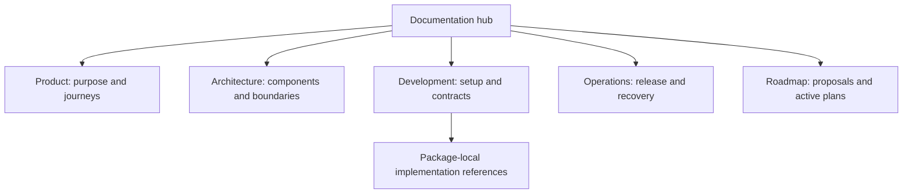

# Writing and maintaining documentation

[Development](README.md) · [Documentation hub](../README.md)

Keep one current source for each subject. Explain the purpose and user behavior
before implementation details. Documentation is part of the product: it should
help a person understand, build or operate the system without reconstructing its history.

## Visual Map



## Choose one home

| Home | Owns |
| --- | --- |
| Product | Principles, capabilities, user journeys and terminology |
| Architecture | Current components, trust boundaries, dependencies and module diagrams |
| Development | Setup, contribution, testing, integrations and implementation references |
| Operations | Hosting, environments, delivery, monitoring, incidents and recovery |
| Roadmap | Unimplemented designs, research and active scoped implementation plans |

Root entrypoints orient contributors. Backend and web/mobile implementation
references stay package-local where standalone use requires them. Agent procedures
live in `.agents`; product explanation does not inherit an executive audience by default.

## Explain progressively

Lead with the outcome, then the decisions a reader needs. Put exact paths,
symbols and commands where they enable an action. Keep hashes, historical test
counts and release chronology out of product explanations. Operational recovery
and provenance still require exact identifiers and dated evidence.

One is the implemented private-agent head; Kai is its finance specialist. Preserve
literal API, schema, package and runtime compatibility names. Distinguish encrypted
PKM memory from workflow metadata, caches and proposed future storage. Privacy and
availability claims must be supported by implementation and qualified acceptance.

## Navigation and diagrams

Every maintained page links to a parent and relevant next steps. A module entrypoint
explains purpose, journey, dependencies, trust boundary and limits, with a diagram.
Leaf references link to the module view rather than copying it. Use descriptive
labels, not lists of filenames. The hub reaches module entrypoints within two links.

Use a subfolder when a subject has its own owner, lifecycle or recurring task.
Length alone does not justify splitting. Indexes are `README.md`; new leaf names
use kebab-case. Render changed diagrams and verify their meaning against source.

## Consolidation and retirement

Before moving or deleting a page, inspect inbound links and executable consumers.
Classify maintained guides, technical contracts, future work, active peer work,
historical material and generated/imported/legal/runtime assets separately.
Markdown prompts, fixtures and package assets require their existing owners.

Merge unique durable facts into their owner before deleting a superseded page.
Preserve unresolved recovery evidence outside tracked audit dumps. Use Git history
for prior versions; do not retain a parallel handbook or redirect tree. Active
plans remain clearly marked until their workstream owner reconciles completion.

Move content and its links, anchors, images, skill reads, inventories, baselines
and generators in the same candidate. Required root and package entrypoints remain.
Never weaken a runtime, consent, security or authority contract to make a move pass.

## Verify the change

```bash
./bin/hushh docs verify
python3 .agents/skills/docs-governance/scripts/doc_inventory.py inventory
python3 .agents/skills/docs-governance/scripts/doc_inventory.py stale-candidates
python3 .agents/skills/docs-governance/scripts/doc_inventory.py folders
python3 .agents/skills/codex-skill-authoring/scripts/skill_lint.py
```

The link checker covers maintained docs, root `AGENTS.md` and first-party `.agents`
guidance, including local headings. It excludes pinned imports. Retain positive
and negative controls when changing a verifier; do not add prose quotas or tests
for appearance. Shared artifacts also follow [link hygiene](../operations/brand-and-compatibility-contract.md).
