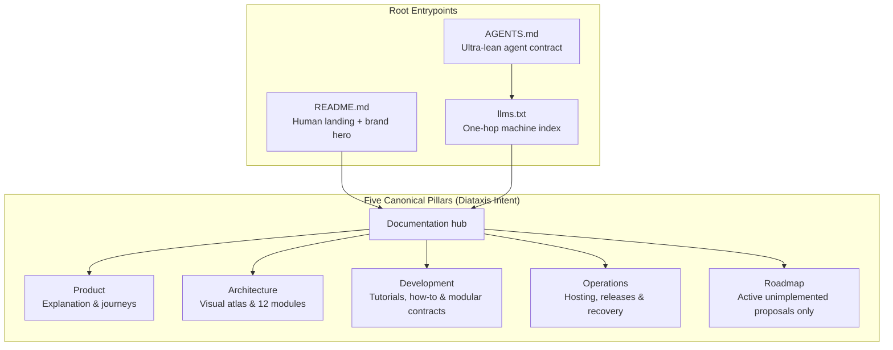

# Writing and maintaining documentation

[Development](README.md) · [Documentation hub](../README.md)

> [!IMPORTANT]
> **Audience Rule:** Documentation starts with humans for immediate comprehension and isolates coding-agent contracts cleanly below or behind linked technical references. Keep one authoritative source per subject; use Git history for retired plans.

Documentation is part of the product. A person should understand what a system does, where its trust boundaries live, and what is live today within 30 seconds, while a coding agent should find exact invariants, seams, and verification gates in one hop without burning context on narrative prose.

## Visual Map



## Five locked documentation standards

### 1. Hybrid tiered audience segregation (humans always first)

Every root, pillar, and module entrypoint uses a **Hybrid Tiered** layout:

1. **Human Hero first:** Open with plain, warm, jargon-free language stating purpose, observable user behavior, maturity status (`Live`, `Preview`, or `Proposed`), key boundaries, and a visual map. Keep internal filenames, class/function names, env vars, HTTP status codes, and historical release logs out of human overview prose unless a specific user, latency, or security figure changes a human decision.
2. **Separated Coding-Agent zone:** Place exact architectural invariants, module seams, failure/rollback rules, and verification commands either in a dedicated bottom `## For coding agents` section (or a collapsible `<details>` drawer on landing pages) or in a linked modular reference spec.
3. **Ultra-lean root agent door:** Keep root `AGENTS.md` concise (~60 to 150 lines) as a pure routing and operating contract pointing directly to `.agents/` and `llms.txt`.

### 2. Full brand visual system and living diagrams

- **Theme-aware hero assets on root and pillar doors:** Landing pages use GitHub-native `<picture>` dark/light SVG heroes stored under `docs/assets/brand/` so documentation renders cleanly in both dark and light GitHub themes.
- **Three-tier living Mermaid standard:** Upgrade flat box charts into reviewable Mermaid-as-code diagrams covering:
  1. **Trust-boundary and topology subgraphs** separating Owner Device, Control Plane, Private Runtimes (Personal Sandbox / BYOC), and External Connectors.
  2. **End-to-end sequence flows** showing consent, encryption, wake, and refusal paths.
  3. **Lifecycle state machines** showing hosting cutover, background preparation, and approval transitions.
- **Scannable GitHub primitives:** Use GitHub callout alerts (`NOTE`, `IMPORTANT`, `CAUTION`), explicit maturity pills (`Live`, `Preview`, `Proposed`), compact comparison tables, and collapsible drawers for deep agent checklists.
- **Clean typography:** Never use em dashes or en dashes in maintained documentation prose or diagrams.

### 3. Zero-archive distillation and truthfulness

- **Git history is the only archive:** Before deleting a dated plan or superseded design spec, distill any unique durable facts into its canonical owning page, then delete the superseded plan outright instead of keeping duplicate archive trees.
- **Present-truth wording:** Live product and architecture docs describe implemented reality in present tense. Unimplemented proposals live strictly under `docs/roadmap/` and carry an explicit `Proposed` label.
- **Separate source truth from rollout proof:** Source implementation, local tests, Dev/UAT preview qualification, and production availability are distinct claims and must never be conflated.

### 4. Five pillars, Diataxis intent, modularity budgets, and machine discovery

Keep our five canonical homes to preserve link stability while tagging every page with its Diataxis reader intent (**Tutorial**, **How-To**, **Explanation**, or **Reference**):

| Home | Diataxis Intent | Owns |
| --- | --- | --- |
| [Product](../product/README.md) | Explanation | Principles, capabilities, user journeys, and terminology |
| [Architecture](../architecture/README.md) | Explanation + Reference | Current components, trust boundaries, dependencies, and module diagrams |
| [Development](README.md) | Tutorials + How-To + Reference | Setup, contribution, testing, integrations, and modular implementation contracts |
| [Operations](../operations/README.md) | How-To + Reference | Hosting, environments, delivery, monitoring, incidents, and recovery |
| [Roadmap](../roadmap/README.md) | Proposals | Active unimplemented designs only (zero completed historical archives) |

- **Modularity ceilings:** Human landing and module overviews target **150 to 300 lines**. Oversized reference monoliths (700+ lines) should split progressively into a crisp overview index plus focused, single-responsibility reference contracts so both humans and coding agents load only what they need.
- **One-hop machine index:** Maintain root `llms.txt` following the `llmstxt.org` structure so IDE and external coding agents locate canonical docs in a single read.

### 5. Progressive verification guardrails

New and edited documentation must pass automated link, anchor, Mermaid diagram, brand spelling, Apache-2.0 license, and `llms.txt` freshness verification. Untouched legacy files surface as non-blocking inventory warnings until retired or decomposed in scheduled cleanup waves.

## Navigation and consolidation rules

Every maintained page links to its parent index and relevant next steps. A module entrypoint explains purpose, user journey, dependencies, trust boundary, and limits with a living diagram; leaf references link to the module view rather than copying it. Use descriptive labels instead of raw filename lists, keep indexes named `README.md`, and name new leaf files in `kebab-case`.

Before moving or retiring a page, inspect inbound links and executable consumers, preserve active peer work and unresolved recovery facts, and move content, anchors, images, skill reads, inventories, and `llms.txt` entries in the same PR.

## Generated evidence and source contracts

Review and audit receipts belong in ignored local or CI artifacts. Preserve source identity, required recovery facts, and failed or unverified outcomes before retiring a copy. Contracts and required generated application assets retain their declared owners. Route documentation follows its existing route, action, cache, and native contract cascade; a navigation rewrite does not certify changed runtime behavior.

<details>
<summary><strong>For coding agents: verification commands and authoring invariants</strong></summary>

- **Brand & naming:** Use `Hussh` in human prose (literal code/package/repo identifiers keep their existing spelling under [brand and compatibility contract](../operations/brand-and-compatibility-contract.md)). One is the implemented root private agent; Kai is its finance specialist.
- **Operational truthfulness:** Never write speculative labels inside `docs/product/`, `docs/architecture/`, `docs/development/`, or `docs/operations/`. Distinguish `Live`, `Preview`, and `Proposed` explicitly.
- **Required checks before pushing any documentation change:**

```bash
./bin/hushh docs verify
python3 scripts/licenses/verify_apache_surface.py
python3 .agents/skills/docs-governance/scripts/doc_inventory.py inventory
python3 .agents/skills/docs-governance/scripts/doc_inventory.py stale-candidates
python3 .agents/skills/skill-authoring/scripts/skill_lint.py
```

</details>
