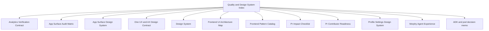

# Quality and Design System Index

[Development](../README.md)

## Visual Map

This is the north-star entrypoint for design-system rules plus verification contracts that decide whether UI and analytics behavior are trustworthy.

One and Puppy share portrait-header geometry and the retained composer seat;
their connection admission, drafts, transcripts and send authority stay separate.

## Read In This Order

- [design.md](./design.md): the concise cross-layer visual, shell, material, and AX contract.
- [design-system.md](./design-system.md): component layering and primitive ownership.
- [frontend-ui-architecture-map.md](./frontend-ui-architecture-map.md): repo map, labs boundary, and layer ownership.
- [app-surface-design-system.md](./app-surface-design-system.md): page shell, header, card, bell, and interaction contract.
- [profile-settings-design-system.md](./profile-settings-design-system.md): canonical grouped settings language.
- [one-onboarding-architecture.md](./one-onboarding-architecture.md): canonical One onboarding architecture and step contract.
- [frontend-pattern-catalog.md](./frontend-pattern-catalog.md): implementation patterns and allowed primitives.
- [app-surface-audit-matrix.md](./app-surface-audit-matrix.md): current rollout matrix across routes.
- [pr-impact-checklist.md](./pr-impact-checklist.md): change-impact review checklist.
- [definition-of-done.md](./definition-of-done.md): the standing repo-wide completion bar — acceptance criteria answer "did we build it", this answers "is it ready".
- [circle-chat-notification-release-checklist.md](./circle-chat-notification-release-checklist.md): creation, chat delivery and grouped Feed acceptance across web, iOS and Android.
- [morphy-agent-experience.md](./morphy-agent-experience.md): internal AX snapshot, intelligence-validation boundary, presentation posture, and performance contract.
- [pr-contributor-readiness.md](./pr-contributor-readiness.md): contributor-facing merge readiness, common blockers, maintainer patch/harvest handling, and attribution rules.
- [analytics-verification-contract.md](./analytics-verification-contract.md): proof ladder for GA4, Firebase, BigQuery, and growth dashboard trust.
- [adk-orchestration-docs-audit.md](../../operations/acceptance/private-agents.md): dated ADK and owner-pod decision memo; Files readiness, accountable gates, and historical evidence anchors.
- [architecture-fitness-baseline.json](./architecture-fitness-baseline.json): explicitly reviewed integration debt at the source revision and parents in the [decision memo](../../operations/acceptance/private-agents.md#open-operational-obligations). Budgets remain 500/250/80; CI rejects future new or worsened findings, while retained debt stays visible.

## Further reading

- [ADK consent and connector checkpoint — 2026-09-24](adk-consent-connectors-checkpoint-2026-09-24.md)
- [Contact sync investigation — 29 October 2026](contact-sync-rca-2026-10-29.md)
- [Live Memory release UAT stories](live-memory-uat-stories.md)
- [Agent One typography audit — 2026-10-14](one-typography-audit-2026-10-14.md)
