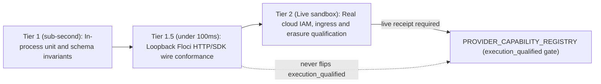

# Floci Multi-Cloud Wire Verification

[Quality and Design System Index](README.md) · [Development](../README.md) · [Hosting](../../operations/hosting/README.md)

> Active `dev` and CI verification contract (verified 2026-11-16). Tier-1.5 loopback wire tests prove SDK serialization, HTTP status and header preconditions, compare-and-swap (CAS), envelope/KMS AAD binding, and capability-prefix confinement across AWS, GCP, Azure, and Hussh-Hosted storage gateways. They never establish live cloud sandbox, IAM, network, or erasure qualification.

## Purpose and the Three-Tier Verification Pyramid

In-process mocks (`unittest.mock.MagicMock`) routinely hide real multi-cloud bugs: mocked cloud clients silently ignore HTTP `If-None-Match: *` and `If-Match` ETag preconditions, omit SigV4 or Managed Identity headers, skip KMS `EncryptionContext` / `additionalAuthenticatedData` checks, and pass malformed JSON or XML payloads. Conversely, live cloud sandboxes are too slow, credential-coupled, and stateful to run on every commit.

Hussh closes that gap with **Tier-1.5 Floci multi-cloud wire verification** (`https://floci.io/` plus deterministic loopback HTTP/1.1 protocol servers in `consent-protocol/tests/floci_wire_harness.py`):



| Tier | Target Latency | What It Exercises | What It Proves | What It Cannot Prove |
| --- | --- | --- | --- | --- |
| **Tier 1 — Unit & Domain Contracts** | `< 1s` | Pure Python/TypeScript state machines, schema validators, and deterministic transforms | Policy logic, closed schemas, and state transitions | SDK wire serialization, HTTP status mapping, ETag CAS, or KMS AAD |
| **Tier 1.5 — Floci Wire Conformance** | `< 100ms` / test | Unmocked `boto3`/`botocore`, `requests` REST, SigV4/Bearer/MSI headers, XML/JSON wire parsers, ETag/generation CAS, and real AES-256-GCM KMS AAD over loopback TCP (`127.0.0.1`) | Exact HTTP request/response handling, conflict/412 fail-closed behavior, envelope AAD tamper rejection, and prefix-token confinement | Live cloud IAM/WIF/MSI policy evaluation, public/VPC ingress, quota behavior, or provider-side retention/erasure receipts |
| **Tier 2 — Live Cloud Qualification** | Minutes (gated) | Real GCP, Azure, or AWS accounts (`hushh-pda-dev` or owner BYOC sandboxes) | Installed container runtime, federated IAM boundaries, direct pod readiness, and provider-terminal absence receipts | Fast per-PR regression feedback without cloud credentials |

## Ephemeral Wire Environments and Auto-Resolution

`consent-protocol/tests/floci_wire_harness.py` exposes four context managers. Each binds strictly to `127.0.0.1` on an ephemeral port, tears down cleanly on exit, and resolves its backing server automatically without requiring contributors or CI runners to pre-install external daemons:

1. **`floci_aws_wire_environment()` (`FlociWireEnvironment`):**
   - **Protocols:** AWS S3 REST/XML (`If-None-Match: *`, `If-Match: <ETag>`, `PreconditionFailed`, `AccessDenied`), AWS KMS `AWSJson1_1` (`TrentService.CreateKey`, `Encrypt`, `Decrypt` with real AES-256-GCM + canonical `EncryptionContext` AAD, key aliases, key disablement), STS `AssumeRole`, IAM inline role policies (`HusshPodRuntimeAccess`, `HusshObserverAccess`, `HusshRemovalAccess`), and ECS Fargate clusters/task definitions/services.
   - **Resolution order:** `FLOCI_ENDPOINT_URL` (`mode="floci_external"`) → `floci` binary on `PATH` when `HUSHH_PREFER_FLOCI_BINARY=1` (`mode="floci_native"`) → built-in `ThreadingHTTPServer` (`mode="loopback_wire_reference"`).
   - **Fault injection helpers:** `set_bucket_forbidden(bucket)` and `set_kms_key_disabled(key_id)` for fail-closed `AccessDenied` vs `gone` and crypto-erasure tests.

2. **`floci_gcp_wire_environment()` (`FlociGcpWireEnvironment`):**
   - **Protocols:** GCS JSON and multipart/media upload REST (`ifGenerationMatch=0`, generation compare-and-swap `412`, object CRUD/listing) plus Cloud KMS v1 (`encrypt` / `decrypt` with `additionalAuthenticatedData` binding).
   - **Resolution order:** `FLOCI_GCP_ENDPOINT_URL` (`mode="floci_gcp_external"`) → `floci-gcp` binary (`mode="floci_gcp_native"`) → built-in loopback handler (`mode="loopback_gcp_wire_reference"`).

3. **`floci_azure_wire_environment()` (`FlociAzureWireEnvironment`):**
   - **Protocols:** Azure Blob Storage `2023-11-03` (`If-None-Match: *`, `If-Match`, `ConditionNotMet` `412`, `BlobNotFound` `404`), Key Vault `7.4` (`wrapkey` / `unwrapkey`), and Managed Identity (MSI token minting, `Identity` header verification, and token revocation).
   - **Resolution order:** `FLOCI_AZ_ENDPOINT_URL` (`mode="floci_az_external"`) → `floci-az` binary (`mode="floci_az_native"`) → built-in loopback handler (`mode="loopback_azure_wire_reference"`).

4. **`floci_prefix_gateway_environment(secret=...)` (`FlociPrefixGatewayEnvironment`):**
   - **Protocols:** Loopback capability-scoped object gateway verifying `PodCapabilityBroker` bearer tokens (`verify_prefix_gateway_token`), `pods/<owner_id>/...` prefix confinement (`401` missing/expired, `403` cross-prefix escape), deterministic clock advancement (`advance_clock(seconds)`), and ETag preconditions (`409` / `412`) when `FLOCI_PREFIX_ALLOW_LOOPBACK_HTTP=1`.

## Non-Negotiable Runtime and Security Guardrails

Production and UAT code paths accept loopback wire overrides **only** through two fail-closed guards (`consent-protocol/hushh_mcp/services/pod_emulator_endpoints.py` and `consent-protocol/hushh_mcp/services/aws_setup_plan.py`):

1. **Unconditional Refusal in Protected Environments:**
   - `PodEmulatorEndpointError` and `AwsFlociGateRefused` immediately reject `FLOCI_ENDPOINT_URL`, `FLOCI_GCP_ENDPOINT_URL`, `FLOCI_GCP_KMS_ENDPOINT_URL`, `STORAGE_EMULATOR_HOST`, `FLOCI_AZ_ENDPOINT_URL`, `AZURITE_BLOB_ENDPOINT_URL`, and `FLOCI_PREFIX_ALLOW_LOOPBACK_HTTP` whenever `HUSHH_DEPLOY_ENV`, `DEPLOY_ENV`, `ENVIRONMENT`, or `APP_ENV` resolves to `uat`, `staging`, `prod`, or `production`.
2. **Strict Loopback Origin Confinement:**
   - `validate_emulator_origin(...)` and `require_floci_only_aws_readiness_endpoint()` reject embedded credentials, non-root paths, query strings, fragments, and any plaintext `http://` host outside strict loopback (`localhost`, `127.0.0.0/8`, `::1`).
   - While `PROVIDER_CAPABILITY_REGISTRY["user_aws"].sandbox_capability.execution_qualified` is `False`, any `user_aws` readiness or control-plane call without a loopback `FLOCI_ENDPOINT_URL` raises `AwsFlociGateRefused`, guaranteeing zero accidental outbound traffic to `*.amazonaws.com`.
3. **Separation of Wire Conformance from Cloud Qualification:**
   - Tier-1.5 Floci suites **never** mutate `execution_qualified = True` in `PROVIDER_CAPABILITY_REGISTRY` (`consent-protocol/hushh_mcp/services/provider_capability_registry.py`) and **never** satisfy live owner-pod acceptance gates (`#5507`, `#28`, `#47`).

## When to Require Tier-1.5 Floci Verification

Add or run Tier-1.5 Floci wire tests whenever a change touches:

- Multi-cloud object stores or CAS commit logs (`pod_s3_object_store.py`, `pod_azure_blob_store.py`, GCS object stores, `PrefixTokenObjectStore`, `pod_commit_log.py`).
- Envelope or owner-KMS custody (`byoc_key_custody.py`, KMS `EncryptionContext` / `additionalAuthenticatedData`, Key Vault key wrapping).
- Scoped pod capability tokens and prefix isolation (`pod_capability_broker.py`, `pod_workspace/`, `wiki_memory/` encrypted `<prefix>/wiki/v1/` and `<prefix>/files/v1` adapters).
- Sovereign BYOC setup blueprints, federated attach/restart adapters, or crypto-erasure state machines (`aws_setup_plan.py`, `user_aws_backend.py`, `azure_setup_plan.py`, `azure_agent_erasure.py`).

Do **not** add `MagicMock` stubs for `boto3`, GCS REST, Azure Blob/Key Vault REST, or prefix-gateway HTTP calls when `floci_wire_harness.py` can exercise the real wire client in `< 100ms`.

## Authoritative Verification Commands

Run the full multi-cloud Floci wire conformance bundle from `consent-protocol`:

```bash
cd consent-protocol
./.venv/bin/python -m pytest \
  tests/test_floci_aws_wire_conformance.py \
  tests/test_floci_gcp_azure_wire_conformance.py \
  tests/test_provider_capability_registry_and_aws_parity.py \
  tests/test_pod_capability_broker.py \
  tests/test_pod_activation_and_upgrade_clearance.py \
  tests/services/test_wiki_phase5_floci_conformance.py \
  tests/services/test_pod_workspace_9511.py -q
```

To test explicitly against an external `floci` daemon when installed locally:

```bash
FLOCI_ENDPOINT_URL=http://127.0.0.1:4566 \
  ./.venv/bin/python -m pytest tests/test_floci_aws_wire_conformance.py -q
```
