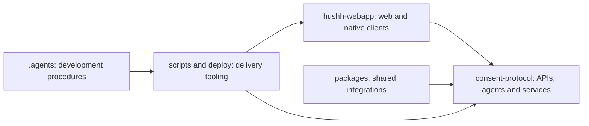

# Repository map

[Development](README.md) · [System architecture](../architecture/system.md)

Find the owner before changing a feature. The monorepo contains the client,
protocol runtime, shared integrations and the tooling that releases them.

## Visual Map

| Responsibility | Implementation home | Read next |
| --- | --- | --- |
| App and platform transports | `hushh-webapp/` | [Web/native package](../../hushh-webapp/docs/README.md) |
| APIs, consent, PKM and domain services | `consent-protocol/` | [Backend package](../../consent-protocol/docs/README.md) |
| One ADK composition | `consent-protocol/hushh_mcp/one_adk/` | [One module](../architecture/modules/one.md) |
| MCP and developer integrations | `packages/` | [Sharing module](../architecture/modules/sharing.md) |
| Release and cloud tooling | `scripts/`, `deploy/`, `bin/` | [Operations](../operations/README.md) |
| Engineering instructions and routing | `.agents/` | [AGENTS.md](../../AGENTS.md) |
| Product and technical knowledge | `docs/` | [Documentation hub](../README.md) |

Preserve identity, vault, consent, owner fencing and recovery contracts across
surfaces. Package-local instructions refine the root operating contract.
