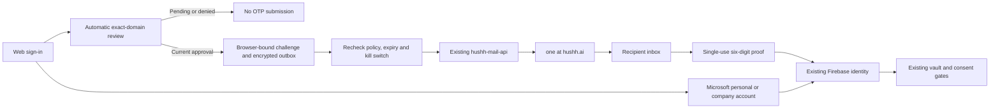

# Independent Email OTP and Microsoft Sign-In Plan

Status: implementation authorized and in progress on 2026-10-16. Target: working
web demonstration by 22:10 IST, ahead of the 22:30 demonstration. Hosted deployment
is a separate release step. The current source contract is
[Independent Email Authentication](../reference/iam/independent-email-auth.md).

## Visual Map

## Agreed outcome and current truth

Deliver Continue with email and Continue with Microsoft in the existing web login.
Email OTP and automatic domain review are independent of WorkOS, organization
onboarding, customer DNS challenges and customer IT-admin approval.

The final delivery service is the existing `hushh-mail-api`, whose health endpoint
identifies Google Workspace Gmail SMTP as its transport. The earlier proposal to
operate another mail server is superseded. OTP mail must come from `one@hushh.ai`.
A person's default sender does not meet acceptance. Do not substitute another
service or spoof an unsupported From field to hide a configuration blocker.

| Claim | Classification | Evidence and boundary |
| --- | --- | --- |
| Existing mail API is available | `already_exists` | Health and authenticated template discovery succeeded; a real mailbox proof was consumed. Required One sender acceptance remains separate. |
| Microsoft configuration exists | `partially_exists` | Firebase provider is enabled with configured client ID/secret. Personal and company login need live acceptance. |
| Independent OTP is implemented | `partially_exists` | Source, migration and focused tests exist. Hosted serving revision and complete authenticated acceptance remain separate. |
| A public CA proves a legitimate company | `wrong_direction` | Certificate domain control does not prove a company, employer, mailbox or person's identity. |
| WorkOS is required | `wrong_direction` | The subsystem directly uses Firebase, Postgres, DNS and the existing mail API. |

Preserve the active branch and existing entrypoints. This checkout predates newer
WorkOS work on main; integrating that work is a separate bounded merge task.

## Automatic Hussh domain review and HRD

“Hussh-reviewed” means a domain passed the automatic technical mail-admission
policy and its current decision is durable. It is not manual approval per company,
business certification or employment proof. Previously unseen company domains may
qualify on first request. An attacker-controlled domain can satisfy this policy.

1. Normalize exact domains with IDNA and strict email parsing. Reject controls,
   IP literals, internal names and malformed addresses. Preserve plus tags/dots.
2. Enforce shared discovery budgets before DNS; deduplicate evaluation with a
   durable review lease.
3. Require a fresh digest-pinned risk snapshot with provenance/license. This
   version checks known disposable domains and emergency revocations; it does
   not claim comprehensive malicious-domain or impersonation coverage.
4. Resolve bounded explicit MX and target A/AAAA records. Null MX denies. Missing
   MX remains unsupported/pending rather than labelled fraudulent. Every address
   must be public; query count, response size and total time are bounded.
5. Collect optional HTTPS certificate evidence using Mozilla public CA roots,
   original-hostname validation and a pinned checked TCP destination. Mail-only
   domains need no website certificate. No scraping or SMTP mailbox probing.
6. Persist status, reason, policy/risk versions, generation, certificate evidence
   and expiry. Approval expires at the earliest relevant DNS TTL, risk deadline
   or one hour. Late reviews cannot overwrite revocation or a newer policy.
7. Recheck current approval at challenge creation, delivery/retries, consumption
   and enrollment, including after database lock waits. Refresh on demand;
   expired or unavailable required evidence never authorizes mail.

Approval never inherits to subdomains. A blocked risk parent blocks its children.
Postgres owns the domain mapping. An optional HRD hashmap may suggest a provider;
it cannot authorize delivery, assign roles, select an owner or force SSO.

Public-CA certificates are **supporting evidence**, as explicitly selected by the
user. They are not mandatory and cannot approve a domain alone. Our own HTTPS
certificates use the existing hosting mechanism; we do not create a public CA or
issue certificates for recipient companies.

References: [SMTP routing](https://www.rfc-editor.org/rfc/rfc5321.html#section-5),
[Null MX](https://www.rfc-editor.org/rfc/rfc7505.html),
[SPF scope](https://www.rfc-editor.org/rfc/rfc7208.html#section-2),
[CA validation requirements](https://cabforum.org/working-groups/server/baseline-requirements/requirements/).

## OTP, cryptography and delivery

Generate uniform six-digit strings, including leading zeros, valid five minutes
with at most five guesses. Shared Postgres counters bound discovery, verification,
recipient, domain and global usage. Resends have a sixty-second cooldown and
supersede earlier codes without resetting recipient budgets. Browser binding
remains in memory.

Store a keyed HMAC verifier. Encrypt recoverable payloads/destinations using
AES-256-GCM, unique nonces and purpose/challenge/destination/expiry-bound metadata.
Use distinct managed verifier, payload and stable lookup keys. This protects
server-side payloads; ordinary email is not end-to-end encrypted. No plaintext
codes, bindings, provider tokens or decrypted vault information in persistence,
URLs, analytics, logs or captures.

Create challenge/outbox atomically. A worker leases an admitted job, rechecks the
live kill switch and submits a fixed template, one recipient and stable
idempotency key to the exact existing API. Browser callers cannot specify From,
CC, BCC, HTML, endpoint or credentials. The API must authorize `one@hushh.ai`
through its supported sender contract before issuance is enabled.

API acceptance and observed inbox receipt are separate. Revocation stops later
local submissions but cannot recall accepted mail or control downstream Gmail
retries. An ambiguous timeout may retry the same still-valid code; exactly-once
email is not promised.

## Identity continuity and Microsoft

Consume proof atomically; concurrent verification has one winner. Wrong guesses
commit even when an error is returned. New accounts reserve opaque Firebase UIDs.
Existing accounts sign in directly after OTP proof when Firebase's current primary
email is verified and matches exactly. The same canonical UID is used; no provider
sign-in is required. Unverified existing accounts remain blocked pending a safe
credential-recovery contract. Conflicting active UID bindings never auto-merge;
provisional reservations and active enrollment are distinct.

Disabled/deleted accounts stay blocked. Check tombstones before Firebase creation
or issuance. Full erasure removes challenges before enrollment; ordinary vault
reset preserves login enrollment. Local WorkOS-created markers preserve those
accounts' offboarding lifecycle without making WorkOS an availability dependency.
Provenance alone does not require SSO: an active created account with a verified
primary email can sign in directly after OTP proof.
Created accounts with a deprovision marker remain blocked; no claim is cleared.

Use Firebase `microsoft.com` with `tenant=common` and account selection. Callback:
`https://hushh-pda.firebaseapp.com/__/auth/handler`. Preserve Firebase's UID mapping
and existing legal, welcome, routing and session settlement. Test cancellation,
missing email, tenant restrictions and collisions. Customer/Microsoft tenant
restrictions remain external constraints.

Neither method unlocks a vault, grants consent, changes roles or issues protected
information access. New methods are web-only until native and voice return paths
have independent acceptance.

## API and ownership

| Endpoint | Contract |
| --- | --- |
| `GET /api/auth/email/capabilities` | Fail-closed availability. |
| `POST /api/auth/email/request` | Domain evaluation and challenge creation. |
| `POST /api/auth/email/resend` | Same authority/budgets as request; new request key. |
| `POST /api/auth/email/verify` | Browser-bound single-use proof and identity result. |

Thin Next proxies enforce browser origin, JSON and request bounds. Backend policy
owns admission; Postgres owns durable decisions/challenges; Firebase owns accounts;
the mail API owns transport. Responses prohibit caching and do not reflect
credentials. Pre-proof responses do not disclose account existence.

## Four-hour delivery and demonstration acceptance

| Window | Work | Evidence |
| --- | --- | --- |
| First 20 minutes | Inspect API/provider config, auth seams and persistence | Report delivery blockers; no secret output. |
| First two hours | Evaluator, encrypted outbox, budgets and atomic proof | Real Postgres races, no-send negatives, expiry and revocation. |
| Next hour | Email UI, direct OTP sign-in and Microsoft | UID continuity, accessible failures and no automatic merging. |
| Final hour, by 22:10 IST | Integrated rehearsal, review and handoff | Inbox receipt from One, repeat UID, provider outcomes and rollback. |

The demonstration uses finished implementation, with no fake transport, code
display, seeded company list, demo-address exception or weakened checks. A sender
or access blocker is an unmet gate; API health is not authenticated acceptance.

Acceptance requires:

- An unseen eligible domain qualifies automatically. A controlled inbox receives
  a real code **from one@hushh.ai**, signs in, signs out and returns to the same UID.
  Existing-account enrollment preserves its owner.
- Pending, denied, revoked and expired decisions cause no local mail submission.
  Null MX, unsafe routes, unavailable evidence and lock-wait races fail closed.
- Wrong, expired, replayed, superseded, substituted and cross-browser codes fail.
  Concurrent consumption succeeds once; budgets survive resends and workers.
- Google/Apple remain intact, the independent path makes zero WorkOS calls, and
  vault/consent/role gates remain effective after authentication.
- Personal and company Microsoft accounts complete their intended flows, or the
  exact external restriction is recorded as incomplete acceptance.
- Kill switch, retention while disabled, erasure, safe errors and focused tests
  pass; exact revision/configuration and remaining gaps are handed off.

## Operations, rollback and release work

Default issuance off. Enable only with schema, active policy/risk versions,
distinct managed keys, API credentials and the authorized One sender. Pin snapshot
source, digest, license and expiry; refresh through the restricted operator path.
Emergency revocation is durable and cannot be bypassed by a cached approval.

An independent retention task clears expired encrypted payloads, destinations and
tickets even while issuance is disabled or keys unavailable. Remove short-lived
challenge metadata after one day and expired budget rows. Keep enrollment until
account erasure. Monitor policy failures, acceptance, queue age, expiry, abuse
limits and observed inbox latency without raw mailbox labels.

Rollback disables issuance/new submissions, cancels outstanding challenges and
clears payloads, encrypted destinations and tickets for every challenge.
Preserve additive tables, enrollment and Firebase accounts.
Existing sessions retain normal lifecycle checks. Do not rotate vault keys or
casually remove a person's only usable login.

Hosted deployment, complete environment schema certification, native/device
acceptance, comprehensive reputation, business identity proof, high availability,
key rotation drills and broad inbox placement need separate evidence. Before a
future push run the required local core mirror; deployment additionally needs
exact serving revision/configuration and authenticated acceptance.
