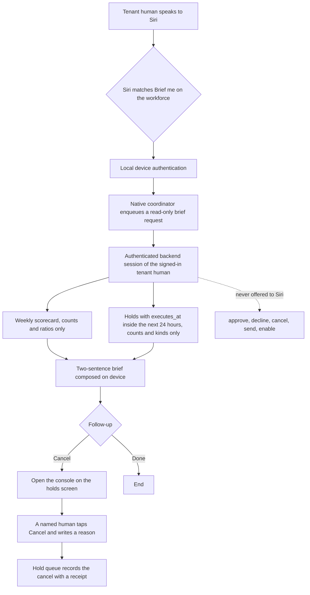

# Workforce Brief, a Siri App Intent for tenant humans

> Status: future roadmap, planning only, classified `future_state_only`. No
> Swift is built in this change, no backend route is added by it, and nothing
> here is a claim that Siri can reach the workforce today. The architecture it
> depends on is [SuperSalesSI, the 🤫 One Workforce](../reference/architecture/supersales-workforce.md).

## Status

| Area | Current state | Classification |
| --- | --- | --- |
| App Intent "Brief me on the workforce" | Not written. This note is the specification. | `missing`, not built in this change |
| Weekly scorecard read endpoint | Not written. The metric ids it would read, `reply_rate_7d`, `replies_7d`, `unsubscribes_7d`, `touch_cap_refusals_7d`, already exist as key results in the sibling roster file. | `missing` |
| Holds executing in the next 24 hours | The hold queue exists in the sibling working tree with `executes_at` per hold and a listing by tenant and status. No authenticated read route exposes it yet. | `partially_exists` |
| Console screen the Cancel follow-up opens | Not written; owned by the sibling repository's console milestone. | `missing` |
| Native patterns to reuse | `hushh-webapp/ios/App/App/OneVoiceAppIntent.swift`: the `AgentOneDestination` AppEnum, the `OneLocationOpenIntent` protocol, `OneAppIntentActionExecutor`, and `OpenOneDestinationIntent`. | `already_exists`, in the One iOS shell |
| Which app hosts the intent | Undecided. See the decision below. | `needs_verification` |
| A free App Shortcut slot | `HusshOneAppShortcuts` already spends slots out of Apple's limit of ten. | `needs_verification` |

## Product boundary

Siri is an entry adapter, exactly as it is for One Voice in
[the Siri handshake PRD](./one-voice-siri-handshake-prd.md). It may recognise
one phrase, read the scorecard and the due holds through the signed-in tenant
human's authenticated session, speak a brief, and open the console. The workforce's own
rules, its hold queue, its signature queue and the tenant's named humans
remain responsible for every decision. Siri never approves, never cancels and
never sends.

| Siri may do | Siri must not do |
| --- | --- |
| Match "Brief me on the workforce" | Approve, decline, cancel or send anything |
| Require local device authentication before anything is read | Call any route that writes: approve, decline, cancel, send, enable |
| Read the weekly scorecard and the holds due in the next 24 hours, through the authenticated backend | Read a draft body, a contact's name or email, a counterparty's company, or a dollar amount |
| Speak a brief of at most two sentences, composed on device from counts and kinds | Decide which hold the person means, or rank holds for them |
| Offer "Cancel" as a follow-up that opens the console on the holds screen | Perform the cancel itself; a named human cancels in the console, signed in as themselves |
| Say "Sign in to the console first" or "The workforce is unreachable right now" | Speak a cached or estimated number when the backend cannot answer |
| Be offered to a tenant human | Be offered to a citizen account |

The reliable user contract is:

- "Hey Siri, brief me on the workforce" speaks the brief without opening the app.
- Saying "Cancel" afterwards opens the console on the holds due today. Nothing
  is cancelled until a person taps Cancel there and writes a reason.
- "Done" ends the conversation.

The brief is spoken aloud and can be heard across a room, so it carries no
name, no address, no amount and no draft text. This is the same dignity rule
the person-side product keeps: serve without exposing.

## User stories

### Morning brief

A tenant human says "Hey Siri, brief me on the workforce" while making coffee.
The device authenticates locally. The intent asks the backend, through the
app's existing authenticated session, for the weekly scorecard and the holds
whose `executes_at` falls in the next 24 hours. Siri speaks:

"This week the workforce had twelve replies at a twenty percent reply rate and
no unsubscribes. Three commitments execute in the next twenty-four hours, the
soonest a first touch at nine this morning."

Siri then offers "Cancel" and "Done".

### Cancel

The person says "Cancel". Siri does not call a cancel route. It opens the app
on the console's holds screen, filtered to the next 24 hours, where each hold
shows its one-tap Cancel with the reason field. The hold queue refuses a
cancel from an agent and requires a named human, so the only path to a cancel
is a person's own tap in the console. The receipt names that person.

### Nothing due

"This week the workforce had four replies and no unsubscribes. Nothing
executes in the next twenty-four hours." Still two sentences, still no
follow-up that pretends there is something to cancel.

### Not signed in, or unreachable

Without a tenant session the intent speaks "Sign in to the console first" and
reads nothing. If either read fails, it speaks "The workforce is unreachable
right now" and never fills the gap with a remembered or estimated number.

## Visual Map



## Handoff contract sketch

Names below are proposals for whoever writes the Swift; none exist yet.

- `WorkforceBriefIntent: AppIntent` with `authenticationPolicy =
  .requiresLocalDeviceAuthentication` and `openAppWhenRun = false`, because
  the brief is spoken without opening the app. It takes no parameter. A phrase
  parameter would have to be an `AppEnum` or an `AppEntity`; the Swift file
  records why an open `String` in an App Shortcut phrase made iOS reject the
  whole shortcuts provider in build 99, and that lesson applies here
  unchanged.
- `WorkforceDestination: String, AppEnum` with cases `holds`, `decisions` and
  `scorecard`, following `AgentOneDestination`, so one `OpenIntent` in the
  shape of `OpenOneDestinationIntent` covers every console screen with a
  single App Shortcut slot. The Cancel follow-up resolves to `.holds`.
- The brief executes through a coordinator in the shape of
  `OneSystemActionInvocationCoordinator.shared.enqueue` followed by
  `waitForCompletionOrProgress`, and returns dialog only, as
  `OneAppIntentActionExecutor.run` does. The coordinator's action id is a
  read; there is no write action id for Siri to enqueue.
- The backend answers one read request with counts and kinds, nothing more.
  A sketch of the shape:

```json
{
  "week": {"replies": 12, "reply_rate": 0.2, "unsubscribes": 0, "touch_cap_refusals": 0},
  "holds_next_24h": {"count": 3, "soonest": {"kind": "outreach_first_touch", "executes_at": "2026-10-13T09:00:00+00:00"}}
}
```

No title, no contact, no email, no amount is in the response, so the device
cannot speak one by accident. The two sentences are templated on device from
these fields and nothing else.

Only redacted lifecycle information may be recorded: that the intent ran, how
long the read took, and the outcome category. The brief text itself is never
logged, cached, placed in analytics or persisted.

## Decision needed before any Swift is written

Current truth: the only native app with App Intents is the One iOS shell,
which is the citizen's private-agent app. The workforce console is a web
surface for tenant humans in the sibling repository, and the workforce is a
company-side counterparty that One, the private agent, stands between the
person and, per doctrine item 5 in [AGENTS.md](../../AGENTS.md) and the
scaling rule in [the agent ontology](../vision/agent-ontology.md).

Recommended path: do not place a tenant-only intent inside the citizen's
private-agent app. Host it in a tenant-side native target when one exists, and
until then ship the console as a web surface without Siri. The brief loses
nothing by waiting; the boundary loses a great deal by being blurred.

Risk if accepted blindly: a company's sales queue appearing inside the private
agent's app is exactly the second surface the architecture page says the
workforce must never have.

Decision needed: which app hosts the intent. Nothing in this note is built
until that is recorded.

## Acceptance checks

The intent is accepted only when every one of these holds on a physical
device.

1. A static check of the intent's target finds no reference to any approve,
   decline, cancel, send or enable route. Negative control: adding such a
   reference fails the check.
2. With the cancel route stubbed to record calls, invoking the intent and
   choosing "Cancel" records zero calls and opens the app on the holds screen.
3. The spoken brief is at most two sentences and contains no `@`, no currency
   symbol and no counterparty name, verified against fixtures that include a
   hold whose title names a company.
4. With zero holds due, Siri speaks "Nothing executes in the next twenty-four
   hours" and offers no Cancel follow-up.
5. Without a tenant session, Siri speaks "Sign in to the console first" and no
   number.
6. With either read failing, Siri speaks "The workforce is unreachable right
   now" and no number, cached or estimated.
7. A citizen account is never offered the intent.
8. The App Shortcut phrase compiles with no `String` parameter and fits inside
   the ten-slot limit without evicting an existing One shortcut.
9. The brief is absent from logs, analytics events and persisted state.

## Promotion rule

This note leaves `docs/future/` only when the hosting decision is recorded,
the two read routes exist with tests in the sibling repository, the Swift is
written in the hosting app, and the acceptance checks above pass on a physical
device. It then splits: the native contract to `hushh-webapp/docs/` if the One
shell hosts it, otherwise to the hosting app's own docs, and the backend
contract to the sibling repository.

## References

- [Agent One Voice, Siri Handshake PRD](./one-voice-siri-handshake-prd.md): the shape of this note and the Siri entry-adapter boundary.
- [SuperSalesSI, the 🤫 One Workforce](../reference/architecture/supersales-workforce.md): the autonomy classes, the hold queue and the boundary with One.
- [OneVoiceAppIntent.swift](../../hushh-webapp/ios/App/App/OneVoiceAppIntent.swift): the AppEnum destination and coordinator handoff patterns to reuse.
- [AGENTS.md](../../AGENTS.md): Project-Wide Agent Architecture Doctrine, item 5.
