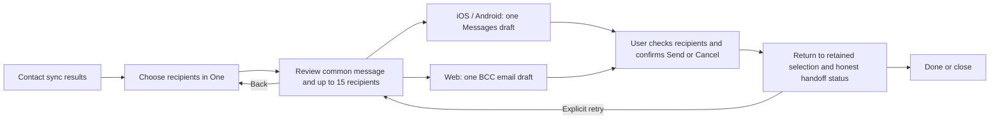

# Personal contact invitations

One's contact results can open an in-app selection and review sheet on web,
iOS and Android. Each contact starts unselected; choose 1–15 destinations and
review one common invitation. Mobile opens one Messages composer addressed to
all selected phone numbers. Web opens one email draft with selected addresses in
BCC. The person confirms Send in their own app. There is no Select All,
background sending, SMS provider, contact upload or delivery receipt.

A multi-recipient Messages draft may create a group conversation and expose
participants' numbers. The review explains this before opening Messages. The
sender is the device's selected messaging account/SIM, which may differ from the
One profile number. Carrier charges and messaging-app limits still apply.

## Visual Map

## Build and rollback

`NEXT_PUBLIC_CONTACT_INVITATIONS_ENABLED` defaults to true, including when
the variable is absent. New web/native builds enable selection, additional web
email collection and session-local recipient retention. An explicit `false` preserves the original
Google/picker fields and generic invite sharing. It is a build-time flag:
rollback requires rebuilding the affected web/native bundle, not a database
migration. Older native binaries can still share/copy without the new composer.

## Contact and session contract

- The existing exact-match sync API, counters, connection outcomes, batching,
  and 10,000-lookup ceiling are unchanged. Matched/suppressed, self, unknown,
  partially checked and overflow contacts are not invitation candidates.
- A separate optional `onInviteCandidates` callback provides names and
  destinations in device memory; never spread these into sync results,
  observability, API bodies, persistence or PKM. Known account phone/email
  destinations are excluded; unknown alternate identities cannot be inferred.
- No match does not prove non-membership. Email-only web contacts appear under
  “Not checked—email only”, outside the existing unmatched counter. Original
  phone-entry provenance prevents malformed phone records bypassing exclusion.
- Google People reads remain browser-only using the existing read-only scope.
  Email collection is flag-gated. Browser email capability is probed before
  the picker tap; the picker itself is never delayed by a capability await.
- Contact-sync outcome toasts report connected and invitable counts without an
  invitation action. Invitations start from the results drawer's “Invite contacts”
  action; partial-sync recovery actions remain available in the toast.
- Session generations invalidate reads, referral preparation and pending
  handoffs on dismissal, resync, account change, route change, flag disable or
  session-provider unmount. Selection and destinations survive search,
  pagination and review/back within that session. The account/route-scoped
  provider also retains the current step and pending handoff while authentication
  revalidation temporarily unmounts the page. Admission and vault gates continue
  to hide the page until access is verified; invitation state grants no access.
  No contact details enter browser storage or requests.
  Contact names, numbers and row whitespace toggle the associated checkbox;
  contacts with multiple destinations still require an explicit destination.
  The regular matching result still survives Location onboarding Finish.

## Explicit resync after disconnect

A fresh contact sync reconnects an eligible person the requester previously
removed. Repeated syncs keep one canonical connection per pair and refresh the
current list; an already-connected match still participates in that refresh.
Peer-made disconnects, unknown historical actors, hidden/opted-out profiles,
and disconnects made after the server began the sync remain protected. A sync
does not restore revoked location/information grants or named Circle membership.

Migration `205_contact_sync_disconnect_actor.sql` adds nullable actor-side and
revocation-episode fields on the existing `connections` authority table.
Migration `206_contact_sync_disconnect_actor_upgrade.sql` is the append-only
compatibility bridge for environments that applied the earlier user-ID form of
205: it translates only a participant-matching actor on the exact current
revocation episode, leaving unknown or stale history suppressed. Apply the
release lane through 206 before deploying the updated backend. The timestamp
pair also fails closed during a mixed-version rollout when an older writer
removes a connection.
The fields share the connection's retention and account-deletion lifecycle;
the actor side refers to the existing immutable A/B account columns, never
address-book information or a mutable account-ID copy. Migration 201 deletion
guards remain installed on those canonical participant identities.
Postgres remains authoritative; any future Redis invalidation layer must retain
the same transaction/episode checks.

For earlier removals, run `consent-protocol/scripts/backfill_contact_disconnect_actors.py`
in dry-run mode first, then `--apply --expected-database NAME` against the
intended environment. It scans bounded batches and only accepts two agreeing
historical events for the exact current revocation. Missing or conflicting
history stays suppressed. Feed is not used as live reconnection authority.
Roll back backend readers before the matching migration rollback; rollback
preserves graph rows but removes actor annotations. The invitation rollout flag
does not control this separate reconnection policy.

Connect retains rows and shows a refresh retry if the list read fails. Location
waits for a pre-sync read to settle, invalidates, then reads fresh state using the
current search. Neither recovery rereads contacts or repeats a committed sync.

## Composer contract

`HushhInvitations.getCapabilities()` returns
`{ sms: boolean, maxSmsRecipients?: number }`. New iOS/Android binaries advertise
15. `composeSmsBatch({ recipients: string[], body: string })` accepts 1–15 unique
E.164 numbers and at most 2,000 UTF-16 code units. Native adapters independently
reject malformed, duplicate, mixed-type, empty or oversized arrays; they never
truncate. The legacy `composeSms({ recipient, body })` method remains compatible.

Batch actions require an affirmative capability with an integer maximum of at
least 15. A legacy `{ sms: true }` response does not enable batch composition.
Older binaries show update/copy recovery. No new contact or background SMS
permission is requested. iOS sets MessageUI's recipients array; Android starts
one ACTION_SENDTO intent with comma-separated `smsto:` numbers and `sms_body`.
Android messaging apps may apply their own recipient/group limits; review all
recipients in the external app. No alternative delimiter or composer is launched
automatically after a successful handoff.

Outcomes remain `queued_or_sent` (iOS Send), `opened` (Android launch),
`cancelled`, `failed`, or `unavailable`. None establishes delivery or a
per-recipient outcome. The user can edit recipients/body in the external app.
Cancel/failure retains the whole selection; retry is explicit. Completed or
ambiguous launches show Done and a reminder to check the external app before
opening again. Share/copy never advances to another person or relaunches a
composer. Copy feedback does not change a previous compose result.

Web filters to valid email destinations, including the email of a mixed
phone/email contact. Phone-only contacts are explained and excluded from email
selection. If none are eligible, generic share/copy and link-preparation retry
remain available. One encoded `mailto:?bcc=...&subject=...&body=...` draft keeps
To/Cc empty. Mailbox validation rejects recipient/header injection and case
variants cannot select the same mailbox twice. The encoded URI has an 8,000
character application guard: oversized drafts fail explicitly without truncation.
The browser handoff occurs on the tap and returns `launch_requested`, never
sent. Mail clients can ignore BCC headers, so the review asks the user to verify
BCC before sending. There is no fallback that puts addresses in To/Cc.

The common text and existing referral attribution/generic-link fallback are
reused without individual greetings. An exact selectable preview and recipient
list precede the composer. Preparation has a bounded wait and retry that
preserves selection. Search, pagination, review Back and auth-gate remounts keep
the draft. Overlay Back unwinds result → review → selection; a pending handoff
consumes Back. Close clears the session. Session guards are rechecked after the
native capability await and before opening Messages, so late completion cannot
launch with recipients from a closed session. External focus changes do not
dismiss the sheet. Receiving an invitation grants no connection or location
capability.

The same session guard covers lazy native Share loading and clipboard recovery:
closing the draft suppresses a later share launch or textarea-copy fallback.
An operation already handed to the operating system or clipboard cannot be
recalled; its late completion cannot update a cleared invitation session.

## Verification and release checklist

Run `npm run verify:contact-invitations`, the Google contact-session regression,
`npm run verify:connect-search`, typecheck, service-boundary and native plugin
checks. The existing contact-invitation layout pack covers small phones,
keyboard insets, batch review and result controls. Run `npm run cap:build` and
native compilation on supported build hosts.

Use designated test recipients for physical iPhone and Android verification:
1, 10 and 15 recipient prefills, common message/referral, Send/Cancel/discard,
app return, group visibility, SIM/account choice, unavailable handler and
older-binary fallback. On Android check Google Messages and supported vendor
handlers. On web exercise Google import, mixed-channel and email-only contacts,
no eligible emails, BCC across supported mail clients, missing mail handler,
and clipboard/share failure. Automated tests never send live invitations.

Before release verify session cleanup on Close, logout, account/route change,
resync, feature disable and provider unmount, including pending capability probes.
Authentication remounts must retain the pending draft without a second handoff.
Names, destinations, message bodies and intent/mailto URLs must stay out of
API payloads, analytics, route URLs, logs and storage.

The historical verification below describes earlier single-recipient builds;
it does not establish physical-device verification of the batch composer.

## Implementation verification (2026-09-09)

- Flag-on web production build compiled the actual Connect and Location routes,
  passed TypeScript, and generated all 161 static pages.
- Invitation, Connect, Location and share regression suites cover existing
  matching plus selection, per-recipient payloads, cancellation, retry, cleanup
  and feature-off behavior. Native plugin/static and service-boundary checks
  validate registration and the client/server split.
- Chromium at 390px and 1440px exercised synthetic Google People responses
  through the real importer, hashed sync service, results sheet, selection,
  personalized preview, real clipboard, share cancellation/retry and email
  launch request. The test also checked user activation and absence of raw
  recipients in API requests, logs and browser storage. External responses
  were mocked; this is not proof of live Google OAuth or physical SMS delivery.
- Live authenticated route rehearsal is blocked on this Windows host by the
  reviewer preflight's `spawnSync gcloud ENOENT` (the installed launcher is a
  PowerShell script). No reviewer credentials or shared fixtures were changed.
- Native export tooling also hits Windows `npx` launching/path-filtering issues.
  Android compilation is blocked by the existing Google Services configuration
  lacking a client for `com.hussh.app`. iOS compilation and native unit tests
  passed on the GitHub Mac runner for the invitation implementation.
  Physical device Send/Cancel/return tests remain required before rollout.

Browser sharing invokes `navigator.share` directly on the final tap to retain
[the Web Share user-activation requirement](https://developer.mozilla.org/en-US/docs/Web/API/Navigator/share#security).
Web SMS uses the documented number-only
[Apple SMS URL contract](https://developer.apple.com/library/archive/featuredarticles/iPhoneURLScheme_Reference/SMSLinks/SMSLinks.html),
with a separate message-copy action.
