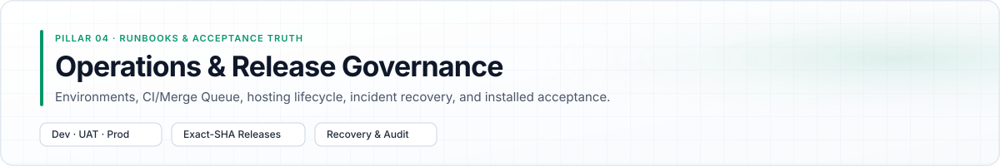
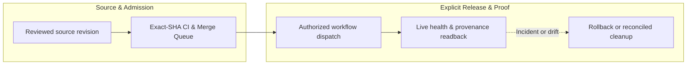

  <picture>
    <source media="(prefers-color-scheme: dark)" srcset="../assets/brand/pillar-operations-dark.svg" />
    <source media="(prefers-color-scheme: light)" srcset="../assets/brand/pillar-operations-light.svg" />
    
  </picture>

# Operations

[Documentation](../README.md) · **Intent:** Runbooks & acceptance truth

> [!CAUTION]
> **Operate What Is Actually Serving:** Verify live revision state and recorded operations before retrying updates, cleanup, or provider mutations. Merging code to any branch never deploys automatically.

Trusted deployment workflows execute from `main` while application sources stay isolated on their protected environment branches (`dev`, `uat`, `main`). Live GitHub teams, exact-SHA validation, compatibility checks, and rollback gates remain authoritative.

## Visual Map

## Operator runbook map

| Operational task | Guide |
| --- | --- |
| Branches, teams, CI, and deployment flow | [CI and releases](releases/ci.md) · [Branch governance](releases/branch-governance.md) |
| Local and cloud environment profiles | [Environments](environments.md) · [Configuration and secrets](configuration/env-and-secrets.md) |
| Install or update a private agent | [Private deployment runbook](hosting/dev-pod-first-light-runbook.md) |
| Verify source truth versus live acceptance | [Private-agent acceptance](acceptance/private-agents.md) |
| Operate encrypted Files libraries | [Files operations](hosting/private-files-library.md) |
| Remove cloud resources or delete accounts | [Cleanup and deletion](identity/account-deletion-rollout.md) |
| Recover from failure | [Pod recovery](hosting/pod-backup-and-recovery.md) · [Database recovery](production-db-backup-and-recovery.md) · [Source rollback](releases/source-snapshot-rollback.md) |
| Diagnose incidents or capacity | [Observability](observability/observability-architecture-map.md) · [Runtime capacity](hosting/runtime-capacity.md) |
| Release native mobile apps | [TestFlight](mobile/ship-ios-testflight.md) · [App Store](mobile/release-ios-appstore.md) · [Google Play](mobile/ship-android-playstore.md) |

Follow the canonical [Admin release SOP](../../.agents/skills/repo-operations/references/admin-release-sop.md) for any authorized release or incident action.

## Specialized operating guides

- [Releases](releases/README.md): Validate, admit, and explicitly release a selected application revision.
- [Hosting](hosting/README.md): Install, observe, and recover owner-controlled deployments.
- [Configuration](configuration/README.md): Choose runtime profiles and maintain configuration and credential boundaries.
- [Observability](observability/README.md): Understand health, telemetry, and operational incidents.
- [Identity](identity/README.md): Operate account, authentication, and cleanup lifecycle changes.
- [Integrations](integrations/README.md): Operate provider-specific connections and background workflows.
- [Mobile](mobile/README.md): Build and distribute explicitly authorized native releases.
- [Advanced Ops](advanced.md)
- [Hussh Brand And Compatibility Contract](brand-and-compatibility-contract.md)
- [MCP Host Operations](coding-agent-mcp.md)
- [Hussh Rebrand Classification](hussh-rebrand-classification.md)
- [Historical operational lessons](safe-changes-history.md)
- [Subtree Maintainers](subtree-maintainers.md)

<strong>For coding agents: release safety invariants</strong>

- Always dispatch `deploy-dev.yml`, `deploy-uat.yml`, and `deploy-production.yml` with `--ref main` while passing the exact tested `sha` for the target branch.
- Preserve UAT and Production runtimes untouched when working on Dev-scoped tasks; docs-only PRs do not trigger runtime deployments.

