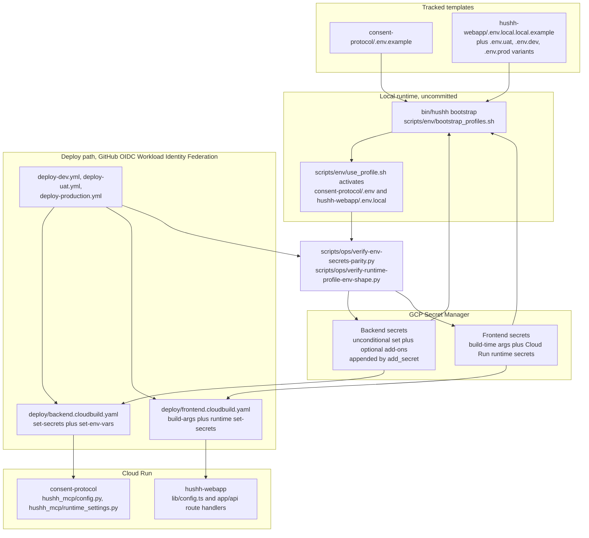

# Environment Variables and Secrets Reference

> Single source of truth for env vars and **strict parity** with code and GCP Secret Manager.  
> **Rule:** What is in `.env` / Secret Manager must match exactly what the code reads — no extra keys, no missing keys.

## Visual Context

Canonical visual owner: [Operations Index](../README.md). Use that map for the top-down system view; this page is the narrower detail beneath it.

See also: [deploy/README.md](../../../deploy/README.md), [consent-protocol/.env.example](../../../consent-protocol/.env.example), [hushh-webapp/.env.example](../../../hushh-webapp/.env.example), [deploy/.env.backend.example](../../../deploy/.env.backend.example), [deploy/.env.frontend.example](../../../deploy/.env.frontend.example). For FCM push notifications, see [fcm-notifications.md](../../../consent-protocol/docs/reference/fcm-notifications.md).

## Visual Map

Where env values originate, how they reach each runtime, and which scripts
enforce the parity rule. Counts live in the cloudbuild files, not here, because a
number written in prose drifts the first time a secret is added.

---

## Modular Configuration References

This overview establishes the parity rule between code, local `.env`, and GCP Secret Manager, plus where runtime values are configured. Environment matrices and per-variable audits live in focused sibling documents:

| Reference | Scope |
| --- | --- |
| [Three-Environment Matrix & Ops Identity](env-three-environment-matrix.md) | Canonical Dev / UAT / Production environment contract, managed AI quota recovery, backup/recovery ops identity, and mobile Firebase artifacts. |
| [Code & Secret Manager Variable Inventory](env-var-inventory.md) | Code-audited backend, frontend, and Secret Manager variable inventories with strict parity rules. |

## Parity rule: code ↔ .env ↔ Secret Manager

### One PLG metadata pilot

`one_plg_activity_enabled` in `BACKEND_RUNTIME_CONFIG_JSON` maps to
`ONE_PLG_ACTIVITY_ENABLED` (default false). This separately controls the
metadata-only all-agent observation pilot. Apply migration365 and verify its
service-only RLS, account deletion guards, epoch/reset fencing and bounded
retention before enabling. It uses the existing private export UID allowlist;
it grants no messaging permission. Disabling it stops collection and hides
retained observations from exports. The authenticated Drive work drain keeps
expiry cleanup independent of collection flags. The snapshot v2 consumer and
producer can release separately; v1 task export remains compatible.
New browser/native operations refresh observation admission at most once per
minute, including after rollout, source failures or resets on another device.
Pending terminal reports retain their original admission promise. An already
resolved epoch stays fixed; cold admission first processed after a remote reset
belongs to the new observation window. Browser reports use server receipt time,
not verified execution start time. Admission failures are best effort and there
is no durable client retry queue.

The deployment config writer defaults all four PLG flags to false and retains only
explicit booleans from the existing config (JSON booleans or exact `true`/`false`
strings). Retaining an enabled flag requires both the target and stored config
to identify production project `hushh-pda`. Invalid values or cross-lane
activation fail config generation. Production candidate releases retain these
settings in their candidate config without updating the serving canonical
config. Deploying this code does not activate the pilot.

The follow-up audience flags `one_plg_audience_enabled` and
`one_plg_activity_all_registered` map to `ONE_PLG_AUDIENCE_ENABLED` and
`ONE_PLG_ACTIVITY_ALL_REGISTERED`. Both default false and use the same strict
production/project retention guards. Expanded collection still requires
`ONE_PLG_ACTIVITY_ENABLED` and canonical registered-contact evidence. The
private audience reader requires migration366 and its own Secret Manager key
`ONE_PLG_AUDIENCE_SECRET` in `hushh-pda`, matching dashboard
`metrics-one-plg-audience-secret` in `hushh-ai-prod`. Never reuse the snapshot,
sync, session, OTP or sender key. The optional deployment binding independently
checks audience key version metadata; it does not require the legacy pilot pair.
Empty/disabled containers remain unbound. Matrix binds this key only to its
private PLG runtime, never the sync worker or browser. Provisioning code creates
containers and scoped IAM only; values stay out of Terraform state. All these
settings require a separately approved rollout, not a customer import or send.

Production exporter `ONE_PLG_EXPORT_ENABLED` defaults false and maps from
`one_plg_export_enabled` in `BACKEND_RUNTIME_CONFIG_JSON`.
`ONE_PLG_EXPORT_SECRET` and `ONE_PLG_EXPORT_ACCOUNT_IDS` are optional dedicated
Secret Manager bindings with the same names in `hushh-pda`. The UID allowlist is
private (maximum 100 production customer UIDs); never put it in tracked config,
logs or Terraform state. The source key must match dashboard
`metrics-one-plg-source-secret` in `hushh-ai-prod`, transferred through secure
process memory/stdin. Never reuse application, session, OTP or provider keys.
Keep the flag off until separately approved releases of both reviewed PRs are
verified. See [the API contract](../../development/contracts/api-referrals-and-plg.md#one-plg-pilot-task-evidence).
The production binding helper checks only version metadata and binds the pair
only when both `latest` versions are `ENABLED`. Missing, disabled or unreadable
versions bind neither secret; empty provisioning containers cannot break an
independent production release. Cloud Build passes the target project explicitly
to the helper; its built-in substitutions are not assumed to be shell variables.

- **Local:** `.env` (backend) and `.env.local` (frontend) must contain exactly the keys the application code reads. Use the repo `.env.example` files as the template; they are audited to match the code.
- **Production:** GCP Secret Manager must hold **exactly** the secrets the code expects — no more, no less. The Cloud Build config (`deploy/*.cloudbuild.yaml`) injects only these; do not add secrets that are not read by the code, and do not remove any that are.
- **Canonical runtime modes:** the supported frontend `local`, `uat`, `dev`, and `prod` files share one frontend key shape. The backend contributor runtime stays local-only in `consent-protocol/.env`. The deployed Dev backend uses the `dev` runtime identity. Local profile tooling deliberately labels the frontend `uat` to prevent development-only authentication shortcuts against a hosted backend; it does not relabel the deployed backend. See [the Dev setup guide](../../../consent-protocol/docs/reference/dev-environment-setup.md).

## Where variables are set

| Context | Backend | Frontend |
|---------|---------|----------|
| Local dev | `consent-protocol/.env` (from `.env.example`) | `hushh-webapp/.env.local` |
| CI | Env in workflow (dummy keys, TESTING=true) | Env in workflow (dummy Firebase, BACKEND_URL) |
| Production | Secret Manager + Cloud Run env (GOOGLE_GENAI_USE_VERTEXAI, ENVIRONMENT) | Secret Manager → build-args in Dockerfile |

### Connector OAuth across app origins

A load-balancer alias does not migrate OAuth. Browser popup completion uses
same-origin correlation and redacted settlement events; `one.hushh.ai` and
`one.hussh.ai` do not share that storage or Firebase browser session. The shared
web handoff rejects a provider callback on a different origin before navigating
the consent window. It never rewrites a signed/registered redirect or expands
the opener's message trust to a second domain.

The approved canonical app origins are `https://one.hussh.ai` (production) and
`https://uat.one.hussh.ai` (UAT). The `hushh.ai` app hosts remain compatibility
aliases, not interchangeable OAuth return origins. Backend/API and email domains
are outside this app-origin change; do not rename them by global substitution.
Governed deployment and native-build defaults use these app origins. Explicit
Secret Manager/private-profile values still take precedence and require separate
rollout verification. Backend preparation derives both Mail and Calendar return
URIs together; frontend build admission accepts only the same-environment
canonical/legacy pair. Stored credential RPs and the native legacy RP defaults
are unchanged, and the legacy association verification remains required.
Before distributing a native build, verify its effective bundled app origin,
not only the backend: a changed fallback cannot supersede an explicit old value.

For each environment migration, register the exact new Mail, Calendar and
connector callback paths with their providers first. Align `APP_FRONTEND_ORIGIN`,
`GMAIL_OAUTH_REDIRECT_URI`, `GOOGLE_OAUTH_REDIRECT_URI`, curated connector registry
redirects and Firebase authorized domains through the governed release. Preserve
old callback registration for in-flight attempts and rollback; do not redirect
provider returns indiscriminately at the load balancer. Gmail's signed state is
bound to the configured callback at completion: drain its ten-minute old-origin
attempt lifetime before switching configuration, or provide a separately
verified compatibility exchange. Keeping the old provider URI registered alone
does not make an old signed attempt valid under new backend configuration.
Prove a real completion
from the selected app origin: consent closes, the original window confirms the
owner-authenticated status, and its document/draft/vault session survive.

Read-only live inspection on 2026-10-10 found production and UAT backend origins
and Mail/Calendar callbacks still on `hushh.ai`, while both production app domain
aliases served the frontend. Domain reachability is not OAuth migration acceptance.
Public authorization-entry probes for the four new Mail/Calendar callbacks
reached Google's sign-in entry without exchanging a code; these are not proof of
provider registration or owner-authenticated completion. The read-only check did
not change secrets, runtime configuration, provider registrations or traffic.

### Passkeys across the domain transition

`hushh-webapp/lib/vault/passkey-domain-aliases.json` owns the exact dev, UAT and production alias groups for `hushh.ai`, `hussh.ai` and `hussh.si`. Browser registration keeps the current host RP; unlock uses the stored RP, credential and PRF salt unchanged. Each RP serves `/.well-known/webauthn` over HTTPS without redirects and with only its own environment origins. Native unlock also retains the stored RP; existing OS associations remain required.

Related Origin Requests requires browser support. Keep passphrase/recovery available for unsupported browsers; do not replace or reset an existing vault. Firebase sign-in and HttpOnly cookies are origin-bound, and vault keys remain memory-only. A cross-domain navigation requires sign-in and unlock again; account-owned history is restored through the existing authenticated APIs. Never transfer tokens, keys or decrypted information in redirect URLs or browser storage.

### Staging another public domain

Register the environment-specific OAuth origins and exact callbacks with each
existing provider application before directing browser navigation to the new
domain. Preserve existing callback, authentication and `/.well-known` endpoints
on their original hosts for in-flight requests and installed native clients.
Firebase authorized domains, Contacts/Picker browser restrictions, provider
registries, CORS and passkey RP allowlists are separate checks; a DNS alias does
not grant any of them. The frontend build checks its host against the same
environment-scoped passkey catalog used by runtime secret synchronization.

Stage certificate validation, destination routing and application compatibility
first. Verify the deployed destination and provider registrations before changing
canonical application origins or enabling redirects. Domain preparation is not
proof of a completed migration or an enabled connector.

### Document Hussh Coins and sandbox Connect

`DRIVE_REQUEST_HASHCOINS_ENABLED` enrolls only new document requests in coin
settlement. Existing obligations retain their immutable method. UAT deploy reads
`DRIVE_REQUEST_HASHCOINS_UAT_ENABLED` and `STRIPE_CONNECT_UAT_MODE` separately
from `STRIPE_UAT_MODE`. The live payment mode must remain live.

`STRIPE_CONNECT_SECRET_KEY` is server-only and must match `STRIPE_CONNECT_MODE`.
UAT sandbox binds the existing test `STRIPE_SECRET_KEY` secret to that runtime
name. `STRIPE_CONNECT_TEST_WEBHOOK_SECRET` binds the existing test Connect signing
secret for `/api/one/payouts/connect/sandbox-webhook`; the live Connect webhook
secret remains bound separately. API and worker retain required credentials for
already reserved obligations even if new enrollment is disabled. Never print
secret values or copy test balances/account IDs into live state.

### Request scope enablement follow-up (2026-10-11)

`PKM_ANSWER_REQUESTS_ENABLED` gates request intake and owner review on its own, independently of the payment and composer flags. **It is open by default and `false` is the only value that closes it**, which is deliberate and is the opposite of the paid-lane flags: an active connection is already the authorization gate for asking someone a question, so a second default-closed flag in front of it only ships a control that explains it cannot be used. Cloud Build passes it through `_PKM_ANSWER_REQUESTS_ENABLED` (default `"true"`), mapped from the environment's `PKM_ANSWER_REQUESTS_*_ENABLED` repository variable; set that variable to `false` to close intake in one environment. **The question form needs no variable at all: do not enable payments, the composer or live mode to make it appear.** With intake open and payments off the owner can review and price a question, the requester sees that price and no pay control, and the Cloud Build preflight still requires no answer Stripe bindings.

History worth keeping: the first revision of this flag inherited `PKM_ANSWER_PAYMENTS_ENABLED` when unset. At that earlier rollout, deployed environments ran payments off and had no answer-requests binding, so intake stayed shut and UAT shipped the dead control the change existed to remove. Do not reintroduce an inherit-from-payments default here.

Request scope uses the existing Stripe Secret Manager lane through dedicated `PKM_ANSWER_STRIPE_SECRET_KEY` and `PKM_ANSWER_STRIPE_WEBHOOK_SECRET` bindings. `PKM_ANSWER_STRIPE_MODE` is independent of Drive's mode and `ENVIRONMENT`; keep UAT at `uat`. `PKM_ANSWER_COMPOSER_ENABLED` defaults false. Live composition/admission additionally requires `PKM_ANSWER_LIVE_PROVIDER_REVIEWED=true`, mapped from the environment's `PKM_ANSWER_LIVE_PROVIDER_*_REVIEWED` repository variable. Set that attestation only after checking the exact selected provider project/model, regional failover, caching, request-response logging and applicable abuse-monitoring retention, and verifying the owner's disclosure/consent. The 2026-10-13 exact-provider probe returned cache retention type `DURABLE`; its retention semantics and the contractual abuse-monitoring exemption remain unresolved. See the [recorded provider evidence](../../architecture/paid-answer-provider-review-2026-10-13.md). See [runtime and key-control review](../../architecture/living-memory-freshness-adr.md).

The canonical counterpart's `REVIEWER_COUNTERPART_UID`, `REVIEWER_COUNTERPART_VAULT_PASSPHRASE` and `REVIEWER_COUNTERPART_PERSON_REF` are provisioned in UAT Secret Manager and its encrypted vault passphrase readback was verified. Reviewer credential values remain process-only. No deployed runtime was changed: bind the counterpart pair explicitly for a later reviewer-enabled deployment or inject it only into the local rehearsal process. Never put a passphrase, vault key, token or decrypted projection into a committed/ignored environment file, trace, screenshot or report.

Operator sequence, after final CI and review:

1. Merge the reviewed PR; apply release migration 305 through the existing manifest/migration verification path, then verify the three schema contracts. Historical payment rows with null mode and historical approvals without composition consent remain blocked pending explicit reconciliation; do not infer mode or grant consent in a backfill.
2. Deploy backend/frontend from the same reviewed SHA with answer payments/composer default off. Preserve Drive credentials, flags, Google configuration and UAT `ENVIRONMENT`. Bind answer test credentials first and verify the signed provider webhook's exact mode, actual Checkout completion, duplicate/late events, full refund and verified owner settlement with the two accounts. Test-mode payments do not establish live account readiness.
3. Configure `deploy/answers/setup_answer_work_drain_scheduler.sh` using its documented environment, project, service-account and audience options. Verify authenticated drain execution, logs and actual expired/refund/payout transitions. The current UAT scheduler inventory has no answer-work job; checked-in worker code is not evidence of a running deployed worker. Keep drain enabled for owed money when admission/composition is paused.
4. Retain test-mode credentials when switching new purchases to live. Each existing checkout, delivery, refund and payout stays bound to its stored mode; absent credentials leave owed work pending without consuming a provider attempt. NULL-mode historical orders require authenticated Event/current Session reconciliation. Re-enable only with a verified live-mode owner account; never promote a legacy, stale, deleted or unverified Connect mapping.
5. After the separate provider retention review and owner disclosure, select dedicated live answer key/signing-secret bindings, set the answer mode to live and explicitly enable the composer/provider-reviewed/payment gates. In UAT the live slots are `STRIPE_LIVE_SECRET_KEY` and `STRIPE_LIVE_WEBHOOK_SECRET`; leave the ordinary Drive bindings alone. Reverify platform and owner accounts and the live endpoint mode; the operator performs deployment and any real purchase.

Optional retained-mode credentials use `PKM_ANSWER_STRIPE_TEST_SECRET_KEY`, `PKM_ANSWER_STRIPE_TEST_WEBHOOK_SECRET`, `PKM_ANSWER_STRIPE_LIVE_SECRET_KEY` and `PKM_ANSWER_STRIPE_LIVE_WEBHOOK_SECRET`. Deploy workflows accept Secret Manager **names** through repository variables formed by appending `_DEV_SECRET`, `_UAT_SECRET` or `_PROD_SECRET` to each credential name; empty values add no binding except UAT retained-test slots, which default to the verified existing `STRIPE_SECRET_KEY` and `STRIPE_WEBHOOK_SECRET` names. Selected-mode generic answer bindings remain supported. Existing shared test keys are used only while Drive's unchanged shared mode is test and neither answer-specific test binding is partially configured. Never relabel keys, reuse a live key for a test obligation, or change the shared webhook/Drive mode to enable answers.

A shutdown disables answer admission/composition while retaining financial draining and requester cancellation. Preserve mode bindings, first-dispatch timestamps and consent digests. The expand-only rollback must not discard pending refund/earning obligations. Automatic answers are deferred. Locked/closed-app 24/7 memory remains a reviewed-design blocker, not completed queue work.

Verification evidence for this follow-up is local and uses Stripe test mode only. The canonical two-account reviewer rehearsal completed the profile Request scope dialog, owner Feed review with exact scope/price/model consent, real hosted Stripe test Checkout, signed test webhook, unlocked owner composition from approved encrypted memory, and requester-only encrypted answer readback on the requesting device. A real full test refund also settled through the answer refund worker. The Refund object has no required `livemode` field: the worker first retrieves and verifies the source PaymentIntent under the mode-bound answer credential, then verifies the refund's payment intent, amount, currency and status. A previously held refund requires explicit reconciliation against verified provider evidence; never reset a manual-review row blindly.

The rehearsal does not prove provider owner onboarding/transfer, live account readiness, deployed scheduler execution, or Google Drive's two-account provider journey. Drive regressions ran locally with answer flags off and on. Answer delivery currently uses the requesting device's existing private recipient key; successful readback in that session does not establish cross-device key recovery. No new key escrow or recovery authority is introduced. Provider retention, hosted workers and verified owner settlement remain external enablement blockers, and live provider review remains incomplete. At the 2026-10-13 read, deployed UAT had composer enabled with test answer mode and live-provider-reviewed=false; repository variables selected live for a later deployment. The locked/closed-app runtime proposal remains pending review.

### Staging another public domain

Register the environment-specific OAuth origins and exact callbacks with each
existing provider application before directing browser navigation to the new
domain. Preserve existing callback, authentication and `/.well-known` endpoints
on their original hosts for in-flight requests and installed native clients.
Firebase authorized domains, Contacts/Picker browser restrictions, provider
registries, CORS and passkey RP allowlists are separate checks; a DNS alias does
not grant any of them. The frontend build checks its host against the same
environment-scoped passkey catalog used by runtime secret synchronization.

Stage certificate validation, destination routing and application compatibility
first. Verify the deployed destination and provider registrations before changing
canonical application origins or enabling redirects. Domain preparation is not
proof of a completed migration or an enabled connector.

### One reviewed task suggestions

`ONE_TODO_SUGGESTIONS_ENABLED` is a default-off backend feature flag, hydrated
from `BACKEND_RUNTIME_CONFIG_JSON.one_todo_suggestions_enabled`. It exposes the
same boolean through the authenticated suggestions status route. Enabling it
admits only explicitly approved, bounded owner summaries to the existing One
single-turn gene in Shared placement; it does not authorize background reads,
new task writes or provider actions. Recheck occurs before output release.
Disable it to withdraw processing while preserving existing encrypted tasks.
Live-model evaluation and provider rehearsal are required before enabling this capability;
private placement remains unavailable until its owner-direct transport qualifies.

### OAuth, Firebase Microsoft IdP, and outbound mail preflight

Deploy pipelines (`deploy-dev-implementation.yml`, `deploy-uat-implementation.yml`,
and `deploy-production.yml`) run `scripts/ops/reconcile_oauth_and_mail_posture.py
--verify-deploy` before backend Cloud Build submission. The preflight fails closed
without ever logging secret values if outbound mail secrets diverge from
`one@hushh.ai` (`SUPPORT_EMAIL_MODE=live`), if `hushh-mail-api` stops reporting
`google-workspace-gmail-delegated` transport, if Google or Drive OAuth secrets or
redirect URIs fail live provider validation, or if `MICROSOFT_FIREBASE_CLIENT_ID` /
`MICROSOFT_FIREBASE_CLIENT_SECRET` drifts. Operators run `--reconcile-all [--apply]`
to audit Firebase `microsoft.com` IdP parity and `HushOne Inc.` Microsoft Entra grants,
redirect URIs, custom domain verification, and B2B guest redemptions across Dev,
UAT, and Production.
