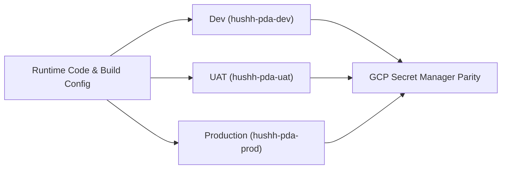

# Three-Environment Matrix & Ops Identity

[Env & Secrets Hub](env-and-secrets.md) · [Configuration](README.md)

**Status:** Live | **Intent:** Reference | **Audience:** Release, Backend, Mobile, and Security Engineering

Canonical Dev, UAT, and Production environment boundaries, managed AI quota recovery, backup/recovery operator identities, and mobile Firebase artifact parity. See [Environment Variables and Secrets](env-and-secrets.md) for the parity rule and configuration locations.

## Visual Map



## Canonical 3-environment contract

### Dev owner-cloud connectors and metadata feeds

Native Google connectors use separate public-client pins:
`GOOGLE_IOS_CONNECTOR_CLIENT_ID`, `GOOGLE_ANDROID_CONNECTOR_CLIENT_ID`,
`GOOGLE_ANDROID_CONNECTOR_REDIRECT_URI` and `GOOGLE_ANDROID_CONNECTOR_DEV_ENABLED`.
The frontend compiles the corresponding `NEXT_PUBLIC_*` values. Register the
exact native redirect; Android requires the approved custom-scheme development
opt-in and remains disabled outside dev. Absent configuration means unavailable,
not fallback to the Shared web OAuth client. `GOOGLE_CONNECTOR_OAUTH_PROJECT`
identifies the verified developer project that owns the Gmail watch topic;
the subscription and its push identity belong to the same owner Google project.
An Azure pod additionally needs a verified Google notification project.

Hub metadata feeds and incarnation-bound consent revocations use an independent
`OWNER_FEED` Ed25519 namespace. Mint through the existing operator command:
`consent-protocol/scripts/ops/mint_consent_ed25519_key.py --namespace owner-feed --project <dev-project>`.
The hub mounts `OWNER_FEED_ED25519_PRIVATE_KEY` and the public map through Secret
Manager; only `OWNER_FEED_ED25519_PUBLIC_KEYS` reaches owner pods. The dev deploy
pins `OWNER_FEED_ED25519_KID=hushh-owner-feed-dev-1` and enables signing only when
both secrets exist. Rotation requires moving the signing kid and retaining
verification keys for unexpired statements. Missing keys leave feeds unavailable;
neither consent-token nor audit keys substitute for this authority.

These variables establish configuration, not live native OAuth, push delivery or
private custody. Feeds carry only canonical consent metadata, public directory
records and owner-published listings; private observations remain inside the pod.

### Wallet artwork catalog

Wallet artwork optionally reads `HUSHH_WALLET_ARTWORK_CATALOG_PATH`, a local
path to a reviewed, versioned catalog and its approved raster assets. An unset
path uses the bundled, reviewed card atlas without external provider requests.
A configured path replaces the bundle; an invalid or empty override fails
closed and must not restore withdrawn bundled approvals. The contributor
backend template documents this optional path. A private override requires a
pipeline maintainer to configure a read-only mount after rights and asset
approval. It is not an API key. See [Wallet artwork](../../architecture/one/wallet.md) for the
catalog and owner-only display recovery contracts.

1. Backend environment identity is `ENVIRONMENT` and must be one of: `development`, `uat`, `production`.
2. Frontend environment identity is `NEXT_PUBLIC_APP_ENV` and must be one of: `development`, `uat`, `production`.
3. Legacy frontend fallback keys are read-only compatibility paths for one release cycle:
- `NEXT_PUBLIC_OBSERVABILITY_ENV`
- `NEXT_PUBLIC_ENVIRONMENT_MODE`
4. Local runtime-mode model (non-committed):
- backend template/source: `consent-protocol/.env.example` -> `consent-protocol/.env`
- frontend templates: `hushh-webapp/.env.local.local.example`, `hushh-webapp/.env.uat.local.example`, `hushh-webapp/.env.dev.local.example`, `hushh-webapp/.env.prod.local.example`
- local source files are created from templates and kept uncommitted
- active files: `consent-protocol/.env`, `hushh-webapp/.env.local`
- PKM rehearsal toggles, maintainer smoke identities, and review/bypass overlays belong in maintainer-only overlays, not in the canonical contributor runtime files.
5. Runtime profile bootstrap command:

```bash
./bin/hushh bootstrap
```

This is the supported contributor entrypoint. It installs dependencies, hydrates local runtime-profile files from templates plus current cloud secrets/runtime metadata when available, and runs the profile doctor.
It does not print secret values and sets profile files to `chmod 600`.
For backend Gmail and voice, bootstrap hydrates `consent-protocol/.env` using the same key names as hosted runtime. Missing Gmail/voice cloud values are warnings by default and only become failures with `--strict`.

### Local agent credential resilience

Local profile hydration is read-only and uses this ordered credential policy:

1. refreshable `gcloud` user credentials;
2. refreshable Application Default Credentials (ADC) when the interactive `gcloud` session has expired;
3. existing local profile values only when neither source can refresh.

Bootstrap never prints a credential or secret. It fails closed for an invalid local
`APP_SIGNING_KEY` or `VAULT_DATA_KEY` instead of reporting a stale cache as ready.
This improves agent-session resilience but does not bypass a Google Workspace
session policy: if ADC itself expires, reauthenticate with
`gcloud auth application-default login`. Use `gcloud auth login` only when you
also need interactive CLI operations. Do not create service-account key files for
local agent operation; GitHub deployment remains on its separate OIDC/WIF path.

### Explicit workspace identity for localhost models

When the default ADC account cannot access the configured Vertex project, set
`HUSHH_LOCAL_GCLOUD_ACCOUNT` to the authorized Workspace email in the launching
shell's process environment. Authenticate that account with
`gcloud auth login EMAIL --no-activate` first. This does not replace the default
CLI account or shared ADC files. The local doctor and managed Gemini clients use
the explicit identity; regional failover preserves it. Tokens remain in memory,
are checked for the selected email and actual expiry, and refresh through gcloud.

This override is restricted to `ENVIRONMENT=development` and
`APP_RUNTIME_PROFILE=local`, with no `K_SERVICE` or `HUSHH_DEPLOY_ENV`. It is not
a hosted credential strategy, does not create service-account keys, and must not
be added to deployed secrets or canonical contributor profile files.

6. Activate the chosen runtime profile:

```bash
./bin/hushh doctor --mode local
./bin/hushh web
./bin/hushh web --mode uat
./bin/hushh web --mode prod
./bin/hushh native ios --mode uat
./bin/hushh native android --mode uat
```

Low-level activation still exists when you need it:

```bash
bash scripts/env/use_profile.sh local
bash scripts/env/use_profile.sh uat
bash scripts/env/use_profile.sh prod
```

The local UAT-backed backend launcher now runs IAM schema verification before booting. If IAM is incomplete, it exits instead of silently falling back to investor-compatibility mode.

Profile-aware frontend-only launcher:

```bash
cd hushh-webapp
npm run dev -- --mode=local
```

### One-command parity audit

```bash
python3 scripts/ops/verify-env-secrets-parity.py \
  --project hushh-pda \
  --region us-central1 \
  --backend-service consent-protocol \
  --frontend-service hushh-webapp
```

Native release preflight (adds required native Firebase and signing keys):

```bash
python3 scripts/ops/verify-env-secrets-parity.py \
  --project hushh-pda-uat \
  --require-native-artifacts
```

The script reports:
- required backend/frontend key lists
- whether each required key exists in the target project
- missing keys (if any), with non-zero exit on failure

When `--require-gmail` is set, it also checks without rendering values that
`GMAIL_OAUTH_REDIRECT_URI` equals
`APP_FRONTEND_ORIGIN + /one/profile/gmail/oauth/return`. This blocks a deployment
whose Gmail callback secret belongs to another environment.

When `--require-calendar` is set, it requires the dedicated Calendar OAuth tuple
(`GOOGLE_OAUTH_CLIENT_ID`, `GOOGLE_OAUTH_CLIENT_SECRET`,
`GOOGLE_OAUTH_REDIRECT_URI`, and `GOOGLE_OAUTH_TOKEN_KEY`) and checks that its
callback equals `APP_FRONTEND_ORIGIN + /one/profile/google/oauth/return`.
Calendar must not rely on Gmail OAuth credentials in hosted environments.

Deploy workflows add Gmail and One mailbox checks with `--require-gmail --require-one-email`. That enforcement stays in deploy/runtime verification and is not part of the default contributor PR CI lane.

### Runtime profile shape audit

Use this when the local profile files feel inconsistent or a new env key was added in only one place:

```bash
python3 scripts/ops/verify-runtime-profile-env-shape.py --include-runtime
```

It checks that:
- tracked backend profile templates share one canonical backend key set
- tracked frontend profile templates share one canonical frontend key set
- the real local canonical profile files and active `.env` / `.env.local` match those same shapes

### Firebase identity plane rule

1. The application uses one Firebase identity plane across `development`, `uat`, and `production`.
2. Environment separation is primarily at the database / backend runtime layer, not by changing the login provider between UAT and production.
3. The frontend and backend now use that same Firebase project directly; there is no separate auth-only override contract.
4. UAT and production share the live Plaid credential set; only local development should use sandbox Plaid secrets and `PLAID_ENV=sandbox`.
5. Web consent delivery uses different defaults by environment:
   - local development: `CONSENT_SSE_ENABLED=true`
   - UAT: the deployed workflow sets `CONSENT_WEB_FALLBACK_ENABLED=false` and `CONSENT_SSE_ENABLED=false`; the web client discovers this runtime policy before attempting a stream
   - production: `CONSENT_SSE_ENABLED=false` unless there is an explicit incident-response or rollout reason to enable it
6. App-review toggles, reviewer identity secrets, bypass flags, and rehearsal keys are maintainer-only overlays and are intentionally excluded from the canonical contributor runtime contract.
7. UAT backend revisions still mount `REVIEWER_UID` and `REVIEWER_VAULT_PASSPHRASE` from Secret Manager so reviewer-mode smoke can mint the Firebase custom token after deploy. The passphrase is the mint credential: the session route refuses a request that does not carry it, whatever `APP_REVIEW_MODE` says.
   Production never mounts either one, and never advertises review mode or mints a review session, whatever `APP_REVIEW_MODE` says. The production App Store reviewer is a dedicated account that signs in normally. Its `REVIEWER_UID` and `REVIEWER_VAULT_PASSPHRASE` live in `hushh-pda` Secret Manager for operator tooling only (the App Store review notes and the iPhone device gate). See `consent-protocol/docs/app-review-mode-config.md` § *Production: backend-only review*.
   **UAT and production share one Firebase authority.** Both `FIREBASE_ADMIN_CREDENTIALS_JSON` secrets carry `project_id` `hushh-pda`, so an ID token issued on one lane verifies on the other. What keeps a review session on the lane that minted it is the `hushh_review_mint: "<ENVIRONMENT>"` developer claim every review-mode mint carries, which every backend verifier refuses outside that lane and always refuses on production (`api/utils/firebase_auth.py`). A review session also cannot approve a trusted device or authorize a Hussh Tech launch, because both mint fresh tokens that could not carry the claim. `ENVIRONMENT` is therefore part of the auth boundary: a lane must never report another lane's value. See `consent-protocol/docs/app-review-mode-config.md` § *Lane containment: one Firebase authority*.
8. The canonical non-production reviewer fixture is `REVIEWER_UID` plus `REVIEWER_VAULT_PASSPHRASE`; `UAT_SMOKE_*` and `KAI_TEST_*` are deprecated migration aliases, and no `NEXT_PUBLIC_*` passphrase is allowed.
   The second non-production fixture for two-person proofs is `REVIEWER_COUNTERPART_UID` plus `REVIEWER_COUNTERPART_VAULT_PASSPHRASE`, Secret-Manager-only like the first, with no aliases: the review-mode session route mints the counterpart uid when the supplied passphrase matches the counterpart pair, mints the primary when it matches the primary pair, and refuses everything else (no passphrase, a passphrase matching no pair, a named `reviewer_uid` without its own pair's passphrase, a backend holding no passphrase, and production). Nothing mounts the counterpart yet (`deploy/backend.cloudbuild.yaml`, `scripts/ops/sync_backend_runtime_secrets.py`, `scripts/ops/verify-env-secrets-parity.py`, `config/deploy-env-coverage.json` and the deploy workflow substitutions carry only the primary pair), so until a maintainer adds it there a counterpart passphrase on dev or uat mints the primary, and the two-person proof detects that through the client-side expected-uid check.
9. Localhost private-agent review: the local backend loads `consent-protocol/.env.local` as a maintainer overlay (`hushh_mcp/runtime_settings.py`; the file is absent in deployed environments, so this is a no-op there, and `override=False` keeps the canonical `.env` authoritative). Use `bash scripts/env/reviewer_mode.sh enable`, restart the backend, and run the reviewer preflight with `REVIEWER_SECRET_PROJECT=hushh-pda-uat`; it resolves `REVIEWER_UID` and `REVIEWER_VAULT_PASSPHRASE` from Secret Manager only into the test process. The overlay holds only `APP_REVIEW_MODE=true`; it never holds reviewer secrets. Because the session route now requires the passphrase, a custom-token rehearsal also needs the backend started from a shell that evaluated `node hushh-webapp/scripts/testing/export-reviewer-test-env.mjs`, which puts `REVIEWER_VAULT_PASSPHRASE` in the backend's process env only. The preflight proves the localhost custom-token minter is enabled before Chromium launches, and the standard rehearsal blocks unapproved state-changing HTTP. Afterward, disable the mode and restart the backend. The overlay never ships.

### Environment divergence note (current)

1. UAT and production use the same canonical frontend key shape.
2. Each deployed environment resolves one active analytics measurement ID and one active GTM ID.
3. Maintainer-only overlays are intentionally excluded from generated contributor runtime files.

### Managed AI configuration and quota recovery

Edit [the managed AI configuration](../../../consent-protocol/config/managed-ai-runtime.json)
for supported fleet provider, model, deployment, endpoint, project and location changes.
Keep credentials in the existing workload identity or secret owner. No chat, voice,
connector, frontend or GitHub workflow edit is needed for these settings.

| Setting in that file | Consumers and boundary |
| --- | --- |
| `managed_provider_selection.uat` | Packaged UAT provider default, currently `vertex`. The existing resolver supplies text, research, audio and embedding callers across Dev, UAT, production and local; Azure descriptors remain validated on standby. |
| `drive_text_uat` | UAT Documents genes and Drive request models use native Vertex independently of the fleet default: `gemini-4-hydrogen` at the global endpoint, LOW thinking, 16,384 output tokens, and no Azure fallback. Existing prompts and processing stages remain unchanged. |
| `one_chat_text_uat` | The UAT managed One chat model, its inherited Search model, and conversation titles use Vertex `gemini-4-hydrogen` at the global endpoint with LOW thinking, a 16,384-token output cap, and no Azure fallback. Explicit owner model connections follow their own bindings. |
| `managed_azure_accounts` | UAT's managed Azure accounts by name: Entra tenant, the runtime app federated to the UAT runtime service account, resource endpoints and the readiness exam's separate probe-only app. `selection.uat` names the active account; every listed account is shape-checked before merge. |
| `pwm_research_uat.azure` | Deployment names that every account hosts; `primary_deployment` supplies general text/research. |
| `managed_runtime_uat.azure.one_text_root` | Azure One root deployment and generation budget for releases using the legacy fleet text binding. |
| `managed_runtime_uat.azure` | Other Azure capability deployments: realtime, transcription, speech, embeddings and compact public search. Preserve model compatibility, the 768-dimension embedding contract and declared capability qualification. |
| `environments.<environment>` | Vertex text, live audio and embedding model names, project and locations for that environment. |

For exhausted Azure quota, choose a compatible provisioned Azure resource or
deployment with available capacity and update the relevant entries in this file.
Changing a deployment name alone does not create quota or provision a model.
To move UAT to Vertex, set `managed_provider_selection.uat` to `vertex`; set it
back to `azure_openai` to restore Azure. The fleet selection supplies independently
owned capabilities such as voice and research. The Drive and managed One chat
policies take precedence for their scoped model callers. Activity-date requests preserve
their existing single interpretation stage, native retrieval and deterministic date
checks. Provider changes require the affected authored v2 planner qualification. Saved
requests retain their processor binding and its current-authority validation.
Legacy Azure chat may use the explicit Vertex alternate once after a classified
transport/quota failure before any response is observed. It never replays tools
or emitted output. Configured Vertex chat remains single-provider. Authority,
identity denials, content filtering and malformed output never trigger fallback.
A classified token-exchange transport outage may use the same bounded alternate;
an invalid credential or 401/403 denial cannot.
The scoped policies disable cross-provider fallback. The existing UAT core proof
checks both scopes' effective model, policy generation and runtime binding and
grades the authored Drive planner cases. The Azure readiness job still verifies
the independently configured PWM model. Broader capabilities remain
separate diagnostics under the [CI policy](../releases/ci.md#managed-provider-readiness-policy).

Validate the complete file without model calls or credentials:

```bash
python3 scripts/ops/managed_ai_config.py --environment uat --format validate
python3 scripts/ops/managed_ai_config.py --environment uat --format provider
python3 scripts/ops/managed_ai_config.py --environment uat --format azure-account
```

Qualify the exact candidate image under the UAT runtime service account with
`python scripts/verify_drive_vertex_journey.py`, inside a temporary Cloud Run Job.
This explicitly invoked script is not a CI/CD hook. It grades the authored v2
planner with synthetic inputs. The Vertex project's `vertexai.allowedModels`
policy must permit the configured model before qualification can pass.
The optional `--live --allow-fixture-mutations` mode requires the designated,
already Google-connected `REVIEWER_UID` / `REVIEWER_COUNTERPART_UID` pair and normal
runtime authentication. It separately exercises the existing free `/queries`
flow, exact-file access and revocation, then trashes its synthetic fixtures.
It does not certify paid delivery or the new `/requests` pipeline end to end.
Unknown writes retain fixtures and produce an incomplete cleanup receipt;
reconcile them before another live run. Never seed consent or payment to pass.

#### Switching the managed Azure account

`--format azure-account` prints the selected account and every deployment it must
host, from this file. To move UAT to another Azure account:

1. In the new account (Azure commercial cloud), create:
   - one resource with a custom `*.openai.azure.com` subdomain, key authentication
     disabled and public network access, hosting every printed deployment under the
     same name, model, version, deployment type and capacity. Record the primary
     deployment's model and version, which the file does not declare yet. The two
     GPT deployments need the Responses `web_search` tool. Live and speech use the
     v1 surface (`/openai/v1`); transcription also needs the dated Audio API
     `2025-04-01-preview` on the same resource;
   - a `*.services.ai.azure.com` host for `phi_endpoint`, which validation still
     requires although nothing calls Phi; an AI Services resource provides one;
   - an Entra app registration with no secret or certificate, whose federated
     credential trusts issuer `https://accounts.google.com`, audience
     `api://AzureADTokenExchange` and subject
     `gcloud iam service-accounts describe consent-protocol-runtime@hushh-pda-uat.iam.gserviceaccount.com --format='value(uniqueId)'`;
   - the `Cognitive Services OpenAI User` role for that app's service principal on
     the resource.

   For a new subscription in the same tenant, keep `tenant_id`, `client_id` and the
   federated credential, and grant the existing service principal the role on the
   new resource.
2. Add the account under `managed_azure_accounts.accounts` with `selection`
   unchanged and merge. Validation checks its shape; runtime bindings do not change.
   `readiness_exam_client_id` names the account's separate probe-only exam app, or
   `null` until it exists; it never equals the runtime `client_id`.
3. Change `managed_azure_accounts.selection.uat` to the new name in a one-line PR and
   ship a normal UAT release. Until the pre-merge exam can examine a standby
   account, that release's exact-image candidate exam under the UAT runtime
   identity is the new account's first live qualification (a guardrail 1 gap), so
   switch while the old account still serves. Read the exam's reason code: a
   transport result (timeout, 429 or 5xx) usually means the new account's quota or
   capacity, so fix that and dispatch once more. A semantic or configuration
   failure is deterministic: never retry it; fix the account or select the last
   passing one.
4. Without the scoped Drive override, the switch rotates Azure bindings without new owner consent. Trusted (Allow)
   Drive requests with a ready plan migrate once, on their next claim; an owner's
   own requests migrate once when that owner acts on them. A request migrates only
   once, so a later switch, including a rollback, supersedes it and its owner makes
   a new request. Each UAT release already runs the bounded recovery job
   (`scripts/ops/run_uat_text_recovery_job.py`), which always applies, to at most
   20 eligible requests; a preview is `consent-protocol/scripts/recover_uat_text_requests.py`
   without `--apply`, inside the runtime. Saved personal research restarts within
   its preserved budget.

   The scoped Drive rollout permits one exact subsequent Azure-to-Vertex
   transition and retains the earlier migration receipt. It preserves saved
   results, cursors, request revision, consent, payments and sharing effects;
   active leases cannot be replaced. Further switches still fail closed.

To roll back, select the previous account while it still serves. Once it is gone,
fix forward: an image from before the switch points at the old account. Selecting
Vertex (`managed_provider_selection.uat`) is a fallback only once the latest UAT
Vertex readiness job has passed its whole bundle; its `structured_text` check
failed intermittently on 2026-10-29.

The deployment compiler reads the packaged default and pins both existing
`HUSHH_UAT_MANAGED_AI_PROVIDER` and `HUSHH_UAT_MANAGED_TEXT_PROVIDER` values on
the candidate revision. These internal verification pins take precedence over
the file at runtime; conflicting pins fail closed. Both Drive workers inherit
the verified API binding. Operators should edit the file, rather than manually
change those pins independently. The existing exact-image readiness and
promotion gates remain mandatory. They require the configured provider's complete
bundle, including chat tool round trips and voice audio; a healthy alternate
cannot silently replace the configured choice. Config validation proves shape,
not live quota, model quality or availability. Azure remains the fleet default;
the packaged Drive override selects Vertex in the API and both Drive workers.

The file is packaged with the backend. A source edit takes effect through the
normal authorized backend release/restart, including affected workers; it does
not hot-reload deployed services or change an active voice session. Preserve
saved job/provider bindings and their existing migration/recovery checks when
changing processors. Roll back through the existing release owner to the prior
qualified configuration/image. No user cohorts or per-account flags are added;
the default applies to existing and new users in the authorized environment,
with their existing permissions. BYOK, private owner-cloud placement and the
coding assistant's own model subscription stay with their separate owners.

### Fleet text model switch (2026-09-02)

Hosted text, Live Voice, research and embedding targets come from
`consent-protocol/config/managed-ai-runtime.json`. Dev, UAT and production each
select their own home GCP project (`hushh-pda-dev`, `hushh-pda-uat`, `hushh-pda`).
The checked-in text model is `gemini-4-hydrogen` on `global`. Hosted clients
ignore local model and project overrides; local mode retains explicit overrides.

The deploy compiler validates the same profile and hash used by the packaged
runtime. Each hosted release must exercise its actual runtime identity against
the destination before serving traffic. Administrative API access does not prove
model availability, quota or successful inference. The 2026-11-14 switch advances
the text model to Gemini 4 Hydrogen on global across home Vertex projects.
Document facts policy includes the model id, so previously processed facts may
require reprocessing when background work is resumed. Preserve the incident pause
until that resumption is explicitly authorized.

One Live Voice adds three names on every lane: `ONE_VOICE_LIVE_ENABLED` (kill switch,
`false` in production until UAT sign-off), `VERTEX_LIVE_MODEL_ID` (an exact Live model
id that must be a native-realtime entry in `hushh_mcp/runtime_providers/registry.py`;
the lane's `constraints/vertexai.allowedModels` must admit it) and `VERTEX_LIVE_LOCATION`
(one regional Vertex endpoint, never `global`). No API key exists for Live anywhere;
see `docs/architecture/one/one-voice-live-tool-contract.md`. The
deploy-time Vertex readiness probe resolves the alias through the same resolver and
receives `HUSSH_GEMINI_TEXT_MODEL`, so it validates the lane's switched model, never
the literal alias. Every text agent names the alias, including the memory chain; only the
Live head keeps an explicit pin.

### Wallet subagent flags and the central One mailbox (2026-09-02)

- The Wallet ships unconditionally. `ONE_WALLET_ENABLED` and
  `NEXT_PUBLIC_ONE_WALLET_ENABLED` were removed on 2026-09-02: the feature was
  complete, the frontend flag was a build-time constant that duplicated the
  backend's authority, and the manifest's `HUSHH_WALLET_AGENT_DISABLED` kill switch
  was never wired to anything. Nothing gates the Wallet now, in any lane.
- One support, account notices, and shared `hushh-mail-api` alerts use the
  delegated `one@hushh.ai` mailbox via keyless Google Workspace Domain-Wide
  Delegation (no personal accounts or App Passwords). Support reports go to One
  with a fixed internal BCC to the support lead; account notices have no BCC.
  The sender and delegated user must both be `one@hushh.ai` for these routes.
  Dev, UAT, and production all mount explicit `SUPPORT_EMAIL_DELEGATED_USER`,
  `SUPPORT_EMAIL_FROM`, `SUPPORT_EMAIL_TO` (`one@hushh.ai`), and
  `SUPPORT_EMAIL_MODE` (`live`) secrets, which each deploy preflight requires
  before backend rollout. The mailbox credential is never stored in the repo or
  Secret Manager; sending rides the delegated service identity. Forwarding from
  `one@hushh.ai` to a person is a Google Workspace admin setting, not a repo
  concern.
- Automatic account mail is limited to the first-account welcome, confirmed
  passkey-add, passkey-remove, existing-vault passphrase-change and phone-link
  change notices, and the `account_deleted` notice. The deletion notice is sent
  by the deletion worker at most once, only after a full-account erasure
  commits, to the retained sign-in's verified email. Hussh reads the address into
  memory and never stores it (the One mailbox keeps its Sent copy, as for every
  account notice), so a lost or uncertain send is logged
  (`account_deletion.notice_failed`, or `account_security_email.failed`) and
  never replayed or backfilled. When `SUPPORT_EMAIL_MODE=live`, account and
  security notices deliver to the signed-in owner across Dev, UAT, and
  production; when `SUPPORT_EMAIL_MODE=test` is explicitly opted in for a sandbox,
  `SUPPORT_EMAIL_TEST_TO` redirects delivery. Otherwise it logs
  `account_deletion.notice_skipped` with `reason=sender_unconfigured`.
  Routine welcome-back, sign-out, phone-conflict, and client-inferred connector
  emails are retired. The separate `hushh-mail-api` frontend binding remains
  only for user-requested Save my Soul email, sending through delegated
  `one@hushh.ai` rather than `ankit@hushh.ai`; it must not send account notices.
  Independent OTP adds a separate backend consumer binding and delegated One
  transport to that same API; the frontend SOS binding never receives a One bearer.
  A green branch check or local commit does not publish this policy: verify the
  landed source SHA, serving web/backend revisions, sender secrets, and live
  event behavior at each authorized release gate.

### Deploy-step env plumbing and the Cloud Build arg cap (2026-09-02)

The `deploy-backend` step body in `deploy/backend.cloudbuild.yaml` is one Cloud Build
arg, capped at 10,000 characters after substitution. Optional env values now travel
through the step's `env:` field (`_NAME=${_NAME}`, which does not count toward the cap)
and one `for n in ...` loop reads them with `${!v}`; only names that existing contract
tests assert literally stay as flat `add_env` lines. The file has no
`automapSubstitutions`, so a name in the loop without an `env:` entry deploys nothing:
that is how the Gmail personal-information-request monitor settings were silently
unset before this change. `tests/test_cloudbuild_step_arg_limit.py` guards the cap, the
per-lane headroom, and the loop-to-`env:` pairing.

### Ops-only GitHub identity variables (deploy/backup governance)

These are not Cloud Run runtime secrets.

- Required on each `dev`, `uat`, and `production` GitHub environment:
  `GCP_WORKLOAD_IDENTITY_PROVIDER` and `GCP_DEPLOY_SERVICE_ACCOUNT`.
- UAT and production declare these required names in
  `config/ci-governance.json`; run
  `python3 scripts/ci/verify-deployment-environment-governance.py` to detect
  missing environment configuration before dispatch. The workflow reads
  `vars.*`, so setting same-named GitHub environment secrets does not satisfy
  the contract.
- Required as production environment variables for the scheduled backup posture
  workflow: `GCP_WORKLOAD_IDENTITY_PROVIDER` and
  `GCP_BACKUP_SERVICE_ACCOUNT`.
- These identities use GitHub OIDC Workload Identity Federation. Do not create,
  upload, or restore a service-account JSON key for deployment or backup jobs.

Used by:
- `.github/workflows/deploy-dev.yml`
- `.github/workflows/deploy-uat.yml`
- `.github/workflows/deploy-production.yml`
- `.github/workflows/prod-cloudsql-backup-posture.yml`

---

## Backup/Recovery Ops Identity

### GitHub Actions (required)

| Variable | Scope | Used by | Notes |
|----------|-------|---------|-------|
| `GCP_WORKLOAD_IDENTITY_PROVIDER` | GitHub production environment variable | `.github/workflows/prod-cloudsql-backup-posture.yml` | Full Workload Identity Provider resource name for GitHub OIDC; non-secret configuration. |
| `GCP_BACKUP_SERVICE_ACCOUNT` | GitHub production environment variable | `.github/workflows/prod-cloudsql-backup-posture.yml` | Dedicated read-only backup-posture identity; never the Cloud Run LLM runtime identity. |

### Backup posture config (Cloud SQL)

Production backups are native Cloud SQL automated backups + PITR; there is no
backup Cloud Run job or GCS backup bucket in the recovery path.

| Key | Scope | Used by | Notes |
|-----|-------|---------|-------|
| `BACKUP_MAX_AGE_HOURS` | Deploy/workflow env | `scripts/ops/cloudsql_backup_freshness_check.py` | Freshness gate threshold (default `30`) |

Validation command:

```bash
python3 scripts/ops/cloudsql_backup_freshness_check.py \
  --project-id hushh-pda \
  --instance hushh-vault-db \
  --max-age-hours 30 \
  --report-path /tmp/prod-backup-posture-report.json
```

---

## Mobile Firebase Artifacts (iOS/Android)

Committed files:
- `hushh-webapp/ios/App/App/GoogleService-Info-README.md` (tracks the iOS Firebase plist setup workflow)

Production release process:
- Store base64-encoded production artifacts in Secret Manager:
  - `IOS_GOOGLESERVICE_INFO_PLIST_B64`
  - `ANDROID_GOOGLE_SERVICES_JSON_B64`
- Release CI decodes and overwrites template files only inside the ephemeral job workspace before native build/sign.
- Frontend runtime profile files do not carry these native artifacts. Treat them as release-only inputs, not web runtime env.
- Local native developers manage platform artifacts in the native project paths or through explicit release tooling; `./bin/hushh bootstrap` does not materialize them into the active frontend runtime profile.

Repository guard:
- CI and the bootstrap/native build flow must preserve tracked Firebase artifacts as templates and keep real release artifacts out of git.

Local iOS signing:
- Store Apple signing assets in Secret Manager or your release system of record.
- They are not part of the canonical frontend runtime profile files and should not be added back to `hushh-webapp/.env.local*`.

Local Android release signing:
- Store Android release keystore and signing values in Secret Manager or your release system of record.
- They are not part of the canonical frontend runtime profile files and should not be added back to `hushh-webapp/.env.local*`.

---
