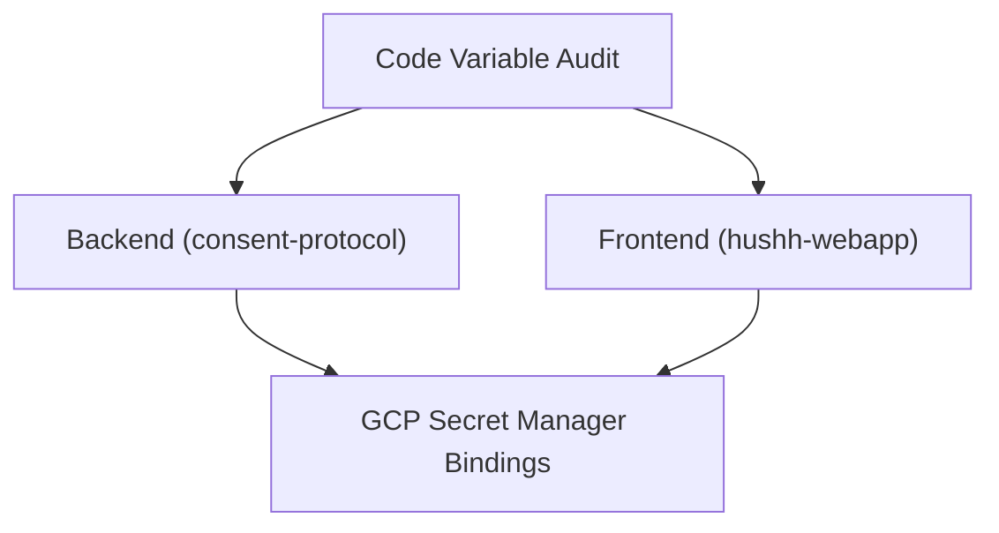

# Code & Secret Manager Variable Inventory

[Env & Secrets Hub](env-and-secrets.md) · [Configuration](README.md)

**Status:** Live | **Intent:** Reference | **Audience:** Backend, Frontend, and Release Engineering

Code-audited environment variables and GCP Secret Manager bindings across `consent-protocol` and `hushh-webapp`. See [Environment Variables and Secrets](env-and-secrets.md) for the parity contract and [Env/Secrets Key Matrix](env-secrets-key-matrix.md) for the key-to-service matrix.

## Visual Map



## Audit: env vars read by code

### Backend (consent-protocol)

| Variable | Where read | Required | Notes |
|----------|------------|----------|--------|
| `APP_SIGNING_KEY` | `hushh_mcp/config.py` | Yes | Min 32 chars (64-char hex recommended); signing/state integrity only |
| `VAULT_DATA_KEY` | `hushh_mcp/config.py` | Yes | Exactly 64-char hex; root for vault/PKM encryption and purpose-separated HKDF keys that protect encrypted nearby-presence anchors and opaque spatial/roster indexes; never used for signing |
| `DB_USER` | `db/connection.py`, `db/db_client.py` | Yes | |
| `DB_PASSWORD` | same | Yes | |
| `DB_HOST` | same | Yes | |
| `DB_PORT` | same | No (default 5432) | |
| `DB_NAME` | same | No (default postgres) | |
| `WORKOS_SSO_ENABLED` | `hushh_mcp/runtime_settings.py` | No (default off) | Flag for WorkOS enterprise SSO routes; off means every SSO route answers 404 |
| `WORKOS_API_KEY` | `hushh_mcp/services/enterprise_sso/workos_adapter.py` | Only when SSO is on | Secret. Also the root the SSO `state` signing key is derived from |
| `WORKOS_CLIENT_ID` | same | Only when SSO is on | Not secret; kept beside the key |
| `WORKOS_WEBHOOK_SECRET` | same | Only when SSO is on | Secret. Verifies `WorkOS-Signature` on `/api/webhooks/workos` |
| `WORKOS_REDIRECT_URI` | same | Only when SSO is on | Server-side configuration, never client input; must match a Redirect registered in the WorkOS dashboard |
| `WORKOS_REDIRECT_ORIGINS` | `hushh_mcp/services/enterprise_sso/workos_adapter.py` | No | Comma-separated https origins SSO may return to. The app is served on several hostnames per environment, and the callback must return to the one the person started on. Anything not listed falls back to `WORKOS_REDIRECT_URI`. Each `<origin>/login` must also be registered as a redirect in WorkOS |
| `APP_FRONTEND_ORIGIN` | `server.py` | Yes (prod CORS fallback) | |
| `CORS_ALLOWED_ORIGINS` | `server.py` | Yes (prod recommended) | Explicit comma-separated CORS allowlist |
| `FIREBASE_ADMIN_CREDENTIALS_JSON` | `api/utils/firebase_admin.py`, `hushh_mcp/runtime_settings.py` | Yes (auth) | Canonical Firebase Admin and Workspace DWD credential. Approved Workspace client ID: `109021324828349644970`. |
| `FIREBASE_SERVICE_ACCOUNT_JSON` | `hushh_mcp/runtime_settings.py` | Optional alias | Runtime compatibility alias for `FIREBASE_ADMIN_CREDENTIALS_JSON`; do not introduce for new config. |
| `HUSHH_UAT_MANAGED_AI_PROVIDER` / `HUSHH_UAT_MANAGED_TEXT_PROVIDER` | `managed_ai_config.py`, `runtime_providers/managed_text.py` | UAT only | Internal revision pins override `managed_provider_selection.uat` in the packaged config; disagreement fails closed. The configured Azure or Vertex provider must pass both core text scopes and trust/schema proof for ordinary UAT release. Broader capability qualification is separate; see the CI readiness policy. API and both Drive workers inherit the exact verified binding. Non-UAT and BYOK selection remain unchanged. |
| `HUSHH_GENAI_AUTH_MODE` | `hushh_mcp/runtime_providers/factory.py` | Yes (hosted) | Must be `vertex_adc`; hosted API-key mode is rejected. |
| `GOOGLE_API_KEY` / `GEMINI_API_KEY` | `hushh_mcp/runtime_providers/factory.py` | Local only | Explicit `developer_api_key` compatibility mode only; never a hosted secret. |
| `GOOGLE_CLOUD_PROJECT` / `GOOGLE_CLOUD_LOCATION` | `hushh_mcp/runtime_providers/factory.py` | Project metadata hosted; location override local only | Hosted text locations come from the packaged `config/managed-ai-runtime.json` profile; credentials come from workload ADC. `GOOGLE_CLOUD_LOCATION` is a local compatibility override, not a required hosted mount. |
| `HUSHH_VERTEX_LOCATIONS` | `hushh_mcp/runtime_providers/factory.py` | Local only | Local ordered same-model failover override. Hosted text locations come from the packaged environment profile; candidates never change model or authorization authority. |
| `GOOGLE_MAPS_API_KEY` | `hushh_mcp/config.py`, `hushh_mcp/services/google_maps_service.py` | Yes (One Location maps) | Server-side Google Maps Platform key for Places New, Geocoding, and Routes. Never expose as `NEXT_PUBLIC_*`. |
| `ONE_EMAIL_ADDRESS` | `hushh_mcp/services/support_email_service.py`, `hushh_mcp/services/one_email_kyc_service.py` | Optional | Canonical One mailbox identity. Default: `one@hushh.ai`. |
| `ONE_EMAIL_SERVICE_ACCOUNT_JSON` | `hushh_mcp/services/one_email_kyc_service.py` | Optional override | Prefer `FIREBASE_ADMIN_CREDENTIALS_JSON`; only use by approved exception. |
| `ONE_EMAIL_DELEGATED_USER` | `hushh_mcp/services/one_email_kyc_service.py` | Optional override | Real Workspace mailbox to impersonate for One intake. Defaults to `ONE_EMAIL_ADDRESS`. |
| `ONE_EMAIL_PUBSUB_TOPIC` | `hushh_mcp/services/one_email_kyc_service.py` | Yes (One email intake) | Gmail watch Pub/Sub topic for `one@hushh.ai`. |
| `ONE_EMAIL_WEBHOOK_AUDIENCE` | `hushh_mcp/services/one_email_kyc_service.py` | Yes (hosted intake) | Expected Pub/Sub push OIDC audience. Falls back to `GMAIL_WEBHOOK_AUDIENCE`. |
| `ONE_EMAIL_WEBHOOK_SERVICE_ACCOUNT_EMAIL` | `hushh_mcp/services/one_email_kyc_service.py` | Recommended | Expected Pub/Sub push service account. Falls back to `GMAIL_WEBHOOK_SERVICE_ACCOUNT_EMAIL`. |
| `ONE_EMAIL_WEBHOOK_AUTH_ENABLED` | `hushh_mcp/services/one_email_kyc_service.py` | Yes (hosted intake) | Must be `true` in UAT/production so Pub/Sub push OIDC verification cannot silently default off. |
| `ONE_PUBLIC_PROFILE_DISCOVERY_ENABLED` | `hushh_mcp/services/public_profile_discovery_service.py` | Optional, default `false` | Global release gate. Keep off until schema, scheduler, provider credentials and cohort are verified. |
| `ONE_PUBLIC_PROFILE_DISCOVERY_ALLOWED_USER_IDS` | `hushh_mcp/services/public_profile_discovery_service.py` | Required for hosted cohort | Comma-separated Firebase UIDs allowed to use discovery; empty means local/development/test only. Never use `*`. |
| `ONE_PUBLIC_PROFILE_DISCOVERY_DRAIN_ENABLED` | `api/routes/profile_discovery_work_drain.py` | Required for worker | Separately enables the OIDC-authenticated background queue drain; defaults to `false`. |
| `ONE_PUBLIC_PROFILE_DISCOVERY_DRAIN_AUDIENCE` | `hushh_mcp/services/scheduler_identity.py` | Required for hosted worker | Exact HTTPS backend origin expected in Cloud Scheduler OIDC tokens for `POST /api/internal/profile-discovery/drain`. |
| `ONE_PUBLIC_PROFILE_DISCOVERY_DRAIN_SCHEDULER_SERVICE_ACCOUNTS` | `hushh_mcp/services/scheduler_identity.py` | Required for hosted worker | Exact comma-separated dedicated Cloud Scheduler service-account allowlist. Empty refuses everyone. |
| `ONE_PUBLIC_PROFILE_DISCOVERY_DAILY_LIMIT` | `hushh_mcp/services/public_profile_discovery_service.py` | Optional, defaults to `1000` | Maximum new HusshOne scan-start requests per UTC database day; bounded to 100,000. A non-integer fails closed. |
| `INTELLIGENCE_API_BASE_URL` | `hushh_mcp/services/public_profile_discovery_service.py` | Required for enabled discovery | HusshOne API base URL used only by the background worker. |
| `INTELLIGENCE_API_KEY` | `hushh_mcp/services/public_profile_discovery_service.py` | Secret when enabled | Server-side HusshOne API credential; keep in Secret Manager and never expose it to the browser. |
| `ONE_EMAIL_WATCH_RENEW_TOKEN` | `api/routes/one/email.py` | Yes (hosted watch renewal) | Shared maintenance token for `POST /api/one/email/watch/renew`. |
| `ONE_EMAIL_WATCH_RENEW_AUTH_ENABLED` | `api/routes/one/email.py` | Yes (hosted renewal) | Must be `true` in UAT/production so maintenance endpoints require `X-Hushh-Maintenance-Token`. |
| `ONE_LOCATION_RETENTION_TOKEN` | `api/routes/one/location.py` | Yes (hosted retention) | Dedicated maintenance token for One Location retention purge. It is not shared with One Email maintenance tokens. |
| `ACCOUNT_DELETION_CLEANUP_AUDIENCE` | `api/routes/account.py` | Yes (hosted account deletion) | Exact backend origin expected in Google OIDC tokens for `POST /api/account/deletion-cleanup/drain`. |
| `ACCOUNT_DELETION_CLEANUP_SERVICE_ACCOUNT_EMAIL` | `api/routes/account.py` | Yes (hosted account deletion) | Exact dedicated Cloud Scheduler identity allowed to invoke the durable cleanup drain. |
| `ONE_LOCATION_RETENTION_AUTH_ENABLED` | `api/routes/one/location.py` | Optional local/test override | One Location retention auth defaults on; `false` is honored only in local/test environments. |
| `ONE_LOCATION_READ_ONLY_STATE_ENABLED` | `hushh_mcp/services/one_location_agent_service.py` | Hosted rollout gate | The service defaults to read-only state projection when this key is absent. Hosted secret generation defaults it to `false`; dev/production pin it off, and UAT may opt in only after the deploy privately verifies the canonical enabled scheduler, exact HTTPS purge URI, POST method, and a non-empty maintenance-auth header without printing its value. |
| `ONE_LOCATION_NEARBY_PRESENCE_MODE` | `api/routes/one/location.py` | Optional non-production override | `disabled` or `uat_simulation`. Development/UAT/staging default to the simulation; production remains disabled even if misconfigured. |
| `ONE_EMAIL_KYC_STRICT_CLIENT_ZK_ENABLED` | `hushh_mcp/services/one_email_kyc_service.py` | Optional | Defaults to `true`. Backend orchestrates consent/send/writeback metadata only; it must not decrypt exports or persist review draft plaintext. |
| `ONE_EMAIL_KYC_DEFAULT_SCOPE` | `hushh_mcp/services/one_email_kyc_service.py` | Optional | Must be on the service allowlist. Current approved value: `attr.identity.*`. |
| `SUPPORT_EMAIL_DELEGATED_USER` | `hushh_mcp/services/support_email_service.py` | Optional | Support/account notices require `one@hushh.ai`; unrelated invite callers retain their own contract. |
| `SUPPORT_EMAIL_FROM` | `hushh_mcp/services/support_email_service.py` | Optional | Support/account notices require `one@hushh.ai`. |
| `SUPPORT_EMAIL_TO` | `hushh_mcp/services/support_email_service.py` | Optional | Support recipient. Defaults to `ONE_EMAIL_ADDRESS`. |
| `SUPPORT_EMAIL_TEST_TO` | `hushh_mcp/services/support_email_service.py` | Optional | Test recipient for non-production email verification. |
| `SUPPORT_EMAIL_MODE` | `hushh_mcp/services/support_email_service.py` | Optional | `live` or `test`. Non-production defaults to `test` when `SUPPORT_EMAIL_TEST_TO` exists. |
| `GMAIL_OAUTH_CLIENT_ID` | `hushh_mcp/services/gmail_receipts_service.py` | Yes (Gmail connection and live receipt reads) | Gmail OAuth client id. Same key name across local, UAT, and production. |
| `GMAIL_OAUTH_CLIENT_SECRET` | `hushh_mcp/services/gmail_receipts_service.py` | Yes (Gmail connection and live receipt reads) | Gmail OAuth client secret. Same key name across local, UAT, and production. |
| `GMAIL_OAUTH_REDIRECT_URI` | `hushh_mcp/services/gmail_receipts_service.py` | Yes (Gmail receipts and owner-approved send) | Environment-owned Gmail OAuth callback. It must equal `APP_FRONTEND_ORIGIN + /one/profile/gmail/oauth/return`; register that exact URI in the Google OAuth client for each environment. |
| `GMAIL_OAUTH_TOKEN_KEY` | `hushh_mcp/services/gmail_receipts_service.py` | Yes (Gmail connection and live receipt reads) | Encryption key for persisted Gmail OAuth tokens. Same key name across local, UAT, and production. |
| `GOOGLE_OAUTH_CLIENT_ID` | `hushh_mcp/services/google_connection_service.py` | Yes (Calendar) | Dedicated Google Calendar OAuth client id. |
| `GOOGLE_OAUTH_CLIENT_SECRET` | `hushh_mcp/services/google_connection_service.py` | Yes (Calendar) | Dedicated Google Calendar OAuth client secret. |
| `GOOGLE_OAUTH_REDIRECT_URI` | `hushh_mcp/services/google_connection_service.py` | Yes (Calendar) | Must equal `APP_FRONTEND_ORIGIN + /one/profile/google/oauth/return`; register that exact URI in the Calendar OAuth client. |
| `GOOGLE_OAUTH_TOKEN_KEY` | `hushh_mcp/services/google_connection_service.py` | Yes (Calendar) | Encryption key for persisted Calendar OAuth tokens. |
| `OPENAI_API_KEY` | `hushh_mcp/services/voice_intent_service.py` | Yes (voice) | Required for the Kai voice lane's realtime transcription, planning/composition, and TTS. |
| `HUSHH_LOCAL_RUNTIME_PACK_REGISTRY_SECRET` | `api/routes/kai/local_runtime.py` | Required when hosted local voice packs are enabled | Secret Manager registry name holding immutable model-object metadata and rollback entries, never a bearer URL or protected application information. |
| `HUSHH_LOCAL_RUNTIME_PACK_REGISTRY_PROJECT` | `api/routes/kai/local_runtime.py` | Required when hosted local voice packs are enabled | Project that owns the model-pack registry. |
| `HUSHH_LOCAL_RUNTIME_PACK_SIGNER_SERVICE_ACCOUNT` | `api/routes/kai/local_runtime.py` | Required when hosted local voice packs are enabled | IAM signBlob identity used by Cloud Run ADC to issue a fresh short-lived URL per capability request; no key file is mounted. |
| `HUSHH_LOCAL_RUNTIME_PACK_URL_TTL_SECONDS` | `api/routes/kai/local_runtime.py` | No | Bounded signed-URL TTL, maximum 900 seconds. |
| `HUSHH_LOCAL_RUNTIME_PACK_REGISTRY_CACHE_SECONDS` | `api/routes/kai/local_runtime.py` | No | Bounded registry-read cache, maximum 300 seconds. |
| `DEFAULT_CONSENT_TOKEN_EXPIRY_MS` | `hushh_mcp/config.py` | No | |
| `DEFAULT_TRUST_LINK_EXPIRY_MS` | same | No | |
| `ENVIRONMENT` | `hushh_mcp/config.py`, `api/routes/debug_firebase.py` | No | |
| `OTEL_ENABLED` | `api/middlewares/observability.py` | No | Enables OpenTelemetry export to Cloud Trace when true |
| `AGENT_ID` | `hushh_mcp/config.py` | No | |
| `HUSHH_HACKATHON` | `hushh_mcp/config.py` | No | |
| `CONSENT_TIMEOUT_SECONDS` | `mcp_modules/config.py` | No | MCP server timeout (not required for FastAPI runtime) |
| `ROOT_PATH` | `server.py` | No | |
| `HUSHH_KAI_AGENT_CHAT_STREAM_TIMEOUT_MS` | `hushh-webapp/app/api/kai/[...path]/route.ts` | No | Optional Next.js Kai proxy timeout for Agent chat SSE streams. Defaults to `120000`. |
| `GOOGLE_GENAI_USE_VERTEXAI` | Cloud Run env (Gemini SDK) | No | Set in deploy, not in .env |
| `CONSENT_SSE_ENABLED` | `api/routes/sse.py` | No | Off by default in production (FCM-first); sourced from `BACKEND_RUNTIME_CONFIG_JSON`, not a literal Cloud Run env var |
| `DOCUMENT_FEED_WEB_STREAM_ENABLED` | `api/routes/document_feed_stream.py` | No | Turns the web's direct Feed stream `GET /api/one/feed/events` on or off. Unset, it is on everywhere except `ENVIRONMENT=production`; off, the route answers 404 `FEED_STREAM_DISABLED` and the web uses the same-origin proxy. Not mapped from `BACKEND_RUNTIME_CONFIG_JSON`, and no deploy sets it today. Turning it on in production needs explicit approval |
| `PROTECTED_DOCUMENT_DELIVERY_ENABLED` | `connector_feature_admission.py` | No | Hosted PDF intake from `BACKEND_RUNTIME_CONFIG_JSON.protected_document_delivery`; environment-wide for all authenticated users after release, independently of legacy connector cohorts. Off preserves issued readers, revoke, refund and cleanup. |
| `DOCUMENT_DELIVERY_BUCKET`, `DOCUMENT_DELIVERY_BUCKET_IDENTITY` | `document_delivery/storage.py`, `runtime_settings.py` | Hosted copies only | `document_delivery_bucket` pins `<project>-document-delivery`; `document_delivery_bucket_identity` pins the qualified bucket's immutable creation identity. Retain both with intake off for issued paid copies. No content keys, public URLs or signed download tokens. See [protected documents](../../architecture/one/protected-document-delivery.md). |
| `SYNC_REMOTE_ENABLED` | deploy env (`deploy/backend.cloudbuild.yaml`) | No | Legacy deploy flag; currently not read by backend code |
| `DEVELOPER_API_ENABLED` | `server.py`, `mcp_modules/config.py`, `api/developer_auth.py` | No | Enabled in both UAT and production; sourced from `BACKEND_RUNTIME_CONFIG_JSON`'s `developer_api_enabled` key via `hydrate_runtime_environment()`, not a literal Cloud Run env var |
| `HUSSH_TECH_CLIENT_ENABLED` | `hushh_mcp/services/hushh_tech_client_service.py` | No | UAT-only cohort switch from `BACKEND_RUNTIME_CONFIG_JSON`; production is hard-disabled in code |
| `ONE_VOICE_MAIL_REPLY_ENABLED` | `hushh_mcp/one_voice/config.py`, `api/routes/one/gmail_delivery.py` | No | One Voice reply-in-thread (`reply_mail` and the HTTP send of a reply card). Off unless set; `deploy-uat.yml` passes `--one-voice-mail-reply-enabled` (`vars.ONE_VOICE_MAIL_REPLY_ENABLED_UAT`, default `true`) and production passes `false`, so it arrives through `BACKEND_RUNTIME_CONFIG_JSON`'s `one_voice_mail_reply_enabled` key, not a literal Cloud Run env var |
| `ONE_VOICE_MAIL_SCHEDULE_SEND_ENABLED` | `hushh_mcp/one_voice/config.py` | No | One Voice scheduled send (`schedule_mail`, `list_scheduled_mail`, `cancel_scheduled_mail`); also their kill switch. Off unless set; `deploy-uat.yml` passes `--one-voice-mail-schedule-send-enabled` (`vars.ONE_VOICE_MAIL_SCHEDULE_SEND_ENABLED_UAT`, default `true`) and production passes `false`, through `BACKEND_RUNTIME_CONFIG_JSON`'s `one_voice_mail_schedule_send_enabled` key |
| `ONE_VOICE_MAIL_DRAFTS_ENABLED` | `hushh_mcp/one_voice/config.py`, `api/routes/one/voice.py` | No | One Voice Gmail drafts (`list_drafts`, `open_draft`, `send_draft` and the draft open route); also their kill switch. Off unless set; `deploy-uat.yml` passes `--one-voice-mail-drafts-enabled` (`vars.ONE_VOICE_MAIL_DRAFTS_ENABLED_UAT`, default `true`) and production passes `false`, through `BACKEND_RUNTIME_CONFIG_JSON`'s `one_voice_mail_drafts_enabled` key |
| `MAIL_SCHEDULED_DRAIN_ENABLED` | `api/routes/one/scheduled_mail_drain.py` | No | Opens `POST /api/one/email/scheduled/drain`, the Cloud Scheduler drain that delivers scheduled mail; the route answers 404 unless this is exactly `true`. Turning it off pauses delivery without withdrawing scheduling. `deploy-uat.yml` passes `--mail-scheduled-drain-enabled` (`vars.MAIL_SCHEDULED_DRAIN_ENABLED_UAT`, default `true`; the same variable pauses or resumes the `mail-scheduled-send-uat` job) and production passes `false`, through `BACKEND_RUNTIME_CONFIG_JSON`'s `mail_scheduled_drain_enabled` key |
| `CALENDAR_EMAIL_FOLLOWUPS` | `api/routes/one/calendar_email_followups.py`, `api/routes/one/calendar_email_followup_drain.py` | No | Opens the Calendar follow-ups routes; every route answers 503 `FOLLOWUPS_DISABLED` unless this is `1`, `true` or `yes`. UAT sets it from the checked-in gate `deploy/uat-surface-gates.txt` (line `calendar_email_followups=true` or `=false`, read by `scripts/deploy/backend-deploy.sh`) because the combined UAT build is at Cloud Build's 200-substitution ceiling and a substitution cannot be added; each UAT revision carries the gate of the commit it was built from. Dev and production never read the file and leave the flag unset. With the gate on, the deploy stops before creating a revision unless `CALENDAR_EMAIL_FOLLOWUP_KEY` is readable. Turning it on does not enable monitoring for anyone: each account still opts in. Rollback: set both gate lines to `false` and run Deploy to UAT |
| `CALENDAR_EMAIL_FOLLOWUP_DRAIN_ENABLED` | `api/routes/one/calendar_email_followups.py`, `api/routes/one/calendar_email_followup_drain.py` | No | Opens the OIDC-only drain route (`POST /api/one/calendar/followups/drain`, 404 otherwise) and lets a preference turn reminders on (`background_reminders_unavailable` otherwise). UAT sets it from the second gate line `calendar_email_followup_drain`, which may be `true` only while `calendar_email_followups` is `true`. The same release resumes the Cloud Scheduler job `calendar-email-followups-uat` (service account `calendar-email-followups`, audience `https://api.uat.hushh.ai`) through `deploy/calendar/setup_followup_scheduler.sh`, and `deploy/calendar/verify_followup_release.py` proves the serving revisions match the gate. Gate `false` pauses the job. Production has no job |
| `CALENDAR_EMAIL_FOLLOWUP_KEY` | `hushh_mcp/services/calendar_email_followup_crypto.py` | Yes while follow-ups are on | Purpose-separated server key (URL-safe base64 of 32 bytes) that seals owner-visible follow-up rows. Bound from the Secret Manager secret of the same name only while the UAT gate is `true`; the infrastructure owner creates it once (value generated straight into Secret Manager, never printed) and grants the runtime service account `roles/secretmanager.secretAccessor` on it. The deploy only references it, never creates or rotates it, so rolling the gate back keeps the secret and every sealed row readable |
| `MAIL_SCHEDULED_DRAIN_SCHEDULER_SERVICE_ACCOUNT_EMAIL` | `api/routes/one/scheduled_mail_drain.py` | No | Optional restatement of the hard-coded scheduler identity (`mail-scheduled-send@hushh-pda-uat.iam.gserviceaccount.com` in UAT/test/local, `mail-scheduled-send@hushh-pda.iam.gserviceaccount.com` in production). Any other value makes the drain answer 503; it cannot widen who may call it |
| `MAIL_SCHEDULED_DRAIN_SCHEDULER_AUDIENCE` | `api/routes/one/scheduled_mail_drain.py` | No | Optional restatement of the hard-coded OIDC audience (`https://api.uat.hushh.ai` in UAT/test/local, `https://api.hushh.ai` in production). Any other value makes the drain answer 503 |
| `HUSSH_TECH_DEVELOPER_APP_ID` | `api/routes/hushh_tech.py` | No | Exact UAT product registration id from `BACKEND_RUNTIME_CONFIG_JSON` |
| `HUSSH_TECH_ALLOWED_AUDIENCE` | `hushh_mcp/services/hushh_tech_client_service.py` | No | Exact UAT product audience from `BACKEND_RUNTIME_CONFIG_JSON` |
| `HUSSH_TECH_ALLOWED_REDIRECT_URIS` | `hushh_mcp/services/hushh_tech_client_service.py` | No | Exact UAT HTTPS callback allowlist from `BACKEND_RUNTIME_CONFIG_JSON` |
| `HUSSH_TECH_ALLOWED_CONSENT_SCOPES` | `api/routes/developer.py` | No | Exact, non-wildcard `attr.*` scopes for the dedicated product registration; empty denies every Research export |
| `HUSSH_TECH_UAT_FIREBASE_UID_ALLOWLIST` | `hushh_mcp/services/hushh_tech_client_service.py` | No | Synthetic Firebase UID cohort from `BACKEND_RUNTIME_CONFIG_JSON`; never email or phone |
| `HUSSH_TECH_TRUSTED_PROXY_HOPS` | `api/routes/hushh_tech.py` | No | Rightmost trusted edge hops skipped when deriving per-visitor rate-limit keys; direct Cloud Run default is `0` |
| `HUSSH_TECH_PROXY_AUDIENCE` | `api/routes/hushh_tech.py`, Research Next launch proxy | No | Exact Research consent API audience used by Google service-account proxy attestation |
| `HUSSH_TECH_TRUSTED_PROXY_SERVICE_ACCOUNTS` | `api/routes/hushh_tech.py` | No | Exact UAT runtime service accounts allowed to attest a forwarded visitor address |
| `HUSSH_TECH_FRONTEND_TRUSTED_PROXY_HOPS` | Research Next launch proxy | No | Rightmost edge hops skipped before the Research proxy signs in with its runtime service account |
| `HUSSH_AZURE_APP_CLIENT_ID`, `HUSSH_AZURE_BROKER_SA`, `HUSSH_POD_IMAGE_READER_SA`, `HUSSH_AZURE_POD_IMAGE_REPOSITORY` | `hushh_mcp/services/azure_federation.py`, `azure_image_source.py` | Dev only | Connect Azure hub identities, public identifiers written for `hushh-pda-dev` only into `BACKEND_RUNTIME_CONFIG_JSON` by `scripts/ops/sync_backend_runtime_secrets.py`; absent on UAT and production, where the Azure routes refuse with `NOT_CONFIGURED` |
| `HUSSH_AZURE_OAUTH_REDIRECT_URI` | `hushh_mcp/services/azure_entra_authorizer.py` | Dev only | `APP_FRONTEND_ORIGIN` plus `/one/setup/cloud/azure/return`, derived by the same script and registered on the dev Entra app |
| `HUSSH_TECH_LAUNCH_PEPPER` | `hushh_mcp/services/hushh_tech_client_service.py` | UAT only | Dedicated Secret Manager binding for one-time launch-code hashing; absent in production |
| `RATE_LIMIT_STORAGE_URI` | backend limiter and Research Next launch proxy | UAT only | Secret Manager binding for shared Redis abuse budgets; HushhTech remains fail-closed without a `redis://` or `rediss://` URI |
| `DEVELOPER_REGISTRY_JSON` | n/a (legacy) | Optional legacy | Legacy developer registry payload; no active backend reader |
| `HUSHH_DEVELOPER_TOKEN` | `api/routes/session.py` (`/api/user/lookup`) | Optional | Self-serve developer token for stdio MCP and token-auth developer lookups. Not part of the normal hosted runtime bootstrap. |

Hosted Gmail, Calendar and Plaid web callbacks retain their configured canonical
URI. During the `hushh.ai` to `hussh.ai` migration, the backend also accepts the
exact same path on the explicitly configured One spelling pair only when both
origins are in `CORS_ALLOWED_ORIGINS`. Custom hosts, other environments, query
strings and arbitrary CORS entries do not gain callback authority. Web start and
completion echo the current document callback; signed Gmail state preserves the
original callback for older in-flight completions that omit it. Register both
URLs on the existing provider client before release; this application allowlist
does not update Google or other providers. Drive registry provisioning upgrades
only its exact known predecessor policy under the existing attestation/lock.


Live Gmail receipt read-through introduces no new credential or persistence
configuration. It reuses the four `GMAIL_OAUTH_*` settings above, the existing
encrypted per-owner connection, managed Vertex configuration for the
manifest-owned Email receipt extractor, and `APP_SIGNING_KEY` for opaque source
handle integrity. Do not add a browser/native receipt token, a receipt-storage
secret, or a client-visible model credential. `NEXT_PUBLIC_RECEIPT_LOGO_URL_TEMPLATE`
is presentation-only public configuration and must never carry any of those
values.

Receipt logo configuration is a Next.js build-time value. A Cloud Run runtime
variable alone cannot change an already compiled client. An approved Logo.dev
publishable token can use this exact template in the deployment build environment:

```text
NEXT_PUBLIC_RECEIPT_LOGO_URL_TEMPLATE=https://img.logo.dev/{domain}?token=APPROVED_PUBLISHABLE_TOKEN&size=128&format=png&fallback=404&redirect=404
```

Replace only the token placeholder through the approved deployment configuration;
never commit the real value or put it in source/env examples. Leave the optional
resource absent until an approved publishable token exists. The existing UAT
build lane is described in [UAT receipt-logo build configuration](#uat-receipt-logo-build-configuration);
provisioning the resource does not authorize a rollout. The `404` options preserve
category/generic fallback for missing or redirected logos.

**Migrations/scripts:** Use **DB_*** only (same as runtime). `db/migrate.py` uses `db.connection.get_database_url()` and `get_database_ssl()`. No `DATABASE_URL` anywhere.

### Frontend (hushh-webapp)

| Variable | Where read | Required | Notes |
|----------|------------|----------|--------|
| `NEXT_PUBLIC_BACKEND_URL` | `lib/api/consent.ts`, `lib/config.ts`, api routes, etc. | Yes | Prod build: from Secret Manager `BACKEND_URL` |
| `NEXT_PUBLIC_RECEIPT_LOGO_URL_TEMPLATE` | `components/gmail/gmail-recent-receipts.tsx` | No | Public HTTPS image URL with exactly one `{domain}` placeholder. Receipt rows substitute only a reviewed canonical merchant domain; unset configuration uses the public DuckDuckGo domain icon endpoint; an explicitly empty or invalid template uses the category or generic receipt icon. UAT image builds resolve the optional same-named Secret Manager resource; other hosted environments leave it unset. Never place a provider secret here. |
| `NEXT_PUBLIC_FIREBASE_*` (6 base keys) | `lib/firebase/config.ts` | Yes | API key, auth domain, project ID, storage bucket, messaging sender ID, app ID |
| `NEXT_PUBLIC_FIREBASE_AUTH_DOMAIN` | `lib/firebase/config.ts` | Yes | Branded target: `id.hussh.ai`. Dev, UAT and production retain the existing `hushh-pda` Firebase project and user IDs. The domain is compiled into each frontend image: updating Secret Manager or Cloud Run runtime variables alone does not change the serving login. Verify Firebase authorized domains and Google, Apple and Microsoft callbacks at `https://id.hussh.ai/__/auth/handler` before rebuilding. Preserve the old callback for existing clients and rollback. Verify the actual serving revision and login separately in each environment; do not deploy a newer application source merely to refresh this setting. |
| `NEXT_PUBLIC_FIREBASE_VAPID_KEY` | `lib/notifications/fcm-service.ts` | Yes (prod build) | Web FCM token registration; from Firebase Console. See [fcm-notifications.md](../../../consent-protocol/docs/reference/fcm-notifications.md). |
| `NEXT_PUBLIC_FIREBASE_MEASUREMENT_ID` | `lib/observability/env.ts` | Recommended | Active GA4 measurement ID for the deployed environment |
| `NEXT_PUBLIC_GTM_ID` | `app/layout.tsx`, `lib/observability/env.ts` | Recommended | Active GTM container for the deployed environment |
| `NEXT_PUBLIC_GOOGLE_MAPS_BROWSER_API_KEY` | `lib/one-location/maps-config.ts` | Required when Your Map is enabled | Browser-only Maps JavaScript key, restricted to the exact Hussh web origins. UAT must authorize both `https://uat.one.hussh.ai/*` and its legacy `https://uat.one.hushh.ai/*` alias while both hosts serve the app; a hostname redirect does not authorize the final browser referrer. Preserve API service restrictions when adding an origin. It is public build config, never the server Maps key. |
| `NEXT_PUBLIC_GOOGLE_MAPS_IOS_API_KEY` | `lib/one-location/maps-config.ts`, native archive scripts | Required for iOS Your Map | iOS Maps SDK key restricted to the Hussh bundle identifier. It is bundled only into the iOS archive. |
| `NEXT_PUBLIC_GOOGLE_MAPS_ANDROID_API_KEY` | `lib/one-location/maps-config.ts`, Android archive scripts | Required for Android Your Map | Android Maps SDK key restricted to the Hussh package and signing certificate fingerprints. It is bundled only into the Android archive. |
| `NEXT_PUBLIC_APP_ENV` | `lib/app-env.ts`, `lib/observability/env.ts`, `app/page.tsx` | Recommended | Canonical frontend environment key (`development`, `uat`, `production`) |
| `NEXT_PUBLIC_OBSERVABILITY_ENV` | `lib/app-env.ts` | Optional legacy | Read-only fallback when `NEXT_PUBLIC_APP_ENV` is unset |
| `NEXT_PUBLIC_ENVIRONMENT_MODE` | `lib/app-env.ts` | Optional legacy | Read-only fallback when `NEXT_PUBLIC_APP_ENV` is unset |
| `NEXT_PUBLIC_OBSERVABILITY_ENABLED` / `NEXT_PUBLIC_OBSERVABILITY_DEBUG` / `NEXT_PUBLIC_OBSERVABILITY_SAMPLE_RATE` | `lib/observability/env.ts` | No | Client analytics rollout controls |
| `NEXT_PUBLIC_CONSENT_TIMEOUT_SECONDS` | `lib/constants.ts` | No | |
| `CAPACITOR_BUILD` | `next.config.ts` | Build script | |
| `BACKEND_URL` | Server-side api routes | Hosted runtime required | Canonical runtime backend origin for Next.js route handlers |
| `SESSION_SECRET` | `lib/auth/session.ts` | If session API | Server-only |
| `FIREBASE_ADMIN_CREDENTIALS_JSON` | `lib/firebase/admin.ts` | Server-side Firebase | Server-only |
| `MAIL_API_ENDPOINT` | `lib/runtime/settings.ts` → `lib/mail/mail-client.ts` | For user-requested SOS mail | `hushh-mail-api` origin. Plain env var, set from `_MAIL_API_ENDPOINT` in `deploy/frontend.cloudbuild.yaml`; not used for account notices. |
| `MAIL_API_KEY` | `lib/runtime/settings.ts` → `lib/mail/mail-client.ts` | For user-requested SOS mail | Server-only. This is not used for One support or account notices. |

### UAT receipt-logo build configuration

`deploy/frontend-image.cloudbuild.yaml` and the combined frontend build resolve
`NEXT_PUBLIC_RECEIPT_LOGO_URL_TEMPLATE` from `hushh-pda-uat` Secret Manager only
when constructing a UAT image. It is optional: precise `NOT_FOUND` leaves the
variable unset before `next build`; permission/authentication errors and invalid
configured values fail without printing the value. It is not a Cloud Run runtime
binding. Changing the resource requires a new reviewed frontend build and the
normal governed deployment; an existing pinned image is never reconfigured.

The accepted value is the exact Logo.dev HTTPS domain template with one
`{domain}` placeholder, a publishable `pk_` token, and `fallback=404&redirect=404`.
The latter flags preserve the category/generic fallback for missing or redirected
brands. Secret `sk_` API keys are prohibited. The existing reviewed merchant
registry owns domain selection; no merchant names or receipt content enter the URL.

Obtain the publishable token through the approved provider/deployment credential
workflow before creating the resource. Validate the complete template with
`scripts/ops/validate_receipt_logo_template.py` over stdin, then use the existing
`scripts/ops/upsert_gcp_secret.py --project hushh-pda-uat --secret
NEXT_PUBLIC_RECEIPT_LOGO_URL_TEMPLATE --stdin` path. Keep values in process memory;
do not put them in command arguments, logs, source, environment examples or files.
Secret provisioning grants no deploy or traffic authority. Never copy this UAT
credential to another environment.

Secret upsert retains all previous versions, including when the payload is
unchanged. The version-inventory helper is read-only: version age does not prove
that serving, rollback, scheduled-job or alias references are absent. Version
destruction requires a separately qualified reference-aware cleanup operation.

Receipt images currently send no Referer. Logo.dev Referer-based domain restrictions
reject these requests, so the approved publishable token must support that existing
policy. Do not change the component's referrer policy to enable a restricted token.
See [Logo.dev API keys](https://www.logo.dev/docs/platform/api-keys) and
[Logo CDN parameters](https://www.logo.dev/docs/api-reference/logo-cdn/get-a-logo).

---

## Backend (consent-protocol) — reference

### Independent email authentication

The default-off OTP subsystem binds `EMAIL_AUTH_VERIFIER_KEY`,
`EMAIL_AUTH_PAYLOAD_KEY` and stable `EMAIL_AUTH_LOOKUP_KEY` as distinct server
secrets, plus `EMAIL_AUTH_MAIL_API_KEY` for the existing mail API. These are
separate backend bindings; the existing frontend `MAIL_API_KEY` SOS contract
does not provision them automatically. Never publish these as `NEXT_PUBLIC_*`.

`EMAIL_AUTH_ENABLED`, `EMAIL_AUTH_RISK_MANIFEST`, `EMAIL_AUTH_MAIL_API_ENDPOINT`
and `EMAIL_AUTH_MAIL_FROM` are server configuration. The exact endpoint is fixed
to the existing service. `EMAIL_AUTH_MAIL_FROM` must be `one@hushh.ai` only after
the API's authorized sender is configured and its From identity observed; this
local assertion cannot change the remote service. Keep issuance off otherwise.
The OTP use of this API is an explicit addition to its existing SOS use.

See [Independent Email Authentication](../../architecture/identity/independent-email-auth.md). Hosted
secret bindings, service configuration and deployment remain release work; an
example file or local Secret Manager read does not establish deployed parity.

| Variable | Required | Secret | Where set | Notes |
|----------|----------|--------|-----------|--------|
| `APP_SIGNING_KEY` | Yes | Yes | Local: `.env`; Prod: Secret Manager | 32+ chars; HMAC signing |
| `VAULT_DATA_KEY` | Yes | Yes | Local: `.env`; Prod: Secret Manager | 64-char hex |
| `DB_USER` | Yes | Yes (prod) | Local: `.env`; Prod: Secret Manager | Cloud SQL database user |
| `DB_PASSWORD` | Yes | Yes (prod) | Local: `.env`; Prod: Secret Manager | DB password |
| `DB_HOST` | Yes | No | Local: `.env`; Prod: Cloud Run env | Pooler host |
| `DB_PORT` | No | No | Local: `.env`; Prod: Cloud Run env (default 5432) | |
| `DB_NAME` | No | No | Local: `.env`; Prod: Cloud Run env (default postgres) | |
| `WORKOS_SSO_ENABLED` | No | No | Local: `.env`; Deployed: Cloud Run env, set by the deploy from `_WORKOS_SSO_ENABLED` (UAT: GitHub variable `WORKOS_SSO_UAT_ENABLED`, default `false`) | Default off |
| `WORKOS_API_KEY` | Only when SSO is on | Yes | Local: `.env`; Deployed: Secret Manager secret named exactly `WORKOS_API_KEY` | Never in `NEXT_PUBLIC_*`. `deploy/sso/bind_workos.sh` binds it only if the secret exists in the deploy project |
| `WORKOS_CLIENT_ID` | Only when SSO is on | No | Local: `.env`; Deployed: Secret Manager secret named exactly `WORKOS_CLIENT_ID` | Same optional binding |
| `WORKOS_WEBHOOK_SECRET` | Only when SSO is on | Yes | Local: `.env`; Deployed: Secret Manager secret named exactly `WORKOS_WEBHOOK_SECRET` | Same optional binding. Each environment's webhook endpoint in WorkOS has its own signing secret |
| `WORKOS_REDIRECT_URI` | Only when SSO is on | No | Local: `.env`; Deployed: Cloud Run env from `_WORKOS_REDIRECT_URI` (UAT: `https://uat.one.hushh.ai/login`) | Must match a Redirect registered in the WorkOS dashboard |
| `WORKOS_REDIRECT_ORIGINS` | No | No | Deployed: Cloud Run env from `_WORKOS_REDIRECT_ORIGINS`, built by the UAT workflow from the passkey alias list (`hushh-webapp/lib/vault/passkey-domain-aliases.json`) | Every hostname the environment is served on |
| `APP_FRONTEND_ORIGIN` | Yes | Yes (prod) | Local: `.env`; Prod: Secret Manager | CORS fallback source |
| `BACKEND_RUNTIME_CONFIG_JSON` | Yes | Yes (prod) | Local: `.env`; Prod: Secret Manager | Structured runtime policy for DB socket, CORS, remote toggles, and platform settings; `passkey_allowed_rp_ids` is derived as `localhost,127.0.0.1` plus the active frontend host and its declared same-environment aliases |
| `CORS_ALLOWED_ORIGINS` | Yes (prod recommended) | No | Local: `.env`; Prod: Cloud Run env | Explicit CORS allowlist (comma-separated) |
| `PASSKEY_ALLOWED_RP_IDS` | No | No | Local: `.env`; Prod: `BACKEND_RUNTIME_CONFIG_JSON` | WebAuthn RP allowlist generated as `localhost,127.0.0.1` plus the active frontend host and its declared same-environment aliases; unregistered or cross-environment hosts are rejected by the sync/parity contracts |
| `HUSHH_GENAI_AUTH_MODE` | Optional local | Yes | Local: `.env`; Prod: Cloud Run env | Hosted value is `vertex_adc`; local API-key compatibility must be selected explicitly. |
| `GOOGLE_API_KEY` / `GEMINI_API_KEY` | Optional local | No | Local: `.env` only | Used only with `developer_api_key`; prohibited as hosted Gemini credentials. |
| `GOOGLE_CLOUD_PROJECT` / `GOOGLE_CLOUD_LOCATION` | ADC local/hosted | Project metadata hosted; location local only | Local: env; hosted: packaged managed AI profile | Hosted region selection ignores the legacy location override; authentication comes from workload ADC. |
| `GOOGLE_MAPS_API_KEY` | Yes (One Location maps) | Yes | Local: `.env`; Prod: Secret Manager | Server-side Places New, Geocoding, and Routes key; never expose as `NEXT_PUBLIC_*`. |
| `HUSHH_KAI_AGENT_CHAT_STREAM_TIMEOUT_MS` | No | No | Local: `hushh-webapp/.env.local`; Frontend runtime env | Optional Next.js proxy timeout for Agent chat SSE streams. Defaults to `120000`. |
| `GMAIL_OAUTH_CLIENT_ID` | Yes (Gmail connection and live receipt reads) | Yes | Local: `.env`; Hosted: Secret Manager | Same key name across local, UAT, and production. |
| `GMAIL_OAUTH_CLIENT_SECRET` | Yes (Gmail connection and live receipt reads) | Yes | Local: `.env`; Hosted: Secret Manager | Same key name across local, UAT, and production. |
| `GMAIL_OAUTH_REDIRECT_URI` | Yes (Gmail receipts and owner-approved send) | Yes | Local: `.env`; Hosted: Secret Manager | Must equal the active environment origin plus `/one/profile/gmail/oauth/return`; local bootstrap explicitly restores the localhost callback after reading shared connector credentials. |
| `GMAIL_OAUTH_TOKEN_KEY` | Yes (Gmail connection and live receipt reads) | Yes | Local: `.env`; Hosted: Secret Manager | Same key name across local, UAT, and production. |
| `GOOGLE_OAUTH_CLIENT_ID` | Yes (Calendar) | Yes | Local: `.env`; Hosted: Secret Manager | Dedicated Calendar OAuth client id. |
| `GOOGLE_OAUTH_CLIENT_SECRET` | Yes (Calendar) | Yes | Local: `.env`; Hosted: Secret Manager | Dedicated Calendar OAuth client secret. |
| `GOOGLE_OAUTH_REDIRECT_URI` | Yes (Calendar) | Yes | Local: `.env`; Hosted: Secret Manager | Must equal the active environment origin plus `/one/profile/google/oauth/return`. |
| `GOOGLE_OAUTH_TOKEN_KEY` | Yes (Calendar) | Yes | Local: `.env`; Hosted: Secret Manager | Encryption key for persisted Calendar OAuth tokens. |
| `OPENAI_API_KEY` | Yes (voice) | Yes | Local: `.env`; Hosted: Secret Manager | Required for voice runtime. |
| `FIREBASE_ADMIN_CREDENTIALS_JSON` | Yes (auth) | Yes | Local: `.env`; Prod: Secret Manager | JSON string. Also canonical Workspace DWD credential for `one@hushh.ai`. |
| `FIREBASE_SERVICE_ACCOUNT_JSON` | Optional alias | Yes | Legacy/runtime Secret Manager alias only | Accepted by backend for compatibility; prefer `FIREBASE_ADMIN_CREDENTIALS_JSON`. |
| `ONE_EMAIL_ADDRESS` | Optional | No | Local: `.env`; Prod: Cloud Run env or default | Defaults to `one@hushh.ai`. |
| `ONE_EMAIL_SERVICE_ACCOUNT_JSON` | Optional override | Yes | Secret Manager, only by exception | Prefer canonical Firebase Admin credential. |
| `ONE_EMAIL_DELEGATED_USER` | Optional override | No | Local: `.env`; Prod: Cloud Run env | Must be a real Workspace user mailbox. |
| `ONE_EMAIL_PUBSUB_TOPIC` | Yes (One intake) | No | Hosted Cloud Run env | Gmail watch topic. |
| `ONE_EMAIL_WEBHOOK_AUDIENCE` | Yes (hosted intake) | No | Hosted Cloud Run env | Pub/Sub OIDC audience. |
| `ONE_EMAIL_WEBHOOK_SERVICE_ACCOUNT_EMAIL` | Recommended | No | Hosted Cloud Run env | Pub/Sub push identity. |
| `ONE_EMAIL_WEBHOOK_AUTH_ENABLED` | Yes (hosted intake) | No | Hosted Cloud Run env | Must be `true` in UAT/production. |
| `ONE_EMAIL_WATCH_RENEW_TOKEN` | Yes (hosted renewal) | Yes | Secret Manager | Send as `X-Hushh-Maintenance-Token`. |
| `ONE_EMAIL_WATCH_RENEW_AUTH_ENABLED` | Yes (hosted renewal) | No | Hosted Cloud Run env | Must be `true` in UAT/production. |
| `ONE_LOCATION_RETENTION_TOKEN` | Yes (hosted retention) | Yes | Secret Manager | Dedicated token for location retention purge. Do not reuse `ONE_EMAIL_WATCH_RENEW_TOKEN`. |
| `ACCOUNT_DELETION_CLEANUP_AUDIENCE` | Yes (hosted account deletion) | No | Hosted Cloud Run env | Exact backend-origin audience for the Google OIDC scheduler token. |
| `ACCOUNT_DELETION_CLEANUP_SERVICE_ACCOUNT_EMAIL` | Yes (hosted account deletion) | No | Hosted Cloud Run env | Exact dedicated scheduler service account; do not grant it project roles or reuse the runtime identity. |
| `ONE_VOICE_MAIL_SCHEDULE_SEND_ENABLED` / `ONE_VOICE_MAIL_DRAFTS_ENABLED` / `MAIL_SCHEDULED_DRAIN_ENABLED` | No | No | UAT: `BACKEND_RUNTIME_CONFIG_JSON` (default `true`); production: pinned `false` | Voice scheduled send, voice Gmail drafts, and the scheduled-mail drain. Unset is off. The drain's scheduler identity and audience are hard-coded in `api/routes/one/scheduled_mail_drain.py`; the optional `MAIL_SCHEDULED_DRAIN_SCHEDULER_*` overrides may only restate them. |
| `ONE_LOCATION_RETENTION_AUTH_ENABLED` | Optional local/test override | No | Local/test env only | Auth defaults on; hosted environments require `ONE_LOCATION_RETENTION_TOKEN` even if this flag is set false. |
| `ONE_LOCATION_READ_ONLY_STATE_ENABLED` | Hosted rollout gate | No | `BACKEND_RUNTIME_CONFIG_JSON` | Service semantic default remains `true` when absent. Hosted deploys explicitly default to `false`; only UAT may opt in, and its deploy fails unless `one-location-retention-purge-uat` is enabled and targets the exact 12-hour purge endpoint. |
| `ONE_LOCATION_NEARBY_PRESENCE_MODE` | Optional non-production override | No | Local/UAT Cloud Run env | Use `uat_simulation` or `disabled`; omit from production because production is hard-disabled in code. |
| `ONE_EMAIL_KYC_STRICT_CLIENT_ZK_ENABLED` | Optional | No | Hosted Cloud Run env | Must remain `true` in dev/UAT strict client-side ZK mode. |
| `ONE_EMAIL_KYC_DEFAULT_SCOPE` | Optional | No | Hosted Cloud Run env | Must remain allowlisted. Current approved value: `attr.identity.*`. |
| `SUPPORT_EMAIL_DELEGATED_USER` | Optional override | No | Local: `.env`; Prod: Cloud Run env | Must be a real Workspace user mailbox, not a group. Defaults to `ONE_EMAIL_ADDRESS`. |
| `SUPPORT_EMAIL_FROM` | Optional | No | Local: `.env`; Prod: Cloud Run env | Visible From address. |
| `SUPPORT_EMAIL_TO` | Optional | No | Local: `.env`; Prod: Cloud Run env | Defaults to `ONE_EMAIL_ADDRESS`. |
| `SUPPORT_EMAIL_TEST_TO` | Optional | No | Local/UAT env | Non-production verification recipient. |
| `SUPPORT_EMAIL_MODE` | Optional | No | Local/UAT env | `live` or `test`. |
| `HUSHH_UAT_PHONE_TEST_NUMBERS` | UAT test only | Yes | UAT Secret Manager | Comma-separated E.164 allowlist for fixed-code phone verification; only honored when `ENVIRONMENT=uat`. |
| `HUSHH_PHONE_LINKED_DELETION_ENABLED` | Production opt-in | No | Deploy environment | Phone-proven deletion of the account holding a verified number. Unset: on outside production, off in production. Fixture codes never authorize it in any production runtime. |
| `HUSHH_UAT_PHONE_TEST_CODE` | UAT test only | Yes | UAT Secret Manager | Fixed OTP for the UAT phone allowlist. Never expose as `NEXT_PUBLIC_*`. |
| `HUSHH_UAT_PHONE_TEST_CHALLENGE_SECRET` | Optional | Yes | UAT Secret Manager | Optional HMAC key for stateless UAT phone challenge IDs; falls back to `APP_SIGNING_KEY`. |
| `HUSHH_PROD_PHONE_TEST_ENABLED` | Production test only | No | Prod Cloud Run env | Must be exactly enabled before production fixed-code phone verification is honored. |
| `HUSHH_PROD_PHONE_TEST_NUMBERS` | Production test only | Yes | Prod Secret Manager | Synthetic-only E.164 allowlist for production fixed-code phone verification. Do not mirror personal UAT numbers. |
| `HUSHH_PROD_PHONE_TEST_CODE` | Production test only | Yes | Prod Secret Manager | Fixed OTP for the production synthetic phone allowlist. Never expose as `NEXT_PUBLIC_*`. |
| `HUSHH_PROD_PHONE_TEST_CHALLENGE_SECRET` | Production test only | Yes | Prod Secret Manager | Required HMAC key for production stateless phone challenge IDs; production never falls back to `APP_SIGNING_KEY` or the OTP. |
| `ENVIRONMENT` | No | No | Default development; Prod: Cloud Run | production / development |
| `OTEL_ENABLED` | No | No | Local: `.env`; Prod: Cloud Run env | Enables OpenTelemetry export to Cloud Trace |

One mailbox production caveats:

- `one@hushh.ai` is a real Workspace user mailbox. UAT and production must not independently renew Gmail watches for the same mailbox unless a label/topic fanout strategy is explicitly documented and tested.
- Hosted One intake requires a daily Scheduler or equivalent maintenance call to `POST /api/one/email/watch/renew` with `X-Hushh-Maintenance-Token`. The runtime gate should confirm `one_email_mailbox_state.watch_status=active` and a future `watch_expiration_at`.
- Hosted One KYC retention uses `deploy/one-email/setup_kyc_retention_scheduler.sh` to schedule `POST /api/one/kyc/retention/purge?older_than_days=30` with the same maintenance token.
- Hosted One Location retention must run
  `deploy/one-location/setup_retention_scheduler.sh` and verify the hourly
  `one-location-retention-purge-uat` job before the UAT read-only state rollout
  is enabled. The UAT deploy checks that the job exists in
  `hushh-pda-uat/us-central1`, is `ENABLED`, and calls exactly
  `POST /api/one/location/retention/purge?older_than_hours=12`. The private
  check also requires a non-empty maintenance-auth header, while its sanitized
  evidence exposes only header presence and never the value. The scheduler
  authenticates with `X-Hushh-Maintenance-Token` set to the dedicated
  `ONE_LOCATION_RETENTION_TOKEN`; never print that header during verification.
- One Voice scheduled mail is delivered by the UAT-only Cloud Scheduler job
  `mail-scheduled-send-uat` (every minute, `Etc/UTC`), configured by
  `deploy/gmail/setup_scheduled_mail_scheduler.sh` and verified by
  `deploy-uat.yml` after release classification. It calls exactly
  `POST https://api.uat.hushh.ai/api/one/email/scheduled/drain?limit=50` with a
  Google OIDC token for the dedicated `mail-scheduled-send` service account
  (no project roles, no stored credential). Production has no job and pins
  `MAIL_SCHEDULED_DRAIN_ENABLED` to `false`. The repository variable
  `vars.MAIL_SCHEDULED_DRAIN_ENABLED_UAT` (default `true`) is the single
  source of truth for both the drain route and the job: the deploy passes it
  to the scheduler step as `MAIL_SCHEDULED_DRAIN_ENABLED`. Anything other than
  exactly `true` pauses an existing job (the step fails unless it reads back
  `PAUSED`) and never creates one; `true` creates or updates the job, resumes
  it if paused and fails unless it reads back `ENABLED`. To stop delivery, set
  the variable to `false` and redeploy (any healthy UAT release applies it,
  frontend-only included). A manual `gcloud scheduler jobs pause` works
  immediately but is undone by the next UAT deploy while the variable is
  `true`.
- The drain's owner notifications (`mail_scheduled_sent`, `_failed`,
  `_unknown`) carry `deep_link=/one/feed`. No web or native tap handler trusts
  `deep_link`; every one of them sends these types to the Feed, which is where
  the send outcome itself is projected. Every scheduled email the drain does
  not send is recorded `failed` with a reason, so migration 252's trigger adds a
  `mail_message_failed` Feed item even when notifications are off:
  `schedule_window_passed` (due more than 24 hours ago, or the window closed
  while it was armed), `recipient_disconnected`, `gmail_unavailable` (Gmail is
  disconnected or needs re-auth; the notification asks the owner to reconnect
  Gmail), `sender_changed` (a different Google account is connected now) and
  `recipient_changed`. None is ever sent, and no notification offers a resend:
  the owner can ask One to schedule it again. Every terminal scheduled row has
  its sealed payload and subject cleared, and each drain run clears a bounded
  batch of finished scheduled rows that still hold either. Account reset
  deletes the owner's scheduled sends.
- Account-deletion cleanup uses a dedicated Google OIDC scheduler identity and
  exact backend-origin audience. Never copy a reusable token into Cloud
  Scheduler headers or job metadata; the Scheduler service agent may mint only
  short-lived tokens for the dedicated no-project-role service account.
- One Email KYC connector private keys are client/vault-owned. Do not configure backend connector public, key-id, or private-key env vars for strict client-side ZK mode.
- Strict client-side ZK KYC drafts are generated after vault unlock and must not persist server-side; production/public launch stays blocked until dev/UAT evidence proves that invariant.
| `GOOGLE_GENAI_USE_VERTEXAI` | No | No | Local: `.env`; Prod: Cloud Run env | True for Vertex AI |
| `AGENT_ID` | No | No | `.env` (default agent_hushh_default) | |
| `HUSHH_HACKATHON` | No | No | `.env` (default disabled) | |
| `DEFAULT_CONSENT_TOKEN_EXPIRY_MS` | No | No | `.env` | |
| `DEFAULT_TRUST_LINK_EXPIRY_MS` | No | No | `.env` | |
| `CONSENT_TIMEOUT_SECONDS` | No | No | `.env` / MCP config | |
| `PORT` | No | No | Optional (uvicorn/runner) | |
| `ROOT_PATH` | No | No | Optional (Swagger) | |
| `CONSENT_SSE_ENABLED` | No | No | Local: `.env`; UAT/Prod: `BACKEND_RUNTIME_CONFIG_JSON` | Local can enable web fallback validation; deployed UAT disables both consent fallback flags, and production stays false by default (FCM-first) |
| `DOCUMENT_FEED_WEB_STREAM_ENABLED` | No | No | Unset (code default); Local: `.env` to override | On by default except when `ENVIRONMENT=production`. Production stays off until the web stream is explicitly approved there |
| `SYNC_REMOTE_ENABLED` | No | No | Local: `.env`; Prod: `BACKEND_RUNTIME_CONFIG_JSON` | Legacy deploy flag; keep false |
| `DEVELOPER_API_ENABLED` | No | No | Local: `.env`; Prod: `BACKEND_RUNTIME_CONFIG_JSON` | Enabled in both UAT and production; the developer API and remote MCP are a first-class, always-on channel, not a debug backdoor |
| `OBS_DATA_STALE_RATIO_THRESHOLD` | No | No | Local: `.env`; Scheduler/Job env | Threshold for Cloud SQL data-health stale-ratio anomaly |
| `DEVELOPER_REGISTRY_JSON` | Optional legacy | No | Local/non-prod env | Legacy developer registry JSON |
| `HUSHH_DEVELOPER_TOKEN` | Optional | No | Local: `.env` when needed | Self-serve developer token for stdio MCP and token-auth `/api/user/lookup` |
| `HUSSH_TECH_CLIENT_ENABLED` and related allowlists | UAT only | No | UAT: `BACKEND_RUNTIME_CONFIG_JSON` | Default off; exact product app, audience, redirect, and synthetic Firebase UID admission |
| `HUSSH_TECH_LAUNCH_PEPPER` | UAT only | Yes | UAT: direct Secret Manager binding | Dedicated HMAC domain for single-use launch codes; never placed in runtime JSON or client config |
| `RATE_LIMIT_STORAGE_URI` | UAT only | Yes | UAT: direct Secret Manager binding | Shared Redis budget for pre-authentication and product-route abuse controls; required before the cohort can turn on |

**CI (GitHub Actions):** Backend tests use `TESTING=true`, dummy `APP_SIGNING_KEY`, and dummy `VAULT_DATA_KEY`; no `.env` file required.

### MCP-only vars (not required for backend API runtime)

These are used by MCP modules (`mcp_modules/`) for MCP server functionality, not by the FastAPI backend:

- `CONSENT_API_URL` - MCP server FastAPI URL (defaults to `http://localhost:8000`)
- `PRODUCTION_MODE` - MCP server production mode flag
- `DEVELOPER_API_ENABLED` - MCP view of `/api/v1/*` availability (enabled in production, matching UAT)
- `HUSHH_DEVELOPER_TOKEN` - optional self-serve developer token for stdio MCP and token-auth lookup

**Note:** These are not required for Cloud Run backend deployment; only needed when running the MCP server locally.

---

## Frontend (hushh-webapp)

| Variable | Required | Secret | Where set | Notes |
|----------|----------|--------|-----------|--------|
| `NEXT_PUBLIC_BACKEND_URL` | Yes | No | Local: `.env.local`; Prod build: Secret Manager (BACKEND_URL) | Baked at build time |
| `NEXT_PUBLIC_WORKOS_SSO_ENABLED` | No | No | Local: `.env.local`; build-time public config | Presentation only: shows "Continue with SSO" on web sign-in. Unset means off. The backend `WORKOS_SSO_ENABLED` flag stays the authority (every SSO route answers 404 while it is off). The UAT web build passes it from the GitHub variable `WORKOS_SSO_UAT_ENABLED` (default `false`) through the `_WORKOS_SSO_ENABLED` substitution; dev and production builds keep it off. Never carries a WorkOS key |
| `NEXT_PUBLIC_RECEIPT_LOGO_URL_TEMPLATE` | No | No | Local/build-time public config | Optional HTTPS template with exactly one `{domain}` placeholder. It must contain no secret; unset configuration uses the public DuckDuckGo domain icon endpoint; an explicitly empty or invalid template falls back to a category or generic receipt icon. |
| `NEXT_PUBLIC_FIREBASE_API_KEY` | Yes | No | Local: `.env.local`; CI: dummy; Prod: build-arg | Public |
| `NEXT_PUBLIC_FIREBASE_AUTH_DOMAIN` | Yes | No | Same as above | |
| `NEXT_PUBLIC_FIREBASE_PROJECT_ID` | Yes | No | Same as above | |
| `NEXT_PUBLIC_FIREBASE_STORAGE_BUCKET` | Yes | No | `.env.local` / CI / Prod build-arg | Required by current Cloud Build frontend manifest |
| `NEXT_PUBLIC_FIREBASE_MESSAGING_SENDER_ID` | Yes | No | Same | Required by current Cloud Build frontend manifest |
| `NEXT_PUBLIC_FIREBASE_APP_ID` | Yes | No | Same | Required by current Cloud Build frontend manifest |
| `NEXT_PUBLIC_FIREBASE_VAPID_KEY` | Yes | No | Same | **Web push (FCM)**: VAPID key from Firebase Console -> Cloud Messaging -> Web configuration -> Key pair. Required for production build and consent push on web. See [fcm-notifications.md](../../../consent-protocol/docs/reference/fcm-notifications.md). |
| `NEXT_PUBLIC_FIREBASE_MEASUREMENT_ID` | Recommended | No | `.env.local` / CI / build-arg | Active analytics measurement ID for the deployed environment |
| `NEXT_PUBLIC_GTM_ID` | Recommended | No | `.env.local` / CI / build-arg | Active GTM container for the deployed environment |
| `NEXT_PUBLIC_GOOGLE_MAPS_BROWSER_API_KEY` | Required when Your Map is enabled | No | `.env.local` / Secret Manager / build-arg | Restricted browser Maps JavaScript key; never reuse the server Maps key. |
| `NEXT_PUBLIC_GOOGLE_MAPS_IOS_API_KEY` | Required for iOS Your Map | No | `.env.local` / Secret Manager / native archive environment | Restricted iOS Maps SDK key; not injected into the Cloud Run frontend. |
| `NEXT_PUBLIC_GOOGLE_MAPS_ANDROID_API_KEY` | Required for Android Your Map | No | `.env.local` / Secret Manager / native archive environment | Restricted Android Maps SDK key; not injected into the Cloud Run frontend. |
| `NEXT_PUBLIC_APP_ENV` | Recommended | No | `.env.local` / CI / build-arg | Canonical frontend environment key: `development` / `uat` / `production` |
| `NEXT_PUBLIC_OBSERVABILITY_ENV` | Optional legacy | No | `.env.local` / CI / build-arg | Read-only fallback key when `NEXT_PUBLIC_APP_ENV` is unset |
| `NEXT_PUBLIC_ENVIRONMENT_MODE` | Optional legacy | No | `.env.local` / CI / build-arg | Read-only fallback key when `NEXT_PUBLIC_APP_ENV` is unset |
| `NEXT_PUBLIC_OBSERVABILITY_ENABLED` | No | No | `.env.local` / CI / Prod build-arg | Toggle analytics emission |
| `NEXT_PUBLIC_OBSERVABILITY_DEBUG` | No | No | `.env.local` / CI / Prod build-arg | Debug logging for observability client |
| `NEXT_PUBLIC_OBSERVABILITY_SAMPLE_RATE` | No | No | `.env.local` / CI / Prod build-arg | Sampling rate (0-1) |
| `CAPACITOR_BUILD` | For native build | No | Set by npm script | true for cap:build |
| `NODE_ENV` | No | No | Set by Next.js / CI | |
| `BACKEND_URL` | Server-side | Hosted runtime required | Cloud Run runtime env or local profile value; do not leave unset in hosted environments | |
| `SESSION_SECRET` | If using session API | Yes | Server env only | Not in client |
| `FIREBASE_ADMIN_CREDENTIALS_JSON` | Server-side Firebase | Yes | Server env only | |
| `MAIL_API_ENDPOINT` | For user-requested SOS mail | No | Cloud Run runtime env from `_MAIL_API_ENDPOINT` | Public `hushh-mail-api` URL |
| `MAIL_API_KEY` | For user-requested SOS mail | Yes | Secret Manager `MAIL_API_KEY`, bound only when present | Never `NEXT_PUBLIC_`; a browser-reachable key would be an open relay under the Hussh Workspace SPF/DKIM identity |
| `NEXT_PUBLIC_CONSENT_TIMEOUT_SECONDS` | No | No | Optional; sync with backend | |

**CI:** Frontend build uses dummy Firebase vars and `NEXT_PUBLIC_BACKEND_URL=https://api.example.com`; no `.env.local` required.

**Prod/UAT deploy (Cloud Build):** Secret `BACKEND_URL` is passed both as a build-arg and as a Cloud Run runtime env so client and server-side route handlers stay aligned.

### Legacy/Deprecated vars

- ~~`NEXT_PUBLIC_CONSENT_API_URL`~~ - **Removed**: Use `NEXT_PUBLIC_BACKEND_URL` instead. Updated in `lib/api/consent.ts` to use `NEXT_PUBLIC_BACKEND_URL`.

---

### Stripe mode on UAT

`STRIPE_MODE` is server-only runtime configuration: `test` or `live`, validated
against the secret key. Production defaults to and requires `live`; other
runtimes default to `test`. The UAT workflow reads environment variable
`STRIPE_UAT_MODE` and applies it to both API and private Drive worker. Live UAT
uses its own `STRIPE_LIVE_SECRET_KEY`, `STRIPE_LIVE_WEBHOOK_SECRET` and
`STRIPE_LIVE_CONNECT_WEBHOOK_SECRET` Secret Manager bindings. These map to the
same runtime names (`STRIPE_SECRET_KEY`, `STRIPE_WEBHOOK_SECRET`,
`STRIPE_CONNECT_WEBHOOK_SECRET`); no credentials enter GitHub variables or code.
The worker only mounts the API key and payment webhook secret because public
Connect events terminate at the API. Sandbox secrets and production bindings are
not overwritten. See [document payments](../integrations/drive-request-stripe-paywall.md#uat-live-payments).

## Secret Manager (GCP) — strict parity with code

Secret Manager must hold **exactly** the keys the code uses. No extra secrets; no missing secrets. Cloud Build injects only these.

### Backend baseline (8 secrets) — all injected by `deploy/backend.cloudbuild.yaml`

| Secret name | Env var / usage in code |
|-------------|-------------------------|
| `APP_SIGNING_KEY` | `APP_SIGNING_KEY` (hushh_mcp/config.py) |
| `VAULT_DATA_KEY` | `VAULT_DATA_KEY` (hushh_mcp/config.py) |
| `GOOGLE_MAPS_API_KEY` | `GOOGLE_MAPS_API_KEY` (`hushh_mcp/services/google_maps_service.py`) |
| `FIREBASE_ADMIN_CREDENTIALS_JSON` | `FIREBASE_ADMIN_CREDENTIALS_JSON` (api/utils/firebase_admin.py) |
| `APP_FRONTEND_ORIGIN` | `APP_FRONTEND_ORIGIN` (server.py CORS) |
| `BACKEND_RUNTIME_CONFIG_JSON` | `BACKEND_RUNTIME_CONFIG_JSON` (runtime settings hydration for DB socket, CORS, remote toggles, service policy, and the exact `localhost,127.0.0.1` plus the active frontend host and its declared same-environment alias passkey RP allowlist) |
| `DB_USER` | `DB_USER` (db/connection.py, db/db_client.py) |
| `DB_PASSWORD` | `DB_PASSWORD` (same) |

### Backend voice add-ons (2 secrets)

| Secret name | Env var / usage in code |
|-------------|-------------------------|
| `OPENAI_API_KEY` | `OPENAI_API_KEY` (`hushh_mcp/services/voice_intent_service.py`) |

### Backend market-data add-ons (2 secrets)

| Secret name | Env var / usage in code |
|-------------|-------------------------|
| `FINNHUB_API_KEY` | `FINNHUB_API_KEY` (`api/routes/kai/market_insights.py`, `hushh_mcp/operons/kai/fetchers.py`) |
| `PMP_API_KEY` | `PMP_API_KEY` (`api/routes/kai/market_insights.py`, `hushh_mcp/operons/kai/fetchers.py`) |

### Backend production phone-test add-ons (3 secrets)

| Secret name | Env var / usage in code |
|-------------|-------------------------|
| `HUSHH_PROD_PHONE_TEST_NUMBERS` | `HUSHH_PROD_PHONE_TEST_NUMBERS` (`api/routes/account.py`) |
| `HUSHH_PROD_PHONE_TEST_CODE` | `HUSHH_PROD_PHONE_TEST_CODE` (`api/routes/account.py`) |
| `HUSHH_PROD_PHONE_TEST_CHALLENGE_SECRET` | `HUSHH_PROD_PHONE_TEST_CHALLENGE_SECRET` (`api/routes/account.py`) |
**Literal Cloud Run env vars, not in Secret Manager:** `ENVIRONMENT`, `HUSHH_GENAI_AUTH_MODE`, `GOOGLE_GENAI_USE_VERTEXAI`, `GOOGLE_CLOUD_PROJECT`, `GENAI_GOOGLE_CLOUD_PROJECT`. Hosted text locations and model failover come from the packaged managed AI profile; `GOOGLE_CLOUD_LOCATION` and `HUSHH_VERTEX_LOCATIONS` remain local compatibility overrides, not hosted mount requirements.

**Sourced from the `BACKEND_RUNTIME_CONFIG_JSON` secret, not literal Cloud Run env vars:** `DB_HOST`, `DB_PORT`, `DB_NAME`, `DB_UNIX_SOCKET`, `CLOUDSQL_INSTANCE_CONNECTION_NAME`, `CONSENT_SSE_ENABLED`, `SYNC_REMOTE_ENABLED`, `DEVELOPER_API_ENABLED`, `REMOTE_MCP_ENABLED`, `CORS_ALLOWED_ORIGINS`, `PASSKEY_ALLOWED_RP_IDS`, the non-secret `HUSSH_TECH_*` policy keys, and nonsecret `SCOPE_COMMERCE_*` policy keys (the two Stripe secrets stay direct mounts). Each key is copied into `os.environ` at process start by `hydrate_runtime_environment()` (`hushh_mcp/runtime_settings.py`), so the actual Cloud Run service spec never shows these as plain env vars — only a `secretKeyRef` to `BACKEND_RUNTIME_CONFIG_JSON`. `HUSSH_TECH_LAUNCH_PEPPER` is the exception: it is a separate direct secret binding. A prior version of this doc claimed these were literal Cloud Run env vars; production ran with a stale Supabase `db_host` in this JSON for months as a direct result of that being untrue.

### Consumer scope commerce configuration

The [consumer scope commerce reference](../../../consent-protocol/docs/reference/consumer-scope-commerce.md)
owns the payment, consent, encrypted export, reconciliation and rollout contract.
This lane has its own Stripe account/key/webhook bindings; Drive payment credentials
are never aliases. No Stripe connection or sandbox/live rollout is established by
these source changes.

| Configuration | Hosted source | Contract |
| --- | --- | --- |
| `SCOPE_COMMERCE_ENABLED`, `SCOPE_COMMERCE_PROVIDER_ENABLED`, `SCOPE_COMMERCE_STRIPE_LIVEMODE` | Lowercase keys in `BACKEND_RUNTIME_CONFIG_JSON` | Admission defaults off; production requires approved live provider configuration. |
| `SCOPE_COMMERCE_STRIPE_ACCOUNT_ID`, `SCOPE_COMMERCE_FRONTEND_ORIGIN`, `SCOPE_COMMERCE_RETURN_PATH` | Structured runtime policy | Exact account, HTTPS origin and `/one/profile/account` return; query contains only the opaque attempt identifier and arrival marker. |
| `SCOPE_COMMERCE_BANK_CHECKOUT_CONFIGURATION_ID` | `scope_commerce_bank_checkout_configuration_id` in the structured runtime policy | Dedicated Stripe Sandbox payment method configuration for website bank checkout. It must offer only US bank account. Missing or invalid configuration blocks new bank checkouts. |
| `SCOPE_COMMERCE_COUNTRY_POLICIES_JSON` | Structured JSON object in runtime policy | Country currency, payout minimum, retention, attributable cost and residual-resolution policy; hydration renders JSON, never Python dictionary text. |
| `SCOPE_COMMERCE_FEE_CONFIGURATION_REF`, `SCOPE_COMMERCE_*_APPROVAL_REF`, `SCOPE_COMMERCE_STRIPE_ACCEPTANCE_REF`, `SCOPE_COMMERCE_ACCOUNT_CONFIGURATION_REF` | Structured runtime policy | Nonsecret references to reviewed provider/account/country/retention/tax/fee evidence. |
| `SCOPE_COMMERCE_DRAIN_AUDIENCE`, `SCOPE_COMMERCE_DRAIN_SCHEDULER_SERVICE_ACCOUNTS` | Structured runtime policy | Exact OIDC audience and dedicated scheduler email allowlist. The drain remains available during admission rollback. |
| `SCOPE_COMMERCE_STRIPE_SECRET_KEY`, `SCOPE_COMMERCE_STRIPE_WEBHOOK_SECRET` | Separate literal Secret Manager mounts | Isolated SDK credential and webhook signature key, bound independently of new-purchase flags. Never place in runtime JSON, frontend environment, policy files or logs. |

`scripts/ops/sync_backend_runtime_secrets.py` retains existing `scope_commerce_*`
policy when deployment supplies no overlay. An explicitly reviewed nonsecret
`--scope-commerce-policy-file <path>` can override allowlisted lowercase keys;
omitted fields retain financial reconciliation settings. Unknown keys, secret
keys, malformed policy, and unverifiable existing configuration fail before
secret writes. Use JSON booleans, an object for country policy and a string array
for scheduler identities. The deploy script mounts the two literal commerce
secrets whenever configured, including flag-off rollback.

**Strict parity:** `DATABASE_URL` is not used anywhere. Migrations (`db/migrate.py`) use **DB_*** only, via `db.connection.get_database_url()`. Do **not** create or keep `DATABASE_URL` in Secret Manager; delete it if present.

### Frontend (11 centrally-managed build-time values + one server-side runtime secret)

| Secret name | Build-arg / usage in code |
|-------------|---------------------------|
| `BACKEND_URL` | `NEXT_PUBLIC_BACKEND_URL` (baked into client) |
| `NEXT_PUBLIC_FIREBASE_API_KEY` | `NEXT_PUBLIC_FIREBASE_API_KEY` |
| `NEXT_PUBLIC_FIREBASE_AUTH_DOMAIN` | `NEXT_PUBLIC_FIREBASE_AUTH_DOMAIN` |
| `NEXT_PUBLIC_FIREBASE_PROJECT_ID` | `NEXT_PUBLIC_FIREBASE_PROJECT_ID` |
| `NEXT_PUBLIC_FIREBASE_STORAGE_BUCKET` | `NEXT_PUBLIC_FIREBASE_STORAGE_BUCKET` |
| `NEXT_PUBLIC_FIREBASE_MESSAGING_SENDER_ID` | `NEXT_PUBLIC_FIREBASE_MESSAGING_SENDER_ID` |
| `NEXT_PUBLIC_FIREBASE_APP_ID` | `NEXT_PUBLIC_FIREBASE_APP_ID` |
| `NEXT_PUBLIC_FIREBASE_VAPID_KEY` | `NEXT_PUBLIC_FIREBASE_VAPID_KEY` (Web FCM push key) |
| `APP_FRONTEND_ORIGIN` | `NEXT_PUBLIC_APP_URL`; Cloud Build derives the exact browser `NEXT_PUBLIC_PASSKEY_RP_ID` host from this value |
| `NEXT_PUBLIC_FIREBASE_MEASUREMENT_ID` | `NEXT_PUBLIC_FIREBASE_MEASUREMENT_ID` |
| `NEXT_PUBLIC_GTM_ID` | `NEXT_PUBLIC_GTM_ID` |
| `NEXT_PUBLIC_GOOGLE_MAPS_BROWSER_API_KEY` | `NEXT_PUBLIC_GOOGLE_MAPS_BROWSER_API_KEY` (restricted browser Maps key) |

`NEXT_PUBLIC_PASSKEY_RP_ID` is intentionally not a second Secret Manager key.
It is public build configuration derived from the environment's canonical
`APP_FRONTEND_ORIGIN`, which prevents a stale standalone RP secret from drifting
away from the URL it protects. Localhost web follows the same rule at runtime.

Cloud Run frontend runtime secrets (server-only Next.js API handlers):

| Secret name | Runtime env usage in code |
|-------------|---------------------------|
| `FIREBASE_ADMIN_CREDENTIALS_JSON` | `lib/firebase/admin.ts` |

### gcloud CLI: list and create only these secrets

```bash
# List existing required secrets
gcloud secrets list --project=YOUR_PROJECT_ID

# Create a missing backend secret (repeat for each of the baseline names)
gcloud secrets create APP_SIGNING_KEY --replication-policy=automatic --project=YOUR_PROJECT_ID
echo -n "your-value" | gcloud secrets versions add APP_SIGNING_KEY --data-file=- --project=YOUR_PROJECT_ID

# Create missing frontend values in Secret Manager (repeat for each of the 16 client-facing names)
gcloud secrets create BACKEND_URL --replication-policy=automatic --project=YOUR_PROJECT_ID
echo -n "https://your-backend.run.app" | gcloud secrets versions add BACKEND_URL --data-file=- --project=YOUR_PROJECT_ID
```

**Required backend 8:** `APP_SIGNING_KEY`, `VAULT_DATA_KEY`, `GOOGLE_MAPS_API_KEY`, `FIREBASE_ADMIN_CREDENTIALS_JSON`, `APP_FRONTEND_ORIGIN`, `BACKEND_RUNTIME_CONFIG_JSON`, `DB_USER`, `DB_PASSWORD`.
**Required backend Plaid secrets when the vault brokerage flow is enabled:** `PLAID_CLIENT_ID`, `PLAID_SECRET`.
**Legacy retirement secret:** `PLAID_ACCESS_TOKEN_KEY` is needed only while server-held Plaid rows remain to be retired; remove it only after the retirement script and migration are verified in each target environment.
**Required frontend 12:** `BACKEND_URL`, `APP_FRONTEND_ORIGIN`, `NEXT_PUBLIC_FIREBASE_API_KEY`, `NEXT_PUBLIC_FIREBASE_AUTH_DOMAIN`, `NEXT_PUBLIC_FIREBASE_PROJECT_ID`, `NEXT_PUBLIC_FIREBASE_STORAGE_BUCKET`, `NEXT_PUBLIC_FIREBASE_MESSAGING_SENDER_ID`, `NEXT_PUBLIC_FIREBASE_APP_ID`, `NEXT_PUBLIC_FIREBASE_VAPID_KEY`, `NEXT_PUBLIC_FIREBASE_MEASUREMENT_ID`, `NEXT_PUBLIC_GTM_ID`, `NEXT_PUBLIC_GOOGLE_MAPS_BROWSER_API_KEY`.

**Native Your Map archive inputs:** `NEXT_PUBLIC_GOOGLE_MAPS_IOS_API_KEY` and `NEXT_PUBLIC_GOOGLE_MAPS_ANDROID_API_KEY`. These are restricted client configuration delivered only to the corresponding signed archive; they are not Cloud Run environment variables and must never reuse `GOOGLE_MAPS_API_KEY`.

These Firebase values are public client config, but storing them in Secret Manager keeps deployment manifests free of hardcoded production values.

**Note:** Consent push on web uses FCM and requires `NEXT_PUBLIC_FIREBASE_VAPID_KEY`. The value comes from Firebase Console (Cloud Messaging -> Web Push certificates), and deployment should source it through Secret Manager for consistency.

**Delete if present (strict parity):** `DATABASE_URL` is not used anywhere. To remove:
```bash
gcloud secrets delete DATABASE_URL --project=YOUR_PROJECT_ID
```

Verify manually with `gcloud secrets list --project=YOUR_PROJECT_ID` and the checklist in [deploy/README.md](../../../deploy/README.md).

---
