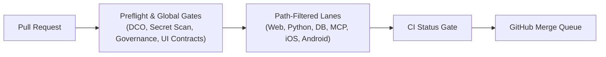

# CI Gates, Branch Lanes & Local Checks

[CI Configuration Hub](ci.md) · [Releases](README.md)

**Status:** Live | **Intent:** Reference | **Audience:** All Contributors and Coding Agents

Detailed execution rules for PR validation triggers, global gates, branch lanes, build caches, frontend/backend/streaming/UI contract lanes, and local reproduction commands. For main-owned release control and blocking policies, see [CI Configuration Hub](ci.md).

## Visual Map



## When CI Runs

| Trigger | Branches | Behavior |
|--------|-----------|----------|
| Pull request | All branches (`**`) | `PR Validation` medium-depth CI (path-filtered) |
| Merge queue | `main`, `integration/pr-train`, `dev`, `uat` | `Queue Validation` proves all included PRs, current approvals and the exact combined result; reuses only identical verified inputs |
| Push | `main` | `Main Post-Merge Smoke` compact deploy-authority smoke |
| Manual | Any | `PR Validation` `workflow_dispatch` with scope `auto` (default) \| `all` \| `frontend` \| `backend`; see [Dispatched runs](#dispatched-runs) |

**Path filters:** `PR Validation` runs jobs only when relevant paths change. A dispatched run with scope `auto` applies the same filters to the dispatched commit's changes against the default branch; `all`, `frontend` and `backend` choose the lanes by hand. `Queue Validation` reuses proven inputs or calls affected lanes on the combined result (see [The merge queue in practice](#the-merge-queue-in-practice)), and `Main Post-Merge Smoke` stays compact rather than path-filtered.

There is no scheduled editor/performance workflow. Safari layout and web
performance checks are developer-local diagnostics.

- **Application lanes** use the authored `ci.yml` filters and existing affected-test selectors. Known CI-controller fixtures and scripts have explicit Governance owners; they do not automatically select all application or database tests. Unknown runtime impact remains conservative.
- **iOS native job** (`ios-native-check`) runs when the `ios` filter matches; that filter lists the web surfaces the XCUITests render alongside the native shell paths, and it is pinned by `consent-protocol/tests/test_ios_lane_path_filter_covers_native_test_surfaces.py`, so a native test that starts rendering a new web surface fails CI until the filter names it. Package resolution runs sequentially after `cap sync`, using the job-local package cache. `scripts/ci/resolve-ios-packages.sh` retries once only for exit 74 with the known cold binary-download cache collision; it retains verified cache entries and both attempt logs. Other failures and a second failure block the lane. Native compilation and tests are never retried by this helper. This is a bounded workaround for the [upstream SwiftPM race](https://github.com/swiftlang/swift-package-manager/pull/10203), not evidence that native checks passed. The simulator boots after the web export so it does not compete with `next build` for memory. Only compressed Swift binary downloads restore under the exact graph/toolchain key; a failed partial archive restore is cleared before resolution. Git/workspace state is rebuilt by the resolver. Native compilation emits its build timing summary.
- **Web Safari layout and performance diagnostics** are local-only. Run
  `cd hushh-webapp && npm run test:layout-editor-performance` when a change
  affects editor/drawer timing or Safari-specific geometry. Use focused browser diagnostics when browser interaction needs investigation.
  App-browser checks are not mandatory CI; software-rendered timing is not a
  Safari performance measurement. Native iOS/Android jobs remain selected by native
  source or contract paths.
- **Integration job** runs when either frontend or backend paths change.

The local History motion check exercises opening, exit and interrupted-drag
behavior in Chromium and WebKit with a focused drawer/sidebar fixture. Linux
Connections checks retain functional layout and interaction coverage. Local
browser timing does not replace physical Release frame-pacing qualification.
### CI script and fixture ownership

The `ci.yml` filters and `scripts/ci/repo_governance_plan.py` are the existing
selection owners. Dedicated web scripts select their actual web callers;
backend runtime paths select Protocol and its applicable database contracts.
Controller-only scripts and inert fixtures use explicit Governance ownership.
Do not infer that every other `scripts/ci/` file requires the backend suite.

`test_ci_path_filters_cover_lane_scripts.py` checks the script-to-lane joins
through Governance as well as its existing Protocol owner. The iOS path guard
checks the web/native inputs actually reached by its scenarios; unrelated web
changes do not require a simulator. When the same hosted run requires Protocol,
Governance transfers only exact whole-module duplicates to that required lane;
missing, failed or cancelled Protocol evidence cannot pass the final gate.
Local or uncertain selection retains conservative coverage.

### Duplicate-Run Policy

Feature and hotfix branches use pull-request validation. Destination drift is
reported as guidance; the queue qualifies the combined result. Main runs compact
post-merge smoke on the actual landed SHA.

Batch a set of fixes before pushing: a newer push cancels the active PR
validation. For an eligible same-head retry, use
`./bin/hushh agents ci-rerun --run-id <id> --expected-attempt <n> --sha <sha>`;
live repository write access is sufficient. This retries only the canonical
validation and verifies attempt `n+1` on the unchanged source; it grants no merge,
protected-edit or deployment authority. Do not dispatch a standalone security worker. Release alert clearance stays in
the protected Deployment Security job of the explicit release workflow.

### Base freshness on pull requests

`Destination sync guidance` records drift against the actual target. It does not
reject a branch solely for being behind. Reconcile relevant stable fixes while
developing; preserve shared history and resolve conflicts by behavior. Main fixes
flow into UAT/Dev, and UAT fixes into Dev through reviewed source-only syncs.
No bot, cadence or merge deploys those changes.

The previous age-based gate is replaced by combined-result verification in the
queue. An unchanged PR can enter a newly assembled group without a sync-only push.
If the destination advances during qualification, the rebuilt group must qualify
again. This is a changed input, not a waived freshness check.

### Dispatched runs

`PR Validation` can be dispatched on any branch (`gh workflow run ci.yml --ref <branch>`). It publishes a distinct `Branch Validation Gate` that `deploy-dev.yml` accepts through `scripts/ci/require-deploy-sha-on-main.sh`.

- `auto` (the default) runs the lanes the branch's changes select, through the same path filters a pull request uses, applied to the dispatched commit against its merge-base with the default branch. On the default branch itself there is no branch diff, so `auto` runs every lane.
- `all` runs every lane.
- `frontend` and `backend` run a subset of the lanes and are diagnostic only: `Branch Validation Gate` fails them.

The default was `all` until 2026-10-15, which put iOS on one of the org's five macOS slots on every dispatch; one 30-minute dispatch loop made 59 of the 77 runs dispatched from 2026-10-07 to 2026-10-15.

A dispatch publishes **Branch Validation Gate**, while a pull request retains **CI Status Gate**. Both use the same fail-closed aggregate and selected contract owners. The separate name prevents a manual run from satisfying PR branch protection or replacing its verdict. PR Base Policy and merge-queue reuse still require the PR's own evidence. A branch may therefore qualify for dev even when its PR cannot be merged into the current base.

`deploy-dev.yml` accepts a qualified Dev branch gate. Exact full-scope UAT qualification also verifies its Branch Validation Gate through `uat_exact_ci.py`; partial diagnostics cannot qualify a release. Its exact-SHA preflight requires the SHA to be reachable from protected `dev` and binds the successful check to GitHub Actions, the canonical `ci.yml` workflow, `workflow_dispatch`, and the same check suite and SHA. The input ref only locates the SHA; it cannot authorize Main-only or arbitrary branch content. Missing or failed provenance lookup refuses deployment. The API read is bounded to the latest 100 matching runs; an older unobserved receipt refuses rather than passing. Production accepts only canonical functional CI for its protected Main source plus a separate Main smoke. Diagnostic-only runs cannot authorize a release. A newer failed or cancelled functional attempt invalidates older green evidence; UAT acceptance is not a fallback. Queue and PR branch protection do not substitute a manual branch check for PR evidence. The reviewed workflow correction must be present on the branch before dispatch. `DCO` runs on dispatches too, over the branch's own commits since its merge-base with the default branch.

### The merge queue in practice

GitHub build concurrency is one group per destination. The current admission
contract roots each group at the landed tip: validate `Head + A`, land it only
on success, then validate the next candidate against the updated tip. A failed A
never becomes B's base. Different destination queues remain independent; valid
exact-input receipts can still avoid another test run. Parallel speculative
`Head + A + B` builds remain unqualified until the complete predecessor chain
and its settlement are verified. Do not enable them merely by raising the
GitHub limit. Finish active ordinary groups before nonurgent owner Admin syncs;
batch operations deltas to avoid repeatedly invalidating their tested base.

Queue admission reads its authority helpers from the protected destination. Git
parents and the complete queue inventory establish every included PR and actual
queue requester. Each PR needs its applicable review or qualified maintainer
self-service authority and its latest successful validation attempt. Protected changes additionally need current `pipeline-editors`
approval; the author alone is not the queue requester.

A single PR may reuse its immutable CI receipt only when source, base, tested
tree, selection, run and attempt prove the current combined inputs. Otherwise
the existing affected-contract CI runs on the combined tree. Multi-PR groups
always validate the combined selection. Missing, failed, cancelled, incomplete
or superseded evidence refuses clearance. Final admission repeats membership,
review, destination and validation checks before publishing `CI Status Gate`.

For Dev/UAT, a newer Main commit is provenance, not by itself a changed queue
policy. Fresh snapshots fingerprint the complete canonical policy, excluding
only Main's native-writer switch outside Main. Changed cohorts, protected owners,
other policy fields, source, approvals and validation attempts still refuse.
Main retains that writer switch in its fingerprint. Legacy receipts keep exact
revision matching. Fresh authorization always runs again before clearance; PR
receipt reuse still requires the same tested source, base and tree.

Rollout order matters: land the trusted helper first, then activate the workflow,
qualify the combined path, and reconcile branch protection. Remove ordinary-user queue bypass
before relaxing strict age checks; partial rollout must retain the stricter
boundary. Main merger restrictions and required review remain independent.
The existing governance reconciler handles Main explicitly and Dev/UAT/the legacy
train through their declared branch policies. Read back each selected policy.

## Global Gates (Always Run)

| Gate | Purpose | Behavior |
|------|---------|----------|
| Secret Scan | Detect leaked credentials/tokens early | Gitleaks scans the event commit range. Privileged unresolved-secret clearance belongs to protected security execution within an explicit deployment, never PR-controlled code. |
| Destination sync guidance | Show drift against the actual PR destination | Advisory summary; no branch-age rejection. Queue validation proves the current combined result before merge |
| CI Status Gate | Single required check for branch protection | Runs on every outcome (`if: always()`); skipped or unknown selected work fails closed. Frontend requires Web Core, targeted Node, affected Web Unit Contracts and Integration. Backend requires Protocol, both Database jobs, MCP Package and Integration. Selected iOS/Android lanes also must succeed. UI Contracts, Secret Scan, Governance, Path filters, Preflight Gate and DCO remain required on every run; pull requests also require PR Base Policy. Optional local Safari/performance diagnostics are not CI jobs. A dispatch publishes the separate `Branch Validation Gate`; partial or unknown scopes fail. Pinned by `consent-protocol/tests/test_ci_status_gate_fails_closed.py` |

Operational note:

- Branch freshness checks the actual PR destination; it does not imply optional mirror parity.
- Maintainers can inspect the optional mirror with `./bin/hushh protocol check-sync` or opt in to a push check with `CONSENT_PRE_PUSH_SYNC_CHECK=1 git push`. Normal PR validation does not run that advisory check.

## Live GitHub Enforcement

Protected branches are expected to enforce the same CI contract documented here:

- repository setting
  - auto-merge enabled so `gh pr merge` can hand green PRs to merge queue instead of failing before queue placement
- `main`
  - `1` independent approving review of the latest push, or the explicit owner self-approval path; protected edits need current `pipeline-editors` approval
  - required status checks: `CI Status Gate`
  - current combined-result verification through the queue; no age-only strict check
  - conversation resolution required
  - merge queue enabled for `main`
- force-pushes disabled
- branch deletion disabled

The live GitHub setting can drift from the docs, so verify it directly:

```bash
./scripts/ci/verify-main-branch-protection.sh
```

Current live nuance:

- the repo uses branch protection for review and conversation resolution, with queue validation of the combined result
- the sanctioned bypass cohort should be limited to the approved owner set, without overlapping push-restriction lists
- native exceptions bind only the live `pipeline-editors` Team; no individual member or saved roster grants authority

## Deployment environments

GitHub deployment environments are part of the release authority surface and should stay minimal:

- `uat`
  - no reviewers
  - no admin bypass
  - custom deployment branch policy: exact `main` only
  - used by [`.github/workflows/deploy-uat.yml`](../../../.github/workflows/deploy-uat.yml)
- `production`
  - no reviewers
  - no admin bypass
  - custom deployment branch policy: exact `main` only
  - used by [`.github/workflows/deploy-production.yml`](../../../.github/workflows/deploy-production.yml)

There should not be parallel legacy production environments carrying approval logic that the current workflows no longer use.

GitHub only records deployment history under an environment after a workflow job actually runs with `environment: <name>`. Older deploy runs from before that binding existed are not retroactively re-linked. If UAT history needs a new entry, use a protected-UAT application SHA with its exact current CI and observed serving base. If production history needs a new entry, explicitly select a qualified protected Main application through the production gate. These are explicit releases; an empty history view does not authorize a deploy.

Verify live environment governance with:

```bash
python3 scripts/ci/verify-deployment-environment-governance.py
```

### Qualified frontend lint toolchain

The onboarding/security correction keeps patched Next.js 16.4.2 independently
of the reviewed lint toolchain: `eslint-config-next` 16.2.4 and its supported
`eslint-plugin-react-hooks` 7.0.1. ESLint remains 9.39.4. The newer analyzer
reported 742 compiler findings across existing source (600 refs, 101 immutability,
41 manual-memoization findings). Both analyzer versions enable these rules as
errors; no rule or severity is disabled here. Qualify that analyzer migration
separately instead of changing owner/session-ref behavior during a security fix.
The lint package declares no Next runtime peer constraint. Existing dependency
alerts remain independently reported.

### GitHub Alert Parity

Local Core, PR and queue source scans retain Gitleaks history and PR-body scans
without privileged alert access. Local Core does not call the GitHub alert reader
by default. Explicit `REQUIRE_GITHUB_ALERTS_CLEAN=1`,
`REQUIRE_GITHUB_SECRET_ALERTS_CLEAN=1` or
`REQUIRE_GITHUB_DEPENDABOT_ALERTS_CLEAN=1` retains the fail-closed diagnostic:
a missing reader, denied access or incomplete inventory fails the requested audit.
Routine contributors need no repository-wide alert token on their laptops.
Draft PRs
run safety, governance and UI contract checks; selected expensive lanes run when
the PR is ready. The non-required Merge Fidelity advisory also starts only when
the PR is ready; `CI Status Gate` does not depend on it. `Draft Safety Gate` cannot
satisfy merge or deployment admission.
Manual `PR Validation` with scope `auto` or `all` provides full branch diagnostics.

[Deployment Security](../../../.github/workflows/deployment-security.yml) reads
repository-wide alerts within an explicit release run, in a separate job using
the Main-only `ci-security` environment. Its fine-grained token has only Secret
scanning alerts: read and Dependabot alerts: read. Candidate code never executes
in that job. All environment releases use this inline Main-owned job in their
explicit deployment run; no branch-to-Main clearance run is dispatched. Its receipt grants secret clearance only, never
deployment acceptance by itself.
Mutation jobs verify the current security attempt; a failed-only rerun cannot
reuse an earlier clearance. Rerun the complete release workflow through its
existing recovery contract. Any unresolved secret alert blocks release; dependency alerts remain
advisory. Inaccessible or incomplete inventories fail closed. The receipt binds
the release run/attempt, Main workflow, environment, requested scope and resolved
application reference. Existing release admission still verifies selected services,
source CI, schema and rollback compatibility.

Historical branch-origin receipts retain their exact caller, reusable Main implementation,
source, attempt and immutable artifact checks. They do not authorize a new branch-origin
dispatch. Current Main execution uses the protected job inline; the isolated Main broker
also serves explicit queue/manual-operation permission requests without exporting its App
credential or roster. No workflow-run observer or automatic PR authority worker runs.
Queue requests check live membership at admission and immediately before landing;
the run label identifies the phase and source queue. Operation labels identify the
surface. Distinct phases are not duplicate polls: polling reads the same dispatched
run and does not launch another.
A dispatch intent is recorded before a broker request; an uncertain response stops rather
than automatically dispatching again. `ci-security` stays Main-only.

Repository HTTP reads, team membership reads and queue REST reads retry HTTP
500/502/503/504 at most twice, after one and two seconds, retaining their request
timeouts. Denied access, malformed evidence and failed validation do not retry.
Each retry reads current state; no earlier authority or successful attempt is
substituted. Dispatch, merge and provider mutations are outside this retry path.

The same protected job reads release-team membership through the first-party
Members-read App, verifies the actual operator and rerunner, and rechecks access
before publishing its decision. This adds no PR observer or recurring worker.
Its additive `authorization` receipt records the admitted identities, team ID,
source and producer; it never includes the roster or App credential. Existing
receipt formats remain readable. Normal cloud releases, native publication,
rollback and PLG frontend qualification carry that verified decision directly
through the trusted Main job graph into their actor checks. Missing output or a
different repository, caller, role, source, operator or attempt refuses admission;
it cannot fall back to a saved username. UAT's target selector is read-only and
defers operator permission to Main clearance before capacity or deployment.

This JSON is a workflow-DAG binding, not a portable bearer credential. Only the
protected producer or artifact-verified requester may issue it. Assign it from
`needs.<security-job>.outputs.authorization` directly in the trusted assertion
step, before candidate code and credentials; never accept it as a dispatch input
or candidate file. The reusable Voice job receives it only from its trusted
TestFlight parent. Historical human releases use verified canonical execution and complete outcome
proof, without replaying current membership against past work; bot releases retain
recorded controller authority. This historical rule grants no new operation. Current read-only inspection, manual
maintenance, emergency and queue consumers also use live-team admission through
the trusted producer; historical records cannot authorize a new operation.

### Matching-branch release control

This historical heading remains a link target. Current execution is
[Main-owned release control](ci.md#main-owned-release-control): choose the intended
workflow, select `main`, and supply the qualified protected application SHA.
`deploy` changes the selected environment only after admission; `inspect` and
`inspect-routing` are explicitly read-only. Recovery inputs belong to their recorded
operation. A blank UAT SHA never silently deploys a branch tip.

Dev/UAT source branches remain isolated and receive reviewed source-only operations
syncs. Their local workflow copies do not authorize environment-branch dispatch.
Main-origin runs use the protected security job inline. Historical branch-origin
receipts retain their recorded caller, application and tooling identities and remain
readable; they do not grant a new operation. Activation verifies exact Main-only
GitHub environment rules and the existing nonproduction cloud identity providers.
No merge, inspection or source sync deploys an application.

### Local core mirror

For local PostgreSQL-backed checks, run `bash scripts/ci/run-with-isolated-postgres.sh bash scripts/ci/orchestrate.sh core` from the repository root. The wrapper owns a temporary PostgreSQL 17 server and checks that both database drivers reach it before tests start. If `pg_config` selects another version, set `HUSHH_CI_TEST_PG_BIN` to the PostgreSQL 17 binary directory. The wrapper leaves existing local servers running. Standalone pytest harnesses have their own database contracts; this wrapper does not attest them.

`bash scripts/ci/orchestrate.sh core` is the broad local mirror: secret and
governance, protocol and web-core, then MCP package and integration. Use it when
the changed dependency graph crosses those stages or when diagnosing a broader
failure, not as a prerequisite for every push. Historical samples took 374
seconds and 1,967 seconds; these are observations, not runtime promises. GitHub
Actions remains authoritative for required web compilation and affected contracts. Set
`CORE_SERIAL=1` to run protocol and web-core sequentially. `web-targeted` runs
every selected pack and reports all failures instead of stopping at the first.

When the broad local Chromium/WebKit layout pack is run, it owns the agent
surface spec; `web-targeted-check.sh` retains its standalone invocation for
agent-only changes. The lane partition check proves both paths and both engines.
When both Drive and Connections layout packs are selected, the unfiltered Drive
pack owns first-connect insights for Chromium and WebKit. Connections omits only
that covered spec; standalone commands stay complete. A required governance
check protects the unfiltered, matching-project assumption. The historical
four-shard collector remains an explicit local diagnostic; it is not a hosted
CI job.

Tests follow the same economy: add a test only for a real regression, a trust boundary (with a negative control), or a public API or schema contract, and extend existing test files before creating new ones (`AGENTS.md`, Verification rules 5 to 8).

The required Governance job runs all seven registered auth-health suites whenever
the existing path filter selects that owner, including mixed changes and filtered
manual dispatches. Its inventory test has this explicit owner instead of selecting
the unrelated Protocol/database lanes. The auth-health-only override applies only
to nonempty, exact PRs; filtered auto dispatch selects affected owners directly.
Explicit backend/all diagnostic scopes remain broad. Mixed application, schema, SQL,
migration and dependency changes retain their affected lanes; unknown impact stays
conservative. Secret scan, DCO and CI Status Gate remain required. Destination drift is advisory.

Production health-job updates must also qualify their immutable image inputs,
specification and ordered audit history in the existing observer inventory. The
database-capacity gate refuses unreviewed job generations even when that job is
healthy. Preserve older profiles and never exempt a workload by its name alone.

The pinned frontend-only auth-domain repair reserves no hypothetical backend or
Drive-worker candidate connections: it uses the existing full-inventory
`--no-candidates` admission. Actual retained workloads, qualified observers,
administrative reserve and database limits still apply. This mode refuses a
non-frontend scope, staged worker, restoration, phone rollback or cold phase;
ordinary deployments retain their candidate reservations.

Preserved release tools are overlaid into their authored workspace paths before
use. Run emergency admission/recheck from `scripts/ci/`, since companion readers
resolve `deploy/phone` and `deploy/drive` relative to that repository root.
The exact auth refresh binds the immutable restored-release evidence and observed
serving pair. Before mutation and after image builds, it rechecks the annotated
recovery reference, canonical restoration receipt, actual serving backend identity,
IAM, service controls and original 100% traffic. Both rechecks use the initialized
project environment through `uv run --frozen --project`, preserving the workspace.
These checks read no database and do not activate or qualify a staged backend or
worker. Their independent schema/producer/WorkOS qualification remains mandatory
for the existing backend/activation paths. A metadata receipt never substitutes
for the auth repair's live serving checks.

Phone-lease history discovery and ancestry remain ordered. Independent per-run
attempt/artifact proofs use at most three readers with the same inherited
deadline; results are consumed in history order. All required records must pass
before the pre-policy boundary admits release. Failure cancels queued reads and
joins active ones; the optimization changes neither the 90-second authority
budget nor checkpoint/source requirements.

The exact reviewed parallel maintenance profile may flush canonical records of
older qualified attempts around its final refusal diagnostic. The reader accepts
only bounded, typed progress metadata there; those records grant no authority.
The actual checkout, source tuple, clock witness, diagnostic hash and absence of
checkpoint/provider mutation remain mandatory. Other profiles keep their strict
transcript contracts; arbitrary output still refuses reconciliation.

### Script Lifecycle Policy

1. Add a new CI/helper script only when it replaces or consolidates an existing one in the same PR.
2. Every CI/helper script must have a clear owner (`frontend`, `backend`, or `platform`) in PR notes.
3. Any CI scope expansion requires reviewer approval from the owning team.

## Branch Lanes

1. **Dev intake** is the default for new development. Preserve existing `integration/pr-train` work and protection. Governed maintainers retain direct Main operations/hotfix authority under Admin SOP.
2. Dev/UAT/production workflows execute from Main and independently select their qualified application sources. Dev accepts an exact CI-green protected Dev SHA through the [Dev Fast Lane](./dev-fast-lane.md).
3. UAT deploys by explicit manual dispatch through `.github/workflows/deploy-uat.yml`. New application selections must belong to protected UAT history. A direct UAT candidate also needs exact full-scope CI with its current attempt, observed serving base, and protected security checks. Historical Main-backed receipts remain readable and retain Dev-backed acceptance, but Main-only application SHAs are not normal UAT dispatch sources.
4. Manual UAT dispatch is limited to the current
   live `deploy-uat` team; do not
   transcribe actor names into this document.
5. Production deploys only through a manual SHA dispatch in `.github/workflows/deploy-production.yml`, and only current `deploy-production` members may trigger it.
6. Ordinary production requires qualified protected Main and Main smoke, preserving distinct application and approval SHAs and identical content when applicable. A prior UAT deployment is not mandatory; accepted-image promotion still verifies the actual UAT image. The explicit emergency mode waives only predecessor deployment. Automatic publication remains disabled.
7. Start from the intended destination: Dev for integration, UAT for a selected candidate, or Main for an authorized operations/hotfix delta. Each deployment admits its own qualified protected history; UAT does not require preceding Dev deployment. Complete relevant downstream source syncs under the [freshness procedure](../../../.agents/skills/repo-operations/references/maintainer-branch-freshness.md). Neither merging nor syncing dispatches deployment.

Deploy to UAT is expected to behave as a closed-loop release lane:

1. start from an explicitly chosen, qualified application SHA and its exact UAT CI or retained Dev acceptance
2. sync canonical secrets
3. capture last healthy revisions
4. deploy changed surfaces
5. verify runtime mounts and semantic behavior
6. retry once on transient readiness
7. roll back only the failing changed surface
8. publish release artifacts with revisions, reports, and final status

UAT text recovery starts one exact-image execution and observes its identity to
terminal state before removing the temporary Job. Its 420-second controller
allowance includes provider startup and settlement; the worker retains its
120-second task limit, zero retries and bounded batch. In run `39949039317`, the
old 180-second waiter deleted the Job before a receipt arrived at 207 seconds.
The provider reported cancellation, so the later worker receipt cannot qualify
that release. Require both provider success and the exact SHA/policy-bound
receipt. An unread or timed-out execution remains unconfirmed with its Job and
execution references retained for reconciliation; do not replay it or delete
active work merely because observation stopped.

The retired One-chat deployment index is excluded from active maintenance discovery.
On 4 November, all 1,169 retained manual runs since its 11 October introduction
were inspected across complete, bounded date windows; none belonged to that
producer. GitHub now returns 404 for its deleted workflow ID. Historical explicit
run and artifact readers remain, and failures reading active producers still stop
maintenance. This does not assert that previously deleted history never existed.

UAT and production revision retirement use the existing `Capacity Maintenance` workflow,
run hourly. Releases never trigger it. Because GitHub delivered only 3-6 of its former
cron's 24 daily runs on 2026-10-12..14, `Capacity Maintenance Clock` is now its only
schedule: it checks both environments every hour without cloud credentials, wakes
maintenance only when work is due with a repository dispatch scoped to the due
environments (the scheduled pass's authority within that scope), and re-arms itself
through the `capacity-maintenance-clock` environment's 60-minute wait timer, which holds no
runner. A scoped pass's title lets the other environment's checkpoint guard skip it without
reading its jobs. The deploy-SHA gate and the UAT target selector look up the post-merge gate
by check name, so the clock's checks on an idle `main` head never crowd it out. An authorized operator
can explicitly inspect or apply cleanup; manual requests are not coalesced with cron.
Scheduled work keeps one active and one pending request without cancelling active
mutations. Each environment still shares its deployment/rollback lock.

GitHub therefore shows two legitimate entries: **Capacity clock** schedules due
work; **Capacity Maintenance** executes it. A clock waiting on its protected
60-minute timer uses no runner and is not a second cleanup. Custom titles omit
run counters; GitHub's own workflow numbers remain. Maintenance fetches complete
Git history with `filter: blob:none` to avoid downloading old file bodies.
Current source qualification binds the static clock title and exact workflow
blobs; historical numbered receipts retain their separately pinned source.

The November 3 auth-domain release (`41608303952`, attempt 1) served successfully
but failed immutable tag publication. Its historical tag was reconciled on
November 4 as object `faeb0e63f5aae00885e5eeb299d17f01f98e6736`; the operational
`production-latest` object remains `5b4f56d6cdbc3f6153e6565bf894f634fae692e6`.
The original failed run and refused publication receipt remain unchanged. The
existing reader pins that incident's run, attempt, source, archive digest and tag,
rechecks them against GitHub, and retains the independently accepted backend
origin. This supplies historical publication evidence only: it cannot authorize
normal promotion, replace live/checkpoint/rollback checks, or prove an application
was redeployed. Unknown or altered evidence still refuses maintenance.

A completed phone activation can publish its healthy tag and then fail readback.
The continuation reader qualifies that outcome only when the tag step is the sole
failure, all required health/security gates succeeded, and the immutable archive,
original runtime, rollback, activated cleanup and timestamped production tag agree.
The failed run remains failed. Later rollback qualification follows that immutable
tag rather than the moving `production-latest` reference. Missing or changed
publication evidence refuses; do not reset tags or replay activation to hide it.

Source-only checks before authentication and again under that lock skip settled and
not-yet-due work. Each executing pass has a 300-second budget, including subprocesses,
with teardown/checkpoint time reserved. No runner waits for request drainage: existing
artifacts retain the deadline and partial progress for the next hourly pass. Drainage
still covers the longest applicable request timeout plus 60 seconds. Unknown provider
outcomes retain mutation intent and block conflicting deployments until reconciliation;
a timeout does not prove that Google stopped the operation. No completion is claimed
for partial or unresolved work. Cleanup outcome is separate from release health and
capacity admission; diagnostic reporting does not add another unconditional cloud scan.
Maintenance publishes an unfinished checkpoint before its worker-health preflight,
preserving restored service journals and capacity-bridge intent. Historical UAT
failures without an artifact require exact frozen owner/workflow source, actual
checkout, completed attempt and runner-output proof that the checkpoint barrier
was never crossed. This proves no provider mutation; it grants no cleanup or
release-health authority. A production attempt stopped by that first guard qualifies
only through `retention_production_evidence.py`: reviewed owner, workflow and
publication bodies at its actual checkout, the exact cleanup-job layout including
operational reference publication, one prepare command group and exactly one guard
diagnostic as its final output. Only the setup action's exact unstamped cache-glob
lines may lack timestamps. The operational reference keeps its own intent artifact
and idempotent tag readback; this proof covers revision-cleanup custody only.
The current static production job additionally requires its exact inspection/cleanup
mode inventory and all four guard-source blobs to match the immutable reviewed
contract in `retention_production_profile_evidence.py`. Its proof preserves the
actual run, attempt, job and checkout; it does not relabel a historical profile,
publish a checkpoint or settle a retained capacity-bridge operation.
A UAT attempt stopped by that first guard under the reviewed current source
qualifies through `retention_uat_guard_evidence.py` on the same terms: reviewed
owner, workflow and publication bodies at its actual checkout, the exact UAT
cleanup-job layout and prepare command group, and exactly one guard diagnostic as
its final output, accompanied only by the walk's own proof records for older
attempts (at most 100, about four days of hourly stops; beyond that each stop needs
its own reconciliation). The clock's tick for both environments, titled
`Capacity Maintenance`, carries the same bot authority as a scoped tick; each
environment's proof still decides whether an attempt qualifies. Any change
to those three files needs a newly reviewed profile before a later guard stop can
qualify; modules the owner imports are reviewed rather than pinned, so a provider
call added before the guard there needs the same review.
Unknown source, incomplete logs, cancellation and failed
checkpoint uploads remain blocked. Every attempt is inspected, including earlier
attempts of a currently running retry; never delete failed runs to clear admission.
The complete bounded inventory is read before qualification. Independent run
proofs use at most three workers; results and proof lines are consumed in the
original chronological order. Only a verified newer publication can exclude a
completed older run. Active runs and equal-boundary results still require proof.
All readers inherit the same 90-second lookup deadline and are joined on exit;
concurrency does not grant cleanup authority or extend the five-minute pass.
Production's independent phone-lease and checkpoint-publication proofs overlap
within that same deadline. Both must succeed and all readers must exit before
checkpoint restoration or any provider mutation; either refusal blocks admission.
The reviewed workflow source can identify a skipped primary deployment job even
when GitHub reports its unevaluated name. The job must be uniquely bound to the
exact attempt, completed, skipped and unstarted; earlier attempts still require
reconciliation. This does not establish a healthy release. A new producer in a
different job requires a separate source-authority review.

The historical production status-reader repair is off unless the trusted workflow
explicitly sets `HUSSH_PRODUCTION_MAINTENANCE_EVIDENCE_REPAIR=true`; enabling it
requires a separately authorized production operation. When enabled, production
status comes from the current attempt's digest-verified artifact, not a local
cache. The reader accepts `tmp/prod-release-status.json` only as an unambiguous
alternative to the root status file, and rechecks the run and artifact inventory
without the maintenance-pass cache.
The production deploy workflow selects this reader for its authorized production
operation. Production maintenance selects it in source qualification, operational
intent preparation, the locked cleanup job and the clock's production due check.
The library default remains off; UAT reader behavior is unchanged.
A saved maintenance checkpoint may precede the README writer. Only the existing
attempt/job/source-qualified saved-checkpoint path may restore that shape; legacy
pending-drain archives still require the marker. Artifact ID, size, digest, bounded
regular ZIP members and completion receipt remain mandatory. Unfinished journals
are restored unchanged and continue to block mutation admission. New publishers
write the README with the initial checkpoint before live health checks.
Retained database-connected revisions remain in admission accounting until safe
retirement. Zero minimum instances and aggregate SQL peaks do not prove that older
generations have finished their admitted requests. A shortage defers deployment.

The manual production capacity bridge has a narrowly pinned `serving_backend_clone_v3`
recovery for healthy revision `consent-protocol-00280-toz` and the failed launcher in
`consent-protocol-00283-ges`. It verifies the exact failed run's attempt-2 upload window,
artifact digest and successful rollback receipt. Only that immutable failed spec receives
a conservative two-worker reservation in maintenance accounting; ordinary worker conflicts
still refuse deployment. SQL limits, every retained revision, jobs and administrative reserve
remain counted. The clone preserves the healthy image, authority and traffic, with unchanged
secret-history verification. A verified old bridge can transition only after it and its
predecessor are absent and unreferenced; its full receipt and checksum remain archived.
Unresolved intents cannot be discarded. Existing tag retirement and the full timeout drain
must finish before ordinary deployment admission can pass. Backend deployment clears inherited
command and argument overrides so the accepted image's launcher honors `WEB_CONCURRENCY`.

Production CRM qualification uses the application's `crm_product_available` authority.
The hosted CRM product is paused, so its gateway-only credentials and transport probe are
explicitly `not_applicable_product_paused`, without claiming gateway verification. If that
authority admits the product, required credential parity and the no-record gateway handshake
remain mandatory. Missing or malformed qualification blocks both paths; no product flag,
registry row, credential or other integration gate changes to obtain a passing release.

Both UAT admission observers stop within five minutes and poll at most once a minute.
Direct inventory checks under deployment locks also bound the entire process group
to 295 seconds, with two seconds for forced teardown. Their timeouts remain verification
failures; an unavailable inventory is not an observed capacity shortage.
`DEFERRED_CAPACITY` retains the original SHA/scope for an operator retry, without
starting maintenance or automatically resuming a deployment. See
[the hosted maintenance contract](../../../deploy/README.md#hosted-revision-maintenance).
Frontend-only UAT releases use a separate zero-increment SQL admission check that verifies the live web runtime and candidate revision; backend and paired releases retain the full connection budget gate.

Before increasing database pools or tiers after a failed load stage, inspect the
existing request query counts and acquisition timing. Drive's consent projection
checks its rolling schema capabilities once inside each existing transaction;
those checks are not cached across requests. Owner filters, revocation rules and
projection totals still execute against the current schema. The PostgreSQL
projection suite guards this query bound and its missing-schema and error cases.

See [Branch Governance](./branch-governance.md).

---

## Required Versions (Must Match CI)

| Tool | CI Version | Local requirement |
|------|------------|-------------------|
| Node.js | 24 for web/Node lanes | Local preflight accepts 20+; use 24 to reproduce CI |
| Python | 3.13 | 3.13 (CI asserts exactly 3.13) |
| npm | latest | Use latest (script upgrades before run) |
| uv | pinned by workflow | install `uv` locally and use `uv sync --frozen --group dev` |

Using a different Node or Python locally can cause “pass locally, fail in CI” if behavior or dependencies differ.

---

## Build Caches

GitHub scopes an Actions cache to the ref that saved it. An entry saved by a
`pull_request` run lives under `refs/pull/<N>/merge`, and no other pull request
can restore it. An entry saved on `main` can be restored by every pull request.
All entries share the repository's 10 GB budget. GitHub evicts an entry that
nobody restores for 7 days, and over 10 GB it evicts the least recently used
entries first. At 20:00Z on 2026-10-14 the budget held 10.65 GB, and
pull-request Next.js entries that no other pull request could restore were
5.50 GB of it.

These caches are saved on `main` only, and only when the key is new. `PR Validation`
restores them with `actions/cache/restore`:

| Cache | Saved by | Restored by | Key |
|---|---|---|---|
| Next.js build cache, the web app's `.next/cache` (~380-460 MB) | `Main Post-Merge Smoke`, on the first green push of each UTC day | `Web Core (Next.js)` | Node version, hash of `package-lock.json` and `next.config.ts`, and the UTC day. A miss falls back to the newest entry for the same lockfile. |
| Compressed Swift binary downloads, `$RUNNER_TEMP/spm-cache/artifacts` (producer reports actual bytes) | [`Warm CI Dependency Caches`](../../../.github/workflows/ios-swift-package-cache.yml), daily at 05:37 UTC and on manual dispatch. On Sundays it also resolves from an empty directory when the entry exists, and saves nothing. | `iOS Native (Xcode)` | Xcode version, runner OS and architecture, and a hash of the project's `Package.resolved` plus the `CapApp-SPM/Package.swift` that `cap sync` generates. Exact match only. |

Each day's Next.js entry stops being read once the next day's is saved, but it
stays until it has gone 7 days unread, so up to a week of them (about 3 GB) can
sit in the budget. They are the least recently used entries, so they are
evicted first.

The Swift package job skips the native web export. `cap sync ios` only needs an
`index.html` in the web directory, and it generates the same `Package.swift`
with or without the export. A pull request that changes the package graph
resolves uncached until the next daily run saves the new graph; dispatch the
workflow to re-seed sooner. The job's `setup-node` also saves the macOS npm
cache on `main`, so the macOS pull-request lanes restore that entry instead of
saving their own copies while their lockfile matches `main`.

A pull request restores only binary download archives; SwiftPM still resolves the
package graph and verifies artifact checksums. It does not restore Git repositories,
expanded frameworks or workspace state. Cached archives can hide an upstream
download failure, so a warm PR does not prove their current availability. Every Sunday, and on a
dispatch with `cold` ticked, the job therefore resolves from an empty directory
even when the entry exists. When a run fails, the workflow opens or comments on
one issue, `iOS Swift Package Cache failed on main`. Pull requests that restore the
entry stay green, but a pin that can no longer be fetched would fail every iOS
pull request at the next graph change or eviction.

In PR run [`42792960565`](https://github.com/hushh-labs/hushh-research/actions/runs/42792960565),
the full Swift clone cache took **293 seconds** to restore, followed by **77 seconds**
of resolution. The replacement versioned key stores only compressed downloads.
The Main producer refuses a changed graph or an empty cache publication. Measure
restore, resolution and compilation separately on the next necessary native run;
this source change alone does not prove a speedup. That run's **28m57s** total was
also constrained by web export/native compilation and a parallel **23m15s**
Protocol lane; caching alone cannot establish a 15-minute whole-PR result.

`scripts/ci/test_ci_cache_scopes.py`, in the governance check, fails when a
`PR Validation` job saves any of these caches, when Main cache-key paths drift,
or when a restore stops looking up the path and key its saver writes.

---

## Frontend Checks (Web / Next.js)

**Working directory:** `hushh-webapp/`

| Step | Command / behavior | Fails CI? |
|------|--------------------|-----------|
| Validate files | `package-lock.json` exists and valid JSON; `next.config.ts` exists | Yes |
| Install | `npm ci` | Yes |
| UI architecture and accessibility | `node scripts/architecture/verify-design-system.mjs --core` | Yes |
| Input and runtime resources | `node scripts/architecture/verify-render-performance.mjs --core` | Yes |
| Cache coherence | `npm run verify:cache` | Yes |
| Appearance and documentation diagnostics | `npm run verify:design-system`; `npm run verify:docs` | No; developer diagnostics |
| TypeScript | `npm run typecheck` | Yes |
| Lint | `npm run lint -- --max-warnings=${WEB_LINT_WARNING_BUDGET}` | Yes |
| Phone verification regression | `npm run verify:phone-verification` | Yes |
| Build (web) | `npm run build` (Next.js) | Yes |
| Security audit budget | `npm audit --json` + budget gate (`moderate/high/critical`) | Yes |
| Tests | `node scripts/testing/affected-tests.mjs run <plan>` in `Web Unit Contracts`; local callers without a validation level retain the whole Vitest suite | Yes |

**Build env (CI):** `NEXT_PUBLIC_BACKEND_URL` and all six `NEXT_PUBLIC_FIREBASE_*` vars are set to placeholders in the workflow so the build does not depend on real secrets.

**Coding rules that affect CI:**

- Do **not** use `fetch("/api/...")` in components or pages; use the service layer (see [Architecture](../../architecture/system.md)).
- ESLint must pass with zero warnings (`--max-warnings=0`).
- TypeScript must compile with no errors.

---

## Backend Checks (Python / FastAPI)

The owner-wide Drive admission regression measures permit deadlines inside the
real PostgreSQL transaction, including both connection generations. Coroutine
resumption after a threaded transaction can compress apparent body-entry times;
it is not the pacing authority. Keep the existing rate, eight-slot, waiting,
cancellation and lease-erasure assertions. A pacing-bypass negative must fail.

Generated backend capability-graph and route-index mirrors do not select the full
Protocol suite. Governance recomputes their three copies and runs the backend
route-index reader contract. Stale or altered mirrors fail those checks. Authored
runtime changes and unknown contracts retain broad backend coverage; this is not
a blanket JSON exclusion.

**Working directory:** `consent-protocol/`

| Step | Command / behavior | Fails CI? |
|------|--------------------|-----------|
| Validate files | `pyproject.toml`, `uv.lock`, generated `requirements*.txt`, and `tests/` | Yes |
| Install | `uv sync --frozen --group dev` plus `bash scripts/sync_runtime_requirements.sh --check` | Yes |
| Lint | `uv run ruff check .` | Yes |
| Type check | `uv run mypy --config-file pyproject.toml --ignore-missing-imports` | Yes |
| Security | `uv run bandit -r hushh_mcp/ api/ -c pyproject.toml -ll` | Yes |
| Tests | `bash scripts/run-test-ci.sh` (manifest-driven curated suites run in parallel with pytest-xdist, plus a whole-tree collection gate) | Yes |

**Parallel pytest (2026-09-26).** `consent-protocol/scripts/run-test-ci.sh` runs the manifest with
`-n auto --dist loadfile`: one worker per CPU, and every test in a file stays on
one worker in file order, so module-scoped fixtures behave as they do serially.
Parallel execution is enabled by the script. On a loaded local host, the pinned
xdist supports `PYTEST_XDIST_AUTO_NUM_WORKERS=<count>` to bound the auto worker
count; this changes scheduling only, never test coverage or deadlines.
`protocol-check` in CI and the local `orchestrate.sh core` stage both reach it through
`consent-protocol/scripts/ci/backend-check.sh`. `tests/conftest.py` gives each
xdist worker its own `OFFLINE_DB_PATH` file so workers never share SQLite rows;
the Postgres-backed tests already create a uniquely named schema or database
per test.

Measured 2026-09-26 on a 16-core Mac shared with other agent sessions (so the
spread is load, not the suite): the full manifest serially took 599 s (6,388
passed, 203 skipped); three parallel runs each passed the same 6,388 with the
same 203 skipped and zero failures, in 186 s, 59 s and 103 s. The three
`ONE_COMMAND_TEST_DATABASE_URL` Postgres files, run concurrently against one
shared database three times, passed 57/57 each time and left no schema behind.
The protocol service uses PostgreSQL 17 with pgvector 0.8.6, pinned to the
upstream OCI index `sha256:cf134a767f474095eeba57e0117be8e568e011a63f33fbf252f14c9b760f8e6f`
through Google's public `mirror.gcr.io` cache. On October 9, two hosted runs were
refused by Docker Hub before checkout. Both registries returned that same index
and platform digests; the mirror changes transport without changing the database
fixture. A missing cached digest must fail initialization. See
[Google's cache contract](https://docs.cloud.google.com/artifact-registry/docs/pull-cached-dockerhub-images).

Before the switch CI spent 321 s in serial pytest (of a 7.8 min `Protocol
(Python)` p50). Enabling it surfaced one class of defect: two route tests
baked a module-level `uuid4()` into their parametrize ids, so every worker
collected different test ids and xdist refused to start. They now use a fixed
synthetic id.

If a test genuinely cannot share a machine with others, mark it and run it in a
second, serial pass inside `run-test-ci.sh`; do not skip it and do not add a
flag. None needed that as of this change.

Blocking backend manifest:

1. `consent-protocol/scripts/test-ci.manifest.txt`
2. Keep this manifest small and stable.
3. Full local repo checks are available through `./bin/hushh test`.
4. Kai accuracy/compliance remains manual through `./bin/hushh protocol accuracy`.

**Test env (CI):**
`TESTING=true`, `APP_SIGNING_KEY`, and `VAULT_DATA_KEY` are set in the workflow (see [ci.yml](../../../.github/workflows/ci.yml)).

**Consent-token rule for automated tests:** Use fixture-issued VAULT_OWNER tokens from `consent-protocol/tests/conftest.py`. `consent-protocol/tests/dev_test_token.py` is debug-only and must not be required by CI.

**Config files:**

- **Ruff:** [consent-protocol/pyproject.toml](../../../consent-protocol/pyproject.toml) — `[tool.ruff]` and `[tool.ruff.lint]`. Target Python 3.13, line-length 100, selected rules (E, F, B, I, S), per-file ignores for tests and routes.
- **Mypy:** Same `pyproject.toml` — `[tool.mypy]`. Python 3.13, `warn_return_any`, `ignore_missing_imports`, overrides for `hushh_mcp.*` and consent/vault.

**Coding rules that affect CI:**

- Use **Python 3.13**-compatible syntax and types.
- Avoid ambiguous names (e.g. single-letter `l`) so Ruff doesn’t flag them.
- Optional args: use `Optional[T] = None`, not `T = None`, to satisfy mypy.
- Return types: avoid returning untyped `Any` from functions that declare a concrete return type; use `cast()` or correct types so mypy passes.
- New backend code under `consent-protocol/` is type-checked and linted; keep `api/` and `db/` aligned with mypy and Ruff.

### Capability-graph evolution gate

`uv run python scripts/generate_capability_graph.py --check` runs in the backend lane (`consent-protocol/scripts/ci/backend-check.sh`) and again through `npm run verify:one-voice` in the web lanes. It regenerates `contracts/kai/one-capability-graph.v1.json` from its sources and diffs the semantic nodes against the pull request base, not against `HEAD`: the predecessor is the committed graph at the merge-base with `origin/<base>`, where the base is resolved in this order: `--base-ref <ref>`, then `CAPABILITY_GRAPH_BASE_REF` (used verbatim), then `GITHUB_BASE_REF` and `WEB_TARGETED_BASE_REF` (bare branch names are prefixed with `origin/`), else `origin/main`. Hosted workflows supply the resolved review base over a full-history checkout; focused local `agents pre-pr` passes its verified destination SHA. Raw stage wrappers do not discover a PR destination automatically: supply `CAPABILITY_GRAPH_BASE_REF` when invoking them directly. Queue Validation uses the merge-group base and combined head. Under CI the check fails closed when that base cannot be resolved. Locally, when no base ref can be resolved, it falls back to comparing against the graph committed at `HEAD` and prints a warning; that fallback only catches a change relative to your last commit, so run with a real base ref before relying on it.

When it fires, the error names the semantic ids with unacknowledged breaking changes. Do not edit the generated graph by hand. Either land a workflow migration with the owning workflow package, or add an exact-revision deprecation entry to `consent-protocol/hushh_mcp/agents/capability_graph_evolution.v1.json` whose `from_revision` is the base graph's top-level `revision`; broad or stale acknowledgements never suppress the gate. Then regenerate in dependency order (the agent registry if it changed, the capability graph, then the runtime topology index last, because it digests the others) and rerun the check with the same base ref CI will use.

When normal UAT replaces a release from retained, divergent history, preserve its
published workflow graph through an exact reviewed `workflow_predecessor_refs`
ledger pin. Only ledger pins may cross histories; inferred and arbitrary CLI
predecessors retain ancestry requirements. Missing publication or incomplete Git
history refuses. Importing that graph must pass both capability-wide semantic
deprecation checks and workflow revision-policy checks. Keep the eight-pin bound;
replace a redundant pin only with proof that the retained history subsumes it.
Regenerate the mirrors with the owning compiler. Normal UAT may reconcile the
landed PR's diagnostic `semantic_diff` only when every other payload field,
including preserved workflow compatibility, agrees. Isolated qualification keeps
its ancestry requirement. Never suppress the check or hand-edit graph output.

---

## Integration Check (Route and Docs Contract)

**Runs when:** Frontend or backend paths change (or manual run with scope that includes either).

| Step | Command / behavior | Fails CI? |
|------|--------------------|-----------|
| Verify | `bash scripts/ci/docs-parity-check.sh` | Yes |

Route contracts must stay in sync between frontend expectations, backend (or proxy) routes, and the route/mobile docs. See [API Contracts](../../development/contracts/api-contracts.md). If you add or change routes, update the contract and run the docs parity lane (or full local CI).

---

## Streaming Contract Gates

Canonical streaming is a production contract, not an implementation detail.

- Contract source: [Streaming Contract](../../development/streaming/streaming-contract.md)
- Runtime pattern: [Streaming Implementation Guide](../../development/streaming/streaming-implementation-guide.md)
- Vertex constraints: [Vertex AI Streaming Notes](../../development/streaming/vertex-ai-streaming-notes.md)

Minimum checks for streaming changes:

- Frontend stream checks: `cd hushh-webapp && npm run test:ci` (includes streaming/parser suites)
- Backend stream/auth tests: `cd consent-protocol && pytest tests/test_kai_auth_matrix.py`

---

## Running CI Locally

During implementation, run the nearest owner checks for the changed contract.
`focused` keeps authority checks and selects affected regression owners from the
exact changed-file list; `release` adds release-authority checks. Use
`diagnostic` or the full local mirror for explicit broad diagnosis. GitHub Actions
remains authoritative for required web compilation and affected contracts; a local pass
does not prove hosted success. `agents pre-pr` defaults to focused local
preparation: it checks the exact base/head, accepts optional review context,
runs protected-edit, base-policy, DCO, security and governance checks, then runs
the selected local owners. Its report identifies selected hosted Integration, database and native checks
still required. App-browser diagnostics are explicitly requested separately. It does not run the full local mirror.
Use `agents pre-pr --diagnostic` when you explicitly want that broader mirror;
the diagnostic mode runs DCO followed by `./bin/hushh ci` and may add advisory
checks with `--include-advisory`. Choose one mode for an unchanged candidate.

```bash
./bin/hushh ci
```

This command runs the full local mirror. `./bin/hushh agents pre-pr` does not call
it by default; only its explicit `--diagnostic` mode invokes this mirror after
the DCO check.

1. Validates required files (e.g. `package-lock.json`, `next.config.ts`, `pyproject.toml`, `uv.lock`, generated runtime artifacts, test files).
2. Checks Node (20+ minimum; use 24 for CI parity) and Python (3.13) and uses `uv` as the canonical backend toolchain.
3. Runs **frontend** checks: install, `tsc`, lint, Next build, audit-budget gate, curated test suite.
4. Runs **backend** checks: shared parity verification, install, Ruff, mypy, Bandit, curated test suite.
5. Runs **integration**: route/runtime contract verification.

To include advisory checks locally:

```bash
./bin/hushh ci --include-advisory
```

This advisory lane now includes the Codex operating-system audit:

```bash
./bin/hushh agents audit
```

To verify the live GitHub branch gate matches the documented minimum contract:

```bash
./scripts/ci/verify-main-branch-protection.sh
```

Fix failures in the selected local checks before pushing. Successful hosted
validation of the exact SHA remains required before deployment.

Secret-scan note:

- local and remote CI now both scan the relevant commit range by default
- use `GITLEAKS_LOG_OPTS=--all` only when you intentionally want a full-history audit

---

## Quick reference: affected preparation

Run the checks selected for the actual destination and changed contract;
full historical suites are explicit diagnostics, not mandatory push commands.

| Purpose | Command from repository root |
| --- | --- |
| Focused preparation before opening a PR | `./bin/hushh agents pre-pr --base-ref origin/<target>`; optional `--body-file <draft>` |
| Focused preparation for the current PR | `./bin/hushh agents pre-pr --pr <number>` |
| Broader diagnosis when needed | `./bin/hushh agents pre-pr --diagnostic` |

Use the owning skill for additional affected runtime checks. Hosted exact-head
validation and release-specific compatibility remain required; optional local
commands cannot substitute for that evidence.

---

## Strict Launch Gate (Release Cut)

One support/account-mail launch check (owner: `kushal@hushh.ai`): verify the
Workspace domain-wide delegation grant for the configured service-account client
ID includes `https://www.googleapis.com/auth/gmail.send`, then send synthetic
`[TEST]` welcome, passkey-add/remove, passphrase-change, and each support type
to the test inbox. Confirm a real Help & Feedback submission reaches
`one@hushh.ai`, its internal BCC reaches the support lead, and no report body
appears in application logs. Confirm one controlled UAT vault change produces
one notice without changing the vault outcome if mail fails. The public privacy
policy must explain support-message handling, the internal copy, and retention;
the in-app account-deletion control must be exercised. Check the managed backend
5xx and account-mail alert policies are enabled, target the verified
`kushal@hushh.ai` notification channel, and deliver a test incident. Missing
grant, policy wording, or alert delivery blocks public launch; source config
alone is not proof.

The first-welcome Firebase claim suppresses ordinary repeated sign-ins, but it
is not a distributed exactly-once mail ledger: simultaneous first-sign-in
requests or a failed claim update can duplicate an accepted welcome. Verify
the expected first-login traffic pattern or add durable idempotency before
claiming a strict at-most-once guarantee.

During launch, the owner records a short daily readout from the existing Cloud
Monitoring dashboard: backend 5xx/latency, support accepted versus failed or
uncertain, security-mail failure events, and open support issues. Follow the
existing production deploy traffic-rollback procedure for a bad application
revision; do not roll back a completed vault transition because email failed,
and do not blindly resend an uncertain Gmail submission.

Before creating a release tag/public rollout, run strict gate commands from repo root:

```bash
bash scripts/ci/docs-parity-check.sh
cd hushh-webapp && npm run typecheck
./bin/hushh native ios --mode uat
./bin/hushh native android --mode uat
cd hushh-webapp && npm run verify:cache
cd hushh-webapp && npm run verify:docs
python scripts/ops/verify-env-secrets-parity.py --project hushh-pda --region us-central1 --backend-service consent-protocol --frontend-service hushh-webapp
bash scripts/verify-pre-launch.sh
```

Blocking rule:
- Launch gate is strict-blocking. Any failing check or non-clean git tree is a release blocker.

## Production Deploy DB Governance Gates

The production deploy workflow (`.github/workflows/deploy-production.yml`) enforces additional DB governance before backend deploy:

1. Cloud SQL backup posture gate:
- validates Cloud SQL automated backups + PITR via `scripts/ops/cloudsql_backup_freshness_check.py`
- requires latest successful backup age within configured threshold (`BACKUP_MAX_AGE_HOURS`, default `30`)
- optional on-demand Cloud SQL backup via workflow input `run_predeploy_backup_job=true`

2. Migration governance + drift gate:
- checks migration filename monotonicity (`consent-protocol/db/migrations`)
- checks the production-pinned schema contract (`consent-protocol/db/contracts/prod_core_schema.json`)
- allows the repo to be ahead of production while production stays pinned to its approved migration floor
- checks live DB schema contract in read-only mode

3. Manifest artifact:
- emits a production migration release manifest with Cloud SQL backup evidence (backup id, completion timestamp)

UAT deploys use a separate latest-integrated contract:

- `consent-protocol/db/contracts/uat_integrated_schema.json`

The daily scheduled workflow `.github/workflows/prod-cloudsql-backup-posture.yml` runs the same backup posture policy and uploads a report artifact.

## Upstream CI (consent-protocol standalone)

The optional consent-protocol mirror has its own full CI pipeline at [hushh-labs/consent-protocol](https://github.com/hushh-labs/consent-protocol/actions). It runs on all branches plus merge queue and includes: secret scan, lint, typecheck, test, security scan, Docker build verification, and a final status gate.

The monorepo is authoritative. Its protocol and release gates determine merge
and deploy readiness. Mirror publication and mirror CI are optional maintainer
operations and must not delay a monorepo release or UAT deploy.

## The collection gate

`consent-protocol/scripts/run-test-ci.sh` runs `pytest --collect-only -q tests/` over the whole
tree before it runs the curated manifest. The manifest is an allowlist, so a
test file that is not listed is simply never executed, and a file that cannot
be IMPORTED is worse than that: pytest reports `no tests ran` for it, which in
CI is indistinguishable from a file that passed.

Measured 2026-09-11. `consent-protocol/tests/test_consent_lifecycle_chat.py`
imported a symbol deleted two days earlier. All 438 of its lines collected zero
tests and reported nothing, and a behavioural change to the proposal path drifted
away from an assertion in the same file with nothing going red.

It also distorts any whole-suite measurement taken against a branch that has
the broken file. A collection error aborts the entire run, so `pytest -q tests/`
returns a single error and executes nothing, and the run reads as one failure
rather than as no coverage at all. Compare failure counts only after confirming
the suite actually ran.

The gate is deliberately separate from the manifest: the manifest answers "which
suites gate a merge", and the gate answers "can every test file still be loaded".

### Browser setup mirror — 2026-10-08

Historical required-browser behavior below was superseded by PR #9000 on
6 November. The retained setup recipe is used only by explicit diagnostics.

PR run `37836804949` restored cached browsers, but the hosted Ubuntu mirror
downloaded 116 MB of system dependencies in 23 minutes 9 seconds. The 30-minute
job deadline interrupted the browser pack. The browser job removes only the
runner's `azure.archive.ubuntu.com` mirror preference and retains its existing
official archive/security entries and signed package checks. Chromium, WebKit,
matched packs, workers and per-test limits remain unchanged. Browser-role job
budget is 40 minutes; node-role budget remains 30. A faster install is a hosted
measurement to verify, not a guaranteed mirror characteristic.

UAT prepares locked npm dependencies, Chromium and its system libraries only for
explicit browser/PWM diagnostics or legacy isolated qualification. Ordinary
frontend deployment and SQL-only preservation do not provision a browser. Setup retries at most twice within eight
minutes. Preparation blocks legacy/PWM qualification; optional diagnostic preparation
reports its failure separately. Its Chromium cache has a separate key from CI's
Chromium/WebKit cache; restored binaries still pass the normal installer.
Both backend provider probes run independently after image and IAM verification.
The required provider aggregate waits for both results and the deployed candidate
before selection; dev and production retain their predeployment Vertex gate.

## Combined UI Contracts gate

Every PR runs one mandatory **UI Contracts** job before expensive lanes. It installs only the locked TypeScript parser, shares source reads, rejects Back/Search coverage and freshness drift, and verifies Surface Map, Gateway, Siri and Route Orchestration mirrors. It runs mutation regressions that prove either owner failure rejects the combined check. Target validation execution is 5–10 seconds; dependency downloads, checkout, runner startup and queue time are separate. The command prints its actual elapsed time. Preflight and CI Status require success; frontend changes also require Web Core, targeted Node contracts and affected Web Unit Contracts.

Run `cd hushh-webapp && npm run ui:doctor` before edits. Follow the [contributor scaffold](../../development/contracts/ui-contract-contributor-guide.md), review authored Back cases and Search actions, then run `npm run build:ui-contracts` and `npm run verify:ui-contracts`. The pre-push wrapper runs the same read-only fast check. It never repairs or stamps source. The previous individual package commands remain available for diagnosis.

### Focused browser and unit selection

Known backend, contract and package paths keep their verification owner.
Unknown application impact retains conservative Node/unit/runtime coverage, not
mandatory app-browser execution. Global CSS changes require the normal compile
path without expanding the unit suite. Authored route contracts and generated
route/cache manifests feed the unit dependency graph. JSON under
`__tests__/fixtures/` remains a related-test input; it is never discarded.
Native Swift sources under `ios/` and Kotlin/Java sources under `android/` stay
with their native jobs; they do not force Vitest to run every unit test. Shared
authentication and unknown application dependencies remain conservative.
Colocated tests have unit ownership. Explicit browser diagnostics retain the
existing pack selector and conservative unknown-impact fallback. The historical
Calendar run `41801308569` expanded to 1,535 unit files because its JSON fixture
was unclassified; this was a selector gap, not missing branch synchronization.
Compare the actual tested checkout and script blobs before attributing delays
to stale branches.

PR Integration selects against the validated checkout's merge parent and tested
tree, rather than comparing the destination with the unmerged feature head.
Destination-only PKM or vault changes therefore do not select those expensive
lanes again. Actual PR changes still select them. Queue reuse also requires the
captured PR path inventory to match that tested merge, plus the existing exact
base, tree, current-attempt and authority checks; an unknown comparison runs
combined verification instead.

The explicit protected-document and phone diagnostics retain their Linux
Chromium and native macOS WebKit partitions. Parameterized identities remain
partitioned by engine. Neither engine is a required PR, queue or release lane.
Native compilation and platform contracts remain independently selected by
actual native changes.

### Owner Admin merges and ordinary contributor access

| Person/action | Expected route | What still blocks |
| --- | --- | --- |
| Ordinary contributor to Dev/UAT | PR, independent review, combined-result queue | Relevant CI, conflicts, unresolved conversations |
| Eligible Dev/UAT maintainer | Governed self-service after destination activation and readback | Required CI, protected-owner approval, objections and combined-result evidence |
| Current `deploy-production` members | Reviewed PR into Main and combined-result queue | Current validation and protected-owner approval where applicable |
| Current `pipeline-editors` approving their own protected PR | `./bin/hushh agents admin-merge` under Admin SOP | Current Main base, exact tested tree, current green attempt, review objections |
| Dev/UAT deployment operator | Explicit Main-owned deployment | Environment/source authority, CI, protected release security and rollback |
| Production operator | Explicit Main production deployment | Qualified protected Main, functional CI, Main smoke, compatibility and rollback; no mandatory UAT deployment |

A merge never deploys. Use the [Admin SOP](../../../.agents/skills/repo-operations/references/admin-release-sop.md)
for the canonical commands and live-policy activation. Do not ask a self-approving
owner for another person just to satisfy GitHub's native self-review restriction.
Do not grant ordinary contributors broader bypass to solve an owner-only problem.

CODEOWNERS is reserved exclusively for protected files owned by
`pipeline-editors` (no catch-all `*` entry), preventing mixed protected PRs from
attaching `allowed-maintainers-to-approve` alongside `pipeline-editors`. After
PR creation, source updates or retargeting, run
`./bin/hushh agents review-route --pr <number> --apply`. It routes ordinary PRs
to `allowed-maintainers-to-approve` and enforces `pipeline-editors`-only routing
on protected and content-based protected changes, preserving explicit individual
requests and completed current-head reviews without adding an Actions run. See
the [routing procedure](../../../.agents/skills/repo-operations/references/admin-release-sop.md#review-routing-on-every-destination).
This is notification only: ordinary maintainers retain existing self-service;
outside contributors still need independent authorized review. Labels never waive
required checks, combined-result admission or protected approval.

### Capacity maintenance job labels

The clock decides when work is due; the worker inspects or performs bounded cleanup
under the environment mutation lock. These remain separate authorities. Static
UAT/Production revision-maintenance labels stay readable even when skipped. Each
executed job records an explicit inspection or cleanup mode; only cleanup plus the
existing successful guarded steps can establish a mutation checkpoint. Missing or
ambiguous mode evidence refuses. Historical inspection/cleanup receipts retain
their original names and verification rules. No cadence or resource policy changes.
