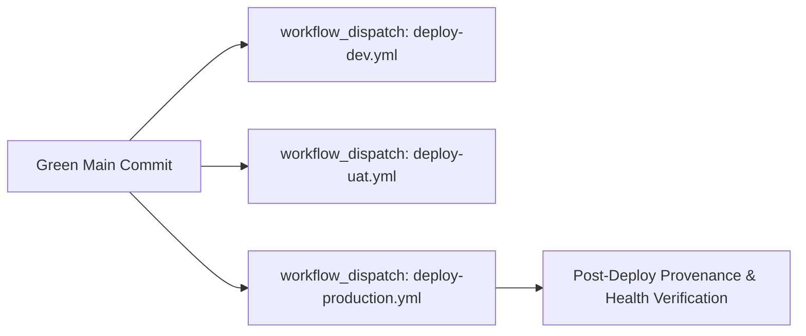

# Manual Deployment Paths & Recorded Release Reviews

[CI Configuration Hub](ci.md) · [Releases](README.md)

**Status:** Live Reference & Operational Record | **Intent:** How-To & Reference | **Audience:** Release Maintainers

Explicit manual deployment dispatch paths alongside recorded production restoration and release-chain audit reviews. See [CI Configuration Hub](ci.md) for current release authority.

## Visual Map

## Recorded production restoration — 26 October 2026

Normal releases keep their exact application SHA and environment acceptance chain:
Exact UAT CI or historical Dev acceptance before UAT. Current production admission requires protected Main functional CI and Main smoke; preceding UAT deployment is optional. A normal manually
requested Main smoke must test the dispatch commit itself. Its check cannot
certify another checkout. Release checks verify the canonical producer, current
attempt, complete bounded inventory and job identity; later failed reruns refuse
stale success.

The one-time Shared-experience restoration uses the pinned
[`production-restoration.json`](../../../deploy/account-deletion/production-restoration.json)
record. The separate **Production Recovery Validation Gate** certifies only that
candidate, with an attempt-bound artifact. It does not create Dev/UAT acceptance
or authorize other commits. Its result neither replaces nor invalidates ordinary
Main smoke. Production admission requires both services built from source,
disabled legacy Drive intake, no new capability activation and a governed manual
operator. Credentials remain scoped to the production environment; Git push
credentials are supplied only to the final trusted release-tagging step.

The recovery workflow joins both immutable image builds before lifecycle fences.
Its database gate inspects the installed contract without replaying migrations;
a transactional writer barrier drains prior document writers and rejects new
issuance. Retained storage remains configured while its recovery worker
maintenance is disabled only after that barrier is verified. Candidate readback
requires phone recovery, WorkOS, replacement-generation admission, document
issuance and document work drain to be explicitly off.

An immutable, run-bound artifact records the original serving pair before any
release mutation. Retries recover that pair and accept only the original
revisions or this same run's candidate as current traffic. Rollback qualifies the
original destinations even when the failing candidate is unhealthy. An
unconfirmed cleanup restoration remains blocked in the release receipt. The
document barrier stays while a non-reader serves; removing it requires a
separately qualified reader activation.

**Deployment remains unverified until its release receipt and serving readback
pass.** Operations source, hosted recovery validation and live application
restoration are separate outcomes. No historical migration replay, Firebase
rollback or fabricated UAT receipt is allowed.

On 27 October, operation `40430296874`, attempt 2, promoted the recorded
`d8a5fa485874` application to both production services at 100% traffic:
backend `consent-protocol-00309-nir`, frontend `hushh-webapp-00160-2w2`.
Runtime parity, immutable provenance, health, account-session and native-domain
checks passed. The workflow remained **blocked** because system Python lacked
the recovery schema qualifier's database driver. The activation command must
use the already verified `PROTOCOL_PYTHON` environment.

The administrator continued this same approved operation using the unchanged
main-owned activation tool at `c9d26ee991`, the verified project environment and
explicit source/run arguments. Competing production mutation entrypoints were
paused and restored to their previous states. Canonical activation verified the
schema, exact document barrier, fresh Scheduler HTTP 200, compatible retained
revisions and serving traffic before confirming the deletion fence absent.
This separate admin repair does **not** turn the failed hosted attempt green or
create a normal promotion receipt. The existing macOS checkpoint retains its
`production-admin-activation-activation.json` and repair record. Signed-in production acceptance then passed through the existing Google login:
the returning account reached One without an alert, and its real
`/api/account/session-status` request returned HTTP 200. Public login and the
unauthenticated session contract also passed.

A hosted restoration completion can attest that same original operation through
`restoration_activation_run_id` and its exact `restoration_activation_attempt` on
the existing production workflow. It accepts only retained activation-only failed
evidence for the recorded source, with the original immutable serving pair and
document-barrier owner. It rebuilds no image and changes no traffic or schema.
Fresh canonical schema, barrier, Scheduler delivery, provenance, health and
already-absent deletion-fence checks must pass. The new verifier has its own
receipt and run identity; runtime labels retain the original deployment run.
The canonical activation configures and triggers the existing cleanup Scheduler;
this is not a read-only operation. Retained consumers needing retirement are
refused through the existing lifecycle inventory before activation begins.
This is a restoration serving reference, not Dev/UAT acceptance or a phone
rollback anchor. The original failed attempt remains unchanged.

The selective-promotion handoff remains preserved separately. Its branch-baseline
and application-SHA/approval-SHA mapping are not active. Its maintenance draft
needs corrections for forced capacity inspection, dry-run checkpoint state and
pre-mutation preparation failures. Do not import deployment-triggered maintenance
or use the two historical UAT exceptions as production authority.

## Release-chain review — 2026-10-23

One measured correction release, not a performance SLA:

| Stage | Elapsed | Evidence |
| --- | --- | --- |
| Full PR validation | 35m02s | [39981561301](https://github.com/hushh-labs/hushh-research/actions/runs/39981561301) |
| Landed-SHA smoke | 3m10s | [39986627702](https://github.com/hushh-labs/hushh-research/actions/runs/39986627702) |
| Dev, both services | 24m09s | [39987252665](https://github.com/hushh-labs/hushh-research/actions/runs/39987252665) |
| Sequential total before UAT | 62m21s | Includes gates, runner waits and cloud control-plane time |

Dev's backend wrapper took 10m20s, including a 6m19s native Gemini readiness
stage; migrations/schema took 3m08s and frontend rollout 2m30s. Images were
pinned before migrations; the frontend image built in parallel. These measurements
do not establish a redundant build or justify removing an authority gate.

The PR's 23 Ubuntu notices announced the `ubuntu-latest` migration to Ubuntu 26;
they were not download failures. Its successful hosted image was Ubuntu 24.04.5,
runner 2.338.0. Core PR/queue/security/smoke and dev/UAT/production workflows pin
`ubuntu-24.04` to retain that measured OS. A complete runtime inventory covered all
26 workflow YAML files (21 distinct literal `uses:` values), expanded the local
reusable workflows and composite action, and checked the composite action's nested
steps. It found no remaining Node.js 20 action runtime among the resolved actions.
The workflow actions and the nested provenance predicate now use Node.js 24:
Google auth/setup-gcloud/get-secretmanager-secrets v3; artifact v6, checkout v6,
setup-node v6, setup-java v5, setup-python v6, cache/restore/save v5; paths-filter
v4, setup-android v4, setup-xcode v1, Anchore SBOM v0, Play upload v1, and the
locally referenced setup-uv v7. The build-provenance wrapper moves v2 to v3, whose
pinned `attest@v3.0.0` and predicate@2.0.0 use Node.js 24. Workflow-used action
inputs and outputs were checked against tagged metadata. WIF identities,
permissions, application Node/Java versions, cache keys, and PR restore-only/main-save
boundaries remain intact. Node 24 requires runner 2.327.1 or newer. This addresses
the observed seven Node.js 20 deprecation warnings; hosted verification is still
required. A material latency reduction is not established.
[Runner announcement](https://github.com/actions/runner-images/issues/14748),
[cache runtime requirements](https://github.com/actions/cache#whats-new),
[Google auth v3 metadata](https://github.com/google-github-actions/auth/blob/v3/action.yml),
[setup-gcloud v3 metadata](https://github.com/google-github-actions/setup-gcloud/blob/v3/action.yml),
[setup-gcloud v2 metadata](https://github.com/google-github-actions/setup-gcloud/blob/v2/action.yml),
[artifact v6 metadata](https://github.com/actions/upload-artifact/blob/v6/action.yml),
[checkout v4 metadata](https://github.com/actions/checkout/blob/v4/action.yml),
[checkout v6 metadata](https://github.com/actions/checkout/blob/v6/action.yml),
[Android setup v3 metadata](https://github.com/android-actions/setup-android/blob/v3/action.yml),
[Android setup v4 metadata](https://github.com/android-actions/setup-android/blob/v4/action.yml),
[provenance v2 metadata](https://github.com/actions/attest-build-provenance/blob/v2/action.yml),
[provenance v3 metadata](https://github.com/actions/attest-build-provenance/blob/v3/action.yml).
`setup-gcloud@v3` defaults its tool cache off; the self-hosted iOS voice workflow
sets `cache: true` to preserve v2's self-hosted cache behavior. This does not
qualify the device runner.
`checkout@v6` keeps the used v4 inputs and credential persistence default. The
Android setup migration explicitly retains the former `cmdline-tools-version`
`12266719` default because v4 changes its default to `15859902`; the workflow also
keeps its explicit `platform-tools` package selection. The build-provenance workflow
continues to provide the same SBOM subject path and does not consume wrapper outputs.
Artifact v6 is the Node 24 runtime release; it retains ZIP uploads and the existing
artifact ID, URL and SHA-256 digest outputs. All current workflows keep hidden-file
exclusion and ZIP compression defaults; none reads action outputs directly. The
retention readers bind artifacts by their run/name/ID and verify the downloaded
ZIP size and digest before parsing only allowlisted members.

The latest five protected security workers each bound a distinct source
run/attempt. Their presence is credential isolation, not five new vulnerabilities.
The long run title participates in exact receipt discovery; renaming the producer
alone strands older PR consumers. Any title migration must preserve old/new
consumer compatibility, chronological newer-failure refusal and source/artifact
binding. macOS capacity notices are provider observations, not demonstrated code
failures. Unchanged historical evidence remains reusable where its inputs match.

## Run-history review — 2026-10-18

Read-only sample: 100 recent runs for discovery, then the last 20 completed PR
validations and 10 completed deployments per environment. Job/step metadata uses
the latest attempt; failed and cancelled runs are excluded from success timing.
These small, different source cohorts are diagnostic samples, not a speed SLA or
a controlled benchmark. Elapsed times include gates and waits, not billed CPU time.

| Successful scope | Dev median | UAT median | Sample count |
| --- | --- | --- | --- |
| Backend only | 16.5 min | 32.1 min | Dev 5; UAT 3 |
| Backend + frontend | 25.4 min | 37.5 min | Dev 4; UAT 4 |
| Frontend only | Not sampled | 14.8 min | UAT 2 |

Sources: [dev backend](https://github.com/hushh-labs/hushh-research/actions/runs/39091378215),
[UAT backend](https://github.com/hushh-labs/hushh-research/actions/runs/39167882081),
[dev both services](https://github.com/hushh-labs/hushh-research/actions/runs/39082250085),
[UAT both services](https://github.com/hushh-labs/hushh-research/actions/runs/39177524405),
[UAT frontend](https://github.com/hushh-labs/hushh-research/actions/runs/39161330609).
Comparing a frontend-only UAT run with a backend dev release is misleading.

The PR sample contains 10 successes, 7 failures and 3 cancellations. Successful
elapsed median is 19.8 min across changing lane sets. Protocol validation is the
largest repeated measured step (14.8 min median, 5 observations); iOS compilation
and tests take 7.7 min median (2). Observed macOS job starts are 5–9 seconds after
preflight in 5 successful jobs, so runner contention is not established as the
cause of those runs. [Example native-inclusive validation](https://github.com/hushh-labs/hushh-research/actions/runs/39175468636).

Successful dev steps: backend deploy wrapper 7.2 min median (9), image pin/build
2.8 min (9), migrations/schema 3.4 min (9). UAT additionally spends 7.8 min on its
private Drive worker deployment/attestation (7). That worker reuses the pinned
backend image; this is not a second image build. Frontend builds already overlap
backend preparation in both environments. Step medians are not additive estimates.

### Protocol partition correction — 25 October 2026

[Run 40158496907](https://github.com/hushh-labs/hushh-research/actions/runs/40158496907)
passed all 24 other jobs, including the four browser shards, but reached the
32-minute backend step limit. Its 23,685 parallel cases passed in 967.16 seconds;
the following serial database phase had not finished. The preceding run completed
both phases in 686.13 and 760.62 seconds. No test failure was reported before the
timeout. These are individual observations, not a new reliability percentile.

The correction keeps one manifest/classifier and separates the existing phases:
`Protocol (Python)` runs static/generated/security checks, parallel tests and
whole-tree collection; `Protocol Database` runs the same serial database list on
its own runner and PostgreSQL service. Both are mandatory for changed backend
sources. Missing, skipped, cancelled, failed and timed-out selected work refuses
clearance. The runner's explicit `PROTOCOL_TEST_PARTITION` is `parallel` or
`database` in hosted CI; default `all` retains the complete local/upstream order.
No tests or isolation checks were removed and no timeout was increased. Hosted
latency remains to be measured on the combined candidate.

**Candidate awaiting hosted qualification (28 October 2026):**
[run 40741369811](https://github.com/hushh-labs/hushh-research/actions/runs/40741369811)
spent 25m08s executing 2,133 passing and one skipped serial database cases. The
proposed change divides that same manifest between two independent runners and
PostgreSQL services, still serial within each runner. The aggregate gate must
pass both shards. Local `all` remains unsharded. Verify combined coverage,
isolation and elapsed time on the hosted candidate before claiming a speedup.

### Failure causes and next improvements

- **PR preparation:** protected-policy edits require the applicable team approval.
  Live Memory PR prose is optional review context, not source-integrity authority;
  `live-memory-source-gate.py` still validates registration, writer ownership,
  journal parity and paid-retrieval isolation. Its `--review-pr-description` mode
  is an explicit diagnostic. Historical prose-only refusals are not the current policy.
  [Missing declaration](https://github.com/hushh-labs/hushh-research/actions/runs/39169067111),
  [protected-policy refusal](https://github.com/hushh-labs/hushh-research/actions/runs/39149416659).
- **Browser fixtures and behavior:** a source extractor could no longer locate the
  agent-name anchor; another run failed a WebKit drag assertion. Repair the owning
  fixture or interaction with unchanged behavioral limits; do not remove browser
  coverage. [Extractor failure](https://github.com/hushh-labs/hushh-research/actions/runs/39173344405),
  [drag failure](https://github.com/hushh-labs/hushh-research/actions/runs/39176000165).
- **Runtime/native tests:** a Vitest case exceeded its 5-second deadline; iOS reached
  test execution and failed assertions. These are observed failures, not proven
  flakes. Establish the cause before changing timeouts or workers.
  [Vitest](https://github.com/hushh-labs/hushh-research/actions/runs/39173073117),
  [iOS](https://github.com/hushh-labs/hushh-research/actions/runs/39169674663).
- **Deployment:** Cloud Build readback confirms image build, IAM verification,
  backend deployment and Azure memory verification succeeded in the failed UAT
  run. `verify-managed-vertex-runtime` failed; the detailed provider condition
  remains unclassified. This is a model-readiness refusal, not a Docker build failure.
  [Failed release](https://github.com/hushh-labs/hushh-research/actions/runs/39114036433),
  [Cloud Build record](https://console.cloud.google.com/cloud-build/builds/8c705e26-b042-49b8-9110-71b95044bfd3?project=hushh-pda-uat).
- **Highest-value profiling:** split protocol time into dependency setup, generated
  checks, lint/types/security, parallel tests and serial database tests before
  selecting an optimization. Profile Drive worker startup/attestation separately.
  Preserve database isolation, scanning, migration fences and exact-image readback.
- **Reuse what already exists:** targeted PR Node packs defer to the mandatory
  three-shard Vitest suite. Queue validation reuses equivalent green source.
  Dev pod-image building stays off unless the pod artifact actually changed.
  Batch completed fixes into one push; rerun only failed jobs when source is unchanged.

Future reviews should compare the same scope, lane set and attempt, with sample
counts, cache observations and failure causes. Reuse existing run timestamps and
release receipts; add no monitoring workflow or scheduled test loop for this review.

