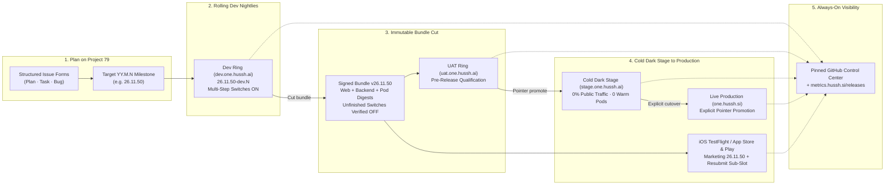
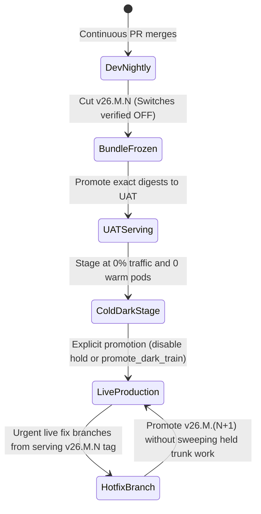

# Uniform YY.M.N Release Control and Ring Visibility

[Releases](README.md) · [Operations](../README.md) · [Documentation](../../README.md)  
**Status:** `Live` · **Intent:** How-To and governance reference

> [!IMPORTANT]
> **Audience Rule:** This guide opens in plain language so anyone on the team can see how Hussh plans, versions, stages, and ships releases across Web, Backend, Private Pods, iOS, and Android. Exact coding-agent contracts and CLI commands sit in the collapsible section at the bottom.

Hussh ships more than a hundred pull requests each week across Web, Backend, Private Sovereign Pods, PostgreSQL, iOS, and Android. To move fast without breaking live owners or losing track of what is running where, every surface shares **one human-readable `YY.M.N` version** (starting at **`26.11.50`**, rolling to **`26.12.1`** in December and **`27.1.1`** in January), **one active planning board ([Hussh Action Items, Project 79](https://github.com/orgs/hushh-labs/projects/79))**, **one immutable release bundle per cut**, and **always-on live visibility** on both GitHub and [`metrics.hussh.si/releases`](https://metrics.hussh.si/releases).

## End-to-End Release Flow



## Four Core Rules Everyone Uses

### 1. One `YY.M.N` Version Across Every Product

Instead of juggling disconnected version numbers across Web, Backend, Private Pods, iOS, and Android, every tier speaks the same `YY.M.N` release number:

| Surface | Versioning Behavior | Example | Why It Works Cleanly |
| --- | --- | --- | --- |
| **Dev (Rolling Nightlies)** | Deploys multiple times daily without burning public release numbers | `26.11.50-dev.4` | Fast continuous testing with zero wasted version numbers |
| **Release Bundle & GitHub Releases** | Increments `N` only when freezing a candidate bundle; resets `N = 1` each month | `v26.11.50` -> `v26.12.1` | Year-and-month clarity plus valid three-part SemVer (zero leading zeros) |
| **Web, Backend & Private Pods** | Stamped at build time into runtime health and telemetry events | `26.11.50` | Every chart, log, and bug report filters by exact release train |
| **iOS (TestFlight & App Store)** | Shared `YY.M.N` marketing version paired with monotonic Apple build numbers | `26.11.50 (186)` | Store-only resubmits bump the build number without burning `26.11.51` |
| **Android (Google Play)** | Shared `YY.M.N` version name paired with integer `YYMMNNNNR` (`R = 0..9`) | `26.11.50` (`261100500`) | Supports up to `9,999` cuts per month and `10` Store submissions per cut |

### 2. Multi-Step Features Use an On/Off Switch

When a large capability takes multiple pull requests over several days (such as Multi-Account Gmail and Calendar or Multimodal Composer):

1. Open one **Product Plan** issue on **Hussh Action Items (Project 79)** naming its runtime On/Off switch.
2. Merge bounded steps into **Dev** daily with the switch turned **ON** in Dev so the team can test active progress immediately.
3. Keep the switch turned **OFF** in **UAT** and **Production** until every step is finished.
4. Because unfinished multi-step features stay switched OFF outside Dev, Hussh can cut and ship `26.11.50` bug fixes or completed features at any moment without waiting and without exposing half-built screens.

### 3. Immutable Bundle Promotion and Cold Dark Staging



- **Never rebuild mutable trunk at Production cutover:** Freezing `v26.M.N` locks one signed manifest of Web, Backend, and Private Pod image digests plus database and mobile compatibility floors. Downstream rings promote that exact verified bundle.
- **Cold Dark Staging costs zero idle pod compute:** Staging revisions on `stage.one.hussh.ai` and `stage.api.hussh.ai` carry `0%` public traffic while the Production sandbox warm pool stays scaled to `0` idle pods until active rehearsal or cutover.
- **Zero-click-gate safety:** Trunk holds unpromoted trains safely behind `deploy/production-dark-stage-hold.json` without adding manual reviewer click-gates. Urgent Production fixes branch cleanly from the live serving `v26.M.N` tag so held trunk work never leaks into a live hotfix.

### 4. Two Places to Check What Is Live in Five Seconds

1. **GitHub:** One **Pinned Hussh Release Control Center Issue** and **Official GitHub Releases** (`Pre-Release` at UAT cut, `Latest Release` upon Production rollout) show live versions, Cloud Run revisions, sandbox warm-pool posture, and Project 79 milestone completion.
2. **Hussh Matrix Metrics (`metrics.hussh.si/releases`):** Staff sign in via `id.hussh.si` to view the live **Release status** screen right alongside crash-free sessions, Cloud Monitoring reliability, and adoption cohorts.

## Related Guides

- [Delivery and Operations Architecture](../../architecture/modules/delivery.md)
- [Branch Governance](branch-governance.md)
- [CI Configuration Reference](ci.md)
- [Migration Governance](migration-governance.md)

<details>
<summary><strong>For coding agents: contracts, CLI commands, and verification gates</strong></summary>

### Binding Invariants

1. **Active Board Default:** Route all new issue intake and triage to **Hussh Action Items (Project 79)** via `.github/ISSUE_TEMPLATE/01-product-plan.yml`, `02-engineering-task.yml`, `03-bug-regression.yml`, and `python3 .agents/skills/planning-board/scripts/board_ops.py` (which defaults to `--board action-items`). Closed Project 73 (`--board engineering-core`) is read-only historical archive.
2. **Strict `YY.M.N` SemVer:** Never emit four-digit years (`2026.11.50`) or zero-padded months/sequences (`26.01.1`, `26.11.01`) on new tags; strict three-integer `YY.M.N` (`26.11.50`, `26.12.1`, `27.1.1`) satisfies npm, Python PEP 440, Apple `CFBundleShortVersionString`, and Google Play `versionName`.
3. **Android Version Code Formula:** `YY * 10_000_000 + M * 100_000 + N * 10 + R` (`R` in `0..9`), enforced by `scripts/ci/release_version_control.py`.
4. **Dark-Stage Hold Contract:** Respect `deploy/production-dark-stage-hold.json` in `.github/workflows/deploy-production.yml`. While `active: true`, live `100%` Production deploys require either an explicit `stage_dark` zero-traffic posture, a verified live hotfix branch off the serving `vYY.M.N` tag, or explicit `promote_dark_train=true` authorization.

### CLI Commands

```bash
# Compute the next sequential YY.M.N release version and Android versionCode
./bin/hushh release next-version --json

# Compute an Android Play Store versionCode (R=0 initial cut, R=1..9 Store resubmit)
./bin/hushh release android-code 26.11.50 --resubmit-slot 0

# Render the Pinned GitHub Release Control Center Markdown from a ring snapshot JSON
./bin/hushh release render-control-center --snapshot /tmp/release-snapshot.json

# Run release version, bundle manifest, and documentation governance checks
python3 scripts/ci/test_release_version_control.py
./bin/hushh docs verify
```

</details>
