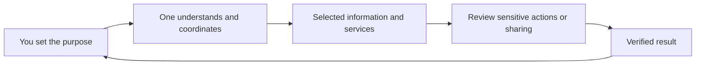

# One, your private agent

[Documentation](../README.md)

One helps you work with the information and services you choose: remember useful
context, find and organize documents, connect accounts and take reviewed actions.
Hussh is the platform and trust infrastructure; One is the private agent you use.

## Visual Map

## Start with your journey

- [Capabilities and availability](capabilities.md): understand what each hosting choice supports.
- [Personal-agent principles](principles/agent-ontology.md): loyalty, consent and duty of care.
- [Connections and invitations](connections/README.md): choose whom and what to connect.
- [Memory](../architecture/modules/memory.md): how One remembers and how sharing differs.
- [Files and documents](../architecture/modules/files.md): encrypted files and bounded processing.
- [Sharing and MCP](../architecture/modules/sharing.md): requests, scopes and explicit release.

Private compute, model processing and encryption are separate decisions. A model
can process information you explicitly disclose; encryption at rest does not make
that processing invisible to the provider. See the [trust boundaries](../architecture/modules/identity.md).

Product descriptions explain source behavior. Live availability depends on your
environment, hosting selection, permissions and installed version. Proposed
capabilities belong in the [roadmap](../roadmap/README.md).

## Further reading

- [Hussh Vision](principles/README.md)
- [Product and implementation terminology](terminology.md)
