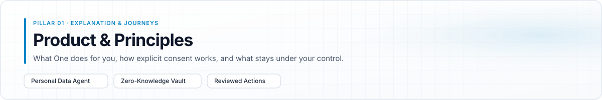
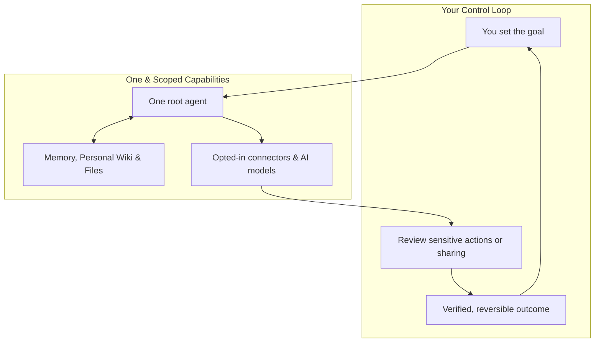

  <picture>
    <source media="(prefers-color-scheme: dark)" srcset="../assets/brand/pillar-product-dark.svg" />
    <source media="(prefers-color-scheme: light)" srcset="../assets/brand/pillar-product-light.svg" />
    
  </picture>

# One, your private agent

[Documentation](../README.md) · **Intent:** Explanation & user journeys

> [!IMPORTANT]
> **Human-First Principle:** Hussh is the platform and trust infrastructure; **One** is the private agent working strictly for you. Private compute, model processing, and encryption at rest are separate choices, never bundled promises.

One helps you remember useful context, find and organize encrypted documents, connect everyday services, and review requests to share specific slices of your information without exposing your whole vault.

## Visual Map

## Start with your journey

| What you want to understand | Status | Guide |
| --- | --- | --- |
| What each hosting choice supports today | `Live` / `Preview` | [Capabilities and availability](capabilities.md) |
| Loyalty, consent, and duty-of-care ontology | `Live` | [Personal-agent principles](principles/agent-ontology.md) |
| Custody, recovery, revocation, and erasure north star | `Live` | [Private-agent requirements](principles/private-agent-requirements.md) |
| Choosing whom and what to connect | `Live` | [Connections and invitations](connections/README.md) |
| How One remembers and how sharing differs | `Live` | [Memory and PKM](../architecture/modules/memory.md) |
| Encrypted files and bounded document workflows | `Live` | [Files and documents](../architecture/modules/files.md) |
| Scoped requests, circles, and external sharing | `Live` | [Sharing and MCP](../architecture/modules/sharing.md) |

> [!NOTE]
> A model can process information you explicitly disclose; encryption at rest protects storage custody rather than blinding an active model call. Review [Identity, vault, and consent](../architecture/modules/identity.md) for exact boundaries.

Product explanations describe implemented behavior. Live availability depends on your environment, hosting selection, permissions, and installed version. Unimplemented designs live strictly in the [Roadmap](../roadmap/README.md).

## Further reading

- [Hussh Vision](principles/README.md)
- [Product and implementation terminology](terminology.md)

<strong>For coding agents: product boundary invariants</strong>

- **Naming contract:** Use `Hussh` for the platform and `One` for the root private agent (`Kai` is the finance specialist). Preserve literal compatibility identifiers under [brand and compatibility contract](../operations/brand-and-compatibility-contract.md).
- **Truthfulness fence:** Never describe unimplemented designs or Dev-only previews as shipped UAT or Production availability. Check [operational acceptance](../operations/acceptance/private-agents.md) before making rollout claims.

