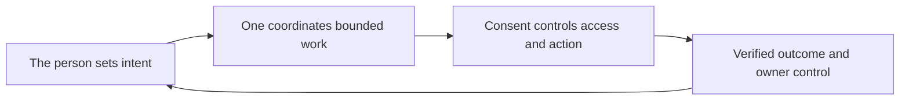

# Personal-agent principles

[Product](../README.md)

**An agent should work for the person whose life it touches.**

One serves the individual. Consent, discretion, duty of care and accountable
outcomes guide the product. Hussh supplies the platform and trust infrastructure.

## Visual Map

## What those principles require

- **Ownership:** private information and its key custody have explicit boundaries.
- **Consent:** sign-in, disclosure to a model and permission to share are distinct decisions.
- **Care:** actions should benefit the person and respect their ability to intervene.
- **Accountability:** claims must match observed outcomes; uncertain effects are reconciled.
- **Restraint:** no shadow dossiers, silent disclosure or unapproved expansion of authority.

The [Personal Data Agent identity](agent-ontology.md#personal-data-agent-founder-identity)
owns the full persona and role contract. The
[private-agent requirements](private-agent-requirements.md) own target custody and
lifecycle properties. Requirements are not evidence that every capability is deployed.

For current behavior, use [capability availability](../capabilities.md),
[the system overview](../../architecture/system.md) and
[terminology](../terminology.md). Proposed capabilities stay in the
[roadmap](../../roadmap/README.md).
