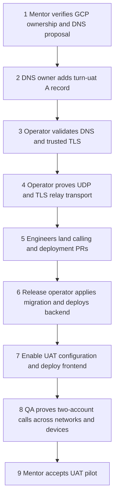

# UAT TURN DNS record: mentor review

Status: proposed DNS change; this document does not modify DNS or enable calling.

## Visual Map



The DNS record is proposed. The VM already exists; trusted TLS and application
release remain separate verification steps.

## Implementation roadmap

**Goal:** working foreground one-to-one audio calls from People messages, using
our existing authenticated application backend for signaling and the GCP TURN VM
for encrypted media relay. The private agent microphone keeps its existing role.
DNS is one prerequisite; adding an A record alone does not implement calling.

| Step | Owner role | Work to implement or execute | Completion evidence / next gate |
| --- | --- | --- | --- |
| 1. Review infrastructure | Mentor + GCP operator | Confirm project, static IP, VM, DNS ownership, UAT region and ongoing cost. | GCP lookup matches the resource below; mentor approves the hostname and pilot scope. |
| 2. Add public DNS | Domain DNS owner | Add only the A record in Requested record below, using the current authoritative provider. | Authoritative DNS and public resolvers return `104.197.235.130`. |
| 3. Enable trusted TLS | GCP operator | Issue a certificate for `turn-uat.hushh.ai`; install it in coturn; configure automated renewal and certificate reload. | Valid hostname and certificate chain on TCP 443; renewal rehearsal succeeds. No self-signed certificate or disabled validation. |
| 4. Verify relay security and transport | GCP operator + QA | Test temporary authenticated TURN credentials over UDP 3478 and TLS/TCP 443, including a UDP-blocked test. Check private/metadata destination restrictions and quota configuration. | Actual bidirectional media packets use relay candidates; invalid/expired credentials cannot allocate; TLS fallback works. |
| 5. Publish implementation | Calling engineer + reviewers | Recover and review the existing local calling commits, update against current main, and open separate implementation/deployment PRs. Reuse the existing calling contract rather than create another signaling runtime. | Reviewed changes include the client call lifecycle, authenticated API, migration, secret bindings and regression tests; required checks pass before merge. |
| 6. Prepare and deploy backend | Release operator | Apply migration `315_direct_message_audio_calls.sql` through the DB release gate. Bind verified TURN URLs and shared secret via Secret Manager to the backend runtime identity, then deploy the calling backend through the governed UAT workflow. | Migration and service provenance verified; authenticated capability/signaling checks pass; unauthorized/non-connected/blocked actors are rejected. |
| 7. Enable UAT client | Release operator | Use the reviewed deployment bindings and `DIRECT_CALLS_UAT_ENABLED` flag only after relay/backend verification. Deploy the matching frontend through the governed workflow. | Correct versions are deployed; missing relay configuration fails closed; the People call button opens the real calling flow. |
| 8. Test complete UX | QA + two test-account owners | Complete the acceptance matrix below on independent networks and physical devices. | Recorded pass/fail evidence for every required case; remaining limitations stated explicitly. |
| 9. Accept pilot | Mentor + release owner | Review evidence, rollback and monitoring before calling UAT ready. | Explicit UAT acceptance. Production rollout is a separate decision and reliability review. |

These are role assignments, not requests sent to anyone. Steps 2–9 remain pending
until their evidence is supplied; earlier local tests are not deployment proof.

### Existing work versus remaining work

| Surface | Existing evidence | Remaining work |
| --- | --- | --- |
| GCP address and VM | Static IP assignment verified on 17 October 2026. Earlier coturn 4.18.0 authenticated UDP smoke and invalid-credential test passed. | Recheck current service health, exposure, version and budget before rollout. One VM is a single failure point. |
| Public DNS / TLS | Proposed record is documented here. | DNS owner action, trusted certificate, renewal and TLS/TCP fallback verification. |
| Calling code | Local commits contain foreground People audio lifecycle, authenticated signaling, busy-slot control and encryption. | Publish separate PRs, current-main review/checks, migration and deployed end-to-end proof. These commits are not included in this PR. |
| Runtime configuration | Local deployment preparation defines TURN secret bindings and UAT enablement. | Land reviewed bindings; verify least-privilege secret access and deploy through the release pipeline. Never put the shared secret in DNS, browser code or this document. |
| Product readiness | Earlier relay smoke used browser peers from one computer. | Independent accounts, networks and physical-device UX tests; monitoring and rollback rehearsal. |

### UAT acceptance matrix

| Area | Required proof |
| --- | --- |
| Basic call | Caller rings callee; callee accepts; both hear audio; either side can end. |
| Permissions | No microphone capture before acceptance; denial, revocation and delayed prompts recover cleanly. |
| Call states | Decline, cancel, no-answer timeout, busy account and competing-device acceptance give truthful states without stuck slots. |
| Privacy / authority | Only permitted participants control or read call signaling; blocks/revocation end access; long-lived relay secrets never reach clients or logs. |
| Network | Wi-Fi to cellular succeeds; UDP-blocked network uses trusted TLS/TCP relay; transport loss ends cleanly without a false connected state. |
| Cleanup | Hangup/account change stops microphone tracks and playback; expired calls release account slots. |
| Mobile | Physical iOS and Android foreground permission, playback, interruption and audio routing are verified. Background/system calling is outside this pilot. |
| Existing product | People messaging, search, reactions, footer navigation and the private agent microphone continue to work. |
| Operations | Call setup failures, disconnects, relay load and billing can be observed without logging audio, credentials or plaintext signaling. |

### Failure and rollback order

1. Keep or set calling disabled when DNS, TLS, secrets or backend prerequisites fail.
2. On a bad release, disable call admission and use the governed application rollback;
   confirm active calls terminate and microphone tracks stop. Do not alter message tables.
3. Roll back the calling-only migration only after confirming no deployed caller
   depends on it and following the DB release procedure.
4. If DNS is wrong, remove only the new record. VM shutdown and IP release are
   separate actions; retain the reserved IP until no DNS reference remains.

### Scope of this review PR

This PR provides the DNS proposal and implementation map only. It does not carry
calling code, migration SQL, secret values, DNS automation or deployment changes.
Mentors can approve the proposed DNS step while requesting changes to later steps.
No section should be read as approval to merge or deploy the separate implementation.

## Requested record

| Field | Value |
| --- | --- |
| DNS zone | hushh.ai |
| Type | A |
| Host | turn-uat |
| Full hostname | turn-uat.hushh.ai |
| IPv4 address | 104.197.235.130 |
| TTL | Automatic |
| Proxy | DNS only; no HTTP/CDN proxy |

The IPv4 is a reserved Google Cloud regional static address, not a developer's
laptop address. On 17 October 2026, GCP reported it IN_USE by the following VM:

- Project: `hushh-pda-uat`
- Address resource: `hushh-uat-turn`, region `us-central1`
- VM: `hushh-uat-turn`, zone `us-central1-a`

TURN relays WebRTC audio when a direct peer connection cannot be established.
The DNS name permits hostname-validated TLS for restrictive networks.

## Verification requested from mentors

1. Confirm ownership of the public `hushh.ai` zone and approval for this UAT hostname.
2. Independently verify the IP assignment using the read-only command below.
3. Review the single-VM UAT scope, ongoing VM/IP/egress cost, and eventual capacity
   and redundancy requirements before production use.
4. Have the DNS owner add only the record above. Do not replace existing records,
   change nameservers, or expose credentials in this PR.

```bash
gcloud compute addresses describe hushh-uat-turn \
  --project=hushh-pda-uat --region=us-central1 \
  --format='json(name,address,status,users)'
dig +short NS hushh.ai
dig +short A turn-uat.hushh.ai
```

Public nameservers previously resolved to Namecheap BasicDNS. Confirm the current
provider before making the change. At the last session check the hostname did not
resolve; this is not a claim about its state at review time.

## After DNS approval

The operator must verify that public DNS returns the exact reserved address,
issue and validate a trusted TLS certificate, and prove authenticated TURN over
TLS/TCP 443 as well as rejection of invalid credentials. Certificate renewal and
calls across separate devices/networks also require verification.

Intended endpoints, pending that verification:

- `turn:turn-uat.hushh.ai:3478?transport=udp`
- `turns:turn-uat.hushh.ai:443?transport=tcp`

The earlier authenticated UDP relay smoke test passed, but this does not prove
full application calling, trusted TLS, or independent-device compatibility.
Calling code and deployment configuration remain separate from this DNS review.
This PR must not enable the calling flag or be treated as a calling release.

## Rollback

Remove only the newly added `turn-uat` A record if it is incorrect. Keep calling
disabled. Removing DNS does not stop the VM, close its ports, or stop billing;
resource shutdown is a separate operator action. Do not release the static IP
while any DNS record still points to it.

## Related local work

No calling implementation PR was found when this review was prepared. Prior
local commits on `feat/direct-message-audio-calls` are `8064b896a` (calling),
`e965fd90c` (deployment preparation), and `040cc760de` (relay provisioning).
These local commit IDs are context only; this PR does not publish those changes.

## Information impact

This DNS review creates no durable owner information and changes no Live Memory
source. Approval of this document is separate from approval to release calling.
