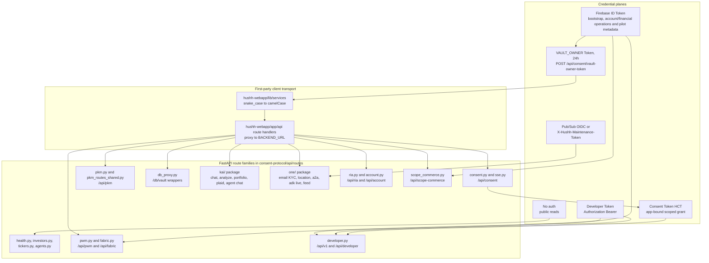

# API Contracts

## Visual Map

Which credential plane authorizes which FastAPI route family, and how first-party
clients reach them through the Next.js proxy layer.



---

## Request-specific revocation

`POST /api/consent/revoke` preserves the optional `requestId` from the web client
through the Next.js proxy to the canonical lifecycle service. A supplied selector
must be a nonempty string of at most 128 characters; invalid selectors refuse
before forwarding. Omitting it retains the existing scope-wide operation.
The vault-owner token still authorizes only the authenticated owner's grants.
Never discard a supplied selector and silently widen the requested revocation.

## Azure software-update continuation

An `upgrade_started` result from the existing Azure authorization-completion
route includes the launched `jobId` and, when available, the approved
`operationId` and `releaseId`. Clients retain that tuple through popup handback
and status following. Older responses without the tuple remain readable but
cannot establish verified completion.

Completion requires `installedReleaseVerified` and a `completedUpdate` receipt
matching the followed operation, release and installed image digest, with a
verified pod incarnation and timestamp. A recorded job, version label or newer
available offer is insufficient. See the
[existing-pod update runbook](../operations/dev-pod-first-light-runbook.md).

### Pod maintenance recovery

The existing machine-authenticated `/api/one/pod/upgrade/{prepare,status,release}`
family retains exact pod-incarnation checks. Status distinguishes current-runtime
`idleReceipt` from `retainedIdleRecord`, the sealed cursor preserved across restart.
`releaseReceipt` identifies the last sealed release and its operation.

Release accepts an optional `expectedIdleRecord: {seq, sha}`. The pod compares it
atomically with its retained cursor. A retry returns the same sealed receipt only
for the same operation and checked cursor, with no newer active fence. A lost
append response is reconciled from the sealed log before work is admitted.
Cursor-checked terminal releases cannot be reopened by a repeated prepare request.
Existing failed-update callers may omit the cursor and retain their retry contract.

This is a control-plane contract, with no browser proxy or native-plugin change.
It does not prove VM image, identity or encrypted recovery by itself; the caller
must establish those before release. See the
[Browser runtime lifecycle](../../../consent-protocol/docs/reference/private-browser-runtime.md).

## Consumer scope commerce

`/api/scope-commerce` uses Firebase identity for account, tariff, quote, human
purchase confirmation, funding, payouts and buyer cancellation. Inactive owner
approval, export context/preparation/staging and owner revocation require
vault-owner authority. Financial confirmation alone never releases information:
access additionally requires canonical consent and a staged v2 export at the
server-fixed activation time. The reconciliation worker uses dedicated Google
OIDC, independently of purchase admission.

Authenticated `GET /api/scope-commerce/readiness` and the additive `account.readiness`
projection distinguish free-sharing controls, locally configured/persisted
platform readiness, seller eligibility and action capabilities. These reads
perform no wallet bootstrap or provider I/O. An unset or explicitly free tariff
keeps the existing consent flow without Stripe; owners can reset an exact tariff
to free while paid admission is unavailable. Positive tariffs fail closed and
never become free because setup is missing. Accepted quotes retain their terms.
Existing financial obligations and access enforcement survive an admission pause.

Owner-bound `GET /api/pkm/scopes/{user_id}` includes an authoritative `scope_handle`
on each compact `scope_entries` row. It preserves the registry handle when present
and otherwise uses the canonical owner/scope fallback. Memory and chat consume this
metadata to review an eligible whole-bundle tariff; they never invent domain handles
or infer a wildcard from child sections. Existing vault-owner matching, exposure
rules and restricted-domain policies remain authoritative. The web proxy and native
transports preserve the additive metadata without a separate payment endpoint.

Authenticated `POST /api/scope-commerce/payouts/manage` accepts an empty object
and returns a short-lived Stripe Express login URL for the caller's existing
information-access payout account. The server checks the pinned platform, test/live
mode and current source binding before and after provider I/O. Caller-supplied
account identifiers are rejected. No login URL is persisted in the financial
journal, and creating it neither transfers funds nor proves settlement. The
existing fenced management window keeps the initiating vault session in memory.

The package-local [consumer scope commerce reference](../../../consent-protocol/docs/reference/consumer-scope-commerce.md)
owns the wire families, exact scope binding, hosted return, configuration,
financial lifecycle and verification limits. The Next proxy preserves the same
snake-case contract; native transport uses the existing direct backend service.

## Private Memory preparation

An admitted app-role session can call `POST /api/one/pod/memory/proposals`
with the existing PKM preparation request and response shapes. The exact ingress
entry requires `pkm.read`, the current held incarnation and a matching owner ID.
The pod runs the existing authored structure and reconciliation agents against
its owner's selected model, with bounded admission and disconnect cancellation.
AI selection changes invalidate preparation and process-memory continuation
reuse. Failed provider preparation refuses rather than selecting managed inference.

The owner app routes private notes directly to this door; unplaced or unresolved
hosting refuses before transmission. The browser separately fetches authorized
exact-section sharing metadata from the hub and requires review for affected
recipients. Missing or malformed metadata blocks preparation. Information stays
in the owner runtime and browser; encryption and confirmed commits retain their
existing authority. Older pods require the governed owner update flow; no hub
fallback is available for private notes.

## Direct Puppy turn cancellation

An admitted app-role pod session can call
`POST /api/one/pod/turn/cancel` with `{requestId, puppyDeviceId}`. The request ID
must match the originating `/api/one/pod/turn/stream` `X-Request-ID` header.
Cancellation is bound to the verified owner, pod key/incarnation, app subject,
device and request; a different app subject cannot cancel another turn.
The route retains the held-incarnation check and does not grant device settings
or hub authority. It is an exact pod ingress allowlist entry.

`state: stopped` means the matching producer settled after cancellation, including
its broker cleanup and admission release; it is not a device acknowledgement.
Absent, completed or mismatched turns return `state: unconfirmed`. The browser
bounds the stop wait and displays uncertainty rather than claiming success.
See the [stream implementation](../streaming/streaming-implementation-guide.md#direct-puppy-streams).

## One PLG pilot task evidence

The server caller and isolated Firestore consumer are maintained in the
[private PLG dashboard integration PR](https://github.com/hushh-labs/hussh-matrix-dashboard/pull/124).
Release the two services independently through their existing approved paths;
adding this contract does not enable the exporter or campaign delivery.

`POST /api/one/plg/snapshot` is a server-only integration hidden from public
OpenAPI. It requires `ONE_PLG_EXPORT_ENABLED=true`, production runtime identity,
dedicated `ONE_PLG_EXPORT_SECRET` (at least 32 characters), and private
`ONE_PLG_EXPORT_ACCOUNT_IDS` (1–100 explicitly enrolled production customer
Firebase UIDs), or the canonical recorded-permission cohort when
`ONE_PLG_SUBSCRIPTION_ENABLED=true`. The snapshot remains server-only. Login, legal
acceptance and shared Firebase membership do not establish marketing consent.
Snapshot account IDs use the same opaque 1–128-character Firebase UID contract
as recorded-permission enrollment. Punctuation is preserved; the signed request,
enrolled-account allow-list and permission checks still authorize each owner.

`X-PLG-Timestamp` (13-digit Unix milliseconds, within five minutes) and
`X-PLG-Signature` authenticate HMAC-SHA256 over
`snapshot\n<TIMESTAMP>\n<EXACT_RAW_JSON_BODY>`. Wrong purposes and bodies fail.
Bodies have a 16,000-byte limit and contain 1–20 distinct accounts:
`{ "accounts": [{ "accountId": "<enrolled UID>", "journey": "memory",
"since": "<timezone-qualified ISO timestamp>" }] }`. Journey is `memory` or
`mail`; since must be within seven days. Unlisted UIDs and more than 100 task
results per account fail the entire batch. Read-only replay cannot send email.

The version-1 response includes `environment: "production"`, `retainedOnly:
true`, `asOf`, and matching accounts with original `since`, `deleted` and
`tasks: [{ actionId, occurredAt }]`. Task IDs are opaque SHA-256 values. Memory
requires committed mutations with matching confirmed content-write provenance;
upgrades and maintenance writes are excluded. The writer now records its existing
validated authorization mode as derived provenance, preserving the prior request
fingerprint for cross-release retries. Only explicit `owner_confirmed` writes
with an exact owner/domain/plan-derived commit ID qualify. Historical rows
without that mode remain unclassified; automatic saves and source refreshes
never become deliberate usage. Mail requires durable `sent` state
and a provider message ID; uncertain and scheduled background sends are excluded
so a background worker cannot count as the owner's returning usage. No content, domains,
email addresses, recipients, subjects or bodies leave the backend. Existing
account-deletion tombstones take priority over task export.

Retained rows prove positive outcomes only. Empty results do not prove signup,
complete feed coverage or inactivity: retention, domain deletion and resets can
remove rows. The consumer must not emit complete observations from this
projection. Setup, failure, support and canonical enrollment remain separate
producers. Version 1 remains compatible; the version 2 observation extension
below introduces migration 365.

The Memory projection uses a correlated event lookup for each committed
revision, with a planner boundary that retains every matching audit event.
Migrations 407–408 add and validate the nonunique, partial text-revision index
on `pkm_events`. This preserves the confirmed-provenance filters, duplicate
deduplication, date window, owner isolation and per-owner overflow sentinel.
Generic 25-owner plans must not flatten the lookup into repeated scans of a
heavy owner's complete event history. The five-second query budget is unchanged.

A concurrent build interrupted before completion can leave an invalid index.
Validation 408 rejects missing, invalid and incompatible same-named indexes,
including a different predicate or key definition. Stop overlapping migration
runners, inspect the exact index, and use the authored rollback 407 followed by
407 outside a transaction and validation 408 under the canonical migration
authority. Do not automatically drop a valid incompatible index or edit accepted
ledger checksums. Application rollback may retain this compatible index.

Both the query and index are required for the qualified heavy-history repair.
An index-only operation does not release the new query or prove the complete
directory works. Deploy through the normal UAT/production gates at a qualified
main SHA. If that SHA also contains unrelated unreleased changes, qualify the
complete release delta; a partial schema repair must never claim the full
migration head or authorize an unqualified application upgrade.

Responses are `private, no-store`: sanitized 400 for invalid requests or result
limits, 401 for signatures, 404 for disabled/nonproduction configuration, 413
for request size, and 503 for source failures. Reads are bounded; synchronous
deletion/read barriers are held for each bounded transaction. Production deployment optionally binds
the two dedicated secrets; `one_plg_export_enabled` in existing
`BACKEND_RUNTIME_CONFIG_JSON` maps the enable flag, which defaults off.

### Optional email preference and subscription projection

`GET /api/one/plg/preferences` and `PUT` use the existing Firebase owner
authentication boundary, independently of a vault unlock. Web uses the existing
One catch-all proxy; native uses the same platform-aware API service. Reads do
not create a preference, enroll anyone, or assume that a missing record is
permission. Signed-in setup and Your account load the saved state, stage changes,
and require a separate manual Save. Setup completion is independent of this
optional form. Voice and Search may navigate to it but cannot submit permission.

The strict PUT body is `{enabled, frequency, expectedRevision,
disclosureVersion, surface}`. Frequency is `daily`, `weekly`, or `updates`;
disclosure version is `one-email-updates-v1`; surface is `setup` or `account`.
No UID, email, chosen time or generation is accepted from the caller. A positive
choice checks the current verified Firebase email and binds its lowercase SHA-256
hash. Opting out requires no identity-provider lookup. The server records the
choice time and a monotonic revision. Stale revisions return 409
`preference_conflict`; an unverified recipient returns 409
`verified_email_required`. Uncertain failures return a sanitized 503 and the UI
requires a fresh read before another save. All responses are private/no-store.

Migration 370 stores this operational permission outside PKM/Live Memory and
atomically coalesces one pending hash-only change per account. Product reset
preserves the choice. Full deletion erases the preference and produces a durable
hash-only erasure; migration 201 guards prevent resurrection. Browser roles have
no access. Nonempty permission or change state makes rollback refuse rather
than silently lose opt-outs.

The private production-only `/api/one/plg/subscriptions/{pull,ack,revoke,check}`
POSTs require `ONE_PLG_SUBSCRIPTION_ENABLED=true`, project `hushh-pda`, and the
separate 32+ character `ONE_PLG_SUBSCRIPTION_SECRET`. They use the existing raw-body
HMAC envelope with purposes `subscriptions.pull`, `.ack`, `.revoke`, `.check`.
They are hidden from OpenAPI and default disabled. `pull` accepts exactly `{}`,
returns at most 25 changes, and rechecks deletion/revision after bounded identity
lookups. `enabled` is the recorded choice; `eligible` separately describes the
currently verified recipient. Only eligible records contain UID/email/name.
Availability can recover at the same canonical revision; consumers must apply
its fresh `checkedAt` without inventing a new choice. Acknowledged records are
eligible for reconciliation after one hour. Bounded pulls reserve at least five
slots for indexed reconciliation; backlog can delay a particular account.
Exact-revision acknowledgements cannot clear newer changes.

`ack` accepts `{changes:[{accountHash,revision}]}` after durable consumer commit.
`revoke` accepts `{accountHash,generation}` and can only disable that opt-in
generation. Frequency edits retain the generation; a fresh explicit re-opt-in
renews it. `check` accepts `{accountId,generation,emailHash,revision}` and returns
`{allowed,erased}` after fresh permission, lifecycle and recipient checks. A
frequency edit invalidates an older send decision even with the same generation.
No request sends email. The consumer must synchronize permission before evidence,
exclude revoked/ineligible contacts from snapshot batches, and perform `check`
immediately before a provider attempt. Provider calls already in flight cannot
be made atomic with a separate permission database transaction.

The feed is a producer contract; its existence does not establish that Matrix
has migrated its pilot capacity, consumed it, or enabled live delivery. Deployment
must verify the paired consumer, storage capacity, signing-secret binding and
controlled acceptance before enabling automatic enrollment.

### All-agent activity, version 2

Set `X-PLG-Version: 2` or JSON `version: 2` to negotiate the expanded contract.
`accounts: []` returns the catalog without opening a database. Nonempty requests
still require the signed enrolled-account allowlist and seven-day window.
Journey additionally accepts a canonical authored `agent_*` ID. The catalog is a
derived measurement projection of the product-agent registry, capability graph, action gateway
and closed frontend observability enums, with a content revision. It does not
register tools, route requests, enable unavailable agents or grant permissions.

Version 2 returns matching accounts with `tasks: []`, `verified` aggregate rows
and `activity`. Every public agent declares a static `outcome` contract in the
catalog (`status`, `proof`, `label`, `reason`). Internal agents declare `internal`,
with no separate activation journey. Availability remains a separate product flag.
Verified rows contain `agentId`, exact `proof`, count, first/last timestamps and
UTC days, maximum 1000 distinct effects per group. Generic execution or app
reports never become verified value. No effect IDs leave the version-2 projection.

| Public agent | Narrow verified value and source |
| --- | --- |
| Memory | Owner-confirmed PKM mutation with exact owner/domain/plan commit binding |
| Mail | Immediate provider-confirmed send; scheduled/uncertain sends excluded |
| Calendar | Provider-acknowledged reviewed create/reschedule/cancel or changed RSVP; no-op RSVP excluded |
| Kai | Confirmed financial save attributed to `kai_analysis_completion`; proves saved analysis, not a trade or model correctness |
| Career | Confirmed professional save attributed to `career_resume_owner_review`; proves reviewed resume saved, not application submission |
| Wallet | Confirmed wallet commit linked to an activated owner card registration; projection refresh/reservation excluded |
| KYC | Information-request workflow linked to canonical same-owner/thread confirmed immediate Mail send; not identity verification |
| Nav | Explicit owner approval/denial of a pending sharing request, persisted audit with server-derived canonical owner and decision; excludes token reuse/automatic revocation |
| Location | Domain command receipts, or newly committed direct private share/nearby check-in; no automatic envelope refresh or command replay/no-op checkout/contact change |
| Documents | Approved review and consumed directive bound to a successful permission grant with sealed provider receipt; automatic rules/preexisting permissions excluded |
| Connected Systems | Same-owner/intent/approval mutation plus successful provider readback; earliest successful audit per intent, excluding generic MCP success |
| One | Union of distinct effects above; shared Memory/Kai/Career/Wallet commits and Mail/KYC sends count once |

Migration 367 adds a service-only RLS receipt store for domain effects whose
working rows are short-lived (Calendar, explicit Nav decisions, direct Location).
The store contains opaque effect hashes and static proof identifiers, seven-day
TTL and maximum 500 receipts per owner/UTC day. Domain writers pin the observation
epoch before the effect, and write only after authoritative success. Delayed
callbacks cannot refresh their epoch after reset. Bounded optional receipt failure
cannot change the domain result, retry a provider operation or grant authority.
Nav additionally re-reads its persisted owner-stamped audit before recording.
KYC gains a nullable canonical send-action association; no historical association
or outcome is guessed. Source limits/cap saturation mark audience counts limited;
the signed pilot snapshot fails atomically on truncated evidence.

Release the backward-compatible Matrix proof consumer first, then migration367,
then backend writers/readers. Retain version1 Memory/Mail compatibility. Rollback
the backend writer before dropping the registered migration367 schema; the Matrix
consumer continues accepting older catalogs and legacy Memory/Mail proofs. Reset
clears new receipts under the existing barrier; account deletion cascades through
the observation epoch. Maintenance reserves bounded capacity for receipt TTL
purging so busy observation cleanup cannot starve it. Existing consent, OAuth,
agent routing and action settlement remain their original authorities.
`activity` contains `enabled`, `mode: best_effort`, `limited`, `startedAt`, an
opaque epoch hash, and bounded rollups by agent/action/source/phase. Sources are
`client_reported` and `execution_observed`; phases are started, returned, failed,
cancelled and blocked. A return is not proof of a domain effect. Deleted accounts
have no activity. Collection disabled or not started remains unknown. Disabling
collection also hides retained observations from export.

`GET /api/one/plg/activity` admits an observation epoch; `POST` reports only
`generation`, random `operationId`, registered `actionId` and phase. These hidden
routes require read-only verified Firebase identity; the UID and client source
are derived by the server. Extra fields and client attempts to report SDK
identifiers fail. Browser and native callers use the existing API transport and
One catch-all proxy. Reporting never bootstraps an account or sends a campaign.

`ONE_PLG_ACTIVITY_ENABLED=true` additionally gates collection to production and
the same explicit pilot UID allowlist. It defaults false. SDK plugins observe
admitted root/specialist/gene runs and tools without reading prompts, arguments,
responses or errors. Unknown private MCP tools use one fixed catalog bucket.
Warmup and anonymous/Firebase-only introductory runs are excluded. Frontend
gateway actions retain synchronous trusted browser activation; event collection
uses closed identifiers only and is independent of GA sampling.

Migration 365 creates two service-only RLS tables. Hashed observation IDs dedupe
replays; writes serialize a maximum 500 rows per owner per UTC day. Reads exclude
seven-day expired rows; the existing authenticated Drive work drain purges up to
1000 expired rows per pass. A rolling window may span eight UTC dates, bounded
at 4000 retained observations. Retired/reowned identifiers are omitted and mark
coverage limited. Collection is best effort: timeouts, capacity drops and missing
history cannot establish inactivity or complete app-wide DAU.

Reset rotates the epoch under the existing writer barrier and clears rows;
full account deletion erases both tables. SDK invocations pin their epoch once
before execution. Browser dispatches pin the initiating account, local reset
generation and admission promise. Account switches and local resets discard
stale callbacks. A previously resolved admission keeps its epoch, so a later
remote reset rejects those reports. Cold admission first processed after a
remote reset belongs to the new observation window; browser reports use server
receipt time and do not prove when execution began. Observation SQL has statement
and lock deadlines.
New client operations refresh admission after at most one minute, recovering
eligibility changes, temporary admission failures and cross-device resets.
Pending terminal reports remain bound to their original admission promise.
Apply the migration and verify schema/deletion/retention checks before enabling
the flag. Rollback: disable collection, then use the registered migration365
rollback; original task exports remain available in version 1. No infrastructure,
collection or marketing delivery is activated by this PR.

### Private registered-account audience and correlated attempts

`POST /api/one/plg/audience` is a separate, private read contract for Matrix's
role-protected PLG people view. It requires production lane, project `hushh-pda`,
`ONE_PLG_AUDIENCE_ENABLED=true` and dedicated `ONE_PLG_AUDIENCE_SECRET` (32+
characters). The existing timestamp/body signature uses purpose `audience`;
snapshot, sync, enrollment and delivery credentials do not grant this authority.
The response and all errors are private/no-store; validation and source errors
never echo contact details. The route is hidden from public OpenAPI.

Request: `{agentId, segment, query, graceMinutes, cursor}`. The agent must exist
in the generated catalog; segments are `all`, `possible_incomplete`, `failed`,
`blocked`, `cancelled`, `returned`, `verified`, `unknown` and `in_progress`.
Query is at most 100 characters, grace is 15–1440 minutes (default 60), and
cursor is optional. A page traverses at most 25 current Firebase records.
Disabled, deprovisioned, unclassified/anonymous and tombstoned accounts are
excluded. Customer reporting additionally requires a saved production canonical
contact and the secret-backed staff/test policy below. This is account-level
production membership evidence, not proof of unique people, deliberate usage or
marketing eligibility. Source failures fail the page with sanitized 503.

Only explicit Firebase getters are projected. Exported SDK records, password
hashes/salts, custom claims, tokens and provider objects are never serialized.
Canonical identity row presence owns the entire saved name/email/phone projection;
null or cleared fields never fall back to stale provider fields. Auth-only
accounts without a production canonical contact are withheld from customer reporting.
Only verified full E.164 phone numbers are shown; a number bound to another
canonical owner suppresses provider fallback. Lifecycle barriers (171 then 198),
the existing phone-claim lock (namespace 0), shared identity row locks and epoch
locks fence deletion, transfer and reset races. No identity is written.

Response includes the catalog, fixed seven-day `windowStart`/`asOf`, `scanned`,
`excluded`, bounded `rows` and `nextCursor`. Each row contains account ID,
selected agent, nullable identity fields with source/verification flags,
activity coverage/counts/timestamps/action ID and verified outcome support.
Filters apply to each source page; an empty matching page can have a continuation.
No global filtered total or stable directory snapshot is claimed. The signed
cursor binds all filters, production project, page size and activity anchor and
expires after 15 minutes. Directory identity remains current on every page;
directory mutations can change traversal. No full-audience Firestore import occurs.

Migration 366 adds an opaque phase-independent `operation_key` for new SDK and
gateway observations. Correlation is bounded by owner, epoch, agent, action and
source; one invocation's return cannot close a different invocation. Historical
phase hashes and independent `observation:*` reports remain uncorrelated.
Tools remain separate observations. A correlated start with no terminal after
the selected grace is **possible incomplete**, never confirmed abandonment.
Recent unmatched starts are in progress. Returns/failures are observations,
not unique user attempts: browser and SDK observations can cover the same user
action. Return/failure timestamps use the selected terminal receipt even when a
start report arrives later at the server. Last observation can therefore be a
later start. Verified value uses the public-agent outcome contracts above;
internal stages do not manufacture separate business completions. Capacity-limited,
not-started, reset and disabled coverage remains explicit. Disabling collection
hides retained execution counts, timestamps and behavioral segments.

`ONE_PLG_ACTIVITY_ALL_REGISTERED=true` expands the existing collection scope
only with `ONE_PLG_ACTIVITY_ENABLED=true`, production lane and project
`hushh-pda`. Admission and writes additionally require a canonical registered
contact (nonempty email or verified phone); an anonymous UID/spine alone is
insufficient. Auth-only accounts are withheld from customer reporting while normal identity
warmup has not yet established that baseline. With this flag off, the original
1–100 UID pilot behavior is preserved. Both new flags default false. The existing
500-observation/day cap, seven-day TTL, reset/deletion and service-only RLS remain.

This read does not enroll contacts, change campaign addresses, grant messaging
permission, send messages or alter aggregate DAU/retention. Matrix consumes it
on demand with its own audience key. Release migration 366 before compatible
writers and readers, then verify prerequisites before separately enabling flags.
Rollback: disable expanded collection/audience, deploy the previous writer that
does not reference `operation_key`, then apply the registered 366 rollback.
Reapplying 366 leaves retained rows uncorrelated; it cannot reconstruct history.

### Customer reporting exclusions

`POST /api/one/plg/customer-cohort` is a private read projection for aggregate
customer reporting. It shares audience read authority with the distinct HMAC
purpose `customer-cohort`; it grants no campaign, write or sending authority.
Production project/lane checks apply. Each page scans at most 50 canonical
production identities in indexed primary-key collation order, checks current Firebase
registration, provider identifiers, verified aliases and deletion barriers, and
returns only eligible analytics hashes and Firebase creation timestamps (nullable).
The hash matches the client contract: first 32 hexadecimal characters of SHA256
of `hushh-observability-v1:<uid>`. No names, raw UIDs, emails, phone numbers, tokens
or denied identifiers are exported. AES-GCM cursors hide the keyset position and
bind the policy revision and ten-minute traversal window. Traversal is live,
not a transaction-wide snapshot. Missing pages, source failures or policy drift
must withhold the full aggregate, never publish partial zeros. The consumer must
enforce expiry and apply positive account membership before event aggregation;
anonymous events cannot be attached retrospectively through device identifiers.
Registration dates must not be inferred from identity-cache creation timestamps.

The audience reader requires `ONE_PLG_REPORTING_POLICY_JSON`, stored in Secret
Manager and bound by the existing production PLG deploy helper. The strict JSON
schema is `{version:1, excludedAccountIds:[], excludedEmails:[], excludedDomains:[]}`.
Use confirmed exact identities and company domains; never commit the roster or
classify a name as fake. Existing inner-team, senior-team and QA email rosters and
`REVIEWER_UID` also contribute to the policy. Missing/malformed policy fails closed.

Exclusions compare canonical email, current Firebase email, linked-provider emails
and active verified aliases. A production canonical email or verified E.164 phone
is required; sharing Firebase authentication alone does not prove production
membership. Auth-only accounts are unverified, not automatically UAT-only.
Excluded identities are filtered before activity/outcome queries. Collection,
product access, canonical identities and account lifecycle are unchanged.

Audience responses include `customerReporting:{scope:"production_registered_contacts",
policyRevision:<sha256>}`. Snapshot callers request `customerReporting:true` for
the same policy/proof and per-account `reportingEligible` boolean. Excluded rows
carry empty tasks/outcomes and no activity, with `deleted:false` unless a real
lifecycle tombstone exists. Snapshot identity resolution is a bounded read-only
Firebase lookup, fails on unavailable/wrong-project identity sources, and never
serializes auth export fields. Legacy snapshot callers retain the existing contract.

Matrix PR #133 requires these proofs, invalidates classification when a recipient
changes, fences concurrent source reads, and withholds proofs from old policy
revisions or older than 24 hours. Stage the policy and release/verify this backend
before deploying that strict consumer. Policy exclusion is not account deletion,
and no missing historical activity is synthesized. Disabling the audience reader
or reverting both reader/consumer together is the safe reporting rollback.

## Verified account phone retention

`POST /api/account/identity/refresh` remains Firebase-authenticated. Ordinary
refreshes, including forced/strict reads and display-name synchronization,
preserve a complete verified phone in the serialized identity writer. A delayed
provider snapshot cannot replace a newer committed E.164 number.

Native OTP completion and web provider-phone replacement send optional JSON
`{ "verified_phone_number": "+…" }`
through the existing account proxy/shared native transport. This is explicit
finalization intent, not verification proof: the backend freshly checks the
authenticated UID and exact Firebase phone, then uses the existing phone claim
writer without cross-owner transfer authority. Mismatch or conflicting ownership
returns 409; provider/persistence failure returns 503. No number enters a URL.
Web's existing secondary Firebase phone-token claim remains unchanged.
If provider linking succeeds while persistence is unavailable, retrying the
same linked phone rechecks provider proof and finalizes without another OTP.

With `NEXT_PUBLIC_AUTH_PHONE_RECOVERY_ENABLED` enabled (the default), web
finalization conflicts `PHONE_ALREADY_VERIFIED` and `PHONE_VERIFICATION_CHANGED`
can request fresh Firebase OTP proof through the existing isolated phone-token
claim. A cached provider phone alone never transfers ownership. Native conflicts,
unrecognized conflicts and provider/persistence outages remain explicit failures.
Strict finalization preserves the backend error code instead of flattening it.
An expired challenge retires only its captured owner/attempt; a newer resend
remains valid. Missing local state is `phone-verification-required`, distinct
from a provider-reported `code-expired`.

`NEXT_PUBLIC_AUTH_PHONE_SESSION_FENCING_ENABLED` defaults on and rejects
pre-dispatch retained native callbacks and overlapping starts. It does not
configure Firebase SMS validity: Android's native timeout controls automatic
retrieval, and the inspected send APIs expose no OTP TTL setting. Explicit
resend replaces the previous challenge. Native events arriving after dispatch
still lack a request identifier; real-device qualification remains required.

Backend and updated native shared JavaScript must ship together for native
replacement. Older clients without explicit intent retain the existing app
phone and fail their exact-number completion check rather than overwrite it.
Concurrent explicit replacements on separate devices still require retry if
their provider state changes; this is not a guarantee of offline or simultaneous
replacement ordering. No historical erased claim is inferred or reconstructed.

## Messages unread action count

`GET /api/one/messages/unread-count` requires the existing Firebase ID token
and returns only `{ "unreadCount": number }` with `Cache-Control: private,
no-store`. The owner comes from verified authentication, never a caller-supplied
user ID. Web uses the existing `/api/one/[...path]` proxy; native uses the shared
`ApiService` HTTP transport.

The Messages roster tile uses this exact total of received unread People and
Circle messages, including totals above 100. The calculation reuses the native
notification badge's owner/membership/deletion filters without its display cap;
it reads no message bodies and changes no read state. Empty means zero; a failed
request retains the previous verified count or an unresolved indicator.

The home counter rechecks on shared Feed and direct-message invalidations,
focus, foreground, visibility and connectivity recovery. It uses the existing
visible-page 45-second shared clock as a fallback, including cross-device web
reads that do not emit a Feed change. Existing conversation visibility and
read-through boundaries remain authoritative for clearing unread messages.

## Circle Wars weekly participation

Migration 358 extends `one_referral_circle_selections` and
`one_referral_circle_contributions`; it does not introduce another referral or
coin ledger. `one_referral_circle_teams` holds random public aliases per existing
reward-round ID. The active program schedule owns the deadline and timezone;
physical prize activation remains independent of team participation.

All `/api/one/referrals/circle-wars` routes require a `VAULT_OWNER` bearer token
and return `Cache-Control: private, no-store` through the existing web/native
`apiJson` transport:

| Method and suffix | Contract |
| --- | --- |
| GET (base) | Current persisted round and caller's optional selection. Optional `week` is a historical reward-round UUID. |
| POST `/participation` | `{circle_id: UUID, consent: true}`; strict consent, no extra fields, active existing Circle membership. Same-team retry is idempotent; switching that week returns 409. |
| GET `/leaderboard` | `limit` 1–100, nonnegative `offset`, optional historical `week`; global ranks, total and pagination. |
| GET `/circles/{circle_id}` | Caller-authorized Circle statistics; unauthorized names and IDs remain private. |

Qualification snapshots eligible weekly selection into the existing durable
scoring job. The existing worker settles one raw team contribution per
relationship alongside individual awards. Referrals opened before opt-in,
nonmembers and inherited genealogy never imply consent. Late jobs retain their
round; revoked relationships stop counting. Existing deletion cascades apply.
Legacy Firebase-only Circle previews remain closed for older clients; the active
dashboard uses these owner-authorized endpoints.

The You card and Ranking/Circles pane reuse existing Circle creation and invite
links. Invite opens the shared native/Web Share flow directly, falling back to
copying the link on devices without a share sheet. Other teams expose random
aliases; authorized members see Circle names.
Rewards and individual rankings retain their existing behavior. SSE and visible
polling refresh team standings and rollover. Rollback disables new snapshot and
notification triggers while preserving bounded history, awards and claims.

Both ranking views request ten entries per page. Individuals retain the
published `snapshot_id` across cursor reads; a pruned snapshot restarts the
latest list. An off-page owner has a shortcut to their ranked page rather than
an eleventh list entry. Circles use the existing offset and `has_more` contract.
Circle deadlines use the persisted round and database clock independently of
prize activation. Current-round reads retry once if the DB read crosses cutoff,
then return retryable 503 `COMPETITION_WEEK_CHANGED`; historical reads stay fixed.
Clients anchor the deadline at response receipt using a monotonic clock and
refresh at cutoff, with normal polling as recovery.

The existing referral lifecycle PostgreSQL suite covers weekly opt-in,
concurrent selection, no retroactive credit, delayed settlement, privacy,
revocation, history, owner API authority and migration replay. Run with
`ONE_COMMAND_TEST_DATABASE_URL` pointing to disposable PostgreSQL; CI includes
this suite. Circle interaction tests and `verify:referral-dashboard` cover the
frontend. Live browser qualification also needs matching nonproduction Firebase
and backend configuration, a migrated database and a fresh invitee account.

> Complete endpoint reference, authentication model, and developer integration guide.

## Individual referral profile portraits

`GET /api/one/referrals/leaderboard` adds optional nullable `photo_url` to both
`entries` and the off-page `viewer` row. It follows the same viewer-permitted
directory projection as `display_name`; chosen public aliases remain unlinked
to account portraits. Unavailable identities have no portrait. The owner row
uses its existing provider-profile projection. Existing custom raster image
URLs are preserved. Clients show a fallback avatar when the field is absent or
the image cannot load. Snapshot scores, ranks, authentication and pagination
are unchanged; the web/native proxy passes this additive field through.

---

## Token Hierarchy

### Independent web email login

`/api/auth/email/*` uses browser-bound public authentication challenges, separately
from vault/consent access. Thin Next proxies preserve the same paths and no-store
responses. See [Independent Email Authentication](../iam/independent-email-auth.md).

| Endpoint | Request and result |
| --- | --- |
| `GET /api/auth/email/capabilities` | Runtime availability; no credentials or private policy evidence. |
| `POST /api/auth/email/request` | `email`, memory-held `browser_binding`, idempotent `request_key`; current domain approval creates an opaque challenge and encrypted outbox. |
| `POST /api/auth/email/resend` | Same bounded request shape with a new request key after cooldown; aggregate budgets remain. |
| `POST /api/auth/email/verify` | `challenge_id`, six-digit `code`, `browser_binding`; atomic proof returns a Firebase custom token for the same verified primary-email UID; no second provider login. |

Pending domain review returns `202` with no sendable challenge, a denied domain `403`,
rate limits `429` and unavailable dependencies `503`. No response before mailbox proof
reveals account existence. Validation errors never echo input secrets. Successful
login grants identity only; the vault and scoped consent retain their own gates.

All data access is gated by consent tokens. Firebase auth is only used to bootstrap the initial VAULT_OWNER token.

Founder-language note:

- `Capability Tokens` are the architecture headline
- this file keeps the runtime labels `VAULT_OWNER`, `consent-token`, and `developer token` because readers need the exact wire contract
- `PCHP` maps here to the `/api/v1/request-consent`, `/api/v1/consent-status`, and `/api/v1/scoped-export` flow

```
Firebase Sign-In
      │
      ▼
POST /api/consent/vault-owner-token  (Firebase Bearer)
      │
      ▼
  VAULT_OWNER Token (24h)
      │
      ├── All vault/data operations
      ├── Agent operations
      └── Can delegate scoped tokens to MCP agents (7d)
```

| Token Type         | Purpose                            | Duration | Auth Format                                    |
| ------------------ | ---------------------------------- | -------- | ---------------------------------------------- |
| Firebase ID Token  | Identity verification only         | 1 hour   | `Bearer <firebase-id-token>`                   |
| VAULT_OWNER Token  | Consent + identity for all data    | 24 hours | `Bearer <vault-owner-token>`                   |
| Agent Scoped Token | Delegated MCP agent access         | 7 days   | `Bearer <consent-token>`                       |
| Developer Token    | External API and remote MCP access | N/A      | `Authorization: Bearer <developer-token>` only |

---

### Hosting management and update compatibility

Completed owners entering cloud setup directly receive a same-route Hosting
return target. Explicit invitation/setup origins are preserved; unfinished
onboarding still uses the setup hub. Finish appears only after verified hosting
and AI readiness. The changed `setup.finish_cloud` meaning retires its exact
previous capability revision; a stale action resumes through a fresh assessment.

Personal-agent status may include `updateBlockedReason`: `UPDATE_IN_PROGRESS`,
`RELEASE_UNVERIFIED`, `INSTALLED_RELEASE_UNVERIFIED`, or
`PREDECESSOR_NOT_QUALIFIED`. This explains an existing installation refusal; it
does not grant upgrade authority. A verified private AI check displays its actual
model/deployment. The hub's Shared model catalog is not an Azure pod catalog.

### Owner cloud removal and inspection

- `GET /api/one/personal-agent/removal`: Firebase-owner, no-store discovery.
  Returns `{available, provider}` only for the installed schema and recorded
  GCP/Azure home, including qualified interrupted Azure setup. No provider calls,
  reservations or mutations; missing/old schema does not offer the control.
- `POST /api/one/personal-agent/removal`: current vault-owner authority. Strict
  phases `inspect`, `status`, `approve`, `execute`, `finalize`; exact operation and
  plan digest plus explicit contents/retention confirmation are required for
  destructive work. Uses the existing erasure executor; never calls full account
  deletion. Successful finalization returns `{status:"cloud_removed",
  operationId, accountRetained:true, hostingMode:"unplaced"}` only for that exact
  released identity. A stale replacement, uncertain outcome or changed approval
  returns a bounded 409 and retains recovery custody.
- `GET /api/one/personal-agent/hosting/inspection`: Firebase-owner, read-only
  control-plane observation of the recorded service and historical receipt
  coverage. Returns `connected`, `starting`, `absent`, `ownership_unverified`,
  `cleanup_pending` or `unverified`, plus bounded previous-home metadata. A denied
  read is never absence. This neither wakes nor repairs/deletes the pod.

These routes use the existing One proxy and exact owner authority. Inspection and
removal remain available when new provisioning is disabled. GCP destructive work
still requires the independent substrate-teardown control before reservation or
provider effects. Cloud removal requires the installed lifecycle schema; native
execution and broad orphan scanning are not qualified. See the [deletion runbook](../operations/account-deletion-rollout.md#remove-cloud-while-keeping-the-account).


## Route Categories

### One business suggestion completion

`GET /api/one/business/suggestion` and `POST /api/one/business/suggestion/complete`
require `VAULT_OWNER`; the authenticated subject is the sole account authority.
Completion accepts `{commits:[{domain,plan_id}]}` (1–64 distinct receipts). The
server verifies every owner-bound mutation commit and matching confirmed
`business_profile_review` content-write event before setting the permanent
`vault_keys.one_business_profile_saved` flag. It returns `{saved:true}`; uncommitted
receipts return 409 and unavailable storage returns retryable 503. Repeat
completion is idempotent. Responses are private and non-cacheable.

After completion, discovery returns its existing empty `no_match` envelope
before accessing Firebase or the directory. Review, Later, failed and partial
saves never set the flag. A lost completion response retains the acknowledged
encrypted review job so retry marks completion without replaying PKM writes.
This is UI progress for Magic Intelligence's optional Business subsection,
independent of personality progress and personal-profile saves; it does not
verify business ownership. Migration
`306_one_business_profile_saved.sql` must precede application rollout. There is
no historical event-only backfill, because one event can represent a partial
multi-card review. Web uses the existing One catch-all proxy; iOS and Android
use the same endpoint through the existing platform API transport.

### Hussh Coins earnings and sandbox redemption

Owner-only `VAULT_OWNER` endpoints under `/api/one/payouts`:

- `GET /hashcoins`: integer real and sandbox balances, reserved amounts, holds,
  fixed `coinsPerDollar=100`, payout mode and recent redemption status/history.
  Each hold carries a closed `reason` and `nextStep`; `redeemableCoins` excludes held coins.
- `POST /hashcoins/redeem`: `{amountCoins, clientRequestId, mode:"test"}`; strict
  integer bounds, owner-isolated idempotency and durable reservations. Returns
  pending, succeeded, failed or unknown. Success confirms a test Stripe transfer,
  never a real bank deposit. `mode:"live"` fails closed in this release.
- Existing account/onboard/manage/bank-payout endpoints use the explicitly
  configured Connect mode. Existing earnings history retains its payment mode.
- `GET /account/bank-payouts` reads the authenticated owner's mode-bound local
  ledger without provider credentials or webhook signing secrets. Provider
  operations and webhook verification retain their credential requirements.
- `POST /connect/sandbox-webhook`: public ingress with mandatory raw-body Stripe
  signature and test-mode/account validation. Legacy live webhook is unchanged.

Hussh Coins balances derive from immutable delivery-settled credits and compensating
entries. A sandbox redemption never updates a live balance or an old payout.
See [the document payment contract](../operations/drive-request-stripe-paywall.md).

### Living source connector change journal

`GET /api/one/source-journal/connectors?after=0&limit=100` requires the
`VAULT_OWNER` token and returns `private, no-store`. `after` is a nonnegative
decimal cursor and `limit` is 1–100. All cursor and sequence fields are decimal
strings so native and JavaScript clients retain PostgreSQL `BIGINT` precision.
The response contains `events` with `eventId`, `sequence`, `sourceId`,
`operation` (`changed` or `deleted`), `schemaVersion` and `occurredAt`, plus
`nextCursor`, `headCursor`, `earliestCursor`, `hasMore` and `resetRequired`.
`earliestCursor` is the oldest cursor from which continuous replay is possible;
at most 2,048 hints per owner are retained. An old, future or discontinuous
cursor returns no events and `resetRequired:true`; the client must verify a
complete authoritative connector overview before checkpointing `headCursor`.
An account reset erases event content and advances a persistent cursor barrier,
including when that owner had no prior journal row. Full account erasure removes
the journal and suppresses later source writes for the deleted identity.
Hints carry no status, credential, account label, scope or provider payload,
and neither authorize sharing nor update encrypted memory on their own.
Invalid cursors and limits return a private 422; unavailable storage returns a
private 503. Web uses the existing `/api/one` catch-all proxy; native clients
use the same backend route.

### Hosted Live Memory pilot review intent

`GET`, `POST` and `DELETE /api/one/hosted-memory/pilot` require the authenticated
owner's `VAULT_OWNER` token and return `private, no-store`. There is no owner ID
in the URL or request body. `POST` accepts only
`{"sourceKind":"curated_oauth_connector","sourceId":"hubspot","reviewVersion":"hosted_memory_pilot.v1","expectedGeneration":"0","acknowledgeHostedCustody":true,"acknowledgeSourceScope":true}`.
`sourceId` must identify a checked-in curated OAuth MCP provider that is still
active in the operator-owned reviewed connector catalog. The selected provider
is pinned to this grant generation. A different provider requires a new review
generation and erases the preceding staged envelope.
Unknown fields, including attempted vault keys or owner tokens, are rejected
with a private 422. The response contains `status` (`off`, `pending`, `expired`,
or `revoked`), an opaque `grantId`, decimal-string `generation`, selected source,
review version and timestamps. `expectedGeneration` must match the current
decimal-string generation from GET; the first request uses `"0"`. A delayed
pre-revocation POST receives a private 409 and cannot rearm the row.
It always reports `captureEnabled:false` and `workerPaired:false`. A pending
review expires after 15 minutes. Repeating POST within that window is
idempotent at the current generation; a fresh request after expiration or
revocation gets a new grant ID and higher generation. DELETE is idempotent and
advances the generation on the first revocation; if no review row exists yet,
it creates a revoked generation-1 fence so a delayed initial POST cannot
restore pending intent. Owner account reset erases the
pending record; full account erasure cascades from `vault_keys`.

`PUT /api/one/hosted-memory/pilot/envelope` requires the same owner token and
stages one owner-encrypted `connector_status.v1` snapshot for the selected
provider. Its strict body has `grantId`, decimal-string `expectedGeneration`,
`sourceKind`, `sourceId`, `scope`, `envelopeVersion` (`aes256gcm.pilot.v1`),
decimal-string `expectedRevision`, UUID-v4 `keyId`, unpadded URL-safe base64
`nonceBase64Url` (12-byte AES-GCM IV), `ciphertextBase64Url` (ciphertext with
16-byte tag), and lowercase-hex `aadSha256`. The UTF-8 AAD is exactly
`hushh-hosted-source-v1\n` + unpadded base64url(owner UID) + `\n` + grant UUID
+ `\n` + decimal generation + `\n` + source ID +
`\nconnector_status.v1\n` + decimal new revision, without a trailing newline.
The owner encrypts with a locally owner-wrapped pilot key and a fresh random IV
for every revision. The server verifies the AAD digest, grant, source and
revision, but cannot inspect the encrypted status. It rejects reuse of the
immediately preceding `(keyId, nonce)` pair; the client remains responsible
for never reusing a key and IV across older revisions. A successful PUT and
`GET /api/one/hosted-memory/pilot/envelope` return exact ciphertext, digest,
revision and source metadata with `private, no-store` and
`captureEnabled:false`, `workerPaired:false`. Stale or changed grants return
private 409; malformed envelopes return private 422; absent current ciphertext
returns private 404.
The owner-side plaintext status before encryption uses
`not_connected|connected|verifying|needs_reauth|revoked|error`; `not_connected`
is an authoritative tombstone for future client projection merges.
The server cannot infer or validate any of these values from ciphertext.

Review and owner staging store no vault key, owner token, plaintext source value,
DEK, wrapped key, attestation or runtime credential. No route activates a worker,
releases a key, or authorizes closed-app source reads. A pending review expires
after 15 minutes and immediately blocks envelope readback and new staging.
The encrypted row remains in storage after expiry until renewed review, source
switch, revocation, account reset or full erasure; no expiry purge runs yet.
Grant change and revocation erase that row transactionally. A missing or
unavailable table returns a private 503 rather than claiming capture is active.
The owner-facing enrollment and separately reviewed key-custody protocol in
[the hosted custody ADR](./hosted-confidential-memory-custody-adr.md) remain
future work.

### Wallet Profile lifecycle

The Wallet cards surface and `/one/wallet-card` share the same identity pass
authority. Owner endpoints under `/api/one/wallet-card` require the existing
`VAULT_OWNER` token and an exact owner match. `POST /ensure` accepts `userId`,
optional `cardPayload`, `avatarUrl` and a known `shareToken`; it creates only a
missing profile from account basics and returns the existing mutation response.
It preserves edits, pause, removal and the current QR during repeat/concurrent
requests. An authenticated owner can recover a new token from its encrypted
envelope or adopt a valid legacy device token; the envelope never leaves the
service. `GET` remains the status/snapshot read. Existing save, preview,
pause/resume, rotate, revoke, public resolve and signed pass routes remain the
same. The `username` payload field is optional and server-validated (3–30
lowercase letters/digits/single internal dots, reserved/blocked labels rejected).

Public QR resolves count aggregate visits only, without identifying scanners.
Profile and NWS share that QR and its scan counters. Owner-confirmed QR rotation
invalidates the old token and atomically resets `scanCount` and `lastScannedAt`
for the replacement, while preserving the profile and pass serial. Delayed
scans presenting the old token cannot increment the replacement's counter.

Referral has a separate invitation QR. Authenticated `POST
/api/one/referrals/rotate` accepts `{slug}` for the currently presented link,
derives the owner from Firebase authentication, and returns the current referral
summary. Disabling the old code and minting its replacement commit together;
allocation failure rolls back both. A stale/repeated request cannot disable a
newer replacement. Link opens and last opened apply to the current code only;
earned referrals, accepted invitations, relationships and credits are retained.
The existing One proxy and native API transport carry the same contract.
Saved payment-card secrets remain in the encrypted `wallet` PKM domain.
Temporary sharing of manually added cards uses the existing direct-message
transaction, connection/block checks and durable Feed projection. A successful
share creates a recipient-specific grant and an opaque message reference
atomically. Feed displays “[Sender name] shared their card with you” and a
“View card” action for both ordinary connections and Trusted Circle recipients.
The grant is resolved from recipient-bound server records, never message text
or persisted Feed metadata. Each share remains separate from ordinary chat
grouping. Failed transactions create neither a grant nor a notification.

The `/api/one/wallet/card-access` endpoints are:

| Method | Suffix | Authority and behavior |
| --- | --- | --- |
| GET | `/networks` | Matching Firebase identity and vault-owner consent; supported canonical network identifiers. Independent of temporary-sharing rollout. |
| POST | `/networks/resolve` | Same owner authority; transient six-digit issuer prefix and strict integer card length, optional selected network. No payment credentials accepted, persisted, logged or sent to a provider. Returns normalized `network`, `source`, and ambiguous `candidates`. |
| POST | `/artwork/resolve` | Matching Firebase identity and vault-owner consent. Only six/eight-digit IIN, strict PAN length and optional selected network. Approved-catalog candidates, honest unconfigured fallback; exact product/variant requires authorized proof. No full credentials, names or photos accepted or echoed. |
| POST | `/artwork/banks` | Same owner authority. Strict network, optional country, opaque issuer/country bank key, bounded offset and strict `automatic` boolean only. Default returns approved cosmetic bank choices. `automatic=true` returns network-wide illustrations in pages of 24 with `selectionBasis=network_illustration`, no bank key or separate picker confirmation; Add remains the owner-confirmed encrypted save. Other/unknown returns no automatic artwork. No exact proof or card credentials. Uses existing private asset/validation endpoints. |
| GET | `/artwork/assets/{sha256}` | Same owner authority. Current approved, digest-bound local PNG/JPEG/WebP; 512 KB maximum; private/no-store/nosniff. |
| POST | `/artwork/validate` | Same owner authority. At most 24 explicit catalog/issuer/product/variant/digest references under the private 16 KB cap. `purpose=selection` (default) requires current catalog version, selectable asset and complete provider snapshot. `purpose=saved` validates an immutable saved reference independently of unrelated catalog versions. Both require current approval, grant and rights. No stored owner image or card ID is disclosed. See [provider contract](../one/wallet-artwork-providers.md). |
| POST | `/registrations` | Matching Firebase identity and vault-owner consent reserve a server card ID. Only a subsequent canonical Wallet PKM mutation activates manual origin. |
| GET | `/cards/{card_id}` | Owner-only sharing readiness and grant status, newest first in pages of 20. Optional `cursor` is the last grant ID; `nextCursor` and `hasMore` describe the next page, and each grant includes ISO `createdAt`. Cursors resolve only within the authenticated owner and card. No card-verification prompt is required. Older saved cards register through an owner-confirmed Wallet metadata refresh when shared. |
| GET | `/requests` | Matching Firebase and vault-owner identity; pending incoming Wallet requests only. Optional owner-bound UUID `cursor`, `limit=1..100`; returns metadata-only `items` (`id`, `createdAt`, `expiresAt`), `hasMore`, `nextCursor`. Requires current connection, no blocks, recipient-visible message and unexpired request. Pure read; never expires or mutates requests. |
| GET | `/connections` | Owner-only searchable active connections with explicit Trusted Circle membership. |
| GET | `/profile` | Matching identity and vault-owner consent; current canonical Profile Card eligibility and server-issued card ID, without profile contents. |
| GET | `/history` | Participant-only unified ledger. `direction=outgoing\|received`, optional `cardType=payment\|profile`, `limit=1..100` (default 20), and participant/filter-bound `cursor`. Returns `items`, `hasMore`, `nextCursor`, `serverNow`. |
| GET | `/history/{grant_id}` | Matching identity and vault-owner consent; outgoing or received grant detail only for that participant, with lifecycle activity. |
| POST | `/cards/{card_id}/grants` | Owner-only, idempotent, per-recipient 5/10/15-minute grants and transactional messages. |
| DELETE | `/grants/{grant_id}` | Owner-only revocation. |
| GET | `/grants/{grant_id}` | Authenticated recipient-only view; checks expiry, revocation, origin and relationship. |
| POST | `/grants/{grant_id}/verify` | Fresh same-user Firebase provider authentication after the server challenge for non-trusted recipients. |

Responses are private and non-cacheable. The encrypted server projection contains
network, last four digits, expiry and normalized issuing region. New grant requests
may also provide `encryptedCards`, an exact map of selected person references to
bounded `hushh-wallet-card:v1:` recipient envelopes (maximum 4096 characters each,
20 recipients, 96 KiB request limit). Plaintext PAN, CVV, PIN and vault keys remain
forbidden. Each recipient's envelope is stored only in that grant's encrypted
contents, never notifications or Feed metadata. Authorized active views return
`encryptedCard` and the authenticated owner's `senderUserId` for client decryption;
denied, expired and revoked views return neither. Old grants remain masked. Removing the
card revokes access. Explicit owner-added Trusted Circle members skip additional
verification; ordinary connection mirror records do not grant this exemption.

Rollout requires migration `302_wallet_temporary_card_access.sql`, the existing
direct-message encryption key and `WALLET_CARD_ACCESS_ENABLED=true` (default off).
The backend Cloud Build substitution `_WALLET_CARD_ACCESS_ENABLED` explicitly
binds this flag so replacement environment deployments preserve its setting.
The UAT workflow enables it with the existing UAT encryption-key binding;
`WALLET_CARD_ACCESS_UAT_ENABLED=false` is the UAT rollback switch. The workflow
omits the substitution when an older selected build config does not declare it.
Other deploy lanes retain the default-off setting until their own prerequisites
are provisioned. HTTP 503 distinguishes `WALLET_CARD_ACCESS_DISABLED` (flag off)
from `WALLET_CARD_ACCESS_NOT_READY` (required sharing schema absent). Unexpected
storage failures retain the generic `WALLET_CARD_ACCESS_UNAVAILABLE` failure.
The sharing-history client retains verified history and pauses automatic focus,
visibility and timer refresh only for the two explicit readiness reasons. Manual
retry, a confirmed sharing change, or a new owner/vault session can read again;
no readiness result is stored in browser persistence.
After these changes land on green `main`, dispatch **Deploy to UAT** with scope
`auto` and that exact commit SHA; confirm the resolved scope includes both the
backend flag and the Wallet readiness UI. Verify sharing readiness, creation, recipient access and revocation
with an owner-added card and an authorized test connection. Changing the rollback
variable takes effect on the next backend deployment, not immediately.
The PKM commit derives an encrypted sharing projection from validated card
summaries after client metadata normalization. It binds each envelope to the
owner and card ID; activation additionally requires the current committed
manifest revision. Confirmed Wallet mutations register existing owner-entered
payment cards automatically; unknown references, system cards and other owners'
cards remain excluded. Manifest metadata may include this
encrypted projection, never plaintext card credentials. Random encryption
nonces are excluded from mutation retry fingerprints. Missing keys leave the
owner's save available but sharing unavailable. Existing encrypted records are
never classified by a bulk database backfill; the owner's Share action refreshes
their canonical Wallet metadata, preserving the original card details.
The native viewer stays unavailable until active capture protection is supported.
The browser viewer clears on hide/expiry and offers no copy, export or print,
but cannot prevent device screenshots or external cameras. Old encrypted-copy
readers and owner receipts remain compatible; previously sent copies cannot be
recalled. The canonical Wallet Profile Card also supports private recipient grants
after migrations 322–325. Its current selected public-field projection is intersected
with the fields permitted at creation; removing a field immediately removes it from
the next read, and adding a field cannot widen an existing grant. Pause makes reads
unavailable; revocation, source replacement and deletion terminate existing grants.
System Agent One Profile, Referral, NWS and received-card resharing gain no permissions.
Public QR links retain their separate, anonymous aggregate-visit behavior.
History contains masked card descriptors, public participant references and names,
creation/expiry/duration, immutable creation trust, verification posture/time,
revocation/last-view times and bounded lifecycle events. Unknown historical creation
trust is `null`/`legacy_unspecified`, never inferred from today's membership.
`SHARE_DELIVERED` means the Messages/Feed transaction accepted delivery, not a push
provider receipt. Expiry is enforced by the database clock on every access;
`SHARE_EXPIRED` is recorded lazily once when the grant is read or listed.
See [universal sharing operations](../one/wallet-sharing.md) for migration,
compatibility, verification and rollback details.
See [Wallet](../one/wallet.md) and the
[Wallet Profile contract](../../superpowers/specs/2026-08-03-wallet-card-contract.md).

### Public (No Auth)

| Method | Path                                      | Description                                                                                             |
| ------ | ----------------------------------------- | ------------------------------------------------------------------------------------------------------- |
| GET    | `/health`                                 | Detailed health check with agent list                                                                   |
| GET    | `/api/kai/health`                         | Kai subsystem health                                                                                    |
| GET    | `/api/investors/search?q={name}`          | Fuzzy search investors by name                                                                          |
| GET    | `/api/investors/{investor_id}`            | Full investor profile by ID                                                                             |
| GET    | `/api/investors/cik/{cik}`                | Investor profile by SEC CIK                                                                             |
| GET    | `/api/investors/stats`                    | Investor database statistics                                                                            |
| GET    | `/api/tickers/search?q={query}&limit={n}` | Public ticker search with enrichment metadata                                                           |
| GET    | `/api/tickers/all`                        | Full ticker universe export with enrichment metadata                                                    |
| POST   | `/api/validate-token`                     | Validate a consent token                                                                                |
| GET    | `/api/app-config/review-mode`             | Review mode toggle (enabled only)                                                                       |
| POST   | `/api/app-config/review-mode/session`     | Non-production reviewer mint: a supplied `reviewer_uid` must name the configured reviewer paired with its passphrase; unknown or mismatched identities fail closed. Legacy callers may omit the UID and authenticate by configured passphrase. |

### Developer API (Developer Token / Developer API Enabled)

| Method | Path                            | Description                                                                                                                                                                                                                                                                           |
| ------ | ------------------------------- | ------------------------------------------------------------------------------------------------------------------------------------------------------------------------------------------------------------------------------------------------------------------------------------- |
| GET    | `/api/v1`                       | Developer API root summary (`410` when developer API disabled)                                                                                                                                                                                                                        |
| GET    | `/api/v1/list-scopes`           | Generic dynamic scope catalog (`410` when developer API disabled)                                                                                                                                                                                                                     |
| GET    | `/api/v1/tool-catalog`          | Public-beta or app-filtered tool visibility                                                                                                                                                                                                                                           |
| GET    | `/api/v1/user-scopes/{user_id}` | Discover materialized dynamic user scopes for one user; reserved empty PKM shapes are omitted (requires `Authorization: Bearer <developer-token>`)                                                                                                                                    |
| GET    | `/api/v1/consent-status`        | Check app-scoped consent status by scope or request id                                                                                                                                                                                                                                |
| POST   | `/api/v1/request-consent`       | Create or reuse consent for one currently materialized/discovered `attr.*` scope or approved capability such as `cap.one.invoke`; empty dynamic scopes fail before pending/active reuse while static capabilities are unaffected (requires `Authorization: Bearer <developer-token>`) |
| POST   | `/api/v1/public-profile-export` | Read an owner-published public-profile resource by opaque handle; records audit metadata and never returns raw PKM                                                                                                                                                                    |
| POST   | `/api/v1/scoped-export`         | Fetch encrypted consent export metadata and ciphertext for an approved developer grant                                                                                                                                                                                                |

### Developer Portal (Firebase Sign-In / Self-Serve)

| Method | Path                               | Description                                                           |
| ------ | ---------------------------------- | --------------------------------------------------------------------- |
| GET    | `/api/developer/access`            | Read the self-serve developer workspace for the signed-in Kai account |
| POST   | `/api/developer/access/enable`     | Create the self-serve developer app and first active token            |
| PATCH  | `/api/developer/access/profile`    | Update the app identity shown during Kai consent review               |
| POST   | `/api/developer/access/rotate-key` | Revoke the current developer token and issue a replacement            |

### Debug (Dev Only)

| Method | Path                      | Description                                                |
| ------ | ------------------------- | ---------------------------------------------------------- |
| GET    | `/debug/diagnostics`      | Registered route diagnostics (returns `404` in production) |
| GET    | `/debug/consent-listener` | Consent listener diagnostics (returns `404` in production) |
| GET    | `/api/_debug/firebase`    | Firebase debug endpoint (returns `404` in production)      |

### Firebase Auth (Bootstrap)

`POST /api/consent/vault-owner-token` accepts `{userId, renewalOfToken?}`.
Omitting `renewalOfToken` retains the existing explicit local-unlock issuance
contract; the server verifies Firebase identity, not a new vault-key proof.
While the same verified user remains locally unlocked in one app document,
clients renew with the prior owner token. Renewal requires a signed, same-user,
non-device `self` / `vault.owner` grant and its intact canonical
`internal_access_events` lineage. Expired evidence may renew, but never authorizes
a data request. Any later owner revocation permanently rejects that lineage,
including after a different explicit unlock. Renewal and owner revocation use
one Postgres transaction lock; no new session store or key persistence is added.
Invalid/revoked renewal returns `403 AUTH_VAULT_OWNER_INVALID`; ledger uncertainty
returns no-store `503 AUTH_ACCOUNT_STATUS_UNAVAILABLE` without bootstrap fallback.
Web proxy and iOS/Android plugins preserve these typed errors. A reload/new app
document starts locked; short interruptions and route changes retain the local
key, with unavailable authority gated for retry.

For self-owner grants only, multiple signed grants in the intact lineage remain
usable up to each token's **original** expiry; renewing does not extend old
credentials. This tolerates a lost response or another tab renewing. Delegated
and device capabilities keep their latest-token validation rules. A successful
renewal adds `renewalValidated: true`; clients reject missing/false acknowledgment.
Deploy the backend before the matching web/native clients and coordinate rollback:
an older backend ignores the new input and must not be used for renewal traffic.
The acknowledgment fails closed on receipt but cannot prevent an older server
from attempting its legacy issuance before returning the incompatible response.

| Method | Path                                                  | Description                                                                                                                                                     |
| ------ | ----------------------------------------------------- | --------------------------------------------------------------------------------------------------------------------------------------------------------------- |
| POST   | `/api/consent/vault-owner-token`                      | Issue VAULT_OWNER token                                                                                                                                         |
| POST   | `/api/consent/vault-owner-token/device`               | Issue a 15-minute device-bound VAULT_OWNER token after Firebase auth and a signed one-time device challenge                                                     |
| POST   | `/api/account/trusted-device-authorizations`          | Approve a UAT-flagged PKCE-bound Hermes installation for the signed-in account                                                                                  |
| POST   | `/api/account/trusted-device-authorizations/exchange` | Consume a one-time PKCE code and return a Firebase custom token, registered device identity, and server-verified account email for local trusted-device display |
| GET    | `/api/account/trusted-devices`                        | List signed-in account device metadata and revocation status                                                                                                    |
| POST   | `/api/account/trusted-devices/{device_id}/challenge`  | Create a short-lived device proof-of-possession challenge                                                                                                       |
| DELETE | `/api/account/trusted-devices/{device_id}`            | Revoke the device and its device-bound owner capabilities                                                                                                       |
| POST   | `/api/notifications/register`                         | Register FCM push token                                                                                                                                         |
| DELETE | `/api/notifications/unregister`                       | Unregister FCM tokens (logout)                                                                                                                                  |
| POST   | `/api/kai/consent/grant`                              | Grant consent for Kai scopes                                                                                                                                    |

### Private Agent Space Name

`GET` and `PUT /api/one/personal-agent/space-name` require Firebase owner
authentication and the existing personal-agent feature flag. PUT accepts
`spaceName`, validates the handle, and updates only the existing owner row's
`space_id`. It preserves pod status, custody, billing identity and lifecycle
timestamps. An absent or concurrently deleted row returns the existing
`409 NO_AGENT`; naming cannot create a registry row.

### WorkOS enterprise SSO (flagged)

Gated by `WORKOS_SSO_ENABLED` (default off). While off, every sign-in route answers `404` (the webhook too, until `WORKOS_WEBHOOK_SECRET` is provisioned; after that it keeps deprovisioning, so turning sign-in off as a rollback never drops offboarding) and Firebase sign-in is unchanged. SSO proves identity only: a successful exchange returns a Firebase custom token and grants no role, consent, or vault access. WorkOS is the authority for organizations, DNS-verified domains and connections; there is no Hussh-side registry or table. See the [ADR](./enterprise-sso-workos-adr.md). Both sign-in routes are rate limited per client IP.

| Method | Path | Auth | Purpose |
|--------|------|------|---------|
| POST | `/api/auth/sso/start` (JSON body `{email}` or `{organization_id}`, optional `origin`) | None | Ask WorkOS which organization has verified the email's domain and has not had SSO switched off, and return `{authorization_url, state, organization}`. Free-mail domains, unknown domains and organizations whose connections are all inactive return `404 sso_not_available`. |
| POST | `/api/auth/sso/exchange` | None (one-time WorkOS code + signed state) | `{code, state}` returns `{custom_token, user_id, is_new_account, organization}`. The client signs in with the custom token. The IdP's name fills the Firebase display name only when the account has none. Refusals: `sso_state_invalid`, `sso_code_invalid`, `sso_org_mismatch`, `sso_org_not_enabled`, `sso_domain_not_verified`, `sso_deprovisioned`, `sso_email_conflict`, `sso_account_conflict`, `sso_account_deleted`. |
| POST | `/api/webhooks/workos` | `WorkOS-Signature` over the raw body (180 s window) | Directory Sync deprovisioning. `dsync.user.deleted` and `dsync.user.updated` with `state: inactive` or `suspended` mark the person deprovisioned and refuse later sign-in through the organization. An account SSO created is also disabled, its refresh tokens revoked and its consent grants revoked; an existing personal account that SSO only linked has its sessions revoked and is otherwise left alone. Every step is idempotent, so redelivery repeats harmlessly. Other events are acknowledged and ignored. |

The custom token carries exactly `auth_provider=workos` and `workos_org_id`. The browser must compare the returned `state` to the value it stored before redirecting, then pass it back to the exchange.

### Chat push device registration

`POST /api/notifications/register` uses Firebase authentication and verifies the
body's `user_id` against the authenticated account. Its body is
`{user_id, token, platform, device_id?, preview_key_id?, preview_public_key?}`.
Installation and preview identifiers are UUIDs. The preview public key is a
canonical base64url raw uncompressed P-256 point (87 characters); its key ID
and public key must be supplied together. It opens notification previews only
and grants no vault or chat-history access. A stable installation can rotate
its FCM token; a token or installation belongs to one account at a time.
Multiple installations on the same platform remain registered independently.
`DELETE /api/notifications/unregister` accepts `{user_id, device_id?, platform?}`;
`device_id` removes only this account's installation. Legacy platform/all-account
removal is retained for older clients. New clients always pass their installation.

Circle chat state includes `notificationDevices` for current other members
(`userId`, `keyId`, `publicKey`, bounded to 500 installations). The optional
`notificationPreviews` message field maps preview key UUIDs to sealed envelopes,
with at most 500 entries, 2600 characters per envelope and a 9 MiB total request
limit including encrypted photo content. Normal Circle message access continues
to require current membership and VAULT_OWNER authorization. Sender clients seal
only a short message preview for each installation; the server separately seals
canonical sender/Circle identity, preventing sender-supplied identity spoofing.
New keys or old clients without a preview receive a generic alert.

Migration `290_chat_push_delivery.sql` adds the transactional direct-message
outbox, per-installation provider-acceptance ledger and preview metadata. Apply
it before running the new workers. `PushTokensService` owns the additive
`user_push_installations` registry and maintains the `user_push_tokens` legacy
projection with its original `UNIQUE (user_id, platform)` conflict target. Serving
older handlers and an unmodified backend rollback can still register tokens.
A database reconciliation trigger revokes the former account's registration
when an older handler transfers a token; a unique legacy token fence rejects
unseen concurrent claims. Device transfers retire the old token's projection,
including when the token changes. New readers prefer installation rows and
deduplicate legacy projections; device unregister and stale-token cleanup remain
owner-scoped and restore a surviving device's legacy projection. Full-account
tombstones also erase both registries beneath older erasure handlers. SQL
rollback removes the new outbox/ledger and Circle
preview column while retaining the compatible registry and ownership bridge.
Existing account-deletion write guards and erasure paths cover both registries. See
[Feed notification model](../one/feed-notification-model.md#device-system-chat-notifications)
for rendering, privacy, retries and native release verification.

### One Person Request History

Chat records an inline scope-discovery send through
`POST /api/one/agent-chat/history/{conversation_id}/information-requests`.
It requires the requester's VAULT_OWNER token and accepts only
`source_activity_id`, `bundle_id`, and `idempotency_key` from the confirmed
request. The server verifies that the conversation and discovery belong to the
owner, that the request ledger binds the key to that bundle and recipient, and
derives an allowlisted submitted-card descriptor from current request metadata.
One deterministic, content-less encrypted ADK session event is appended per
discovery card; retries return that event without a second request or card.
Chat history suppresses the superseded discovery card and restores the
submitted descriptor. This history receipt is presentation-only: grant status
and encrypted exports must still be reread under current authority, and no
vault key, connector credential, scope payload, or decrypted value is stored.

#### Continuing the asking chat after an answer

When the other person approves, declines, lets a chat-sent request expire, or
later ends access, the requester's app opens one follow-up turn in the same
conversation with
`forwardedProps.consentContinuation = {bundleId, outcome, sharedInformation?}`
and the fixed message for that outcome:

| `outcome` | Fixed message |
| --- | --- |
| `granted` | `Consent approved` |
| `partially_granted` | `Partly approved` |
| `denied` | `Request declined` |
| `expired` | `Request expired` |
| `revoked` | `Access ended` |

`POST /api/one/agent-chat` admits it only with the requester's VAULT_OWNER token
and chat key, only in the conversation that recorded the submission, only when
the ledger's current outcome for that bundle (`progress.outcome`, read as the
requester) equals `outcome`, and only once per bundle (`409` otherwise). The one
exception: a bundle continued with `granted` or `partially_granted` may be
continued once more with `expired` or `revoked`. A client that sends `granted`
for a partial answer is admitted and recorded as `partially_granted`. The model
is told which fields were shared and which were not. No tool runs in that turn
(tool calling mode `NONE`) and it runs at the lowest thinking level the model
accepts. `sharedInformation` is accepted only for `granted`/`partially_granted`
(≤ 12,000 characters), is the text the requester's device decrypted from the
approved export, and is held as a 10-minute in-memory request secret; session
state carries only its reference. Anything else returns `400`/`409`.
**Sensitive values never reach the model (CONTRACT-2 C7).** The device sends a
sensitive item's field-name outline instead of its values. Admission enforces
it again before the text is stored: each line of an item whose
`sensitivity` is `sensitive` (or missing) becomes
`- <label>: N fields (<names>). Sensitive: shown to the person in the secure card on their device; the values are not shared with you.`,
built from key names only, and a line no `standard` item claims is dropped.
**Field level (2026-09-29).** A `standard` item is checked line by line with
`hushh_mcp/consent/field_sensitivity.py` `field_sensitivity(key_path, value)`:
an identifier-class key on the line's path (SSN, SIN, national id, tax id, TIN,
EIN, FEIN, ITIN, passport, driver license, account or routing number, IBAN, card
number, CVV, date of birth, government id numbers, security answers, anything
secret-shaped) or an identifier-shaped value (an SSN, an EIN, a Luhn-valid card
number, an IBAN, a credential string) removes that line and names the field in
`- <label>: sensitive field(s) (<names>). Shown to the person in the secure card on their device; the values are not shared with you.`
The rest of the item still reaches the model. Unknown keys in a standard item
stay standard. The words, phrases and value patterns live in
`contracts/consent/field-sensitivity.v1.json` (backend copy under
`consent-protocol/contracts/consent/`), so the client applies the same rule
before it builds `sharedInformation`. Measured cause: in localhost acceptance
run 4 the same EIN was sensitive under "Tax record" and standard as "Fein" under
"Legal entity information".
It logs `one.consent_sensitive_stripped count=<lines>` (a count only). The
turn's instruction names those items and tells One the values are in the secure
card above, never to guess or restate them. Every outline the model's block
carries is also listed in the instruction as shared but hidden
(`Shared with the person but hidden from you, with values only in the secure card above: Tax record (Filing year, Refund).`),
and One is told to answer the rest from the values and say those parts are in
the secure card, never that they were not shared. A declined request's turn
offers exactly one concrete alternative (a narrower item, or asking later).
`GET /api/one/agent-chat/history/{conversation_id}` returns `consentOutcomes`
(`{bundleId: outcome}` for bundles already continued), `consentAccessEnded`
(`{bundleId: "revoked"|"expired"}`), and restores the follow-up message as a
`selection` chip.

**Redaction after access ends (CONTRACT C3).** Every turn that ran while a
bundle's shared information was live in the conversation (the answer turn and
later turns until access ends) is recorded against the bundle in sealed session
state. Before each later model call the server re-reads the bundle as the
requester; once access has ended (`revoked`, `expired`, or `progress.ended_at`
set) it replaces those turns' model-side content in the model request with
`Access to <labels> from <name> ended; do not use or repeat it.` Turns are
located by identity: the person's own messages in the request are aligned in
order with the sealed session's user events, and everything else between two
of them belongs to that turn. If a tagged turn cannot be located, that bundle
fails closed and every model-side content from its first tagged turn onward is
replaced. A fenced shared block, or a tool payload naming an ended bundle, is
replaced wherever it appears. Each model call logs
`one.consent_redaction bundles=… tagged_turns=… replaced=… mode=identity|fail_closed`
(bundle ids and counts only). Stored sealed events are not modified.

The continuation record (`temp:hussh:consent_continuation`) belongs to its
answer turn only. The encrypted session store never seals `temp:` state and
drops any it finds in an older row; a shared continuation record seen in any
later invocation is refused (`one.consent_continuation_stale`), and a fenced
shared block is stripped from any other turn's instruction. Measured
2026-09-28: before this, the sealed record re-rendered the shared block into
every later turn for its 10-minute lifetime, blocked their tools, and skipped
the revoke check. In the history response, those turns' assistant
messages carry `metadata.consentBundleId` and
`metadata.consentAccess = {bundleId, state: "live"|"ended", outcome, personName, labels}`;
once ended the message's `content` is `""`, its cards and activity are dropped,
`metadata.consentAccessEnded` is `true`, and only one such message is returned
per turn. The status chip carries `consentBundleId` (and `consentAccessEnded`).

#### Request progress (CONTRACT C1)

`GET /api/one/information-requests/{bundle_id}` (VAULT_OWNER, requester-bound)
is polled while a request is open, so it reads three indexed queries whatever
the item count: the bundle joined with its items, the items' state transitions
(each item's status is its latest transition, the same rows `progress` is built
from), and the owner-scoped delivery records (`internal_access_events` by
`(user_id, action)`). It loads no catalog, profile or export. Measured
2026-09-29 against UAT through the local proxy: 5 to 6 round trips (growing with
item count) and 1.29 s to 1.73 s median before; 3 round trips and 0.84 s after.
It keeps `bundleId, personRef, purpose, durationSeconds, cancelled, items` and adds:

```json
"progress": {
  "requested_at": "iso",
  "delivered_at": "iso|null",
  "seen_at": "iso|null",
  "decided_at": "iso|null",
  "outcome": "pending|granted|partially_granted|denied|expired|revoked|cancelled",
  "access_ends_at": "iso|null",
  "ended_at": "iso|null",
  "fields": [{"scope": "attr.food.preferences.*", "label": "Food preferences", "sensitivity": "sensitive|standard", "status": "pending|granted|denied|expired|revoked|cancelled"}]
}
```

`delivered_at` is the first `NOTIFICATION_SENT` and `seen_at` the first
`NOTIFICATION_OPENED` for any field. `decided_at` is set once no field is
pending. `access_ends_at` is when current access ends. `ended_at` is when access
that was granted ended (revoked or ran out); it stays `null` for a request that
expired before a decision. `revoked` (the owner ended it) is never reported as
`expired` (time ended it). `cancelled` means the requester withdrew. Labels come
from `hushh_mcp/consent/scope_labels.py`. A field in a credential domain is
refused at creation with `403` even if a catalog offered it.

`sensitivity` (on `items[]`, `progress.fields[]`, catalog items, viewer-profile
grants and the shared-with-me card) comes from one server function,
`hushh_mcp/consent/scope_sensitivity.py` `scope_sensitivity(scope, pkm_tags)`.
It is `sensitive` for the tax, financial or banking, identity or government-id,
health or medical, and credentials domains (by registry key or by the words of
a dynamic domain or path), for any scope a PKM tag (`restricted`,
`confidential`, `sensitive`) marks, including a wildcard over a tagged branch,
for any scope whose path holds an identifier-class key (`attr.legal_entity.entity.fein`),
and for anything that is not a well-formed `attr.<domain>` scope. Everything
else is `standard`. A stored `standard` never downgrades it.

Labels: a stored label that is mechanical ("Tax Record Domain", "Fein",
"Naics code") is replaced. A whole dynamic domain whose name is already a
specific thing reads as that thing ("Tax record", "Legal entity"); a registry
domain reads "Food & dining information". Field keys and enum values with a
fixed human name ("Federal EIN", "Industry code (NAICS)", "C corporation") come
from `contracts/consent/field-labels.v1.json`, which the secure card should
read too. The requester-facing catalog drops record-keeping rows ("Schema",
"Last updated", "Holdings is editable", "Connection count") the way it drops a
record's schema fields, and "tax", "tax return", "refund", "irs" and "filing"
reach a tax record by synonym; a question that says any of them never reaches
a financial row by synonym alone (a tax question proposes the tax record, never
Portfolio).

#### Outcome doorbell: `information_request_updated` (CONTRACT C2)

This is the single, canonical event a requester (and later the requester's pod
agent) consumes: `(requester_user_id, bundle_id, outcome, at)`. The consent
listener emits it to the requester over FCM data and the authenticated consent
SSE stream for `CONSENT_GRANTED`, `CONSENT_DENIED`, `TIMEOUT`, `REVOKED` and
`CANCELLED` rows of a person-to-person bundle, including each field of a
partial answer. Payload (identifiers and words only, never a scope, label or
value):

```json
{"type": "information_request_updated", "bundle_id": "uuid", "request_id": "one_person_…",
 "action": "CONSENT_GRANTED|CONSENT_DENIED|TIMEOUT|REVOKED|CANCELLED",
 "outcome": "pending|granted|partially_granted|denied|expired|revoked|cancelled",
 "at": "iso", "message_id": "information-request:<bundle>:<request>:<action>:<issued_at>"}
```

`outcome` is the bundle's `progress.outcome` after this event (omitted only if
that read failed; the client rereads the bundle anyway). TIMEOUT rows carry
`bundle_id` since 2026-09-28. Delivery is exactly once per event per device:
each consent event is claimed by its `consent_audit` id in
`consent_event_deliveries` (migration 259) before the push, the owner's
`NOTIFICATION_SENT` record or the requester's doorbell push is sent, so the
many workers that receive the same PostgreSQL NOTIFY cannot repeat it. Each SSE
stream lives in one worker and receives the event once. The visible push stays
bare (see `consent-protocol/docs/reference/fcm-notifications.md`).

`GET /api/one/agent-chat/information-requests/{bundle_id}/conversation`
(VAULT_OWNER + chat key) returns `{conversationId}` for the requester's own
conversation that recorded the submission, or `404`. It exists because the
answer push carries only the bundle id; the conversation lives in sealed history.

#### One's own attention moments

`POST /api/one/first-connect-insights` (VAULT_OWNER + chat key, the same gate as
a chat turn) offers the "Here's what I picked up" card for one Gmail, Calendar
or Drive source first connected within the last seven days and not yet offered.
It returns `{status: "none"|"empty"|"unavailable"}` or `{status: "offered",
source, sourceLabel, items: [{id, kind, label, memory_text, evidence}]}` (at most
five). The items come from the manifest gene `one_first_connect_insights` over
that source's metadata only, and are not stored: `one_attention_ledger`
(migration 257) records only that the source was offered. Keep saves one item
through the client's owner-confirmed encrypted PKM writer; nothing else writes
memory.

A `one_feed_attention` push (see `consent-protocol/docs/reference/fcm-notifications.md`)
opens `/?feedAttention=<feed row id>`. After unlock the app starts a fresh chat
whose first turn is the fixed message `Opened an update from your feed` with
`forwardedProps.feedAttention = {itemId}`. `POST /api/one/agent-chat` admits it
only for the VAULT_OWNER's own feed row that the server actually pushed
(`404` otherwise), only once per row per conversation (`409`), and only with
that exact message and payload shape (`400`). The row's Feed projection is held
as a 10-minute in-memory request secret for the turn; no tool runs in it; the
history restores the message as a `selection` chip.

**Saved receipts in chat.** A typed turn from an unlocked owner may carry
`forwardedProps.receiptMemory`: the bounded canonical receipt index that the
owner's device decrypted from `shopping.receipts_memory._canonical_index`
(schema `receipt_canonical_index.v1`, at most 100 transactions and 96 KB). The
server never holds the vault key, so this is the only way the Email specialist
can read saved receipts. `POST /api/one/agent-chat` pops the field before the
bridge can copy it, validates it against a closed schema (`extra=forbid`; no
subject, preview, body, sender address, provider id, signed source handle or
link can ride along; text is made single-line and markdown-inert, and a
link-bearing field is dropped whole), and keeps it only as an expiring request
secret for that turn; an invalid index is treated as absent, never repaired, and
a locked or anonymous turn keeps nothing. It is never written to conversation
state, logged, or shown to a model. A receipts question (`read_receipts`) filters,
pages and formats it in code, newest first, ten at a time, with dates in the
owner's timezone and any unavailable amount omitted. "Show more" continues a
server-held position (`hussh:receipt_cursor`, filters and offset only, thirty
minutes, void after a new save). A missing, malformed, empty or older-than-seven-day
index answers `Your receipt memory is not ready yet. Sync and save your receipts
in Mail.` with the generated `route.profile_receipts` action, and is never
reported as an empty mailbox. The index is written only through writer
`gmail_receipt_memory_save_button`: once, automatically, after each sync the
owner starts on Mail > Receipts (the product default, set by
`RECEIPT_MEMORY_AUTO_SAVE_DEFAULT`). The page shows no save control. Opening the
page, a partly loaded list or a failed sync never writes; a failed save retries
twice, quietly, then waits for the next sync. Every field of the write that
names its author, including the structure decision's `source_agent`, is that
writer id, because the pre-save validation request carries no mutation plan and
the reserved-branch guard judges it by `source_agent` alone.

**Queued messages (Claude-Code-style queueing).** While One works on a typed
turn, the composer stays usable. A message sent then is offered to the running
turn with `POST /api/one/agent-chat/runs/{conversation_id}/queue`
(`{client_message_id, text}`, VAULT_OWNER, no chat key). The turn reads it at
its next model step, after a tool or agent step returns, and appends it to the
sealed conversation as the person's own event (history metadata
`queuedInput: "joined"`). A turn that is writing its final answer, was stopped,
answers a consent continuation or a feed item, resumes a confirmation, or has
passed the post-read barrier does not take it: the receipt or the settlement
says `returned` and the client sends it as the next turn, several queued
messages together in order. The stream reports placement as an AG-UI `CUSTOM`
event named `hussh.queued_input` carrying only ids
(`{phase: "joined" | "settled", joined, returned}`), never text. Every
operation is idempotent by `client_message_id`; the client settles every id it
offered from `GET .../queue?ids=` before the next turn starts, so nothing is
sent twice or lost across retries and reconnects. `POST .../stop` ends the
running turn at its next step with the answer `Stopped.` and returns what it
held. Queued text is process memory until sealed or dropped; an enqueue that
reaches an instance not running the turn is returned, so it degrades to
next-turn delivery. Contract and fallbacks: `consent-protocol/hushh_mcp/one_adk/queued_input.py`.

`GET /api/one/information-requests/shared-with-me` (VAULT_OWNER) lists the
current approvals other people gave this person: display names, item labels,
bundle and request ids, purpose and expiry, plus `grantRef` (the request id),
`sensitivity`, `fieldOutline` (field names from the owner's catalog, never
values), `fields` (`[{name, sensitivity}]`: every field of a sensitive item is
sensitive, and an identifier field such as "Federal EIN" is sensitive inside a
standard item), `sharedAt`, `accessEndsAt` and `decryptable`. A grant whose
scope another live, openable grant from the same person covers is not listed
separately (a request that asked for `attr.legal_entity.*` and
`attr.legal_entity.entity.*` lists one item), and items sort by person, then
label, then when shared, the same order the person page's `grants` use. The
outline leaves out a record's schema fields ("Events kind") and record-keeping
rows. The consent ledger decides
what is current, so an item approved before its request was withdrawn is still
listed, and an active grant that no request row names is swept in from the
ledger with `bundleId: null, decryptable: false` (no existing path can open it).
It never returns values; those stay in each encrypted export and open on the
person's own device.

**"Shared with you" card in chat (CONTRACT-2 C6).** One's
`list_information_shared_with_me` tool returns the same shares as
`cards: [card]` (plus `card` when exactly one person), each:

```json
{
  "kind": "one.shared_with_me_card.v1",
  "person": {"personRef": "...", "displayName": "Manish Sainani", "profilePath": "/people/<ref>"},
  "items": [{"grantRef": "<request id>", "requestId": "<request id>", "bundleId": "<uuid>|null",
             "label": "Tax record", "sensitivity": "sensitive|standard",
             "fieldOutline": ["Filing year", "Refund"],
             "fields": [{"name": "Filing year", "sensitivity": "sensitive"}], "sharedAt": "iso|null",
             "accessEndsAt": "iso|null", "purpose": "...", "decryptable": true}],
  "decryptVia": "information_request_exports"
}
```

`decryptVia` names the existing path: `GET /api/one/information-requests/{bundleId}`
then `/exports`, matched by `requestId`. The model reads the same result, so it
holds labels and field names only. History restores it as the structured
experience `one.shared_with_me_card.v1` with content `{cards: [...]}`, each card
re-validated field by field.

`GET /api/one/people/{person_ref}/relationship` requires Firebase authentication
and returns `{personRef, relationship}` through the existing relationship owner.
Self, missing, or inactive profiles return 404. The private/no-store read omits
internal subject IDs, contacts, catalogs, grants and history. It establishes
current presentation eligibility independently of slower full-profile assembly;
mutations still recheck current server authority. The complete viewer response
remains unchanged and can establish eligibility if the narrow read fails.

`GET /api/one/people/{person_ref}/request-history` requires the authenticated
Firebase user. It reads only bundles that user requested from the active person
profile named by `person_ref`; the profile URL alone grants no access. A self
profile or missing/inactive profile returns `404`. Responses are
`private, no-store`.

Query parameters: `limit` defaults to 20 and must be 1–50; `cursor` is an opaque
continuation value from `nextCursor`. Invalid or cross-person cursors return
`400`; out-of-range limits return `422`. Results order by bundle creation time
descending, then bundle UUID descending, so tied timestamps remain stable.
Each response has `bundles` and `nextCursor` (`null` at the end). A bundle has
`bundleId`, `purpose`, `durationSeconds`, `createdAt`, `cancelled`,
`itemCount`, and `itemLabels` (the items' human labels in request order, so the
page names what was asked for instead of "2 information items"). The viewer
profile's `requestHistory[].label` is the same human label. The count covers all stored items in that bundle, including bundles
with more than 100 items. This is request correlation metadata, not consent or
grant authority; individual grant status remains governed by the consent ledger.
Concurrent inserts can appear ahead of an existing cursor and require a fresh
first-page read to see them. The existing `GET /api/one/people/{person_ref}`
`requestHistory` field remains unchanged for current callers.
Active `grants` in that viewer profile include a viewer/subject-bound `bundleId`
when the grant belongs to a person request. Clients use it to fetch current
bundle status and encrypted exports even after the recent `requestHistory`
projection is truncated; it is a locator, not decryption authority.

The authenticated viewer profile includes nullable `contactEmail` and
`contactPhoneNumber` only for a current active social connection. The identity
read rechecks the canonical viewer/subject edge; pending or removed connections
receive null contact details. `contactPhoneNumber` is a verified E.164 number
including its country code. Neither contact field appears in the public profile.
Clients clear the old projection when the connection graph changes and re-read
it with `cache: no-store`.

`GET /api/one/people/{person_ref}/scope-catalog?query=&page=&limit=&catalog_revision=`
is the server-side search behind the request card's Change picker (consent
lifecycle Contract C4). Same authentication, `404` and `private, no-store` rules
as above. It searches human labels plus a small synonym table
(`hushh_mcp/consent/scope_matcher.py`), so "restaurant" finds food; an empty
`query` lists everything grouped by domain. `limit` is 1–100 (default 20) and
`page` is 1–1000. The response is
`{person:{personRef,displayName}, query, items:[{scope,scopeRef,label,description,domain,domainLabel,sensitivity,wildcard,pathSegments,why?}], page, limit, hasMore, nextPage, totalCount, catalogRevision, paginationReset, catalogTruncated, domains:[{domain,label,count}]}`.
Items carry an opaque `scopeRef` (repeated as `scope`, matching the proposal card), never a raw `attr.*` scope or a value.
`why` explains a search hit in plain words. Labels come from
`hushh_mcp/consent/scope_labels.py`. Scopes that
`hushh_mcp/consent/requestable_scope_policy.py` refuses (runtime secrets,
credentials, keys, tokens, protocol namespaces) never appear, here or in any
other person-to-person catalog, and are refused again at request creation.

### Personal World Model research

Explicit “Update my model” sends `refresh:true` only to
`POST /api/one/world-model/jobs`. It starts a new discovery from a completed,
same-identity draft, with new evidence/usage budgets while retaining the three
starts-per-hour limit, consent checks, provider breaker and atomic claim.
Pending work coalesces and paused/unavailable work retains its existing resume
and cooldown behavior. Ordinary starts keep their idempotent reuse behavior;
`/ensure` rejects the refresh field and never implicitly buys a new discovery.

An explicit jobs refresh may include `public_profiles:{urls:[...],permitted_public_sources:true}`
with one to three owner-chosen public HTTPS profile URLs. The same public-page
validator rejects credentials, queries, fragments, IP addresses and private host
suffixes. This requires current Azure/Bing consent and never verifies identity.
Azure retrieves these leads through its normal charged web tool and assesses
received citations before presenting candidate findings. The full private decisions object and unrestricted Memory never become search seeds. Omitted profiles carry through resumes;
reordered URLs reuse the same scope. A changed set requires explicit refresh,
returns 409 while a pending lease is live, and starts a new work generation while
retaining hourly starts and the CAS fence. Automatic `/ensure` rejects this field.
The existing Pages you choose form offers a separate Azure research action; its
Gemini page-review action retains its meaning. No research occurs on typing or
opening the form, and every save still requires owner review.

Explicit Update may also include `research_context:{confirmed:[...],permitted_public_research:true}`.
Its strict permission flag and bounded statements are validated, with each statement
required to be in the request's confirmed `owner_decisions`. The client builds this
snapshot from saved accepted/edited declarations. `/ensure` rejects this field.
Only the distinct `owner_confirmed_research_leads` projection enters planning and
search queries; it does not replace public citations or identity evidence. Rejected
and removed statements remain suppression-only. A newly approved Update starts
fresh bounded work outside a live idempotent pending lease. The frozen snapshot
can resume the same discovery but cannot enter a fresh automatic generation after
consent, identity/policy, completion or retention changes. New links remain optional.

`POST /api/one/world-model/ensure` starts/resumes the existing owner-bound research
job after setup and unlock. The backend resolves fresh authenticated name,
verified email and canonical verified phone when available; at least one verified
contact is required. `POST /api/one/world-model/research` retains its strict
`{name,email?,phone_number?}` compatibility body and rejects identifiers that do
not match that owner. It is not an arbitrary-person lookup endpoint.

UAT's Azure GPT-5 mini adapter uses native Bing receipts and strict structured
output behind the same routes. Fresh `pwm-azure-bing-v1` consent remains required.
`GET /api/one/world-model/jobs/stream` retains `progress`, cumulative validated
`partial`, `ping` and terminal `result` events with private/no-store headers.
Status and stream reads recheck authority before releasing checkpoint findings.
Owner-authorized JSON responses may include numeric `X-Hussh-PWM-Usage` metadata
from encrypted provider receipts, including paused or failed work. Missing token
receipts remain unknown. The Next.js proxy forwards this private header; the
strict JSON and SSE event bodies remain unchanged. Prices are not part of this
receipt and any currency calculation is an estimate at the stated rates.
Reports remain view-only (`pkm_written:false`); source and identity review precede
the owner's existing encrypted memory save. A final model review selects existing
fact IDs without rewriting their statements or citations. It may return an empty
matched/uncertain report when no new statements remain; the assessed identity is
preserved. `no_match` still forbids findings. Backend and shared web/native JavaScript
decoders use this same rule; no SSE event or credential boundary changes.
See the [PWM contract](../one/personal-world-model.md)
and [stream implementation](../streaming/streaming-implementation-guide.md).

### One Runtime Configuration

`GET` and `PUT /api/one/models/private-text-approval` remain Firebase-owner
authenticated and `private, no-store`. Without query parameters their strict
owner-receipt response is unchanged. Updated clients opt into
`?include_policy=true` to additionally receive `processing_policy`:
`{enabled,basis:owner_approval|uat_policy|disabled,version,generation,
scope:one_text_chat_and_drive_requests}`. Adding
`&include_processing_provider=true` includes the nested
`provider:azure_openai|gemini|null`; existing strict clients retain their response shape.
Effective administrator status never
changes the owner receipt's `enabled`, `accepted_at`, `revoked_at` or CAS generation.
The nested provider follows the current policy generation. The legacy top-level
`provider:azure_openai` identifies historical pilot receipts, not the effective
processor. Clients receiving older responses without the nested provider show
provider-neutral processing information rather than infer a primary.
The old PUT remains a historical personal receipt operation; it cannot choose the
managed UAT processor. Updated clients expose read-only processing information.

All UAT users use the administrator managed-text policy for One text chat
and semantic document requests. One text chat requires Azure and never falls back to Gemini. Candidate readiness requires the complete Azure application bundle; Vertex Drive-only evidence cannot authorize One. Drive retains its separately bounded alternate transport. Partial text-only readiness does not certify Voice,
media or other capabilities. `/api/one/models/preference` projects the
central deployment as effective, with `source:administrator_policy`; old saved
choices remain visible as history. Selection writes return `MODEL_MANAGED_BY_POLICY`.
Connected-stream revocation emits the fixed `TEXT_AUTHORITY_ENDED` refusal without
automatic retry. Failure to validate current authority still fails closed and
remains an actionable runtime error, including consent database outages.
An explicit Azure `incomplete/content_filter` response or structured SDK
`content_filter` error (HTTP 400 or statusless SSE) emits `TEXT_CONTENT_FILTERED`
with a fixed rephrasing notice and `retryable:false`. It remains a terminal error
classified as a refusal; partial output never becomes a completed answer.
An explicit Azure SSE `rate_limit_exceeded` error without an HTTP error status
emits the existing retryable `RESOURCE_EXHAUSTED` capacity notice. Telemetry
records `quota` while preserving the unknown HTTP status as zero; no automatic
replay or alternate provider is introduced.
Managed UAT fleet aliases resolve through the selected Azure compatibility port;
responses and telemetry retain the actual model/provider. BYOK remains explicit.

New semantic bindings seal `authorization_basis:uat_policy` and the current policy
generation. Existing eligible pending bindings move only through an atomic,
recorded processor migration that preserves results and effect history. The shared
provider contract attempts the verified provider first and permits one bounded
alternate-provider call only for classified transient failures before any output.
The authenticated managed readiness response identifies the actual `provider`,
`model`, nullable `location`, and `fallback_used`; successful caching is keyed by
policy generation and configuration. BYOK validation remains separate. Current file access,
owner/request authority, source versions, payment and sharing gates remain required.
See [UAT policy and recovery](../iam/rollout-and-environments.md#uat-managed-text-processing-policy).

| Method | Path                               | Auth            | Description                                                                                                                                                                                                                                                                                                               |
| ------ | ---------------------------------- | --------------- | ------------------------------------------------------------------------------------------------------------------------------------------------------------------------------------------------------------------------------------------------------------------------------------------------------------------------- |
| POST   | `/api/one/runtime/gemini/validate` | Firebase Bearer | Run a bounded, non-persistent Gemini generation probe before encrypted BYOK storage; validates Google AI Studio or explicit Vertex project/location access and distinguishes invalid credentials, IAM, API-enablement, quota/rate-limit, billing, model, and temporary failures without logging or storing the credential |
| POST | `/api/one/runtime/managed/select` | Firebase Bearer | Verify the selected runtime through the existing connection gate. BYOC probes use the owner's resolved bootstrap authority and compare the registry/cloud observation again before reporting or scheduling. |
| POST | `/api/one/pod/wake` | Firebase Bearer | Wake the recorded owner pod. A confirmed absent host earns fresh-setup guidance only after a conditional registry transition matching the pre-probe snapshot. |

Managed selection returns `409 CLOUD_CONFIGURATION_CHANGED` when the probed
registry or resolved cloud changed, and `503 CLOUD_STATUS_UNAVAILABLE` when
required registry observation or recovery persistence fails. Wake uses
`409 POD_STATE_CHANGED` and `503 POD_STATUS_UNAVAILABLE` for those respective
boundaries. These errors ask the caller to retry; they never claim that a stale
probe proves the current host is gone. Existing successful response shapes remain
unchanged. Parked BYOC setup can still resolve before a registry cloud exists;
its probe cannot clear authorization on an unrelated registry row.

Private pod storage uses the existing error responses for unavailable history.
Migration export and import return a sanitized `409` when ordinary log replay
is refused, including an authenticated erasure fence. A pod turn that encounters
that fence while resolving local grounding returns `409`; it does not continue
to the model with an empty local context. Request and successful response shapes
are unchanged. These storage checks are not a public erasure endpoint or a
replacement for consent, lifecycle admission, or draining already admitted work.

`POST /db/vault/bootstrap-state` and `POST /db/vault/pre-vault-state` also
carry the strict non-secret `oneRuntimeSetupChoice` setup enum. It is limited to
managed Gemini or `byok_pending_vault`; a Gemini key is never accepted by this
pre-vault contract. A selected setup credential is process-memory-only: it may
be request-validated before the vault but is encrypted through the existing
vault-owner PKM mutation path only at Finish setup.

The same two routes carry `oneChatOnboarding`, the durable progress of One's
conversational onboarding (migration 257, `vault_keys.one_chat_onboarding`):
`{version: 1, status: in_progress|completed, answered, skipped, completedOn,
tipDismissedOn}`, where `answered` and `skipped` hold only the question ids
`name`, `focus` and `tone`, and the two dates are `YYYY-MM-DD`. The backend
re-normalizes it (`normalize_one_chat_onboarding`) and drops any other key, so
the plaintext row can never hold an answer. A person's preferred name and
reply style are written only to encrypted memory, client-side, after they
confirm. Omitting the field leaves the stored record unchanged.

### One Model Preference

The Chat header reads the served model catalog independently of identity
warm-up. The read path validates the Firebase bearer token without scheduling
an unrelated identity synchronization task, so a busy preference pool cannot
hide the model controls or delay the rest of Chat. Saving a personal choice is
still an authenticated write and follows the normal Firebase auth dependency.

| Method | Path | Auth | Description |
| ------ | ---- | ---- | ----------- |
| GET | `/api/one/models/preference` | Firebase Bearer | Return the authenticated person's selected/effective model and the currently selectable catalog; a missing or busy preference read falls back to the deployment model. |
| PUT | `/api/one/models/preference` | Firebase Bearer | Set or clear the authenticated person's model choice after catalog validation. |

### Kai Gmail receipt read-through

Receipt availability is independent of legacy database write retirement. Shared
status resolves current owner placement and advertises `receipt_sync_available`
only for a configured, connected, non-revoked readonly grant with a provider account
and connection generation. Private or unknown placement remains unavailable;
status does not refresh provider credentials. `receipt_history_available` admits
only the existing owner-authorized Shared history read. Every actual read retains
its independent current authority and placement checks.

The existing paginated receipt-history response adds constant provenance
`{source: "legacy_server_read_only", account_binding: "unknown"}`. Historical
rows have no provider-account binding. `amount_decimal` is PostgreSQL's exact
four-decimal text; pagination ends with the unique `id DESC` tie-breaker. Clients
must keep these owner records separate from live account totals, source locators,
continuations and deduplication. No retired database writes are re-enabled.


The supported receipt path is a stateless backend read-through over the
authenticated owner's existing encrypted Gmail connection. It does not revive
the retired receipt worker and does not write `kai_gmail_receipts` or
`kai_receipt_memory_artifacts`. Both live routes require a Firebase bearer and
`X-Hushh-Consent: Bearer <VAULT_OWNER>` for the same requested owner. The
backend refreshes the existing `gmail.readonly` credential when necessary,
captures the exact Gmail account/grant binding, and rechecks both vault access
and that binding before returning information.

Scan and detail items include the optional `durable_source_ref` (an opaque,
owner/account/connection-bound `grs1_` locator) and `amount_decimal` (the exact
normalized decimal total, or null when no total is verified). Both fields pass
through the shared response schema; unexpected fields remain rejected. The
locator survives encrypted device snapshots without exposing the Gmail ID.

| Method | Path | Auth | Description |
| ------ | ---- | ---- | ----------- |
| POST | `/api/kai/gmail/receipts/scan` | Firebase + `VAULT_OWNER` | Body `{user_id,page?,per_page?,cursor?,incremental?,checkpoint?,account_key?}` with `page<=50` and `per_page<=6`. Search a bounded receipt-like Gmail page, fetch bounded content only for those candidates, run at most two manifest-owned Email receipt extractors concurrently, and return normalized live items plus honest page coverage. Receipt scans use owner-scoped expiring task leases; timeout, cancellation, and caller disconnect release the lane without changing Gmail connection state. Incremental requests capture a pre-listing Gmail history baseline, then reconcile authenticated history changes. Responses add stable `event_id`, `sync_mode`, sealed `checkpoint`, and bounded `unavailable_events`. The requested account must match current server authority. Page 50 may return `has_more:true` with `reached_limit:true` and a signed rollover cursor for a later page-1 batch; it never advances a partially consumed checkpoint. Expired history/continuations return safe typed recovery codes. A successful empty provider page is `200` with `items:[]`; provider, authorization, malformed-response, timeout, and extraction failures remain typed non-empty errors. |
| POST | `/api/kai/gmail/receipts/detail` | Firebase + `VAULT_OWNER` | Body `{user_id,source_id}`. Verify the signed owner/account-bound source handle, re-fetch only that Gmail message, and return its current normalized item plus an optional bounded object labelled `email_excerpt` / `Email preview`; it is never represented as a full invoice. |
| GET | `/api/kai/gmail/receipts/{user_id}` | Firebase + `VAULT_OWNER` | Compatibility read of owner-scoped legacy receipt rows only. The table remains read-only and is not a dependency or write target for live scan results. |

Each live item carries stable `source_id`, `source_kind="gmail_live"`, Gmail
message/thread IDs, nullable verified `merchant_name` and `merchant_domain`,
sender evidence, nullable `order_id`, `amount`, and `currency`, receipt/email
date, subject, preview, `classification_confidence`, and backend-authored
`event_type` (`purchase`, `fulfillment`, `refund`, `cancellation`, or
`unknown`). Unknown merchants and missing amounts remain visible with null
fields. Raw Gmail messages remain distinct; exact merchant/order fulfillment
grouping is presentation-only, while refunds and cancellations stay separate.
An explicit paid/total value may precede `Paid` as well as follow a total label.
Currency preserves a bare `$` as `$` rather than inferring USD; explicit currency
codes remain authoritative. The receipt UI renders the preserved symbol directly.
Automatic receipt scanning continues after matches through every available page
within a fifty-page/six-candidate-per-page bound (300 messages), publishing each page
incrementally. Reaching that bound is not proof of mailbox exhaustion.
Each owner has one active receipt page across backend instances, fenced by a
nonblocking PostgreSQL session lock on a dedicated connection; success, failure,
timeout and cancellation close that connection and release the lane. It reserves
one additional database connection per active scan, outside the request pool,
bounded to two lock connections per backend worker within the scan deadline.
Receipt extraction owns one transient retry budget, without nested model retries.
Schema and evidence-validation failures are permanent for the current scan and
are never retried automatically. Errors carry safe `detail.code`, `message` and
`retryable`; response-model drift is `500 GMAIL_RECEIPT_CONTRACT_MISMATCH` with
`retryable:false`. Previously saved rows remain visible during a failed refresh.
Gmail's rejection of a provider pagination token becomes
`409 GMAIL_RECEIPT_CURSOR_EXPIRED`, without automatic replay. Try again clears
the rejected continuation and starts at page one while keeping valid rows.
Transient provider failures are typed `503 GMAIL_PROVIDER_UNAVAILABLE`;
receipt failure logs include request ID and upstream status, never provider bodies.
Each validated page appears immediately. During a restored-snapshot refresh,
new canonical groups appear beside saved groups; hashed event identity prevents
duplicate projections as a group expands. An incomplete pass changes only the
current display, keeping the saved snapshot and its revision until completion.
An incoming compatible event for one saved transaction waits for the complete
pass; separate refund/cancellation rows still appear immediately. Canonical
grouping and the final snapshot use the existing grouping contract.
Receipt-only signed `next_cursor` continuations bind owner/account, page size,
query and a fixed 365-day `window_start`/`window_end`. Send that cursor in the
next scan body; it expires after two hours and never grants access by itself.
Existing owner/vault/Gmail checks still apply to every request. Continuations
perform one provider listing, not replay of earlier pages, and stay in the
receipt-only memory cache/retry state. No legacy receipt storage is written.

Accepted live items carry `category` (Shopping, Food, Travel, Transport,
Software & Subscriptions, Cloud & Infra, Bills, Uncategorized) and
`category_confidence`. Transitional clients may still send the former
Subscription/Other values while an in-memory scan remains open. Uncategorized
means a proven receipt without evidence for a more specific category. Only the dedicated receipt
extractor assigns this field, with confidence >=0.85 and a verbatim 8–240
character quote validated against its supplied subject/snippet/body excerpt.
The quote stays inside extraction validation and is never logged. A bounded,
URL-free subset may be returned only by the selected receipt detail route as
`source_evidence`; scan rows do not expose it. Weak keywords, advertising and
footer text do not establish a category.
Presentation resolves verified merchant, then reliable category, then `Receipt`;
the compact main row shows merchant/category and amount only. Other without a merchant is
displayed as Receipt. Category icons never create merchant identities or enable
order grouping. Local search uses all loaded rows; UI pagination has ten rows
per page and does not scan Gmail. Missing totals display — in lists and Not
available in details, never an invented zero.

Receipt-only enrichment includes nullable `document_kind`, `transaction_date`
(verbatim document date, distinct from Gmail received time), and `identifiers`
(`kind`: order/invoice/receipt/pnr/payment, `value`). The dedicated extractor
must quote source evidence for each field. Merchant precedence is explicit
document brand, verified domain mapping, then corroborated sender display name;
unverified domains never become logo URLs. Technical senders are not merchants.
Presentation groups only same-owner, same-merchant records sharing a strong
typed identifier, rejects conflicting order IDs even through a shared reference,
and excludes refund/cancellation events. The representative is invoice/receipt/
payment confirmation before order confirmation, booking, then fulfillment.
Identifiers are unioned for display; source records remain unchanged and detail
retrieval uses the representative's signed source ID.

The same dedicated extractor keeps lifecycle and attention as separate axes.
`status` may be paid, overdue, refunded, cancelled, trial, delivered,
payment_failed, suspended, or renewal_due. `recurrence` is recurring, one_time,
or unknown. `attention_state` is none, needs_attention, coming_up, or
needs_review with a bounded reason, optional exact date and explicit
`attention_is_prediction`. Non-none attention and non-unknown recurrence require
exact source quotes; predictions are allowed only for quote-backed recurring
renewal evidence and are labelled in presentation. The browser never derives
these semantics from email text.

Receipt MIME fallback supplements incomplete plain text with sanitized HTML.
When no total candidate exists, at most one explicitly named invoice/receipt PDF
per candidate may be read through the same Gmail authority/client/response budget.
It is capped at 512 KiB with two receipt-only workers and an eight-second optional
deadline. Existing ClamAV safety checks and the isolated document parser are
reused without indexing or persistence. An unavailable scanner, invalid/encrypted
PDF or parser timeout leaves the original receipt intact with missing fields.
The model still establishes receipt evidence; a filename is not classification.
PDF-derived passages are never labelled as the email preview. Scan coverage,
owner/vault gates, total deadline and legacy read-only protections are unchanged.

The scan response uses `returned_count`, `has_more`, and a `coverage` object
(`listed_count`, `candidate_count`, `matched_count`, bounded page information,
query scope, aggregate `rejection_counts`, and aggregate `evidence_counts`).
Those counts expose only fixed receipt-signal categories—never sender, subject,
message/order identifiers, amounts, or content. `has_more` becomes false at the
fifty-page API bound; `reached_limit` then records that Gmail reported a provider
remainder. It does not claim a mailbox-wide total from one bounded page.
Both responses are private and no-store. Request bodies keep source handles out
of URL/access-log paths, and application logs must contain neither tokens nor
email content, sender/owner identifiers, order IDs, or amounts. The old
`POST /api/kai/gmail/sync` remains retired; the existing Start Receipt Sync
control invokes this bounded scan and stays on the landing view.

The Email receipt extractor is the single semantic authority. Deterministic
code discovers candidates and validates exact evidence references but cannot
replace the agent's receipt, merchant, order, total, currency, or event choice.
The browser and native clients do not provide a second production extraction
path or a fallback around the backend contract.

### One Email KYC

One mailbox intake is One-led and approval-gated. KYC workspace routes require
a VAULT_OWNER token plus a matching `user_id`; mailbox maintenance routes use
Pub/Sub OIDC or the One maintenance token, not user Firebase auth. Strict
client-side ZK means the backend never decrypts consent exports, never builds
review drafts, and never persists review draft plaintext. Dev/UAT One Email now
uses deterministic multi-scope disclosure intake: after resolving the vault owner,
the backend matches email intent against that user's consumer-visible dynamic
scope inventory, stores detected domains, candidate scopes, thread metadata,
hashes, and consent/writeback/send metadata only; the vault-unlocked client
confirms scopes and builds the final draft from approved encrypted exports. When
the user approves a reply, the client may submit both plain text and sanitized
HTML; Gmail send uses multipart/alternative while preserving the plain-text
fallback and original-thread reply headers. The
`agent_kyc.approved_disclosure_formatter.v1` contract owns the render model;
the vault-unlocked browser executes it against decrypted scoped exports. The
legacy mailbox-KYC architecture has been retired.

Inbound user resolution uses exact verified sender evidence. The resolver binds
an actionable request only to the `From` sender when that sender matches a
verified Hussh identity or verified email alias. `To`, `Cc`, distribution-list,
and `Reply-To` recipients are reply-thread context only; they do not authorize a
request for a copied user. Apple private relay addresses are not inferred to
original emails; original addresses must be verified as aliases before they can
resolve intake.

Mailbox automation is explicit opt-in. The account-scoped backend preference is
the authority for clients and asynchronous intake; missing state is disabled.
The Pub/Sub `emailAddress` and the fetched message recipient headers must match
the configured canonical `one@hushh.ai` mailbox before the sender can be
resolved or a workflow can be created. Workflow insertion atomically rechecks
that opt-in remains enabled after classification. Webhook `accepted: true`
acknowledges Pub/Sub delivery; `handled: true` is returned only when at least
one eligible request actually creates or advances work.

| Method | Path                                                                        | Auth                        | Description                                                                                                                                                                                                                                                           |
| ------ | --------------------------------------------------------------------------- | --------------------------- | --------------------------------------------------------------------------------------------------------------------------------------------------------------------------------------------------------------------------------------------------------------------- |
| POST   | `/api/one/email/webhook`                                                    | Pub/Sub OIDC                | Receive Gmail Pub/Sub notifications for the delegated One mailbox                                                                                                                                                                                                     |
| POST   | `/api/one/email/watch/renew`                                                | `X-Hushh-Maintenance-Token` | Renew the Gmail watch for the delegated One mailbox                                                                                                                                                                                                                   |
| POST   | `/api/one/email/sync/recent`                                                | VAULT_OWNER Bearer          | Bounded catch-up scan of recent One mailbox messages, used by Email refresh when Pub/Sub delivery or history state lags                                                                                                                                               |
| GET    | `/api/one/kyc/preferences/automatic-response-preparation?user_id={user_id}` | VAULT_OWNER Bearer          | Read the server-authoritative account preference; a missing row returns disabled                                                                                                                                                                                      |
| PATCH  | `/api/one/kyc/preferences/automatic-response-preparation`                   | VAULT_OWNER Bearer          | Explicitly enable or disable automatic processing of canonical One mailbox requests for the authenticated vault owner                                                                                                                                                 |
| GET    | `/api/one/kyc/client-connector?user_id={user_id}`                           | Firebase Bearer + X-Hushh-Consent          | Read registered public client connector metadata                                                                                                                                                                                                                      |
| POST   | `/api/one/kyc/client-connector`                                             | Firebase Bearer + X-Hushh-Consent          | Register public client connector metadata after vault unlock; private key remains client/vault-only                                                                                                                                                                   |
| GET    | `/api/one/kyc/workflows?user_id={user_id}`                                  | VAULT_OWNER Bearer          | List One KYC workflows for the vault owner                                                                                                                                                                                                                            |
| GET    | `/api/one/kyc/workflows/{workflow_id}?user_id={user_id}`                    | VAULT_OWNER Bearer          | Read one workflow and metadata-only draft state for the vault owner                                                                                                                                                                                                   |
| POST   | `/api/one/kyc/workflows/{workflow_id}/scope-selection`                      | VAULT_OWNER Bearer          | Confirm or narrow backend-detected candidate scopes before consent requests are created                                                                                                                                                                               |
| POST   | `/api/one/kyc/workflows/{workflow_id}/refresh`                              | VAULT_OWNER Bearer          | Refresh workflow state after consent approval; returns encrypted export metadata for client-side draft generation                                                                                                                                                     |
| GET    | `/api/one/kyc/workflows/{workflow_id}/consent-export?user_id={user_id}`     | VAULT_OWNER Bearer          | Return the encrypted wrapped-key export package for this ready workflow without exposing the consent token to the browser                                                                                                                                             |
| GET    | `/api/one/kyc/workflows/{workflow_id}/consent-exports?user_id={user_id}`    | VAULT_OWNER Bearer          | Return all selected encrypted wrapped-key export packages for multi-scope client-side draft generation                                                                                                                                                                |
| POST   | `/api/one/kyc/workflows/{workflow_id}/send-approved-reply`                  | VAULT_OWNER Bearer          | Transiently send the user-approved final email body as Gmail reply-all in the original thread; accepts required `approved_body` plain text and optional sanitized `approved_html` for multipart Gmail rendering; persist metadata/hashes and thread verification only |
| POST   | `/api/one/kyc/workflows/{workflow_id}/writeback-complete`                   | VAULT_OWNER Bearer          | Record encrypted PKM writeback status and artifact hash                                                                                                                                                                                                               |
| POST   | `/api/one/kyc/workflows/{workflow_id}/approve-draft`                        | VAULT_OWNER Bearer          | Deprecated; returns gone because server-side draft approval is disabled                                                                                                                                                                                               |
| POST   | `/api/one/kyc/workflows/{workflow_id}/reject-draft`                         | VAULT_OWNER Bearer          | Reject and block the workflow                                                                                                                                                                                                                                         |
| POST   | `/api/one/kyc/workflows/{workflow_id}/redraft`                              | VAULT_OWNER Bearer          | Record typed or voice-originated redraft instruction metadata; draft revision is client-local                                                                                                                                                                         |
| POST   | `/api/one/kyc/retention/purge`                                              | `X-Hushh-Maintenance-Token` | Redact terminal workflow drafts after the retention window                                                                                                                                                                                                            |

The retained public client-connector registry authenticates its GET and POST with
`require_vault_owner_token` and requires the requested `user_id` to equal that
validated owner. It accepts the existing VAULT_OWNER bearer used by web and native
clients; it does not reinterpret a Firebase UID string as consent-token metadata.
Missing or revoked owner authority refuses registry access before any service call.

### One Owner-Approved Gmail Email

Personal Gmail delivery is separate from the One Email KYC platform mailbox.
It reuses the encrypted per-user `kai_gmail_connections` credential owned by
the receipt connector; it does not use `one@hushh.ai`, a service-account
sender, or the generic Google credential store. The shared Gmail OAuth grant
requests `gmail.readonly` and `gmail.send`. Provider scope never authorizes a
model or chat message to send directly: the owner must review the visible draft
and press the final Send email control.

The three routes require a Firebase Bearer token and
`X-Hushh-Consent: Bearer <VAULT_OWNER>` for the same owner. They never accept a
caller-supplied user ID, From address, OAuth token, or raw MIME message. Draft
contents are transient request data: persistence contains only a short-lived
HMAC-bound action and safe delivery metadata. The client must show editable
fields, call prepare, then make a separate final Send email click.

| Method | Path                     | Auth                     | Description                                                                                                                                                          |
| ------ | ------------------------ | ------------------------ | -------------------------------------------------------------------------------------------------------------------------------------------------------------------- |
| POST   | `/api/one/email/draft`   | Firebase + `VAULT_OWNER` | Produce only `{to, cc, bcc, subject, body, missing_details}` from the current explicit instruction; never sends or persists a draft.                                 |
| POST   | `/api/one/email/prepare` | Firebase + `VAULT_OWNER` | Normalize the visible envelope, including an optional sanitized `html_body` paired with its plain-text `body`, and create/reuse a ten-minute HMAC-bound confirmation action; does not call Gmail. A selected Gmail information-request `source_workflow_id`, or a One Voice reply's opaque `source_mail_ref` (mutually exclusive; no attachment; gated by `ONE_VOICE_MAIL_REPLY_ENABLED`), instead derives recipient, subject, and reply thread server-side from the original message and ignores caller envelope fields. |
| POST   | `/api/one/email/send`    | Firebase + `VAULT_OWNER` | Atomically consume one unchanged prepared action and send RFC MIME as Gmail user `me`; the optional safe HTML representation is emitted as multipart/alternative, while timeout or missing message ID is reported as an unknown outcome, not retried. A selected `source_workflow_id` or `source_mail_ref` revalidates the original source before delivery; a reply whose returned thread differs from the original is an unknown outcome. |
| POST   | `/api/one/email/mailbox/execute` | Firebase + `VAULT_OWNER` | Apply one reviewed mailbox change (`archive`, `add_label`, `remove_label`, `mark_read`, `mark_unread`, `trash`) from its ten-minute, single-use `gmod_` proposal. The body is only `proposal_id`; message and label IDs, the action and the bound Gmail account come from the server. Needs `gmail.modify`; a changed Gmail account fails closed. Trash is Gmail's recoverable Trash, never permanent deletion. |
| POST   | `/api/one/email/scheduled/drain?limit=50` | Google OIDC pinned to the per-environment `mail-scheduled-send@` service account and API audience (`MAIL_SCHEDULED_DRAIN_ENABLED`; 404 when off) | Claim due voice-scheduled sends (`state='scheduled'`, `send_at <= NOW()`) with `SKIP LOCKED`, re-check the recipient connection and the sending Google account, record every refusal (including rows past `send_at + 24h`) as `failed` with a reason so the Feed keeps it, arm `scheduled -> prepared` and send through the unchanged `execute()`; never re-sends an `outcome_unknown`; returns action ids and states only (the `cancelled` and `expired` keys are always empty). Called every minute by Cloud Scheduler (UAT). |
| POST   | `/api/one/voice/draft/open` | Firebase + `VAULT_OWNER` | Resolve a voice drafts-list position against the conversation's current drafts offer (`mailbox: drafts`, fresh revision) and return that draft's text (To, Cc, the owner's own Bcc, subject and body) for the screen only; 409 for a superseded or expired offer, 410 `DRAFT_GONE` when Gmail no longer has it. Gated by `ONE_VOICE_MAIL_DRAFTS_ENABLED`. |

The current product and security flow is [Owner-Approved Gmail Email](../one/gmail-owner-approved-email.md).

### Email Agent Personal Gmail Information Requests

This opt-in monitor is separate from receipt synchronization and the `one@hushh.ai`
platform mailbox. It retains workflow metadata only. Email content is transient
during classification; PKM values are read only by the unlocked client after the
owner selects a candidate scope. The prepare and send endpoints derive the
recipient, subject, reply headers, and Gmail thread from the original message
server-side, then bind both actions to that source.

| Method | Path | Auth | Description |
| ------ | ---- | ---- | ----------- |
| GET | `/api/one/email/information-requests/preference?user_id={user_id}` | Firebase Bearer | Read the authenticated mailbox owner's monitoring preference. |
| PATCH | `/api/one/email/information-requests/preference` | Firebase Bearer | Explicitly enable or disable transient server-side classification for that mailbox. Enabling captures a Gmail History baseline and makes one newest-first setup scan of up to 30 Inbox messages. |
| GET | `/api/one/email/information-requests?limit={limit}&offset={offset}&view={active\|activity}` | Firebase + `VAULT_OWNER` | List the active detected queue (`active`, default) or terminal metadata-only activity (`activity`); no original email content is returned. |
| POST | `/api/one/email/information-requests/scan` | Firebase + `VAULT_OWNER` | Run a bounded owner-requested scan of Inbox messages added after the opt-in baseline. Already recorded, unchanged messages are not classified again. |
| POST | `/api/one/email/information-requests/scan/stream` | Firebase + `VAULT_OWNER` | Run the same bounded new-mail scan as a named SSE stream. It sends the completed-email count and each newly persisted metadata-only request as it is found, then one final safe scan summary; it never sends source email content, addresses, or Gmail cursors. |
| GET | `/api/one/email/information-requests/{workflow_id}/source-preview` | Firebase + `VAULT_OWNER` | Fetch the selected source email transiently for an owner-initiated chat or draft. The no-store response includes `from`, optional `reply_to`, subject, and readable body after current source-fingerprint validation. |
| POST | `/api/one/email/information-requests/{workflow_id}/refresh-candidates` | Firebase + `VAULT_OWNER` | Re-resolve the active request's model-classified field labels against the owner's current visible PKM manifest leaves. Returns metadata-only exact scopes; it never returns PKM values or email content. |
| POST | `/api/one/email/information-requests/{workflow_id}/prepare-reply` | Firebase + `VAULT_OWNER` | Compatibility facade for source-bound reply preparation; current app clients use `/api/one/email/prepare` with `source_workflow_id`. |
| POST | `/api/one/email/information-requests/{workflow_id}/send-reply` | Firebase + `VAULT_OWNER` | Compatibility facade for source-bound reply delivery; current app clients use `/api/one/email/send` with `source_workflow_id`. |
| POST | `/api/one/email/information-requests/{workflow_id}/ignore` | Firebase + `VAULT_OWNER` | Remove a detected request from the owner queue without sending. |
| POST | `/api/one/email/information-requests/scan-enabled` | Cloud Scheduler OIDC | Scheduled bounded rotating scan of explicit opt-ins; verifies configured audience and service-account email. |

The maintained architecture reference is [Personal Gmail Information Requests](./personal-gmail-information-requests.md).

### One-time Public Profile Discovery

Discovery is explicitly opt-in, one-time, and independent of PKM storage. Public
findings stay in the service-only shared pool; private edits are client-encrypted
under the unlocked vault; `claimed` is an owner-scoped terminal handoff state.
The background worker uses HusshOne's existing scan API and never runs in the
browser request path.

| Method | Path | Auth | Description |
| ------ | ---- | ---- | ----------- |
| GET | `/api/one/profile-discovery` | Firebase Bearer | Read only the signed-in owner's job and, once ready, its revision-pinned public profile. |
| POST | `/api/one/profile-discovery/start` | Firebase Bearer | Start or resume the owner's one-time job. Requires versioned public-web consent; external phone matching has a separate opt-in. |
| POST | `/api/one/profile-discovery/anchors` | Firebase Bearer | Add optional name, email, public profile URL, employer or city details to a pending owner job. These do not write to the shared public pool. |
| POST | `/api/one/profile-discovery/draft` | `VAULT_OWNER` | Store only the encrypted owner review draft for the pinned profile revision. |
| POST | `/api/one/profile-discovery/claim` | `VAULT_OWNER` | Complete the one-time handoff after the client reports all selected PKM writes succeeded, or after explicit reject-all. |
| POST | `/api/one/profile-discovery/cancel` | Firebase Bearer | Cancel pending owner discovery. |
| POST | `/api/internal/profile-discovery/drain` | Cloud Scheduler OIDC | Process a bounded batch under a dedicated scheduler identity and publish the transactional Feed outbox. |

The global feature and worker gates default off. Hosted access also requires a
small Firebase UID allowlist. See [public profile discovery storage and rollout](./public-profile-discovery.md)
for the current implementation boundary and release checks.
### B2B profile suggestion — directory discovery, review and confirmation

Real mode is independently default-off: `ONE_BUSINESS_DIRECTORY_ENABLED=true`
(runtime JSON key `one_business_directory_enabled`). It returns `b2b-profile-suggestion.v2` in every state and never falls back to synthetic information. The retired team fixture is rejected by the frontend, including when an older backend still returns it.
Fresh primary Firebase email control and Firebase/account-OTP verified phone
control supply independent lookup signals, never caller query parameters or
unverified profile fields. Consumer email domains and non-US phones are omitted,
not coerced. A failed canonical phone read is unavailable, not missing.

The server invokes the protected directory at its pinned Cloud Run origin using
workload OIDC; browsers receive no invocation credential. An explicit approved
gcloud account can invoke the directory in the local/development runtime,
including ordinary live discovery without reviewer rehearsal. Deployment
labels and Cloud Run service markers prohibit this CLI credential path.
The process must select the credential store containing that account through
`CLOUDSDK_CONFIG`; a local overlay may otherwise select the scraper's isolated
store. This does not change shared CLI defaults or ADC. HTTP redirects are
refused, response size is capped at 512 KB, token acquisition is off the event
loop, and request I/O has a 40-second total budget. Contact lookup does not scan
or write PKM or directory tables. Contacts and returned records are not logged.

The adapter validates `b2b-onboarding.v1`, native table/identity shapes and
unverified-ownership posture; claimed phone/domain evidence must match the
returned public fields. Directory UIDs are
`urn:hushh:business:directory:{vertical}:{sha256(canonical_native_identity_json)}`.
Native identity JSON is sorted, compact and UTF-8. IDs are scoped to hotel,
healthcare, RIA, insurance or business, not claimant IDs or inferred company
ownership. Distinct branches remain distinct even with shared contacts.

v2 statuses add `insufficient_signals` and `unavailable`. No usable verified
signal (or an older deployed service rejecting independent contacts) is not
`no_match`. `coverage_incomplete` accompanies partial failures/truncation;
available records may still be reviewed individually but never auto-selected
or auto-saved. Up to 100 candidates are supported, each with a separate review,
decision and encrypted recovery key. Editing invalidates prepared proposals;
explicit Save is still required, with exact-card idempotency and sharing checks.
Real immutable provenance uses `synthetic:false` inside encrypted memory only.

Verified 2026-10-07: the private directory deployment
`hushh-directory-api-00006-5dd` serves independent email/phone contacts and the
indexed registry query order at 100% traffic. All three absent-contact variants
returned HTTP 200 with no unavailable warnings; a stored real hotel returned one
candidate with ownership/claim flags false. Anonymous access remains 403.
Explicitly approved service-specific invocation access was added for
`consent-protocol-runtime@hushh-pda-uat.iam.gserviceaccount.com`, preserving
existing Workspace access. This proves directory transport, not effective
invocation from that hosted workload or a real owner's encrypted save.
The research app changes remain local, behind main, and not deployed to UAT.
Core release verification is blocked by the existing One prompt budget;
the local frontend dependency lock was repaired and localhost restored.
Vault-unlocked real-owner selection, save/readback and cold-session recovery
still need acceptance after governed app rollout.

Read-only database diagnosis also confirmed that healthcare and insurance have
no website column or normalized-phone index. Healthcare's phone query timed out
with SQLSTATE 57014 after five seconds; ZIP-filtered reads still succeeded for
both databases. Domain-only matching cannot cover records with no website.
The approved concurrent phone indexes were applied after successful backup
`1791367253653` and storage/load checks; both are valid/ready. Ordering registry
lookups by normalized phone before native identity prevents the planner from
walking the primary key instead. A checked healthcare plan used the new index
and finished in 0.235 ms; deployed lookups completed without warnings in about
2–4 seconds. No directory rows or matching timeouts were changed. Healthcare
and insurance still lack websites, and no insurance agency with a valid
ten-digit phone was found in the bounded source-coverage check. Indexes cannot
invent missing contact evidence; large-scale load acceptance remains separate.

For a localhost-only rehearsal, `ONE_BUSINESS_LOCAL_REHEARSAL_ENABLED=true`
is a process-only maintainer override. It additionally requires review mode,
the exact canonical `REVIEWER_UID`, an actual loopback request peer (not a
forwarded header), the `development`/`local` runtime, no hosted-runtime markers,
and the exact UAT Cloud SQL instance with a loopback database host. It uses the same verified-contact directory lookup and v2 response as hosted discovery.
It cannot manufacture a team profile. Shared reviewer PKM writes still require
explicit operator approval.

`GET /api/one/business/suggestion` requires the existing `VAULT_OWNER`
capability. The owner is derived from its validated token; query/body email,
phone and user IDs cannot select a claimant. Responses, including auth errors,
are private/no-store. Requests are bounded to 10/minute per existing limiter
key (process-local unless a shared limiter backend is configured).

The retired `ONE_BUSINESS_UAT_FIXTURE_ENABLED` switch is no longer read by the
runtime. The frontend accepts empty v1 envelopes for compatibility with older
disabled backends, but rejects every v1 candidate and any `synthetic:true` or
`uat_fixture` candidate under v2. There is no local synthetic preview builder.
Only real public directory candidates can be displayed, prepared, or saved.
The backend rejects upstream `synthetic` or `is_test_profile` markers and the
reserved `uat_fixture` and `uat_test` native sources rather than relabeling them as real.
An arbitrary unmarked upstream seed is not proof of real information.

Encrypted review keys and idempotency scopes are unchanged. An old synthetic
checkpoint cannot authorize a new PKM write, but an already acknowledged
mutation receipt can still be reconciled without replaying the writer or
requiring a current listing. Previously confirmed saved PKM is not deleted by
disabling discovery.
The typed `BusinessSuggestionService` uses `apiJson` with no-store and caller
owner authority, through the existing One Next proxy on web and `ApiService`
Capacitor HTTP on native. No new screen or native plugin is introduced in this
slice; physical-device acceptance is not claimed. The service rejects unknown
versions and inconsistent candidate/status shapes. Consumers must call after
setup resolves and the vault unlocks. Ordinary suggestion responses stay in memory. Magic Intelligence's personal research and optional Business lookup
wait for loaded owner progress and finished personality onboarding; they
do not mount or request discovery while questions, confirmation, saving or
failed-save recovery are active. The single Magic offer renders after the final
personality turn, including when ordinary chat messages interrupt onboarding.
Already-onboarded owners use the same discovery path once their loaded
personality progress is resolved and their vault is unlocked. No onboarding
reset or new-user marker is required. One authority-bound attempt per mounted
controller prevents duplicate paid work through server-side coalescing. StrictMode's
trial effect is cancelled before dispatch; marker consumption does not restart
research. Effect restarts resume status under current authority rather than
inheriting a stale attempted latch from cancelled polling.

Personal discovery uses `POST /api/one/profile-research/jobs` to claim or recover
one owner-bound background run, then authenticated `GET` on the same path.
Both require VAULT_OWNER and the derived chat key, accept no caller-selected
identity, and return private/no-store responses. Pending returns HTTP 202 with
`{status:"pending", pkm_written:false, restart_required:false}`. An absent or
expired execution lease sets `restart_required:true`; only a fresh POST can
resume it. Terminal results retain the personal research envelope. Current offered results
carry a grounded report and Search suggestions, with no separate verification
metadata, score or numerical threshold. Readers retain legacy scored envelope
compatibility during policy migration; new policy binding prevents older scored
drafts from being released.
A charged discovery failure returns
`{status:"unavailable",pkm_written:false,retry_exhausted:true,attempts:1}`,
with no invented report or confidence. This is terminal and cannot restart
research or reveal a Business fallback. Ordinary pre-research unavailable
responses retain compatibility without these two fields.
The legacy synchronous POST remains compatible; the chat no longer uses it.
Onboarding progress remains an admission prerequisite; transient progress-read
failures retry with bounded backoff and on foreground/online resume instead of
silently keeping discovery disabled. A failed read never implies completion.
Transport cancellation stops polling, not admitted background research. Lost
start responses recover through GET, not repeated paid POST. Foreground/online
resume wakes one status read, with no total browser discovery deadline.

The existing `one_adk_sessions` table stores one person-key encrypted draft per
owner under `one.magic.discovery.v1/profile`, not a profile authority or PKM
write. Revision plus exact ciphertext CAS fences competing/old workers. Discovery
uses the canonical encrypted-session checkpoint store; the discovery adapter
binds only its namespace and issues no direct session SQL. Reads, updates and
bounded expiry cleanup accept only marked person-key rows. Cleanup is restricted
to this exact app/session namespace, never ordinary chat or legacy rows.
Jobs have a 200-second execution budget, a 240-second lease and at most three actual
research starts per owner/hour; process admission is bounded to eight jobs.
The research root and its local Search child apply the task's authored LOW
thinking policy and 4096-token output cap, rather than provider defaults.
Search exposes its remaining read budget. After its two allowed reads, the
parent's available action is only `finish_task`; a third Search call is still
rejected. The raw compatibility task supplies its grounded report within five
model calls. Default discovery performs one grounded research task, with all
available full owner identifiers together, and up to three logical model calls.
There is no independent confidence assessment, numerical release threshold,
alternate query or research retry. The researcher owns the report's
matched/uncertain/no-match result; ordinary categorical fact uncertainty remains
visible during review and uncertain facts remain unchecked by default.
The Search child request must equal the unchanged JSON-quoted owner identifier
string. Native Google grounding may reformulate internal queries, as authorized;
literal query receipt matching is not required. Actual grounded source evidence,
known source refs, owner authority and schema integrity remain required.
Identity comes only from fresh owner ingress, never a request body; no
private-account tools are added.
The sole research slot is charged before dispatch in the same encrypted checkpoint
under revision/ciphertext CAS. Expired-lease recovery preserves this charge and
the original 24-hour window for the same identity/policy. Older seven-mask
metadata is validated during policy migration, not replayed. A changed policy
invalidates old scored drafts without resetting the rolling paid-start budget.
Deployment and broader disclosure acceptance remain separate from localhost proof.
The raw compatibility task searches broad public identity and background first, then uses
one remaining read to fill missing education, projects, competitions, leadership
or achievement evidence. A failed initial match instead targets original public
profile, project, university and event pages with the supplied name, without
invented context or unhelpful domain restrictions. Namesake candidates stay
separate; occurrence lists and answer-site assertions alone are insufficient.
Same-person evidence, role/date precision, deduplication and exact source
receipts remain required; there is no minimum fact count or exhaustive-coverage
claim. Supported first-pass facts can form a partial draft if enrichment fails.
The model's internal citation contract uses short `ref` handles exposed by its
Search child instead of copying opaque redirect URLs. The host resolves only
selected, exposed handles from that invocation to exact received URLs, preserves
model-authored facts/titles/confidence/order, then validates the unchanged public
`sources:{title,url}` shape. Unknown refs, parent-only metadata, raw-URL fallbacks
and unsafe resolved URLs fail closed. Search source refs never enter the public
API or PKM. Current discovery has no separate verification metadata.
Cached drafts bind the effective identity and active research policy (task and
Search instructions, resolved model, output schema and execution limits) under
the person's key. A changed policy requires a fresh authenticated start, not
reuse of an older draft; it preserves the rolling paid-start budget.
The single-shot discovery is bounded to one 160-second deadline with no
assessment pass. Raw compatibility research retains 90-second inactivity limits
inside the 200-second job budget. Nested Search does not stream intermediate
events to the browser; none of these limits is a browser request deadline.
The original request's derived key is retained only for checkpoint commit under
the existing absolute 300-second ceiling. No token/key is persisted. A restart
does not autonomously resume unfinished work; fresh owner authority must claim
its expired lease. Completed drafts expire after 24 hours and namespace-scoped
hourly cleanup physically prunes at most 500 expired rows per pass. Every draft
release rechecks strict first-party authority, rollout, setup, fresh admitted
identity (including canonical name/verified-phone fallback) and saved status.
Pre-research unavailable results retain their 60-second dependency cooldown;
charged search or assessment failures are terminal and never become no-match
evidence. Client status recovery stops rather than automatically dispatching
another POST, and mounted cards do not schedule research retries.
Initial pending personal discovery cannot reveal the outer Magic card,
even if the optional directory lookup is already ready. Review and explicit
receipt-confirmed PKM completion are unchanged. Hosted multi-instance acceptance
and physical-device suspension are separate verification, not localhost proof.

Personal review pins one complete, owner-scoped decrypted inventory before asynchronous memory
preparation. Duplicate checks, semantic reconciliation and business-origin binding
use that same memory-only witness even if a concurrent PKM write invalidates the
shared context cache. Vault expiry revokes the witness; it is not persisted or
write authority. Canonical saves still rebuild against fresh PKM on every conflict
retry. A bound existing business must retain its UID at the same active target;
deleted, moved, inactive or replaced targets require another review and cannot
be resurrected by an extension. Personal details remain independent of Business
cache readiness once preparation has captured its complete inventory.

Personal completion is independent of Business completion. A successful review
calls `POST /api/one/profile-research/complete` with 1–64 unique domain/plan
receipts using the same VAULT_OWNER + derived chat-key authority. The server
locks the owner's vault row and checks all acknowledged PKM mutation receipts,
content revisions and confirmed `profile_research_review` provenance before
setting the monotonic `one_magic_intelligence_saved` flag. Failed or partial
saves never complete it; retries retain pinned scopes and reconcile existing
receipts before retrying completion. Opening, Later and research alone never
set it. Saved owners receive `{status: "saved", pkm_written: false}` before any
paid research; an in-flight result is also suppressed if another device saves.
Personal completion hides the whole automatic Magic offer, including an unsaved
optional Business suggestion. It does not mark that Business review saved or
erase its independent receipt/recovery state.
The completion route remains available during rollout withdrawal for recovery.
Migration 314 adds only this boolean UI metadata, with no profile facts; normal
application rollback retains it and all approved Memory. The explicit down
migration removes suppression history and must only be used for schema rollback.
The flag is authoritative in Postgres across workers and devices. A future
Redis/Memorystore read cache must be invalidated by the confirmed completion
transaction and must never replace receipt verification or the monotonic flag.

The main chat workspace mounts one compact Magic Intelligence offer: a short
notice that One found more information and a Review details action. Opening it
only reveals drafts; it never prepares or saves memory. Public career, education
and personal findings are primary. Public business findings and real directory
listings share one optional Business subsection; business findings start unchecked.
`BusinessProfileSuggestion` is an embedded review controller with known,
unexpired owner authority, not a separate chat identity or outer card. Its
lookup, preparation or save can fail or remain pending without blocking a
personal review. Directory reviews retain their own exact receipts and
permanent completion flag; a personal save never completes an unsaved Business
review. Controllers remain mounted while details collapse, retaining approved
recovery jobs. Back unwinds a nested edit/review or Business subsection before
collapsing Magic and then reaching route navigation; busy mutations consume Back.
Both discovery services share a server-owned cumulative Magic rollout. Phase 0
is off; phase 1 admits only `parth.mawai.12@gmail.com`; phase 2 adds the four
inner-team accounts; phase 3 adds four senior-team accounts; phase 4 adds QA.
Phase 5 admits any enabled owner with a fresh verified primary email only when
both `ENVIRONMENT` and revision provenance `HUSHH_DEPLOY_ENV` are `uat`.
It removes the email roster, not owner, vault, setup, saved-state or rate gates.
Admission uses fresh Firebase UID, enabled state and verified primary email,
with only case/outer whitespace normalization. Client input, phone identity,
shadow records, aliases and token email claims cannot select a rollout account.
For phases 1–4, missing, malformed, duplicated, overlapping or incomplete promoted cohorts
close discovery. Independent profile/Business switches still apply; Business
never blocks personal research. Both services recheck current identity and their
worker's policy before returning provider results. Initial pending, denied,
malformed and failed personal discoveries never reveal a card; admitted
`no_match` reports can still explain that no reliable match was found.

The UAT deploy defaults to phase 1 with personal research enabled. Production
and other unconfigured lanes default to phase 0 with research off. Promote
explicitly using `ONE_MAGIC_INTELLIGENCE_PHASE_UAT` (1–4) and exact CSV repository
variables `ONE_MAGIC_INTELLIGENCE_INNER_TEAM_EMAILS_UAT` (Sharu, Roopmann, Divya,
Smirthika; four accounts), `ONE_MAGIC_INTELLIGENCE_SENIOR_TEAM_EMAILS_UAT` (Ankit,
Akshat, Neelesh, Kushal; four accounts), and `ONE_MAGIC_INTELLIGENCE_QA_EMAILS_UAT`
(Jhumma; one account). These feed the corresponding lowercase structured
runtime-config keys and uppercase backend environment names. Unconfirmed
inner-team addresses remain empty, so phases 2–4 stay closed until supplied.
For the approved UAT-wide rollout, set that UAT variable to `5`; no per-email
CSV is needed. The config writer rejects phase 5 outside UAT, and runtime
admission rejects missing or conflicting environment provenance. Production
defaults remain off. Accounts without a verified primary email are not admitted.
For rollback, set phase to 0, or set `ONE_PROFILE_RESEARCH_ENABLED_UAT=false`
and `ONE_BUSINESS_DIRECTORY_ENABLED_UAT=false`, then deploy a new backend
revision and retire old traffic. Secret/variable edits alone do not update
existing workers or withdraw their in-flight requests. Already confirmed PKM
and commit-receipt recovery remain available. The strict localhost Business
reviewer exception remains local-only and rechecks identity and its full
environment boundary before releasing a result.

An unverified real directory listing retains Review, Later and Not my business.
Editing a name or website invalidates prior proposals. A scheme-less website domain
is normalized to HTTPS before preparation; explicit HTTP(S) URLs remain supported,
and unsafe protocols or embedded credentials are rejected. Review uses the existing
private-agent memory preparation and exact-card selection; it does not save.
Business review additionally exposes the proposed entity's individual fields,
including nested object leaves. Arrays and synthesized summaries are visible,
atomic entries; they are not silently rewritten to remove an overlapping fact.
The owner can select/deselect each entry and Save shows the selected field count.
An empty selection cannot save. Consent narrowing retains the model's domain,
entity identity and merge decision, but builds an incoming payload containing only
selected fields and internal business provenance. Unreviewed sibling payloads and
original model summary projections cannot ride along. Save checkpoints the narrowed
cards and approved source text; the full listing snapshot remains encrypted recovery
evidence, not information added to PKM. Pending jobs lock their field selection and
retry the exact approved payload/scopes. Deselection does not delete existing memory.
An existing same-UID entity cannot be replaced with `create_entity`; it requires a
fresh model-prepared update to avoid erasing previously saved omitted fields.
Save requires an explicit second action, plus separate acknowledgment when the
selected memory affects active sharing. It rechecks fresh candidate eligibility
before using `business_profile_review`, a governed memory-agent writer, through
the existing client-encrypted PKM coordinator. No new profile store or router.

Immutable `business_uid`, source identity, synthetic and unverified-ownership
labels are attached as `_business_origin` to the semantic agent's single
selected entity. Inconsistent destinations and non-entity proposals fail closed.
This internal ciphertext-only provenance is excluded from manifests, model
context and exported knowledge paths; it never replaces the user or entity ID.

Owner/business-scoped, vault-encrypted `business_profile_review:uat:v1:{businessUid}` device recovery
holds control state, the original listing snapshot, reviewed edits and exact approved cards/scopes. It is not profile
authority. Later defers 24 hours; Not my business and saved suppress this device's
offer. These decisions are not cross-device. Checkpoints have a 30-day freshness
bound; expired, unreadable or unavailable recovery fails closed rather than
silently starting another job. Existing account-cache deletion remains applicable.
Before cloud writes, an explicit Save durably checkpoints its reviewed revision.
Retries reuse stable owner/business/revision/card scopes and query owner-bound
commit receipts before replay. Decisions and saves share the existing owner Web
Lock (in-process fallback where unavailable); a stale Later preserves a pending
job and cannot overwrite saved. Only acknowledged numeric revisions count as saved.
Lock, account/session change and expired authority fence every effect and hide
old content. Recovering a pending save requires another explicit Save action.
Recovery failures expose a retry without starting a replacement job. Pending
reviews retain their original listing and edits even when discovery returns
newer fields for the same UID. New writes require a fresh matching snapshot;
existing commit receipts can be reconciled while the listing is unavailable.
Legacy jobs without snapshots can reconcile receipts but cannot authorize new
writes. Scope/card acknowledgements are validated against their owner and revision.
An unsaved preview can refresh its listing and restart review; pending cards are
not silently discarded. Within the current PKM domain, the conflict-aware writer
rejects the same business UID at a different entity destination. This is not a
cross-domain or cross-user uniqueness guarantee.

This is not a business ownership claim system. Business-authority verification,
cross-device lifecycle and deployment acceptance remain separate gates. Source/unit tests do not certify
live model quality or physical-device behavior. Receiving a suggestion never
authorizes a save.

Production matching must support one person selecting multiple independent
businesses, never one business per owner. Decisions, reviewed drafts and retry
identities must be keyed by owner **and** immutable business UID. Email and phone
are independent signals, not an obligatory exact pair: a domain-only match,
phone-only match or missing contact may suggest candidates but cannot establish
business authority. Conflicting signals must not silently choose either result.
Shared switchboards, franchise domains, multiple branches, consultants using
client email, employee accounts, recycled phones, changed domains and stale
directory rows require explicit disambiguation and provenance. Generic personal
email providers are not business domains. No-match must remain distinct from
provider failure; never fabricate a candidate to fill a coverage gap.
The v1 UAT response deliberately admits only the single synthetic fixture;
v2 handles real directory candidates without widening that fixture contract.
At the encrypted writer, an existing semantic entity can only be updated by the
same business UID. A different or unidentified origin fails closed rather than
merging two businesses merely because their names or contact details overlap.

### One task inventory and reviewed suggestions

One profile To-do and `/one/todos` share live pending-work projection and encrypted
completion/dismissal state. Coverage follows Messages, Finance, Wallet, Location,
Advisor, Mail, Calendar, Memory and Consent, using their existing authorized
services. This is a bounded foreground inventory, not a background sweep of all
connected information. Calendar agenda covers the next 168 hours plus bounded
invitations; Mail inspects at most 50 recent nudges and reports limited coverage;
Advisor reads existing advisor-persona attention items (other personas report
unavailable coverage, not disconnected relationships); Memory inspects only the
current session's verified Live Memory mirror metadata, never its contents.
A cold or stale mirror is unavailable/incomplete. Consent and Wallet page at
most 5,000 rows each and preserve incomplete coverage when capped. Source failures
remain independent, never becoming a disconnected status or an empty success.

`GET /api/one/todos/suggestions/status` requires vault-owner authentication and
returns private/no-store `{available}` from `ONE_TODO_SUGGESTIONS_ENABLED`.
`POST /api/one/todos/suggestions` additionally requires current self-owner
authority and Shared placement, checked before processing and before release.
The bounded input rotates across represented capabilities so one large queue
cannot crowd out every other source. It is rate limited to three requests per
minute and accepts only
`{allow_model_processing: true, sources}`: 1-100 strict records containing
`ref` (`s` followed by 1-4 digits), one of the nine capability IDs, a 1-240
character summary, and `already_pending`. The client requires explicit processing
approval and excludes message bodies, card details and Memory contents. Owner
IDs, tokens, provider IDs and URLs are not included in the prompt.

One's manifest-owned `one_todo_suggestions` single-turn gene has no tools or
conversation history. Its strict response is `{items: [{source_ref,title,reason}]}`,
at most 12 rows with title length 1-160 and reason length 1-240. Unknown or
duplicate source references, invalid output, timeouts and changed authority fail
closed. The host does not rewrite semantic output or create replacement tasks.
Only opaque-count/status telemetry is emitted; no summaries or model text are logged.
No source mutation or persistence occurs. A reviewed Add task uses the existing
encrypted `one_todos` writer, with source links resolved locally. Completion and
dismissal never execute the source action.

The rollout defaults off and is rechecked before returning suggestions. Private
placement refuses this Shared processing path; a qualified owner-direct version
of the same gene is separate acceptance work. Web and native use the existing
One API proxy/ApiService transport. Mock/schema tests do not qualify live model
behavior or real-provider completeness. See the
[semantic declaration](../../../consent-protocol/docs/reference/backend-semantic-boundary.md#declared-one-task-suggestions).

### One Google Calendar

Private-pod Calendar reads use the existing owner-bound
`POST /api/one/pod/specialist/calendar/read` broker. Its optional `calendarRead`
contains `operation` (`events`, `availability`, or `openings`), offset-qualified
`start_at`/`end_at` spanning at most 31 days, and for openings a 5–720 minute
`duration_minutes` with `limit` 1–20. No owner selector or write operation is
accepted. The pod verifies the returned operation and range; older hub responses
without coverage fail safely. Event results expose `coverage_complete` because
provider pagination may truncate the bounded result. Failed free/busy responses
cannot become free slots. These are transitional consented hub reads, not proof
of pod-native specialist execution.


Calendar is a live Google provider integration. Connection lifecycle uses
Firebase identity; legacy event reads and all action proposals require `VAULT_OWNER`.
The two first-party Schedule reads instead verify Firebase identity and the
owner-bound active Calendar OAuth consent grant, including required Google scopes.
They derive the owner only from the verified bearer, never request parameters.
This narrow provider-read lane grants no vault, PKM, Mail, agent or mutation access.
Create, reschedule, and cancel are always two-step: a short-lived proposal is
reviewed by the client and then executed once. Plans are deleted after execution
or failure and become unusable after ten minutes; a subsequent Calendar mutation
purges expired plans. Event data is not persisted as PKM or a Calendar cache in
this first release. After the owner confirms a successful Calendar create, the
unlocked client may write a safe task presentation snapshot to the encrypted
`one_todos` PKM domain. The Calendar event remains authoritative; the To-do
record only retains its private completion or dismissal state and never stores
attendees, description, location, or the provider's HTML event link.

The shared Google credential boundary verifies provider subject before refresh
reuse, rejects account replacement while connected, and requires fresh credentials
after disconnection. Cached tokens and grants are read in one snapshot; refresh
writes compare original credentials. Starts and disconnects serialize per owner;
callback publication verifies the start-bound generation and atomically stores
credentials, permission and terminal attempt expiry. Native starts also return
an opaque `state`, which completion must echo. It remains memory-only on the
client; missing/legacy state requires restarting the connection, with no unfenced
fallback. Deploy matching native/web assets with the backend. Real provider
revocation/reauthorization ordering is not proven by local transaction tests.

Drive connection, selection, processing, reading and sharing use the external
connector routes under `/api/connectors` and `/api/connectors/google_drive/sharing`. The former
`/api/one/drive/*` compatibility routes are retired: they are neither mounted
nor documented, and both remaining shared callback façades reject a Drive
attempt before exchanging its provider code. The existing account-wide
Drive-MCP read capability remains a separately authorized legacy path for its
existing reviewed email-attachment feature; it is never a fallback for the
selected-file connector. Retiring the compatibility lifecycle does not revoke
an already-active account-wide grant; a selected-file attachment migration is
separate work. Historical generic-Drive tool results remain redacted if an
encrypted chat session is restored. Real provider/device acceptance remains
separate work; a static export or native compile is not sign-in proof.

| Method | Path                                  | Authorization      | Description                                                                                                         |
| ------ | ------------------------------------- | ------------------ | ------------------------------------------------------------------------------------------------------------------- |
| POST | `/api/one/google/connect/complete` | Firebase Bearer | Complete the owner-bound Google attempt; return connection status and authoritative service. No caller-supplied service is accepted. |
| POST   | `/api/one/calendar/connect/start`     | Firebase Bearer    | Start incremental Google Calendar read or manage authorization; returns only an OAuth authorization URL and expiry. |
| POST | `/api/one/calendar/connect/start` | Firebase Bearer | `additional:true` starts an owner-bound additional Calendar authorization through the existing connect endpoint, optionally bound to one existing `account_id` for reconnect. A verified Google subject cannot occupy two active account slots; the owner can retain at most three slots. |
| POST   | `/api/one/calendar/connect/complete`  | Firebase Bearer    | Redeem a one-time, PKCE-bound OAuth callback and persist the encrypted provider credential and Calendar grant.      |
| POST   | `/api/one/calendar/connect/native/start` | Firebase Bearer | Create an owner-bound, generation-fenced native attempt; return public client settings and opaque state. |
| POST   | `/api/one/calendar/connect/native/complete` | Firebase Bearer | Exchange the native code only with the matching state, owner, service and permission; missing state is rejected. |
| GET    | `/api/one/calendar/status/{user_id}`  | Firebase Bearer    | Return non-sensitive Calendar connection and permission state, including each owner-bound Calendar account ID/status and a three-account limit. |
| POST   | `/api/one/calendar/disconnect`        | Firebase Bearer    | Disable the selected Calendar `account_id`; the default preserves sibling Google services, while an additional Calendar-only credential is erased and its provider token revoked best-effort. |
| POST   | `/api/one/calendar/events`            | VAULT_OWNER Bearer | Read bounded primary-calendar events in a supplied ISO-8601 time range.                                             |
| POST   | `/api/one/calendar/availability`      | VAULT_OWNER Bearer | Read free/busy blocks for up to twenty requested calendars.                                                         |
| POST   | `/api/one/calendar/proposals`         | VAULT_OWNER Bearer | Validate and persist a ten-minute create, reschedule, or cancel proposal; never mutates Google.                     |
| POST   | `/api/one/calendar/proposals/execute` | VAULT_OWNER Bearer | Execute one reviewed proposal after re-reading its event ETag; stale proposals fail closed.                         |
| POST | `/api/one/calendar/schedule/today` | Firebase Bearer + active owner-bound Calendar OAuth grant | Resolve `date` in `time_zone`, page the subscribed calendar inventory and all readable calendar events, including recurring instances and civil all-day dates. Fail on incomplete reads; report calendars that share only busy times separately. |
| POST | `/api/one/calendar/schedule/availability` | Firebase Bearer + active owner-bound Calendar OAuth grant | Check every subscribed calendar and return up to three maximal free `windows` plus exact `full_count`, filtering by requested 15/30/60-minute duration. Missing permission or any unavailable calendar fails closed. |
| POST | `/api/one/calendar/board/day` | Firebase Bearer + each account's active Calendar OAuth grant | Return all paged events, hidden invitations and full-day free windows for up to three distinct accounts, with source coverage, cross-account overlaps and exact shared free-time intersection. A missing or changing account marks the result incomplete; no shared opening is offered. Per-account calendar-inclusion overrides affect availability only. |
| POST | `/api/one/calendar/invitations` | Firebase Bearer | No-store, owner-bound upcoming received invitations across subscribed event-readable calendars (default 90 days, maximum 93), all pages and recurring instances; organizer-owned events excluded. Includes pending count, RSVP, attendees, provider link and conflicts. Reports free/busy-only calendars explicitly. |
| POST | `/api/one/calendar/attendance/review` | Firebase Bearer + X-Hushh-Consent VAULT_OWNER | Verify equal owners and the selected account's attendee; prepare a ten-minute encrypted review of a response and optional editable organizer email. No meeting changes. `account_id` defaults to the legacy connection. |
| POST | `/api/one/calendar/attendance/confirm` | Firebase Bearer + X-Hushh-Consent VAULT_OWNER | Atomically claim `review_id`, validate `review_token`, current selected account/grant and ETag, patch only that attendee response. Return separate `calendar` and `email` outcomes, replay completed outcomes without sending twice. |
| POST | `/api/one/calendar/conflicts/review` | Firebase Bearer + X-Hushh-Consent VAULT_OWNER | Prepare a ten-minute, owner/account-bound keep-one/decline-selected plan. All account reads and conflict coverage must be complete; each Calendar response and exact canonical-Mail sender, recipient and note is previewed without mutation. |
| POST | `/api/one/calendar/conflicts/confirm` | Firebase Bearer + X-Hushh-Consent VAULT_OWNER | Preflight account grants and event versions, accept the kept pending invitation if needed, then claim each selected decline and reviewed organizer note. Provider operations are not atomic; child ledgers prevent duplicate effects, and separate outcomes disclose partial or unknown results. |
| POST | `/api/one/calendar/rescheduling/options` | Expiring encrypted capability in POST body | Recipient browser reads only previously offered times after live free/busy recheck and grant binding; ten requests/minute using configured shared limiter. No event-read, booking or mutation authority. |
| POST   | `/api/one/drive/reviewed-actions/execute` | VAULT_OWNER Bearer | Run one Drive share or trash the owner confirmed in Chat; the ledger matches the exact file, address, role, conversation and current Drive connection, once, or nothing is sent. |

Connected `/one/calendar` shows an account board when Calendar account status is available, with one to three accounts, per-account Events/Free time, cross-account conflict review and shared openings. Invitations remains available per account and Insights retains the default account's weekly overview. An inline decline/email flow keeps the person on Calendar; Mail enablement and retry of a known failed organizer note also stay in the review. Provider-side accept/decline and Mail send cannot be rolled back together. The legacy single-account workspace remains a compatibility surface during a newly verified connection before account status refresh. Today loads every event-readable subscribed calendar with
source names/colors and real Meet/Zoom/Teams links. Free time checks up to 100
subscribed calendars in batches of twenty, merges busy periods and clips elapsed
time before counting matching windows. Overlaps and civil-day/DST boundaries
are calculated server-side. Time zone resolves from the connected primary calendar,
with device fallback; advanced options remain in the account menu. Free time
checks the full selected local day. A selected window hands its date, exact
start/end, duration, zone and account context to the existing One conversation.
One asks who should join; the reply carries this memory-only context through
normal chat text attachments. The existing proposal requires confirmation.
The selected window/duration are checked before confirmation and execution.
Change time offers fitting starts in the resolved zone and requests a fresh
proposal with the reviewed attendees/title. A changed connected account blocks
execution. A conflict offers a fresh availability check inside chat. Only successful
execution publishes an owner-scoped refresh for Today and Free time. Slot taps,
cancellation and authorization never execute an event.
Calendar automatically loads using the current signed-in identity and its existing
Calendar OAuth grant; it has no additional credential prompt or unlock card.
Each provider request checks the original connection/grant binding. Disconnect,
revocation, owner changes and unavailable provider information fail closed.
Responses are private/no-store; events stay in component memory. A vault lock or
HCT revocation does not revoke these two provider reads: Firebase invalidation
or Calendar disconnect does. Attendance still requires matching Firebase and
VAULT_OWNER authority. Date/view changes and session epochs reject stale results.
Selected-day shortcuts open Google Calendar, and free-window actions hand off
date, range, time zone and the exact requested-duration booking to Calendar chat.
Chat gathers missing details and requires the existing proposal confirmation;
selecting a window never creates an event by itself. New proposals bind the
review to the current Google grant. With subscribed-calendar access, create
proposals show busy-period warnings across the included calendars and reject
changed availability at confirmation. Google must return an event identifier
before creation is reported as successful; mutations are never automatically
retried.

The visible Schedule view refreshes every thirty seconds and on return to the
page or network recovery, coalescing requests within three seconds. Superseded
reads are cancelled. Transient read failures receive at most two short retries;
authentication and permission failures require their existing recovery action.
Today retains the last successful same-owner/day records during refresh with an
explicit stale notice if checking fails. Free-time booking actions are removed
until a fresh availability check succeeds. Permission loss clears retained events.
Initial disconnected onboarding is
unchanged. Native subscribed-calendar discovery is requested only through an
explicit `include_calendar_list` upgrade; base native consent stays unchanged,
and existing manage/list permissions are preserved.

The five connected workspace endpoints belong to
`api/routes/one/calendar_workspace.py`, registered independently beside the
existing Calendar router. Calendar lifecycle, setup, and chat proposal APIs
remain owned by `calendar.py`; their onboarding workflow inventory and paused
cursors retain their existing contract.

Attendance review accepts additive `send_message` and `exact_time` booleans.
`send_message` requires a nonempty reason and a decline response; it prepares
organizer Mail independently of `offer_times`. With `offer_times` and
`exact_time`, From/Until describe one proposed interval. The service derives
its elapsed duration in the supplied IANA zone, reports busy intervals as
conflicts, and emails the proposed time rather than a free-slot link. The
confirm call rechecks included calendars and conflicts before RSVP or Mail.
Legacy window-search callers retain their existing duration and link contract.
All availability paths use the same recognized-holiday exclusion; unreadable
included calendars still fail closed.

The reason/alternative form's send CTA authorizes preparation and confirmation
only for the displayed organizer. Changed recipients or conflicts require a
fresh visible review. One chat receives only the memory-held settlement promise,
owner and vault epoch, never the review token or a model send instruction.
Expired reviews are discarded while edited terms remain; renewing one requires
fresh confirmation. Partial or unknown delivery is reported without auto-retry.

Attendance review stores only an opaque idempotency ledger in
`calendar_attendance_reviews` (migration 337); encrypted review contents remain
in memory in the client. The three-day organizer link uses
`/calendar/reschedule#<encrypted-capability>` and is scrubbed before analytics
or API dispatch. It discloses only offered times, the reviewed reply address
and the original event-specific link, and expires on Calendar account/grant
changes. Choosing a time opens the recipient's email app; the organizer must
update the invitation. It never substitutes the logged-in Calendar homepage.


### Complete Consent source reads

`GET /api/consent/center/list?source_read=true` authenticates the owner, bypasses presentation caches/grouping, and fails if any installed source family is unavailable. It returns `source_read_verified=true`, stable non-authority record IDs, explicit activity and coordinate-free status/scope/time/counterpart/action fields. Durable sent/resolved Location requests and Circle invitations remain in this inventory; default UI reads retain their existing behavior.

`GET /api/consent/center/source-fence` returns `{user_id, fence}` with private no-store caching. The opaque owner-scoped MVCC equality digest includes verified identifier bindings, relevant source row versions and derived expiry. It is a bounded collection fence, not a persistent monotonic revision. The unlocked client verifies two full scans between matching fences before recording deletion; failure retains previous encrypted records and reports incomplete freshness. No token, coordinate, envelope or question payload is included in this source DTO.

### Request scope paid answers

The Request scope dialog contains a recipient, one labelled question field and Cancel / Send request. Dates are optional throughout this lane. Periods written in the question remain part of the exact approved question; historical explicit date ranges remain visible and constrain the approved projection. Drive retains its own required date form.

`/api/one/answer-requests` uses Firebase participant authentication and an active connection, without Trusted circle membership or connector setup. Request intake and owner review are gated only by `PKM_ANSWER_REQUESTS_ENABLED`, which is open unless explicitly set to `false`, and never by the payment or composer flags: asking a connected person a question, and that person approving scopes and setting a price, move no money. Checkout has its payment gate; the composer and owner preparation have their separate composer gate. Preparation must finish before a new checkout. Reading an already delivered answer is ungated, because entitlement is enforced by the delivery row and the requester-scoped read rather than by a rollout flag. Feed and Consent Center use the same answer review card and participant status. The owner approves the exact question, narrowed scopes and whole-dollar price with explicit model-processing consent; approval never creates a standing grant.

| Method | Path under `/api/one/answer-requests` | Contract |
| --- | --- | --- |
| GET | `/availability` | Three independent gates: `requests` admits intake and owner review, `payments` admits checkout and additionally requires usable answer credentials, `payouts` reports owner payout reachability. Legacy `payments`-meaning `enabled` is retained so an older client fails closed. Each field is absent-is-false; a surface whose gate is off opens an explanation instead of a control, and a check that could not be made is reported as retryable rather than as a disabled lane. |
| POST | `/` | Create a connected-person question and resolve eligible scopes through the existing resolver. Optional UUID `clientRequestId` replays the same requester/owner/canonical question/dates without reopening lifecycle state or duplicating Feed events; conflicts return generic 409, invalid IDs 422. Omission preserves legacy UUID generation. Participant `/{id}/state` supports uncertain-submit recovery. `periodStart` and `periodEnd` may be omitted or null; a supplied range must contain two real ISO calendar dates in order. |
| GET | `/inbox`, `/{id}/state` | Owner review queue or exact participant state; unrelated users cannot read the question. |
| POST | `/{id}/approve`, `/{id}/decline`, `/{id}/cancel` | Exact terms and model-processing consent, refusal or withdrawal; paid cancellation owes a full refund. Approval is admitted by the request gate and records a price without charging; with payments paused the requester sees that price and no pay control. |
| GET / POST | `/{id}/payment`, `/{id}/payment/checkout` | Quote/status and mode-bound hosted Checkout with durable overlapping-session recovery. |
| POST | `/api/payments/stripe/webhook` (shared endpoint) | Raw signed provider event; exact attempt, terms, currency, amount and mode verification. |
| GET | `/answerable` | Approved, unprepared work plus historical paid, unanswered recovery; requester public key with exact participant/consent checks. |
| POST | `/{id}/compose`, `/{id}/deliver` | Separate default-off transient Gemini composer; exact approved scope values, narrow `memory` and optional source/freshness metadata only. A complete nonempty answer with no reported gaps yields a request/owner/terms/model-bound composition receipt. Successful staging requires that receipt and requester-only ciphertext; verified payment alone releases it. Confirmed absence remains unchargeable, and incomplete reads or model failures remain retryable. No backend PKM decryption or key transfer. |
| GET | `/{id}/answer` | Ciphertext to its requester only; ungated, so pausing payments never strands an answer already paid for. |
| GET / POST | `/payout-account`, `/payout-account/{action}` | Verified mode-specific owner account, onboarding or bank-management link; Drive resumption is excluded. Onboarding accepts an optional strict body `{attempt_id: UUID, purpose?: "verify"}` and returns the matching opaque attempt, hosted URL and canonical Payouts return URL with `source=answers`. Legacy calls without a body remain supported. Owner, account and mode are server-owned. |

Answers remain manual while unlocked. Exact approved plaintext reaches the backend composer and Google Vertex AI for one call, with application NO_CONTENT telemetry and no plaintext persistence. Live mode additionally requires provider-retention review attestation; it does not establish provider zero retention. Payments retain Drive's 3% platform fee, actual Stripe fee, full refund and owner-earnings rules. The separate authenticated answer drain handles deadlines, refunds and settlement even when admission is paused. Historical unbound modes and approvals without consent require explicit reconciliation. See [enablement steps](../operations/env-and-secrets.md#request-scope-enablement-follow-up-2026-10-11) and [memory/runtime boundary](./living-memory-freshness-adr.md).

Answer payout setup uses the shared fenced hosted-browser flow. A warm return preserves the initiating unlocked session; a cold Payouts return requires normal authentication and unlock before answer-specific status or fresh-link recovery. Only opaque attempt/source/purpose metadata persists. Return notifications trigger authenticated reads and never establish eligibility. Answer and document markers are separate; scope events accept neither source. Bank-management links use a separately admitted auxiliary window or native browser and are retired when the owner or vault session changes.

Every new successful answer, including a single name, age or sex, is composed by Gemini. Exact source-linked scope slices share Profile Memory's encrypted `one_living_sources._private.memory_document`; authoritative PKM revisions and exposure metadata are checked before reuse, and missing/stale slices are refreshed before absence is reported. Existing account name/photo supply only their exact approved scopes, explicitly saved legal name takes precedence, and current age is derived from validated saved DOB with no DOB in an age-only slice. Sex requires an explicitly recorded value. Canonical approved photo bytes/reference remain in encrypted presentation and render with the existing Avatar after release; the model receives only a bounded photo descriptor. No KYC repetition is required.

The composition receipt proves that the gated Gemini call succeeded for the approved terms. Initial staging checks its ten-minute validity; later checkout verifies the immutable staged receipt without imposing that initial deadline again. Keyed input/answer digests avoid offline guessing of low-entropy facts. The backend cannot attest plaintext equality inside requester-encrypted ciphertext without changing key custody; the application seals the actual returned answer. Historical immutable staged orders preserve their recovery, delivery, refund and payout eligibility; new or requoted orders require a fresh verified composition. Reserved receipt metadata is never returned as requester source revisions.

### Contact Discovery

Matching an address book against the Hussh user directory. The shared iOS, Android,
browser-picker, and Google Contacts pipeline resolves national-format numbers from
number-plan, verified-account, then locale evidence; an explicit `+` country code is
authoritative. A country code retained without `+` is accepted only when it is a valid
international mobile and the regional interpretation is not a valid number; ambiguous valid
regional numbers keep the stronger region evidence. Google People's output-only E.164
`canonicalForm` takes precedence over its locale-shaped display value. The client normalizes
each usable number to E.164 and hashes it locally. **Raw phone
numbers and unmatched contact names never leave the client**, and the server never persists
submitted proofs. A successful consented match may persist only its authorized canonical
relationship/provenance, and the lookup-weighted abuse budget persists only aggregate counts.

The client reads up to 5,000 unique usable numbers per sync, dispatches them in batches of at
most 1,000, and reports any source/cap overflow as unchecked rather than as zero/unmatched.
Contact sync reuses the phone verification established at signup. Client phone
hydration is an optional normalization hint and cannot require a second OTP.
Complete verified phone claims keep the existing cached web/iOS/Android path.
For a phone-less requester, both contact-sync mutation and `one_network`
compatibility matching read the authenticated owner's current Firebase Admin
record before lookup charging. A current verified, nonblank Google/Apple email
can admit an established account: the database must contain the same verified
email and an active vault or completed setup. The mutation rechecks those facts
under the existing identity table SHARE lock before writing relationships.
Client-supplied email evidence, retained display email, setup flags alone,
unverified email, disabled identities, and unfinished accounts cannot use this
fallback. It verifies the requester account, never a phone or target contact.
Provider refresh preserves backend-only verified phone
claims when the primary Firebase account has no phone. Missing normalization
identity permits explicit international numbers and Android SIM-region numbers;
ambiguous national numbers remain uncheckable without locale guessing. A partially
normalized multi-number contact can still match, but cannot be labelled unmatched
or inviteable unless every usable number was checked. Database verification remains
mandatory after recovery.

Signup phone verification is account-scoped: deleting only an RIA persona retains
the shared identity row and its verified phone, email and avatar. Full account
deletion still removes it. Passive Firebase hydration cannot transfer a phone
already verified for another account; ownership is rechecked under the existing
phone advisory lock and ordered identity row locks. An ordinary validated phone claim cannot displace another owner. Fresh real SMS
proof plus a separate explicit transfer confirmation uses the same identity writer.
An unbound replacement still uses ordinary phone claiming.

If an incomplete identity cannot be refreshed because the provider or persistence
is unavailable, both contact-sync endpoints return retryable HTTP 503 with
`CONTACT_SYNC_IDENTITY_UNAVAILABLE`, before lookup charging or matching. That
failure does not ask for another OTP. A successful refresh with neither a trusted
phone claim nor the established-account email evidence above still fails with
HTTP 403. The compatibility error code remains
`CONTACT_SYNC_REQUESTER_PHONE_VERIFICATION_REQUIRED`; the refusal describes account
verification recovery rather than telling a signed-in user to repeat phone OTP.
Previously deleted app-only
claims cannot be reconstructed from a phone-less Firebase record.
The email fallback leaves both endpoints' shared per-UID minute/day lookup
allowance, batch limit, target verified-phone matching, opt-outs, and disconnect
rules unchanged. It admits a narrower established-account class than accepting
every email-verified signup, but that class no longer requires a current phone
claim for requester admission.

`actor_identity_cache` stores only canonical E.164 verified phones. Migration 198 clears every
member of a malformed or duplicate verified binding, marks the shadow stale for an immediate
Firebase refresh, and enforces a partial unique index; it never guesses an owner.

`last4` is an index bucket, not an answer: it narrows the candidate rows so the query can
use `idx_actor_identity_cache_phone_last4`, and the full digest is what decides a match.
Nothing about a matched person's phone number is returned.

Rate limited per authenticated user, on two ceilings — see
`RateLimits.CONTACT_DISCOVERY_MATCH`. One number cannot describe the abuse: the per-minute
bound stops a tight loop, the per-day bound is the one that stops the patient walk, which is
the realistic way to enumerate a user base through a discovery endpoint. The minute bound is
deliberately generous because the web picker returns hand-picked contacts and the product
offers a "Check more" action that re-runs the sync.

**The read-only match endpoint's two SlowAPI bounds are per worker process, not global.**
slowapi falls back to in-process memory storage unless `RATE_LIMIT_STORAGE_URI` points at a
shared backend. UAT passes that secret; production does not, and runs `gunicorn -w 2` on a
scale-to-zero Cloud Run service — so in production the effective ceiling is the stated number
multiplied by however many workers are live. That is survivable for a minute bound and
materially weakens the day bound. Wiring `RATE_LIMIT_STORAGE_URI` into the production backend
is what makes the number above the real one; until then, read it as a per-worker bound.

The contact-sync mutation separately charges a Postgres-authoritative lookup-weighted budget
before matching: 12,000 submitted proofs per UTC minute and 20,000 per UTC day per account.
That budget is atomic across workers and Cloud Run instances and does not depend on Redis.
SlowAPI remains a useful outer request-count guard. The service seam may move the weighted
budget to Redis/Memorystore later without changing the API contract.

| Method | Path | Auth | Description |
| ------ | ---- | ---- | ----------- |
| POST | `/api/marketplace/contacts/match` | Firebase Bearer; verified requester account for `one_network` | Match up to 1000 `{hash, last4}` lookups against the directory. `scope: "one_network"` uses exact current verified-phone matches to visible ONE Connect-directory accounts under `contact_directory_auto_connect_v2` and consumes the same Postgres-backed lookup allowance as canonical contact sync, so switching endpoints cannot bypass the enumeration budget. An untouched preference is eligible by default; explicit contact opt-out, marketplace hide, and invalid preference evidence block new-person discovery. `scope: "marketplace"` (the default) keeps the Connect deck's publicly-discoverable-profiles policy and existing requester contract. Returns `user_id`, `kind`, `display_name`, `headline`, `profile` — and **no phone digits** |
| POST | `/api/one/connections/contact-sync` | Firebase Bearer + verified requester phone | Exact-match up to 1000 opaque `{lookup_id, hash, last4}` proofs from `lookups` (`last4` is exactly four digits). A current, unique verified-phone proof may map to an already-active canonical ONE connection even when that target has contact discovery disabled; this recognition creates no new contact provenance or Trusted/Circle projection. New relationships use the visible Connect-directory default, honor explicit contact opt-out and marketplace hide, and reject malformed preference evidence. The mutation revalidates proof, relationship, and policy under transaction locks shared with preference/profile writers. Hidden nonconnections and hidden revoked pairs are omitted; a fresh explicit sync may reconnect an eligible pair only when the requester made the earlier disconnect. The database-clock attempt cutoff and exact revocation episode prevent an in-flight sync from undoing a newer removal. Peer-made, unknown-actor and mismatched-episode disconnects stay suppressed. Migration 205 stores actor/episode annotations; the bounded historical backfill only promotes two agreeing exact-episode events. Returns batch counts, matched `items` only as `{lookupId, userId, displayName, photoUrl, outcome}`, and opaque `indeterminateLookupIds` for initially matched proofs that could not be safely revalidated; clients must neither display those as matches nor treat them as invitation candidates. Emits `auto_connected`, `already_connected`, or `suppressed` (`request_required` remains client-readable only for rolling compatibility). Viewer-relative provenance records `verified_phone_directory_match`, `contact_directory_auto_connect_v2`, and the actual target preference state; it never fabricates historical v1 consent or persists proof material. Hashes and digits are never returned or stored. Contact sync grants no location or private-information access; a later eligible location request from any active connection follows the owner's pre-existing `all_contacts` standing rule. |
| GET | `/api/one/connections` | Firebase Bearer | With no query parameters, preserves the legacy complete `{items}` array. Supplying any of `page`, `limit` (maximum 100), `query`, or `audience=all\|ria` selects the bounded contract `{items,page,hasMore,totalCount,audience}`. Filtering, including verified-RIA audience filtering, happens before stable normalized-name/user/connection ordering and paging; contact provenance and RIA annotations are computed only for page rows. |
| GET | `/api/iam/contact-discoverability` | Firebase Bearer | Read effective contact-directory eligibility plus `stored_contact_discoverable`, `directory_visible`, `contact_sync_preference_state` (`default`, `enabled`, `disabled`, or `invalid`), and `contact_sync_match_policy_version`. Untouched accounts follow the visible Connect-directory default; explicit opt-outs and marketplace hides remain disabled. Historical explicit enablement timestamp, rule version, and consent-contract version are reported as stored, never fabricated for default eligibility |
| POST | `/api/iam/contact-discoverability` | Firebase Bearer | Atomically set the combined preference. Enabling requires `{enabled:true, consent_version:"contact_find_auto_connect_v1"}`; a missing/stale marker returns `409`, so an older findability-only client cannot broaden authority. Disabling accepts `{enabled:false}` and blocks future new-person discovery and automatic edge creation without erasing or hiding existing active connections. The relationship grants no location or information access |

### Direct Messages

Direct Messages are a separate one-to-one relationship surface. Every route is
Firebase-authenticated and derives the caller from the bearer token; the client
never supplies a sender identity. A new conversation or message is admitted
only when the canonical `connections` pair is currently `active` and neither
participant has a directed direct-message block. This database gate locks the
connection row, so a revoke or block cannot race a send. It does **not** query
Circle membership, trusted-edge membership, or Circle provenance. Conversation
history remains participant-readable after disconnect or block, with
`canSend:false` and a disconnected notice; it is not deleted merely because the
connection ended.

| Method | Path | Description |
| --- | --- | --- |
| POST | `/api/one/messages/route-token` | Mint with exactly one of `{conversationId, personRef}`, or restore with `{token}`. Firebase authenticated, participant checked on both mint and restore, and private/no-store. Returns `{token, kind, ref}`; business identifiers remain in memory and API bodies. |
| GET | `/api/one/messages/conversations` | Participant-only inbox with latest decrypted message projection, timestamp, unread count, peer-safe profile projection, and `canSend`. |
| DELETE | `/api/one/messages/conversations/{conversationId}` | Hide the entire chat for the authenticated participant using existing per-message deletion timestamps. Returns `{conversationId, deleted:true, scope:"me"}`; preserves the other participant's history and the connection. |
| GET | `/api/one/messages/with/person/{personRef}` | Open the viewer's existing conversation with an opaque public person reference, or return a no-conversation draft state. Internal `/with/{userId}` compatibility remains Firebase-authenticated and is never exposed as a profile route. |
| POST | `/api/one/messages` | Send `{recipientPersonRef|recipientUserId, content, replyToMessageId?, clientMessageId?}`. Optional UUID makes a retry return the original message without another Feed/push event. A reused ID with different normalized text, reply target, conversation or sender returns the same generic 409. Every replay rechecks the active connection and block gate. Creates the canonical pair conversation on first message; empty text, self-send, unconnected pair, and a block fail closed. | A reply must reference a message in the same participant conversation.
| GET | `/api/one/messages/conversations/{conversationId}/messages?before=&limit=` | Participant-only chronological history page; `before` is an opaque message id and `limit` is bounded. |
| PATCH | `/api/one/messages/conversations/{conversationId}/messages/{messageId}` | Edit the caller's non-deleted sent message using `{content}`. The envelope is re-encrypted with its original message identity, and the response is the participant-safe updated projection. |
| DELETE | `/api/one/messages/conversations/{conversationId}/messages/{messageId}?scope=me\|everyone` | `scope=me` hides the message only for the caller. `scope=everyone` is sender-only and replaces content with the durable deleted-message marker for both participants. |
| PUT | `/api/one/messages/conversations/{conversationId}/messages/{messageId}/reaction` | Set the caller's one durable emoji reaction using `{emoji}`. The response aggregates emoji counts without exposing participant identities. |
| POST | `/api/one/messages/conversations/{conversationId}/delivered` | Recipient acknowledgment of received bodies using `{messageIds: UUID[]}` (1–100). Every id must be a visible received message in this participant conversation; own, hidden, deleted or foreign messages fail the entire batch without updates. Delivery is idempotent and monotonic; returns `deliveredCount` and `deliveredAt`. |
| POST | `/api/one/messages/conversations/{conversationId}/read?throughMessageId=` | Mark the viewer's received unread messages through the supplied message's `(created_at,id)` boundary. The optional UUID must belong to this participant-scoped conversation; a foreign boundary returns 404 without updates. Returns `readCount`, `readAt` and, when bounded, `readThroughCreatedAt`. Omitting the boundary preserves the legacy whole-conversation behavior. Reading preserved history remains available after a connection ends. |
| GET | `/api/one/messages/events` and `/stream` | Authenticated metadata-only realtime subscription. The event is a doorbell; clients re-read the inbox/history instead of trusting an event payload. |
| POST / DELETE | `/api/one/messages/blocks` | Create/remove the caller's directed block using `{blockedPersonRef|blockedUserId}`. Blocking does not revoke the canonical connection or delete history, but either direction disables future sends. |

Opening a person returns their participant-safe `peerDisplayName` and
`peerPhotoUrl` alongside `peerPersonRef`, including an accepted, unblocked
connection's draft before its first message. Draft identity is checked against
the current connection and block state in the same read. An unavailable draft
returns no name or photo; existing participant history remains readable and
keeps its peer identity. Opening never creates a conversation: first send owns
that write. Anonymous public-profile visibility is a separate discovery policy
and does not hide an already-accepted connection's identity.

Message projections include nullable `deliveredAt`; `readAt` implies delivery,
including legacy read rows. Send acceptance and push hints do not establish
recipient delivery. Inbox body previews and authenticated history can be
acknowledged without marking them read; the existing visibility/read boundary
remains separate.

Whole-chat deletion requires confirmation from the inbox row menu on web or a
stationary long press on phone. It serializes with sends on the conversation
row: messages committed before deletion are hidden for the caller, while a new
message after deletion starts visible history again. Empty hidden conversations
are excluded before inbox pagination; unread counts, attachment access, reply,
edit, reaction, send retry, and derived Feed previews respect the caller's
deletion flags. Metadata-only `conversation_deleted` and `feed_changed`
doorbells notify only that caller. The general Feed frame permits only the
exact `{reason:"history_mutated"}` metadata hint, which invalidates saved Feed
pagination and fences stale unmount saves. A fresh authoritative read replaces
loaded history after deletion; ordinary arrivals preserve the reading position.
Feed list responses also carry an opaque owner-scoped `history_revision` derived
from received-message deletion flags across all source rows. It is read before
the page so a racing deletion cannot label stale rows with a newer revision.
This repairs missed hints and fences older pagination completions; older
backends without the optional field retain compatibility behavior.
Clients invalidate owner-scoped inbox and Feed reads before refreshing. No schema migration or new history store is
introduced.

The send route also accepts `attachment: {name, mimeType, data}` with canonical
unpadded base64url bytes and a 5 MB bound. Voice notes use the existing encrypted
attachment store with verified mono PCM16, 16 kHz WAV, at most 60 seconds.
Duration comes from actual samples. Stored/wire `kind: document` keeps WAV files
readable by older revisions; `durationMs` lets current clients render audio.
Missing duration falls back to a downloadable file. The authenticated
`GET /api/one/messages/conversations/{conversationId}/messages/{messageId}/attachment`
returns private/no-store bytes only after participant and deletion checks.
Apply migration `327_direct_message_delivery_receipts.sql` before deploying the
new service readers; rolling back requires reverting those readers and freezing
writes before the explicit schema rollback. This PR adds voice notes, not live
peer calls or video-message controls.

Persisted body text is AES-256-GCM ciphertext under the server-managed
direct-message envelope key. API responses decrypt only inside the authenticated
service boundary and expose `senderIsViewer`, never a peer's raw user id.
Realtime doorbells contain no message content. System pushes may include a
bounded preview sealed to an independent installation key, as described in
the chat push device registration contract above; plaintext is never sent to
the push provider. Stable `403` failures are
`DIRECT_MESSAGE_CONNECTION_REQUIRED`, `DIRECT_MESSAGE_BLOCKED`, and
`DIRECT_MESSAGE_SENDER_FORBIDDEN`; malformed/self/empty requests are `422`.

Browser selections use `/one/messages?token=dm1.…`. AES-256-GCM seals a
conversation or person selection with a random 12-byte IV, base64url encoding,
and viewer-bound authenticated information. A purpose-specific route key derives
from server-only `DIRECT_MESSAGE_ENCRYPTION_KEY_V1`; rotating that deployment key
invalidates existing links as well as affecting message-envelope recovery. No
client key or development fallback exists. Tokens conceal navigation identifiers
and do not grant access: participant and connection checks remain authoritative.
Legacy `conversation`, `conversationId`, and `person` URLs are accepted only as
inbound compatibility links and replaced after authenticated token minting.
Invalid/tampered selections return to the inbox. New Feed and push links use
viewer-bound tokens; old notifications without a token open the inbox.

Each newly received Direct Message also creates one recipient-only Feed row.
Migration 268 projects that row in the message INSERT transaction; the send
response does not repeat the Feed write after commit. Web subscriptions use
the streaming response and native subscriptions reuse `HushhStream` via
`nativeStreamFetch`, so event bytes arrive before the subscription closes.
That row contains only the opaque source message id; it never stores a body,
envelope, sender id, or preview. During the authenticated recipient's Feed
read, the service verifies the recipient relationship again, decrypts the
source in memory, and returns a whitespace-normalized preview capped at 256
characters. The source message's delete path removes that derived Feed row,
and SSE payloads remain metadata-only. System push previews use the separate
installation-key envelope; neither previews nor preview keys are stored in Feed.

### One Location Agent

One Location Agent is One-owned live-location sharing for trusted people. The
authenticated route family is ciphertext-only for approved live-location reads.
Snapshot-backed public links are explicit, duration-bounded bearer links created
by the owner to show one captured public location directly. Request-only public
links without an owner-attached snapshot remain metadata-only and route the
workflow back to owner approval. Public links must not expose private grants,
ciphertext, movement trails, raw owner identity, or reverse-geocoded enrichment.
The maintained architecture reference is
[One Location Agent](./one-location-agent.md).

Save My Soul grants preserve the ordinary `location_share_created` notification
contract and add emergency presentation metadata when `share_kind=sos`:
`notification_profile=one_location_sms_emergency` and
`notification_category=ONE_LOCATION_SMS_EMERGENCY`. Clients must recognize the
explicit profile and retain `share_kind=sos` as a compatibility fallback.
Presentation is intentionally platform-specific: the visible web/native shell
uses the shared red alarm card, Android routes through the dedicated
`one_location_sms_emergency_v1` high-importance channel, and iOS background
delivery uses the matching category plus `one_location_sms_alarm.wav`. The
profile does not authorize Do Not Disturb bypass or Apple Critical Alerts.

While the recipient app is visible, the SOS cue repeats until the recipient
dismisses the alarm or opens/unwatches the share, or the sender ends it. The
emergency card has no automatic timeout. Web Audio owns browser cues; the
existing native notification bridge owns foreground sound and vibration on
iOS and Android. Cues also release on expiry, sign-out, interruption and
foreground loss. The existing two-second sender countdown is unchanged.
`location_share_revoked` is always silent transport, including SOS: its grant
identity stops an active cue without triggering another sound or vibration.
Background delivery retains the platform notification cue; indefinite closed-app
or locked-screen alarms are outside this contract. Browser playback remains
subject to audio/vibration support and device permissions; blocked audio is
not queued to ring after a later unlock. A remote stop still requires delivery
or authoritative reconciliation on the receiving device.

The older KAI location route family is transitional prototype history and is
not the product owner for live location.

| Method | Path | Auth | Description |
| ------ | ---- | ---- | ----------- |
| GET | `/api/one/location/state` | VAULT_OWNER Bearer | Read-only projection of eligible recipients, named Circle summaries, incoming targeted Circle invitations, owner grants, received grants, pending requests, referrals, and the current server-owned automatic-approval preference (`enabled`, scope, server `enabledAt`, and monotonic `ruleVersion`) for the authenticated user. Due expiries are projected without mutating rows or sending push; the bounded retention maintenance route owns expiry settlement and notification fan-out. A preference read failure fails the state request instead of displaying a live rule as off |
| PATCH | `/api/one/location/auto-approve-preference` | VAULT_OWNER Bearer | Enable a server-timestamped standing rule for `all_contacts` or one active, person-created Circle owned by the caller, or disable it and clear its scope. Every change increments `ruleVersion` and writes metadata-only audit evidence |
| GET | `/api/one/location/sms-contacts` | VAULT_OWNER Bearer | Return the complete owner-scoped `{smsContactUserIds, recipients}` roster, independent of the ranked recipient picker limit. Refresh incomplete identity shadows through the canonical verified-phone service before projecting readiness; bounded provider failures leave final phone/key/membership gates intact. Response is `private, no-store`; the recipient projection is additive for older clients |
| POST | `/api/one/location/sms-contacts` | VAULT_OWNER Bearer | Idempotently add an active, location-ready connection or named-Circle co-member to the authenticated owner's Save My Soul contacts; refresh an eligible recipient's incomplete identity shadow before validation. Circle eligibility and selection are committed under the same membership locks |
| DELETE | `/api/one/location/sms-contacts/{recipient_user_id}` | VAULT_OWNER Bearer | Idempotently remove one owner-scoped Save My Soul contact without changing the underlying connection |
| GET | `/api/one/location/recipients` | VAULT_OWNER Bearer | With no query parameters, preserve the legacy bounded `{recipients}` picker response. Supplying `page`, `limit<=100`, or `query` returns `{items,page,hasMore,totalCount}` from the identical connection/shared-Circle eligibility predicate, with stable filtering/ordering and page-local key/contact-provenance annotation. Search covers only the displayed safe-name/email-handle ladder and displayed masked phone suffix; hidden email domains and full phones are not searchable. Relationship eligibility never itself grants location. |
| POST | `/api/one/location/recipient-keys` | VAULT_OWNER Bearer | Register/rotate the authenticated user's recipient public key under the recipient-key transaction lock; private key remains device-local, a key id cannot be rebound to different material, and active grants bound to replaced keys are revoked atomically |
| POST | `/api/one/location/maps/autocomplete` | VAULT_OWNER Bearer | Search provider places for explicit owner-entered fallback text, optionally biased to the current request-only point; results are not persisted |
| POST | `/api/one/location/maps/nearby-places` | VAULT_OWNER Bearer | Return at most 20 operational, de-duplicated Google places inside the fixed 500 m check-in area, with structured name/address/category metadata and server-verified distance ordering. Provider coordinates are used only for server-side radius validation and are not returned. Optional category filters query the same boundary without fan-out; the one-shot point and results are not persisted |
| POST | `/api/one/location/maps/place-details` | VAULT_OWNER Bearer | Resolve one selected provider place in request memory; place details are not persisted by the Maps route |
| POST | `/api/one/location/maps/reverse-geocode` | VAULT_OWNER Bearer | Transiently resolve captured coordinates to display copy and an ISO alpha-2 `countryCode`; the service does not persist coordinates or reverse-geocoded output |
| POST | `/api/one/location/place-ratings/summaries` | VAULT_OWNER Bearer | Non-production/cohort-gated batch projection for at most 25 place ids. Returns only places with at least five current-consent, non-sensitive ratings as `{placeId, average, countBucket}`; never returns authors or exact counts, and responses are `private, no-store` |
| POST | `/api/one/location/nearby-presence/check-in` | VAULT_OWNER Bearer | Non-production simulation only: capture one fresh foreground point, verify the owner is plausibly at the selected public place (within 500 m, widened by reported accuracy up to a 2 km cap), then persist only that **place's** coordinates as short-lived authenticated ciphertext plus an opaque candidate token, and publish presence for 30, 60, or 120 minutes; the captured point and its accuracy are never persisted; fixed radius 500 m, Connect requests default off |
| GET | `/api/one/location/nearby-presence` | VAULT_OWNER Bearer | Non-production simulation only: return the caller's active posture and one stable maximum-20 projection of mutually active check-ins whose independently selected places are at most 500 m apart; never returns peer coordinates, place, distance, contact details, or stable user ids; response is `private, no-store` |
| DELETE | `/api/one/location/nearby-presence` | VAULT_OWNER Bearer | Idempotently check the caller out, clear encrypted anchor/index material immediately, and remove them from discovery; available even when discovery is disabled |
| POST | `/api/one/location/nearby-presence/connection-request` | VAULT_OWNER Bearer | Non-production simulation only: resolve a rotating alias supplied in the JSON body, revalidate both active presence versions and exact radius, then create only the canonical pending Connect request if the target still opts in |
| POST | `/api/one/location/public-invites` | VAULT_OWNER Bearer | Create a duration-bounded public live-location link at `/one/location/view/<first-name>.<token>` (bare token if no safe name exists). Only the token hash is stored; the owner can recover the signed token and URL on subsequent reads while the signing key matches. Calling this while a link is live reuses it with `reused: true`, its window restarted for the requested duration and its snapshot refreshed. If a live legacy or rotated-key token cannot be recovered, return `409 LOCATION_PUBLIC_INVITE_UNRECOVERABLE` without revoking the existing link; the owner can explicitly stop it before creating another |
| POST | `/api/one/location/public-invites/{invite_id}/location` | VAULT_OWNER Bearer | Owner heartbeat that moves the pin on their own live public link. Writes `publicLocation` only - never the window, the label or the status, so a heartbeat can never extend a link past what the owner agreed to |
| GET | `/api/one/location/public-invites/{public_token}` | Public | Accept named or legacy bare tokens. The first-name prefix is decorative; only the bearer token authorizes access and the stored invite supplies the owner's identity. Resolve the sharer's display-name label (`allow_email_handle=False`, never a phone number or email handle), status, duration, expiry, attached `publicLocation`, and database-relative `expiresInSeconds`. The database clock decides expiry. Invalid/missing bearers return `404 LOCATION_PUBLIC_INVITE_INVALID` or `404 LOCATION_PUBLIC_INVITE_NOT_ACTIVE`; expired or revoked rows return `410 LOCATION_PUBLIC_INVITE_NOT_ACTIVE`. The viewer treats only these typed service errors as terminal and retries untyped transport errors, but conceals the pin at the database-relative deadline while confirmation is unavailable |
| POST | `/api/one/location/public-invites/{public_token}/submit` | Public | Legacy/request-only visitor intake; submit visitor name, phone, and optional message as metadata-only request intent for links without public location snapshots |
| DELETE | `/api/one/location/public-invites/{invite_id}` | VAULT_OWNER Bearer | Revoke an active public request link |
| POST | `/api/one/location/circle-invites` | VAULT_OWNER Bearer | Create a hash-only Invite to One link; claiming never grants live location access directly |
| GET | `/api/one/location/circle-invites/{public_token}` | Public | Resolve safe owner label, status, duration, expiry, and optional owner message for an Invite to One link |
| POST | `/api/one/location/circle-invites/{public_token}/claim` | VAULT_OWNER Bearer | Claim an Invite to One link after sign-in, phone verification, and vault unlock; creates a one-way trusted edge in `trusted_connections` (claimer→inviter) so SOS and check-in have recipients |
| DELETE | `/api/one/location/circle-invites/{invite_id}` | VAULT_OWNER Bearer | Revoke an active Invite to One link |
| GET | `/api/one/location/circles` | VAULT_OWNER Bearer | List the authenticated user's active Circles and membership role, including the manually curated Trusted default Circle. Wrapper advertises `customTypePolicy:{version:1,maxTypes:3}`; owner-only summaries may include `customTypeLabel`. |
| POST | `/api/one/location/circles` | VAULT_OWNER Bearer | Create a bounded named Circle and its owner membership atomically. Optional `customTypeLabel` requires `kind=other`, normalizes whitespace/Unicode, is at most 32 characters, and enforces three distinct active owned types under the existing owner lock. This descriptive metadata grants no access. |
| DELETE | `/api/one/location/circle-types` | VAULT_OWNER Bearer | `{customTypeLabel}` removes only the authenticated owner's custom category from matching ordinary active Circles, returning `{updatedCircleCount}`. Circles, members, invitations and grants stay intact. |
| GET | `/api/one/location/circles/{circle_id}` | VAULT_OWNER Bearer | Return Circle metadata, viewer capabilities, the safe active-member roster, and the current shared invite code to an active member under `Cache-Control: private, no-store`; recipient public keys support explicit Circle expansion, while no private key, coordinates, grant, or SMS authority is returned |
| GET | `/api/one/location/circles/{circle_id}/overview` | VAULT_OWNER Bearer | Return Circle metadata, invite-code metadata, and viewer capabilities without a `members` field. This distinct shape lets large Circle screens load safely without pretending a partial roster is complete. |
| GET | `/api/one/location/circles/{circle_id}/members` | VAULT_OWNER Bearer | Return a searchable active-member page as `{items,page,hasMore,totalCount}` with `limit<=100`, stable visible-label/user ordering, page-local relationship/contact provenance annotations, and recipient public-key readiness. Search is limited to the displayed safe name or email handle, never a hidden email domain or phone. The complete legacy detail route remains unchanged for authority-sensitive callers. |
| PATCH | `/api/one/location/circles/{circle_id}` | VAULT_OWNER Bearer | Owner-only rename/type update |
| DELETE | `/api/one/location/circles/{circle_id}` | VAULT_OWNER Bearer | Owner-only soft delete; cancels pending targeted invitations and revokes the active code, Circle connection origins, and Circle-sourced grants while preserving other connection origins |
| POST | `/api/one/location/circles/{circle_id}/invite-code` | VAULT_OWNER Bearer | Active-member idempotent ensure/read of the shared reusable 72-hour code; `?rotate=true` is authorized only by canonical `circle.owner_user_id`, responses are `private, no-store`, and only a keyed HMAC digest plus derivation metadata is persisted. An unreadable legacy active code returns `LOCATION_CIRCLE_CODE_ROTATION_REQUIRED` until the owner explicitly rotates it |
| DELETE | `/api/one/location/circles/{circle_id}/invite-code` | VAULT_OWNER Bearer | Owner-only revoke of the active code |
| GET | `/api/one/location/circles/{circle_id}/eligible-connections` | VAULT_OWNER Bearer | Active-member list of that caller's own active connections who are not active Circle members or covered by a pending invitation. With no query parameters the legacy complete arrays remain unchanged; supplying `page`, `limit<=100`, or `query` adds `{page,hasMore,totalCount}` and bounds `eligibleConnections` after stable filtering/ordering by the displayed safe name/email handle only. Hidden email domains and phones are not searchable. `pendingInvites` and `remainingCapacity` retain their existing meanings. Owner-removed users are offered only to the canonical Circle owner. |
| POST | `/api/one/location/circles/trusted?summaryOnly=true` | VAULT_OWNER Bearer | Find or create the empty, manually curated Trusted Circle and return overview metadata without materializing its complete roster. It never reads Connections or adds, restores, or reconciles a member; existing memberships remain untouched. Omitting `summaryOnly` preserves the legacy complete Circle response. |
| POST | `/api/one/location/circle-member-invites` | VAULT_OWNER Bearer | OWNER-ONLY batch ADD of the owner's selected active connections, including to Trusted. Only the Circle owner may add anyone, and only the owner may read or create the join code: sharing through a Circle is authorized by shared membership alone, so whoever decides membership decides who may receive the owner's location. Details: every person named must already be an active connection of the actor, so membership is written outright rather than invited, and each is notified by name. Actor identity comes only from the token. Terminal invitees keep the 12-hour Circle-wide cooldown so a direct add cannot overrule a decline, someone who LEFT the Circle within the same 12 hours cannot be re-added by anyone including the owner, and only the canonical owner may re-add an owner-removed user. There is no cap on how many Circles a person may belong to. An SMS/Emergency Circle holds the owner plus at most 10 added contacts (11 members total); Trusted and ordinary Circles hold at most 100. Migration 363 raises existing active SMS Circle limits from 10 to 11, and owner bootstrap reconciles stale values without removing members. Rolling back the limit reduces future room only and preserves every existing membership. Any pending invitation for an added person is marked accepted. Adding grants no location, SMS, or trusted authorization; the response's `invites` array is retained and always empty |
| GET | `/api/one/location/circle-member-invites` | VAULT_OWNER Bearer | List the authenticated user's incoming invitations or outgoing invitations authored by that member; Circle owners may also see outgoing invitations for moderation |
| POST | `/api/one/location/circle-member-invites/{invite_id}/accept` | VAULT_OWNER Bearer | Invitee-only acceptance after Circle-first locking and revalidation that the actual inviter remains an active Circle member and their direct connection remains active; only an owner-authored invitation may restore an owner-removed membership. Acceptance atomically joins and creates source-aware connection origins without location/SMS/trusted authorization |
| POST | `/api/one/location/circle-member-invites/{invite_id}/decline` | VAULT_OWNER Bearer | Invitee-only decline of a pending targeted Circle invitation |
| DELETE | `/api/one/location/circle-member-invites/{invite_id}` | VAULT_OWNER Bearer | Circle owner/inviter cancellation of a pending targeted Circle invitation |
| POST | `/api/one/location/circle-codes/resolve` | VAULT_OWNER Bearer | Resolve safe Circle preview metadata for a bounded human-entered code |
| POST | `/api/one/location/circle-codes/public-preview` | Public link holder | Read-only, no-store `{circle: {name, ownerDisplayName}}` for an active, unexpired, unexhausted ordinary Circle code. No membership, roster, account IDs, keys or grants. Uses the existing Circle join rate limit; anonymous web requests may share the proxy's IP bucket. |
| POST | `/api/one/location/circle-codes/preview` | Firebase Bearer | Viewer-specific pre-vault preview, including member count and `alreadyMember`; unchanged for existing clients. |
| POST | `/api/one/location/circle-codes/join` | VAULT_OWNER Bearer | Treat the signed-in user's confirmed Join action as membership consent; atomically joins and creates source-aware canonical connection origins with active members, but no trusted edge, SMS selection, location grant, envelope, or capability token |
| DELETE | `/api/one/location/circles/{circle_id}/members/me` | VAULT_OWNER Bearer | Leave a member role, revoke the shared bearer code and that member's pending authored invitations, revoke matching Circle origins/grants, and preserve direct and other-Circle origins |
| DELETE | `/api/one/location/circles/{circle_id}/members/{member_user_id}` | VAULT_OWNER Bearer | Owner-only member removal with the same shared-code, authored-invitation, source-aware connection, grant, and SMS cleanup |
| POST | `/api/one/location/grants` | VAULT_OWNER Bearer | Create an owner-approved grant for one eligible recipient identity/key. Trusted private shares may be timed or `durationMode: "until_stopped"` (`expiresAt: null`); public links, nearby/check-in, and SMS/SOS flows remain duration-bounded. Circle eligibility, grant replacement, and its audit event commit atomically, and Circle-only eligibility always persists exact `sourceCircleId` provenance |
| POST | `/api/one/location/grants/with-envelope` | VAULT_OWNER Bearer | Idempotently create/replace one owner-approved grant and persist its first recipient-encrypted envelope in one locked database transaction. Trusted private shares may be timed or `durationMode: "until_stopped"` (`expiresAt: null`); Check-In shares are rejected for `until_stopped`, store only the fixed `check_in` reason code, and emit the metadata-only share notification only after durable success |
| POST | `/api/one/location/grants/{grant_id}/envelopes` | VAULT_OWNER Bearer | Store the owner-device encrypted latest-location envelope; backend receives ciphertext and metadata only. Save My Soul notifies from this route rather than at grant creation, so for that share kind the response also carries `recipientAlerted`: whether the recipient had a device the alert could be delivered to. It is reachability, not FCM's eventual delivery result, and is absent for every other share kind — an absent field means "not reported" and must never be rendered as a delivery failure |
| GET | `/api/one/location/grants/{grant_id}/envelope` | VAULT_OWNER Bearer | Return ciphertext only to the exact approved recipient while grant is active |
| DELETE | `/api/one/location/grants/{grant_id}` | VAULT_OWNER Bearer | Revoke an active owner grant immediately |
| PATCH | `/api/one/location/grants/{grant_id}/shorten` | VAULT_OWNER Bearer | Move one active grant's expiry earlier. Either the exact owner or recipient may call it; the service rejects any attempt to lengthen access |
| PATCH | `/api/one/location/grants/{grant_id}/duration` | VAULT_OWNER Bearer | Owner-only same-row duration edit for one exact grant. Timed edits may shorten or extend up to 24 hours and refresh the grant capability. For eligible trusted private shares, `durationMode: "until_stopped"` clears the finite expiry, authorization ceiling, and finite capability; SMS/SOS and Check-In shares remain duration-bounded. The owner-authorized ceiling advances on extension and is not lowered by a later timed shortening |
| POST | `/api/one/location/requests` | VAULT_OWNER Bearer | Create metadata-only request for owner approval. Optionally carries the amount asked for (`requestedDurationHours` + `requestedDurationMode`) and the live grant it would lengthen (`extendsGrantId`, verified server-side against the real grant between the two identities and otherwise detected from it). A request, never an authorization: no grant is written here. Re-asking for a different amount updates the one pending row in place and bumps `requestRevision`. Command callers supply stable `clientOperationId`; the owning transaction journals its input fingerprint and receipt so a lost response cannot create another request. |
| POST | `/api/one/location/requests/{request_id}/approve` | VAULT_OWNER Bearer | Every caller must send `approvalMode` as `manual` or `automatic`; omission is rejected so a cached automatic client cannot be mistaken for an explicit tap. Manual approval forbids rule context and may omit duration to grant exactly what was requested (1 hour when absent), or supply a duration override. Command confirmation freezes and displays that duration and sends `expectedRequestRevision`; the service rejects a changed revision under the request lock before writing access. Extension commands require the existing review screen because the receipt cannot pin the current live grant. Automatic approval requires the current `autoApproveRuleVersion` beside its mode and forbids duration overrides; the service locks the pending request and rule, derives duration from that request, requires it to be newer than activation, revalidates the relationship or exact Circle, refuses ongoing access, and commits grant, request transition, and audit atomically. |
| POST | `/api/one/location/requests/{request_id}/deny` | VAULT_OWNER Bearer | Owner denies pending request. Denying an extra-time request leaves any access the requester already holds untouched |
| POST | `/api/one/location/grants/{grant_id}/refer` | VAULT_OWNER Bearer | Recipient refers another verified user into a request flow; no access is forwarded |
| POST | `/api/one/location/retention/purge?older_than_hours=12` | `X-Hushh-Maintenance-Token` backed by dedicated `ONE_LOCATION_RETENTION_TOKEN` | Scrub due nearby-presence anchor material, then delete terminal expired/revoked location grants, nearby-presence metadata, ciphertext envelopes, terminal requests, referrals, public request-link submissions, Invite to One links, expired/revoked named-Circle codes, terminal targeted Circle-member invitations, and related events after the retention window; the hourly hosted scheduler is a release prerequisite |
| POST | `/api/account/deletion-cleanup/drain?limit=10` | Google OIDC pinned to `ACCOUNT_DELETION_CLEANUP_AUDIENCE` and a dedicated `ACCOUNT_DELETION_CLEANUP_SERVICE_ACCOUNT_EMAIL` | Claim a bounded batch of durable post-erasure Firebase cleanup intents with `SKIP LOCKED`, delete or quarantine each exact UID, and settle claims; the external scheduler is required because the in-process loop is only a latency optimization |

### Agent One invocation preview (not official A2A v1)

Agent One currently exposes a contained Hussh invocation-preview contract at
`/api/one/a2a/card` and `/api/one/a2a/message`. It intentionally does not publish
`/.well-known/agent-card.json`, `supportedInterfaces`, a protocol version, or
official Task semantics. Official A2A v1 remains release-blocked because the
pinned ADK 2.4 dependency range is incompatible with `a2a-sdk` 1.x. The preview
must not expose internal routing targets. It has two paths:

1. With `X-Consent-Token`, the caller must also authenticate as the developer
   app with `Authorization: Bearer <developer-token>`; the consent token is
   DB-validated for `cap.one.invoke`, must belong to that same app, and
   the route derives `userId` from the signed token. Any mismatched body
   `userId`, `email`, or `phoneNumber` is rejected before Agent One runs.
2. Without `X-Consent-Token`, an authenticated developer caller can create or
   check a pending `cap.one.invoke` consent request for a resolved
   `userId`, `email`, or `phoneNumber`. This path does not execute Agent One
   and does not return a consent token.

`cap.one.invoke` can only create or resume the relationship. Downstream private
data and actions require exact attenuated authority and otherwise return an
auth-required response.

| Method | Path                   | Auth                                                                  | Description                                                                                            |
| ------ | ---------------------- | --------------------------------------------------------------------- | ------------------------------------------------------------------------------------------------------ |
| GET    | `/api/one/a2a/card`    | Public metadata                                                       | Return the contained Hussh invocation-preview metadata and its release blocker                         |
| POST   | `/api/one/a2a/message` | Developer bearer token plus `X-Consent-Token` scoped `cap.one.invoke` | Frame or resume an Agent One request; exact downstream authority remains mandatory                     |
| POST   | `/api/one/a2a/message` | Developer `Authorization: Bearer <token>`                             | Create or report pending invocation consent for a resolved user; returns consent request metadata only |

### VAULT_OWNER (Consent-Gated)

#### Consent Management

| Method | Path                           | Description                                                                                           |
| ------ | ------------------------------ | ----------------------------------------------------------------------------------------------------- |
| GET    | `/api/consent/pending`         | List pending consent requests                                                                         |
| GET    | `/api/consent/pending/lookup`  | Resolve specific pending consent requests by canonical `request_id` for cross-linked product surfaces |
| POST   | `/api/consent/pending/approve` | Approve consent (zero-knowledge export)                                                               |
| POST   | `/api/consent/pending/deny`    | Deny consent request                                                                                  |
| POST   | `/api/consent/cancel`          | Cancel pending request                                                                                |
| POST   | `/api/consent/revoke`          | Revoke active consent                                                                                 |
| GET    | `/api/consent/history`         | Paginated consent audit history                                                                       |
| GET    | `/api/consent/active`          | Active (non-expired) tokens                                                                           |

#### RIA And Relationship Sharing

| Method | Path                                                       | Description                                                                                                                                                                                            |
| ------ | ---------------------------------------------------------- | ------------------------------------------------------------------------------------------------------------------------------------------------------------------------------------------------------ |
| GET    | `/api/ria/clients`                                         | Advisor-facing list limited to investors with an active explicit RIA capability                                                                                                                        |
| GET    | `/api/ria/clients/{investor_user_id}`                      | Advisor-facing relationship detail, including explicit scoped grants                                                                                                                                   |
| GET    | `/api/ria/workspace/{investor_user_id}`                    | Advisor workspace over investor-consented data plus relationship-share status                                                                                                                          |
| GET    | `/api/ria/picks`                                           | Read the signed-in advisor's encrypted-PKM-backed Picks bootstrap; legacy uploads are intentionally unavailable                                                                                        |
| POST   | `/api/ria/picks`                                           | Sync the owner PKM-derived `ria.advisor_package`, including its bounded investor debate thesis, to currently authorized explicit Picks share artifacts; the thesis is available only to a selected investor source during a live debate run |
| GET    | `/api/kai/market/insights/{user_id}`                       | Investor market home payload with rights-gated `pick_sources[]` and RIA feed share metadata                                                                                                            |
| GET    | `/api/one/connections/directory`                           | Paginated Connect directory over named, active profiles whose Firebase accounts still exist and are enabled, including people without a verified phone and verified RIAs in the `all` audience. Strangers are listed only when they finished signing up in this environment (a `vault_keys` row with `vault_status = 'active'`); people with no vault row or only a `placeholder` one appear only to a viewer who already has a relationship with them (an active connection, a pending connection request, or an active trusted-connection edge, in either direction). The directory-bounded `context` and `scope-catalog` lookups below apply the same rule. Account, vault and relationship eligibility are resolved before logical pagination; nameless placeholders, strangers without an active vault, and deleted or disabled accounts do not consume result slots. Short cached account checks may take up to 60 seconds to reflect an external auth change; an unavailable auth provider returns a retryable error. A name is listed whatever the marketplace or contact-sync settings say; explicit discoverability opt-outs keep a stranger out of email and phone lookups only; email and phone labels stay masked. Distinct accounts with the same name remain separate. The `ria` audience narrows to verified advisers. |
| GET    | `/api/one/connections/{counterpart_user_id}/context`       | Firebase-authenticated, directory-bounded person lookup with current connection state and the latest participant-pair request. An accepted historical request does not establish current Location eligibility. This read grants no action or information-sharing authority. |
| GET    | `/api/one/connections/{counterpart_user_id}/scope-catalog` | Server-authorized metadata and opaque handles available for a bilateral proposal                                                                                                                       |
| POST   | `/api/one/connections/requests`                            | Create a connection request with `requested_scope_handles[]` and `offered_scope_handles[]`                                                                                                             |
| POST   | `/api/one/connections/requests/{request_id}/cancel`        | Requester cancels a pending connection request and its pending proposals                                                                                                                               |
| GET    | `/api/one/connections/requests/{request_id}/scopes`        | Participant-visible scope statuses and immutable proposal history                                                                                                                                      |
| POST   | `/api/one/connections/requests/{request_id}/accept`        | Accept with separate selected requested/offered opaque handles                                                                                                                                         |

Connect directory search keeps the existing exact-name, name-prefix and
word-prefix ranking. It also matches case-insensitive literal email fragments
(including before `@`) and digit fragments of verified phone numbers from the
first character. Phone formatting (`+`, spaces, parentheses and hyphens) is
ignored, including Unicode phone digits, pasted direction markers and dashes.
International `00` and optional national trunk prefixes are normalized while
preserving the original digits and countries' significant leading zeros;
national numbers match stored international numbers without assuming
a fixed country-code or national-number length. Contact-only matches follow
name matches in stable alphabetical order. Matching and eligibility checks
happen before pagination, and email/phone response labels remain masked. Directory
phone labels exclude the country calling code and expose only the first two and
last two national digits, with `*` for every middle digit: `+91 9876543210`
becomes `98******10`. Significant national leading zeros are preserved. Ambiguous
legacy numbers without a region and legacy last-four masks are omitted rather
than guessing a prefix; raw phone values never enter the directory response.

Existing accounts whose provider-verified phone never reached the identity
cache need a one-time index repair. Run
`python scripts/backfill_actor_identity_cache.py --missing-phones-only --limit 1000`
from `consent-protocol` to count candidates; add `--execute` to repair them.
This bounded repair uses fresh enabled Firebase evidence and the canonical
serialized writer. Add `--all` to continue through bounded batches past
phone-less profiles. It preserves existing verified phone bindings, including
claims committed during provider lookup, and changes neither discoverability
nor referral/reward state.

Voice and chat name resolvers use `name_only=true` matching so contact
fragments cannot interfere with person disambiguation or near-spelling fallback.

RIA relationship bundle note:

- investor private information -> RIA stays on explicit scope consent
- RIA active picks feed -> investor is the reserved bilateral capability (`ria_active_picks_feed_v1`)
- connection acceptance is social only; it grants no information access
- disconnecting ends BOTH people's non-owner One Location Circle memberships in every Circle, in the same transaction and after the connection row is revoked. One Location authorizes a delivery on an active non-Circle connection origin OR a shared active Circle, so a membership left behind keeps that permission alive on its own -- including the system Circle SOS reads. Owner rows are retained, so disconnecting a member never deletes a Circle
- advisor picks require a current proposal, active relationship-share grant, and active share artifact with matching lineage
- legacy RIA Picks uploads were product-authorized clean-start retirement; they have no read, migration, fallback, or access route

#### Personal Knowledge Model

| Method | Path                                                                     | Description                                                                                                                                           |
| ------ | ------------------------------------------------------------------------ | ----------------------------------------------------------------------------------------------------------------------------------------------------- |
| POST   | `/api/pkm/store-domain`                                                  | Store encrypted PKM domain data + update index; accepts optional non-sensitive `write_projections[]` for derived read models such as decision history. For the reserved `wallet` domain the write is additionally gated on `ONE_WALLET_ENABLED` and its plaintext summary envelope (brand, last4, expiry, normalized issuing region, region-locked-scheme check, no secret-shaped keys) is validated server-side. Card artwork uses the separate owner-authenticated Wallet metadata endpoints documented above. |
| GET    | `/api/pkm/data/{user_id}`                                                | Get full encrypted PKM payload                                                                                                                        |
| GET    | `/api/pkm/domain-data/{user_id}/{domain}`                                | Get encrypted PKM domain data                                                                                                                         |
| DELETE | `/api/pkm/domain-data/{user_id}/{domain}`                                | Compatibility deletion path for existing first-party callers                                                                                          |
| POST   | `/api/pkm/delete-domain`                                                 | Delete a PKM domain with an owner-confirmed `PkmMutationPlanV2`, current sharing-impact check, and expected content revision                          |
| GET    | `/api/pkm/device-sync/{user_id}`                                         | List metadata-only upsert/delete events after a monotonic cursor; trusted devices fetch ciphertext through the domain snapshot contract               |
| GET    | `/api/pkm/metadata/{user_id}`                                            | Get PKM metadata for UI                                                                                                                               |
| POST   | `/api/pkm/commits/lookup`                                                | Owner-scoped: whether each of the caller's own writes `{domain, plan_id}` already committed, in order. The commit id is derived from the token's user; the answer is `{exists, data_version}` only. The resumable save job asks this when a write's response was lost. |
| POST   | `/api/pkm/memory/proposals`                                              | Produce an owner-local PKM preview. Optional `memory_profile`: `general` (compatibility default), `kyc_identity_v1` (constrained KYC extraction), or `business_directory_v1` (one business record with selectable listing fields). Preview cards may include canonical field IDs, confidence, source disposition, and value-free retrieval hints; they never contain server-stored PKM values. |
| POST   | `/api/pkm/domains/{domain}/scope-exposure`                               | Set a top-level PKM section posture: private or consent-required                                                                                      |
| POST   | `/api/pkm/domains/{domain}/public-profile-projection`                    | Vault-owner publishes a client-generated public-profile projection independent of encrypted consent posture                                           |
| GET    | `/api/pkm/domains/{domain}/public-profile-projections?user_id={user_id}` | Vault-owner lists active public-profile handles and metadata only; never projection payloads                                                          |
| DELETE | `/api/pkm/domains/{domain}/public-profile-projection`                    | Vault-owner revokes one exact public-profile handle                                                                                                   |
| GET    | `/api/pkm/upgrade/status/{user_id}`                                      | Get generic PKM upgrade status + resumable run metadata                                                                                               |
| POST   | `/api/pkm/upgrade/start-or-resume`                                       | Start or resume a client-side PKM upgrade run                                                                                                         |
| POST   | `/api/pkm/upgrade/runs/{run_id}/status`                                  | Update run-level PKM upgrade status                                                                                                                   |
| POST   | `/api/pkm/upgrade/runs/{run_id}/steps/{domain}`                          | Update per-domain PKM upgrade checkpoint                                                                                                              |
| POST   | `/api/pkm/upgrade/runs/{run_id}/complete`                                | Mark a PKM upgrade run completed                                                                                                                      |
| POST   | `/api/pkm/upgrade/runs/{run_id}/fail`                                    | Mark a PKM upgrade run failed                                                                                                                         |
| GET    | `/api/pkm/scopes/{user_id}`                                              | Get available PKM scope handles for the user                                                                                                          |
| POST   | `/api/pkm/get-context`                                                   | Get user context for analysis                                                                                                                         |

Memory proposal retries remain explicit, independently vault-owner-authorized
requests. For an exact single-segment proposal whose final structure stage timed
out, the existing bounded, process-memory preview cache can retain schema-valid
earlier stage outputs that survived normalization without substituted semantic
fields. Reuse is bound to owner, credential digest, complete request context,
effective model/contracts and runtime policy. The failed stage runs fresh within
the unchanged request budget; current sharing impact is always recalculated.
Repeated failures do not extend the original cache expiry. Internal continuation
records are not returned to clients or persisted; sanitized stage telemetry marks
reuse separately from a new model invocation. This is preparation only, never
write or sharing authorization.

Business Review revalidates the directory and complete owner inventory before
preparing a proposal. An explicit Review never treats an incomplete or failed
ambient warm-up as current evidence: it performs a fresh, no-stale-fallback
read. The whole preparation has a 90-second client deadline; failure returns
to a retryable offer, and late results cannot publish after retry, owner change,
or vault-session change. This deadline never authorizes a save. PKM RPCs and
consent entry/background database reads execute off the API event loop. Upgrade
status batches manifest reads and preserves unavailable-versus-absent errors.
The domain registry accepts both eager SQL RPC results and lazy adapters without
duplicate fallback upserts. Idle message-push sweeps back off to at most five
seconds; circle dispatch concurrency leaves capacity for foreground requests
on small pools. Delivery leases, retry bounds and eligibility checks are unchanged.

#### Connected Systems

Connected Systems are registry-driven. Safe registry listing is signed-in;
schema, binding, and record operations are vault-owner authenticated. Every
active CRM declares one primary object, enabled operation names, direct
Streamable HTTP MCP tool/endpoint mappings, timeout/retry policy, and a
validated non-secret response contract per operation. Cloud Run reaches
MuleSoft Managed Omni Gateway, which owns the CloudHub Private Space network
boundary; no Hussh GCP VPC connector or ResourceLink transport belongs to this
integration.

The schema response is normalized from its registered object and field paths
into `objectMetadata` and `fields[]` descriptors with `name`, `label`,
`dataType`, `required`, `readable`, `identityField`, `immutable`,
`createable`, `updateable`, derived `writable`, and portable constraints such
as `allowedValues` and `maxLength`. A missing operation response mapping fails
closed. Field access flags are optional refinements: an explicit `false` is
enforced, while an absent flag does not create a separate authorization gate.
List responses expose only the exact active row's capabilities; schema
responses expose `schemaStatus`, `schemaFingerprint`, freshness, refresh
guidance, and `effectiveActions`. The UI cannot expose a record action that
those effective capabilities do not authorize.

Read and search requests use generic `searchFields` and `returnFields` and
return only normalized, requested, explicitly readable fields. Create and
update use `recordFields`; email, phone, name, and `additionalFields` remain
Macy's compatibility aliases only and are routed through the same schema
validation. Create, update, and delete are auditable, idempotently approved
intents. Only intent approval issues the registered direct MCP mutation.

`crm-encrypted-fields.v1` is the sole default-off external CRM encrypted
profile. It is sandbox/UAT-gated and uses X25519, direct SHA-256 of the shared
secret, and AES-256-GCM without AAD. It encrypts bound read responses and
reviewed update `additionalFields`; Hussh relies on owner authentication,
server-side binding, schema allowlists, intent approval, and authenticated
gateway transport. It must not be described as independent cryptographic
authorization, replay-proof, or production-ready.

A successful exact-bound-id read with a valid registered response contract and
an empty record collection returns `bindingStatus=remote_record_missing`.
Malformed responses and transport, authorization, timeout, or MCP tool failures
never enter that state. The active binding remains in place until the owner
confirms local unlink; unlink transitions only the local pointer to
`disconnected`, preserves intent/audit history, and never calls the remote
delete operation. New record preparation and approval both fail while another
active binding exists.

| Method | Path                                                                                       | Description                                                                                                                                                                              |
| ------ | ------------------------------------------------------------------------------------------ | ---------------------------------------------------------------------------------------------------------------------------------------------------------------------------------------- |
| GET    | `/api/connected-systems`                                                                   | List active registry systems with `registryRevision`, per-system `configurationRevision`, and registry-owned `operationObjectTypes`; signed-in metadata only                             |
| GET    | `/api/connected-systems/{system_id}/schema?objectType={primary_object}&forceRefresh=false` | Return the normalized schema catalogue, fingerprint, freshness, refresh guidance, and exact `effectiveActions`                                                                           |
| GET    | `/api/connected-systems/record-bindings`                                                   | Return owner-scoped binding statuses for every active CRM in one request; no CRM record IDs or values                                                                                    |
| GET    | `/api/connected-systems/{system_id}/record-binding?objectType={registry_object}`           | Return the current One user binding for the requested registry-owned CRM object, or `unbound`                                                                                            |
| DELETE | `/api/connected-systems/{system_id}/record-binding?objectType={registry_object}`           | Idempotently disconnect the authenticated owner's current local binding; the request accepts no record ID and does not delete the remote CRM record                                      |
| POST   | `/api/connected-systems/{system_id}/records/read`                                          | Read the exact owner-bound record using `{ objectType, returnFields }`; returns a sanitized normalized projection or explicit `remote_record_missing` recovery state                     |
| POST   | `/api/connected-systems/{system_id}/records/search`                                        | Search and bind the One user when the registered record id mapping resolves a record                                                                                                     |
| POST   | `/api/connected-systems/{system_id}/records/create-intents`                                | Create a pending schema-validated `{ objectType, recordFields }` intent                                                                                                                  |
| POST   | `/api/connected-systems/{system_id}/records/update-intents`                                | Create a pending schema-validated `{ objectType, id, recordFields }` intent; verified create/search mapping fields are binding keys and cannot be updated                                |
| POST   | `/api/connected-systems/{system_id}/records/delete`                                        | Compatibility path that creates a reviewable delete intent; it never deletes immediately                                                                                                 |
| POST   | `/api/connected-systems/{system_id}/intents/{intent_id}/approve`                           | Idempotently approve and execute a pending mutation through its registered MCP tool                                                                                                      |
| POST   | `/api/connected-systems/{system_id}/intents/{intent_id}/reject`                            | Reject a pending intent without calling MCP                                                                                                                                              |
| GET    | `/api/connected-systems/{system_id}/encrypted-fields/config`                               | Return the registry-pinned sandbox recipient key for `crm-encrypted-fields.v1`; never accepts a request-supplied key or connector configuration                                          |
| POST   | `/api/connected-systems/{system_id}/records/read-encrypted`                                | Relay a bound encrypted read using `{ objectType, returnFields, encryptedFields }`; Hussh supplies the existing record binding and returns opaque fields for browser-memory decryption   |
| POST   | `/api/connected-systems/{system_id}/records/update-intents-encrypted`                      | Create a ciphertext-only pending update intent from `{ objectType, fieldNames, encryptedFields }`; no record ID or field value is browser-controlled plaintext                           |
| POST   | `/api/connected-systems/{system_id}/intents/{intent_id}/approve-encrypted`                 | Execute the already-reviewed opaque update once through Hussh's authenticated, idempotent approval lifecycle; accepts no approval proof body and returns a metadata-only acknowledgement |

Registry activation is not an API. Operators use the local, ignored
`crm-registry.v1` descriptor with
`scripts/ops/configure_crm_registry.py check|probe|apply|deactivate`. A CRM is
activated only after its declared MCP tools and operation response contracts
pass; CRUD descriptors additionally pass an isolated create/read/update/read/
delete/absent lifecycle with cleanup.

#### Kai Chat and Agent One AG-UI

| Method | Path                                                  | Description                                                                                                                                                   |
| ------ | ----------------------------------------------------- | ------------------------------------------------------------------------------------------------------------------------------------------------------------- |
| POST   | `/api/kai/chat`                                       | Conversational Kai endpoint                                                                                                                                   |
| POST   | `/api/one/agent-chat`                                 | Canonical AG-UI `RunAgentInput` endpoint; emits official run, text, tool, state, interrupt, and terminal events, excluding provider reasoning; authenticated ADK sessions are encrypted at rest |
| GET    | `/api/one/agent-chat/capabilities`                    | Official AG-UI capability projection for the request's authenticated or pre-vault runtime tier                                                                       |
| GET    | `/api/one/agent-chat/conversations/{user_id}`         | List recent encrypted Agent chat conversations for the vault owner                                                                                            |
| PATCH  | `/api/one/agent-chat/conversations/{conversation_id}` | Rename an authenticated vault owner's encrypted Agent chat conversation                                                                                       |
| DELETE | `/api/one/agent-chat/conversations/{conversation_id}` | Delete an authenticated vault owner's Agent chat conversation and its encrypted messages                                                                      |
| GET    | `/api/one/agent-chat/history/{conversation_id}`       | Read decrypted Agent chat history for the authenticated conversation owner; `turn.pending` is true while the newest turn is still running server-side (bounded at 300 s, the detached turn's chat-key ceiling), so a client that left mid-turn can reattach |
| POST   | `/api/one/agent-chat/runs/{conversation_id}/queue`    | Offer a message sent while One works to the running turn; idempotent by `client_message_id`; returns `queued` or `returned` |
| GET    | `/api/one/agent-chat/runs/{conversation_id}/queue`    | Outcome of queued messages by `ids`: `queued`, `delivered`, `returned`, `withdrawn` or `unknown` |
| DELETE | `/api/one/agent-chat/runs/{conversation_id}/queue/{client_message_id}` | Withdraw a queued message before it joins; reports `delivered` if it already did |
| POST   | `/api/one/agent-chat/runs/{conversation_id}/stop`     | End the running turn at its next step; returns the queued messages it held |
| POST   | `/api/one/adk/relay-session`                          | Retired: HTTP 410; clients must use the Location command lifecycle                                     |
| WS     | `/api/one/adk/live`                                   | Retired: policy close with an explicit command-runtime retirement response                                 |
| GET    | `/api/kai/chat/history/{conversation_id}`             | Conversation history                                                                                                                                          |
| GET    | `/api/kai/chat/conversations/{user_id}`               | List all conversations                                                                                                                                        |
| GET    | `/api/kai/chat/initial-state/{user_id}`               | Initial chat state                                                                                                                                            |
| POST   | `/api/kai/chat/analyze-loser`                         | Analyze a specific loser                                                                                                                                      |

One's full and pre-vault heads do not publish thought summaries. Reasoning
events and reasoning messages in replay snapshots are removed at the outbound
boundary, and history/compatibility responses omit thought-marked text parts.
This does not disable model reasoning or mutate provider continuation state:
opaque thought signatures and function-call associations stay server-side.
The client rejects legacy reasoning events before SDK message storage and uses
deterministic activity/status text instead of a reasoning detail view.

Shared and private-pod AG-UI routes admit the same closed receipt-tool
declarations. A receipt continuation must match the authenticated owner,
conversation and pending call in that owner's encrypted session. Client state
and caller-selected schemas cannot grant receipt authority; invalid pod
continuations fail with `POD_CHAT_RECEIPT_NOT_ADMITTED` before agent construction.

#### One Voice

`consent-protocol/api/routes/one/voice.py` owns One Live Voice (Gemini Live on
Vertex ADC behind `ONE_VOICE_LIVE_ENABLED`). The retired `/api/one/adk/*` paths
stay as retirement responders.

| Method | Path | Notes |
| ------ | ---- | ----- |
| GET    | `/api/one/voice/readiness` | Firebase auth. The single flag the app reads: `{enabled, status, model, location, protocol_version, ws_path}`; always 200, fails closed |
| POST   | `/api/one/voice/sessions` | Vault-owner token. Mints a single-use 60 s HMAC ticket `{ticket, expires_at, session_id, ws_path}`; 404 `ONE_VOICE_LIVE_DISABLED` when off |
| WS     | `/api/one/voice/live?ticket=` | The relay. Ticket consumed against `relay_ticket_nonces` (fail closed); first frame must be `auth` with the vault-owner token; frames are `one-voice-v1` |
| GET    | `/api/one/voice/pending-actions?conversation_id=` | Vault-owner token. Open confirmation cards for a conversation (refresh-safe) |
| POST   | `/api/one/voice/pending-actions/{id}/confirm` | Vault-owner token. HTTP twin of the socket's tap confirmation (`receipt_token`, optional `firebase_id_token`) |
| POST   | `/api/one/voice/pending-actions/{id}/cancel` | Vault-owner token. Cancels an open confirmation |
| GET/PATCH | `/api/one/location/account-settings` | Vault-owner token. Owner-level sharing posture: `sharingState on|off`, `precision`, `includeSos`, `consentVersion`, `osPermissionReported` (`api/routes/one/location_settings.py`) |
| GET/PATCH | `/api/one/location/setup-progress` | Vault-owner token. Voice-first Location setup step machine (`action: start|accept_consent|record_os_permission|set_precision|confirm_recipient_key|complete`) |
| PATCH  | `/api/account/identity/display-name` | Firebase auth. Changes the display name at Firebase Auth and re-syncs the identity shadow |
| GET/POST | `/api/account/legal-acceptance` | Firebase auth, not vault-gated. GET returns the latest accepted Terms of Use and Privacy Policy version per document; POST `{documents:[{document_id, document_version, effective_date}], surface: web|native}` records both, idempotent per version (`account_legal_acceptances`, migration 254; deleted with the account) |

Location commands (the bounded runtime) keep the canonical proposal namespace.
The semantic model there has no effect tools; admission, confirmation and
execution remain separate.

| Method | Path | Description |
| --- | --- | --- |
| POST | `/api/one/transcriptions` | Bounded transient recording to ordinary Gemini transcription |
| POST | `/api/one/agent-chat/proposals` | Structured Location proposal without executing effects |
| POST | `/api/one/agent-chat/proposals/typed` | Typed Siri/action proposal through the same lifecycle |
| GET | `/api/one/action-proposals` | Owner-scoped unfinished commands |
| GET | `/api/one/action-proposals/{id}` | Encrypted checkpoint and authoritative outcome |
| PUT | `/api/one/action-proposals/{id}/checkpoint` | Revision-checked client-vault-encrypted continuation |
| POST | `/api/one/action-proposals/{id}/resolve` | Reassess missing inputs and current capabilities |
| POST | `/api/one/action-proposals/{id}/admit` | Validate prerequisites and issue bounded authority |
| POST | `/api/one/action-proposals/{id}/confirm` | Correlate genuine user activation with displayed resources |
| POST | `/api/one/action-proposals/{id}/claim` | Atomically claim a client operation |
| POST | `/api/one/action-proposals/{id}/execute` | Execute an authored backend binding atomically |
| POST | `/api/one/action-proposals/{id}/settle` | Record correlated client outcome |
| POST | `/api/one/action-proposals/{id}/resume` | Revalidate or reconcile; never replay a consumed effect |
| DELETE | `/api/one/action-proposals/{id}` | Remove sensitive continuation and cancel unused authority |

Unlock is required before command submission or recovery. Continuations expire
within 24 hours and need explicit Resume after restart. See the
[Location command runtime](../one/one-voice-runtime-architecture.md).

#### Kai Portfolio

| Method | Path                                         | Description                                                                                              |
| ------ | -------------------------------------------- | -------------------------------------------------------------------------------------------------------- |
| POST   | `/api/kai/portfolio/import`                  | Import brokerage statement (CSV/PDF)                                                                     |
| POST   | `/api/kai/portfolio/import/stream`           | Streaming import with deterministic Gemini extraction, thought telemetry, and strict quality-gate aborts |
| GET    | `/api/kai/portfolio/summary/{user_id}`       | Portfolio summary from PKM discovery metadata                                                            |
| GET    | `/api/kai/dashboard/profile-picks/{user_id}` | Real profile-based picks for dashboard cards (`symbols`, `limit`)                                        |
| POST   | `/api/kai/portfolio/analyze-losers`          | Analyze losers vs Renaissance                                                                            |
| POST   | `/api/kai/portfolio/analyze-losers/stream`   | Streaming losers analysis (SSE, deterministic config, cash-excluded investable universe)                 |

#### Kai Plaid Vault Passthrough

The vault route performs Plaid provider calls for the owner's device. The backend transiently
handles access tokens and readable provider responses but does not persist vault-route
payloads. The device seals connection state in the owner's vault. Existing server-held data
still requires the per-environment retirement procedure and migration evidence; source removal
does not establish deployed cleanup. Contract: [../kai/plaid-vault-passthrough.md](../kai/plaid-vault-passthrough.md).

| Method | Path                                | Description                                                                                  |
| ------ | ----------------------------------- | -------------------------------------------------------------------------------------------- |
| POST   | `/api/kai/plaid/vault/link-token`   | Create a Link token (no webhook, opaque `client_user_id`, platform-aware redirect; update mode accepts a sealed token) |
| POST   | `/api/kai/plaid/vault/exchange`     | Exchange `public_token` and return the access token plus Item and institution metadata       |
| POST   | `/api/kai/plaid/vault/snapshot`     | Fetch accounts, holdings, and a cursor-based transactions sync; re-link needs return 200     |
| POST   | `/api/kai/plaid/vault/remove`       | Revoke the Item at Plaid (idempotent)                                                        |

The legacy server-backed endpoints and webhook may still exist at the audited `HEAD`, but
their removal and database cleanup are pending working-tree retirement changes. They are not
the documented integration path for new clients.

#### Kai Support Messaging

| Method | Path                       | Description                                                                                                         |
| ------ | -------------------------- | ------------------------------------------------------------------------------------------------------------------- |
| POST   | `/api/kai/support/message` | Firebase-authenticated support send from `one@hushh.ai` to the One inbox, with an internal support-lead BCC. Returns `accepted_by_provider` only after Gmail returns a receipt; known failure and uncertain delivery are distinct. The verified Firebase email, never client text, supplies Reply-To. No report body is persisted by this route. |

`POST /api/account/welcome` is Firebase-authenticated and sends only a first-account welcome to the verified Firebase email. Existing-vault wrapper upsert and primary-method changes require both Firebase auth and a matching `X-Hushh-Consent` VAULT_OWNER bearer, like wrapper deletion. Committed passkey add/remove and existing-passphrase updates trigger a best-effort account notice from One; mail failure cannot roll back the vault change.

#### Kai Analysis

| Method | Path                      | Description                     |
| ------ | ------------------------- | ------------------------------- |
| POST   | `/api/kai/analyze`        | 3-agent investment analysis     |
| GET    | `/api/kai/analyze/stream` | SSE streaming debate analysis   |
| POST   | `/api/kai/analyze/stream` | SSE streaming with context body |
| POST   | `/api/analysis/analyze`   | Deep fundamental analysis       |

#### Kai Market Home

| Method | Path                                 | Description                                                             |
| ------ | ------------------------------------ | ----------------------------------------------------------------------- |
| GET    | `/api/kai/market/insights/{user_id}` | Token-gated market home payload (cache-backed, provider-fallback aware) |

#### Kai Decisions

| Method | Path                           | Description                                                                                        |
| ------ | ------------------------------ | -------------------------------------------------------------------------------------------------- |
| GET    | `/api/kai/decisions/{user_id}` | Decision history from PKM `decision_projection` events with summary fallback only for legacy users |

#### Kai Personalization

Kai personalization no longer uses dedicated `/api/kai/preferences/*` endpoints.
Optional intro fields are persisted in encrypted PKM path `financial.profile`.
Frontend reads/writes these fields through the centralized onboarding/profile flows that call PKM APIs.

#### Account & Sync

`GET /api/account/export` requires the current database-validated `VAULT_OWNER`
identity; a caller-supplied owner parameter cannot select another account. Its
existing JSON envelope (`requested_target`, `exported_at`, `data`, `success`)
streams from one read-only repeatable-read snapshot. The ten existing sections
include all retained encrypted recovery revisions and segments. The historical
500-row consent-audit cap and optional-table null/empty behavior remain unchanged;
this is the existing account bundle scope, not every table in the system.

The backend uses actual server-side cursors fetching one row at a time. Memory
scales with the largest row and its JSON encoding, rather than total history.
Native JSON containers use an export-only normalization path preserving the
existing recursive `_sa*` key filtering. Unusual types, container subclasses and
non-string-keyed mappings retain canonical FastAPI normalization. The standard
JSON C encoder then materializes one encoded row and yields 16 KiB ASCII slices;
this adds a row-sized allocation, never a complete-history allocation. Deadline
checks bracket normalization and encoding and guard every slice. The transport
coalesces across rows and punctuation into buffers no larger than 256 KiB before
the threadpool/ASGI boundary. The prepared first prefix is sent immediately.
Rich metadata must not incur a transport send for every punctuation mark or scalar.
The transport regression includes nested metadata
and the two HTTP middleware hops, in addition to retained ciphertext history.
Each process admits two exports, with a 240-second streaming budget, 30-second
statement timeout, and 60-second idle-transaction timeout. Blocking database work
can finish its bounded statement before cancellation cleanup. Saturation returns
503 with `Retry-After: 30`; preparation failures return a sanitized 500.
Disconnect, stalled sends, and header failures close the cursor and connection.
No data rows or prompts enter export telemetry: only outcome, row/byte counts,
chunk counts, maximum chunk size, elapsed time, database fetch/decoding time,
document-production time, row normalization/encoding time and yield-to-resume
wait time are recorded. Production time includes the fetch and encoding phases;
those counters must not be added as independent costs. The yield wait
includes middleware, scheduling and backpressure; it is not pure network time.
`producer_complete` requires source exhaustion and the final route-local ASGI send.
That send may hand bytes to outer middleware; it does not attest network delivery
or a saved file. Client completion independently requires valid JSON and actual EOF.

The Next proxy forwards JSON bytes with backpressure and cancellation, using
`private, no-store`; it never buffers/parses/reserializes the encrypted bundle.
A mid-stream failure aborts the body without a success footer. The platform-aware
account service accepts bulk JSON beyond the generic small-API 10 MiB cap, but
requires the complete successful envelope and cancels stalled reads after 240
seconds. Partial JSON never becomes an apparently complete encrypted backup.
The Memory download preserves its existing readable-only fallback with explicit
`meta.restorable_error` when the encrypted half fails and tells the person that
the encrypted backup was not included. The browser download validates JSON grammar,
UTF-8, all ten sections, the successful envelope and actual EOF incrementally.
It composes the existing `meta/readable/restorable` file from Blob parts, excluding
the top-level consent audit without parsing or reserializing encrypted history.
The object-returning API remains available for compatibility. Browser Blob storage
is proportional to file size and its backing store is implementation-dependent;
this does not establish constant-memory downloads. Native HTTP and share-sheet
base64 handling remain buffered. Downloaded-file restoration is not implemented.

Phone metadata refreshes cannot transfer a verified phone to another actor,
regardless of their descriptive source. Only a server-validated Firebase phone
session claim carries transfer authority. Fixed-code test verification preserves
another verified owner: its start response declines the test shortcut. Web uses
real Firebase OTP; native stops before linking and asks for a different test
number. Confirmation rechecks under the phone advisory/row
locks and returns `PHONE_TEST_NUMBER_IN_USE` (409) for a stale/racing test challenge.
Same-owner retries and claims for unbound test numbers remain supported. An
unavailable ownership read returns `PHONE_TEST_IDENTITY_UNAVAILABLE` (503).

Phone confirmation requests may supply `expected_user_id`; it must match the
authenticated Firebase UID before proof verification or persistence. Clients
fence pending verification by account and attempt generation, so an account
switch or resend cannot publish an earlier result. Native completion waits for
a fresh backend identity with the exact current UID and linked verified phone;
provider linking alone is not reported as a saved app-level phone. Linked
provider metadata does not authorize cross-owner reconciliation.
Native finalization uses `/api/account/identity/refresh?require_success=true`:
this forces current provider/persistence success and returns 503 on failure
instead of falling back to a prior identity. Background refresh keeps its
existing cache fallback.

Display-name writes also require a strict post-write shadow sync. After Firebase
accepts the name, a failed read or shadow write returns the confirmed name with
`shadow_sync: "pending"`; it must not return an older cached name as synced or
claim that the provider write failed. The PATCH response binds `user_id` to the
authenticated caller and omits the partial shadow (`identity: null`) while
pending. Clients may display the confirmed name, but cannot cache a contradictory
shadow or automatically repeat the completed write.

If a native OTP links the provider phone but persistence is unavailable, retry
reads the native provider directly (without substituting the cached Firebase JS
user) and reruns only strict identity synchronization for the same owner and
requested phone. It does not send another OTP or repeat link/unlink. Same-number
submit and linked-phone Continue wait for this synchronization before completion;
account/attempt fences still apply. Native test-start failures or malformed
responses stop before linking. Only a successful explicit nonallowlisted response
falls through to normal native OTP.

An existing native app-level phone, including a backend-only UAT claim, may
continue without another challenge only when a forced strict backend refresh
confirms the same UID, exact published/requested number and verified binding.
Cached hints alone never authorize completion. This preserves the native
same-number/linked Continue path without requiring an SDK phone link for an
already saved backend-only claim.

Web verification's app-level phone need not be linked to the primary social
Firebase user. Auth state publishes a fresh verified identity-cache phone after
the backend claim commits, including same-user Firebase republication, and never
uses stale/unverified cache evidence or a previous user's cache. Historical
missing phone bindings are not reconstructed from email verification or OTP log
messages; account owners restore them through the existing phone verification flow.
An identity lookup failure is retryable availability uncertainty, not a removed
phone. Auth state retains the known same-session claim, accepts later exact-owner
cache updates, and fences delayed responses against account changes and newer
committed claims. Profile offers Retry while the number is unresolved and Add
only after an authoritative full unverified identity. View-cache TTL and the
backend identity-refresh freshness interval do not expire a verified phone.

| Method | Path                                              | Description                                                                                                                                                                                              |
| ------ | ------------------------------------------------- | -------------------------------------------------------------------------------------------------------------------------------------------------------------------------------------------------------- |
| POST   | `/api/account/identity/refresh`                   | Refresh backend identity shadow from Firebase Auth                                                                                                                                                       |
| POST   | `/api/account/phone/claim`                        | Persist a secondary Firebase phone-session token as the signed-in actor's verified app-level phone claim, then delete the safe phone-only secondary Firebase user when it differs from the signed-in UID |
| GET    | `/api/account/session-status`                     | Linearized, no-store account lifecycle probe. `401 AUTH_ACCOUNT_NOT_FOUND` is terminal; `423 AUTH_ACCOUNT_DELETION_IN_PROGRESS` means the client must retain its privacy gate and re-probe after `Retry-After`; general lookup failure is `503 AUTH_ACCOUNT_STATUS_UNAVAILABLE` |
| GET    | `/api/account/email-aliases`                      | List vault-owner account email aliases                                                                                                                                                                   |
| POST   | `/api/account/email-aliases/verification/start`   | Start explicit email alias verification; dev/UAT review mode may echo the code                                                                                                                           |
| POST   | `/api/account/email-aliases/verification/confirm` | Confirm an email alias before it can match One Email KYC intake                                                                                                                                          |
| DELETE | `/api/account/delete`                             | Delete the selected environment’s user-owned Vault/profile/application records. Shared Firebase identity is retained; this operation does not erase another environment. Required append-only or regulated evidence follows its approved retention/redaction policy rather than an incidental cascade. Returns `409 ACCOUNT_DELETION_EXTERNAL_RESOURCES_REQUIRE_DEPROVISIONING` without deleting anything when personal-agent/BYOC state may still own an external resource. Recorded user-owned Azure/GCP targets include `cleanupProvider: "azure" | "gcp"`; GCP completes the existing reviewed cloud-removal finalization before the owner explicitly continues account deletion. A settled bounded Shared Files batch returns `409 FILES_ERASURE_IN_PROGRESS` while versions remain; keys are retained and completion requires subsequent qualified absence. The owner may retry deliberately after active-account confirmation; uncertain delivery is never replayed automatically. |
| GET | `/api/account/delete-lost-vault/options` | Firebase-authenticated, no-store discovery for a signed-in person with an inaccessible vault. Returns whether a verified linked phone is required, a masked hint, and enrolled Google/Apple provider IDs. It grants no deletion or vault authority. |
| POST | `/api/account/delete-lost-vault/phone` | Read-only preflight after fresh same-owner Google/Apple reauthentication. Accepts `{phone_number:"+..."}` with an explicit country code, normalizes through the canonical phone utility, and compares the complete number with the same authoritative existing binding used by deletion. Returns only `{valid:true}`, with `private, no-store`; mismatch, invalid number, binding conflict, or unavailable identity cannot issue SMS through the normal UI. It changes no binding and grants no deletion or vault authority. Final deletion rereads the binding and checks fresh phone proof independently. |
| POST | `/api/account/delete-lost-vault` | Full account deletion without a vault secret. Requires a fresh (at most five minutes) Google/Apple reauthentication bearer for the exact current UID; when an account has a verified linked phone, also requires a fresh Firebase phone ID token for that exact stored number. A phone token alone, a newly entered number in the request, a different UID/provider, or a stale bearer cannot authorize deletion. The body is `{method:"provider"}` when no linked phone is required or `{method:"phone",phone_id_token:"..."}` when one is required. Reuses the full erasure and Firebase cleanup lifecycle and its external-resource blockers. `ready_to_start_fresh` is true only when the old Firebase identity was deleted or already absent; otherwise the client must withhold fresh signup. `details.firebase_auth_user: "identity_retained"` means deliberate preservation, not automatically completing cleanup; the central sign-out/login notice preserves this distinction. |

Full account erasure removes encrypted recovery segments and their parent revisions
in statements of at most 100 rows, advancing over their existing keys within the
same transaction and lifecycle barriers. A later failure
rolls every batch back. SQL lock/statement deadlines remain 3/20 seconds;
batching does not commit partial erasure or promise a total duration. Indexed
archived-revision references keep parent cleanup from repeatedly scanning other
owners' recovery records. The client reports completion only after confirmed
account deletion; an uncertain transport outcome is resolved through the
existing account-session status contract and its owning validation budget.
A verified `423 AUTH_ACCOUNT_DELETION_IN_PROGRESS` preserves identity behind the
existing sealed session-recovery gate, which observes commit or rollback with
backoff. It never resubmits DELETE or reports pending work as a completed deletion.
The public deletion proxy forwards and echoes the existing request correlation ID.

Provider cleanup requires the installed version-2 producer contract (migration423).
A reviewed Google OAuth project shared across environments is retained: revocation
affects the whole project’s clients for that person. The existing digest-bound
local-erasure confirmation authorizes removal of this environment’s copies, and
the receipt records retained shared authority. It never reports those grants as
revoked. Unknown effects retain recovery custody and require reconciliation.

Every Firebase bearer dependency verifies signature, issuer, audience, and
expiry, preserves revoked/disabled-token enforcement, and always enforces the
database tombstone. Revocation proof uses a 60-second positive cache bound to
the exact token digest and UID (never merely the UID), with one bounded
single-flight remote lookup on a miss. This trades at most 60 seconds of
revocation-detection latency for bounded Firebase Auth load; local token checks
run on every request and every locally verified UID is checked against the
tombstone before it can be accepted. The lookup has a five-second
caller deadline, bounded worker/capacity pools, and Firebase Admin HTTP calls
use a four-second per-attempt transport timeout; failures are not cached and
upstream outage maps to a retryable no-store 503 instead of a generic 500.

Reserved future surface:

- broker execution will live under a separate `/api/kai/brokers/*` or `/api/kai/execution/*` family
- no live-trading routes exist today
- trade execution will require distinct consent scopes, approval, and audit logging

#### Vault Key Metadata (Setup/Get)

Vault setup/get now use a multi-wrapper `VaultState` contract:

- `vaultKeyHash`
- `primaryMethod`
- `recoveryEncryptedVaultKey`
- `recoverySalt`
- `recoveryIv`
- `wrappers[]` with:
  - `method`
  - `encryptedVaultKey`
  - `salt`
  - `iv`
  - `passkeyCredentialId` (nullable)
  - `passkeyPrfSalt` (nullable)
  - `passkeyRpId` (nullable)
  - `passkeyProvider` (nullable)
  - `passkeyDeviceLabel` (nullable, friendly label captured at enrollment when available)
  - `passkeyLastUsedAt` (nullable)

Method-management semantics:

- Passphrase wrapper is mandatory for every vault.
- Recovery wrapper is mandatory for every vault.
- Optional quick methods (native biometric/web PRF passkey) add wrappers for the same DEK.
- Primary method only controls default unlock UX; fallback wrappers remain valid.
- Wrapper deletion is a vault-key-verified mutation: `POST /db/vault/wrapper/delete` requires `vaultKeyHash`, refuses passphrase removal, and moves primary unlock to an enrolled fallback when the removed wrapper was primary.
- Additional endpoints: `POST /db/vault/wrapper/upsert`, `POST /db/vault/wrapper/delete`, `POST /db/vault/primary/set`.

Security invariant:

- No plaintext-at-rest path is allowed.
- PKM encryption/decryption always uses the same DEK regardless of unlock method.
- Generic PKM upgrades remain client-side after unlock; the backend only stores resumable run metadata and ciphertext.
  | POST | `/api/sync/vault` | Disabled in regulated cutover (`501`, `SYNC_DISABLED`) |
  | POST | `/api/sync/batch` | Disabled in regulated cutover (`501`, `SYNC_DISABLED`) |
  | GET | `/api/sync/pull` | Disabled in regulated cutover (`501`, `SYNC_DISABLED`) |

### Consent Token (MCP Data Access)

| Method | Path                | Description                                                                                                                                                                                                                                                                                                                                  |
| ------ | ------------------- | -------------------------------------------------------------------------------------------------------------------------------------------------------------------------------------------------------------------------------------------------------------------------------------------------------------------------------------------- |
| GET    | `/api/consent/data` | Legacy consent-token encrypted export path; Developer API and MCP integrations should prefer `/api/v1/scoped-export` or `get_encrypted_scoped_export`, which return ciphertext plus `wrapped_key_bundle` for connector-local decryption. The MCP tool carries ciphertext directly; raw HTTP retains its resource endpoint for compatibility. |

### One Feed history

The One Feed history API uses Firebase bearer authentication. The owner always
comes from the verified token; item IDs are presentation-row IDs, never an
authorization grant. All writes are idempotent and leave source domain records
and audit trails intact.

| Method | Path | Feed history contract |
| ------ | ---- | --------------------- |
| GET | `/api/one/feed?cursor=&limit=` | Owner-scoped, grouped newest-first history with keyset pagination; returns `{items,next_cursor,unread_count}` and `Cache-Control: private, no-store`. Hidden rows do not appear. |
| POST | `/api/one/feed/{item_id}/dismiss` | Marks this owner's presentation row hidden and read. Returns `{status:"ok",dismissal_token:"<UUID>"}` for a newly hidden row; missing, another owner's, or already hidden IDs return a null token. |
| POST | `/api/one/feed/{item_id}/restore` | Body `{dismissal_token:"<UUID>"}`. Undoes only that exact dismissal, leaving the row read. Returns `{status:"ok",restored:boolean}`; missing, another owner's, or superseded tokens return false. |
| POST | `/api/one/feed/clear` | Body `{up_to_id:"<positive Postgres bigint>"}`. Atomically marks this owner's existing rows through that ID hidden and read, and replaces their dismissal tokens so a stale Undo cannot revive them. Newer rows remain visible. Returns `{status:"ok"}`. |

The latest grouped chat row is hidden after grouping, so dismissing it cannot
reveal an older message in the same thread. A later new message can make the
thread visible again. A dismissal also covers older rows in the same displayed
Consent bundle. A Drive outcome dismissal also hides earlier outcome rows for
that same request; its decision, progress, and payment entries remain visible.
Account deletion removes its Feed rows and hide state.

A historical Drive outcome with request status `partial` receives live,
participant-scoped receipt counts in metadata: `current_delivery_total_count`,
`current_delivery_confirmed_count` (`succeeded` plus `preexisting`) and
`current_delivery_pending_count` (queued, dispatching or unknown). These counts
cover approved batches for that request and recipient. They describe recorded
permission outcomes, not a new check of the current Google ACL. Missing or
inconsistent counts use neutral copy; a request-level `partial` alone never
establishes a sharing failure. The request detail uses aggregate delivery counts,
so a successful latest batch cannot conceal an earlier failed batch. Confirmed
delivery does not establish exhaustive search coverage or authorize unverified
candidates. The proxy and native HTTP transport pass these additive fields;
older servers safely omit them.

Current no-charge Drive completion adds the boolean
`current_existing_access_nocharge` from participant-scoped live receipts. It is
injected after final metadata sanitation; persisted Feed metadata cannot assert
it. The field lets history describe already-accessible files without reviving a
payment instruction, and carries no file/provider details.


### SSE (Server-Sent Events)

| Method | Path                                                               | Description                                                                                                                                                                                                         |
| ------ | ------------------------------------------------------------------ | ------------------------------------------------------------------------------------------------------------------------------------------------------------------------------------------------------------------- |
| GET    | `/api/consent/events/{user_id}`                                    | Disabled in production unless `CONSENT_SSE_ENABLED=true`                                                                                                                                                            |
| GET    | `/api/consent/events/{user_id}?capabilities=1`                     | Firebase bearer matching `user_id`; returns `{enabled:boolean}` with private/no-store headers without opening a stream. The web client discovers availability before connecting and retains inbox/FCM delivery when disabled. |
| GET    | `/api/consent/events/{user_id}/poll/{request_id}`                  | Deprecated and disabled (`410`, `CONSENT_POLL_DEPRECATED`)                                                                                                                                                          |
| GET    | `/api/v1/consent-events?user_id={user_id}&request_id={request_id}` | Developer-authenticated SSE for the outside agent; prefer `Authorization: Bearer <developer-token>`; emits `snapshot`, `consent_update`, and `heartbeat`; scoped to the developer app that owns the consent request |
| GET    | `/api/consent/document-feed/{user_id}?v=1\|2`                      | Firebase bearer whose uid must equal `user_id` (403 `USER_ID_MISMATCH`). Wake-ups for document requests, the Feed and payouts. `v=2` sends typed frames. Without `v` (or `v=1`) it is the v1 long-poll: it closes about 500 ms after its first change frame and lives at most 110-120 s. The web reaches it through the same-origin Next proxy at the same path, which accepts only `v=1` or `v=2` and ends each stream after 90-110 s, below the web server's request timeout. Native apps call the backend directly |
| GET    | `/api/one/feed/events?v=2`                                         | The web's direct stream at the backend origin; always v2. Firebase bearer; the owner comes from the token, never the URL. Answers 404 `FEED_STREAM_DISABLED`, before reading the token, when `DOCUMENT_FEED_WEB_STREAM_ENABLED` is off (the default in production). The web falls back to the Next proxy above on 404, 503 or a network failure |

The first-party `/api/consent/events/{user_id}` stream also carries metadata-only
Circle and Connection state doorbells when enabled. Committed membership changes
wake active Circle viewers; accepted, removed, invite-linked, and contact-sync
connections wake the affected accounts. `connection_graph_changed` and
`location_circle_member_*` with `sync_only=true` request an authenticated
re-read without creating an alert or Feed item. The same transition is sent
over FCM; the Postgres user-state channel fans SSE out across backend workers.
Delivery is best-effort, not replayed, so visible Connect and Circle surfaces
perform bounded reconciliation if a push is missed: every 30 seconds on an
open Circle surface and every 60 seconds on the Connection or People overview.
Those reads do not delay an event that arrives live. These events carry no
roster, location, or private-information contents and grant no authority.

Both document-feed streams share one frame set, one admission limit and one
token check. v2 frames:

- `hello {v, heartbeat_ms, max_lifetime_ms, live}` first.
- `feed_reset {}` on connect and after a LISTEN resync: reread the snapshot.
- `feed_changed` with an event `id` and `{request_id}` for one document
  request, or `{}` for any other Feed write.
- `payout_changed {kinds, request_ids}`. Kinds are `wallet`, `earnings`,
  `bank_payouts`, `account` and `balance`; a doorbell with missing or unknown
  kinds lists them all. `request_ids` holds at most 20 IDs and is empty when the
  change is not request-specific or names more than 20. Doorbells coalesce per
  stream (500 ms debounce, 2 s maximum wait).
- `heartbeat {ts, live}` every 15 s.
- `reconnect {after_ms}` (0-2000) just before the server closes, after 840 s
  ± 60 s on a direct stream.

v1 keeps `feed_reset`, `feed_changed` and `heartbeat {live}` (every 30 s), and
turns a payout burst into one `feed_reset`. Each backend worker admits 6
document-feed streams, at most 3 per user; a fourth stream for one user ends
that user's oldest, and a full worker answers 503 `FEED_STREAM_BUSY` with
`Retry-After: 60`. The Firebase token is re-verified every 30 s; once it no
longer maps to the owner, the stream ends without another frame. Frames are
reread hints: they carry no amounts, file names, provider IDs or counterpart
data. Client behaviour is in the
[streaming implementation guide](../streaming/streaming-implementation-guide.md).

### Deprecated (410 Gone)

| Method | Path                                       | Replacement                                                                                                                                                                                    |
| ------ | ------------------------------------------ | ---------------------------------------------------------------------------------------------------------------------------------------------------------------------------------------------- |
| POST   | `/api/v1/food-data`                        | `GET /api/pkm/domain-data/{uid}/{discovered_domain}` after runtime domain discovery, or the publishable flow `/api/v1/user-scopes/{uid}` → `/api/v1/request-consent` → `/api/v1/scoped-export` |
| POST   | `/api/v1/professional-data`                | `GET /api/pkm/domain-data/{uid}/{discovered_domain}` after runtime domain discovery, or the publishable flow `/api/v1/user-scopes/{uid}` → `/api/v1/request-consent` → `/api/v1/scoped-export` |
| DELETE | `/api/pkm/attributes/{uid}/{domain}/{key}` | Client-side BYOK operation                                                                                                                                                                     |
| POST   | `/api/kai/decision/store`                  | `POST /api/pkm/store-domain` with domain=`financial`; first-party flows now attach `write_projections[]` instead of relying on legacy summary inference                                        |
| GET    | `/api/kai/decision/{id}`                   | `GET /api/kai/decisions/{user_id}`                                                                                                                                                             |
| DELETE | `/api/kai/decision/{id}`                   | `POST /api/pkm/store-domain` with domain=`financial`                                                                                                                                           |
| `*`    | `/api/identity/*`                          | Removed from app surface; compatibility stubs return `410`                                                                                                                                     |

Notes:

- First-party PKM writes are version-aware through the frontend `PkmWriteCoordinator`; stale domains may trigger resumable client-side PKM upgrade before save.
- Debate/analysis history remains encrypted in `financial.analysis_history` and mirrors a privacy-safe `decision_history_v1` projection for backend/read-model consumers.
- Current history retention is `3` saved versions per ticker, newest first.

---

## Kai Market Insights v2 Payload (Additive)

`GET /api/kai/market/insights/{user_id}` returns additive sections for `/kai`:

- `layout_version`
- `hero`
- `watchlist`
- `movers`
- `sector_rotation`
- `news_tape`
- `signals`
- `meta.symbol_quality`
- `meta.filtered_symbols`
- `meta.provider_status`

Backward-compatible sections remain present while migration is active:

- `market_overview`
- `spotlights`
- `themes`

The Market benchmark strip uses index levels: S&P 500 (`^GSPC`), NASDAQ
Composite (`^IXIC`), Dow Jones (`^DJI`) and Russell 2000 (`^RUT`). Volatility
uses `^VIX`. These symbols use the public Yahoo chart adapter; an unavailable
index never falls through to Finnhub/FMP equity plans or affects their cooldowns.

Each benchmark row includes `symbol`, `as_of` (provider quote time, nullable),
`retrieved_at`, `is_delayed`, optional `quote_delay_minutes`, and `market_state`
(`open`, `closed`, or null). Retrieval time does not imply a live quote.
`delta_pct` stays null when the previous close is missing. Unknown delay stays
null; a delay flag may also reflect a quote over ten minutes old during its
reported regular session. Closed sessions are labeled separately. Index
sparklines use the same response's observed intraday closes; missing history
remains unavailable. Cached levels retain their original quote time and are
labeled as cached. Server home v5, macro v2 and client market-home v5 cache
names exclude earlier ETF snapshots. Web and native use the same response
contract through `ApiService`.

### Market company facts and sector periods

Stock browsing now lives in Finance's **Stocks** tab (`/one/kai?tab=analysis`),
alongside the existing research preview and saved analysis. Market keeps indices,
news, sectors, and movers. Both tabs share one resource/source-selection owner;
the stock list is absent from active debates and saved-result drill-ins.
Public browsing and company facts remain available while Vault is locked;
saved analysis and starting a debate retain their existing unlock requirements.
Stock facts load separately through
`GET /api/kai/market/company-facts/{user_id}?symbols=AAPL,MSFT`. Firebase
authentication must match the path owner. At most eight validated symbols are
accepted per request, with four provider calls in flight; the existing
`ApiService` splits visible stock pages into bounded batches on web/native.
Public company facts use a separate six-hour fresh/24-hour stale cache, so a
price-only quote cache cannot suppress market cap, P/E (TTM), P/B, total
debt/equity, or the provider company description. Unknown ratios are null.
Debt/equity is a multiple (Yahoo's reported percentage divided by 100).
Provider retrieval time and financial period end remain separate.

Stock detail reads `GET /api/kai/market/history/{user_id}?symbol=AAPL`
through the existing Kai catch-all proxy and platform-aware `ApiService`.
Firebase authentication must match the path owner before any cache/provider
work. One uppercase symbol (at most 16 characters) and a recognized US exchange
in the symbol master are required; unsupported listings return 422.
The response contains `symbol`, `currency: "USD"`, `interval: "1d"`,
`points: [{t, p}]` (Unix seconds and observed closes), `retrieved_at`, `stale`,
and `unavailable`. At most 32 observations are returned from the existing
month history fetcher. This is daily history, independent of the spot quote;
it does not supply intraday candles or an earnings calendar.
The shared L1/L2 owner uses `stock_history:v1:{symbol}:1mo`, a two-minute
fresh window and seven-day stale-on-error window. The fetch closure refuses
provider work outside the existing regular-session policy, including cold
misses. A closed cold miss returns an empty unavailable result. The frontend
preserves retrieval/cache status, aborts a dismissed selection, and offers only
ranges containing at least two observations. No new provider or scraper is added.

Sector rows now include `change_1w_pct`, `period_start_1d`, `period_start_1w`,
`period_end` and `basis`. Both periods use observed sector ETF closes; one
week spans five trading-session returns. Missing weekly observations stay
unavailable. Daily fallback feeds do not acquire a synthetic weekly value.
`sectors:v2:us` excludes prior daily-only snapshots. News rows preserve an
optional HTTPS `image_url`; unavailable or broken images use a neutral cover.

Market news preserves NewsAPI article images. When Finnhub supplies a Yahoo
publisher logo, fixed-host Yahoo search and RSS metadata enrich exact matching
article URLs, UUIDs, or Finnhub publisher-URL digests. Headlines, source, ordering
and story links stay unchanged; no title matching or article HTML scraping is
used. `image_url` carries the original photo and optional `image_thumbnail_url`
carries its smaller provider resolution for compact mobile rows. Unmatched
articles keep an empty image rather than a channel logo. Home/news/feed v5
cache names exclude earlier image-less snapshots.

### Kai Market News Feed (Cursor Snapshot)

`GET /api/kai/market/news/baseline/{user_id}` serves the authenticated public baseline feed. `GET /api/kai/market/news/{user_id}` serves a vault-owner-scoped feed for up to three validated symbols. Both return the same bounded envelope:

- `items`: normalized provider headlines only (`symbol`, `title`, optional `summary`, `url`, `published_at`, `source_name`, `provider`)
- `next_cursor` and `has_more`: opaque cursor pagination over one server-side snapshot
- `snapshot_id`: must match the snapshot encoded in `next_cursor`; a changed snapshot returns `409`, so a client restarts at page one instead of mixing editions
- `cache`: bounded cache tier/age/hit metadata and `stale`
- `provider_status`: provider health metadata only

The server resolves at most three symbols with bounded fanout, caches the normalized bundle for ten minutes fresh and thirty minutes stale, and slices later pages from that cached bundle. Paging must not trigger a second provider fanout. Provider resolution is strict priority fallback (Finnhub, then PMP/FMP, NewsAPI, Google News RSS); PMP/FMP news calls share the FMP request budget and honor provider cooldowns.

### Ticker Enrichment Fields (`/api/tickers/search`, `/api/tickers/all`)

Each ticker row can include:

- `sic_code`
- `sic_description`
- `sector_primary`
- `industry_primary`
- `sector_tags`
- `metadata_confidence`
- `tradable`

### Analyze Stream Terminal Decision Metadata

Terminal `decision` events from `/api/kai/analyze/stream` include:

- `short_recommendation`
- `analysis_degraded`
- `degraded_agents`
- `company_strength_score` (0-10 deterministic score)
- `market_trend_label`
- `market_trend_score` (0-10 deterministic score)
- `fair_value_label`
- `fair_value_score` (0-10 deterministic score)
- `fair_value_gap_pct`
- `analysis_updated_at` (UTC ISO-8601)
- `stream_id`
- `llm_calls_count`
- `provider_calls_count`
- `retry_counts`
- `analysis_mode`

These fields are additive to the canonical decision payload and mirrored in `raw_card` where applicable.

### Portfolio Import Stream Terminal Diagnostics (V2)

Terminal payload from `POST /api/kai/portfolio/import/stream` now includes:

- `portfolio_data_v2` (canonical app-consumed portfolio payload)
- `raw_extract_v2` (raw single-pass LLM extraction snapshot)
- `analytics_v2` (materialized dashboard/debate/optimize metrics)
- `quality_report_v2` (deterministic quality report and gate output)
- `timings_ms` (phase timings, includes `total_ms`)
- `token_counts` (phase -> `{chunks, thoughts}`; import thoughts are suppressed for investor-facing output)
- `coverage_metrics` (positions availability coverage checks)
- `quality_gate`:
  - `passed`
  - `holdings_count`
  - `placeholder_symbol_count`
  - `account_header_row_count`
  - `core_keys_present`
  - `rows_with_symbol_pct`
  - `rows_with_market_value_pct`

If import cannot proceed, terminal events are:

- terminal `error` with `code=IMPORT_JSON_INVALID` (invalid/non-JSON extractor output)
- terminal `error` with `code=IMPORT_SCHEMA_INVALID` (missing required top-level keys)
- terminal `error` or `aborted` with `code=IMPORT_NO_HOLDINGS` (no confirmed holdings available)

No silent success is emitted on terminal failures.

---

## Personal Mail / Drive connector lifecycle (UAT gated)

### Legacy owner-private MCP registration (compatibility only)

The readable private-registration path below is superseded by the owner's
browser-encrypted vault configuration. Do not apply migration 243 to enable new
custom connectors. Existing callers remain until replacement parity is proven;
their presence does not establish the intended custody architecture.

`POST /api/connectors/registrations` requires a Vault Owner token and accepts only
`registrationId` (a stable retry UUID), `displayName`, `endpoint`, and `authStyle`
(`api_key` or `oauth`). The server derives the owner and connector identity. It admits
public HTTPS endpoints on port 443 without URL credentials, query parameters, or
fragments; transport-time public-address validation is a separate required boundary.
Registration neither authenticates a provider nor grants tool execution permission.
The response is a safe connector summary with `registrationKind=private` and
`status=not_connected`, never endpoint or credential configuration.

`GET /api/connectors/features` is a private/no-store Vault Owner read of
`{features, driveAgentPackagesEnabled}` using the same rollout predicates as the
complete overview, without registry, OAuth, or provider-status reads. These flags
do not certify provider readiness or authorize a mutation. Deploy support before
first-party callers; the existing overview and its complete payload remain unchanged.

`GET /api/connectors` lists the operator-curated registry and the authenticated
owner's connection statuses; custom definitions are loaded separately from the
browser-encrypted vault. This overview does not require migration 243's private
registration columns. Legacy API-key connection lookup remains owner-scoped.
Repeating an unchanged registration UUID is idempotent;
changing its definition returns 409, as does exceeding 32 active private registrations.
Owner-scoped reads require migration 243; unavailable registry storage returns 503,
not a misleading empty catalog. Validation responses omit submitted input and use
`Cache-Control: no-store`.

Release caveat: environments already carrying legacy private registrations need
an explicit recovery/migration check before removing their old Settings entry
points. The curated overview is not proof that those records were migrated.

This is a backend registration boundary, not certification of custom OAuth,
Settings controls, ADK invocation, or native acceptance. Those remain separate gates.

### Owner-private MCP exact-call review

Founder decision 2026-09-27: calls on the person's own MCP connectors (vault
custom connectors and their own private registrations) run without review. There
is no first-call review, no review after third-party content, and no per-turn
unreviewed-call budget. What remains: credentials stay vault/server-held and are
redacted from results; only the turn's owner may use a connector
(`MCP_OWNER_MISMATCH`); a tool the owner blocked whose contract changed still
needs review; curated first-party rows keep exact-call review; and each
unreviewed call writes a metadata-only audit line before dispatch. The review
route below serves those remaining cases and resumes of reviews issued earlier.

`POST /api/connectors/{connector_id}/mcp/review` requires a Vault Owner token,
`conversationId`, namespaced `toolName`, and bounded JSON `arguments` (32 KB).
The request stream is capped at 64 KB before JSON parsing, with a five-second
body-read deadline; chunked input cannot bypass that cap.
It verifies the owner's connector configuration and encrypted ADK conversation,
resolves current credentials, rediscovers tools and validates the exact schema.
It issues metadata-only authority through the existing action ledger (migration
244), returning the complete arguments for transient browser review plus the
directive ID and expiry. It does not invoke the provider tool.

Vault-backed calls supply optional `connectorConfiguration`: one versioned
configuration for the exact connector, including its transient access credential.
The browser projection excludes OAuth refresh tokens; the server rejects them.
This field is excluded from model serialization and representation. The server
validates endpoint, owner, enabled state and credential expiry, and binds approval
to the complete configuration as well as the discovered tool revision. It does
not create a private registry row. Omission retains the legacy registration path
for compatibility. Client transport and backend review support are implemented;
Chat's authenticated workspace now loads these configurations from the encrypted
`runtime_secrets` domain using a forced coherent snapshot. Initial turns, action
resumes and connector review/confirmation reload the catalog and check the
authenticated owner and vault-session epoch before dispatch. Failed loading is
not treated as an empty catalog or a reason to fall back to private registration.
This is source-level integration, not verified live provider/native acceptance.

The existing Connectors panel includes a custom-server editor for public HTTPS
endpoints with no authentication or a supplied Authorization header. It writes
through browser-encrypted runtime settings, never the private-registration API,
and labels records as saved rather than connected. This editor does not yet
implement remote OAuth or persistent permissions management. Removal
requires an explicit confirmation and the displayed record revision, and deletes
only its encrypted vault settings; it does not revoke the provider's grant or
undo completed actions.
Those remain explicit integration gaps; do not advertise a saved definition as
a verified provider connection. Owner/vault guards fence preparation, dispatch,
retry and cache publication through the existing encrypted write service.

Block/Enable updates the existing encrypted `enabled` field with revision checks.
Blocked definitions are omitted from new turn projections, including credentials;
enabling restores Ask first, not standing execution permission. This does not
cancel an already-dispatched provider operation or revoke a provider grant.

Custom remote OAuth remains a separate, incomplete custody boundary. The legacy
`ExternalConnectorOAuthService.complete` writes to the server-owned credential
store and must not be reused unchanged for vault-owned custom connectors. The
installed MCP SDK's `OAuthClientProvider` supplies reusable protocol behavior.
`one_adk/mcp_oauth_storage.py` now implements its request-only TokenStorage port
over the existing expiring secret handoff, with single delivery of tokens and
registered client information for eventual browser-vault persistence. Focused
tests include a synthetic SDK authorization exchange, owner invalidation,
expiry, bounded storage and one-time delivery. This adapter is not yet wired
to a public login route; it does not establish browser or provider acceptance.
Callback and protected-resource/issuer discovery integration still need owner-bound
vault custody and endpoint protection. `ConnectOnlyMcpOAuthProvider` now restricts
OAuth retries to setup/read-only protocol methods, redacts the installed SDK's
auth logger messages and tracebacks, sanitizes propagated errors and bounds the
live flow by the attempt deadline. It compares the authorization metadata's issuer
to the exact advertised issuer before SDK URL normalization, requires S256 and
validates public HTTPS endpoint syntax before registration or authorization.
Metadata changes clear previously admitted endpoints; metadata GETs cannot carry
Authorization/Cookie headers, and credential POSTs use admitted endpoints only.
Admission validates the complete SDK `OAuthMetadata` model, then requires the
SDK's accepted metadata to equal that admitted model before registration or
authorization. This prevents malformed optional fields from causing a silent
SDK fallback beneath a raw-JSON endpoint whitelist. Successful delivery uses
the provider's `take_result()`, not the storage method directly: its terminal
cleanup clears both expiring storage references and SDK token/client copies.
Failure, cancellation and generator abandonment
clear the temporary storage. The synthetic tests exercise these boundaries, not
a public callback API. `McpOAuthCallback` binds the SDK-generated state and exact
advertised issuer to the workflow's verified owner and current-session guard.
It rejects replay and checks the guard again before delivering the code. The
`iss` callback parameter is required when metadata advertises support; whenever
present it must match exactly. `use_callback` installs this handoff before the SDK
starts and cannot be rebound during the flow. The authenticated routes below
establish owner/attempt authority and fail closed on lost worker continuity.
The adapter's `create_http_client`
uses the existing public-network transport with a 65,536-byte streamed response
limit. It requests identity encoding and rejects compressed responses before
decompression, keeping the bound meaningful. Redirects and environment proxies
remain disabled. Ordinary MCP clients retain their existing stream behavior;
this additional bound is specific to OAuth setup. Synthetic transport tests cover
exact-limit bodies, overflow, compression refusal and stream closure.

`one_adk/mcp_oauth_connection.py` composes the real SDK Streamable HTTP transport,
`ClientSession.initialize`, callback handoff and single-use result delivery into
one live attempt. It binds owner, connector and configuration revision, bounds the
attempt to five minutes, and closes temporary resources on completion/cancellation.
No product tool runs during connection. Tests use synthetic OAuth/MCP HTTP responses
with the real SDK; they do not prove public login, browser/native return or a real
Workspace server. The handshake closes local streams
without an OAuth-retried server-session DELETE; remote session expiry remains the
server's responsibility and needs provider acceptance.

The private `/api/connectors/{connector_id}/mcp/oauth/{begin,complete,cancel}`
POST routes require Vault Owner authority and accept only custom connector IDs.
`begin` receives endpoint and configuration revision; the server fixes the return
path to `/one/profile/connectors/oauth/return` on `APP_FRONTEND_ORIGIN`, never an
arbitrary client-supplied redirect. HTTPS is required except localhost in
development/test. The provider must admit that exact return URI too.
Attempts are process-local, expire after five minutes, and are bounded to two per
owner and 128 per worker. Completion claims an attempt once and binds owner,
connector, revision, SDK state and issuer. Its no-store result contains tokens and
client registration for **browser-encrypted vault delivery only**. Both proxy and
backend bound request bodies to 64KB. Restart or another worker fails closed;
multiworker affinity and aggregate admission remain deployment prerequisites.
Custom connector Settings now offers web Sign in when encrypted Chat recovery is
available. It starts the private attempt, saves the existing encrypted recovery
capsule plus opaque connector/revision references, and navigates in the same tab.
The shared return page distinguishes this marker from legacy provider flows,
removes callback query parameters, requires the same owner and an unlocked vault,
and completes once. It forces a fresh connector snapshot, checks the original
revision, and uses the existing CAS encrypted writer. Client registration and
refresh credentials remain vault-only; turn projections contain only the access
token and expiry. Missing/expired token lifetimes reject rather than inventing
one. A tool refresh follows save, with a distinct recoverable refresh-failure
message. This is covered by synthetic component/service tests, not live OAuth or
physical-device proof. The native app-owned HTTPS return is implemented, but
live physical-device proof and refresh-token renewal remain open; standard
OAuth support is not proof of Workspace server compatibility.

The adapter rejects preloaded tokens in a fresh provider. Do not load a vault refresh token into
a fresh SDK provider until the issuer/token-endpoint binding is verified: its
initial refresh can otherwise fall back to the MCP origin's `/token` endpoint.
Use OAuth only for a connection handshake, not mutating tool invocation, because
the SDK may replay the original HTTP request after authorization.
No static API-key form or Google provider token passthrough proves standard MCP
OAuth support. See the [MCP authorization specification](https://modelcontextprotocol.io/specification/2026-07-28/basic/authorization).

`POST /api/connectors/{connector_id}/mcp/catalog` takes a transient
`connectorConfiguration` under Vault Owner authority. Settings' explicit Refresh
tools action reloads the encrypted record and calls the same governed toolset as
Chat with execution disabled. The no-store response contains connector/configuration
revision and namespaced tool IDs, names, revisions, exact descriptor fingerprints,
and `ask_first` or `blocked` permission. Per-tool Block is an encrypted vault
preference bound to the exact discovered descriptor; Chat and call review filter
blocked tools before admission, while Settings still lists them for re-enablement.
Changed tool descriptors return to Ask first. Connector-wide Block remains separate.
It contains no tool results or credentials and issues no action approval.
Settings rejects mismatched or late responses and bounds the visible tool list.
Discovery uses the shared toolset's bounded pagination and timeout; an empty
catalog is distinct from failure. Provider notifications and persistent
allow-without-review remain unimplemented.

Protocol proof: `test_real_sdk_protocol_paginates_reviews_invokes_and_rejects_changed_tools`
in `tests/test_governed_mcp_toolset.py` uses a real MCP Server/ClientSession over
the SDK memory transport and the native ADK tool implementation. It verifies two
catalog pages, no invocation while application approval is pending, exact wire
tool/arguments on one permitted invocation, and rejection of an old tool after
catalog revision changes. Session acquisition and the approval decision are test
seams; this does not certify HTTPS, real consent-ledger approval, OAuth, browser,
or provider behavior.

Chat ingress accepts `forwardedProps.mcpConfigurations` only with current Vault
Owner authority. It removes that private field before handing the input to
AG-UI, validates the bounded catalog, and stages it in the existing process-local
secret store with a 60-second expiry and event-loop cleanup of abandoned
handoffs. Disabled connector credentials are excluded from browser projections.
The owner/conversation-bound reference is
consumed once and removed from state before the ADK bridge runs. The turn-local
toolset receives the configuration, rechecks authority per call, and closes at
turn completion. An explicit empty catalog cannot resurrect a custom connector
from the legacy database. Omitted catalogs retain compatibility behavior until
all compatibility callers have migrated. The authenticated Chat workspace sends
an explicit catalog, including an empty one. This server ingress is covered
by focused contract tests, not live provider or browser acceptance.

For a native ADK pending call, include `pendingHandle`. Review resolves its
owner/thread/tool/call-bound transient arguments and verifies both stored native
call identities and the current catalog. It returns the original directive,
never a second directive; send `{}` as `arguments` when fetching that preview.
Confirmation includes the same handle and exact reviewed arguments. A changed
directive, call, arguments or catalog is rejected. The native resume separately
checks the pending handle's function-call ID before consuming the receipt.

`POST /api/connectors/{connector_id}/mcp/confirm` accepts those same terms,
`directiveId` and strict boolean `confirmed=true`. It reconstructs current terms
and confirms only an exact, unexpired ledger match. The returned short-lived
receipt belongs in browser/request memory only—not Chat history, model input,
logs or persistent storage. The resumed native ADK tool must consume it once
before dispatch. There is no separate HTTP tool-execution endpoint.

Both routes use the existing Next connector proxy and return `no-store`, including
errors. Validation/errors never echo private input or provider diagnostics.
These endpoints currently admit owner-private configurations/registrations only; curated
Workspace adapters, Chat review-card/resume wiring and live acceptance remain
separate integration gates. Confirmation is not proof that a tool executed.

### Drive lifecycle

The Drive lifecycle extends the existing external-connector registry and credential store;
it does not migrate Gmail/Calendar credentials or change Firebase authentication. These
routes remain default-off and do **not** enable chat reads or indexing.

| Route | Authority | Contract |
| --- | --- | --- |
| `GET /api/connectors/features` | Vault Owner | Lightweight `{features,driveAgentPackagesEnabled}` rollout projection; private/no-store, no provider or registry reads. |
| `GET /api/connectors` | Vault Owner | Existing catalog/status plus redacted validation/revocation state, `available`, and computed rollout flags; deactivated Drive and a curated OAuth connector with an existing owner grant keep a recovery row with `available=false`. No endpoints, scopes, raw policy, provider subject or credentials. |
| `POST /api/connectors/google_drive/connect/oauth/start` | Vault Owner + UAT admission/connection flag | Registered `redirectUri`, optional `flow=web\|native`; returns authorization URL, opaque `attemptId`, connector and ten-minute expiry. |
| `POST /api/connectors/{connector_id}/connect/oauth/start` | Vault Owner + active operator registry row + provider OAuth secrets present | For a reviewed curated OAuth MCP connector, requires its exact registered web return URI and returns only a provider authorization URL, opaque attempt ID, connector ID and expiry. |
| `POST /api/connectors/oauth/complete` | Vault Owner | Dispatches the signed, atomically claimed owner attempt to its adapter. Drive uses verified Google identity/scopes; curated OAuth seals the owner-bound grant then verifies its MCP endpoint before reporting `connected`. |
| `POST /api/connectors/oauth/complete/web` | Verified Firebase identity matching an existing unexpired Vault-authorized Drive attempt | Requires `code`, signed `state` and matching opaque `attemptId` before exchange. Popup-only completion exception; no opener Vault Owner token transfer. |
| `GET /api/connectors/oauth/native/callback` | Signed state + atomic native attempt claim | Backend code exchange; encrypted pending credentials only. Fixed `hushh://connectors/return` handoff contains only opaque attempt/outcome. Invalid state has no redirect. |
| `GET /api/connectors/oauth/native/pending` | Original Vault Owner | Returns only the current opaque staged native `attemptId` and expiry for restart recovery. It never returns provider credentials, codes, tokens, subjects, or callback data. |
| `POST /api/connectors/oauth/native/finalize` | Original Vault Owner | Accepts `attemptId`; checks expiry, generation, client/redirect configuration and current rollout admission before activation. |
| `POST /api/connectors/google_drive/disconnect` | Vault Owner; remains available when rollout is off | Immediately disables local execution, invalidates attempts, clears credentials, then makes a bounded in-memory provider revocation attempt. Reports `revocationOutcome`; no background retry is promised. |
| `POST /api/connectors/{connector_id}/disconnect` | Vault Owner; curated OAuth recovery remains available when rollout is off or the row is inactive | Finds an operator-curated OAuth row even when inactive, invalidates its lifecycle state and scrubs the local credential. An unknown retired ID falls back only to owner credential scrubbing; it does not reactivate or execute any connector. |
| `POST /api/connectors/google_drive/picker/session` | Vault Owner + Picker cohort/flag | Exact registered web `origin`; verifies authenticated Drive About and fixed selected-file policy, then returns a ten-minute opaque selection session and the minimum short-lived Google access credential for the official Picker. Backend and web proxy both set `no-store`. No refresh token. |
| `POST /api/connectors/google_drive/documents/select` | Same Vault Owner + current single-use session + explicit `confirmed=true` | At most 25 unique candidate IDs. Revalidates fixed provider metadata/policy; atomically consumes the session and inserts encrypted internal catalog references in `queued` state. Does not claim indexing completed. |
| `POST /api/connectors/google_drive/picker/native/start` | Vault Owner + Picker cohort/flag | Requires the exact registered HTTPS callback. Starts a separate ten-minute PKCE One Picker attempt with only `drive.file`, `trigger_onepick=true`, and `allow_multiple=true`; returns an authorization URL, opaque attempt ID and expiry only. |
| `GET /api/connectors/google_drive/picker/native/callback` | Signed state + atomic native Picker attempt claim | Fixed Google HTTPS callback accepts the provider redirect server-side. It validates exactly `drive.file`, transiently exchanges the code, validates no more than 25 picked IDs with both the callback credential and the current verified connector credential, encrypts minimal staged metadata, then redirects only to `hushh://connectors/picker-return?attemptId=…&outcome=…`. It never persists the callback token, OAuth code, selected provider IDs, or a callback-account identity claim. Invalid state has no handoff. |
| `GET /api/connectors/google_drive/picker/native/pending` | Original Vault Owner | Returns only the current opaque attempt, expiry, owner-review display name/mime type, and opaque staging document handles. No provider IDs, codes, subjects, raw query data, or credentials. |
| `POST /api/connectors/google_drive/picker/native/confirm` | Original Vault Owner | Accepts only an opaque attempt ID and optional explicit `selected-files-background-v1` processing consent. Rechecks generation, credential version, policy, and current stored grant before atomically consuming the shared selection session and inserting catalog entries. Omitting consent cannot enable processing. |
| `POST /api/connectors/google_drive/picker/native/cancel` | Original Vault Owner | Idempotently removes the linked selection session and native attempt, suppressing late callback/confirmation results. |
| `GET /api/connectors/google_drive/documents` | Vault Owner | Owner-only internal document references, names and safe states. Available after grant rejection and with execution disabled; never provider file IDs or tokens. |
| `DELETE /api/connectors/google_drive/documents/{document_id}` | Vault Owner + explicit `confirmed=true` | Repeat-safe local removal, no Google mutation. Invalidates pending Picker sessions so in-flight selection cannot resurrect a removed source. Works without provider credentials or document decryption. |

Consent enters `verifying`, **not** `connected`. The fixed REST selected-file policy and
authenticated Drive About check precede the Picker session. A definitive refresh grant rejection yields
`needs_reauth`; transient failures preserve the encrypted grant. Refresh uses a 30-second
database lease and generation/version fencing. A pending revocation temporarily blocks
reconnection so an old revoke request cannot race a new grant.

The existing hosted runtime-config mechanism carries default-false `connections_panel_v2`,
`google_drive_connection`, `google_drive_picker`, `drive_document_indexing`, `gmail_chat_reads`, and `google_drive_chat_reads` with either an exact-UID cohort or explicit all-signed-in-UAT-users mode.
This is revision-owned configuration, not an instantaneous fleet-wide
flag service. Writes, user-facing downloads, connector voice execution and production remain
disabled. Status, recovery callbacks and disconnect remain reachable with their required
authority; an outstanding callback does not bypass activation eligibility.

Web OAuth accepts exactly identity scopes plus `drive.file`; broad Drive and combined Gmail
grants are rejected, including legacy cached credentials. The REST adapter has no scan or write
operation: selected metadata, Docs/Slides text export and bounded binary/text retrieval only.
It rejects redirects, compression, unsupported formats, shortcuts, CSE, missing/false download
or GenAI capabilities, and changed metadata after fetch. Requiring GenAI eligibility is our
conservative REST-index policy, not a claim that all Google REST calls require it.

Migration 228 adds an encrypted source catalog under separate `DRIVE_DOCUMENT_KEY_V1`, not
client-key PKM or OAuth credential storage. Source metadata is owner/document/generation bound;
source IDs are owner-keyed HMAC fingerprints. Disconnect/account switch atomically deletes
selected sources and sessions. This checkpoint stores no raw content, chunks or embeddings.

### Curated OAuth MCP connector rollout

HubSpot is the first curated OAuth MCP connector. Its initial contract is
**web onboarding and mobile use after a web connection**: native does not yet
own a curated OAuth callback. A non-terminal stored grant remains visible for
Disconnect if an operator deactivates the
registry row; it does not become connectable or executable again.

The checked-in UAT descriptor is not activation. An authorized operator must
run the descriptor's validation/probe/apply workflow against the intended UAT
registry, with the matching OAuth app callback and UAT-only secrets already
provisioned. Deployment does not apply that row implicitly. Source wiring for
the provider secrets is therefore not proof that the registry row is live.
Curated connectors are owner-initiated and available to every Vault Owner; an
environment without the provider's secrets or an active row never offers one.

Descriptor validation and runtime configuration admit only public HTTPS MCP,
authorization, and token endpoints: no credentials/userinfo, query/fragment,
non-443 port, loopback, private-address literal, or private DNS suffix.
For an enabled curated provider, reviewed runtime pins must also match its
endpoint, scopes, client-ID variable, and client-secret variable; an
operator-writable registry row alone cannot select another process secret.
Token exchange and refresh use the public-only transport with redirects and
environment proxies disabled, public-address DNS pinning, identity encoding,
and a bounded response before JSON parsing. Curated chat admission separately
requires a verified owner grant, the reviewed policy, and the connector's
allowlisted tools. Connecting a provider grants no unreviewed change: only tools
on a per-provider list reviewed in application code (never in the operator
registry), and which the server itself also marks read-only, run without a
per-call review card, each logged as an unreviewed read call. Every other tool,
including every write, needs exact-call review, and a provider absent from that
list keeps review on every call.

The existing left drawer mounts Chats and Connections together. Mail uses the existing
Gmail connection service; Drive uses a synchronously opened popup with exact origin/source/
attempt/expiry settlement checks and owner-status reconciliation. The exact callback shell
does not require an opener vault key; Firebase identity and the prior attempt authorize the
server completion. Other management routes retain their vault gates. The official web Picker
receives an in-memory short-lived token only, and selection needs a separate explicit owner
confirmation. Blocked popups remain in chat; no unencrypted full-page recovery is used.
Drive's popup marker has a local 9.5-minute correlation deadline so a device clock behind the
server cannot reject a newly created attempt before Google opens; the server still enforces
the OAuth attempt's ten-minute expiry during completion.
The opener removes its attempt marker on settlement, cancellation, expiry, or failed
navigation. The callback uses popup mode only when a live marker matches the signed
state's attempt ID; other full-page OAuth returns keep their own handoff.

Connecting Mail, Drive or Calendar from the chat drawer never navigates the chat window, so
the memory-only vault key, the chat and the open drawer survive. All three open their consent
window through one opener (`lib/connections/oauth-window.ts`): a sized popup, or a new tab
when the popup is refused, synchronously inside the click. Both settle through the same
contract: the existing callback page posts a redacted outcome to its exact same-origin opener,
and writes a same-origin storage hint for when Google's opener policy severs the opener. The
drawer accepts only the exact origin, the exact window and the exact attempt, before the
attempt expires, and then re-reads owner status; the settlement itself is never proof. When
both popup and tab are refused, Mail and Calendar stay in place and ask the person to allow
pop-ups. Drive may use its encrypted one-use recovery capsule for a full-page return, and fails
closed if the capsule cannot be saved. Native uses the platform Google sign-in sheet (Mail,
Calendar) or the system authentication browser with an app-link return (Drive); the WebView
does not reload. Callback URIs and scopes are unchanged.

The in-chat cards use the same path through `lib/connections/google-connect-in-place.ts`:
the Gmail send upgrade on a failed delivery, the Gmail modify card and the Calendar card One
shows. Each opens Google's window inside the click, stays cancellable while it is open, and
decides success only from an owner status read that checks the requested permission. A
successful send upgrade reopens the reviewed draft, and nothing is sent until the person sends
it again. The Gmail modify and Calendar cards clear with a confirmation, as the old redirect
return did. Native Gmail modify is still web-only. `/one/calendar` settles through the same
handler and no longer reads `popup.closed`, which Google's opener policy makes unreliable. It
ends on the callback, an explicit Cancel sign-in, or a bounded expiry.

Native Drive authorization and native file selection use separate fixed registered backend HTTPS
callbacks. The One Picker path requests **only** `drive.file`; Google does not return OIDC identity
in that flow, so it never claims to identify the callback account. Its callback credential is
transient, validates the picked metadata only, and is discarded before the opaque
`hushh://connectors/picker-return` handoff. iOS presents it through
`ASWebAuthenticationSession`; Android uses Auth Tab with the documented Custom Tabs fallback.
The app validates the fixed Google authorization origin and opaque result, keeps browser/auth
interactions single-flight, and reconciles staged state only after the original Vault Owner is
current. The native return never replaces chat navigation or exposes an OAuth code, state,
provider identity, token, or selected file identifier to JavaScript.

Release prerequisites still include encrypted full-page recovery, ingestion/index/search/grants,
scheduled retention, authenticated mobile Picker acceptance, and OAuth callback ingress-log routing
evidence. Native Picker requires the fixed registered HTTPS callback plus the Google Picker API key
in the native shell; source-level handling does not prove either environment prerequisite.
Application redaction covers query `code`/`state`/`picked_file_ids` and Drive file-ID paths, but
does not sanitize platform-managed request logs.
See [Mail + Drive UAT acceptance](../operations/mail-drive-uat-acceptance.md).

### Delegated Mail reads (default-off)

One's existing AG-UI typed-chat route can delegate `list_recent` (newest INBOX page, no
search expression, limit 1-25), `list_needs_reply`, `search_inbox`, `read_message` (the
newest one to five matches, with their text) or `read_thread` (the newest matching
conversation, its ten newest messages with their text) through the authored
Email specialist. An inbox search plan with no criteria is read as `list_recent`; the
reader itself still refuses an empty search expression. Each read is scoped to one mailbox (`inbox` by
default, `sent`, or `anywhere`; spam and trash are always excluded, and `list_needs_reply` is
inbox-only). Items carry an `unread` flag and, for sent mail only, a `recipient` label. The
planner receives the current time and the person's timezone, and calendar-date `after:` /
`before:` terms are rewritten to epoch seconds at local midnight in that timezone. Admission requires UAT rollout eligibility,
`gmail_chat_reads`, a current Vault Owner session and a manifest-declared invocation
capability bound to the same owner, task, call and expiry. Voice, arbitrary operations,
client-supplied delegated results and action plans cannot enter this path. Existing
Gmail credentials, receipt/sync routes, Calendar and reviewed sending are unchanged.

Metadata reads request fixed Gmail fields only: sender, subject, date and labels. The two
body reads use the same `gmail.readonly` grant and fetch `format=full`; the reader returns
readable text only (the `text/plain` part, else text extracted from `text/html` with
scripts, styles and links dropped), never attachments, snippets or ICS enrichment, capped
to a shared 16 KB of text per answer with `body_truncated` per message. Only the
tool-less interpreter sees body text; the planner and One never do. Reads default
to ten results (maximum 25; body reads default to one, maximum five), one page, per-message
fetches run concurrently (at most eight in flight, results kept in listing order), a
20-second provider deadline and a 256 KiB aggregate provider-response budget (4 MiB for
body reads). A no-tools interpreter returns a bounded answer
and ephemeral source references. The grant is rechecked before releasing results;
disconnect or credential changes suppress a late answer. The delegated path creates
no separate Email conversation and persists no Email turn.

Specialist results add optional `specialist_read.v1` structured data with safe status,
source references, truncation and explicit connect/reconnect actions. The frontend
accepts a strict display-only projection; it neither performs OAuth nor executes a
directive from retrieved content. The existing Connections drawer opens only after a
user presses its button. On reload, the final visible assistant answer may carry the
same redacted receipt in `metadata.specialist_read`; preambles and user turns do not.

Mail invocation tool arguments and raw responses are replaced with a redacted durable
projection, preserving call correlation and opaque thought signatures. Normal encrypted
assistant answers remain. One and specialist telemetry suppress content; export-time
exception sanitization and provider HTTP tracing suppression also cover SDK failure
paths. Tool execution closes before external Mail data enters the model and remains
closed for the rest of that SDK invocation. A new user turn starts a new invocation.
These controls are automated-test evidence, not authenticated provider/UAT acceptance.

### Reviewed Gmail mailbox changes

When the person asks to archive, label or unlabel, mark read or unread, or trash mail,
One calls `propose_gmail_mailbox_change` (typed chat, `gmail_chat_reads` admission). It
follows the Calendar proposal pattern: the server resolves the exact messages (one page,
at most 25) under the read grant, stores a ten-minute `gmail_mailbox_action_proposals`
row holding only message and label IDs bound to the Gmail account, and puts the review
card in `hussh:pending_directive:gmail_mailbox` (`gmail.execute_mailbox_proposal`,
listing sender and subject per message). The tool result returned to the model holds
only a status and count, never mail text. Nothing changes until the owner presses the
card's control, which calls `/api/one/email/mailbox/execute`. Labels resolve by name to
the owner's own labels, plus Starred and Important. Without `gmail.modify` the tool
returns a `gmail.connect` card (purpose `modify`) that requests that one scope
incrementally (`include_granted_scopes=true`) on the web; read-only connections are never
asked for it. `gmail.modify` is a Google restricted scope and needs Google's
restricted-scope verification before production use. Native Google sign-in does not yet
request it.

### Owner-confirmed Gmail To-do follow-ups

An owner may explicitly ask One to prepare Gmail follow-ups for the encrypted
`one_todos` domain. `propose_gmail_todo` resolves bounded Gmail metadata under
the existing typed-chat read admission, then shows the exact selected emails in
an owner confirmation card. Confirmation writes only an opaque proposal item
identifier and the owner-visible follow-up title to the encrypted list; Gmail
message identifiers, bodies, and received timestamps are never treated as a
task due date or saved in the To-do record.

### Owner Drive four-group folders

`/api/connectors/google_drive/groups` uses a current Vault Owner, derives the owner
from that credential, and rechecks it after storage I/O. Responses and authored
errors are `private, no-store`. With `DRIVE_FOUR_GROUP_INDEX_ENABLED` off (the
default), every endpoint returns 404 before storage construction. This is a
virtual, sealed server index; it never mutates Drive, writes PKM or grants sharing.
An enabled global switch still requires the existing environment-specific owner
cohort; admission is rechecked after storage I/O and before lease renewal/commit.
The existing connector catch-all web proxy forwards these endpoints. The Google
Drive detail renders Data packets below Trusted documents on web and native.
Content routes also require current shared-runtime placement; moving to a private
runtime during a read prevents delivery of hub file names.

| Method / suffix | Contract |
| --- | --- |
| `GET /` | `{status,groups,folders}`. `groups` is the four-item `{shelf,name}` catalog from `folders.json`, including empty categories. Status includes `enabled,state,revision,timeZone,listedFiles,indexedFiles,counts,listingComplete,limited,lastRunAt,modelVersion`; state is `off`, `paused`, `indexing`, `incomplete` or `ready`. Folders contain `shelf,name,period,fiscalYear,fiscalQuarter,count`. |
| `POST /processing` | `{enabled:boolean,disclosure?:string,timeZone:string}`; strict boolean, no extra fields. Enabling requires the exact `drive-four-group-v1` disclosure and a valid IANA zone. Returns `{enabled,revision}`. Disabling pauses preparation without deleting entries. |
| `GET /{shelf}/files?period=…&cursor=0&limit=50` | One of the four group IDs or `kept`; optional period `FY26-Q1` or `undated`, omitted for the whole shelf and always omitted for `kept`. Returns `{items,nextCursor,total}`; limit 1–100, non-negative integer offset cursor. Items contain `ref,title,mimeType,viewUrl,day,dayBasis,modifiedTime,shelf,candidate,confidence,reason,groupSource`. No text starts, vectors or provider file ID field. Offset pages are a current view, not a frozen snapshot. |
| `POST /erase` | `{confirmed:true}`; repeat-safe owner erase, returns `{removed}`. Deletes entries, withdraws opt-in and invalidates in-flight work. No provider call. |

The live Drive policy and generation remain authoritative. Background OFF pauses
preparation; opt-in, background revision, lease expiry and connection changes fence
late commits. Only a complete, uncapped listing permits deletion of absent files.
The fiscal rule is title date, created time, then modified time in the owner's
zone. Kept files have no fiscal folder. See [implementation and local release
registration](../one/drive-four-group-index.md#slice-3-storage-worker-and-owner-api).

### Owner Drive searches

`/api/connectors/google_drive/searches` requires a current Vault Owner and private/no-store responses.
`POST` records consent only for continuing this metadata search. It never enables document-request
preparation, downloads content, indexes documents, or grants sharing permissions.

| Method / suffix | Contract |
| --- | --- |
| `POST /` | `{clientRequestId,query,backgroundConsent:true,timezone}`; idempotent by owner, request ID and original query/timezone. The Documents planner runs once, then the frozen search is checkpointed. Returns initial job progress after at most one 25-file page. Another active search returns `409 search_in_progress`. |
| `GET /` | Up to 20 unexpired searches belonging to the current owner, newest first. |
| `GET /{id}` | `{jobId,status,revision,matched,pagesScanned,incompleteSearch,canStop,createdAt,updatedAt,expiresAt,errorCode}`. Status is `queued`, `running`, `completed`, `stopped`, `failed`, or `limited`. |
| `GET /{id}/results?cursor=…` | Up to 25 metadata records (`position,id,name,mimeType,modifiedTime,openUrl`), result count, revision and opaque `nextCursor`, bound to owner and search. `position` is a stable, one-based result reference within the job. Requires the same active Drive connection generation. |
| `POST /{id}/stop` | Empty body; invalidates the lease atomically. Late provider responses cannot append. Cancellation remains available after search-feature or provider-access revocation. |

Search jobs retain encrypted queries/checkpoints and result metadata for 24 hours, with one active
job per owner and a 10,000-file cap. Each worker slice processes at most four 25-file pages or 90
seconds, checkpoints every page, and resumes through the existing Drive suggestions worker.
A queued slice wakes its successor; the scheduler remains the recovery path. Search-only consent
survives tab closure; Stop, connection changes and account deletion fence subsequent collection.
Expired records are excluded from reads before bounded cleanup removes them.

The recent-results panel is an operational cache, not PKM or a document index. Its
query/checkpoint/results use a server-held Drive encryption key, so autonomous
searches that survive tab closure must not be described as strict client-key
zero knowledge. It never writes Drive listings into `source_library`. When an
owner selects a result for One chat, the client forwards only `{jobId,position}`
for that turn. The chat route treats this pointer as untrusted and checks the
owner session. The selected-result tool checks current owner and connection
generation, resolves the saved positive result, and verifies the exact file
with live Drive metadata before providing it to One. A stale,
deleted, inaccessible, or expired result is refused; cached absence never proves
that a file does not exist. Selection alone does not read content or grant sharing;
an explicit read request may fetch content after a fresh access check, and sharing
still requires the existing review and Share action.

The REST compiler uses exact `name =` for literal titles before pagination, Google's token/phrase
full-text rules for topics and dates, and preserves provider relevance order. It searches the user
corpus first, then bounded shared-drive corpora, deduplicating by file ID. Duplicate filenames stay
distinct. Empty pages with cursors continue; `incompleteSearch` and any bounded coverage become
visible incomplete results, never proof of absence. Existence queries return metadata without
exports. Optional content-read failure preserves successful siblings. Sharing remains the existing
reviewed exact-ID permission flow below.

### Reviewed sharing of a complete Drive search

`/api/connectors/google_drive/sharing/bulk` is a separate owner-approved lane for
sharing *all matches of one saved search* with the owner's eligible Trusted circle.
The search job is only metadata collection authority. A running, stopped, failed,
limited, expired, or `incompleteSearch` result cannot be represented as “all.”
Every route is Vault Owner authenticated and private/no-store; the browser sends
only opaque job/share IDs, never a list of Drive IDs or recipient emails.

| Method / suffix | Contract |
| --- | --- |
| `POST /` | `{searchJobId,clientRequestId,audience:"trusted_circle"}`. Idempotently freezes the completed result IDs and currently eligible, verified recipient identities under an exact review digest. No Google permission or recipient message is created. |
| `GET /` and `GET /{id}` | Owner's recent review and durable share status: file/recipient counts, exclusions, review revision/digest, and separate queued, confirmed, already-present, skipped, failed, and uncertain effect counts. An uncertain provider write requires review; a queued approval is never called delivered. |
| `GET /{id}/files?cursor=…` | Owner-only, 25-file pages from the frozen encrypted manifest before and after approval. Each file includes bounded per-recipient `outcomes` with recorded status, an allowlisted `reasonCode` released apps parse and, for a newer code, the exact additive `reasonDetail`; original links remain available. No content downloads. |
| `POST /{id}/approve` | `{revision,reviewDigest,confirmed:true}` from the current exact-set review. HTTP 202 queues file-by-recipient Viewer grants; it does not mean Google access or notification has succeeded. |
| `POST /{id}/retry` | `{revision,reviewDigest,confirmed:true}` explicitly requeues only a pre-POST `skipped/provider_unavailable` effect with no receipt or lease, in the same frozen manifest. Requires a current owner, exact revision/digest, live connection generation, current recipient relationship and unexpired originating request. Confirmed, stopped, and uncertain effects are never replayed. Returns HTTP 202. |
| `POST /{id}/stop` | Empty body; fences remaining grants. Already confirmed Google permissions remain and are reported honestly. |
| `GET /received` and `GET /received/{id}/files?cursor=…` | Current recipient's collection and 25-file pages of *confirmed* original-file links only. The recipient needs a current verified email, not a Drive connector. A changed identity cannot read the old collection. |

Approval creates a durable per-file, per-recipient ledger. Bounded workers recheck
the owner's Drive generation and live file access, current Trusted membership,
and the recipient's verified email before each grant. Ambiguous provider outcomes
are reconciled by read before any retry; successful grants are not repeated.
Google's per-file notification email is disabled for this bulk lane so thousands
of files do not produce thousands of emails. A recipient gets one in-app summary
with a collection of links after confirmed grants; a failed or pending grant never
appears as delivered. Search results are not a transactionally consistent Google
Drive snapshot: the reviewed set is frozen, and files changed or removed before
execution are skipped and counted. The encrypted operational manifest is separate
from PKM and is not a strict client-key zero-knowledge store.
Only one bulk share can be prepared for a saved search, including across chats or
repeated requests with different client IDs; reopening recovers the same review
or progress rather than queueing duplicate grants.

Google's answers to a grant are classified, never echoed. `invalidSharingRequest`,
which Google also returns after a successful share whose email could not be sent,
is uncertain: read-only reconciliation records the exact requested Viewer grant as
a confirmed grant that Stop and expiry can remove. Without that grant the effect
fails as `recipient_needs_google_account` (the address is not a Google account;
per-file email stays off), `drive_policy_blocked` (Workspace or shared-drive
sharing rules) or `permission_rejected`. `sharingRateLimitExceeded` returns the
effect, and the rest of its batch, to the queue. The wait follows the effect's
attempt number (5, 10, 20, then 40 minutes), and each retry repeats the absence
check before any POST. Refusals share the effect's five attempts with its other
retryable failures and reconciliation reads, so a refusal on the fifth attempt
fails as `sharing_rate_limited`. A reconciliation read that fails for a passing
reason (quota, 5xx, timeout) never settles an uncertain effect: it stays `unknown`
and is read again, with longer waits up to an hour, until a read settles it. The
exact-file lane counts its own refusals instead (a fifth refusal settles), and a
grant waiting out the limit releases its file claim, so a confirmed Stop's removal
or another grant of that file never waits on the timer.

`issues[].reasonCode` and a file outcome's `reasonCode` use only the codes every
released app parses, because native apps bundle their web assets and refuse any
other code. A newer code arrives there as its nearest known one
(`recipient_needs_google_account` and `drive_policy_blocked` as
`permission_rejected`, `sharing_rate_limited` as `provider_unavailable`). The exact
code is additive: `issueDetails: [{reasonCode,count}]` beside `issues`, and
`reasonDetail` on a file outcome, present only when they differ. Clients use them
only when they know every code, and otherwise keep the known codes.

Owner status includes `issues: [{reasonCode,count}]`, `retryableCount` and `canRetry`.
The displayed partition is `shared + alreadyShared + skipped + failed + needsReview
+ unknown + pending = total`; `processed` counts terminal effects, including failures,
and is never used as a delivered count. After explicit approval, request delivery
includes `bulkStatus`, the same recipient-scoped `counts`, and aggregate safe `issues`.
B receives no failed candidate names or private search metadata. A stopped job keeps
its stopped status while in-flight effects settle; the originating request then moves
out of approved and publishes its final outcome. Stop, settlement and retry lock the
bulk parent before its effects. A retry emits a new request revision without changing
the reviewed file/recipient manifest.

#### Complete search for a document request

An incoming document request can use the same checkpointed Drive REST search and
bulk grant worker, bound to that request's single verified recipient. This path
starts only under the owner's current authority. It searches metadata in bounded
pages across the owner's files and shared drives, retains encrypted result rows,
and lets the owner leave the review screen while collection continues. A request
search is separate from generic Trusted circle bulk sharing: it never broadens
the recipient list. Ordinary live requests with earlier small reviews switch to
the complete search when the owner opens them; explicit owner-selected exact
file reviews retain their original selection.

Every recipient file request requires the requester to supply both exact
`periodStart` and `periodEnd` calendar dates (`YYYY-MM-DD`) before creation.
Missing dates return `422 date_range_required`; the private agent asks for both
dates and checks that they appear in the user's current message before staging
the card. This includes relative day, week, and month wording. Existing queued
automatic requests without saved dates cannot continue searching or grant
Viewer access through the request-bound bulk worker. Owner-approved exact-file
grants retain their explicit file selection, including already approved legacy
operations. Owner-initiated shares of already selected exact files are exempt.
The frozen range is applied to each candidate's title date first, then its
creation or modification date.

| Method / suffix under `/sharing/requests/{id}` | Contract |
| --- | --- |
| `POST /search` | Start or resume the request-bound metadata search. The request ID is the idempotency key; no content or permission is read or written. |
| `GET /search` | Owner-only checkpoint status, including matched count, unavailable shortcut count, pages scanned, incomplete flag, terminal error and optional `coverage` describing corpus, file kind, frozen date range/basis, scan/exclusion counts and provider page exhaustion. A running or incomplete search cannot be approved as the full set. |
| `GET /search/files?cursor=…` | Owner-only pages of matching file metadata with stable positions for review. The list may grow until the search completes. |
| `POST /bulk` | Freeze the completed search for this request's verified recipient, omitting owner-deselected and unavailable shortcut positions. Returns the exact review digest and selected count; no permission is created. |

The owner approves the frozen review through `/sharing/bulk/{shareId}/approve`
with `confirmed: true`.
That HTTP 202 response means queued, while the bulk worker confirms or reports
each Google Viewer grant. The original request and recipient delivery status
follow those effects; pending or failed files never appear as delivered. Request
cancellation, expiry, connection changes, and a changed recipient fence further
search and sharing. Search results are Drive metadata matches for owner review,
not proof that every document's contents cover a requested period. The existing
owner search operational cache uses server-held encryption and is not strict
client-key zero knowledge, as described above.

Request searches preserve shortcut target metadata through the actual REST projection,
resolve targets and folder shortcuts, and traverse matching meeting-folder descendants
with durable encrypted cursors. Document-like note formats include Google Docs, PDF,
plain text and Word documents; recordings are excluded from a notes request. Topic
matching uses Drive's file search and existing meeting-note eligibility. The period
uses a date in the file title first, then creation/modification metadata; it is not a
content-date verification. Provider pagination is exhausted across the user corpus
and each member shared drive, including empty pages with continuation tokens; folder
or result bounds and `incompleteSearch` prevent an exhausted-coverage claim. Every
selected result is an original file deduplicated by ID. Link-shared originals use
Google's resource-key header for metadata and permission operations; keys remain
inside encrypted operational metadata. Only documented rate-limit reason codes on
a bounded 403 response are treated as transient. An uncertain permission POST is
reconciled with reads rather than automatically repeated.

### Two-month Drive packets (UAT)

`features.drive_period_packets` admits the separate `DRIVE_PERIOD_PACKETS_ENABLED`
capability in UAT. It does not enable the retired content collection, extraction,
four-group classifier or legacy package builder. Proactive enrollment currently
prepares Financial statements; the other authored category templates are separate.
Each category has an independent calendar-pair packet: January–February through
November–December. Enrollment is bounded to elapsed/current pairs of the current
year. Owners can search current pairs immediately; only final sale versions wait for closure.
Heads record an explicit UTC calendar boundary; the period window is displayed
with each packet rather than inferred from the viewer's timezone.
Explicit background OFF, connector revocation, owner placement and account erasure
remain execution fences. Default enrollment records a product policy, not an owner
acceptance or permission grant.

Financial preparation uses the versioned `financial-records-v1` predefined query;
it does not invoke Azure planning. Custom requests retain their Azure planner.
The existing discovery
compiler, Drive pagination and owner-search leases collect metadata without reading
document bodies or running another content assessor. Only a complete closed search
can freeze a packet; incomplete, failed and over-limit searches cannot authorize a sale.
Usable partial originals remain visible in the owner's separate preview.
Frozen membership and query provenance live encrypted in the existing packet
version store, independently of temporary search results. A selected metadata date
window is not a claim about statement reporting coverage.

`GET /api/connectors/google_drive/sharing/packets` retains its legacy packet shape
and adds a discriminated `kind: "provider_discovery"` item with `category`,
`periodStart`, `periodEnd`, `timezone`, server lifecycle state, fixed `priceCents:500`,
and recipient-bound `requestId`/`purchaseState`. Unfrozen heads have version zero;
frozen heads have version one. Owner-only contents contain bounded original links.
Visitors receive only summaries admitted by the owner's explicit listing audience,
including separately authorized public summaries. Private filenames and links are
never included in an unpurchased public summary. A connection remains required to request purchase.

Owner preview uses `POST /sharing/packets/{id}/preview` with `{refresh:false}`
on opening a period and `{refresh:true}` for an explicit refresh. It derives the
owner from the current vault authority, accepts no counterparty identifier, and
runs at most a 25-second slice through the existing planner/search queue. Polling
and result paging use `GET /sharing/packets/{id}/preview?cursor=...` without
starting work. Current and historical ranges are searchable; own previews neither
charge nor grant permissions. An open completed preview is reused for five minutes;
explicit refresh or a later open can rotate its unfrozen search revision. The first
post-closure scan must start after the boundary before a sale version can freeze.

Owner-only `preview` reports `status`, `revision`, nullable `matched`, `complete`,
`stale`, `updatedAt` and safe `errorCode`. Detail reads add up to 25 original links,
shareability notes, an opaque cursor and a `limited` marker. Unknown is not zero;
only completed discovery can establish an empty search. Files the owner can open
but cannot re-share remain in this preview, independently of sale eligibility.
The last usable first 120 results are retained encrypted in the existing head build
envelope through retries and temporary-job expiry. A live job pages the full saved
result set; an expired snapshot explicitly identifies any remaining uncached files.
Frozen versions and completed purchases are not rewritten. No new index or content
assessment is introduced. A failed provider search cannot become a successful result.

Provider file titles use the adapter's bounded UTF-8 metadata contract; the shorter
caller-supplied exact-title query limit is not a file admission limit. Original
names remain unchanged in encrypted source metadata. Packet display labels use
the existing 255 UTF-16-unit browser limit, with an ellipsis for longer names.
A legacy
financial search marked incomplete without a typed reason can replay its frozen
query once, preserving its job, original rows and positions. Due exhausted heads
receive one migration claim only for their exact current-revision child. Replay
revalidates current owner/background authority, generation, origin and head lease.
Continued incompleteness is `search_incomplete`, not completion or an empty result;
the recorded replay marker survives later recovery paths.

Listing and purchase use the existing `/sharing/packets/{id}/listing` and
`/sharing/packets/{id}/requests` endpoints. The new admission cannot reactivate a
legacy content packet. Every purchase binds the exact packet version, manifest
digest, listing revision, 500-cent price and verified recipient. The normal exact
owner Allow, one-time checkout, recipient-access preflight and permission worker
remain authoritative. Repeat purchases resume their existing request. All-existing
access completes without a charge; mixed and unknown access retain their existing
review/refusal behavior. Disabling payments blocks new period listings and purchases
while retaining owner previews; it never silently makes advertised paid packets free.
There is no recurring charge or automatic addition of the
next period's files. Provider-search package summaries use
`confidenceBasis:"provider_search"`, null model scores and zero assessed documents;
buyer disclosures report unknown content coverage and an explicit search-only
limitation. A provider-search disclosure cannot claim verified content periods.

### Device-encrypted One document copies

Existing `/sharing/requests` Drive requests keep their original contract. The
additive `/sharing/delivery-requests` facade accepts `receiveThrough: "one" |
"both"`; it never enrolls the legacy automatic preparation worker. Both parties
can use the environment-wide `PROTECTED_DOCUMENT_DELIVERY_ENABLED` capability;
there is no account cohort or A/B experiment. Turning admission off preserves issued readers,
revocation, financial reconciliation and cleanup.

B accepts the versioned activity notice and supplies the current public connector
key. A separately approves exact selected PDF files, price, deadline and hosted-copy
consent. Drive connection, Trusted status and B's request are not A's copy consent.
A's browser reads authorized source bytes directly from Google, creates a separate
watermarked raster PDF, and encrypts originals, renditions and metadata locally.
The server stores ciphertext and recipient/owner-recovery key envelopes. The
existing server-readable Drive processing lane remains a separate trust boundary.

All routes below use `/api/connectors/google_drive/sharing`, participant-scoped
current vault authority, bounded payloads and `private, no-store`. Request creation
and payment also require matching Firebase identity. B's One-only delivery does not
require Google content OAuth. `both` additionally uses the existing verified Google
recipient and managed permission worker.

| Method / suffix | Contract |
| --- | --- |
| `GET /delivery-readiness` | Current environment/schema/storage qualification, PDF/size limits and versioned notices. `nativeViewerEnabled:false` until native download qualification. |
| `POST /delivery-requests` | B's delivery preference, explicit activity consent and exact public key binding. Returns the existing request reference plus `delivery`. |
| `GET /requests/{id}/delivery/terms` | Participant projection of exact revision, selected files, amount, deadline, content/terms/package commitments, delivery summary and independent revoke states. Source custody fields remain A-only. |
| `POST /requests/{id}/delivery/approve` | A-only `phase:prepare` with exact files, copy consent and terms; then `phase:final` with the prepared terms/package digests. Neither click substitutes for the other. |
| `POST /requests/{id}/delivery/source-session` | A-only temporary Google credential after exact preparation consent, bound to current connection generation and revision. Original bytes never pass through this endpoint. |
| `GET /requests/{id}/delivery/recipient-key` | Exact pinned public key; `purpose=recovery` requires B's proven replacement key. |
| `POST /requests/{id}/delivery/key-challenge` | Single-use, five-minute X25519 possession challenge bound to B, request and key. Never sends a private key. |
| `POST /requests/{id}/delivery/uploads`, `PUT …/uploads/{uploadId}`, `POST …/uploads/{uploadId}/finalize` | Reserve a descriptor, upload raw bounded ciphertext, and verify size/hash/object generation before staging. No public object URL. |
| `POST /requests/{id}/delivery/package` | A stages the canonical content commitment, exact terms, wrapped keys and package commitment. Prepayment responses withhold all B key envelopes. |
| `POST /requests/{id}/payment/checkout` | New modes require exact `acceptedTermsRevision`, `acceptedTermsDigest`, `acceptedPackageDigest` plus recent B possession proof. Legacy omitted-body checkout remains compatible. |
| `GET /requests/{id}/delivery/package`, `GET …/artifacts/{artifactId}` | B-only paid active entitlement; authenticated ciphertext response. A receipt for each file releases its keys once. In `both`, that file also needs the actual durable Drive permission receipt. Metadata may describe pending files without releasing their keys. |
| `GET/POST /requests/{id}/delivery/activity` | Bounded owner/recipient timeline; server authorizations and ciphertext retrieval differ from client-reported render/download handoff. No claim to detect screenshots, saved-file forwarding or exact physical location. |
| `POST /requests/{id}/delivery/revoke` | Explicit `scope:one|drive|both`; blocks future hosted reads immediately and queues removal of proven app-created Drive permissions. Pending provider removal is not completed removal. |
| `GET /requests/{id}/delivery/owner-package`, `POST …/recovery-amendment` | A-device rewrap of unchanged ciphertext for B's proven replacement key. Preserves original paid commitment, price, files, rights and deadline; never charges again or restores revoked/expired access. |

The HTTPS entry `/one/documents/open?ref=<opaque-request-uuid>` contains no key,
token or source locator. One sign-in and vault unlock remain required; forwarding
the URL does not grant access. Browser downloads preserve original bytes separately
from the watermarked copy. A downloaded original or screenshot cannot be recalled.
Initial qualification covers browser PDFs up to 4 MiB/file, 25 files, 40 pages/PDF
and 32 MiB ciphertext/request. Availability is for every authenticated user in the
released environment. Native preparation/viewer remains an explicit parity gap
with browser handoff, rather than a claim of verified device support.

Migration 424 owns the request-bound encrypted artifact inventory, access receipts,
activity and retained financial/cleanup obligations. Runtime bucket admission pins
a dedicated private GCS bucket's creation identity, public-access prevention,
uniform access and no retained-version/hold policy. Exact-generation erasure and
uncertain upload reconciliation must complete before cleanup claims removal.
See the [implementation contract](../one/protected-document-delivery.md) for digest
binding, recovery, rollout and verification ownership.

### Exact-file Drive sharing (default-off)

All routes below use `/api/connectors/google_drive/sharing` and require a current Vault
Owner. Responses and validation failures are private/no-store; provider payloads, file IDs,
tokens, subjects and endpoints are not returned. Mutations derive owner/generation server-side.

| Method / suffix | Authority and result |
| --- | --- |
| `POST /owner/compile/stream` | A-only original-note compilation, separate from consent-sheet preparation and Google sharing. Body `{message,window:{start_date,end_date,timezone}}` uses the canonical named 1–31-day query and fixed local-calendar window from A's successful metadata listing. The server checks the window's span, offset and age before work. Discovery combines a creation-time window, a bounded full-text token search, and children of up to three matching named folders; exact local title/date or verified folder/date filtering follows. Folder children must be Google Docs with a Gemini-note or requested meeting-subject title, and obvious non-note titles are excluded from meeting-note title results too. Excluded ambiguous files and search truncation force partial status. The current Vault Owner and live Drive grant are checked before work, per Google read, and before each private Markdown/complete frame. `text/event-stream` sends `stage {phase}` (`starting`, `searching`, `fetching`, `finalizing`), `file {phase:"fetching",completed,total,failed}` with counts only, `heartbeat`, then ordered `markdown {index,text}` chunks and `complete {status,matched,included,failed,truncated}`. Missing `complete` means interruption and the client discards accumulated Markdown. An `error {code,message}` carries no provider payload. Up to 40 files are read with four concurrent fenced Google REST reads; Markdown is capped at 2 MB with explicit partial coverage. No index, model, persistent artifact, Viewer permission or B disclosure is created. Disconnect cancels this read-only job. |
| `POST /requests` | B's recent verified Google Firebase identity must match B's Vault Owner; an active A/B connection is required. Accepts an opaque client request ID, exactly one of `ownerUserId` or `ownerPersonRef`, and purpose/period. Every recipient file request requires both period dates or returns `422 date_range_required`. Public person references resolve server-side; no internal UID is exposed in the profile. B need not connect Drive. |
| `GET /requests` | Participant-scoped incoming/outgoing metadata, bounded pagination; never private candidates. |
| `GET /requests/{id}` | Participant-only generic status and server-derived `direction`. Preparation and private review remain pending to B; a deep link never grants owner review authority. |
| `GET /requests/{id}/review` | A-only current private review; exact documents, coverage, recipient and review digest. Also `ownerAllowed`, `allowAvailable` (a read-only preview of the `/allow` checks below), `paymentRequired` and `priceCents` (A's price once allowed, else null). Before a request-bound search starts, the durable fields are only `search: null` and `bulkShare: null`. |
| `POST /requests/{id}/prepare` | A-only foreground preparation with a current owner-token callback; empty body. Returns only `{status}`: `review_ready`, `no_ready_files`, `unavailable` or `not_claimed` (worker holds the lease). Bounded to 160 seconds. |
| `POST /requests/{id}/prepare/stream` | Same authority and preparation as `/prepare`, as `text/event-stream` (`private, no-store, no-cache, no-transform`). Frames: `stage` (`starting`, `searching`, `choosing`, `checking`), then one `complete {status}` after the review commits or `error {code, message}` from the public error map, plus `heartbeat`. No frame carries files, ids, content or coverage. A stream that ends with no terminal frame (owner authority ended mid-run, or the 190 second stream deadline) means: read `GET /requests/{id}`. A process at its stream capacity answers `503 sharing_unavailable` before the stream opens; clients then use `/prepare`. Closing the tab, locking the vault or signing out never stops a started preparation (same as `/prepare`); token expiry or revocation, account deletion, decline and refresh stop it within the 160 second budget. |
| `POST /requests/{id}/review/refresh` | A's current revision cancels unused review authority and queues preparation again. |
| `POST /requests/{id}/approve` | A's exact revision, digest, document IDs and strict `confirmed=true`; atomically claims confirmation and records work. HTTP 202 means pending, not shared. |
| `POST /requests/{id}/allow` | A's revision-bound Allow for a request from outside A's Trusted circle. Body `{revision, amountCents?, confirmed: true}`; `amountCents` is whole US dollars in cents (100–50000, a multiple of 100), required when the request is paid and rejected when it is free (`422 invalid_payment_amount`). Requires A's live Drive, an active A/B connection, both period dates, and a request that is still new: pending, unexpired, not stopped, not Trusted (by its marker or B's current Trusted membership) or already allowed, and with no search started. Re-seals the request with the same automatic marker a Trusted request gets plus A's price, so the Trusted pipeline runs next: background search, first frozen batch, payment order at A's price, then automatic grants. Each step still rechecks the connection, and a disconnect ends the Allow for good: reconnecting never restores it. Keeps the revision, emits no event and makes no provider call. HTTP 202 `{requestId,status,revision,ownerAllowed,amountCents}`. Repeating the same price returns the same result while the Allow stands; a different price or a decided request returns `409 request_already_decided`, and a stale revision `409 review_changed`. |
| `POST /requests/{id}/decline` | A's revision-bound decision; no provider call. A paid or already shared request returns `409 request_paid`. |
| `POST /requests/{id}/cancel` | B's revision-bound withdrawal of a pending, preparing, review-ready or approved request; no Google call. A paid or already shared request returns `409 request_paid`. Payment effects are in [Document request prices and payouts](#document-request-prices-and-payouts). |
| `GET /requests/{id}/delivery` | Recorded per-file outcomes. B's current verified Google identity is revalidated; only successfully delivered originals have links. These are not live ACL guarantees. |
| `POST /requests/{id}/revocation/prepare` | A's fresh review of recorded Hussh-managed direct Viewer grants under the current matching Google account. |
| `POST /requests/{id}/revocation/confirm` | Exact revocation revision, directive, digest, grant IDs and strict confirmation; queues removal, never adopts pre-existing grants. |

Drive questions (`/queries`) are a separate, slimmer lane in `drive_live_query_requests`: B asks,
A allows or denies, and nothing reads A's Drive before Allow. No preparation worker scans this
table.

| Method / suffix | Authority and result |
| --- | --- |
| `POST /queries` | B's Vault Owner and an active A/B connection; no Google identity needed. Accepts an opaque client request ID, exactly one of `ownerUserId` or `ownerPersonRef`, and one `query` (≤2000 characters, ≤2048 UTF-8 bytes). Stores it sealed as `pending`; no Drive I/O, no worker wake. A new question queues one opaque `document_share_question` notification for A in `drive_query_events` (ids and a closed type only); a retried send queues nothing. Idempotent per client request ID. |
| `GET /queries` | Participant-scoped incoming/outgoing questions, bounded pagination. |
| `GET /queries/{id}` | A or B only: status, the question, and the answer (text plus file titles) once answered. The failure reason after a failed Allow is A-only. A also receives `answer.selectedFileRefs` (null before sharing). Reopening A's answered card can link an already committed approval; GET never prepares or approves files. |
| `POST /queries/{id}/allow` | A's exact revision and optional IANA `timeZone`. Claims the unexpired question once, then runs A's own bounded live chat turn (`DriveChatService.run_live_query`) under A's current authority, fenced on every step. Stores answer text and titles only; B never receives Drive links, file IDs or dates. When the question carries search words (and no exact title), the tool-less selector gene `agent_documents_live_select` judges the keyword-found files from metadata before any title is released; B receives only the titles it chose, worded as judged from names, types and dates (not opened), or the no-clear-match text when it chose none. A date-only listing (no search words) and a resolved exact-title match skip the selector, record the skip as `metadata_listing` / `exact_title`, and release the found titles worded as found, not judged. An explicit `none_relevant` interpreter answer is stored as answered with no titles. When some matching files couldn't be read, a connection's answer adds only a count, never which files or why. A selector failure or invented reference fails closed like any other failed run. A failed run returns the question to `pending` with `reconnect_required` or `drive_query_unavailable`. A stored answer queues one opaque `document_share_answered` notification for B. |
| `POST /owner-shares` | A's Vault Owner. Exactly one audience: `recipientPersonRef` (resolved server-side to an active connection), or `audience: "trusted_circle"`. For the circle, only actual active Trusted members A accepted by request or invite (`direct_request`, `legacy_invite` origins), admitted to sharing, with one Google identity, at most 10, receive a row. An accepted connection with no active Trusted membership is excluded; connection status never implies Circle membership. Everyone else is returned as `excluded` with a closed reason (`not_connected`, `contacts`, `circle`, `imported`, `unavailable`, `no_google_account`, `limit`), and each recipient is then shared with through their own `/owner-shares/{id}/share`. An opaque client request ID, the files in A's words (`query`, ≤2000 characters) and optional IANA `timeZone`. Runs A's own bounded live chat turn once under A's authority and seals the found files (at most 8, no folders) in `drive_owner_shares`; returns them by reference (`f1`..`f8`), names and dates only, never Drive ids. Nothing is shared and B is not told. A retried client request ID returns the first search without searching again; cached unshared recipients must still be eligible. Committed approvals are recovered into existing receipts. Owner rows and circle recipients expose `selectedFileRefs` (null before a Share attempt) and `selectionExpired`; a reserved selection stays fixed across retries and an expired unapproved attempt requires a new share request. No match returns `no_match` with A's own answer text. |
| `POST /owner-shares/{id}/share` | A's Vault Owner and 1–8 unique `fileRefs` from that search (valid for one hour). Shares exactly those files with the connection as Viewer through the owner-initiated exact-file lane (B's verified Google identity, owner-selected review, A's ledger approval, permission worker); B gets the document-share notifications. Unknown refs, another owner or an expired search are refused. The first attempt atomically reserves the exact references and a stable downstream client key; repeated/concurrent taps resume that request, return its approved receipt, or report `drive_share_in_progress` (409) while another preparation owns the lease. A lost response never creates another approval. Expired reservations may recover an already-committed receipt but cannot authorize new work. |
| `POST /queries/{id}/share` | A's Vault Owner and 1–8 unique `fileRefs` from the answered question. Atomically seals canonical selected refs and a private random downstream client key once before any effects. Same-selection retries resume the same approval or return its receipt; different refs are refused. The private key and refs are never returned to B. A lost approval response or receipt write is recovered on retry or owner status read without another approval. The question’s seven-day decision expiry does not expire its answered files; the downstream request and review retain their own authority bounds. |
| `POST /queries/{id}/deny` | A's revision-bound decision; no Drive I/O. Queues one opaque `document_share_declined` notification for B. |
| `POST /queries/{id}/cancel` | B's revision-bound withdrawal of a pending or running question; requester only; no Drive I/O. A running Allow is fenced, so no answer is stored. Idempotent once cancelled. |

Background suggestions require current durable per-file processing consent and a short-lived
request lease. The authored interpreter has no tools, owner session or permission authority.
It may propose only observed document/source references, and every read input is checked again
under publication locks, including when no file is suggested. Fixed finite workers process
queued approvals; timeout outcomes reconcile with reads, never blind mutation retries.

Disconnect disables One and deletes its index, not existing Google sharing. Encrypted management
receipts remain for separate removal. Google originals remain in A's Drive and later edits remain
visible until access is removed; unrelated inherited/group access can remain. Notification,
native UI/recovery, deployed worker isolation and authenticated A/B acceptance are still
release prerequisites. No production flag is enabled by these source changes.

Consent Center's existing investor surfaces add metadata-only document rows with opaque
`document_share_request:<uuid>` selection IDs, exact counts and bounded previews. Recorded
Google outcomes, not approval acceptance, determine Active access. The additive
`drive_projection_available` distinguishes a pre-migration deployment from an installed
empty domain; database errors are not reported as authoritative zero. No encryption key,
provider call or private file/recipient data enters this projection. Existing permissions
remain discoverable when execution is disabled. The generic PKM decision handlers and
voice controls exclude these rows. Only the private, vault-guarded review can submit exact
approval/removal terms; status refresh never executes a decision. Those details remain in
component memory and are dropped on lock/owner change, not stored in the consent cache.

`GET /api/consent/center/list?surface=pending&request_view=sent` adds B's pending document
requests to the existing Consent Center Requests pane. Its metadata-only page/count is
separate from Received and Needs You; the default summary still counts incoming requests
only. Sent remains discoverable after disconnect or a feature pause. The UI uses
`requestView=sent`, not the legacy RIA route. Connected person profiles offer a default-off
request form with same-current-user Google reauthentication and independent Firebase/Vault
headers. An unchanged in-memory retry reuses its client request ID; lock clears the draft.
Web uses Firebase popup reauthentication; native uses the additive
`HushhAuth.reauthenticateGoogleIdentity({expectedUserId})` bridge. iOS/Android capture
the existing native Firebase user and linked Google subject, reauthenticate that user
without replacement sign-in, then return only `{userId,idToken}` with fresh Firebase proof.
Interactive native auth is single-flight on the main thread. Three callback stages check
owner/session identity, deadline and single settlement; Android retains a timed-out result
slot until the outstanding provider callback drains. Lock/session changes suppress the JS
result and POST. No new credential persistence, cached-token fallback or React identity
publication is introduced. Older shells fail closed with bounded retry/update guidance.
This identity check grants no Drive scopes, consent or file permissions.

Migration 234 separates A's minimal removal receipts from B's removable private request.
Account reset/erasure removes request narratives, reviews, B's app identity and raw ACL snapshots;
only encrypted facts necessary for A to inspect/remove recorded Google permissions remain.
Owner-only management entries remain discoverable after that cleanup. A's own erasure removes
credentials, index and receipts; reset retains only revoked monotonic generation/version counters.
An uncertain already-dispatched write leaves an ownerless keyed file fence, never an automatic
retry or age-based permission release. That file requires management in Google. The fence keeps
no raw file ID, user ID or recipient and must survive file-lock-key rotation; it is not a claim
that account erasure revoked external access or established a legal retention policy.

## External Developer API

### Consent Flow

External developers (MCP agents, third-party apps) use the `/api/v1` endpoints:

```
1. GET /api/v1/user-scopes/{user_id}
   Header: Authorization: Bearer <developer-token>
   → Returns: { user_id, available_domains, scopes, scope_entries }

2. For an owner-provided public-profile handle, POST /api/v1/public-profile-export
   Header: Authorization: Bearer <developer-token>
   Body: { user_id, public_profile_handle }
   → Returns: { projection_payload, projection_hash, projection_version }
   → This resource is independent of PKM discovery and encrypted consent; an audit event is recorded.

3. POST /api/v1/request-consent
   Body: { user_id, scope, reason, approval_timeout_minutes, connector_public_key, connector_key_id, connector_wrapping_alg }
   → Returns: { request_id, status: "pending" } or an immediate reuse payload with
     { requested_scope, granted_scope, coverage_kind, covered_by_existing_grant }.

4. Optional realtime wait: GET /api/v1/consent-events
   Header: Authorization: Bearer <developer-token>
   Query: ?user_id=<user_id>&request_id=<request_id>
   → SSE events:
     - `snapshot`: current request state
     - `consent_update`: request state change, including `consent_token` only when `status="granted"`
     - `heartbeat`: keepalive while waiting
   → The stream is bound to the authenticated developer app and closes on terminal consent states.
   → Query-string authentication is rejected.

5. User receives FCM notification → approves in app

6. Poll fallback: GET /api/v1/consent-status
   Query: ?user_id=<user_id>&request_id=<request_id>
   → Returns pending/granted/denied/expired status. `consent_token` is null until granted.

7. POST /api/validate-token
   Body: { token: "<consent-token>" }
   → Returns: { valid, user_id, scope, expires_at }

6. POST /api/v1/scoped-export
   Header: Authorization: Bearer <developer-token>
   Body: { consent_token, expected_scope, connector_id, connector_public_key, connector_key_id }
   → Returns: { encrypted_data, iv, tag, wrapped_key_bundle, export_revision, export_refresh_status }
   → Connector unwraps and decrypts locally, then narrows to the approved workflow payload before any partner handoff
```

For MCP hosts, the recommended consumption surface is:

`search_user_scopes` → `request_consent` → `check_consent_status` → `get_encrypted_scoped_export(expected_scope=original_scope)`

The MCP lifecycle keeps caller identity as input-only information. It returns
`request_ref` while approval is pending and `grant_ref` after approval; consent
tokens and internal user identifiers stay inside the backend. The raw HTTP
contract above remains available for direct integrations.

Coverage rules:

- broader active grant → narrower ask: reuse immediately
- narrower active grant → broader ask: requires fresh approval
- exact duplicate pending request → reuse the existing request_id
- broader-token reuse must still return the narrower requested slice when `expected_scope` is supplied
- partner persistence is not implied by export access; partner CRMs may store consent/audit metadata and narrow approved workflow fields only under explicit purpose, consent, retention, masking/encryption, deletion, and audit policy

Production policy:

- `/api/v1/*` is enabled in production, matching UAT (`DEVELOPER_API_ENABLED=true`, sourced from `BACKEND_RUNTIME_CONFIG_JSON`; see [env-and-secrets.md](../operations/env-and-secrets.md)).
- When the developer API is off in a given environment, every `/api/v1/*` route returns `410` with `{"error_code":"DEVELOPER_API_DISABLED_IN_PRODUCTION","message":"Developer API is disabled in production."}` (or the non-production variant of that error code).
- Developer principals are DB-backed records issued via the registry service (`hushh_mcp/services/developer_registry_service.py`), not a static `DEVELOPER_REGISTRY_JSON` env var.

### Available Scopes

```
pkm.read
pkm.write
attr.{domain}.*
attr.{domain}.{subintent}.*
attr.{domain}.{subintent}.{attribute}
```

Scope strings are dynamic. Do not hardcode domain keys. Discover user-available scopes via:

- `GET /api/pkm/scopes/{user_id}`
- `GET /api/v1/user-scopes/{user_id}` with `Authorization: Bearer <developer-token>`
- `search_user_scopes(user_identifier, query?, domain?)` in MCP; omit `query` to list all available scopes with pagination

### Token Format

```
HCT:<base64(user_id|agent_id|scope|issued_at|expires_at)>.<hmac_sha256_signature>
```

### Error Responses

| Status | Meaning                  | Action                                |
| ------ | ------------------------ | ------------------------------------- |
| 401    | Missing or invalid token | Re-authenticate or re-request consent |
| 403    | Insufficient scope       | Request additional scopes             |
| 404    | Resource not found       | Verify user_id or resource exists     |
| 410    | Endpoint deprecated      | Use the replacement endpoint          |
| 429    | Rate limited             | Back off and retry                    |

---

## HushhTech UAT Product Client

The complete boundary is [hushh-tech-uat-client.md](./hushh-tech-uat-client.md).
These routes are UAT-only, disabled by default, and accept only a synthetic
Firebase UID cohort. Production and Supabase stay unchanged.

| Method | Route                                                     | Required proofs                                                               | Result                                                        |
| ------ | --------------------------------------------------------- | ----------------------------------------------------------------------------- | ------------------------------------------------------------- |
| `POST` | `/api/v1/products/hushh-tech/launch/authorize`            | Research Firebase ID token; exact audience, redirect, and S256 challenge      | 60-second single-use code                                     |
| `POST` | `/api/v1/products/hushh-tech/launch/exchange`             | code, verifier, exact audience and redirect                                   | product-bound Firebase custom token and link state            |
| `GET`  | `/api/v1/products/hushh-tech/link/status`                 | Firebase ID token plus server-only HushhTech developer token                  | `READY` or `LINK_REQUIRED`                                    |
| `POST` | `/api/v1/products/hushh-tech/link/verify`                 | recent Firebase authentication, product token, synthetic legacy-session proof | active UID-to-legacy-UUID link or `LINK_CONFLICT`             |
| `POST` | `/api/v1/products/hushh-tech/link/revoke`                 | recent Firebase authentication plus product token                             | revoked link and `LINK_REQUIRED` state                        |
| `GET`  | `/api/v1/products/hushh-tech/compatibility/{record_type}` | Firebase ID token plus product token                                          | one allowlisted synthetic record or a typed fail-closed state |

Email, phone, Apple relay address, and provider identifiers are never mapping
keys. Link and compatibility routes accept only the exact developer app with
the `hushh_tech_client` tool group and no broader capability.

## Response Format

### Circle member chat

Ordinary named Circles expose member chat through the existing One JSON proxy
on web and `ApiService.apiFetch` / Capacitor HTTP on iOS and Android. Trusted
and SMS system Circles are excluded because their rosters have different
visibility contracts. Every endpoint requires a current `VAULT_OWNER` token;
the authenticated owner determines the user, and an active Circle membership
must match the recipient envelope's current `joined_at` generation. Joining
or rejoining starts a new history window.

| Method | Endpoint | Contract |
| --- | --- | --- |
| GET | `/api/one/circles/{circle}/chat` | Current public-key roster/version, unread count, latest sequence and mute state |
| GET | `/api/one/circles/{circle}/chat/messages` | Ascending visible messages; exclusive `before` or `after` sequence cursor; 40 default, 50 maximum |
| POST | `/api/one/circles/{circle}/chat/messages` | Client UUID, roster version, encrypted content/image and exactly one key wrap per current member, including sender |
| POST | `/api/one/circles/{circle}/chat/messages/resolve` | 1–40 message UUIDs; returns only independently authorized encrypted originals, without attachment bytes or identity photos |
| POST | `/api/one/circles/{circle}/chat/messages/updates` | 1–600 loaded/quoted message UUIDs; bounded revision, hidden and tombstone metadata plus unavailable IDs; repairs missed mutation doorbells |
| PATCH | `/api/one/circles/{circle}/chat/messages/{message}` | Original sender only; encrypted content, fresh IV and expected revision; retains original key envelopes, audience and attachment bytes |
| DELETE | `/api/one/circles/{circle}/chat/messages/{message}` | `scope: me` hides only the caller's copy; `scope: everyone` requires the sender's encrypted tombstone and expected revision |
| GET | `/api/one/circles/{circle}/chat/messages/{message}/image` | Separately authorized encrypted image bytes; images are omitted from transcript pages |
| GET | `/api/one/circles/{circle}/chat/wait?after={sequence}` | Twenty-second JSON long poll over the existing PostgreSQL user-state event bus; subscribe before revision read, reauthorize before response, disconnect cleanup, four waits per user per worker; `changed` distinguishes matching doorbells from idle timeouts |
| GET | `/api/one/circles/{circle}/chat/keys/{key}` | Owner-only vault-encrypted historical key backup, only for an accessible current-generation message; active/rotated keys, never revoked keys |
| POST | `/api/one/circles/{circle}/chat/read` | Visible sequence watermark; atomically marks recipient messages and derived Feed rows read |
| PUT | `/api/one/circles/{circle}/chat/preferences` | `muted` disables queued system pushes while preserving chat and Feed |
| PUT / DELETE | `/api/one/circles/{circle}/chat/messages/{message}/reactions/{emoji}` | Add/remove the caller's exact emoji on a currently visible message; idempotent, multiple choices per caller; returns authoritative counts and viewer flags |
| PUT | `/api/one/circles/{circle}/photo` | Current owner of an active ordinary circle saves/removes a normalized PNG/JPEG/WebP data URL; bounded private overview response |

Transcript pages deduplicate identity photos in `senders` and cap their combined
UTF-8 size at 2 MB, falling back to initials without dropping messages. The
optional paired `receiptAfter` / `receiptThrough` range refreshes sender-only
receipt metadata for the loaded window even when no new messages arrive.
Messages may carry `replyToMessageId`, authenticated inside encrypted content.
The server validates that target against the sender's original recipient epoch.
Pages include one-level `replyTargets` only when each viewer independently has
access to the original; hidden, erased or inaccessible targets show an unavailable
preview. No plaintext quote or copy of historical content is sent to new members.
The UUID reference remains after source erasure so surviving replies still decrypt.

Migration 357 must precede backend/client message-action rollout. Content edits
use the original v1 key and AAD with a fresh IV; no current-roster resealing occurs.
Strict mutation bodies cannot replace recipient envelopes, attachments or sender
identity. Revision comparison rejects concurrent stale edits; an identical sealed
retry succeeds. Original send fingerprints remain unchanged, and a delayed send
retry projects the current edited/deleted state. Delete-for-everyone replaces
content with a client-encrypted tombstone readable by older v1 clients and removes
attachment bytes, reactions and pending previews. Delete-for-me retains recipient
epochs and existing read timestamps, without fabricating a read receipt. Both
delete scopes remove the matching Feed projection and reconcile the specific
notification/badge without clearing other unread messages. Mutation doorbells
contain metadata only; clients also reconcile loaded history every five seconds
and fence delayed responses by revision/visibility. Already downloaded copies
cannot be recalled. Schema rollback refuses to drop action metadata once used;
keep migration 357 in place when rolling back application code. Empty feature
storage can roll back without changing existing ciphertext or recipient envelopes.

Reaction choices use the fully qualified Unicode Emoji 17.0 catalogue in
`consent-protocol/hushh_mcp/data/emoji-reactions.v1.json`; the frontend projection
is generated by `consent-protocol/scripts/generate_emoji_reactions.py`. Standalone components,
arbitrary text and multiple emoji sequences return a private 422. Skin tones,
flags and joined sequences are supported. Migration 350 must precede the full
picker/backend rollout. Rollback refuses to discard newer reaction choices.
New messages persist the original non-sender recipient count; legacy audiences
remain unknown. Blue double checks mean every original recipient acknowledged
the message. Partial reads and unknown/empty audiences remain sent. Removed
accounts cannot shrink the denominator. Receipt doorbells reach only senders
whose current membership generation still authorizes that message.

Chat and Members share a retained conversation: switching panes preserves
drafts and uncertain retries. Sender avatars/names, automatically loaded inline
images, an attachment preview and an in-app viewer use shared UI primitives.
Visible foreground thumbnails own their decrypted blobs and revoke URLs when
hidden or access is lost; downloads have two scheduler slots. Native physical
requests remain awaited after logical cancellation. Open owned dialogs block
read acknowledgements, as do unresolved incoming decryption failures, including
after the rendered 300-message window trims older rows.

Circle chat `messages` also returns current-membership activity in `events`.
Migration 362 adds nullable `batch_id` to membership events. One reviewed
multi-person add writes a fresh batch UUID across its members, including actions
processed in several 20-person chunks; the response exposes it as optional
`batchId` for the client to show one line with each authorized member's safe
display label. The server includes the complete oldest returned batch when the
200-event window cuts through it. Separate actions and historical rows with no
batch marker remain separate. Existing clients ignore the extra field, while
new clients accept responses without it. Deploy migration 362 before the backend;
rolling back the app is safe, but rolling back the migration discards grouping
markers and restores the earlier trigger before dropping the column.

Circle photos reuse the 256px profile picker but mutate the circle identity.
The API verifies and decodes a single PNG, JPEG or WebP frame up to 512 by 512
pixels and 300 KiB (410,000 encoded characters), bounds the request to 430,000
bytes and never echoes rejected
input. Private list/detail/overview projections carry the photo; public invite
previews do not. Photo doorbells refresh circle state without creating Feed
activity. List projections cap their combined photo bytes at 2 MB and retain
all circles with a fallback icon; single-circle overview returns the full photo.
Soft deletion clears the photo; account lifecycle erasure removes the
owned circle. Photos are private circle metadata, separate from encrypted chat
attachments. This bounded photo action remains separate from reviewed rename
commands and their immutable command bindings.

The new chat wire uses camelCase directly on all surfaces. Clients encrypt a
fresh AES-256-GCM content key per message, wrap it to every recipient using the
existing vault-synced P-256 recipient keys, and authenticate Circle, client
message ID, sender, recipient and payload kind as additional data. Text, image
bytes, filename and MIME metadata remain encrypted. Feed carries Circle identifiers
and generic activity. System pushes may carry a sender-sealed bounded snippet
and server-sealed canonical identity, both encrypted to independent installation
preview keys. Missing keys retain a generic alert. This reuses the existing authenticated
key directory; it does not introduce key verification or a ratcheting protocol.

Native push token teardown uses `HushhNotifications.deletePushToken()`, which
resolves after the Firebase SDK completes deletion on iOS and Android. Native
token retrieval waits for an already-started deletion so a rapid account switch
cannot register an installation token that logout later invalidates. Preview key
removal remains immediate and independent of network completion.

Native registration also reports optional `registered`/`degraded` provider
results and chat-preview custody readiness. Generic registration can survive
preview preparation failure, but the client must retry rather than advertise
working chat push. Android exposes optional `chatAlertsEnabled` and
`chatSoundsEnabled` independently of ordinary activity/emergency channels.

Direct-message SSE emits a metadata-only `resync` frame (`{}`) immediately after
subscribing and after listener recovery/overflow. Consumers reload their current
authorized inbox/thread; no queued content or actor identity travels in a reset.
Circle long polling likewise treats a reset as invalidation of all chat snapshots,
and rechecks current membership before responding. The direct push worker reuses
its committed doorbell, respects the existing two-second read grace, and drains
full batches without an idle poll. A chat intent is sent only when an owner/event
acceptance receipt exists; no-device/all-stale attempts retain bounded retry.

Images are passive JPEG/PNG/WebP files up to 5 MiB and messages contain at most
4,000 characters. Both API layers bound chat requests to 7,250,000 bytes.
Validation and database errors never echo rejected payloads. Responses are
private/no-store. Native long polling receives complete JSON, so it does not
depend on streamed fetch through the native bridge. Five-second foreground
polling repairs missing events; native lifecycle and browser visibility suspend
work, with catch-up on resume. Busy doorbells coalesce at a 250 ms cadence with
one trailing refresh; gaps beyond five pages continue immediately. Automatic
state/message/wait/read budgets are 1,200 per minute per authenticated owner
(four sessions at four refreshes per second, plus manual headroom). Sending
retains 30/minute and 1,000/day; automatic image downloads allow 120/minute. These are
bounded budgets, not an unlimited throughput or global latency guarantee.
Native waits stay awaited after a pause because Capacitor cannot cancel the
underlying request. Read doorbells expose only `readChanged` metadata and
invalidate subset-read Feed projections; pre-read responses cannot restore
cleared cache or clear unrelated unread activity.

Identical retries return the existing message; altered payloads or membership
generations reject that UUID. Membership and nonblocking key locks serialize
send authorization without inverting the key-registration lock order. Message,
recipient wraps, Feed rows and event doorbells commit together. Pushes use a
bounded five-attempt lease with generic content; provider acceptance is not a
recipient read receipt. Leaving suppresses old unread Feed activity and pushes;
deleting a Circle erases its message/image store. Reset/full-account cleanup
also erases authored messages and recipient-owned wraps/preferences.

Migrations `265_circle_chat.sql` and `266_circle_chat_presentation.sql`, their rollbacks, the release manifest and UAT
schema contract travel together. Deploy the migration before the updated
backend, then the web/native bundle. The rollback removes chat and its derived
Feed projections; restoring erased history requires a database backup.

Core proofs: `tests/test_circle_chat.py` runs against the existing isolated
PostgreSQL CI service and tests concurrent retry, membership-generation privacy,
image authorization, key contention, cursor pagination, leases, mute, deletion,
tombstones and migration replay. The existing encryption, native notification
routing and Feed-renderer tests cover authenticated client encryption, recovery
and safe destinations. Native simulator/device verification remains a separate
release check; browser WebKit is not an iOS device test.

Backend returns **snake_case**. Frontend transforms to **camelCase** in the service layer.

```
Backend:  { "user_id": "abc", "domain_summaries": {...} }
Service:  { userId: "abc", domainSummaries: {...} }
React:    Uses camelCase throughout
```

Plugins requiring camelCase transformation: PersonalKnowledgeModel, Kai.

---

## How to Add a New Endpoint

1. Create route function in `consent-protocol/api/routes/{module}.py`
2. Add auth dependency (`require_vault_owner_token` / `verify_firebase_bearer`)
3. Use service layer for all DB access (never direct SQL)
4. Register router in `server.py`: `app.include_router(router)`
5. Create Next.js proxy: `hushh-webapp/app/api/{path}/route.ts`
6. Create Capacitor plugin: iOS Swift + Android Kotlin
7. Add service method: `hushh-webapp/lib/services/{name}-service.ts`
8. Update app navigation truth when needed: `hushh-webapp/lib/navigation/routes.ts`
9. Verify route/docs alignment: `bash scripts/ci/docs-parity-check.sh`

See [Tri-flow parity](../mobile/tri-flow-parity.md) for the full pattern, the
declaration contract, and the gates that enforce it. The earlier link targeted
a nonexistent anchor; the parity document is now the canonical definition.

---

## See Also

- [Personal contact invitations](../../guides/contact-invitations.md) — client-only recipient callback and native composer contract; contact-sync HTTP payloads remain unchanged.

The invitation bridge preserves `composeSms({ recipient, body })` and adds
`composeSmsBatch({ recipients, body })` for one user-confirmed native draft with
1–15 unique E.164 numbers and a common body (maximum 2,000 UTF-16 units).
`getCapabilities()` adds optional `maxSmsRecipients`; only affirmative SMS support
and an integer maximum of at least 15 enable the batch path. Legacy binaries
remain unsupported for batch, with copy/update recovery. Web uses one in-memory
BCC email draft for 1–15 validated email destinations. Composer launch/Send
results never establish delivery. No new HTTP endpoint or backend SMS provider
is involved; see the guide for privacy, cancellation and compatibility contracts.


- [Architecture](./architecture.md) -- System overview and tri-flow
- [Personal Knowledge Model](../../../consent-protocol/docs/reference/personal-knowledge-model.md) -- Data storage endpoints
- [Consent Protocol](../../../consent-protocol/docs/reference/consent-protocol.md) -- Token lifecycle

### Connect directory request budgets

Directory browsing (empty or whitespace query) and nonempty searches have
separate daily budgets per caller: 3,000 per day for browsing and 500 per day for
search. Both modes share the 60-per-minute ceiling. The existing visibility rules
and 50-profile page bound are unchanged. Browsing pages the list the person
already sees and is not a lookup by email or phone, so it carries the larger
budget; it has to outlast a foregrounded client that refreshes the list on a timer
(two pages a minute is 2,880 a day).

Idle Connect repair polls refresh connections without issuing another directory
search. Passive triggers (window focus, reconnect, returning to the app) reread the
directory only when its last read is more than two minutes old; graph changes,
mutations and explicit actions always refresh it. The client keeps the last
browse first page for the session, paints it on a revisit, and keeps it on screen
when a refresh is refused (HTTP 429), so people already shown are never replaced
by an error. The People list is never padded with the person's own connections:
it lists people they are not yet connected to. With nothing saved, a refused read
shows a neutral "taking a moment" row and is retried quietly with growing pauses;
there is no retry button for a rate limit. Only a real failure shows an
unavailable row with a retry action.

### Connect directory mutual connections

Directory rows additionally return `mutualConnectionCount` and optional
`mutualConnectionPreview` (`displayName`, `photoUrl`, `publicPersonRef`). Counts use distinct shared
neighbors across active canonical connections, scoped to the returned page,
excluding blocked relationships. A bounded batch lookup resolves shared peers
through the canonical directory's live visibility and account checks, independent
of the current page or search. Eligible previews show an avatar and name; the
public person reference opens the existing profile route. If the selected peer
is hidden or disabled, only the count is shown. No raw peer IDs or contact details
are added. Existing
masked email/phone visibility remains unchanged. The Next proxy and native HTTP
transport forward these additive fields. Older servers omit them; clients omit
the badge rather than inventing a mutual relationship. No migration is required.

### Private email send recovery

An admitted owner app session may read `GET /api/one/pod/actions/{gmod_id}/status`
with `pod.act` authority and the current held incarnation. The response contains
only the matching proposal ID, `gmail_mailbox` kind and prepared, expired, sent
or outcome-unknown state. It reads the existing sealed proposal ledger and never
contacts Google, dispatches an action or falls back to the hub. Executing or failed
settlement remains uncertain; only durable executed settlement proves delivery.
Unknown, foreign and non-send proposals are unavailable.

## Referral dashboard reads

`/one/referrals` uses the existing web proxy and native `ApiService` transport.
Firebase authentication derives the owner; client payloads cannot select one.

- `GET /api/one/referrals/points` returns equal `{points, coins}` compatibility
  aliases of lifetime `SUM(points)`. Never add the aliases.
- `GET /summary` adds canonical `joined_count` and matching `total_count` for
  distinct registered identities with valid bound attribution. Qualification
  fields and Recent Referrals retain actual status; invitations do not count.
- `GET /milestones` returns `joined_referral_count`, separate
  `lifetime_qualified_count`, `progress_basis: joined_referrals`, persisted
  `earned`, server-owned `available_milestones`, and next unreached/unearned
  `next_milestone`. Joined progress does not grant a claim entitlement.
- `GET /leaderboard` refreshes shared cumulative Coins snapshots independently
  of weekly prizes, with deterministic ties and off-page viewer lookup.
  `snapshot_id` pins continuation pages.
  Chosen public aliases retain priority. Otherwise, nullable `display_name`
  comes from the existing viewer-permitted Connect directory. Hidden, inactive
  and unresolved people remain anonymous. The viewer may see their own profile
  name; no peer identifiers or contact details are returned.
- `POST /app-open` retains its compatibility path but records visible dashboard
  visits with `{surface:"referral_dashboard"}`. Legacy unmarked app opens return
  a read-only status. One owner/date in Asia/Kolkata is recorded atomically, returning
  streak, `server_now` and `next_day_at`. `GET /engagement` awards nothing.
- `GET /challenge` returns persisted Monday/Kolkata round bounds and fresh server
  time after database work. `active` and `campaign_active` both mean enabled
  weekly prizes in an open round; `calendar_active` only describes the schedule.
  `weekly_prizes_enabled` remains the explicit campaign setting. Reads never
  enable prizes. A wait across cutoff resolves the next round before responding.
  `server_processing_ms` lets clients estimate response transit separately from
  server work, then advance `server_now` using a monotonic receipt anchor. The
  dashboard shows one weekly-prize countdown with days/hours/minutes/seconds;
  disabled, unknown or invalid timing never falls back to a device clock.
  Activation sends the allowlisted global `weekly_prizes_enabled` referral
  doorbell so open dashboards re-read state; it carries only that reason.
- `GET /policy` supplies active amounts through compatible `points` keys,
  streak/schedule rules and flash/prize availability. UI calls amounts Coins.
- `GET /transactions` returns owner-only cursor history; row `coins` aliases
  earned `points`, preserving stored historical columns.
- `POST /activity` reconciles only an existing server-persisted event for its
  owner. Client award amounts are rejected.
- `POST /rewards/claim` atomically claims a recorded owner entitlement. Unearned
  and duplicate claims return 409; approval/fulfillment remain separate.
- `GET /circle` returns `{circle_id:null,status:preview,competition_active:false}`.
  Circle leaderboard reads return no teams while accepted referral-team
  membership is unavailable. `POST /circle` returns 409 `REFERRAL_CIRCLE_PREVIEW`.
  Genealogy/contribution records and protected-information permissions remain.

Migration 349 adds dashboard attendance and settings v5 without rewriting
awards or entitlements. See [the referral contract and audit](../one/referral-backend.md)
for catalogue, rollback, Circle League preview and deployment boundaries.

### Document request prices and payouts

All owner setup, pricing and earnings routes require the current Vault Owner;
responses are private/no-store. The web connector proxy preserves `PUT` for
`/api/connectors/google_drive/sharing/pricing`.

| Route | Contract |
| --- | --- |
| `GET /api/connectors/google_drive/sharing/pricing` | Owner's `{enabled,amountCents,version}` default. Disabled means ask per request; it never authorizes a fallback charge. |
| `PUT /api/connectors/google_drive/sharing/pricing` | `{enabled,amountCents,expectedVersion}`; whole USD dollars from $1 to $500. Concurrent edits fail with `price_changed`; existing orders keep their amount. |
| `POST /api/connectors/google_drive/sharing/requests/{id}/price` | Owner's `{revision,amountCents,confirmed:true}` for a pending Trusted request without a price. Sets this request's quote, without extending sharing consent or replacing current trust checks. Refuses stale, closed, already searched or ordered requests. |
| `GET /api/one/payouts/account?fresh=true` | Current `stripeMode` and safe Connect readiness booleans/status, verified with Stripe. Optional default USD bank display name/last four/status, `bankStatus`, `canManageBank`, `verification` (state, due date, what Stripe needs, in plain codes) and `payoutSchedule`. A masked status is cached 30 s per owner, mode and account; `fresh=true` (a return from Stripe, Retry) reads Stripe directly. Display only: money paths re-verify. No provider account ID or banking credentials. |
| `POST /api/one/payouts/account/onboard` | One US Express account per owner and Stripe mode; a fresh Stripe setup URL returns to Profile → Payouts. Optional strict body `{attempt_id: UUID, purpose?: "verify"}` correlates the hosted return with `source=documents`; `purpose:"verify"` opens Stripe's update flow for details Stripe needs. Legacy calls without a body remain supported. Test setup never satisfies live readiness. |
| `POST /api/one/payouts/account/manage` | A fresh Stripe Express login link for the authenticated owner's existing US Express account, including restricted accounts needing bank repair. Deleted/non-US/non-Express accounts are rejected. No caller-selected destination account. |
| `GET /api/one/payouts/account/earnings?cursor=…&mode=live\|test` | Owner-scoped document transactions, at most 20 per page, newest first; opaque request UUID cursor; `mode` defaults to the payment mode. Shows gross, refund, 3% commission, actual allocated processing fee, net earnings, reversal and delivery counts. Unknown amounts remain null. |
| `GET /api/one/payouts/account/bank-payouts?cursor=…` | Up to 20 recorded Stripe bank payout statuses per page with `nextCursor`. Each keeps the masked bank it was sent to (write-once), the payout method, Stripe's bank trace and reconciliation status, and when the status changed; a same-status provider update still applies. An account transfer is never reported as a bank deposit. |
| `GET /api/one/payouts/account/balance` | The owner's Connect balance for the configured mode: `{stripeMode, currency, accountLinked, inStripeCents, availableCents, pendingCents, nextAvailableOn, nextAvailableCents, asOf, stale}`. An unlinked owner gets zeros with `accountLinked:false`. Snapshot read; refreshes from Stripe inline (single flight, at most 2.5 s) only when stale; 503 `BALANCE_UNAVAILABLE` otherwise. |
| `GET /api/one/payouts/activity?kind=&mode=&cursor=&limit=&since=` | One owner-scoped, newest-first list of earnings, coin redemptions, bank deposits and adjustments (`kind` all, earning, redemption, deposit, adjustment or coins; `limit` 20, at most 50; opaque cursor). Held money carries `review: {reason, nextStep}` from a closed vocabulary, never provider text. `balanceAfterCoins` is the ledger balance after that row, not the available balance: reservations and holds are not ledger rows. `sourceItemCount` is the raw page row count before client presentation filters; a strict memory source read requires it to equal the returned `items.length`. `since=` (never with `cursor`) rereads from 30 s before that time and returns at most 100 changed rows; more than that returns `reset:true` and no rows. Deposit IDs keep their `po_`; no other provider ID is returned. 422 `INVALID_ACTIVITY_QUERY` on unknown filters, 422 `INVALID_CURSOR` for a cursor from another owner, mode, kind or signing key. The web client refuses a page whose `schemaVersion` is not 1, whose `mode` or `kind` differs from the query, or whose `nextCursor` repeats the cursor it sent; drops rows that break amount, ID or mode rules; never displays provider IDs; and merges pages by ID. |
| `GET /api/one/payouts/activity/{itemId}` | One receipt for the authenticated owner: amounts, fees, status timeline, masked bank and a Hussh reference `HC-XXXXXXXX` for support. No `acct_`, `ch_`, `pi_`, `tr_` or `trr_` IDs. Another owner's item is 404 `ACTIVITY_ITEM_NOT_FOUND`. |
| `GET /api/connectors/google_drive/sharing/requests?direction=outgoing`, `GET …/requests/{id}`, `GET …/requests/{id}/delivery` | For the requester of a request that requires payment, each also carries `payment`, the requester payment view: `{state, amountCents, currency, checkoutExpiresAt, requestExpiresAt, refund, nextAction, withdrawn}`. `state` is `none`, `awaiting_owner`, `preparing`, `payable`, `link_expired`, `request_expired`, `paid`, `refund_pending`, `refunded`, `partially_refunded` or `closed`; `nextAction` is `pay`, `wait_owner`, `new_request` or `none`. Money states win, so a late payment on a closed request never reads as unpaid or closed. Free requests and the owner's view keep their old shape. No provider IDs, owner earnings or file details. |
| `GET /api/connectors/google_drive/sharing/requests/{id}/payment` | Requester only. Adds `paymentView`, the same payment view, beside the existing quote and status fields. |
| `POST /api/connectors/google_drive/sharing/requests/{id}/cancel` | The requester withdraws a pending, preparing, review-ready or approved request that is not paid. A paid or refunded order, or any file share already sent to Google, returns 409 `request_paid` on every attempt; the owner's `/decline` uses the same check. Repeating a completed withdrawal returns the cancelled request. In one transaction, queued shares stop, queued grants are retired, the unpaid order expires (its session kept) and an unpaid owner earning becomes void. The response carries `payment` when the request requires payment. After commit, an open Checkout is expired at Stripe, best effort; it never fails the withdrawal. If Stripe reports the session already paid, `payment.state` is `refund_pending`. A payment that completes after withdrawal settles as `request_closed` and is refunded in full. |
| `POST /api/connectors/google_drive/sharing/requests/{id}/review-request` | The requester asks the owner to review files that were not shared, at most three times per request; queues the owner's notification. |
| `GET /api/connectors/google_drive/sharing/recipient-identity` | The Google account a new request's files would be shared with: `{email, provider}`. |
| `GET /api/connectors/google_drive/sharing/requests/{id}/shared-files?cursor=` | Owner only; anyone else gets 404 `request_unavailable`. The files One shared for the request, 50 per page: `{requestId, recipientLabel, sharedCount, files: [{fileRef, name, modifiedTime, status, removable, undoable}], nextCursor, undoSeconds}`. `status` is `shared`, `had_access`, `removing`, `removed` or `needs_attention`. Names are the owner's own files. |
| `POST /api/connectors/google_drive/sharing/requests/{id}/shared-files/remove` | Owner only. Body `{fileRef}`. Queues removal of the requester's access to that one file in the existing bulk-removal queue, due after `undoSeconds`; the scheduled Drive drain deletes the permission. Idempotent. A permission One did not create returns 409 `no_revocable_permissions`. No Drive call or wake runs in the request. The file leaves the requester's list at once. |
| `POST /api/connectors/google_drive/sharing/requests/{id}/shared-files/restore` | Owner only. Body `{fileRef}`. Undo: cancels a removal no worker has claimed; once claimed it returns 409 `revocation_pending`. |

New paid requests carry a sealed owner-settlement requirement. Missing payout
readiness, missing price or paused enrollment leaves them waiting without
preparation or Checkout. Optional `ownerPayoutAccountReady`,
`ownerPriceRequired` and `paymentsReady` fields let Feed show the correct next
step. A quote's amount may be null while the owner has not set a price. A payable
order must have a concrete validated amount. Non-trusted requests still require
owner Allow with a request-specific price; a stored default never supplies
consent. Trusted requests use the saved default or an explicit per-request quote.

Saving a price or verifying payout setup wakes eligible waiting requests; both
participants re-read authoritative state through the document Feed stream.
Reconnect sends a reset, and scheduled workers recover missed wakes. Migration
297 caches full US transfer/payout readiness conservatively and emits an owner
Feed reset after an earning's status changes. Price selection, setup completion,
a browser return and a stream notification never prove payment or delivery.

For ordinary automatic requests, a completed, nonincomplete final selection of
at most 120 discovered matches can finish without payment when fresh Drive ACL checks prove
the requester already has access to every file. Current Allow/Trusted authority,
connection generation, source versions and exact recipient are revalidated.
`POST /api/connectors/google_drive/sharing/requests/{id}/payment/checkout`
then returns `{requestId,existingAccess:true}` (HTTP 200) instead of a Stripe URL.
Both checkout callers refresh the current request; they do not redirect or show
an error. Delivery adds `noChargeReason:"existing_access"`. Normal outcome events
and unmanaged `preexisting` receipts expose all original links in the current
request and Feed; this does not create new Google permissions.

An existing bound Stripe checkout must first be proven expired and unpaid.
Allocated-but-unbound attempts, paid or uncertain provider outcomes cannot waive
payment. Session/attempt IDs remain retained; a durable obligation waiver marker
allows signed late money to be refunded once, including after account erasure.
No completed payment or sharing history is rewritten. The normal paid streaming
flow remains available before the final set is known; already-paid requests do
not retroactively become free.

The delivery-confirmed owner settlement and proportional-refund rules are in
[Drive request payment gate](../operations/drive-request-stripe-paywall.md).


### Calendar Invitations review and chat continuation

`attendance/review` adds `response_status` (`accepted`, `declined`, or `tentative`,
default `declined` for existing Schedule callers), exact `calendar_id`, and optional
`expected_account_email`. `mail_only_retry:true` is limited to an already-declined
invitation and one reviewed organizer note. Preparation and confirmation both
verify the current declined attendance; confirmation never patches Calendar and
refuses a changed invitation before Mail delivery. The review seals source calendar, event instance, response,
ETag and current owner/account/grant binding; organizer events, recurrence masters,
omitted/ambiguous attendees and cross-account selections fail closed. Accept reviews
include all-calendar overlaps, and confirmation rejects newly observed conflicts.
Only the connected email's attendee is patched (`attendeesOmitted: true`, `If-Match`);
no meeting is created, moved, cancelled or replaced. Read-only calendar ACLs disable
RSVP controls. Existing review metadata/idempotency storage is reused; no migration.

`offer_times` requires decline, a chosen date/window/duration and editable message.
The existing availability and reviewed Mail services prepare the organizer's exact
message and a recipient-accessible, expiring `/calendar/reschedule` capability.
Confirmation reports RSVP and Mail separately; unknown delivery is never retried
silently. The organizer chooses/replies and updates their own invitation.

One's typed `calendar_invitations` read and client-only `open_calendar_invitation`
use private owner/conversation/grant-bound ordinal offers. Provider content keeps the
external-read barrier; review capabilities remain only in browser memory. Both chat
and `/one/calendar` use the same invitation components and attendance routes. Realtime
Talk to One's `calendar.invitation.review` handoff forwards the original request (or
an explicitly selected, current offered event) into the existing conversation. It
grants no RSVP/Mail authority and never navigates to `/one/calendar` for an action.

### Calendar Insights and meeting artifacts

Calendar's existing `/one/calendar` shell has an Insights state and nested meeting
library/detail states. `POST /api/one/calendar/insights` and `/meetings` accept
`date` and `time_zone`; first-party Firebase identity plus the live owner-bound
Calendar grant authorize these read-only calls. The library checks six recent
candidates per page in a 30-day window (`page`, zero-based; `next_page` in the
response), and declares incomplete provider coverage. Filters
use verified Meet artifact kinds, not filename guesses. Calendar attachments
remain explicitly labelled linked files until a Meet resource verifies their kind.

`POST /api/one/calendar/meetings/detail` accepts `calendar_id`, `event_id` and
`expected_account_email`. It re-reads that exact Calendar event, uses only its
provider conference ID/attachment IDs, refuses ambiguous conference matches, and
rechecks the current Drive subject, generation, policy and each file's access.
`/meetings/context` additionally requires matching vault-owner authority through
`X-Hushh-Consent`; it freshly reads source text and references for one existing-chat
turn. The handoff carries IDs only. The chat turn attaches authorized source text,
disables automatic PKM capture and refuses `pkm.add` for this context. Retry retains
meeting provenance and rechecks source access; restored attachments without live
selection provenance require reopening Calendar. These reads
perform no ingestion, Memory write, schema change or scheduling action.

Detail availability is per artifact kind: available, processing, not generated
(only after a successful complete Meet list), permission required, unavailable,
or provider error. Drive 403 is permission required; 404/410 may mean deleted or
not shared and never proves that a meeting was not recorded. Supported text is
read from Drive afresh; explicit Decisions/Follow-ups sections are quoted with
source links, never invented. Account/generation changes discard read content.

Opening Insights, returning to the tab, window focus, network reconnection and
manual Refresh fetch fresh provider state. Library/detail polls at one-minute
intervals, at most five times per entry/resume/manual refresh; hidden/offline
pages stop and abort pending reads. Refresh clears displayed source content and
replaces page one, removing stale, revoked or deleted artifacts. Chat unlock
retries retain owner/conversation identity and await that conversation's restore;
meeting source attachments cannot enter generic edit/resend or draft recovery.

All responses use `private, no-store`. The existing catch-all One proxy and
platform-aware `ApiService` own web/native transport. No new native bridge is
introduced. Back unwinds detail → library → Insights within the Calendar shell.

Live-provider acceptance remains necessary: existing Calendar OAuth does not
request Meet scopes. Actual bearer scopes are inspected; missing Meet access
shows permission-required without claiming an ordinary Calendar reconnect fixes
it. Drive uses the separate existing connector and must have the same verified
Google subject. Workspace recording/notes availability, per-file sharing,
`canDownload`/`canAccessViaGenAi`, revoked grants and processing/expired artifacts
must be exercised on authorized provider accounts. No real provider credentials
or private meetings are part of the synthetic regression fixtures.

Provider contracts: [Meet conferences](https://developers.google.com/workspace/meet/api/reference/rest/v2/conferenceRecords/list)
and [Meet artifacts](https://developers.google.com/workspace/meet/api/guides/artifacts).

### Optional adviser claim readiness

`POST /api/ria/claim/lookup` retains HTTP 503 with a safe `{detail:{code,message}}`
when optional profile claiming is unavailable. `RIA_CLAIM_NOT_CONFIGURED` means
its identity-service configuration is absent; `RIA_REGISTRY_UNAVAILABLE` means
that configured dependency failed. Neither is a no-match result. Existing
one-time onboarding probes and explicit claim retries keep their current flow.

### Location and consent summary read projections

The Consent Center summary uses the Location contributor's narrow count
projection. It retains the full state's owner-bound, capped rowsets and expiry
mappers, without loading picker recommendations, recipient keys or standing
preferences. Full lists and strict complete source inventory keep their existing
contracts. Healthy auxiliary Location and recommendation reads use one bound
SQL statement per projection group; optional schema failures fall back to
independent section reads with a sanitized `one_location.read_batch_fallback`
warning. Standing-preference failures still fail visibly. Query budgets and
latency targets require request-level runtime verification; batching alone does
not prove those targets.


### Phone conflict recovery and trusted-device boundary

Web, iOS and Android use the same phone conflict model. A conflict reveals no
previous-account name, email, identifiers, devices or information. The choices
are **Use this number on this account**, **Recover my previous account**, and
**Delete my previous account**. The latter two open the existing Google/Apple
sign-in and Profile flow. Deletion still needs that account's existing owner
capability, re-authentication and destructive confirmation. Phone-origin proof
is accepted only as the secondary possession proof and cannot admit a primary
application session, read a previous owner profile, mint an owner capability or approve a new trusted device. Existing
owner-authenticated trusted-device listing and revocation keep their hub-first,
pod-propagation and uncertain-outcome contracts. This does not create a universal
browser/mobile session registry; currently enrolled trusted devices retain their
existing platform coverage.

`POST /api/account/phone/transfer/prepare` requires the current Firebase bearer,
`expected_user_id` matching the captured application owner and an independent
`phone_id_token`. The server verifies its phone provider, revocation, exact UID,
authentication age, application fixtures and provider fictional-number config.
The response is an opaque `transfer_id` and intent `expires_at`. This is a
server authorization deadline, not a promise about provider OTP lifetime.
Fixture, emulator, reviewer and shared test-code proofs cannot transfer a number.
If removing the phone would strand an established phone-only identity, existing
account recovery is required first.

`POST /api/account/phone/transfer/confirm` repeats those proofs and requires
`transfer_id` and literal `confirmed: true`. The canonical phone writer consumes
the proof event and expected source/receiving binding revisions atomically under
existing lifecycle, identity-generation, per-phone and ordered row locks. A
stale/expired intent, generation change, ABA binding change or concurrent loser
moves nothing. Only the old phone link changes; old files, encrypted PKM, vault
and account remain. A phone credential already owned by the receiving identity
is preserved. A temporary phone-only proof identity is also never unlinked or
deleted by transfer; it supplies possession only. Established phone-only accounts
require independent recovery. Old phone-origin admission is fenced, and existing owner-token
lineage is retired under its canonical renewal lock; Google/Apple access can
renew through the existing owner flow.

External unlink reserves the existing Firebase mutation journal in that same
transaction and dispatches at most once. It never deletes or disables an identity,
and does not explicitly revoke independent Google/Apple refresh sessions.
`GET /api/account/phone/transfer/{transfer_id}` is owner-scoped and reports
`not_started`, `in_progress`, `action_required`, or `completed`. Before reporting
`not_started`, it expires the prepared intent under its row lock so a confirm
still awaiting provider preflight cannot commit afterward. The spent proof receipt
remains through the maximum five-minute proof window, including for the per-owner
intent bound. A lost confirm response permits only status checks until
authoritative readback. The hub worker
resumes reserved effects, fairly scans uncertain receipts and reconciles local completion from the journal
without replaying an uncertain POST. A transient provider read cannot settle an
uncertain write or release its generation fence. An unchanged uncertain provider
outcome needs operator reconciliation; the screen names support rather than
claiming ongoing automatic completion. Account erasure waits for committed
provider work so its recovery context cannot disappear. Existing deletion 202
and cleanup-pending behavior remains authoritative.

Native verification extends the existing isolated proof bridge rather than
linking the primary Firebase user. Owner/attempt fences suppress stale native
callbacks. Harmless rerenders, typing and background/foreground events do not
start a challenge. Resend is explicit and retires the prior local challenge.
Native Profile Close consults the same visit-scoped pending-operation guard as
the phone flow; it cannot discard an uncertain transfer before status settles.
No provider expiry countdown is invented. Native provider error mapping follows
[Firebase's published error contract](https://docs.cloud.google.com/identity-platform/docs/error-codes);
wrong code, provider-expired code, missing local session, ownership conflict and
provider outage remain distinct.

Migration `425` holds short-lived transfer receipts and independent hash-only
retired-phone admission fences. Unsettled remote work blocks rollback; rollback
removes its erasure trigger before the workflow table and retains security fences.
The existing `AUTH_PHONE_RECOVERY_ENABLED` rollout flag and request-scoped auth
traces are reused. Monitoring extends the existing auth failure metric, without
phone/token labels. The existing verified-email gate sends static phone-link
security notices after the binding commit; uncertain sends are not blindly replayed.

Verification has separate lanes: focused unit/component tests, disposable
PostgreSQL concurrency/rollback proof, generated UI/native contracts, hosted CI,
deployment schema/provider qualification, and physical-device real-SMS journeys.
Passing an earlier lane does not declare a later lane complete. Release requires
Identity Platform config-read permission, permitted identity mutation authority,
qualified migration 425, existing alert delivery and real Web/iOS/Android SMS,
resend, account-switch, outage and device-revocation rehearsals.
