# Back navigation graph

Generated by `hushh-webapp/scripts/architecture/generate-back-navigation-graph.mjs`
from `hushh-webapp/lib/navigation/app-route-layout.contract.json` -- the same
authored contract `hushh-webapp/__tests__/navigation/back-hierarchy.contract.test.ts`
validates against the live resolver
(`hushh-webapp/lib/navigation/back-navigation-graph.ts`) on every run.
Regenerate with `npm run docs:back-navigation-graph` (from `hushh-webapp/`)
after any route's authored Back case changes; do not hand-edit this file.

## Visual Map

151 authored routes, 12 of them section/app
roots. 9 routes additionally branch on query (an action sheet,
a tab, a detail view) -- those sub-flows are counted on their edge label, not
drawn individually, so the diagram reads as the hierarchy rather than every
authored test fixture. See the JSON contract directly for the full
per-query-combination cases.

An oval marks an app/section root (no outgoing edge -- Back has nowhere
further to climb). A hexagon marks a `redirect`-kind route, which forwards
elsewhere immediately and sits outside the normal back-hierarchy. Every other
node is a `parent`-kind route with one edge to its authored parent; `push`
vs `replace` on the edge is the history mode that parent navigation uses.
Routes with no outgoing edge that are neither a root nor a redirect are
`surface-owned`: the screen itself owns its own back control, not this
shared contract (lib/navigation/back-layers.ts).

## Diagram

```mermaid
flowchart TD

  r_root(["/"])
  r_one(["/one"])
  r_agent{{"/agent"}}
  r_one_setup(["/one/setup"])
  r_welcome(["/welcome"])
  r_r_slug{{"/r/[slug]"}}
  r_circle_join["/circle/join"]
  r_developers["/developers"]
  r_login["/login"]
  r_oauth_authorize["/oauth/authorize"]
  r_getting_started["/getting-started"]
  r_delete_account["/delete-account"]
  r_privacy["/privacy"]
  r_terms["/terms"]
  r_one_career["/one/career"]
  r_one_location["/one/location"]
  r_one_location_map["/one/location/map"]
  r_one_location_check_in["/one/location/check-in"]
  r_one_location_check_in_hotel["/one/location/check-in/hotel"]
  r_wallet_open["/wallet/open"]
  r_c_token["/c/[token]"]
  r_one_location_request_token["/one/location/request/[token]"]
  r_one_location_view_token["/one/location/view/[token]"]
  r_one_location_invite_token["/one/location/invite/[token]"]
  r_gmail{{"/gmail"}}
  r_one_gmail["/one/gmail"]
  r_one_email["/one/email"]
  r_one_calendar["/one/calendar"]
  r_one_todos["/one/todos"]
  r_pkm{{"/pkm"}}
  r_one_pkm["/one/pkm"]
  r_one_pkm_recent["/one/pkm/recent"]
  r_one_pkm_location["/one/pkm/location"]
  r_one_pkm_location_detail["/one/pkm/location/detail"]
  r_one_marketplace["/one/marketplace"]
  r_one_wallet_card["/one/wallet-card"]
  r_one_wallet["/one/wallet"]
  r_one_puppy(["/one/puppy"])
  r_connected_systems{{"/connected-systems"}}
  r_connected_systems_systemId{{"/connected-systems/[systemId]"}}
  r_one_connected_systems["/one/connected-systems"]
  r_one_connected_systems_systemId["/one/connected-systems/[systemId]"]
  r_one_connect["/one/connect"]
  r_one_messages(["/one/messages"])
  r_one_connect_settings["/one/connect/settings"]
  r_register_phone["/register-phone"]
  r_logout["/logout"]
  r_one_consent["/one/consent"]
  r_one_feed["/one/feed"]
  r_consents["/consents"]
  r_kai{{"/kai"}}
  r_one_kai["/one/kai"]
  r_one_kai_news["/one/kai/news"]
  r_one_kai_market{{"/one/kai/market"}}
  r_kai_analysis{{"/kai/analysis"}}
  r_one_kai_analysis(["/one/kai/analysis"])
  r_kai_dashboard{{"/kai/dashboard"}}
  r_kai_dashboard_analysis{{"/kai/dashboard/analysis"}}
  r_kai_import{{"/kai/import"}}
  r_one_kai_import["/one/kai/import"]
  r_kai_investments{{"/kai/investments"}}
  r_one_kai_investments{{"/one/kai/investments"}}
  r_kai_funding_trade{{"/kai/funding-trade"}}
  r_one_kai_funding_trade{{"/one/kai/funding-trade"}}
  r_kai_onboarding{{"/kai/onboarding"}}
  r_one_kai_onboarding{{"/one/kai/onboarding"}}
  r_one_setup_kai["/one/setup/kai"]
  r_one_setup_gmail["/one/setup/gmail"]
  r_one_setup_calendar["/one/setup/calendar"]
  r_one_setup_location["/one/setup/location"]
  r_one_setup_email["/one/setup/email"]
  r_one_setup_finance["/one/setup/finance"]
  r_one_setup_finance_import["/one/setup/finance/import"]
  r_one_setup_ria["/one/setup/ria"]
  r_one_setup_connected_systems["/one/setup/connected-systems"]
  r_one_setup_connections["/one/setup/connections"]
  r_one_setup_capability["/one/setup/[capability]"]
  r_kai_optimize{{"/kai/optimize"}}
  r_one_kai_optimize{{"/one/kai/optimize"}}
  r_kai_plaid_oauth_return{{"/kai/plaid/oauth/return"}}
  r_one_kai_plaid_oauth_return(["/one/kai/plaid/oauth/return"])
  r_kai_portfolio{{"/kai/portfolio"}}
  r_one_kai_portfolio{{"/one/kai/portfolio"}}
  r_one_kai_portfolio_holdings["/one/kai/portfolio/holdings"]
  r_one_kai_portfolio_allocation["/one/kai/portfolio/allocation"]
  r_one_kai_portfolio_performance["/one/kai/portfolio/performance"]
  r_one_kai_portfolio_sources["/one/kai/portfolio/sources"]
  r_marketplace["/marketplace"]
  r_marketplace_ria(["/marketplace/ria"])
  r_marketplace_connections["/marketplace/connections"]
  r_marketplace_connections_portfolio["/marketplace/connections/portfolio"]
  r_portfolio_shared["/portfolio/shared"]
  r_one_profile["/one/profile"]
  r_one_profile_regulatory{{"/one/profile/regulatory"}}
  r_one_profile_account["/one/profile/account"]
  r_one_profile_account_phone["/one/profile/account/phone"]
  r_one_profile_preferences["/one/profile/preferences"]
  r_one_profile_preferences_kai["/one/profile/preferences/kai"]
  r_one_profile_preferences_gemini["/one/profile/preferences/gemini"]
  r_one_profile_preferences_device["/one/profile/preferences/device"]
  r_one_profile_preferences_voice["/one/profile/preferences/voice"]
  r_one_profile_preferences_voice_changelog["/one/profile/preferences/voice/changelog"]
  r_one_profile_preferences_voice_examples["/one/profile/preferences/voice/examples"]
  r_one_profile_security["/one/profile/security"]
  r_one_profile_security_vault["/one/profile/security/vault"]
  r_one_profile_security_session["/one/profile/security/session"]
  r_one_profile_security_devices_authorize["/one/profile/security/devices/authorize"]
  r_one_profile_payouts["/one/profile/payouts"]
  r_one_profile_request_pricing["/one/profile/request-pricing"]
  r_one_profile_my_data["/one/profile/my-data"]
  r_one_profile_my_data_domain["/one/profile/my-data/domain"]
  r_one_profile_access["/one/profile/access"]
  r_one_profile_access_connection["/one/profile/access/connection"]
  r_one_profile_connected_systems["/one/profile/connected-systems"]
  r_one_profile_connectors["/one/profile/connectors"]
  r_one_profile_connectors_oauth_return{{"/one/profile/connectors/oauth/return"}}
  r_one_profile_gmail["/one/profile/gmail"]
  r_one_profile_gmail_connection["/one/profile/gmail/connection"]
  r_one_profile_gmail_actions["/one/profile/gmail/actions"]
  r_one_profile_referrals["/one/profile/referrals"]
  r_one_referrals["/one/referrals"]
  r_one_profile_support["/one/profile/support"]
  r_one_profile_support_routing["/one/profile/support/routing"]
  r_one_profile_support_compose["/one/profile/support/compose"]
  r_one_profile_gmail_oauth_return(["/one/profile/gmail/oauth/return"])
  r_profile_google_oauth_return{{"/profile/google/oauth/return"}}
  r_one_profile_google_oauth_return{{"/one/profile/google/oauth/return"}}
  r_one_profile_integrations{{"/one/profile/integrations"}}
  r_one_profile_receipts["/one/profile/receipts"]
  r_one_profile_pkm["/one/profile/pkm"]
  r_one_profile_pkm_agent_lab["/one/profile/pkm-agent-lab"]
  r_ria["/ria"]
  r_ria_clients["/ria/clients"]
  r_ria_clients_userId["/ria/clients/[userId]"]
  r_ria_clients_userId_accounts_accountId["/ria/clients/[userId]/accounts/[accountId]"]
  r_ria_clients_userId_requests_requestId["/ria/clients/[userId]/requests/[requestId]"]
  r_ria_claim["/ria/claim"]
  r_ria_onboarding["/ria/onboarding"]
  r_ria_picks["/ria/picks"]
  r_ria_requests["/ria/requests"]
  r_ria_settings["/ria/settings"]
  r_ria_workspace["/ria/workspace"]
  r_blog["/blog"]
  r_blog_slug["/blog/[slug]"]
  r_research["/research"]
  r_research_protocol["/research/protocol"]
  r_manishhussh(["/manishhussh"])
  r_ria_profile["/ria/profile"]
  r_people_personRef(["/people/[personRef]"])
  r_products_hushh_tech_launch["/products/hushh-tech/launch"]
  r_one_profile_world_model["/one/profile/world-model"]

  r_ria_clients_sample["/ria/clients/sample"]

  r_developers -->|push| r_root
  r_privacy -->|push| r_login
  r_terms -->|push| r_login
  r_one_career -->|push| r_one
  r_one_location -->|push, +62 cases| r_one
  r_one_location_map -->|push| r_one_location
  r_one_gmail -->|push| r_one
  r_one_email -->|push| r_one
  r_one_calendar -->|push| r_one
  r_one_todos -->|push| r_one
  r_one_pkm -->|push| r_one
  r_one_pkm_recent -->|push| r_one_pkm
  r_one_pkm_location -->|push| r_one_pkm
  r_one_pkm_location_detail -->|push| r_one_pkm_location
  r_one_marketplace -->|push| r_one
  r_one_wallet_card -->|push| r_one_profile_account
  r_one_wallet -->|push| r_one
  r_one_connected_systems -->|push| r_one
  r_one_connected_systems_systemId -->|push| r_one_connected_systems
  r_one_connect -->|push, +3 cases| r_one
  r_one_connect_settings -->|push| r_one_connect
  r_one_consent -->|push| r_one
  r_one_feed -->|push| r_one
  r_consents -->|push| r_one
  r_one_kai -->|push, +7 cases| r_one
  r_one_kai_news -->|push| r_one_kai
  r_one_kai_import -->|push| r_one_setup
  r_one_setup_kai -->|push| r_one_setup
  r_one_setup_gmail -->|push| r_one_setup
  r_one_setup_calendar -->|push| r_one_setup
  r_one_setup_location -->|push| r_one_setup
  r_one_setup_email -->|push| r_one_setup
  r_one_setup_finance -->|push| r_one_setup
  r_one_setup_finance_import -->|push| r_one_setup
  r_one_setup_ria -->|push| r_one_setup
  r_one_setup_connected_systems -->|push| r_one_setup
  r_one_setup_connections -->|push| r_one_setup
  r_one_setup_capability -->|push| r_one_setup
  r_one_kai_portfolio_holdings -->|push| r_one_kai
  r_one_kai_portfolio_allocation -->|push| r_one_kai
  r_one_kai_portfolio_performance -->|push| r_one_kai
  r_one_kai_portfolio_sources -->|push| r_one_kai
  r_marketplace -->|push| r_one
  r_marketplace_connections -->|push| r_marketplace
  r_marketplace_connections_portfolio -->|push| r_marketplace_connections
  r_one_profile -->|push, +5 cases| r_one
  r_one_profile_account -->|push| r_one_profile
  r_one_profile_account_phone -->|push| r_one_profile
  r_one_profile_preferences -->|push| r_one_profile
  r_one_profile_preferences_kai -->|push| r_one_profile_preferences
  r_one_profile_preferences_gemini -->|push| r_one_profile_preferences
  r_one_profile_preferences_device -->|push| r_one_profile_preferences
  r_one_profile_preferences_voice -->|push| r_one_profile
  r_one_profile_preferences_voice_changelog -->|push| r_one_profile_preferences
  r_one_profile_preferences_voice_examples -->|push| r_one_profile_preferences
  r_one_profile_security -->|push, +1 case| r_one_profile
  r_one_profile_security_vault -->|push, +1 case| r_one_profile_security
  r_one_profile_security_session -->|push| r_one_profile_security
  r_one_profile_payouts -->|push, +2 cases| r_one_profile
  r_one_profile_request_pricing -->|push| r_one_profile
  r_one_profile_my_data -->|push, +2 cases| r_one_profile
  r_one_profile_my_data_domain -->|push| r_one_profile
  r_one_profile_access -->|push| r_one_profile_my_data
  r_one_profile_access_connection -->|push| r_one_profile_access
  r_one_profile_connected_systems -->|push| r_one_profile
  r_one_profile_connectors -->|push| r_one_profile
  r_one_profile_gmail -->|push| r_one_profile
  r_one_profile_gmail_connection -->|push| r_one_gmail
  r_one_profile_gmail_actions -->|push| r_one_gmail
  r_one_profile_referrals -->|push| r_one_profile
  r_one_referrals -->|push| r_one
  r_one_profile_support -->|push| r_one_profile
  r_one_profile_support_routing -->|push| r_one_profile_support
  r_one_profile_support_compose -->|push| r_one_profile
  r_one_profile_receipts -->|push| r_one_gmail
  r_one_profile_pkm -->|push| r_one_profile_my_data
  r_one_profile_pkm_agent_lab -->|push| r_one_profile_my_data
  r_ria -->|push| r_one
  r_ria_clients -->|push| r_ria_profile
  r_ria_clients_userId -->|push| r_ria_clients
  r_ria_clients_userId_accounts_accountId -->|push| r_ria_clients_sample
  r_ria_clients_userId_requests_requestId -->|push| r_ria_clients_sample
  r_ria_claim -->|push| r_ria_onboarding
  r_ria_onboarding -->|push| r_one
  r_ria_picks -->|push| r_ria_profile
  r_ria_requests -->|push| r_ria_profile
  r_ria_settings -->|push| r_ria_profile
  r_ria_workspace -->|push| r_ria_profile
  r_blog -->|push| r_root
  r_blog_slug -->|push| r_blog
  r_research -->|push| r_root
  r_research_protocol -->|push| r_root
  r_ria_profile -->|push| r_one
  r_one_profile_world_model -->|push, +1 case| r_one_profile
```

