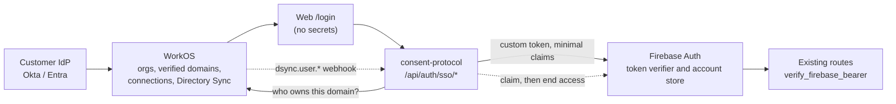

# ADR: WorkOS Enterprise SSO Integration

## Visual Context

Canonical visual owner: [Architecture Index](README.md). This ADR adds one federation front door in front of the existing Firebase authority; it does not add a second token verifier or any table.

## Status

Proposed. Two decisions are explicitly open (see [Open decisions](#open-decisions)).

## Context

- Auth today is Firebase ID tokens only: `api/utils/firebase_auth.py::verify_firebase_bearer`, enforced by `api/middleware.py::require_firebase_auth`. No SAML/OIDC enterprise login exists.
- Authorization is DB-driven (`ria_profiles`, `RIAIAMService.require_ria_verified`). `ria_firms` carries FINRA/SEC identity only and has no tenant or IdP fields.
- Vault keys are client-side BYOK. Possession of an authenticated session never unlocks a vault; the passphrase does.
- Hussh has no WorkOS integration today. Enterprise customers need SAML/OIDC per organization, domain-based org discovery, Directory Sync (SCIM) deprovisioning, and a way to onboard without Hussh staff editing records. This ADR covers that integration only; which roles an enterprise user later holds (for example an advisor actor) is unchanged and out of scope.

## Decision

1. **WorkOS is a federation front door, not an authority over sessions.** Firebase remains the only verifier of session tokens. WorkOS proves "this person authenticated at this org's IdP"; the backend converts that into a Firebase custom token. No route accepts a WorkOS token.
2. **WorkOS is the authority for organizations, domains and connections.** Hussh is the WorkOS customer. Any organization that exists in our WorkOS account, has a DNS-verified domain and has not had its SSO switched off can sign its people in; WorkOS itself refuses anyone without a usable connection. Nobody registers an organization or a domain on the Hussh side.
3. **Firebase is the authority for accounts, and there is no table.** Which WorkOS person an account belongs to, and whether they were deprovisioned, are custom claims on the Firebase user.
4. **SSO never grants roles.** A successful exchange establishes identity only. It does not create or advance `ria_profiles.verification_status`, does not mint consent, and does not unlock a vault.
5. **Webhooks are the deprovision channel.** Directory Sync deletion or deactivation drives the deprovision below. Every step is idempotent, so redelivery and replay are harmless.
6. **Feature-flagged, default off.** Rollback is the flag; Firebase sign-in is untouched.

## Organizations and domains

- Discovery: for an email, the backend asks WorkOS for the organization that has **verified** that domain and has not had SSO switched off. If none, or more than one, there is no SSO for that address. The domain states WorkOS reports as verified are `verified` and `legacy_verified`.
- "Switched off" means WorkOS lists connections for the organization and **none is active**. An organization with no *listed* connection is passed on to WorkOS, which decides: a live staging run showed WorkOS keeps its built-in Test Identity Provider (type `TestIdp`, state active) out of the connection listing under every filter, so an empty listing cannot be read as "no SSO". The gate is a courtesy that avoids sending people to a WorkOS error page; it is not a security control, because nobody can authenticate without a usable connection.
- The profile WorkOS returns after sign-in must belong to the organization the attempt started for (the signed `state` carries it), and its email's domain must be one that organization has verified. An org's IdP can therefore only assert addresses its company proved it owns by DNS.
- Free-mail domains (`gmail.com`, `outlook.com` and similar) are refused even if WorkOS were to list one, because email auto-link trusts a verified domain.
- The off switch for an organization is switching its connection off in WorkOS. There is no local suspension. An organization that has verified a domain but has no connection at all would be sent on to a WorkOS error page; that is the one cost of the rule above.
- Each unauthenticated request to `/api/auth/sso/start` calls WorkOS's API, so both SSO routes are rate limited per client IP.

## Account model

| Concept | Where it lives |
|---|---|
| Firebase UID | Firebase; all existing tables key on it |
| WorkOS org id, WorkOS user id | Custom claims `workosOrgId`, `workosUserId` on the Firebase user |
| How the account came to exist | Claim `workosOrigin`: `created` (SSO made it) or `linked` (it already existed) |
| Deprovisioned | Claim `workosDeprovisionedAt`; plus Firebase `disabled` for `created` accounts |
| The person's name | Firebase `displayName`, the same place a Google or Apple sign-in puts it; the identity shadow syncs from there |

Claims are merged into the existing claim object, never written over it (`set_custom_user_claims` replaces the whole object, and `hushhWelcomeMailAt` already lives there).

**What we keep from the IdP profile.** The WorkOS profile id, its organization, the email, and the name (first and last, or a full name when the IdP sends no split). Groups, roles, raw attributes and the WorkOS access token are not read. The name is written to Firebase `displayName` only when the account has none, so a name the person chose, or one a Google or Apple sign-in already gave the account, is never replaced, and later changes at the IdP do not follow. It passes the same rules as the name editor in the app (2-60 characters, no links or handles); a name that fails them is dropped. Failing to save a name never blocks sign-in.

**Resolving the account on exchange**

1. Derive the UID `sso_<sha256(org, workos user)>`. If that Firebase user exists, use it. It must not be disabled or deprovisioned, and its claims must name this org and this person.
2. Otherwise, if exactly one existing Firebase user has the same email, link to it, but only if that email is **verified** (an unverified one could be a squat of the address) and the account is not claimed by a different org or WorkOS person. This lets an employee with a personal Hussh account keep one vault.
3. Otherwise create the account with the derived UID and the IdP's email, marked verified, and write the claims. If that UID has an account-deletion tombstone, refuse instead of recreating it.

**Why the UID is derived, and unkeyed.** Two simultaneous first sign-ins then create one account, and a work email that changes at the IdP still reaches the same account. It is not keyed with a secret on purpose: rotating a secret must never move people to new, empty accounts. A UID is an identifier, not a credential; signing in still needs a token only this service can mint.

**Custom token claims.** Minimal: `auth_provider=workos` and `workos_org_id`. The token must **not** carry `hushh_review_mint` (that claim is the review-lane containment marker in `firebase_auth.py`). Roles and entitlements are never claims; they stay DB-driven.

**Email and aliases.** No change to `actor_identity_service.py` is needed: the account is created in Firebase with the IdP-asserted email, and the existing identity sync reads the email from the Firebase user record. The IdP email is never written to the alias tables.

## Why there is no table

An earlier draft added four tables (organizations, domains, identity links, webhook ledger). Once WorkOS became the authority for organizations and domains, each had a replacement and the schema became pure cost: a migration on a shared database, a version-pinned contract that gates every deploy, number collisions with concurrent migrations, a rollback that is unusable after any account tombstone, and an erasure path to maintain.

| Would have been stored | Instead |
|---|---|
| Allowed organizations and their domains | WorkOS, asked at sign-in |
| Which account is which WorkOS person | Claims on the Firebase user, plus the derived UID |
| Deprovisioned state | A claim, plus Firebase `disabled` |
| Webhook event ids | Not needed: handlers are idempotent and the signature window is 180 s |
| Rows to clean on account erasure | None. Deleting the Firebase account removes everything |

**What this gives up**

- No SQL view of SSO people per organization, so no seat counts or offboarding reports except through Firebase and the WorkOS dashboard.
- An account that was *linked* (it existed before SSO) is found by email. If that person's work email later changes at the IdP, they get a new derived account instead of reaching the old one. Accounts SSO *created* are unaffected.
- After a person deletes their account, SSO will not recreate it (the tombstone blocks the derived UID). They are told to contact support.
- One account belongs to one organization in v1.

If a customer needs reporting or the linked-account case matters, add an identity-link table then, behind the same service interface.

## Deprovision semantics

On `dsync.user.deleted`, or `dsync.user.updated` with `state: inactive` (WorkOS has no separate deactivation event; this is how a deactivation arrives):

1. Find the Firebase user by the event's email. It is ours only if its `workosOrgId` claim is the event's organization. Anyone else is left alone.
2. Set `workosDeprovisionedAt` **first**, so any new SSO sign-in is refused even if a later step fails.
3. Then it depends on how the account came to exist:
   - **`created`** (SSO made it for their work): disable the Firebase user and revoke refresh tokens through `AccountDeletionLifecycleService.quarantine_firebase_identity`, a thin public entry to the quarantine the deletion cleanup already uses, then revoke every active consent grant with `ConsentLifecycleService.revoke_all_active_grants`.
   - **`linked`** (a personal account that already existed): revoke refresh tokens only. The person's own account, vault and grants are not the employer's to disable, and they can still sign in with their usual method. They can no longer sign in through the organization.
4. If a step cannot finish, the webhook answers `503` so WorkOS redelivers.
5. Do **not** delete any account or data. Encrypted data remains passphrase-protected ciphertext. We make **no claim** that a vault is "locked" or "destroyed" by deprovision, because BYOK means key custody was never ours.

**Timing.** Already-issued Firebase ID tokens stop being accepted within about a minute: `verify_firebase_bearer` caches a positive revocation check for at most 60 seconds (`_REVOCATION_CACHE_TTL_SECONDS`).

**Known limitations in this version.**

- Reactivation is manual. A person the IdP later reactivates stays deprovisioned until an operator clears the claim.
- `dsync.deleted` (a whole directory removed) is acknowledged and ignored. Removing a directory is not the same as removing its users from the IdP.
- A deprovision event only reaches someone who has signed in via SSO at least once, and is matched by the email on the event.
- A deprovisioned `linked` account keeps working with its personal sign-in methods. That is intended.
- The signed `state` expires and is bound to the org, but it is not bound to a browser. The client must compare the returned `state` with the value it stored before redirecting (login-CSRF defense); the server cannot do that for it.

Anything beyond session and consent revocation (for example suspending downstream relationships) is out of scope for this integration.

Webhook handling: verify the `WorkOS-Signature` HMAC over the **raw body**; enforce a 180-second timestamp window (the WorkOS SDK default); return 2xx only after the state change; acknowledge and ignore unknown event types.

## Web client

- **Entry.** "Continue with SSO" on the sign-in screen (`EnterpriseSsoSection`, rendered by `AuthStep`) opens an inline work-email form. It is shown only when `NEXT_PUBLIC_WORKOS_SSO_ENABLED` is on and the client is web; the backend flag stays the authority.
- **No new route.** The WorkOS redirect URI is `/login`. On return, the section completes the Firebase sign-in with the custom token and `AuthStep`'s existing-session routing takes over, so post-auth routing, onboarding and legal acceptance match Google and Apple. Reusing `/login` avoids a new route and its navigation and Back contracts.
- **Login-CSRF defense.** The client stores the returned `state` in `sessionStorage` before redirecting and honors the callback only when the returned state matches exactly, once. A mismatch never reaches the exchange. The code and state are removed from the address bar immediately.
- **Back.** While the email form is open, Back closes it first (a `useBackLayer` on the login route), then reaches the route's own parent.
- **Voice and Search.** No voice or Search action is added: signing in needs a typed work email, and the login voice playbook still describes Google and Apple only. This is a decision, not an omission.
- **Proxy.** The web app reaches the backend through two thin pass-through handlers, `app/api/auth/sso/start` and `exchange`. The webhook goes from WorkOS straight to the backend.

## Native and web

Web is the v1 surface. Native (system-browser plus deep-link return) is deferred and needs `mobile_native_architect` review before scope is committed.

## Secrets

`WORKOS_API_KEY`, `WORKOS_CLIENT_ID`, `WORKOS_WEBHOOK_SECRET` live in Secret Manager per [env-and-secrets.md](../operations/env-and-secrets.md). Nothing secret is exposed via `NEXT_PUBLIC_*`. The WorkOS SDK sits behind an adapter so tests and the flag-off path never import it.

## Rationalizations, rebutted

| Rationalization | Reality |
|---|---|
| "SSO proves they work at the customer, so grant them roles" | SSO proves identity only. Roles and verification status stay DB-driven and unchanged by this integration. |
| "Accept the WorkOS token directly and skip Firebase" | Two verifiers means two revocation systems. Firebase stays the single decision-maker. |
| "Match by email, it's the same person" | Only for a domain WorkOS verified for that org by DNS, and only into a verified account. Otherwise it is account takeover. |
| "Any organization is welcome, so skip the domain check" | The domain check is what stops one org's IdP from asserting another company's addresses. Open signup keeps it. |
| "Deprovision should disable the account" | Only for accounts SSO created. A personal account that was merely linked is the person's own. |
| "Deprovision should lock the vault" | BYOK: the passphrase is client-held. We revoke sessions and, for created accounts, consent, and say exactly that. |

## Resolved decisions

- **Who runs WorkOS.** Hussh is the WorkOS customer and each enterprise is a WorkOS Organization connected to its own IdP (confirmed by the founder). Customers are not WorkOS tenants of their own, so no foreign OIDC issuer is trusted.
- **Any organization can sign up.** There is no pre-registration. WorkOS's verified domains and connections decide.
- **No database schema** for this feature (see above).

## Open decisions

1. **Web-only v1 or native too.** Default: web-only.
2. **Cost control for self-serve onboarding.** WorkOS bills per SSO connection. Today organizations are created in WorkOS by us or our customers' admins; fully self-serve onboarding would need a gate before it exists.

## Verification

- Webhook: bad signature rejected, with a negative control proving a good signature passes; the helper's signatures pass the backend's own verifier and the vendor SDK's.
- Exchange refuses a mismatched organization, an organization whose SSO is switched off, an email on a domain the organization has not verified, and a free-mail domain, and creates nothing; refuses to link an unverified existing account or one claimed by a different person.
- Deprovision of a created account disables it, revokes sessions and consent, and blocks later sign-in; deprovision of a linked account revokes sessions only and still blocks sign-in through the organization.
- Each guard was checked by deliberately breaking it and confirming a test fails.
- Reviewer browser proof still to do: SSO login still requires passphrase unlock; same-session navigation intact.
- `scripts/ci/orchestrate.sh core`, focused pytest for the route and service, vitest and UI contracts for web, and an end-to-end run against a WorkOS sandbox org before UAT.
