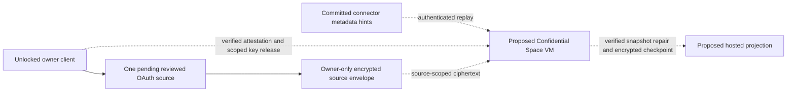

# ADR: Proposed hosted Confidential Space memory runtime and key custody

Status: **Owner-only scoped ciphertext staging implemented in this branch;
hosted runtime and key release proposed, capture disabled.**
Updated: 2026-10-15.

## Visual Map

Solid paths are separate callable primitives in this branch; the Profile UI
does not wire them into an enrollment flow. Dotted paths are proposed and
cannot run.
The backend has a metadata-only connector hint journal, a 15-minute pending
review intent for one provider, and owner-only ciphertext staging with exact
readback. It holds no memory decryption key or worker credential. Review expiry
blocks reads and writes but does not itself purge staged ciphertext; re-review,
revocation, reset, or account erasure removes it. There is no closed-app
worker; the owner-operated device proposal is documented separately in the
freshness ADR.

## Context and decision boundary

Today the owner client can refresh Live Memory only while open and unlocked.
The backend stores the existing PKM ciphertext and does not receive the
canonical vault key. The connector change journal emits committed metadata
hints; a narrow owner API can record pending review for exactly one curated
OAuth provider and stage its encrypted status envelope. The route always
returns `captureEnabled:false` and `workerPaired:false` and has no active state
or key-release endpoint. The staged envelope is a client-encrypted owner
readback, not proof of a real source change or a running hosted worker. The
replay worker and hosted runtime are absent. [The freshness ADR](./living-memory-freshness-adr.md)
describes the implemented boundary and the earlier owner-operated device
proposal.

The owner selected a **hosted private runtime** as the direction for a future
opt-in review. A normal Cloud Run worker with Cloud KMS decrypt permission
would receive the decrypted data key in its process; Cloud KMS encryption at
rest alone would change the current zero-knowledge custody promise without
isolating the runtime from the operator. This ADR proposes a narrower pilot on
an isolated Google Confidential Space VM. It is a **change in key custody**:
the approved workload could hold a scoped plaintext memory key and source
values in protected VM memory. It is not a claim that Hussh or Google can never
access plaintext, that a TEE is infallible, or that the current app operates
while closed.

Google describes Confidential Space as an attested Confidential VM workload
whose resource owner can condition access on workload assertions such as the
container image digest. Its security overview also names exclusions including
some software supply-chain and Google Cloud attacks. These are design inputs,
not a certification of this application. [Security overview](https://docs.cloud.google.com/docs/security/confidential-space),
[resource grants](https://docs.cloud.google.com/confidential-computing/confidential-space/docs/create-grant-access-confidential-resources).

## Proposed custody protocol

1. **New, scoped content key.** The client-side pilot codec generates one
   random AES-256 key for the reviewed owner, grant generation and provider.
   It produces an owner-wrapped recovery copy using the unlocked vault key and
   encrypts one allowlisted status with owner, source and revision in AES-GCM
   additional authenticated data. No pilot key is uploaded or persisted by the
   current backend. Future hosted release may wrap this scoped key to a
   verified ephemeral workload key or to a pinned Cloud KMS asymmetric key
   whose decrypt policy is restricted to an attested workload; the exact
   ceremony needs a separate review. Either route gives the hosted workload
   access to the scoped plaintext key. The canonical vault key stays on the
   owner client. Existing PKM ciphertext cannot be decrypted merely by deriving
   an HKDF child key; selected domains need a versioned envelope migration,
   readback verification and rollback before any hosted read is possible.
   [Cloud KMS asymmetric envelope guidance](https://docs.cloud.google.com/kms/docs/asymmetric-encryption).
2. **Owner-verified enrollment.** Show the source list, allowed read/write
   operations, expected image digest, key-custody change, retention and
   revocation limits before an explicit opt-in. The unlocked client verifies a
   fresh, nonce-bound attestation for the expected production Confidential
   Space image, immutable workload digest and approved launch settings, and
   binds the evidence to the key-release channel before releasing any scoped
   key. Google documents custom audience/nonces, TLS channel binding and nonce
   binding to other data for external relying parties. The isolated Python
   synthetic verifier in this branch requires a direct TLS exporter. An
   ordinary browser `fetch` cannot provide that exporter through the standard
   [Web Crypto API](https://www.w3.org/TR/webcrypto/); a browser enrollment
   needs its own owner-side Google signature and claim verifier, with a fresh
   challenge and ephemeral workload public-key fingerprint bound into the
   signed nonce. The workload must prove possession of the corresponding
   private key before receiving the scoped key. This browser protocol is not
   implemented or approved here.
   [External resource attestation](https://docs.cloud.google.com/confidential-computing/confidential-space/docs/connect-external-resources),
   [attestation assertions](https://docs.cloud.google.com/confidential-computing/confidential-space/docs/reference/attestation-assertions).
3. **Narrow hosted release.** Run a single-purpose immutable workload image on
   an isolated Confidential Space VM. Its federated workload identity has only
   the KMS decrypt and ciphertext/source metadata rights needed for this
   pilot. Pin the image digest and production, debug-disabled attestation
   claims; reject overrides and unsupported or revoked runtime images. Use
   direct resource access rather than a broadly impersonated service account
   where supported. Keep KMS policy administration separate from deployment
   administration. A new workload digest needs an explicit owner-visible
   policy and enrollment transition, not a silent moving-tag update.
   [Resource access guidance](https://docs.cloud.google.com/confidential-computing/confidential-space/docs/create-grant-access-confidential-resources),
   [attestation assertions](https://docs.cloud.google.com/confidential-computing/confidential-space/docs/reference/attestation-assertions).
4. **Constrained processing.** The proposed workload consumes committed
   journal hints and authoritative owner snapshots, verifies owner identity,
   source revisions and freshness, then writes derived ciphertext. There is
   no worker lease, checkpoint or authorization path in this branch. The
   eventual worker must repair from a verified full snapshot when the bounded
   connector journal has pruned older events; a cursor supplied beside opaque
   ciphertext cannot prove that the snapshot covers those events. Checkpoints
   may advance only after authenticated source verification, encrypted commit
   and readback. The pilot makes no model calls and does not answer paid
   requests. Plaintext keys, values, prompts and document bodies stay out of
   disk, serial console, crash dumps, app logs and traces. Emit only source
   kind, opaque counters, revision and health metadata. Network egress,
   runtime permissions and retention remain separately reviewed.
5. **Revocation and recovery.** Revocation denies new leases and source reads,
   removes the runtime-wrapped key, stops the worker, and rotates/re-encrypts
   the scoped key for the surviving owner client. Unpairing and account erasure
   also remove encrypted checkpoints and derived projections under their
   retention contracts. Revocation cannot recall plaintext already present in
   a running VM's RAM, undo prior processing, or prove that a previously
   compromised workload forgot copied data. The UI must disclose this limit
   and show last successful source verification and worker health.

Confidential Space uses attestation tokens and Workload Identity Federation to
authorize access; an attested image digest alone does not supply per-owner
consent, application authorization or key-rotation semantics. Those controls
belong in this protocol and its tests. [Resource access guidance](https://docs.cloud.google.com/confidential-computing/confidential-space/docs/create-grant-access-confidential-resources).

## Pilot gates and evidence

The first pilot uses synthetic keys and synthetic owner records. The isolated
direct-TLS attestation verifier has signed synthetic positive and negative
tests; it is default disabled and is not browser enrollment. A future browser
verifier needs the same wrong digest, debug image, expired/replayed nonce and
changed ephemeral-key negative tests. The complete pilot must also prove KMS
deny outside the attested identity, source/owner isolation, failed-read
preservation, crash/replay and compare-and-swap conflict recovery, full-snapshot
repair after the journal retention window, scoped rotation, and prompt shutdown on
revocation. Audit **Data Access** logging for Cloud KMS must be explicitly
enabled and verified; it is not enough to assume Admin Activity logs show key
reads. [Google audit configuration](https://docs.cloud.google.com/logging/docs/audit/configure-data-access).

Only after that synthetic gate, a separately approved UAT pilot may enroll one
opted-in owner and one selected source with the versioned envelope. No
production or live vault-key transfer is authorized by this ADR. Release needs
documented owner consent, a reviewed threat model, measured freshness and
capacity, key-policy separation, incident response, exit/migration path, and
an independent security review. If any gate fails, the product continues to
claim only open-and-unlocked Live Memory freshness.
