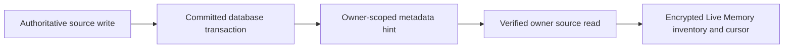

# Live Memory source journal backend contract

## Visual Map

## Contract

Migration 345 adds a separate, durable owner stream for admitted source changes.
Storage triggers append in the same transaction as an authoritative write. A
rolled-back write leaves no hint. Each event contains an owner SHA-256
commitment, sequence, UUID, source kind, changed/deleted operation, schema
version and timestamp. It never stores a profile value, counterpart identity,
request or payment ID, credential, scope, location or document content.

The owner-only `GET /api/one/source-journal/events?after=0&limit=100` endpoint
returns ordered events and `nextCursor`, `headCursor`, `earliestCursor`,
`hasMore`, and `resetRequired`. A missing event, stale cursor or cursor ahead of
the head requires a complete authoritative source read. Hints have a maximum
of 2,048 events per owner. The existing `/connectors` journal is independent.
Clients must keep the new cursor distinct from the connector cursor and only
advance it after a successful encrypted inventory update.

| Source kind | Transactional trigger authority |
| --- | --- |
| `profile` | `actor_identity_cache` |
| `consent` | `consent_audit` |
| `connection` | `connections`, `connection_requests`, `trusted_connections` |
| `document_request_payment` | `drive_request_payment_orders`, `drive_request_payment_refunds` |
| `document_earning` | `drive_request_payment_orders`, `drive_request_owner_payouts`, `drive_request_payment_refunds` |

Other consent projection tables and bank or Hashcoin payout activity do not
emit this journal yet. Existing bounded verification scans remain necessary
for these sources, timestamp expiry, and any missed signal. The journal is a
change hint, not an encrypted memory value, a consent grant, or a closed-app
memory writer. The private hosted worker still requires reviewed enrollment,
key custody and revocation before it can update encrypted memory while the
owner app is closed.

Account reset clears events and advances the stream watermark so an old
cursor must rebuild; full account erasure deletes the stream, and the
account-deletion tombstone prevents its recreation.
