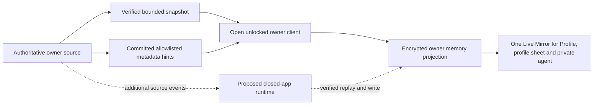

# Live Memory P0 acceptance stories and evidence

Status: **review contract, not a claim of 24/7 readiness**. Updated 2026-10-15.

## Visual Map

Solid arrows show the implemented unlocked path, including metadata-only
change journals for selected first-party source transactions. Their hints cause an authoritative reread; they are not
memory facts. Dotted arrows are release-gated proposals and do not run while
the app is closed today.

This document turns the requested continuous personal memory into testable user stories. The [source admission contract](./live-memory-source-contract.md) owns each source's field, capacity and scan rules. The [freshness ADR](./living-memory-freshness-adr.md) describes the implemented open, unlocked bridge and proposed closed-app runtime. The [hosted custody ADR](./hosted-confidential-memory-custody-adr.md) evaluates a separate, opt-in hosted runtime; it does not make that runtime current behavior.

## Honest product boundary

The current owner client can refresh an encrypted, owner-only source inventory and a derived Profile `memory.md` while the app is **open and the vault is unlocked**. Committed metadata hints for selected source transactions prompt authoritative rereads; encrypted, owner-scoped cursors survive client restarts, and scheduled verification covers missed signals. The inventory keeps the latest verified state and tombstones; a separate encrypted, bounded history retains observed revisions and explicitly marks retention rollover. Neither source can reconstruct every intermediate value while all owner clients are closed. A late, failed, racing or over-cap read must show the source as incomplete and preserve its prior record.

Profile Live Mirror, the Memory workspace, the private agent's profile sheet and the private agent read one Live Mirror projection, built in memory from the encrypted inventory and its observed history. Its Markdown is a derived preview generated from that projection, not an authority. `one_memory.markdown` stays the private agent's editable chat memory. History covers only changes seen while the app was open and unlocked: it records explicit gap markers and never invents values in between. When a source fails, the mirror shows the verified sources and marks the failed one unavailable. Locked, it shows only a status line. Neither the mirror nor the inventory authorizes another person's access.

Current user-facing copy, shared by every mirror surface: “Updates while the app is open and unlocked.” Activity copy may claim only what the owner does in One on this device while the app is open and unlocked (the [in-app activity decision](#in-app-activity-decision-2026-10-29)). Do not advertise an unscoped “every action,” “all transactions,” “all contacts,” “24/7” or updates while the app is closed from this implementation.

The admitted source inventory covers owner Profile identity, Consent activity, connection identifiers and status, curated OAuth connection status, document earnings, a separately admitted payout activity subset, and first-party requester document payment status and refund metadata. It does not import the contact list, all OAuth definitions, third-party app usage, all purchase receipts, live location coordinates, bank details, provider payloads, document bodies or secrets. Saved preferences and saved Location render in Profile from their encrypted PKM domains; they are not inventory kinds, have no Live Mirror history and are not evidence of a complete general-purpose event journal. To-Do information has its own encrypted PKM path. `payout_activity` is a wallet activity read model for redemption, deposit and adjustment rows; dedicated `document_earning` remains the owner earnings source. `document_request_payment` is the requester's own first-party order snapshot, including only an owner-scoped opaque counterpart reference. A receipt detail endpoint is not itself a memory source.

## Evidence rule for every P0 story

Use controlled, consenting owner accounts in a review environment and actual committed source records or provider test-mode flows. A mock response or a unit fixture proves parser behavior, not that the app captured a real change. For each story retain a privacy-safe run record: source kind, opaque test account alias, source operation and commit time, change signal or recovery trigger, source verification time, encrypted PKM write/readback receipt and revision, visible freshness state, and pass/fail. Keep raw names, sex, coordinates, contact rows, document content, OAuth material, bank data, transaction descriptions, and vault keys out of screenshots, CI artifacts, logs and this document. Inspect exact values only within the authorized unlocked test session. Run the negative control for each authority boundary: wrong owner, stale session, incomplete page or revoked capability must fail without a new complete memory view.

Passing CI and the [feature PR impact declaration](./live-memory-source-contract.md#adding-a-durable-source) is required but cannot substitute for these real-source checks. Every durable feature must identify its authoritative source and admitted source kind, or state with review evidence why it is intentionally absent from Live Memory. Reviewers reject a generic “covered by memory” claim without a post-commit signal, complete owner-scoped snapshot, field exclusions, retention and failure test.

## Current unlocked-session release stories

| ID | Owner story and real-source evidence | Pass condition |
| --- | --- | --- |
| P0-1 Profile edit | Owner changes a display name or photo through the real Profile save path; the canonical identity response and encrypted source readback are inspected in one unlocked session. | The owner-only record updates once to the effective saved value with a new local revision. A failed save creates no new fact; lock or account switch prevents the old request publishing. No inferred age or sex appears. |
| P0-2 Consent and connection | Two controlled accounts connect, create a request, change its status and disconnect. Inspect committed Consent and connection reads and both owners' private projections. | Post-commit signals or the bounded recovery scan update only the correct owner's allowed status and counterpart ID. A complete read can tombstone a removed row. A failed or racing read cannot infer removal or turn a prior grant into a new grant. No contact-list row or counterpart profile is copied. |
| P0-3 Curated OAuth | Owner connects then revokes one curated OAuth provider in its actual test flow; inspect the owner-token overview after each committed transition. | Only provider ID, status and connection time enter the private inventory. No token, account email, scope list or provider payload is saved. User-defined encrypted connector definitions remain outside this source until independently admitted. |
| P0-4 Document earning and wallet activity | In provider test mode, complete a document earning and one wallet action that yields redemption, deposit or adjustment activity. Read both the earnings endpoint and `/api/one/payouts/activity` in live and test partitions, then encrypted readback. | Earnings appear only in `document_earning`; other wallet activity appears once in `payout_activity`. Mode, amount, status and time match authoritative rows. Provider or deposit IDs are not copied as raw memory IDs or values, and test money is never labeled live. A refund/reversal updates the existing record or adds its separate adjustment as the source contract defines; no invented transaction is added. |
| P0-4R Requester document payment | A controlled requester opens checkout, completes a provider test-mode document request payment, then receives a full or partial refund. Inspect the owner-token `/api/one/source-snapshots/document-request-payments` response and encrypted source readback after each commit. | One `document_request_payment` record per request ID reflects mode, amount, currency, status and refund progression. The counterpart is only an owner-scoped opaque reference. No Stripe identifier, checkout URL, document information or raw counterpart ID enters memory. A failed, racing or over-cap snapshot preserves the earlier record and marks the inventory incomplete. |
| P0-5 Incomplete data | Interrupt one page, alter an item between the two scans, exceed a declared source cap, and make a source unavailable after a previously complete read. | The prior encrypted records survive, `complete` becomes false, the failed kind is visible as unavailable and no absence or deletion is claimed. Recovery after a later complete read updates the view. Bounded observed history discloses its retention rollover. |
| P0-6 Exposure and answer request | A requester asks for age, sex and location while the owner has only some eligible, explicitly recorded values. Use actual encrypted PKM and the paid-answer test lane. | The owner sees available, missing and unavailable separately. The exact approved subset and price are frozen and rechecked. The requester sees included and omitted coverage before checkout. The private source inventory itself is never an automatic grant, model input or purchased answer. If an approved fact is unavailable or composition fails, no chargeable receipt is issued. |
| P0-7 Lock and owner switch | Start a slow source read, lock the vault or switch from owner A to owner B before it returns, then resume both accounts separately. | No late A plaintext or encrypted write appears under B, the local decrypted cache clears, and neither account is marked complete from the other's response. Unlock triggers an owner-scoped repair read. |
| P0-8 Account erasure and corrections | Correct a fact, remove a supported source row, then exercise the documented account deletion path in a controlled account. | Corrected content supersedes the prior current value; a verified removal creates a tombstone according to the source contract. Account deletion removes the encrypted source projection with the owner's PKM data and invalidates running work. Retention of legally required payment records is reported separately and is never presented as live personal memory. |
| P0-9 Feed dismissal across sign-in | Dismiss an owner Feed card, sign out, and sign in again. Also retry a stale dismissal that affects no database row. | A confirmed dismissal stays hidden across sign-in and does not erase the underlying payment or consent fact. A zero-row server acknowledgment cannot show a false removal success or hide the card locally. |

P0-4 and P0-4R have source declarations and focused adapter tests under review; real provider test-mode runs remain pending. For P0-6, automated contract tests prove that only available, approved scopes can be priced and that the Live Memory inventory cannot make a scope chargeable (`answer-request-review.test.tsx`, `memory-scope-retrieval.test.ts`); the real paid-answer run is still pending. The other rows are acceptance requirements, not a statement that this review has executed them. The current bridge has a 60-second wake and source-specific five-minute verification windows, not a guaranteed five-minute delivery service level. Network delay, retries, browser suspension and source failure can extend freshness; the visible state must say so.

## Closed-app mode requires a separate opt-in and release gate

The reviewed pilot branch can record a pending owner-selected curated OAuth
provider and stage one encrypted status envelope with exact owner readback.
These primitives do not start capture, persist a worker key, or update memory
after the app closes. The direct-TLS synthetic attestation verifier is not a
browser enrollment path. A browser owner must be able to verify an attested
workload key and release only the scoped source key under a separate reviewed
protocol before any hosted worker is authorized.

The user must be shown the runtime location, exact selected sources and fields, key custody change, ability to pause and revoke, last successful source verification, backlog, error state, and the distinction between stopping future capture and deleting retained information. Enrollment defaults **off** and is separate from OAuth grants, chat memory, location sharing, answer composition and payment consent. A connection to an app or a paid subscription is not consent to continuously ingest its data. Each newly admitted sensitive source requires a fresh owner review; the runtime cannot silently expand its permissions after an update.

Before any “updates while the app is closed” claim, a controlled owner must close and lock every client, then commit real profile, consent and test-mode wallet changes. The enrolled runtime must receive a post-commit event or repair from an authoritative snapshot, persist an encrypted owner-scoped revision and checkpoint, and show a truthful delay/failure state. Restart, duplicate, out-of-order, missed-event, offline and source-overflow cases must replay or repair without fabricating facts, losing a committed deletion or crossing accounts. The team must publish and measure a freshness target and recovery target in the pilot; neither target is implied by a 60-second browser timer. Powered-off owner hardware, an unavailable hosted runtime or a disconnected source makes the memory stale rather than “live.”

A hosted processor is an explicit change to the current client-only vault-key custody model. Confidential execution, attestation, egress restriction and encryption at rest do not by themselves prove that a hosted party cannot access decrypted information. Its reviewed design must identify who can release the decryption capability, what code identity is attested, which owner and source it may process, whether any administrator or platform can recover it, where plaintext may exist, and how keys, events and checkpoints are erased. The owner must approve those conditions before a closed-app credential is issued. If the custody proof, authenticated owner fence or source-specific consent is unavailable, ingestion stops; it must not fall back to a general server credential or cached browser key.

Revocation acceptance is independent of the happy path: pausing stops new work; unpairing revokes the runtime credential and decryption capability; account deletion also removes queued encrypted events, checkpoints and derived projections. A worker that already started must have a bounded in-flight lifetime, recheck the current generation before its encrypted commit, and fail closed after revocation. Test revocation during a paused queue, an active source read and a pending compare-and-swap write. Show the owner whether provider-side revocation and historical data erasure completed or remain pending. Re-enabling capture requires a new explicit enrollment; reconnection alone cannot restore it.

## Sensitive-field admission

Source contracts specify allowlisted values, not “collect everything.” Passwords, passphrases, API keys, OAuth/refresh tokens, private keys, PINs, card security codes, raw bank details, provider references and document bodies do not enter the general source inventory. A deterministic hash of a source identifier is a stable pseudonym, not a secrecy guarantee; do not treat it as permission to expose an ID or ignore deletion obligations. Third-party identifiers such as connection counterparts need the same owner-only treatment as other personal data.

Age may be derived only from a validated saved date of birth under the existing exact scope rules; date of birth is not sent in an age-only answer. Sex must be explicitly saved, never guessed from a name, photo, chat tone or model inference. Live coordinates, contact rows, mail and document contents, third-party app usage and full receipt details each require a distinct source authority, consent, retention, capacity and sharing review before ingestion. The owner must be able to inspect and correct or delete eligible facts; no private source record becomes a shareable answer merely because it is present in `memory.md`.

### In-app activity decision (2026-10-29)

Founder decision, 2026-10-29: One's own in-app activity is admitted as a memory input, outside the source inventory. While the owner is signed in with the vault unlocked, the client keeps an encrypted, owner-scoped activity log on the device for the closed event kinds in `hushh-webapp/lib/pkm/live-activity/live-activity-types.ts`: sections opened, connector connects, disconnects and successful syncs, location sharing links created or revoked, places saved or removed, check-ins at a named place, connection requests, accepts and removals, consent decisions, profile updates, Personal World Model reviews, memory saves and wallet cards added or removed. Person-to-person live location shares are not journaled yet, because their current signals cannot tell a live share from a one-time check-in. Each event carries only an authored kind, an allowlisted subject id, for place kinds a place label, a bounded count and timestamps.

- Excluded: message, mail and file contents; coordinates; counterpart or recipient identity; raw paths, URLs and query strings; passwords, tokens and scopes; free text other than place labels.
- Retention: device-only, encrypted with the vault key, at most 7 days and 2,048 events per owner, enforced when the log is next opened on the device. A place label is the owner's own name for a saved place (their text, up to 40 characters, which may name a person) or a Google venue's public name for a check-in or a place saved from one; a label that repeats the place's own street address is dropped on a best-effort basis. Capture stops on lock, sign-out and owner change, and nothing is buffered while locked. Reset clears the log only on the device where it runs; other devices keep theirs until it ages out.
- PKM writes: consolidation only. The private agent's existing memory pipeline turns each cycle's dated digest (the not-yet-consolidated events of one local day) into durable `one_memory` facts, at most one commit per cycle, never removing a memory, and each outcome is recorded. No raw event reaches PKM, the Live Mirror or the source inventory. Each chat turn sends today's activity as request data in `pkm_context`.
- Visibility and choice: today's activity shows in Profile > Memory > History, and the owner can edit or delete memory.md facts there. Capture is on by default; a stored automatic-memory choice gates capture and consolidation, but no owner-facing control writes it today (removed 2026-10-12). That control is a recorded gap.

## Decision record for this review

Current release wording: **continuous only during an open, unlocked, healthy owner session, from the declared sources**. P0 cannot be called a complete log or an always-on subscription feature. The in-app activity log does not change this: it covers only actions in One on one device while the app is open and unlocked, for 7 days. Closed-app mode remains a separate opt-in milestone with real-source pilot evidence, key-custody review, revocation tests and measured freshness. Any source without those controls is marked unavailable or excluded, not silently treated as known or absent.
