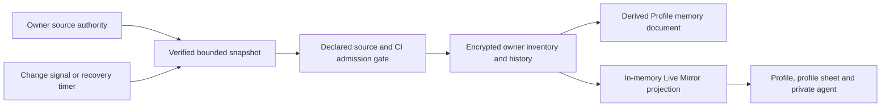

# Live Memory source admission contract

The encrypted `one_living_sources._private.inventory` is a derived, owner-only
projection. Its authority remains in the source services and PKM domains.
Profile Live Mirror, the Memory workspace, the private agent's profile sheet and
the private agent read one owner-scoped Live Mirror projection. It is built in
memory from this inventory and its observed history and is never persisted. Its Markdown and
`memory.md` are derived previews, not a second source of truth. The bridge
runs only while the owner client is open and the vault is unlocked; it does
not provide closed-app or continuous 24/7 capture. Every surface shows one
boundary line: "Updates while the app is open and unlocked." See the
[freshness ADR](./living-memory-freshness-adr.md).

## Visual Map



The signal wakes a read; only the verified source snapshot can change the
encrypted inventory. The gate checks registered kinds, journal kinds, writer
sites and paid-answer imports before the change can enter the release
pipeline.

Each verified change to an admitted inventory record also enters
`one_living_sources._private.observed_history` in the same encrypted write.
This owner-only history retains at most 2,048 entries and records
`firstRetainedSequence` and `truncatedAt` when it rolls over. The server
journals contain kind-only hints, never source values.

- **Pending hints.** Encrypted `journal_pending` is stored in the same write
  as the journal cursors. A cursor moves past a hint only when that write
  verifies the hint's kind or records the kind as pending. One failing source
  no longer holds every cursor, and no hint is dropped.
- **Gap markers.** When more changes were committed than an unlocked client
  verified, the history gets an explicit `gap` entry with counts and times. It
  never invents the values in between and shares the 2,048-entry cap. A
  verified source that recorded no change gets no marker, and an unknown
  recorded count reads "recorded count unknown".
- **Reset repair.** A journal reset, including the backend's reset for a
  missing event inside the retained range, forces an authoritative rescan of
  every kind instead of trusting hints.
- **Freshness.** A source is current for five minutes after its last verified
  read, plus a two-minute grace, judged when the view is read. An unchanged
  sync's verification applies on read without a rebuild; a source whose
  records changed keeps its stored time until the rebuilt mirror lands, and
  the mirror shows "Updating" meanwhile. Routine wakes otherwise rebuild
  quietly. A failing kind retries with bounded per-kind backoff.
  Commit-to-encrypted-write lag is measured per kind and shown only to the
  owner.
- **Private agent packet.** The packet is bounded so the server's
  20,000-character clip never cuts it. Finance and Investor receive the whole
  block with its rule, or none of it; only Soul.md is clipped to fit.

The observed history cannot reconstruct values that changed while every owner
client was closed; it must not be sold as a complete account activity export.
The Live Mirror and the private agent's packet hide earlier values of a record
that was later removed; the encrypted history keeps them until rollover.

## Adding a durable source

Every feature PR records its Live Memory impact and a concrete evidence line in
the PR template. The governance job rejects a PR body without exactly one
checked impact choice. For covered sources it requires an admitted `kind`, a
post-commit `signal`, and an existing focused `test` path; exclusions require a
concrete reason. If the
feature changes durable owner data, the author identifies an existing admitted
source or adds a declaration here. The CI gate below rejects undeclared source
kinds and new owner projection writer paths. Reviewers check the declared
authority and completeness against the implementation; the static check alone
cannot determine whether a feature omitted a needed source.

Every new `LivingSourceInput.kind` must be declared below before it can enter
the inventory. The governance gate compares this declaration with both the
type union and emitted source kinds in `living-source-sync.ts`. A source owner
must fill in the actual authority, a post-commit change signal or explicit
recovery cadence, an authoritative snapshot, owner check, included and excluded fields, revision and deletion
rules, incomplete-read behavior, exposure and retention, and focused evidence.
New sources require a bounded record count with fail-incomplete overflow.
Consent is bounded too; no source has an unbounded exception.
The per-source `max_records` limits cap one authoritative scan.
For multirow bounded sources, `max_retained_records` also accounts for
revisioned tombstones; the gate checks its separate runtime guard. Profile
has one stable owner key. Overflow marks the source incomplete and retains
prior records without silent trimming.
An event is a hint to reread after commit, never proof that a write succeeded.
Do not infer deletion from a failed, partial, or racing read. Avoid raw
credentials, provider payloads, and unreviewed third-party data. Preserve the
existing vault and owner-session fences; any new always-on key custody needs
separate owner review.

The JSON block is machine checked. `source_file` plus `source_anchor` identify
the emitted registration. `signal` and `snapshot` must point to existing code,
and `evidence` must point to focused tests. Reviewers must verify the meaning
of those references; the static gate cannot prove runtime completeness.

### Journal kinds and paid answers

The gate requires the newest `live_memory_source_events.source_kind` CHECK
list to equal `SOURCE_JOURNAL_KINDS` in `source-journal-service.ts`, and both
to be declared kinds below. Curated OAuth status uses its separate connector
journal, so it is the one declared kind without a source-journal entry.

Paid exact-scope answers read authoritative domains and Soul only. The gate
rejects any `living-source-*` or `live-mirror-*` import in
`memory-scope-retrieval.ts` or `answer-scope-availability.ts`. A focused test
proves the inventory cannot make a scope chargeable, even when it holds a
value and the authoritative reads fail.

## Not yet admitted

No source kind is added in this release. Each family below stays outside the
inventory until it passes every admission rule above.

| Story | Information | Decision | Reason |
| --- | --- | --- | --- |
| E03 | Saved onboarding and communication preferences | Later | Shown in Profile from the encrypted identity domain, but there is no change hint and it overlaps the per-turn style channel. |
| E07 | Mail and receipts | Excluded | Continuous mail capture first needs an owner decision on consent, retention and sharing. |
| E08 | Document handoffs | Later | No owner-scoped handoff snapshot or journal trigger exists. |
| E09 | Saved places and visit ratings | Later | Shown in Profile from the encrypted location domain with receipts, but there is no record cap, it holds coordinates and removed addresses would stay in history. |
| E10 | Reviewed PWM claims | Later | PWM is a separate authority and its review-and-approve projection is not built. |
| E11, A11 | Specialist-agent outcomes | Later | No single authority exists; each outcome needs its own durable source. Raw tool logs stay excluded. |
| Reviewed To-do tasks | Owner-approved task titles, completion and dismissal | Excluded | Existing encrypted `one_todos` remains authoritative. One-off obligations are not general memories; suggestions stay ephemeral until Add task. Live Memory is read only for freshness/conflict counts, never written by the suggestion flow. |

## Owner projection writer admission

The governance gate also inventories runtime references to
`one_living_sources`, `owner_source_projection`, its writer ID, and
`LIVING_SOURCE_DOMAIN`. A new reference fails until reviewed in the gate's
explicit allowlist. These are the only direct projection write call sites:

| Call site | Owned effect |
| --- | --- |
| `hushh-webapp/lib/pkm/living-source-sync.ts` | Merge the source inventory. |
| `hushh-webapp/lib/pkm/memory-refresh.ts` | Refresh the source-linked Profile document. |
| `hushh-webapp/lib/pkm/memory-document-store.ts` | Merge approved answer scope slices. |

The generic PKM coordinator has two downstream store calls and the PKM service
has eight internal store dispatches; the gate counts those separately. Adding
a write under an existing source kind still changes a guarded call-site count.
The gate rejects a new owner projection reference
in a different runtime file, including a new writer. Reviewers must inspect
the resulting data flow and source contract before extending either allowlist.

<!-- live-memory-source-contract:v1 -->
```json
{
  "sources": [
    {
      "kind": "profile",
      "source_file": "hushh-webapp/lib/pkm/living-source-sync.ts",
      "source_anchor": "kind: \"profile\"",
      "authority": "AccountIdentityService effective Firebase-backed owner identity",
      "signal": {
        "path": "hushh-webapp/components/profile/living-memory-bridge.tsx",
        "anchor": "CACHE_KEYS.ACCOUNT_IDENTITY(userId)",
        "rule": "Cache identity changes wake a post-commit authoritative reread; focus, connectivity, and the 60-second check recover missed changes."
      },
      "snapshot": {
        "path": "hushh-webapp/lib/services/account-identity-service.ts",
        "anchor": "refreshIdentityForSession",
        "rule": "Force-read the effective identity for this authenticated owner before projection."
      },
      "owner_isolation": "Require identity.user_id === params.userId and a current vault session epoch before encrypted owner-scoped save.",
      "fields": ["display_name", "photo_url", "email", "created_at", "updated_at", "last_synced_at"],
      "exclusions": ["authentication tokens", "provider payloads", "credentials"],
      "revision": "Stable profile:userId source key; content revision increases when projected values change; source timestamps remain separate.",
      "tombstone": "A verified complete profile snapshot may remove a missing record; unavailable identity preserves the previous record.",
      "freshness_errors": "Open-and-unlocked only; refresh failure marks profile unavailable and inventory incomplete, then retries on later triggers.",
      "exposure": "Owner-only one_living_sources._private; shareable never. Registry send_to_model owner_turn_allowlist: only the owner's own private agent may receive a bounded, allowlisted, value-minimal Live Mirror packet on a consented, unlocked turn. The photo URL becomes presence only and is never sent to the model. Never a grant or automatic share; answer scopes require separate approval and exposure checks.",
      "retention": "Encrypted PKM projection follows owner domain lifecycle and deletion; no plaintext source values in telemetry or checkpoints.",
      "capacity": {
        "mode": "bounded",
        "max_records": 1,
        "overflow": "One stable owner userId is the only profile key; a second profile input is invalid and must preserve the previous projection.",
        "path": "hushh-webapp/lib/pkm/living-source-sync.ts",
        "anchor": "inputs.push({\n        kind: \"profile\""
      },
      "evidence": ["hushh-webapp/__tests__/lib/pkm/living-source-sync.test.ts", "hushh-webapp/__tests__/components/living-memory-bridge.test.tsx"]
    },
    {
      "kind": "curated_oauth_connector",
      "source_file": "hushh-webapp/lib/pkm/living-source-sync.ts",
      "source_anchor": "kind: \"curated_oauth_connector\"",
      "authority": "Owner-token GET /api/connectors returns the complete unpaginated server-curated catalog with this owner's OAuth credential statuses and Google Drive recovery row",
      "signal": {
        "path": "hushh-webapp/components/profile/living-memory-bridge.tsx",
        "anchor": "window.setInterval(refreshSources, 60_000)",
        "rule": "The owner client replays committed connector metadata hints through source-journal-service.ts on the 60-second bridge wake; a changed or reset cursor forces an authoritative overview reread before checkpointing. Native OAuth return also forces a reread. Focus and connectivity checks plus five-minute complete catalog verification recover missed hints while open and unlocked."
      },
      "snapshot": {
        "path": "hushh-webapp/lib/services/external-connector-service.ts",
        "anchor": "if (options.sourceRead && (!payload || !Array.isArray(payload.connectors)))",
        "rule": "Strict sourceRead rejects missing or malformed catalog arrays while allowing a real empty catalog. The adapter requires two matching sorted owner-token reads; the endpoint is unpaginated."
      },
      "owner_isolation": "The backend's require_vault_owner_token derives the owner for status lookup; the client uses the current owner vault token and session epoch for the encrypted projection. The response itself has no user ID.",
      "fields": ["connectorId as provider and source ID", "curated OAuth status", "connectedAt", "authStyle"],
      "exclusions": ["owner-vault custom OAuth connectors", "OAuth tokens", "scopes", "account label", "catalog description", "provider payloads", "API-key connector rows"],
      "revision": "Stable curated_oauth_connector:connectorId key; local revision increments on projected status or timestamp changes. Two equal scans reject a racing read; there is no server revision fence.",
      "tombstone": "Only matching complete overviews may tombstone an omitted or not_connected OAuth source, including a genuine empty catalog. Malformed, racing, or over-cap reads retain prior records.",
      "freshness_errors": "Open-and-unlocked only; failed overview marks curated_oauth_connector unavailable and the inventory incomplete, then retries on a later bridge trigger. Five-minute complete-scan freshness is checked at each 60-second wake.",
      "exposure": "Owner-only one_living_sources._private; shareable never. Registry send_to_model owner_turn_allowlist: only the owner's own private agent may receive a bounded, allowlisted, value-minimal Live Mirror packet on a consented, unlocked turn. No credentials, scopes or account labels enter it. Connection status does not grant access or become an automatic answer scope.",
      "retention": "Encrypted PKM projection follows owner domain lifecycle and deletion; no credentials or plaintext source records in telemetry.",
      "capacity": {
        "mode": "bounded",
        "max_records": 500,
        "limit_symbol": "MAX_CONNECTOR_CATALOG_ROWS",
        "max_retained_records": 1000,
        "retained_limit_symbol": "MAX_RETAINED_CURATED_OAUTH_CONNECTORS",
        "retained_anchor": "[\"curated_oauth_connector\", MAX_RETAINED_CURATED_OAUTH_CONNECTORS]",
        "overflow": "A catalog above 500 rows or more than 1,000 retained source IDs including tombstones fails as incomplete and preserves prior records.",
        "path": "hushh-webapp/lib/pkm/living-source-sync.ts",
        "anchor": "rows.length > MAX_CONNECTOR_CATALOG_ROWS"
      },
      "evidence": ["hushh-webapp/__tests__/lib/pkm/living-source-sync.test.ts", "hushh-webapp/__tests__/services/external-connector-service.test.ts"]
    },
    {
      "kind": "document_earning",
      "source_file": "hushh-webapp/lib/pkm/living-source-sync.ts",
      "source_anchor": "kind: \"document_earning\"",
      "authority": "Owner-vault DocumentPayoutService earnings endpoint, GET /api/one/payouts/account/earnings, across live and test partitions including legacy test rows",
      "signal": {
        "path": "hushh-webapp/components/profile/living-memory-bridge.tsx",
        "anchor": "subscribePayoutStateChanged",
        "rule": "Owner-matched payout state hints force a fresh scan; open-and-unlocked 60-second bridge checks scan when the five-minute verification age expires."
      },
      "snapshot": {
        "path": "hushh-webapp/lib/services/document-payout-service.ts",
        "anchor": "static async earnings(vaultOwnerToken",
        "rule": "Owner-token no-store keyset pages of 20 for live and test; the adapter verifies mode, cursor progress, row shape and duplicate IDs, then requires two matching complete scans."
      },
      "owner_isolation": "The owner-vault token authenticates each earnings page; the encrypted writer also uses the current owner userId, vault credentials and session epoch. The page does not expose an owner ID.",
      "fields": ["requestId", "stripeMode", "status", "grossAmountCents", "refundAmountCents", "netAmountCents", "createdAt", "transferredAt", "settlementMethod"],
      "exclusions": ["document description", "bank details", "provider references", "payout credentials", "file contents"],
      "revision": "Stable document_earning:requestId key; local revision increments when an allowlisted amount, status or settlement field changes. verifiedAt tracks the last complete scan separately from content revision.",
      "tombstone": "Only two matching complete live-and-test scans may tombstone a missing requestId. A failed, shifted, duplicate or over-cap page retains prior records.",
      "freshness_errors": "Open-and-unlocked only; five-minute per-owner/session verification age is checked by the 60-second bridge. A failed due read marks document_earning unavailable and inventory incomplete.",
      "exposure": "Owner-only one_living_sources._private; shareable never. Registry send_to_model owner_turn_allowlist: only the owner's own private agent may receive a bounded, allowlisted, value-minimal Live Mirror packet on a consented, unlocked turn. This source does not create a payment entitlement, grant or automatic answer scope.",
      "retention": "Encrypted PKM projection follows owner domain lifecycle and deletion; no payment description, bank details or plaintext earnings in telemetry.",
      "capacity": {
        "mode": "bounded",
        "max_records": 5000,
        "limit_symbol": "MAX_DOCUMENT_EARNINGS",
        "max_retained_records": 10000,
        "retained_limit_symbol": "MAX_RETAINED_DOCUMENT_EARNINGS",
        "retained_anchor": "[\"document_earning\", MAX_RETAINED_DOCUMENT_EARNINGS]",
        "overflow": "More than 5,000 active rows or 10,000 retained IDs including tombstones fails as incomplete and preserves prior records without truncation.",
        "path": "hushh-webapp/lib/pkm/living-source-sync.ts",
        "anchor": "entries.length > MAX_DOCUMENT_EARNINGS"
      },
      "evidence": ["hushh-webapp/__tests__/lib/pkm/living-source-sync.test.ts", "hushh-webapp/__tests__/components/living-memory-bridge.test.tsx"]
    },
    {
      "kind": "document_request_payment",
      "source_file": "hushh-webapp/lib/pkm/living-source-sync.ts",
      "source_anchor": "kind: \"document_request_payment\"",
      "authority": "Owner-token GET /api/one/source-snapshots/document-request-payments reads the complete first-party requester payment orders and their single refund status in one repeatable-read snapshot",
      "signal": {
        "path": "hushh-webapp/components/profile/living-memory-bridge.tsx",
        "anchor": "forceDocumentRequestPayments: requestPaymentVersion > scannedRequestPaymentVersion",
        "rule": "Committed document payment ready, confirmed and refund events produce a request-scoped Feed notification that dispatches CONSENT_STATE_CHANGED_EVENT and forces a requester payment reread. The 60-second unlocked bridge checks the five-minute verification age for missed or non-signalled changes."
      },
      "snapshot": {
        "path": "hushh-webapp/lib/services/document-request-payment-source-service.ts",
        "anchor": "parseDocumentRequestPaymentSnapshot",
        "rule": "No-store VAULT_OWNER request requires schema version 1, exact owner ID, sourceReadVerified true, at most 5,000 complete rows, unique UUIDs, valid currency/status/mode/refund metadata and timestamp shape. Two equal sorted snapshots are required before projection."
      },
      "owner_isolation": "The backend derives requester_user_id from the owner token; the client requires response.ownerUserId to equal the authenticated userId and fences encrypted save by the current owner vault session epoch.",
      "fields": ["requestId", "owner-scoped opaque counterpartRef", "mode", "status", "amountCents", "currency", "paidAt", "refundStatus", "refundAmountCents", "reconciliationRequired", "createdAt", "updatedAt"],
      "exclusions": ["raw counterpart user ID", "Stripe session, intent and refund IDs", "document name, contents and description", "checkout URL", "provider payload", "bank and card details"],
      "revision": "Stable document_request_payment:requestId key; local revision increments when an allowlisted payment or refund value changes. verifiedAt tracks the last complete two-snapshot read separately from content revision.",
      "tombstone": "Only two matching complete owner snapshots may tombstone an absent request. Failed, racing, wrong-owner, malformed or over-cap reads retain prior records. Legally retained anonymous payment obligations are not reimported after requester erasure.",
      "freshness_errors": "Open-and-unlocked only; the 60-second bridge checks a five-minute verification age, while a committed request-scoped feed hint forces a reread. A private SOURCE_CAPACITY_EXCEEDED 503 backs off five minutes unless a hint forces retry; other failures retry normally and leave the inventory incomplete.",
      "exposure": "Owner-only one_living_sources._private; shareable never. Registry send_to_model owner_turn_allowlist: only the owner's own private agent may receive a bounded, allowlisted, value-minimal Live Mirror packet on a consented, unlocked turn. The opaque counterpart reference never becomes a mirror fact or packet value. A payment record is not an entitlement, grant, purchasable answer scope or automatic share.",
      "retention": "Encrypted PKM projection follows owner domain lifecycle and deletion. No raw payment provider reference, counterpart identity, document content or plaintext value enters telemetry.",
      "capacity": {
        "mode": "bounded",
        "max_records": 5000,
        "limit_symbol": "MAX_DOCUMENT_REQUEST_PAYMENT_RECORDS",
        "max_retained_records": 10000,
        "retained_limit_symbol": "MAX_RETAINED_DOCUMENT_REQUEST_PAYMENT_RECORDS",
        "retained_anchor": "[\"document_request_payment\", MAX_RETAINED_DOCUMENT_REQUEST_PAYMENT_RECORDS]",
        "overflow": "More than 5,000 active rows or 10,000 retained IDs including tombstones marks this source incomplete and preserves all prior records without trimming. A source capacity error is retried no more than once per five minutes unless a committed request change hint forces a scan.",
        "path": "hushh-webapp/lib/pkm/living-source-sync.ts",
        "anchor": "rows.length > MAX_DOCUMENT_REQUEST_PAYMENT_RECORDS"
      },
      "evidence": ["hushh-webapp/__tests__/services/document-request-payment-source-service.test.ts", "hushh-webapp/__tests__/lib/pkm/living-source-sync.test.ts", "hushh-webapp/__tests__/components/living-memory-bridge.test.tsx"]
    },
    {
      "kind": "payout_activity",
      "source_file": "hushh-webapp/lib/pkm/living-source-sync.ts",
      "source_anchor": "kind: \"payout_activity\"",
      "authority": "Owner-vault PayoutActivityService.list reads the payout activity endpoint for live and test partitions; document earnings have their own separate source",
      "signal": {
        "path": "hushh-webapp/components/profile/living-memory-bridge.tsx",
        "anchor": "forcePayoutActivity: activityVersion > scannedActivityVersion",
        "rule": "Owner payout hints affecting wallet, earnings or bank payouts force a source reread. The open-and-unlocked 60-second bridge wake checks a five-minute per-kind verification age for recovery."
      },
      "snapshot": {
        "path": "hushh-webapp/lib/services/payout-activity-service.ts",
        "anchor": "body.sourceItemCount !== body.items.length",
        "rule": "No-store owner-token sourceRead pages require backend pre-filter sourceItemCount to match returned items, explicit all-kind live/test mode, bounded cursor pagination and two matching complete scans; partial, shifted or malformed pages cannot authorize deletion."
      },
      "owner_isolation": "Each page uses the current owner-vault token; the encrypted projection is fenced by authenticated owner userId, vault session epoch and owner credentials. The response does not carry an owner ID.",
      "fields": ["deterministic hashed mode-scoped source ID", "activity kind", "mode", "occurredAt", "updatedAt", "amountCents", "coinsDelta", "redemption status and reversal status", "deposit status and expected arrival", "wallet activity type"],
      "exclusions": ["raw provider deposit or payout ID", "bank account and routing references", "provider payment references", "description and document body", "earning rows duplicated by document_earning"],
      "revision": "Stable mode-prefixed SHA-256 pseudonym of the source item ID; local revision increments on allowlisted value changes. A deterministic hash does not guarantee secrecy for guessable IDs. Per-kind verifiedAt records the last complete scan separately.",
      "tombstone": "Only two matching complete live-and-test scans may tombstone a missing activity item. Failed, racing, reset, duplicate or over-limit scans preserve prior records.",
      "freshness_errors": "Open-and-unlocked only; owner hints force a scan and the 60-second wake checks five-minute complete-scan freshness. A failed due read marks payout_activity unavailable and inventory incomplete.",
      "exposure": "Owner-only one_living_sources._private; shareable never. Registry send_to_model owner_turn_allowlist: only the owner's own private agent may receive a bounded, allowlisted, value-minimal Live Mirror packet on a consented, unlocked turn. Payout activity is not a payment entitlement, grant, scope or complete transaction ledger.",
      "retention": "Encrypted PKM projection follows owner domain lifecycle and deletion; no raw provider IDs, bank details or plaintext activity in telemetry.",
      "capacity": {
        "mode": "bounded",
        "max_records": 5000,
        "limit_symbol": "MAX_PAYOUT_ACTIVITY_RECORDS",
        "max_retained_records": 10000,
        "retained_limit_symbol": "MAX_RETAINED_PAYOUT_ACTIVITY_RECORDS",
        "retained_anchor": "[\"payout_activity\", MAX_RETAINED_PAYOUT_ACTIVITY_RECORDS]",
        "overflow": "More than 5,000 scanned rows across live and test or 10,000 retained IDs including tombstones marks the source incomplete and preserves prior encrypted records without trimming.",
        "path": "hushh-webapp/lib/pkm/living-source-sync.ts",
        "anchor": "scannedRows > MAX_PAYOUT_ACTIVITY_RECORDS"
      },
      "evidence": ["hushh-webapp/__tests__/lib/pkm/living-source-sync.test.ts", "hushh-webapp/__tests__/components/living-memory-bridge.test.tsx"]
    },
    {
      "kind": "consent",
      "source_file": "hushh-webapp/lib/pkm/living-source-sync.ts",
      "source_anchor": "kind: \"consent\"",
      "authority": "ConsentCenterService received/sent pending, active, and previous owner projections",
      "signal": {
        "path": "hushh-webapp/components/profile/living-memory-bridge.tsx",
        "anchor": "CONSENT_STATE_CHANGED_EVENT",
        "rule": "Consent state changes force an authoritative reread after commit; the 60-second bridge wake performs a complete recovery scan when the prior verification is five minutes old."
      },
      "snapshot": {
        "path": "hushh-webapp/lib/services/consent-center-service.ts",
        "anchor": "sourceFence",
        "rule": "Force-read every verified page twice under equal start/end source fences; reject incomplete or racing scans."
      },
      "owner_isolation": "Every page requires response.user_id === params.userId; owner token and current vault epoch fence the encrypted save.",
      "fields": ["entry id", "issued_at", "scope", "status", "active", "counterpart_id", "expires_at", "action"],
      "exclusions": ["authority tokens", "request payloads", "provider metadata", "grant secrets"],
      "revision": "Stable consent:entryId source key; changed projected values increment the local revision; source fence guards complete scans.",
      "tombstone": "Only a verified complete scan can tombstone an absent entry; failed or racing pages preserve previous records.",
      "freshness_errors": "Open-and-unlocked only; unavailable reads mark inventory incomplete and retain previous consent records for retry. Capacity overflow retries after five minutes or an owner consent change signal.",
      "exposure": "Owner-only one_living_sources._private; shareable never. Registry send_to_model owner_turn_allowlist: only the owner's own private agent may receive a bounded, allowlisted, value-minimal Live Mirror packet on a consented, unlocked turn. Counterpart IDs never become mirror facts or packet values. The inventory cannot create grants or exports; scope approval remains separate.",
      "retention": "Encrypted PKM projection follows owner domain lifecycle and deletion; no tokens or plaintext source records in telemetry.",
      "capacity": {
        "mode": "bounded",
        "max_records": 5000,
        "limit_symbol": "MAX_CONSENT_SCAN_ROWS",
        "max_retained_records": 10000,
        "retained_limit_symbol": "MAX_RETAINED_CONSENT_RECORDS",
        "retained_anchor": "[\"consent\", MAX_RETAINED_CONSENT_RECORDS]",
        "overflow": "More than 5,000 scanned rows, 100 source pages per pass, or 10,000 retained IDs including tombstones marks consent incomplete and preserves prior records without trimming. Capacity overflow retries no more than once per five minutes unless an owner consent event forces it.",
        "path": "hushh-webapp/lib/pkm/living-source-sync.ts",
        "anchor": "scannedRows > MAX_CONSENT_SCAN_ROWS"
      },
      "evidence": ["hushh-webapp/__tests__/lib/pkm/living-source-sync.test.ts", "hushh-webapp/__tests__/lib/pkm/living-source-lifecycle.test.ts"]
    },
    {
      "kind": "connection",
      "source_file": "hushh-webapp/lib/pkm/living-source-sync.ts",
      "source_anchor": "kind: \"connection\"",
      "authority": "ConnectionsService authenticated owner connection graph, including both connection audiences",
      "signal": {
        "path": "hushh-webapp/components/profile/living-memory-bridge.tsx",
        "anchor": "subscribeToConnectionGraphChanges",
        "rule": "Owner-matched connection graph events wake a post-commit snapshot; focus, connectivity, and the 60-second check recover missed events."
      },
      "snapshot": {
        "path": "hushh-webapp/lib/services/connections-service.ts",
        "anchor": "listConnectionsPage",
        "rule": "Authenticated all-audience pagination; two identical complete sorted scans compensate for the absence of a durable graph revision."
      },
      "owner_isolation": "The current owner session supplies the Firebase ID token and owner-scoped vault credentials. The connection response has no owner ID, so the service authorization is the row ownership boundary; the bridge filters change events by userId.",
      "fields": ["connectionId", "counterpart userId", "createdAt", "connectedFromContacts"],
      "exclusions": ["counterpart name", "email", "photo", "contact list rows", "request payloads", "tokens"],
      "revision": "Stable connection:connectionId source key; local revision increases on value change. Double complete scan checks page, audience, count, duplicates, and row shape; there is no server revision fence.",
      "tombstone": "Only matching complete scans tombstone a missing connection. Failed, over-limit, shifted, or racing scans retain prior records.",
      "freshness_errors": "Open-and-unlocked only; invalid or unavailable pages mark connection unavailable and inventory incomplete for retry.",
      "exposure": "Owner-only one_living_sources._private; shareable never. Registry send_to_model owner_turn_allowlist: only the owner's own private agent may receive a bounded, allowlisted, value-minimal Live Mirror packet on a consented, unlocked turn. Counterpart user IDs never become mirror facts or packet values. Connection records are not a grant, shared list or implicit answer scope.",
      "retention": "Encrypted PKM projection follows owner domain lifecycle and deletion; counterpart identifiers are excluded from plaintext telemetry.",
      "capacity": {
        "mode": "bounded",
        "max_records": 5000,
        "limit_symbol": "MAX_CONNECTION_RECORDS",
        "max_retained_records": 10000,
        "retained_limit_symbol": "MAX_RETAINED_CONNECTION_RECORDS",
        "retained_anchor": "[\"connection\", MAX_RETAINED_CONNECTION_RECORDS]",
        "overflow": "More than 5,000 active rows or 10,000 retained IDs including tombstones fails as incomplete and preserves prior records without truncation.",
        "path": "hushh-webapp/lib/pkm/living-source-sync.ts",
        "anchor": "response.totalCount > MAX_CONNECTION_RECORDS"
      },
      "evidence": ["hushh-webapp/__tests__/lib/pkm/living-source-sync.test.ts", "hushh-webapp/__tests__/components/living-memory-bridge.test.tsx"]
    }
  ]
}
```
<!-- /live-memory-source-contract:v1 -->
