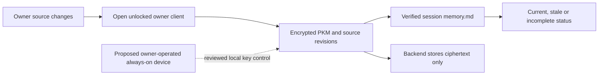

# ADR: Continuous living memory and an owner-controlled always-on runtime

Status: **proposed runtime; locked and closed-app 24/7 operation remains unimplemented.**
Updated: 2026-10-11.

## Visual Map

Solid arrows describe the implemented unlocked flow. The dotted device path is a proposal requiring separate owner review and implementation. The [PKM architecture](../../../consent-protocol/docs/reference/personal-knowledge-model.md) owns encrypted persistence.

## Current boundary

Encrypted PKM remains authoritative. The backend does not decrypt PKM and receives no vault key. `memory.md` is a reproducible, session-only view of verified encrypted readback; it is not another store. Source commits invalidate that view. Offline cached readback is stale, failed or incomplete sources are disclosed, and a change arriving during a refresh remains pending. Vault teardown clears the view and fences late publication.

The implemented bridge runs while the owner's application is open and unlocked. It observes owner-scoped PKM commits, Profile identity changes, Consent changes, and connectivity/focus recovery, and verifies remote Profile/Consent sources every minute. Queued metadata or rebuilding on the next unlock does **not** satisfy 24/7 updates. No automatic answering runs in this bridge.

## Coverage and authority audit

| Source | Existing authority and update seam | Derived memory behavior |
| --- | --- | --- |
| Profile name, email and photo | Firebase-backed AccountIdentityService, including effective owner edits | Complete encrypted private source projection, stable owner source ID, observed revisions and source timestamps |
| Consent | Existing received/sent pending, active and previous Consent Center projections | All pages; IDs/status/revocation/expiry; failed pages preserve prior records and disclose incomplete inventory |
| Saved Location and visit notes | Existing encrypted Location PKM writers | Stable source IDs, original creation time when known, revision receipts and deletion tombstones; every persisted note retained |
| To-Do | Existing encrypted one_todos private tasks | Creation/edit/completion/deletion, source ID and record revision; stale completion cannot overwrite an edit or revive a deletion |
| Memory and eligible specialist sources | Existing PKM mutation coordinator, manifests and content_revision | Rebuild every owner domain on committed changes; full eligible values, with explicit withheld branches and traversal limits |
| Chat with One | Existing governed semantic capture and encrypted Chat history | Captured information already enters PKM through the existing capture coordinator; raw transcripts, credentials and withheld branches are not silently promoted to memory |

A mirrored inventory is derived, encrypted and owner-only. It cannot create grants or exports and cannot run an implicit PKM upgrade. Failed reads never imply deletion. Known source times are retained; unknown original creation time stays unknown. The source's content revision remains the canonical concurrency boundary. This does not claim that every historical Chat fact has been captured: the existing capture coverage and save receipts determine what reached PKM.

## Concrete proposed runtime

Use an **owner-operated device** that stays powered on: a supported desktop or small home computer running a dedicated, signed Node 24 runtime. It uses the existing identity, consent, encrypted PKM read/write, manifest and revision contracts. It has no independent semantic router or second PKM authority. This design is proposed for review; no daemon, enrollment or persistent key capability ships in this PR.

1. The owner pairs the runtime from an unlocked client. The client verifies the device public key and a pairing challenge, shows its allowed sources and write operations, and issues an owner-scoped, revocable device credential. Enrollment is separate from answer-composition consent.
2. The owner must explicitly review a **new local key-control exception**: a decryption capability sealed by the device's TPM or Secure Enclave to its measured runtime and local OS account. Hussh receives neither that capability nor its wrapping key. Initial unsealing requires the owner on the device. A machine reboot cannot resume processing until its reviewed local unlock policy permits unsealing. Without this exception, memory keys remain RAM-only and reboot requires owner unlock.
3. The daemon retrieves ciphertext plus committed source metadata. It decrypts in owner-device RAM, verifies source identity/revision, and commits encrypted mutations through the existing compare-and-swap coordinator. Durable cursor/checkpoint state is encrypted on that device; plaintext source values, prompts, documents and keys are excluded from disk, telemetry, crash dumps and server logs.
4. Replay is idempotent by source ID and revision. Out-of-order updates cannot replace newer records. Deletions are revisioned tombstones. Checkpoints advance only after encrypted commit/readback. Conflicts trigger authoritative rereads. A restart replays the encrypted checkpoint before publishing a complete memory view.
5. The exact full view is rebuilt only after every eligible source is verified. Per-source failure, last successful refresh and disconnected runtime health are visible. Powered-off hardware or lost connectivity makes the view stale; no service may advertise continuous freshness merely because a worker or queue exists.
6. Revocation stops new reads/writes and clears RAM. Unpairing erases the locally sealed capability and device credential; a compromised-device response also rotates the owner's applicable keys and credentials. Recovery requires another owner-controlled device or owner recovery credentials, never a backend escrow path.

A purpose-derived HKDF key cannot decrypt existing PKM ciphertext. Restricting this daemon to a smaller decryption capability requires a separately reviewed content-key wrapping/rotation protocol; it cannot be asserted by deriving a differently named key. A hosted private runtime or third-party enclave would introduce different custody and attestation assumptions and is outside this proposal.

## Answer composition is separate

Answers remain manual: requester asks, owner approves exact scopes, question and price with explicit model-processing consent, payment is verified, then the owner chooses **Write answer** while unlocked. The approved projection transits the backend and Google Vertex AI for one composition call; PKM decryption and requester-only encryption occur on the owner device. Failed composition can be retried manually until the deadline worker owes a full refund. No vault key is transferred.

The composer flag defaults off. Live mode also requires the separate provider-review attestation. Application telemetry uses ADK NO_CONTENT and refuses processing if environment overrides would capture messages. This does not establish provider zero retention.

Google's [retention policy](https://docs.cloud.google.com/gemini-enterprise-agent-platform/resources/zero-data-retention) describes implicit memory caching up to 24 hours; [abuse monitoring](https://docs.cloud.google.com/gemini-enterprise-agent-platform/models/abuse-monitoring) can retain suspicious requests up to 90 days unless the applicable exemption is verified. [Request-response logging](https://docs.cloud.google.com/gemini-enterprise-agent-platform/models/capabilities/request-response-logging) is separately configurable. The 2026-10-11 read-only probe of the exact UAT managed runtime confirmed implicit cache **enabled** in its separately billed project. Model logging probes returned 404 in global/us/eu, so logging and the contractual abuse-monitoring exemption remain **unverified**. The default-off composer and live-review gate must remain closed until those settings and the owner's disclosure are verified.

## Decision for owner review

Review whether an owner-operated always-on device with the explicit local hardware-sealed capability is acceptable, including reboot unlock and revocation behavior. Until that review and implementation are complete, the supported freshness claim is **continuous while open and unlocked**, with truthful offline and incomplete status. Automatic answering remains deferred regardless of the runtime decision.
