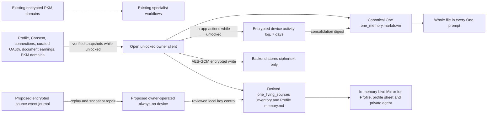

# ADR: Continuous living memory and an owner-controlled always-on runtime

Status: **V1 chat memory, an open, unlocked source projection, one shared Live Mirror and an open, unlocked in-app activity journal (encrypted device log plus consolidation into chat memory) are implemented; lossless source history and locked or closed-app operation are not.**
Updated: 2026-10-29.

## Visual Map

Solid arrows describe the implemented unlocked flow, including the in-app activity log. The dotted source journal and device paths are proposals requiring separate owner review and implementation. The existing PKM encryption and optimistic-write coordinator remain the persistence boundary; V1 does not introduce a second cryptosystem. The derived Profile document is not the chat document or another authority.

## Current boundary

For One chat, `one_memory.markdown` is the V1 memory authority. It is one Markdown document inside one client-encrypted PKM domain. The backend stores ciphertext and never receives the vault key. Unlock decrypts the document into process memory, every One turn receives the whole document as private context, and chat memory capture rewrites the encrypted document through the existing conflict-aware coordinator. Vault teardown clears the plaintext session copy and fences late publication.

Existing structured PKM domains remain authorities for Finance, KYC, Consent
and explicit Saved-information workflows. One's conversation recall remains
Soul-only: a missing document begins with an empty session document, and legacy
records never seed it. An explicit `pkm.add` retains its resumable structured
save/review contract for sharing and pricing. Its acknowledgement counts remain
separate from private-agent memory; no whole PKM packet enters One's prompt.

Chat facts are selected by the existing semantic preparation stage using `soul_markdown_v1`, then silently applied to the RAM document and encrypted through the existing writer. The model supplies a plain attributed bullet and section; corrections/extensions replace an exact offered bullet, and deletions remove it rather than saving the request. No legacy domains are imported. This V1 path has no per-fact confirmation card or automatic-memory switch: while the vault is unlocked, usable durable facts use the product-default authorization record and no capture status is added to chat. Owner identifiers may be retained; passwords, passphrases, API keys, tokens, private keys, PINs and card security codes are omitted. The whole document is bounded to 18,000 characters; reconciliation offers at most 256 bullets without silent truncation.

Typed text and pasted text attachments are assessed together. Preparation runs
beside the answer and can finish after navigation to Memory or another chat in
the same unlocked owner session. Lock, owner changes, token replacement, expired
access and unavailable authentication still fence effects, including after the
chat component unmounts. Only the originating mounted chat receives UI updates.
Incomplete preparation refuses automatic writes. An explicit save reports
failure while that chat remains visible. An ambient capture failure is a quiet
pending state that telemetry records and that never interrupts chat; a valid
assessment with no durable facts remains quiet.
RAM publication precedes encrypted cloud sync, whose status is shown in Memory.

Target references exist only in the preparation snapshot and encrypted recovery envelope, never as paths or IDs inside Soul.md. Stale, duplicate or unoffered targets fail closed. Automatic replacement refuses masked targets; multiline/nested owner-authored bullets need the editor rather than partial mutation. Unrelated text and fenced examples remain unchanged. Encrypted recovery envelopes carry their staging order, so interrupted dependent corrections replay FIFO even when device keys or encryption finish out of order. If any envelope cannot be read, recovery waits rather than replaying a later correction first.

The implemented bridge runs while the owner's application is open and unlocked. It observes owner-scoped PKM commits, Profile identity changes, Consent, connection-graph and payout changes, native connector returns, and connectivity/focus recovery. A 60-second wake verifies Profile; Consent, connections, curated connector status and document earnings have five-minute complete-scan windows, with relevant change signals forcing an immediate reread. A signal is a prompt to reread an authoritative source, not evidence of a committed value. Matching complete scans permit changes and tombstones; failed, partial or racing reads preserve the prior record and mark the inventory incomplete. Per-kind verification times expose delayed scans. Unchanged inventory contents do not require another encrypted write. Curated OAuth status records contain provider, status and connection time, never tokens or provider payloads. Queued metadata or rebuilding on the next unlock does **not** satisfy 24/7 updates. No automatic answering runs in this bridge.

Profile Live Mirror, the Memory workspace, the private agent's profile sheet and the private agent read one Live Mirror projection, built in memory from the inventory and its observed history; it is never persisted. When one source fails, the mirror still shows the verified sources and marks the failed one unavailable. That partial view never saves the derived document or rebuilds paid scope slices. "Current" is judged when the view is read: a source stays current for five minutes after its last verified read, plus a two-minute grace, so a throttled or hidden tab cannot keep showing a stale source as current. Encrypted pending hints let journal cursors advance while a failed kind stays pending, and failing kinds retry with bounded backoff. When more changes were committed than an unlocked client verified, the encrypted history records an explicit gap marker with counts and times instead of inventing the values in between. A verified source that recorded no change gets no marker. An unchanged sync's verification applies on read; a source whose records changed shows "Updating" until the rebuilt mirror lands. Lossless history of values that changed while every client was closed is still not implemented. Every surface states the boundary in one line: "Updates while the app is open and unlocked."

## Coverage and authority audit

| Source | Existing authority and update seam | Derived memory behavior |
| --- | --- | --- |
| Profile name, email and photo | Firebase-backed AccountIdentityService, including effective owner edits | Complete encrypted private source projection, stable owner source ID, observed revisions and source timestamps |
| Consent | Existing received/sent pending, active and previous Consent Center projections | Bounded complete reads with a source fence, durable terminal Location requests/invitations, non-authority source IDs and activity/status/revocation/expiry; failed, racing or over-cap reads preserve prior records and disclose incomplete inventory |
| Connections | Existing authenticated connection graph and owner-matched change signal | Both connection audiences, bounded pagination and two matching complete scans; stable connection ID, counterpart ID, creation time and contact-origin flag, without counterpart profile or contact-list rows |
| Curated OAuth connector status | Existing owner connector overview and credential-status service | Two matching complete curated-catalog scans; provider ID, connection status and time only, without custom owner-vault connectors, credential values, scopes, emails or provider payloads |
| Document earnings | Existing owner-vault document payout earnings endpoint | Live and test partitions, bounded keyset pages and two matching complete scans; request ID, status, gross/refund/net cents and timestamps without description, bank data or provider references. This is owner earnings, not all transactions or requester payments. |
| Saved Location and visit notes | Existing encrypted Location PKM writers | Stable source IDs, original creation time when known, revision receipts and deletion tombstones; every persisted note retained |
| To-Do | Existing encrypted one_todos private tasks | Creation/edit/completion/deletion, source ID and record revision; stale completion cannot overwrite an edit or revive a deletion |
| Memory and eligible specialist sources | Existing encrypted domains remain compatibility inputs | One prompts use private Soul; specialized records remain separate and never seed it |
| Chat with One | Semantic fact selection plus the encrypted Markdown writer | Background and KYC facts update private Soul; explicit Saved actions retain reviewed scoped jobs; credentials are omitted |

The Consent inventory uses a bounded owner-scoped MVCC equality fence before and after two complete scans. It detects row changes, delete/recreate and effective expiry while paging; it is not a durable owner revision. Reads never settle expiry or modify grants. UI flags and presentation grouping cannot silently remove source records. Authority tokens and provider payloads are excluded from the source projection. Exact private PKM keys survive segmented encrypted storage/readback; neither storage-ID normalization nor a summary may replace the authored complete records.

A mirrored inventory is derived, encrypted and owner-only. It cannot create grants or exports and cannot run an implicit PKM upgrade. Failed reads never imply deletion. Known source times are retained; unknown original creation time stays unknown. The source's content revision remains the canonical concurrency boundary. This does not claim that every historical Chat fact has been captured: the existing capture coverage and save receipts determine what reached PKM.

The [Live Memory source admission contract](./live-memory-source-contract.md) declares each inventory source's authority, owner isolation, post-commit signal, authoritative snapshot, allowed and excluded fields, revision and tombstone rules, incomplete-read behavior, exposure, retention, capacity and focused evidence. `scripts/ci/live-memory-source-gate.py` runs from the repository governance check. It rejects a mismatch between declared source kinds, the runtime type union and emitted adapters; every kind requires bounded capacity. It also requires the SQL and web journal kinds to match, and keeps Live Memory modules out of paid exact-scope retrieval. This is a static admission ratchet for inventory source kinds, not proof that every product feature emits an event or that every historical change was captured. Review and runtime evidence must establish the declared semantics.

## Implemented in-app activity journal

Founder decision, 2026-10-29. While the owner is signed in with the vault unlocked, the client records allowlisted actions in One (the closed kinds in `hushh-webapp/lib/pkm/live-activity/live-activity-types.ts`) into an encrypted, owner-scoped log on this device. Capture is constant-time, never awaits, coalesces exact repeats and stops on lock, sign-out, owner change or when the owner's stored automatic-memory choice is off (no owner-facing control writes that choice today; recorded gap); nothing is buffered while locked. Events carry an authored kind, an allowlisted subject id, for place kinds a place label (the owner's own name for a saved place, up to 40 characters of their text, or a Google venue's public name for a check-in or a place saved from one; a label that repeats the place's own street address is dropped on a best-effort basis), a bounded count and timestamps, never message, mail or file contents, coordinates, counterpart identity, URLs or tokens. The log keeps at most 7 days and 2,048 events per owner, enforced when it is next opened on the device, and is purged with the account.

The log is not PKM and not a source inventory kind. Its only PKM effect is consolidation: each cycle sends a dated, first-person digest of one local day's not-yet-consolidated events (a day can arrive in several cycles) through the existing `/api/pkm/memory/proposals` preparation with `soul_markdown_v1`, and the private agent's existing memory agents decide which facts are durable; consolidation never removes a memory. Usable facts are staged into `one_memory.markdown` through the existing writer, at most one commit per cycle, under the same fail-closed rule as ambient chat capture. A failed cycle writes nothing and stays a quiet pending state that never interrupts chat; every cycle that reaches a decision is recorded through `live_activity_consolidation_completed`. Each chat turn also receives a short recent-activity packet; Profile > Memory > History shows today's activity. This covers only actions in One on one device while the app is open and unlocked; it is not a log of every user action.

## Proposed encrypted source event journal

The source inventory bridge retains the latest source-linked records and tombstones plus a bounded observed history with explicit gap markers, not an append-only history of every user action; the in-app activity journal above does not change that. Active and retained-history caps fail incomplete rather than silently trim Consent, connection, curated OAuth or earnings records. `pkm_events` carries coarse control metadata, not decrypted values or a complete feature activity log. Neither source snapshots nor the admission gate can reconstruct an intermediate change that happened while every owner client was closed. Requester payments, individual receipts, document handoffs, contact-list entries and location traces need their own reviewed source contracts before any coverage claim.

A future journal would have each source owner publish an event **after its authoritative commit**, ideally through a transactional outbox bound to that commit. Each owner-scoped event would carry an opaque event ID and cursor, source kind and stable source ID, source revision, operation (`upsert` or `delete`), schema version, source time, and an encrypted minimal change or snapshot reference. The owner-visible fields and values stay in ciphertext; server routing, telemetry and retry logs retain no plaintext payload, token, coordinate or document body. The event ID and `(source kind, source ID, source revision)` make replay idempotent; a later revision dominates an older one, and deletion is a durable revisioned tombstone. An event does not authorize sharing, model processing or payment.

An owner-controlled consumer would resume from an encrypted checkpoint, verify event continuity and source revisions, then read authoritative snapshots to repair gaps, out-of-order delivery and schema upgrades. It would advance its checkpoint only after the existing encrypted PKM compare-and-swap commit and readback succeed. Bounded queues, backoff and source-specific retention must surface backlog and failure instead of silently dropping changes. The owner can inspect source freshness and delete both journal payloads and derived projections under the account-erasure contract. This journal, outbox, replay worker, retention policy and cross-device cursor do **not** exist in the current implementation.

### Standards used for the proposed source journal

The proposed event identity and versioned envelope follow the interoperable
[CloudEvents specification](https://github.com/cloudevents/spec/blob/main/cloudevents/spec.md).
Publishing only after the source transaction commits follows the
[transactional outbox pattern documented by Debezium](https://debezium.io/documentation/reference/stable/transformations/outbox-event-router.html).
The payload and telemetry restrictions follow [OWASP logging guidance](https://cheatsheetseries.owasp.org/cheatsheets/Logging_Cheat_Sheet.html)
and [OpenTelemetry Collector security guidance](https://opentelemetry.io/docs/security/config-best-practices/).
These references guide the proposed journal design; the current snapshot bridge is
not a CloudEvents or outbox deployment.

## Concrete proposed runtime

Use an **owner-operated device** that stays powered on: a supported desktop or small home computer running a dedicated, signed Node 24 runtime. It would consume the proposed journal and verified source snapshots through the existing identity, consent, encrypted PKM read/write, manifest and revision contracts. It would have no independent semantic router or second PKM authority. This design is proposed for review; no daemon, enrollment, journal subscriber or persistent key capability ships in this implementation.

1. The owner pairs the runtime from an unlocked client. The client verifies the device public key and a pairing challenge, shows its allowed sources and write operations, and issues an owner-scoped, revocable device credential. Enrollment is separate from answer-composition consent.
2. The owner must explicitly review a **new local key-control exception**: a decryption capability sealed by the device's TPM or Secure Enclave to its measured runtime and local OS account. The hosted service receives neither that capability nor its wrapping key. Initial unsealing requires the owner on the device. A machine reboot cannot resume processing until its reviewed local unlock policy permits unsealing. Without this exception, memory keys remain RAM-only and reboot requires owner unlock.
3. The daemon retrieves ciphertext plus committed source metadata. It decrypts in owner-device RAM, verifies source identity/revision, and commits encrypted mutations through the existing compare-and-swap coordinator. Durable cursor/checkpoint state is encrypted on that device; plaintext source values, prompts, documents and keys are excluded from disk, telemetry, crash dumps and server logs.
4. Replay is idempotent by source ID and revision. Out-of-order updates cannot replace newer records. Deletions are revisioned tombstones. Checkpoints advance only after encrypted commit/readback. Conflicts trigger authoritative rereads. A restart replays the encrypted checkpoint before publishing a complete memory view.
5. The exact full view is rebuilt only after every eligible source is verified. Per-source failure, last successful refresh and disconnected runtime health are visible. Powered-off hardware or lost connectivity makes the view stale; no service may advertise continuous freshness merely because a worker or queue exists.
6. Revocation stops new reads/writes and clears RAM. Unpairing erases the locally sealed capability and device credential; a compromised-device response also rotates the owner's applicable keys and credentials. Recovery requires another owner-controlled device or owner recovery credentials, never a backend escrow path.

A purpose-derived HKDF key cannot decrypt existing PKM ciphertext. Restricting this daemon to a smaller decryption capability requires a separately reviewed content-key wrapping/rotation protocol; it cannot be asserted by deriving a differently named key. A hosted private runtime or third-party enclave would introduce different custody and attestation assumptions and is outside this proposal.

## Answer composition is separate

Both active connection categories can request an answer. The owner explicitly approves the question, exact scopes, price and model processing. While unlocked, the owner client prepares a readable Gemini answer and seals it to the requester; **Write answer** retries preparation if needed. Checkout requires a completed nonempty staged envelope. A verified Checkout event releases that envelope once. The requester opens the answer from Feed and unlocks their own vault when needed. Existing paid requests without an envelope still require owner unlock and preparation within the original deadline. The approved projection transits the backend and Google Vertex AI for one composition call; PKM decryption and requester-only encryption occur on the owner device. No vault key is transferred.

Request checkout returns use `answerPaymentRequestId` and the answer's own payment status, including delayed confirmation, cancellation and bounded retries. Historical `paymentRequestId` returns with `paid`/`cancelled` remain supported. Drive's `success`/`cancel` status handler, configuration and payment mode remain independent. A staged envelope is cancellable until release; a verified charge after cancellation or disconnection files the existing full-refund obligation without releasing the envelope. Feed milestones use migration 179's partial unique index for idempotency.

The operator-only `PkmAnswerPaymentService.recover_checkout_event` retrieves the actual Stripe Event and current Checkout Session with the stored order-mode credentials. A NULL-mode historical row requires an explicit mode and exact authenticated provider reconciliation before binding; today's deployment mode is never inferred. It requires exact request/session/attempt/terms/amount/currency/mode binding, then uses the same settlement transaction and replay guard as the signed webhook. PaymentIntent metadata, browser return parameters and HTTP 200 do not establish payment. Recovery cannot manufacture an unstaged answer or decrypt PKM.

The shared Profile Memory renderer now persists a source-linked `memory.md` projection inside the existing encrypted `one_living_sources._private.memory_document`. It preserves the current verified inventory, record revisions, tombstones and structured source domains; it is not a complete event journal. The signature excludes the document's own write revision, so unchanged authoritative readback reuses the document without a write loop. Failed or incomplete reads cannot overwrite it. Name, photo reference and eligible explicitly recorded facts (including age and sex) retain source paths; no age or sex is inferred. The chat document in `one_memory.markdown` keeps its existing authority. Profile now previews Markdown generated from the Live Mirror projection; the persisted `memory.md` stays the derived document behind paid scope slices. Neither is an authority.

Paid answers retrieve stable approved scope slices from that same encrypted projection, never the owner's whole private document. Each slice links its authoritative domain and Soul revisions, exposure metadata, account identity fingerprint where needed, and the UTC derivation date for age. Metadata is checked before reuse; a missing or stale slice is rebuilt from exact authoritative sources through the existing encrypted writer, preserving the full Profile document and unrelated slices. One coherent ciphertext/manifest read is reused per domain. Only approved source segments are decrypted, then exact eligible paths are projected. Vault and PKM invalidation epochs reject in-flight stale work, and failed reads cannot establish absence. Profile Memory refresh rebuilds the same slices after identity edits and across birthdays. Local synthetic cold/warm preparation measurements and encrypted-cache regression coverage live in `answer-read-session.test.ts`; they do not measure deployed provider latency.

Every successful question receives its own Gemini composition, including simple name/age/sex answers. The model receives the exact question, exact approved values, narrow Markdown and bounded source/freshness metadata. Name and photo are never unconditional profile context. The owner can price only scopes verified as available; that exact set is frozen when the price sheet opens and rechecked before approval. The requester sees included and not-included scope labels before checkout. A narrower answer must end with a fixed disclosure derived from server-validated scope IDs, with no model-reported gap in approved information; otherwise it receives no chargeable receipt. Missing any approved fact is unchargeable, and model failures remain pending for retry. A request-bound signed receipt from successful Gemini composition is verified before a new staged envelope can enable checkout. It proves the gated call and approved terms, while requester ciphertext remains unreadable to the backend. Historical immutable staged orders retain their existing recovery and financial obligations.

The composer flag defaults off. Live mode also requires the separate provider-review attestation. Application telemetry uses ADK NO_CONTENT and refuses processing if environment overrides would capture messages. This does not establish provider zero retention.

Google's current [retention policy](https://docs.cloud.google.com/gemini-enterprise-agent-platform/resources/zero-data-retention) describes default memory-only implicit caching with a 24-hour TTL and says it does not violate zero retention. The actual project's `DURABLE` response permits long-lived retention backed by durable storage according to Google's official [API schema](https://aiplatform.googleapis.com/$discovery/rest?version=v1); its exact TTL/deletion and residency guarantees remain unverified. The 2026-10-13 authenticated read checked the deployed composer project/model and global/us/eu logging configuration. No configuration was found for those exact logging resources; documentation describes logging as default-off. Applicable [abuse monitoring](https://docs.cloud.google.com/gemini-enterprise-agent-platform/models/abuse-monitoring) may retain flagged prompts for up to 90 days unless the customer's contract or approved exemption covers it. The live review flag remains false until actual retention guarantees, contractual coverage and owner disclosure are satisfied. Test-mode UAT remains enabled. Full responses, routing evidence, deployment mapping and precise owner prerequisites are in [the provider review record](./paid-answer-provider-review-2026-10-13.md).

## Decision for owner review

Review whether an owner-operated always-on device with the explicit local hardware-sealed capability is acceptable, including reboot unlock and revocation behavior. Until that review and implementation are complete, the supported freshness claim is **continuous while open and unlocked**, with truthful offline and incomplete status. Automatic answering remains deferred regardless of the runtime decision.
