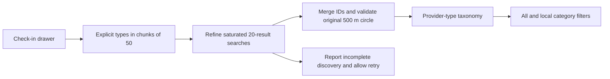

# One Location Place Taxonomy

Status: implementation contract
Owner: One Location + Hussh maps integration
Last updated: 2026-10-22

The Check-in picker discovers physical venues within 500 m of the current
location and filters them using Google's explicit place types.

## Visual Map

## Discovery and radius

`consent-protocol/hushh_mcp/services/google_maps_service.py` owns requests and caching;
`nearby_place_discovery.py` owns bounded discovery through fetch/normalize ports;
`place_geometry.py` owns spherical geometry; `place_taxonomy.py` owns classification.
Every requestable venue type in the
chip table is requested explicitly, including `food_court`. An unfiltered search
also discovers venues with unknown or generic types.

Google limits each Nearby Search response to 20 places. A saturated response
triggers four overlapping smaller searches. Saturated children are refined
again, up to four levels. Every child that can intersect the original circle
gets a fresh distance-ranking budget. Calls share a six-request concurrency
limit, a 96-query budget and a 25-second total deadline below the proxy timeout.
Successful responses survive another query's failure or deadline.

Every returned record is validated against the **original** user position with
unrounded spherical distance. Subdivision never expands the allowed 500 m.
The distance check allows only one micrometre of floating-point error. Invalid
coordinates, address-only records, permanently closed venues and service-area
businesses without physical premises are excluded. Temporarily closed physical
venues remain discoverable. Duplicate IDs merge provider types before classification.
No application-wide 80-row cap or post-merge 20-row cap discards valid results.

Finite queries cannot guarantee every real-world or Google-indexed venue is
returned. A failed/timed-out query, or a refined response still at the provider
cap, or a query/depth budget is exhausted, sets the optional `discoveryIncomplete` response field. The picker preserves
available venues and offers retry/name-search guidance instead of presenting a
partial list as complete. Name search remains a separate, radius-restricted mode.

## Category rules

Each Google Table A type has exactly one owning chip. A venue with multiple
precise provider types can legitimately match multiple chips. Precise types beat
umbrella types such as `lodging` or `store`; request provenance and venue-name
keywords never decide eligibility. Unknown venues remain available in More.

| Chip | Label | Meaning |
| --- | --- | --- |
| `food_drink` | Food | Restaurants, food courts, cafeterias, bakeries, prepared food, bars and pubs |
| `cafes` | Café | Cafes, coffee shops, tea houses, cat cafes and dog cafes |
| `health` | Health | Provider health and wellness types, including clinics and pharmacies |
| `shopping_services` | Shops | Retail, groceries, professional services, banking and vehicle repairs |
| `hotels_stays` | Hotels | Explicit commercial accommodation: hotels, motels, hostels, inns, guest houses, B&Bs and resorts |
| `other_stays` | Stays | Generic lodging, private rooms, cottages, farm stays and residential apartments |
| `education` | Education | Schools, universities, libraries and educational institutions |
| `outdoors_landmarks` | Leisure | Parks, landmarks, culture, entertainment, sports and camping |
| `transit` | Transit | Boarding, parking, fuel and charging |
| `worship` | Worship | Religious worship venues |
| `civic` | Civic | Government and emergency services |
| `other` | More | Other physical venues, including offices and unknown types |

A listing named “Two-Bedroom Apartment” with only `lodging` is Stays, never
Hotels. A genuine hotel carrying `hotel` and `lodging` is Hotels. A restaurant
carrying `restaurant` and `lodging` is Food. If Google provides incorrect precise
types, the provider record remains a limitation; this code does not invent a
classification from the business name.

## Cache and clients

`hushh-webapp/lib/one-location/nearby-places.ts` owns the picker category table,
radius filtering and response metadata. Existing service/type entrypoints remain
compatible facades; the check-in sheet retains capture and presence ownership.

Check-in cache keys include the exact latitude, longitude and category. Reusing
already filtered results across a roughly 100 m grid cell previously omitted
newly nearby venues and retained stale distances. Directory caching keeps its
separate keys. The `places-cache:v3:` namespace isolates this taxonomy from old
rolling-deployment responses. Incomplete discovery is never cached as a complete
answer. Successful complete sweeps retain the existing ten-minute TTL.

The frontend fetches All once and switches chips locally. Categories share one
backend/frontend type contract, used by web and native webviews through the
existing authenticated, private/no-store proxy. Provider keys stay server-side.

## Verification and changes

The nearest backend suites are `tests/test_place_taxonomy.py`,
`tests/services/test_google_maps_service.py` and
`tests/test_one_location_nearby_presence_routes.py`. They cover the type partition,
food/cafe/hotel/stay membership, dense-area recovery, radius edges, moving inside
the old cache cell, category contamination and failure recovery.

Update the backend Literal, frontend category union, sheet chip table and browser
layout labels together. The component suite verifies category switching against
the returned evidence. The layout pack checks that all chips remain reachable
on narrow phones and desktop. Regenerate Back/Search UI receipts after UI edits.

## Sources

- [Google Place Types](https://developers.google.com/maps/documentation/places/web-service/place-types)
- [Google Nearby Search](https://developers.google.com/maps/documentation/places/web-service/nearby-search)
