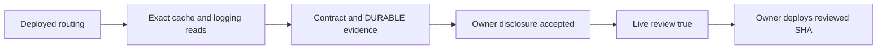

# Paid-answer UAT provider review, 13 October 2026

Authenticated, read-only GCP and GitHub reads were performed using the authorised local account. The sanitized [machine record](./paid-answer-provider-review-2026-10-13.json) contains exact responses and observations; no token, secret value, private prompt or customer log is recorded. The live Stripe key was used process-only for authenticated read-only provider calls. During the provider review, no runtime, shared webhook, Drive, Gemini project/model, cache setting or contract was changed. The later separately authorised test-mode UAT restoration is recorded below.

## Visual Map



## Actual routing and boundaries

At 22:59:35 UTC on 12 October (04:29:35 IST on 13 October), UAT `consent-protocol` in `hushh-pda-uat/us-central1` served revision `consent-protocol-02068-juz` at 100% traffic, deployment SHA `9f6232dea557243ad65b4c7b8599f98848a86477`. Runtime account: `consent-protocol-runtime@hushh-pda-uat.iam.gserviceaccount.com`.

The answer writer's `gemini-default` single-turn factory selects `HUSSH_GEMINI_TEXT_MODEL=gemini-3.6-flash`, Vertex ADC and `GENAI_GOOGLE_CLOUD_PROJECT=hushh-vertex-personal54` (number `748922917160`), with locations `global,us,eu`. The One chat override `hussh-511311` is separate. Official [endpoint/residency guidance](https://docs.cloud.google.com/gemini-enterprise-agent-platform/resources/data-residency?popup=false) permits worldwide processing for global calls and limits us/eu processing to their respective jurisdictions. The existing failover includes global, so it cannot claim a single residency boundary. This processing guidance does not establish implicit DURABLE cache residency or deletion. Code review confirms a fresh tool-less single-turn session, no Search/Maps grounding, no Live resumption or Interactions storage, and application NO_CONTENT telemetry. These application boundaries do not attest provider retention.

The initial serving UAT snapshot had answer composer/payments enabled, answer Stripe mode **test**, provider-reviewed **false**, answer drain **false**. Drive is independently **live**. The deployed answer test bindings reference `STRIPE_SECRET_KEY` and `STRIPE_WEBHOOK_SECRET`; Drive references `STRIPE_LIVE_SECRET_KEY` and `STRIPE_LIVE_WEBHOOK_SECRET`. The follow-up retains those existing test bindings through dedicated mode-specific answer environment names when new answer purchases switch live. It preserves the shared endpoint and Drive configuration.

At 23:35:36 UTC, the existing UAT `STRIPE_LIVE_SECRET_KEY` was read process-only through authorised Secret Manager access. Authenticated Stripe balance readback returned HTTP 200 with `livemode:true`; the platform account readback reported charges/payouts enabled and details submitted. The existing `https://api.uat.hushh.ai/api/payments/stripe/webhook` endpoint is enabled with `livemode:true` and subscriptions for Checkout completed, async succeeded and expired (plus its existing subscription events). No endpoint, subscription, secret or account was changed. These [read-only account](https://docs.stripe.com/api/accounts/retrieve) and [endpoint](https://docs.stripe.com/api/webhook_endpoints/list) probes verify the live credential and shared endpoint posture, not a real-card transaction, signing-secret association, owner Connect account or refund/payout journey; those remain controlled UAT readbacks.

## Provider evidence and limits

At 22:41:59 UTC, `GET /v1/projects/hushh-vertex-personal54/cacheConfig` returned HTTP 200 with:

```json
{"name":"projects/748922917160/cacheConfig","retentionConfig":{"retentionType":"DURABLE"}}
```

`disableCache` is absent. Google's [zero-retention guidance](https://docs.cloud.google.com/gemini-enterprise-agent-platform/resources/zero-data-retention), updated 9 October, describes default in-memory, project-isolated caching with a 24-hour TTL and says it does not violate zero retention. It does not define this response's `DURABLE` mode.

At 23:51:54 UTC, Google's official [v1](https://aiplatform.googleapis.com/$discovery/rest?version=v1) and [v1beta1](https://aiplatform.googleapis.com/$discovery/rest?version=v1beta1) public REST schemas resolved that meaning: `DURABLE` permits long-lived implicit cache retention backed by durable storage; `EPHEMERAL` restricts retention to volatile memory. A project with no stated preference reports `DURABLE`, and unspecified retention also means `DURABLE`. The schemas give no TTL, deletion or data-residency guarantees for that mode. Treating the actual project as memory-only with the guidance's 24-hour TTL would therefore be unsupported. No project setting was changed.

At 00:10:33 UTC on 13 October, authenticated explicit `cachedContents` listings returned HTTP 200 and zero entries in **global, us and eu**. The writer does not create or reference explicit caches. Google’s [creation guidance](https://docs.cloud.google.com/gemini-enterprise-agent-platform/models/context-cache/context-cache-create?hl=en) sets a default expiration of 60 minutes; its [overview](https://docs.cloud.google.com/gemini-enterprise-agent-platform/models/context-cache/context-cache-overview) permits longer configured lifetimes with no stated maximum and warns that explicit caches also interact with implicit caching. Its [update guidance](https://docs.cloud.google.com/gemini-enterprise-agent-platform/models/context-cache/context-cache-update?hl=en) says expired caches are deleted through garbage collection without specifying a physical deletion deadline. None of these observations resolves hidden implicit `DURABLE` retention.

Exact model `fetchPublisherModelConfig` calls in global, us and eu returned HTTP 404 `NOT_FOUND`, stating the configuration was not set. [Request-response logging documentation](https://docs.cloud.google.com/gemini-enterprise-agent-platform/models/capabilities/request-response-logging) describes logging as default-off. Absence is consistent with that default; these responses are not explicit `enabled:false` configurations.

[Abuse-monitoring guidance](https://docs.cloud.google.com/gemini-enterprise-agent-platform/models/abuse-monitoring) permits flagged prompt retention for up to 90 days for customers under the applicable Google Cloud terms. Cloud Master Agreement coverage or an approved exception must be established for this project/model; invoice status alone does not prove exemption. The current Advanced AI section lists particular Claude models/features; it does not list this Gemini model, so it adds no separate blocker on the observed configuration.

These reads returned no IAM permission denial. The outstanding evidence is contractual/configuration interpretation, not a demonstrated missing API permission.

## Exact owner prerequisites and deployment mapping

1. Obtain Google Support/account-team evidence for this project's `DURABLE` posture: exact data held, durable-storage TTL/deletion, residency, explicit-cache interaction and zero-retention applicability. Its durable-storage meaning is now verified. Alternatively, approve a separate project-wide switch to `EPHEMERAL` or disabled caching and verify its readback; that would affect all models/regions and is outside this preservation change.
2. Establish applicable Cloud Master Agreement or approved abuse-monitoring exemption, for `gemini-3.6-flash` under the actual governing terms.
3. Accept the owner disclosure against the verified backend/provider plaintext transit and retention posture. Each request still needs explicit model-processing consent; neither an inferred fact nor old KYC grants that consent.

At the initial review, `PKM_ANSWER_LIVE_PROVIDER_UAT_REVIEWED` was unset (effective false) alongside enabled composer/payments and repository answer mode live, correctly blocking deployment. Following the owner's explicit restoration instruction, repository variables were changed and read back as requests/composer/payments true, answer Stripe mode **test**, provider reviewed **false**. A controlled backend-only deployment of existing green main SHA `bf6ec5d7282f5c0b385a94d8ad21ef1c82d7a139` was dispatched in [run 38323861024](https://github.com/hushh-labs/hushh-research/actions/runs/38323861024); final serving verification is recorded with that run. Drive variables were not changed.

The tested mapping is repository variable → Cloud Build `_PKM_ANSWER_LIVE_PROVIDER_REVIEWED` / `_PKM_ANSWER_COMPOSER_ENABLED` → runtime environment → `answer_composer_enabled()`. With live mode and review false, runtime composition is closed and deployment preflight rejects enabled live payments. Test mode with review false remains deployable and enables the configured composer. With both composer and genuine live review true, live composition opens. The fail-closed check is preserved.

After evidence satisfies all three items, switch `PKM_ANSWER_STRIPE_UAT_MODE=live` and `PKM_ANSWER_LIVE_PROVIDER_UAT_REVIEWED=true` together, then deploy the reviewed backend/frontend SHA. Verify the retained test credentials, live owner Connect readiness, authenticated answer drain and manual two-account payment/readback/refund/payout UAT. CI and synthetic encrypted application tests do not establish those external provider journeys. No real charge is authorised for automatic execution.

## Authorised temporary test-mode restoration

[Deployment run 38323861024](https://github.com/hushh-labs/hushh-research/actions/runs/38323861024) completed successfully. At 00:09:58 UTC, the actual serving revision `consent-protocol-02071-zap` had 100% traffic, Ready=True and deploy SHA `bf6ec5d7282f5c0b385a94d8ad21ef1c82d7a139`. Its exact environment readback was:

```text
PKM_ANSWER_REQUESTS_ENABLED=true
PKM_ANSWER_COMPOSER_ENABLED=true
PKM_ANSWER_PAYMENTS_ENABLED=true
PKM_ANSWER_STRIPE_MODE=test
PKM_ANSWER_LIVE_PROVIDER_REVIEWED=false
```

Health, authenticated answer availability and the owner preparation queue returned HTTP 200; Vertex capability was available. Selected answer credentials had the test-key/signing-secret prefixes, with the existing test secret references. Read-only Stripe balance confirmed test mode and its existing shared webhook was enabled. Invalid signature returned 400; a correctly signed unsupported TEST event returned 200 before any order/event mutation. The exact pre/post Drive environment and secret-reference comparison had no changed keys; Drive remains live. Gemini project/model/regions were unchanged.

This proves temporary TEST availability, not a completed answer or real payment. The deployed green-main baseline excludes the final unmerged follow-up. **Final live acceptance remains incomplete** until the exact provider evidence and owner approval permit the live/reviewed pair, the approved final SHA is deployed and the owner performs controlled real-card UAT. No real charge, model prompt, vault unlock or financial mutation was performed during these probes.

## Synthetic real-Gemini adapter verification

At 00:30:39 UTC, the production `AnswerComposer` and managed ADK single-turn adapter made two real Vertex `generateContent` calls with strictly synthetic facts. Both returned HTTP 200, nonempty bounded answers, three covered facts and no gaps. Exact project `hushh-vertex-personal54`, model `gemini-3.6-flash`, configured locations `global,us,eu`; both calls selected `global`. First local-process composition took **3922.01ms**; the second same-process call took **1354.65ms**. Underlying HTTP times were 1744.85ms and 1324.93ms. Local source SHA was `8aac6a05ee6d5f735005d3fd73ab6a39d114b8bc`.

The probe used the existing authorised local CLI OAuth identity through the factory's local credential seam, rather than the deployed Cloud Run service identity. No prompt/reply, credential value or private fact was persisted; NO_CONTENT telemetry remained active. No runtime/provider setting, database, vault, consent, staging, payment or signing receipt was changed. These two samples establish local production-adapter transport and model access, not Cloud Run cold-start latency, provider cache-hit behavior, a consent-gated UAT journey or a real payment. They do not satisfy the unresolved DURABLE/contract/disclosure review; the provider-review flag stays false. Sanitized timing and transport metadata are in the machine record.

## Displayed owner consent reviewed against actual source

The follow-up's existing `AnswerRequestReview` names **Google Gemini on Vertex AI**, explains that only ticked information reaches the provider under its retention and caching policies, and requires the unchecked per-request checkbox: “I agree to this question and the ticked information being used by Google Gemini to write the answer.” The price sheet describes approval → preparation/encryption → Pay when ready → verified release. Exact scopes, question, model-processing consent and price are bound to the request before preparation.

This verifies explicit model-processing disclosure and consent in the application. It does not establish acceptance of unknown DURABLE retention lifetime, processing/cache residency or abuse-monitoring contract coverage. The product/privacy owner must approve this disclosure against the completed provider evidence before the review flag can become true. No existing KYC or account profile consent substitutes for this per-request decision.
