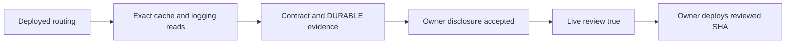

# Paid-answer UAT provider review, 13 October 2026

Authenticated, read-only GCP and GitHub reads were performed using the authorised local account. The sanitized [machine record](paid-answer-provider-review-2026-10-13.json) contains exact responses and observations; no token, secret value, private prompt or customer log was read or recorded. No runtime, shared webhook, Drive, Gemini project/model, cache setting or contract was changed.

## Visual Map



## Actual routing and boundaries

At 22:59:35 UTC on 12 October (04:29:35 IST on 13 October), UAT `consent-protocol` in `hushh-pda-uat/us-central1` served revision `consent-protocol-02068-juz` at 100% traffic, deployment SHA `9f6232dea557243ad65b4c7b8599f98848a86477`. Runtime account: `consent-protocol-runtime@hushh-pda-uat.iam.gserviceaccount.com`.

The answer writer's `gemini-default` single-turn factory selects `HUSSH_GEMINI_TEXT_MODEL=gemini-3.6-flash`, Vertex ADC and `GENAI_GOOGLE_CLOUD_PROJECT=hushh-vertex-personal54` (number `748922917160`), with locations `global,us,eu`. The One chat override `hussh-511311` is separate. Code review confirms a fresh tool-less single-turn session, no Search/Maps grounding, no Live resumption or Interactions storage, and application NO_CONTENT telemetry. These application boundaries do not attest provider retention.

UAT currently has answer composer/payments enabled, answer Stripe mode **test**, provider-reviewed **false**, answer drain **false**. Drive is independently **live**. The deployed answer test bindings reference `STRIPE_SECRET_KEY` and `STRIPE_WEBHOOK_SECRET`; Drive references `STRIPE_LIVE_SECRET_KEY` and `STRIPE_LIVE_WEBHOOK_SECRET`. The follow-up retains those existing test bindings through dedicated mode-specific answer environment names when new answer purchases switch live. It does not edit the shared webhook or Drive configuration.

## Provider evidence and limits

At 22:41:59 UTC, `GET /v1/projects/hushh-vertex-personal54/cacheConfig` returned HTTP 200 with:

```json
{"name":"projects/748922917160/cacheConfig","retentionConfig":{"retentionType":"DURABLE"}}
```

`disableCache` is absent. Google's [zero-retention guidance](https://docs.cloud.google.com/gemini-enterprise-agent-platform/resources/zero-data-retention), updated 9 October, describes default in-memory, project-isolated caching with a 24-hour TTL and says it does not violate zero retention. It does not define this response's `DURABLE` mode. Treating that mode as the documented memory-only default would be an unsupported inference.

Exact model `fetchPublisherModelConfig` calls in global, us and eu returned HTTP 404 `NOT_FOUND`, stating the configuration was not set. [Request-response logging documentation](https://docs.cloud.google.com/gemini-enterprise-agent-platform/models/capabilities/request-response-logging) describes logging as default-off. Absence is consistent with that default; these responses are not explicit `enabled:false` configurations.

[Abuse-monitoring guidance](https://docs.cloud.google.com/gemini-enterprise-agent-platform/models/abuse-monitoring) permits flagged prompt retention for up to 90 days for customers under the applicable Google Cloud terms. Cloud Master Agreement coverage or an approved exception must be established for this project/model; invoice status alone does not prove exemption. The current Advanced AI section lists particular Claude models/features; it does not list this Gemini model, so it adds no separate blocker on the observed configuration.

These reads returned no IAM permission denial. The outstanding evidence is contractual/configuration interpretation, not a demonstrated missing API permission.

## Exact owner prerequisites and deployment mapping

1. Obtain Google Support/account-team evidence defining `DURABLE` for this project: data held, memory/at-rest behavior, TTL/deletion, explicit-cache interaction and zero-retention applicability. Alternatively, approve a separate project-wide cache change and verify its readback; that would affect all models/regions and is outside this preservation change.
2. Establish applicable Cloud Master Agreement or approved abuse-monitoring exemption, for `gemini-3.6-flash` under the actual governing terms.
3. Accept the owner disclosure against the verified backend/provider plaintext transit and retention posture. Each request still needs explicit model-processing consent; neither an inferred fact nor old KYC grants that consent.

`PKM_ANSWER_LIVE_PROVIDER_UAT_REVIEWED` is **unset**, so the workflow defaults it to false. It remains unset because review is not satisfied. The repository has `PKM_ANSWER_COMPOSER_UAT_ENABLED=true`, `PKM_ANSWER_PAYMENTS_UAT_ENABLED=true` and `PKM_ANSWER_STRIPE_UAT_MODE=live`. The tested mapping is repository variable → Cloud Build `_PKM_ANSWER_LIVE_PROVIDER_REVIEWED` / `_PKM_ANSWER_COMPOSER_ENABLED` → runtime environment → `answer_composer_enabled()`. With live mode and review false, runtime composition is closed; the deployment preflight rejects enabled live payments without review. With both composer and genuine review true, the composer opens. No deployment was performed.

After evidence satisfies all three items, the owner can set `PKM_ANSWER_LIVE_PROVIDER_UAT_REVIEWED=true` and deploy the reviewed backend/frontend SHA. Verify the retained test credentials, live owner Connect readiness, authenticated answer drain and manual two-account payment/readback/refund/payout UAT. CI and synthetic encrypted application tests do not establish those external provider journeys.
