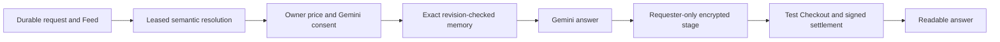

# Request scope recovery evidence, 13 October 2026

This repair keeps answer purchases in Stripe test mode and the provider-reviewed flag false. Drive remains on its existing live configuration. It does not merge or deploy the follow-up. See [the provider review](./paid-answer-provider-review-2026-10-13.md) for the unresolved Vertex retention and consent decisions.

## Visual Map

## Observed lifecycle

The following UTC timestamps come from read-only UAT database and Cloud Run queries. Historical browser tap, memory-read and model-start timings were not recorded; they cannot be reconstructed from the screenshots.

| Milestone | `6bb693ec-8d1f-4f95-a217-25037820a06e` | `a589fb03-5ae4-411d-92d6-17eb8312b846` |
| --- | --- | --- |
| Browser tap | Not recorded | Not recorded |
| API receipt | No separate application receipt timestamp recorded | No separate application receipt timestamp recorded |
| Request row created | 02:12:47.690699 | 02:14:00.597717 |
| Owner Feed event created | 02:12:47.683598 | 02:14:00.583065 |
| Request HTTP completion | 02:13:08.229114; 20,759 ms | 02:14:21.525120; 21,281 ms |
| Semantic resolution | Failed; `skipped/resolver_failed` | Failed; `skipped/resolver_failed` |
| Offered scopes after failure | 147 | 147 |
| Owner approval / stored price | None | 02:16:54.079876; $1; exact Age scope selected |
| Requester approval Feed event | None | 02:16:54.056617 |
| Memory read / Gemini | No attributable historical stage measurement | No attributable historical stage measurement |
| Encrypted staging / payment order | Neither existed at readback | Neither existed at 02:47:04 readback |

Feed timestamps are transaction-local creation timestamps; their slight lead over row timestamps does not mean a Feed event was published before the request committed.

## Causes and repair boundaries

Request creation awaited catalog loading and the 20-second semantic resolver before returning HTTP success. It now commits the row and owner Feed event first, with a background wakeup and durable leased work recovered by the existing answer worker. Migration 326 adds the lease and bounded attempt counter. Owner cancellation and connection checks still fence late results.

Resolver failure previously copied the entire eligible catalog into the owner review and permitted manual pricing. Failure now offers retry or decline only. Canonical Name, derived Age, explicitly saved Sex and Photo candidates precede the resolver's bounded catalog; semantic selection remains the agent's decision. Successful resolution persists only accepted handles. The simplified owner review retains explicit Gemini consent in the price confirmation sheet. The existing signed composition receipt binds the approved terms and exact input, including source revisions; client freshness is checked again before staging.

The memory bridge responded to its own derived projection write by scheduling another full refresh. Concurrent projection writers could race, while a global PKM epoch invalidated a narrow answer after unrelated writes. The shared writer now serializes by user/domain, rereads the current encrypted revision for each bounded jittered retry, and skips identical source-linked slices. Narrow reads fence only their authoritative sources and the vault session. Derived projection writes no longer perpetually mark Profile Memory pending. Plaintext remains in the existing session-only caches.

The 409 observations are HTTP write conflicts. The collected window includes multiple users, so its aggregate count cannot honestly be attributed entirely to these two requests, and the original HTTP summaries do not identify every conflict subtype. The regression exercises an actual encrypted projection race through the application services, then verifies one current projection and one staged requester-only answer. Unreadable or changed sources still fail closed.

The observed 410 is `CONSENT_SSE_DISABLED`, an explicit runtime configuration response. It is not evidence of an expired token. That response remains on fallback delivery without a retry storm; an unrecognized/expired 410 refreshes authentication and retries with a bounded backoff. Request cards poll both participant views for a bounded period and mutations directly refresh their request. The existing Feed refresh owner remains in place.

Approval had no visible owner preparation retry, while the requester could wait indefinitely. The card now exposes retry, preparation has a 60-second operational bound that prevents a late result advancing to staging, and the payment projection reports actionable retry after two minutes without a valid prepared answer. Confirmed absence remains non-chargeable.

The Feed also took its price only from a payment order, although the order does not exist before Checkout. It now uses the approved request price and requires the composed staged answer. Staging updates the existing coarse Feed milestone instead of losing the update to `ON CONFLICT DO NOTHING`. Historic approval-only activity no longer says to pay for an unprepared answer.

## Verification boundaries

Focused application tests exercise current name/age facts, missing facts, source isolation, source revision checks, real client encryption, a forced 409, concurrent preparation, one staged answer, and readable requester decryption. Real PostgreSQL tests cover durable creation, resolver failure, late resolution, pricing, staging, signed settlement and historical test-order recovery. Chromium and WebKit exercise photo isolation and Pay appearing after staging without SSE. Provider replies and payment transport in these automated regression fixtures are synthetic; those are not a real two-account UAT transaction.

A separate real Vertex probe used synthetic questions, the configured `hushh-vertex-personal54` project and `gemini-3.6-flash`, and the production semantic resolver. Name, Age, Sex and Photo each resolved to exactly one expected scope. Durations were 4,941.86, 1,176.57, 3,050.05 and 1,279.40 ms. These four local-provider samples are not two-account UAT p50/p95 measurements, do not exercise deployed service-account authority, and do not approve retention.

The new code and migration must be merged and deployed through the guarded UAT release before its fresh two-account Request → approval → Gemini → stage → test Checkout → signed settlement → readable answer timings can be claimed. Merge and new release remain with the owner. No real charge is part of this repair.

The primary configured reviewer passed the deployed visible vault challenge and same-session Consent/Feed navigation. The configured counterpart failed before unlock with `auth_error`. Read-only Cloud Run inspection of ready revision `consent-protocol-02080-rib` found only `REVIEWER_UID` and `REVIEWER_VAULT_PASSPHRASE` bindings; the two counterpart secrets exist but are not mounted. The follow-up adds their optional Cloud Build bindings and selects them only in the UAT workflow. IAM inspection confirms the runtime service account already has an unconditional Secret Manager accessor binding for both counterpart secrets. The owner release must verify the mounted references and successful counterpart authentication before the two-account rehearsal. No reviewer identity or vault credential was changed.

A fresh readback at 03:38:05 UTC confirmed serving revision `consent-protocol-02080-rib`, SHA `b2e22e286b08a7fb25f2b70f8a4bbf52f6b3455b`, 100% traffic and HTTP health 200. Requests, composer and payments are enabled, answer mode is `test`, and provider review is `false`. Drive environment values and secret references match the earlier baseline without changes.

At 04:07:16 UTC, read-only runtime/scheduler inspection also found `ANSWER_WORK_DRAIN_ENABLED=false` and no answer-work Cloud Scheduler jobs in UAT. The background wakeup handles normal submissions after the HTTP response; durable recovery after process termination requires the existing answer-work timeouts worker to run. The owner release must enable `ANSWER_WORK_DRAIN_UAT_ENABLED` and provision/verify the OIDC-authenticated timeouts job through `deploy/answers/setup_answer_work_drain_scheduler.sh`. Refund/payout schedule activation remains an explicit operational decision; this repair changes neither scheduler jobs nor financial operations. Without that release prerequisite, queued rows survive but an abandoned resolver is not automatically drained.
