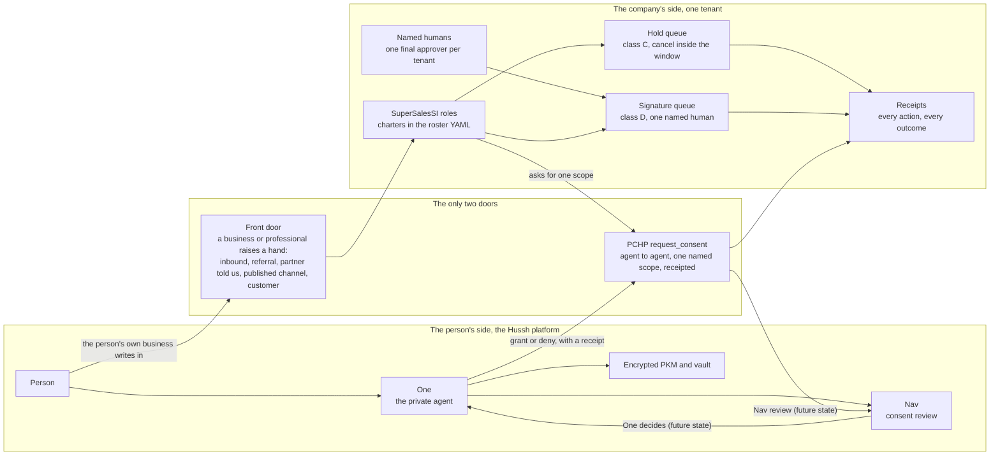

# SuperSalesSI, the 🤫 One Workforce

Status: architecture boundary contract. This page owns how the business-side
workforce relates to Hussh, to One (the private agent) and to the person. The
kernel itself lives in the sibling repository `hushh-search-console` under
`backend/app/supersales`; its design of record is that repository's
docs/product/supersales-workforce.md, cited here by name only. Nothing on this
page is a claim that Hussh runtime code changed.

## Visual Map

Two sides, two doors. The person's side is Hussh and One. The company's side
is a tenant, its named humans, and the agents that fill its growth, sales,
marketing and revenue roles. The only ways across are the front door and PCHP
`request_consent`; everything else is class F.

## Visual Context

Canonical visual owner: [Architecture Index](./README.md). Use that map for
the top-down platform view; this page is the narrower boundary beneath it. The
person-side ontology it depends on is
[Hussh Agent Ontology](../../vision/agent-ontology.md).

## What it is

SuperSalesSI, publicly 🤫 One Workforce, fills a company's product-led growth,
sales, marketing and revenue roles with agents. Each role carries a charter,
goals and key results in a roster file, runs inside an autonomy model a human
can cancel, and leaves a receipt for everything it does.

Its principal is a company tenant and that tenant's named humans. Today the
sibling repository defines two tenant files, `hushh-ai` for HushOne, Inc. and
`hushhtech-com` for its parent holding company, each with one human marked
`final` who may sign anything in class D, and other humans who may sign only
the kinds their tenant record lists. The workforce sells only to professionals, businesses, institutions and
brands; the manifest validator refuses an offer aimed at a citizen.

## Why it is not a second private agent

The repository doctrine is explicit. From the root operating rules,
[AGENTS.md](../../../AGENTS.md), Project-Wide Agent Architecture Doctrine,
item 5:

> No second decision-maker. Each interaction surface has exactly one routing
> authority. One owns product semantic decisions within the generated action
> contract; the owning workflow routes engineering work. New intelligence
> slots below One as a specialist; it never becomes a parallel top-level
> router.

And from the [agent ontology](../../vision/agent-ontology.md), Scaling Rule:

> The ontology scales by adding reachable specialist capabilities below One,
> not by creating parallel top-level agents or standalone product roots.

The same section places brand-side access precisely: "brand-side or
developer-facing access belongs under PCHP, Developer API, MCP, and scoped
consent, not a separate trust plane", and the Canonical Roles section closes
with "Do not add a second top-level private agent unless the product ontology
itself changes."

SuperSalesSI satisfies both rules by being neither of the things they guard
against.

| It is not | Because |
| --- | --- |
| A specialist under One | A specialist serves the person and is summoned by One. The workforce serves a company. One never delegates to it, never frames a handoff to it, and never speaks for it. |
| A second private agent | It has no standing on the person's interaction surface. It cannot read the person's PKM, cannot route a person's request, and cannot act for a person. On the person's side One remains the single routing authority. |
| A separate trust plane | Its only access to a person runs through PCHP `request_consent` and the existing developer identity. It inherits the Hussh consent, scope and receipt model instead of inventing one. |

What it is instead: a brand-side counterparty. On the company's surface its
own rules engine, `classify` in the sibling `policy.py`, and the tenant's
named humans are the authority. On the person's surface One is. The two
authorities never share a decision, and One sits between the person and the
workforce at all times. A workforce agent that wants anything from a person
asks One's side for it and waits for the answer; it does not reach around.

The roster enforces a veto from inside the company too. The manifest validator
requires a `trust` role in every roster, and no role may list a forbidden
action kind as allowed.

## Autonomy classes

Actions are sorted into classes, not into draft versus send. The classifier is
a pure function of the action kind and an honestly filled context, so a test
can hold every rule.

| Class | Name | What it covers | How it executes | Reversibility |
| --- | --- | --- | --- | --- |
| A | Internal | Lead creation, notes, next steps, scores, scheduling, metrics, drafts | Immediately, with an undo log | Full, by state |
| B | Reply | A reply inside a thread the other side already joined | Immediately, disclosed as sent by software, receipted | Notice only, the other side has read it |
| C | Held | A new external commitment: first touch, follow-up, quote, proposal, payment request, stage move, purchase inside a ceiling, partner invite | Queued with `executes_at` set to now plus the tenant's hold window, default 24 hours, minimum 1. Shown with a one-tap Cancel. Silence means go. | Full for a stage move, partial for a commitment, notice only once sent |
| D | Signature | Contract execution, a spending-ceiling change, a partner status change, publishing content, enabling mail, any purchase above or outside an active ceiling, a move to `won` | Exactly one named approver from the tenant says yes. The agent's recommendation is preselected; the evidence sits beside it. | Partial |
| F | Forbidden | Charging a citizen, impersonation, a certification or partner claim, securities solicitation, writing to a suppressed or unsubscribed contact, roster or scraped-list contact, fake scarcity, paid placement, exceeding a ceiling, a call, an SMS | Never. No approver can unlock it, the founder included. | Not applicable |

Rules that hold the table together:

1. An approval re-runs `classify`. A class F item cannot be approved, whoever
   asks, and "the founder approved it" cannot become a way around a ceiling.
2. Agents do not decide and do not cancel. Both paths refuse an actor marked
   as an agent; a person records the decision signed in as themselves.
3. A cancel is honest only while the hold is still held. After execution the
   honest answer is a correction, which is a new action with its own class.
4. A quote, proposal or payment request addressed to a citizen is reclassified
   to `citizen_charge`, class F. Agent One is free to every American, and the
   workforce cannot be the exception.
5. A kind with no registered executor is not silently dropped when its window
   passes; it becomes a signature-class decision and the hold records that it
   did.

## Contact provenance

Who may be written to is decided by the CRM record, not by the agent. The
contactable provenances are `inbound`, `referral`, `partner_told`,
`company_published` and `customer`. Everything else fails closed:
`regulator_roster` resolves to class F `roster_contact`, `scraped` and
`purchased` resolve to class F `scraped_list`, and `unknown` is refused rather
than guessed.

The roster rule is not a preference. The public-benefit requests the sibling
project has drafted to government agencies and professional bodies (its
docs/records-requests, each marked draft, not sent) will assert seven
representations, and every workforce action has to keep all seven true before
any of them is sent:

1. Citizens are never charged.
2. No listing is ever sold, rented, or offered as paid placement.
3. No advertising on a person's listing.
4. No computed ratings or scores.
5. No solicitation or lead generation off the data.
6. Removal on request, with no account and no negotiation.
7. Every listing cites its source and links back to the authoritative record.

The provenance rule is representation five made executable. Regulator-roster
data is never a prompt input for outreach and is never written to; autonomy
cannot override it. Representation one is `citizen_charge`, two is
`paid_placement`, and six is the unsubscribe-forever and suppression rules.
Two further rules come from the inside-sales playbook: three touches at most,
then the workforce stops, and an unsubscribe is honoured forever the first
time.

## Receipts both sides keep

Receipts are symmetric by design. Each side can prove what happened without
asking the other.

| Side | Receipt | Where it is kept |
| --- | --- | --- |
| Company | One sentence per hold: who queued what, for which role and tenant, when it executes, and later who cancelled it and why, or how it executed | The hold ledger in the workforce store |
| Company | One sentence per signature decision: who approved or declined what, with the note | The decision ledger |
| Company | Every CRM note is dated and attributed; software is attributed as software, as `supersales/<role>` | The CRM record, Stripe metadata or the SQLite port |
| Company | Spend is summed only from executed purchase holds, per category and month | The hold ledger |
| Person | Every grant, read and revoke under a preference subscription writes a signed, hash-chained receipt | The fabric receipt ledger, see [Preference Subscription Fabric](./preference-subscription-fabric.md) |
| Person | Every consent request, approval and denial is recorded against the developer identity that asked | PCHP consent records and the consent token audit trail |
| Person | Confirmation and settlement of any action One takes on the person's behalf | One's directive ledger |

Neither side sees the other's ledger. The person's receipt names the tenant
that asked and the scope it asked for; it never carries the workforce's
internal reasoning. The company's receipt records that a request was made and
whether it was granted; it never carries the person's reason for saying no.

## The agent-to-agent contract, a sketch

The intended shape is: the demand-side agent asks, Nav would review, One
would decide. Only the first step runs today; the Current truth table below
says which rules exist. A worked example is a brand tenant whose workforce
wants a preference subscription to a few granted fields, the offer the tenant
file prices at two to ten dollars per granted person per month with the
person taking the majority share.

1. The demand-side agent asks. A workforce role, authenticated as the tenant's
   developer identity, calls PCHP `request_consent` naming one scope, the
   purpose, and optionally an offer. The offer is a data-access bid the
   person's side would clear against a reserve price; it never moves money,
   and settlement stays at the AP2 money boundary. Today the bid is recorded
   on the consent event and shown to the person; no reserve price exists.
2. Nav would review. Nav would check that the requester is a registered
   developer identity, that the scope is one the person actually holds, that
   the request is not a repeat the person already refused, and that nothing
   in it would expose a sensitive field in a context that could shame the
   person, then explain the request in plain words. None of these checks run
   on the consent path today; a workforce author must not assume a refused
   request is de-duplicated for them.
3. One would decide. One would apply a rule the person already set, or put
   the request in front of the person once. A grant mints a scoped consent
   token and a fabric grant with an expiry; a denial is a receipt too. One
   never grants a field the person did not name. Today the existing consent
   surface decides, and no standing rule of the person's is applied.
4. The workforce reads only the granted field paths, only for the life of the
   grant, through the fabric read path. Revocation is immediate and is itself
   receipted.

What crosses the boundary: the tenant identity, the scope name, the purpose,
the offer, and the yes or no. What never crosses: PKM contents outside the
grant, contact lists, the person's reasons, and any consent token or key.

Current truth, so this sketch is not mistaken for shipped behaviour. Hussh
exposes a contained invocation preview at `/api/one/a2a/card` and
`/api/one/a2a/message`; it is not official A2A v1, which remains
release-blocked because the pinned ADK 2.4 range is incompatible with
`a2a-sdk` 1.x. See [API contracts](./api-contracts.md). When the boundary
crosses a process or deployment, doctrine item 8 in AGENTS.md applies:
official A2A Tasks across the boundary, MCP for consented tools and encrypted
resources, and invocation, information and action authority kept separate at
every hop.

## Runtime substrate

The workforce kernel imports only the standard library, PyYAML and httpx, so
it runs on a laptop with SQLite, inside the hosted backend, or in a customer's
own container with the same rules.

**Gemini is the default.** Each tenant file carries `default_provider: gemini`.
Hussh is a Google-first, Gemini-first company, and the day-zero experience
works for a tenant that arrives with a Google account and nothing else.

**One adapter covers every OpenAI-compatible server.** The sibling kernel's
`openai_compatible` provider speaks `POST {base}/chat/completions` and probes
`GET {base}/models` for reachability. The same adapter therefore covers
NVIDIA NIM, vLLM, Hugging Face TGI, Ollama, and LM Studio running MLX on Apple
silicon, with Azure OpenAI handled by header shape.

The Hussh runtime gains the same provider in the same change. In
`consent-protocol/hushh_mcp/runtime_providers/registry.py` the aliases `nim`,
`vllm`, `ollama`, `lmstudio`, `tgi` and `local` all resolve to
`openai_compatible`; in `consent-protocol/hushh_mcp/runtime_providers/factory.py`
the host comes only from `HUSHH_OPENAI_COMPATIBLE_BASE_URL`, never from an
alias, and the provider fails closed when that variable is unset. In a
hosted environment the host must be `https` unless it is loopback, so no
prompt or credential crosses a network in the clear. The managed client may
run keyless for this provider alone, because a local server commonly has no
key; bring-your-own-key is refused for it, because the host is operator
configuration rather than the person's choice and the BYOK path would carry
the person's Gemini key to it. It shares the
`openai_transport.py` wire adapter with Grok, and the registry holds one
conservative placeholder model entry, `local-default`, with realtime and
prompt caching off. The Puppy One tier already pins `lmstudio` as its
provider; see [Puppy One: the on-device tier](../ai/puppy-one-on-device.md)
and the variable's row in [env and secrets](../operations/env-and-secrets.md).

**The open-model bar is the Hugging Face model card and licence check.** We
support every open model that meets the standard the open-source community
sets for itself. Before an open model may be named in a tenant's provider
entry, a human records four things from its Hugging Face model card: the
card's address, the licence it names and whether a company may use it
commercially, the disclosed training and evaluation practice, and a
responsive maintainer. A model with no card, no licence, or a licence that
forbids the tenant's use is not an option, however fast it is. This is a
policy bar recorded by a human today; no code in either repository enforces
it yet, and this page does not say otherwise.

**Placement policy.** Three tiers, and the rule is about what the data is, not
where it is cheapest.

| Tier | Where | What may run there |
| --- | --- | --- |
| Device | The owner's own hardware: a Mac, a Puppy One, a laptop with the SQLite store | Everything, including any step that touches a person's data: a granted field, an inbound message body, a contact record |
| Tenant | The customer's own cloud or container, with the provider they chose | Everything the tenant owns; a person's data only under the tenant's own provider, never a third-party model host the tenant did not choose |
| Hosted | The Hussh-operated backend | Role work that carries no personal data in the prompt: drafting against published facts, scoring, metrics, scheduling |

A prompt to a hosted model carries only what the role needs for that step.
Regulator-roster data is never a prompt input. Personal data stays on the
device tier unless the tenant has placed it, by its own choice and under its
own provider, on the tenant tier.

**Every watt figure is labelled.** Any energy, cost-per-watt or
cost-per-workload number shown for the workforce is labelled `measured`, with
the device, the model, the date and the benchmark that produced it, or
`estimated`, with the assumption written beside it. A measured and an
estimated number are never blended into one, following the "Measured, not
asserted" rule the Puppy One tier already keeps. No watt figures exist for
the workforce today, so none are stated here.

## What this is not

- **Not Fund A, limited partner or securities marketing.** Both tenant files
  list `fund_a`, `limited_partners` and `securities` as forbidden topics, and
  `securities_solicitation` is class F. Alphabets 27 is never presented as
  venture capital, and the workforce never writes about it.
- **Not calls or SMS.** `call` and `sms` are class F. The Lifecycle charter
  says it plainly: calls and texts are for humans only, by rule.
- **Not computer-use purchasing.** A purchase inside an active ceiling executes
  only through a registered executor for that kind, after its hold window. A
  kind with no executor falls to the manual-cart path and becomes a
  signature-class decision. The workforce never drives a browser, a checkout
  page or a payment form.
- **Not a specialist One summons, and not a consumer surface.** It has no
  entry in the One app, no `delegate_agent_id`, and no voice. A person meets
  it only as a counterparty whose request One has already filtered.
- **Not a way to charge a citizen.** `citizen_charge` is class F, and the
  manifest validator refuses any offer whose payer is not a professional,
  business, institution or brand.

## Current truth

| Surface | Classification | Boundary |
| --- | --- | --- |
| Autonomy classes, hold queue, signature queue, deal rules, provenance rule, provider adapter | `partially_exists` in the sibling working tree at the time of writing, not yet merged | Described above from the code; treat as in flight until the sibling pull request lands |
| Backend mount, scorecard endpoint, console | `missing` | Owned by the sibling repository's later milestones; this page names them, it does not assume them |
| PCHP `request_consent`, fabric grants and receipts, developer identity | `already_exists` in Hussh | The only consented door; see [Preference Subscription Fabric](./preference-subscription-fabric.md) |
| Hussh-side `openai_compatible` runtime provider | `partially_exists` in this working tree at the time of writing, not yet merged | Host from `HUSHH_OPENAI_COMPATIBLE_BASE_URL` only; unset fails closed; `https` required in hosted environments except loopback; BYOK refused |
| Nav review rules (registered developer, repeat refusal, sensitive-field review) and reserve-price clearing | `future_state_only` | Today `request_consent` records the scope, purpose and optional offer and the existing consent surface decides; see [API contracts](./api-contracts.md) |
| Official A2A v1 across the boundary | `future_state_only` | Release-blocked; the invocation preview is not it |
| Hugging Face model-card and licence check as code | `missing` | A human-kept policy bar today |
| Siri brief for tenant humans | `future_state_only` | See [the planning note](../../future/supersales-siri-app-intent.md) |

## References

- [AGENTS.md](../../../AGENTS.md): Project-Wide Agent Architecture Doctrine, items 5 and 8.
- [Hussh Agent Ontology](../../vision/agent-ontology.md): canonical roles and the scaling rule.
- [Preference Subscription Fabric](./preference-subscription-fabric.md): the grant, read and receipt path a workforce subscription uses.
- [API contracts](./api-contracts.md): the Agent One invocation preview and its A2A release blocker.
- [Puppy One: the on-device tier](../ai/puppy-one-on-device.md): the device tier and the measured-not-asserted rule.
- Design of record: the sibling repository `hushh-search-console`, docs/product/supersales-workforce.md, cited by name only.
