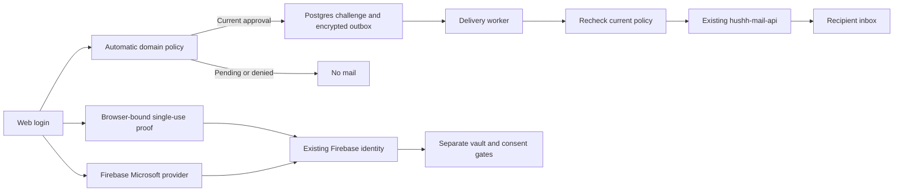

# Independent Email Authentication

## Visual Map

## Implementation and evidence

The source implements web email OTP and Microsoft sign-in. Hosted deployment and
authenticated acceptance are separate release evidence. Native entrypoints are
excluded until their provider/transport return paths are accepted; existing native
Google and Apple behavior is retained.

The final delivery service is the existing authenticated `hushh-mail-api`. Its
existing SMTP transport remains for other callers. OTPs use its narrow delegated
One transport: the backend supplies short-lived `gmail.send` authority from the
canonical One credential source, and the API composes and sends the fixed message
through the One mailbox. No private key moves to the API. Separate
mail-server provisioning is outside this implementation. OTP sender acceptance
requires `one@hushh.ai` through the API's authorized sender contract; a person's
default mailbox is not acceptable. WorkOS discovery and
customer organization onboarding are never called by the email-auth subsystem.

## Domain admission

The service automatically evaluates exact normalized recipient domains using
bounded DNS MX/A/AAAA resolution, public-address restrictions, a versioned known
disposable-domain snapshot, and durable emergency revocations. An unknown domain
is pending until evaluation passes. Missing MX is unsupported in this version;
Null MX or unsafe routes deny sending. Temporary evidence failure remains pending.

Public-CA HTTPS certificate validation is supporting evidence only. TCP is pinned
to a checked public address while TLS validates the original hostname through the
Mozilla public trust roots supplied by `certifi`. Valid mail-only domains need no website certificate.
Technical eligibility does not authenticate a business, employer or individual.
An attacker-controlled domain can satisfy this technical policy.

Decisions expire at the earliest relevant DNS expiry, risk snapshot deadline, or
one hour. A policy-state row identifies the active policy/risk versions. A late
review cannot supersede revocation or a newer policy. Expiry is rechecked after
database lock waits. Revocations are durable even before a domain is first seen.

The public disposable-domain snapshot has pinned provenance and a CC0 license
under `consent-protocol/config/email-auth/`. Its manifest must be refreshed before
expiry; expired required evidence blocks approval. It is not comprehensive
malicious-domain or impersonation coverage. No website scraping, mailbox probing,
or owner DNS challenge is required.

## Authentication and identity

- Codes are uniform six-digit strings, valid for five minutes and at most five
  guesses per challenge. Shared Postgres counters enforce discovery, verification,
  recipient, domain and global budgets. Resends have a sixty-second cooldown and
  supersede earlier codes without resetting recipient budgets.
- A random browser binding remains in memory. The verifier is keyed HMAC-SHA-256;
  recoverable delivery payloads and destinations use AES-256-GCM. Purpose,
  challenge identity, destination binding and expiry bind delivery content.
- A successful proof is consumed atomically. Database failure never falls back
  to process memory. Dependency failure after consumption requires a new code.
- New accounts receive an opaque reserved Firebase UID. Provisioning reservations
  are distinct from active enrollments; provider creation races never silently
  merge identities.
- Existing accounts with an exact, currently verified primary email sign in
  directly after valid OTP proof using their existing Firebase UID. No second
  provider sign-in is required. An existing unverified account remains blocked
  until a safe credential-recovery contract exists; this flow never silently
  verifies an account while retaining an unknown person's credentials.
- The token is returned only after the consumed, browser-bound proof finalizes
  under the current domain policy. Conflicting active UID bindings are rejected.
- Finalization serializes each Firebase UID and freshly checks its verified
  primary email. A primary-email change moves only that UID's binding; a stale
  proof cannot move it back. Canonical deletion barriers and a fresh tombstone
  check prevent returning a token when account erasure wins during issuance.
- Disabled/deleted accounts are refused; canonical tombstones are checked before
  Firebase creation and issuance. Account deletion removes enrollment and related
  challenges. Active WorkOS-created accounts with a verified primary email can sign in directly. Created accounts with a deprovision marker
  remain blocked even before disablement finishes; linked personal accounts retain
  their personal lifecycle. These local checks never call WorkOS or change its claims.
- Firebase remains the account/session authority. Neither method issues consent,
  roles or vault keys, or unlocks a vault.

## Delivery and failure boundary

The durable worker rechecks domain approval, challenge validity, expiry, its lease
and the live kill switch before each API submission. A bounded submission holds
policy/domain/challenge locks so revocation and consumption serialize with it.
It submits a fixed template,
one destination and a stable idempotency key; browser callers cannot specify
sender, CC, BCC, HTML, API origin or API credentials.

The delegated route requires the unique `one` consumer key and a short-lived One
bearer in a dedicated header. It accepts only recipient, six-digit code, bounded
remaining lifetime and idempotency key. From/Reply-To are fixed to `one@hushh.ai`;
CC, BCC, attachments, arbitrary HTML and SMTP fallback are rejected. Support mail's
test recipient and BCC are never inherited. This makes the mail API an intended
holder of short-lived One send authority; its response/logs must not retain it.

API acceptance is recorded separately from inbox delivery. An ambiguous timeout
can retry the same still-valid code. The API's downstream Gmail delivery queue is outside
this repository's control: revocation blocks subsequent local submissions but
cannot recall already accepted mail or establish downstream retry enforcement.
No claim of exactly-once email delivery or end-to-end email encryption is made.

API response headers prohibit caching. Codes, bindings and tokens must never
appear in URLs, browser storage, logs, analytics or captures. Validation errors
use fixed responses rather than reflecting credential-bearing input.

## Runtime configuration

The backend defaults to disabled. Enable only after schema359, current policy
inputs and the existing API binding are ready:

| Variable | Contract |
| --- | --- |
| `EMAIL_AUTH_ENABLED` | `true` enables issuance and worker submissions; otherwise disabled. Restart/reload runtime configuration through the normal owner. |
| `EMAIL_AUTH_VERIFIER_KEY` | Dedicated base64-encoded 32-byte server verification key. |
| `EMAIL_AUTH_PAYLOAD_KEY` | Separate base64-encoded 32-byte AES payload key. |
| `EMAIL_AUTH_LOOKUP_KEY` | Separate stable base64-encoded 32-byte destination-lookup key; rotating it needs an enrollment migration. |
| `EMAIL_AUTH_RISK_MANIFEST` | Absolute path to the reviewed, digest-pinned, unexpired risk manifest. |
| `EMAIL_AUTH_MAIL_API_ENDPOINT` | Exact existing Hussh mail service origin; arbitrary origins are refused. |
| `EMAIL_AUTH_MAIL_API_KEY` | Server-only unique `one` consumer credential; never a public frontend variable. |
| `EMAIL_AUTH_MAIL_FROM` | Must equal `one@hushh.ai`, after the mail API's authorized sender is configured and observed. This setting alone cannot change the remote service sender. |

Migration359 adds policy, domain decisions, budgets, challenges/outbox and
enrollment tables. The release manifest and schema contracts own deployment.
The active policy row must match the configured policy and risk snapshot.
No individual company-domain seeding or demo-address list is needed.

### Restricted policy operations

`consent-protocol/scripts/email_auth_policy.py` requires an explicit
`EMAIL_AUTH_POLICY_DATABASE_URL` in the operator environment. It never inherits
the application's default database. Mutations require `--expected-database`,
`--actor` and `--reason`; the DB role remains the access boundary. Commands are
`status`, `activate --manifest <path>`, `revoke --domain <domain>` and
`reevaluate --domain <domain>`. Revocation records actor/reason durably.
Reevaluation only returns a domain to pending and cancels old challenges; it
cannot manually approve a domain. Activation requires unexpired digest-pinned
inputs and a runtime restart so all workers load the new snapshot.

Refresh the vendored list from its pinned upstream source, retain its license,
record the new source commit/digest/retrieval/expiry in the manifest, review the
artifact, then activate that version. Never extend an old artifact's expiry to
work around an unavailable source. These are platform operations; customers do
not approve domains or change their DNS.

The independent retention task runs even when issuance is disabled or its keys
are unavailable. Expired payloads, destinations and enrollment tickets are cleared;
challenge metadata expires after one day. Account erasure removes challenges
before enrollment bindings; ordinary vault reset preserves login enrollment.

Rollback disables issuance/worker submissions, cancels outstanding challenges
and clears delivery payloads, encrypted destinations and tickets on every challenge.
Keep enrollment rows and existing Firebase accounts;
additive schema remains for forward recovery. Already established sessions retain
their normal account lifecycle.

## Impact and verification

Login UI, AuthService, ApiService, thin Next proxies, backend router, Firebase
admission, migration359 and account erasure are one change. No protected-information
cache keys, PKM records or vault cryptography change. New methods are web-only;
native and voice reachability are not certified by web proof.

Focused checks cover real Postgres concurrent consumption, persisted guess limits,
expiry after lock waits, revocation, enrollment/collision handling, credential-safe
errors, provider identity continuity and late browser responses. A runtime rehearsal
must additionally record API acceptance, observed inbox receipt, sign-in, repeat UID
continuity, Microsoft personal/company outcomes and vault remaining locked.

The mail API source is maintained under `deploy/mail-api/`, recovered from the
exact prior deployed source archive recorded in `source-provenance.json`.
Its Node contract tests run in the core web lane; its path schedules that lane.
Standalone deployment authority is separate from the Research frontend/backend
release workflows. A mail API rollout does not deploy this login implementation.
