# Finance advisor introductions

## Visual Map

```mermaid
flowchart LR
  Analysis[Portfolio Analysis] --> Agent[Inline private agent review]
  Analysis --> Choose[Choose a verified advisor]
  Choose --> Approve[Approve connection and sealed Finance snapshot]
  Approve --> Pending[RIA Clients request inbox]
  Pending --> Accept[Accept on the existing or newly connected edge]
  Accept --> Workspace[Participant workspace and expiring snapshot]
  Workspace --> Agree[Agree on an introduction time]
  Agree --> Calendar[Advisor reviews and confirms Google Calendar booking]
  Calendar --> Plan[Advisor offers monthly price and terms]
  Plan --> Checkout[Owner approves Stripe test checkout]
  Checkout --> Readback[Signed event and provider reconciliation]
```

## Product boundaries

Portfolio Analysis shows charts from the saved portfolio and the active
investing persona below Net Worth Score. Enabling automatic review approves a
bounded portfolio summary for model processing in the current visible vault
session. The review refreshes on saved changes to the approved source and reuses
results for matching inputs. Owners can turn it off from Analysis. The four
onboarding answers can support a Snapshot score when the portfolio and planning
inputs are sufficient. The optional 13-question refinement updates the active
persona and planning inputs.

An introduction uses one explicit approval for a connection and a full saved
Finance snapshot. It contains holdings, values, quantities and cost basis when
available, cash, allocation, saved balance history and available investment
preferences. Missing goals or preferences are shown as unavailable. It contains
no unrelated documents, transactions, account identifiers, credentials or keys.
The snapshot is encrypted separately for the owner and advisor using the existing
recipient-key system. Only ciphertext crosses the Finance request endpoint.

The pending recipient sees the sender and introduction, not the snapshot.
Verified RIA acceptance reuses the active canonical connection. If a connection
is needed, acceptance activates it with its legacy mirrors. The reference-only
message and snapshot release share the same transaction. It does not grant
trading, model-processing, Circle membership or any other data scope. Decline or
withdraw removes the ciphertext. Repeated requests reuse the exact immutable
request id; one pending or accepted workspace per owner/advisor pair prevents
duplicates. A definite refusal requires a fresh approval; uncertain responses
retry the same request.

## Access and discovery

Requests expire seven days after creation. Acceptance retains that original
snapshot deadline. Snapshot expiry does not erase the meeting/subscription
workspace. Every snapshot read rechecks participant, verified advisor, active
connection, block status, current key and server deadline. Disconnection or block
stops snapshot access permanently; reconnecting cannot revive it. The browser
clears decrypted content on expiry, visibility/session changes and failed access
checks. Account erasure removes either participant's request.

Discovery reuses the existing public advisor directory for postal-code or current
location searches, then matches exact CRD identities to discoverable, verified
platform advisors. Public records without an eligible in-app identity cannot
receive a request. Keyless advisors are shown as unavailable until they unlock
One. Location is sent in a private POST body, never in a route or persisted search.
The directory can return no matches, approximate coverage or a provider failure;
postal-code search remains available after location permission refusal.

## Calendar and missing setup

Either participant proposes a time with a real time zone; the other explicitly
agrees. The advisor must connect Google Calendar with management permission,
review the actual invitation and confirm through the existing one-shot Calendar
proposal/execute boundary. The user can receive an email invitation and join
without connecting Calendar. Both have a link to Calendar setup; missing setup
preserves the agreed time and request.

The meeting is bound to the original Google grant and a deterministic event id.
Uncertain provider results remain unconfirmed. Check Calendar status before a
retry; a provider-confirmed absence permits retrying only that same event id.
Changing accounts refuses reconciliation. Cancellation is confirmed from provider
evidence. A completed introduction can be recorded only after the confirmed end
time. Missing invitation email, expired review, conflicts and provider failures
leave an actionable error instead of claiming a booking.

## Monthly plan and payments

After the introduction, the advisor sets the monthly USD amount, service details
and cancellation terms. The advisor must finish the existing Stripe payout setup
before offering a plan. The owner reviews the exact revision and explicitly
approves recurring payment before Checkout. An uncertain checkout reuses its
stable request/revision idempotency key; the UI directs the owner to check payment
status rather than create another subscription.

This feature accepts **Stripe test mode only**. It requires the existing
`STRIPE_CONNECT_MODE=test`, test secret configuration and
`STRIPE_CONNECT_WEBHOOK_SECRET`. Configure the signed Connect webhook at
`/api/payments/advisor/stripe/webhook`. Existing live Drive payment configuration
is not changed. A checkout redirect never establishes active subscription state.
Provider reconciliation validates test mode, request, plan revision/hash, monthly
price, destination and paid invoice. Past-due/unpaid/unknown states are not active.
Stop sharing and cancel subscription are separate explicit actions.

Deletion queues known checkout expiry and subscription cancellation in the
provider-only cleanup outbox. The existing packet-order worker drains a bounded
batch. Signed late events for deleted requests also queue cancellation. A refused
or uncertain cleanup stays pending; database deletion does not prove provider
cancellation. Service delivery after subscription, real payments, trading and
portfolio management are outside this change.

## Schema, rollout and verification

Migration `447_finance_advisor_handshake.sql` adds the participant request,
test-subscription and provider-cleanup tables with service-only RLS, immutable
approval fields, disconnect/block triggers and account-deletion fences. Its
schema projections are generated by
`consent-protocol/scripts/generate_advisor_review_schema_contracts.py` and checked
with `--check`. The rollback refuses outstanding active or unreconciled billing;
reconcile provider resources before dropping the feature tables.

Focused tests cover approval, pending confidentiality, participant/placement
authority, retry binding, Calendar recovery, payment evidence and responsive
phone/desktop controls. PostgreSQL tests cover atomic accept/connection/message,
concurrent decisions, replay, disconnect and erasure. They require an isolated
`ONE_COMMAND_TEST_DATABASE_URL`. Synthetic browser fixtures do not establish
authenticated two-account, Google Calendar, Stripe webhook or deployed acceptance.
This work adds no Live Memory source: Finance content and consent/share artifacts
remain excluded from automatic memory ingestion.
