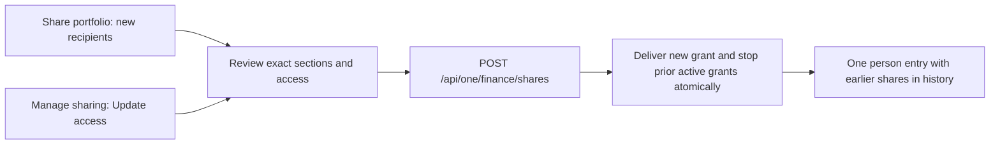

# Finance sharing and access updates

## Visual map

## Product flow

Share portfolio handles connections and verified RIAs in the same sheet. The
recipient rows reuse Connect's verified-advisor badge. Both kinds of recipients
use the same section, stock, amount and Agent One review controls. Contacts with
active access appear in Manage sharing, where the owner chooses Update access.
Updates load the current owner-encrypted settings and saved source, then require
a fresh preview and confirmation. Received access has no owner update action.

Custom durations accept whole minutes, hours or days from one minute to seven
days. When every selected recipient is a verified advisor, Always is available
for either a fixed snapshot or ongoing access. Ongoing updates still depend on
the existing open-and-unlocked owner publisher; they are not an autonomous
server subscription. Stop sharing, relationship changes, key changes and
advisor-eligibility checks retain their authority.

## Approval and storage contract

- V1 remains the curated connection policy and accepts bounded custom durations.
- Existing V2 full-portfolio advisor approvals remain readable with their original
  amount and model-processing constraints.
- V3 (`verified_ria_share`) uses the curated projection and the same granular
  controls as V1, with optional no-expiry access. Creation, recipient reads and
  ongoing refresh revalidate the canonical RIA verification under a database lock.
  Its encryption context has a separate V3 purpose prefix.
- Re-sharing applies the latest choices rather than combining older permissions.
  New delivery and retirement of the same owner's prior active grants to the
  selected recipient happen in one transaction under the connection-graph locks.
  A failed replacement leaves old access intact. Other recipients are unaffected.
  A retry of an older request returns its original stopped receipt and cannot
  restore it or retire a newer approval.
- Manage sharing groups by counterparty identity, with earlier immutable
  approvals inside that person's history. Stopped views lose their ciphertext;
  they are not duplicated as new person cards.

`GET /api/one/finance/shares/active-recipients` returns at most 10,000 opaque
person references for the authenticated owner. It requires the existing matching
Firebase identity and vault-owner token, returns no financial contents and uses
the same private/no-store response policy. It is picker metadata, not an access
grant. Recipient keys and connections are independently checked before delivery.

## Migration and verification

Migration `446_finance_advisor_share_options.sql` admits the explicit advisor
no-expiry policy without rewriting existing approvals. The canonical release
manifest includes it. Its rollback refuses to rewrite or delete standing
snapshot Always approvals; those must first be reconciled by an operator.

The Finance sharing component, service and projection tests cover the shared
controls, custom-duration bounds, purpose binding, owner-only update entry and
new-recipient filtering. The PostgreSQL suite exercises advisor verification,
replay, migration replay, per-recipient replacement and stale-request behavior.
It requires `ONE_COMMAND_TEST_DATABASE_URL` pointing to an isolated test server;
the fixture creates and drops its own random database. Browser coverage uses
production components with synthetic transport and does not establish a live,
authenticated two-account acceptance result.
