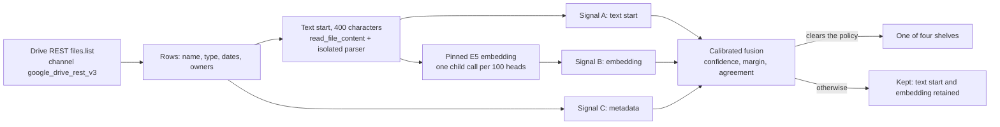

# Drive four-group index: design, evidence and implementation

Status: slices 1 and 2, and slice 3's period helper, sealed store, worker and owner API are in source on `feat/drive-four-group-index`, dark behind `DRIVE_FOUR_GROUP_INDEX_ENABLED`. On 2026-10-21 the owner approved local release/schema, table-family, runtime/admission, deploy-config and CI registration; those registrations are implemented with the feature disabled in every hosted lane. The backend branch is published, and an authorized local Drive run produced a CSV. Hosted deployment and acceptance remain unverified. The worker is callable but is not registered in `DriveWorkDrain`. The PKM writer and page remain future work. Checked in the worktree based on `origin/main` at `5a894a2adf`.

The aim: sort a person's Google Drive files into four groups, keep the index in the person's memory (PKM), and show the four folders with their indexed files on the Google Drive page under Connectors. The groups are virtual: nothing is written to the person's Google Drive. The grouping uses no model that writes text; the declaration is in [Backend Semantic Boundary](../../../consent-protocol/docs/reference/backend-semantic-boundary.md#declared-drive-four-group-organizing-aid-owner-decision).

## Visual Map



## What is built (slices 1 and 2)

| Piece | Where (under `consent-protocol/hushh_mcp/services/`; data files in `drive_groups/data/`) | Notes |
| --- | --- | --- |
| Listing and read timing | `google_drive_rest_transport.py` (`drive_rest.call`), `drive_telemetry.py`, `drive_owner_metadata_index.py` | Channel, fixed tool name, rows, more-pages flag and stage milliseconds per fenced read. See [the measurement recipe](./drive-connection-and-sharing-memory.md#redacted-latency-measurement-of-the-drive-listing). No latency is claimed until a UAT run is made. |
| Text start | `drive_groups/text_head.py` | First 400 characters (200 to 500 allowed) of the parsed text; ligatures folded, control marks dropped; `None` when a scan has no text. |
| Signal A, text start | `drive_groups/linear_model.py`, `features.py`, `text_model.json` | tf-idf over word 1-2 grams and character 3-5 grams, softmax-linear, weights learned. Digits fold to `0`, so no account number or date reaches a feature name. |
| Signal B, embedding | `drive_groups/embedding_model.py`, `embedding_model.json` | Cosine of the pinned `multilingual-e5-small` vector to five class centroids and to the four written group definitions, then a small learned layer. |
| Signal C, metadata | `drive_groups/features.py`, `metadata_model.json` | Name words and grams, extension, MIME type, shared-with-me and owner flags. Folder path and size are not in the fenced listing mask (`LIST_FIELDS`), so they are not used. |
| Fusion | `drive_groups/fusion.py`, `fusion.json` | Log-domain pooling with one learned weight per signal, a Platt map to a confidence, then a policy: confidence, margin over the runner-up, and agreement of the voting signals. A signal with weight 0 neither pools nor votes. |
| Operon | `drive_groups/indexer.py`, `adapters.py` | `index_files(rows, heads=, embedder=)`: reads heads (2 at a time by default; an explicit caller may select 1–32), embeds in batches of 100, places each file. Parser children are separately capped at two per retained parser. A kept file keeps its text start and vector; placed files discard both by default. An explicit local export may retain evidence for both. Systemic failures end the run; only a few per-file outcomes read as "no text". |
| Fit and measure | `consent-protocol/scripts/train_drive_groups.py`, `consent-protocol/scripts/eval_drive_groups.py`, `consent-protocol/scripts/build_drive_group_fixtures.py`, `tests/fixtures/drive_groups/synthetic.jsonl` | Offline. scikit-learn and scipy are used for fitting only; both already ship as dependencies of sentence-transformers and neither is imported at runtime. No new dependency was added. |

The working group definitions, kept in `groups.json` and taken from the Drive lab, are: financial statements (bank, credit card, brokerage, loan, tax); non-financial statements (utilities, telecom, medical, education transcripts); insurance statements (policies, premium notices, claims); personal documents (passports, ID cards, certificates, resumes, letters, forms). Non-financial is the vaguest and needs the owner's confirmation.

## Evidence, and its limits

The fit uses 276 invented files from template families. Folds hold out whole families, so the confidence it learns is not flattered by near-copies. The held-out `eval` split has 146 invented files from families the fit never saw (50 of them fit no group, including coursework with a lab and enrollment number, a statement of purpose, a bank-holiday circular, accounting lecture notes and an insurance comparison).

| Held-out result, version `629b0b04a049` | Value |
| --- | --- |
| Placed / correct | 57 / 55 (precision 0.965) |
| Group files placed correctly (recall) | 55 of 96 (0.573); 41 kept |
| Files that fit no group but were placed | 2 of 50 (both on insurance) |
| Calibration error on placed files | 0.067 |
| Files with no text (15) | all kept, reason `no_evidence` |
| Per group, precision / recall | financial 1.00 / 0.96, non-financial 1.00 / 0.25, insurance 0.91 / 0.88, personal 1.00 / 0.21 |

What this does and does not show:

- It is a regression gate. The documents are invented by the same author as the fit, so it says nothing certain about a real Drive. Promotion needs the owner to run `eval_drive_groups.py` on authorized real labels.
- Under unseen layouts, text alone reached 0.65 to 0.70 top-1, the embedding 0.63 to 0.64, and the file name alone 0.33 (chance is 0.30). The fit therefore gave the metadata signal weight 0, so every file without text is kept. Real names are probably more informative than invented ones; refit with real labels before relying on this.
- The written group definitions generalised better than example centroids (out-of-fold log-loss 0.91 against 1.11), which is why the embedding signal uses both.
- Hand-weighted keyword rules failed in the lab because words such as "lab", "cv" and "university" are not group evidence. The learned text signal alone keeps five such trap documents and places two genuine ones (`test_drive_groups.py`).
- Recall is low for non-financial and personal documents on unseen layouts. That is the price of precision first; those files are kept, not lost.
- Fits on private labels must go outside the repository: `train_drive_groups.py` refuses to write the packaged data from any other fixtures unless `--output-dir` is given.

## Run it

From `consent-protocol/`:

```bash
python scripts/build_drive_group_fixtures.py
python scripts/train_drive_groups.py
python scripts/eval_drive_groups.py            # held-out synthetic split
python scripts/eval_drive_groups.py --fixtures /private/labels.jsonl --split all
```

Needs the pinned E5 snapshot in the local Hugging Face cache (`local_files_only`), which is the model the production image bakes. On Windows the isolated parse and embedding children report `processor_unavailable` (no POSIX `resource` module); the fit and eval scripts embed in process, so they run, but Linux CI is the authority for the child path.

## Cost and latency, from the code

- A text start costs one file download (up to 4 MiB) and one isolated parse (25 s limit). The lab measured a median of 0.44 s per PDF parse; that is a lab figure, not a repository measurement.
- Embedding costs one child process per batch of up to 100 text starts; `index_files` runs the batches one after another, and the caller's lease must keep a worker to one run. A code comment in `IsolatedDocumentEmbedding.query` records about 71 s of cold start on the UAT worker's 2-CPU/4-GiB allocation, so 1,000 files is about ten batches of background work, not a request-path step.
- Of the lab's 154 text-capable files, 139 were readable; 12 scanned PDFs and 45 images had no text, and OCR is out of scope. So a real Drive has a meaningful share of files with no text, and the metadata signal matters once real labels exist.

## Slice 3: storage, worker and owner API

Implemented under `consent-protocol/`:

- `db/migrations/368_drive_group_index.sql` and `hushh_mcp/services/drive_group_index_store.py`: explicit opt-in with disclosure `drive-four-group-v1`, owner time zone, renewable leases, sealed entries, folder counts, file pages and erase. Connection changes delete the opt-in and entries. Disabling processing pauses it; erase withdraws the opt-in and invalidates in-flight work. The store rejects pruning from an incomplete or capped listing and preserves owner placements, discarding retained text/vector when the final shelf is placed.
- `hushh_mcp/services/drive_group_index_job.py`: `DriveGroupIndexJob.run()` runs owners sequentially (one by default, at most four), with a 900-second default overall deadline (at most 1,800). Each owner run lists up to 10,000 files in creation-time order, processes at most 100 changed files through `index_files`, and commits one bounded batch. Listing requests the existing 1,000-row owner metadata pages; a response over its byte budget retries the same cursor at 100 and then 25. At most 400 successful pages are accepted, including empty pages. Later runs skip only matching Drive revisions, modified times and model versions. Migration 368 replay-safely adds the source revision column; earlier local entries without it refresh once. A full listing alone permits removal of absent entries; capped, truncated or incomplete listings retain them and report incomplete status. No partial listing cursor is persisted, so each batch starts its inventory again.
- Internal `GoogleDriveRestTransport.read_group_index_tool`: the same live-grant fence, additionally bound to the job's connection generation before provider I/O. The worker rechecks processing authority around reads and embedding, renews its five-minute lease while working, and cancels on lease loss. Systemic parser errors propagate instead of becoming files with no text. Existing chat reads keep their response contract. No Drive mutation or PKM write runs here.
- `api/routes/drive_groups.py`, registered in `server.py`: current Vault Owner only, private/no-store including authored errors, with a 404 before storage construction while the flag is off. The existing connector catch-all proxy forwards the API; no browser/native caller is added in this slice. See [API Contracts](../architecture/api-contracts.md#owner-drive-four-group-folders).

Focused acceptance uses a real disposable PostgreSQL 16, the production job/store/transport orchestration, and invented files with synthetic parser and embedding outputs. It covers incremental batches, unchanged-file skipping, complete-list deletion, incomplete-list retention, opt-in/background/lease/erase fences, sealed retention and owner API admission. This is local contract evidence, not Linux isolated-child, authenticated Drive or deployment acceptance.

### Remaining storage and page work

Facts it rests on: PKM is client-side encrypted and the server never holds the vault key, so a server job cannot write PKM while the person is away ([PKM storage ADR](../architecture/pkm-storage-adr.md)). The closest precedent for a derived, non-semantic memory is the receipt memory: the registered writer `gmail_receipt_memory_save_button` (owner-confirmed, web) saves the reserved branch `shopping.receipts_memory` with `exposure_eligibility: false` on its paths, declared in `contracts/pkm/reserved-branches.v1.json` as an entry (`domain`, `branch_prefix`, `owner_feature`, `writer_ids`, `shareable`, `send_to_model`) plus a `writers` item. The semantic path (`saveConnectorMemoryReview` into `addToPKM`) runs model stages and is the wrong writer for this index.

Storage, in order:

1. Sealed server index, so the work can run while the person is away. One table keyed by owner, connection generation and file fingerprint, sealed like `connected_documents` (AES-256-GCM with owner and generation as associated data) and deleted by foreign key and trigger when the connection changes. A row holds the shelf, candidate, confidence, reason, data `version`, `group_source`, the sealed name, and the file's title date, created time and modified time; the deciding date and fiscal quarter are worked out when the page is served, so the convention and the owner's time zone can change without rewriting rows. For kept files it also holds the text start and embedding for future indexing. A new migration after 367, under migration governance.
2. Register the implemented background job with the Drive worker only as a separate reviewed change: changing `DriveWorkDrain` also changes its public result and generated runtime topology. The job already reuses `index_files` and the transport's owner/generation fence.
3. The browser writes the person's own copy. When the vault is unlocked, the Drive page reads the placements over an owner-authenticated route and writes four group branches plus a kept branch into PKM through a new deterministic, owner-confirmed writer and registry entry (backend and webapp copies stay byte-identical) with `shareable: never` and no path open to third-party requests. PKM holds shelf membership, names and confidence; heads and embeddings stay in the sealed index, because a text start can contain account numbers and does not belong in a shareable memory. Recommended: confirm with the owner.
4. The owner can move a file. A move is stored with `group_source = owner` and wins over the aid on every later run.

Page, in order:

1. A "Folders" section on the Google Drive page in `connectors-panel.tsx`, between Background Drive access and Sharing and approval: the four groups, each with its file count, opening into quarter folders named as in the table below (newest quarter first), each listing its files (name, date, open in Drive), and a fifth "Not sorted yet" row for kept files. It reuses `SettingsGroup`, `SettingsRow` and the existing back layering; the mobile layout is a single column of rows with a push-in list, and each opened group or quarter is a nested Back state.
2. A new overview feature `drive_four_group_index` beside `drive_document_indexing`, in `connector_feature_admission.py`, `runtime_settings.py`, the overview type in `external-connector-service.ts`, and the deploy files. The existing `DriveCollectionView` stays as it is: that packet pipeline was retired on UAT by migration 360 and its flags are off, which is why the UAT page does not show it.
3. UI contract steps from `AGENTS.md`: `npm run ui:doctor`; add the Search actions and the Back cases (each opened folder is a nested state, registered with `useBackLayer`); `npm run build:ui-contracts` (Back before Search); `npm run verify:ui-contracts`; the owning behavioural tests and the Chromium and WebKit layout pack at mobile and desktop widths, light and dark.

Folder names and period rule, settled by the owner on 2026-10-21:

| Group id | Folder name |
| --- | --- |
| `financial_statements` | Financial Assets |
| `non_financial_statements` | Non-Financial Records |
| `insurance_statements` | Insurance |
| `personal_documents` | Personal Documents |

A folder is a group plus a fiscal quarter, written "Financial Assets (FY 26 Q1)". The quarter comes from the file's date: the date written in its title, else its created time, else its modified time (the precedence in `drive_title_dates.py`). Kept files sit in "Not sorted yet" with no quarter, and a file with no usable date shows the group name without one.

Assumptions to confirm, each a single constant or rule:

- The fiscal year is India's: 1 April to 31 March, named by the year it ends. FY 26 Q1 is April to June 2025, and 21 October 2026 is FY 27 Q3.
- When a title names several dates, the latest decides, because a statement belongs to the quarter it ends in.
- Dates are read in the owner's time zone. A file created at 20:00 UTC on 31 March 2025 is 1 April 2025 in India, so FY 26 Q1, not FY 25 Q4.

Neither existing mode of `period_decision` gives that rule, so the implemented helper builds on `parse_title_dates` and `resolve_title_dates`. With `period=None` the older function returns the latest title date but reads created and modified times in UTC. With a window it reads them in the window's zone but returns the first title date, so a title such as "15 Mar 2025 to 14 Apr 2025" gives 14 April or 15 March. Read through the real `period_decision`, a title month "Mar2026" gives FY 26 Q4, "14 Sep 2025" gives FY 26 Q2, and a modified time of 21 October 2026 alone gives FY 27 Q3. The quarter arithmetic on the boundary days 1 Apr 2025, 30 Jun 2025, 1 Jul 2025, 31 Dec 2025, 1 Jan 2026, 31 Mar 2026 and 1 Apr 2026 gives FY 26 Q1, Q1, Q2, Q3, Q4, Q4 and FY 27 Q1. The helper, folders, migration, store, worker and route are implemented and tested locally; migration 368 and its preservation rollback are registered in the local release manifest.

Order of remaining work: reviewed worker scheduling; the PKM writer and registry entry; the page with its flag off; a separately authorized UAT run with the owner's account; promotion only after the owner's private evaluation. Push, PR, deployment and feature activation each require separate authority.

## Local verification and release boundary

Before registration, the worker commit `fd95177c0c` had 166 focused checks pass in Python 3.13, with one existing text-export test excluded because the Windows isolated parser lacks POSIX `resource`. The four suites were `test_drive_groups.py`, `test_drive_group_index_postgres.py`, `test_drive_groups_routes.py` and `test_google_drive_rest_transport.py`. Loading the pre-change reader reproduced that failure. PostgreSQL 16 was disposable and local; parser/embedding output was synthetic. Removing the incomplete-list pruning guard in a separate test process made both protection cases fail. No production source was mutated by that negative control.

Ruff, the docs verification bundle and the runtime topology freshness check passed. Web typecheck could not pass because this worktree has no installed web dependencies. Full Linux CI, isolated-child execution, live Drive acceptance, private-label evaluation and deployed serving behavior remain unverified. The Founder Wiki tool was unavailable in this session; no wiki content was read or published and no new product direction was introduced.

The approved local registration advances the release manifest and all three schema heads to 368. The release-contract check passes, both schema generators report current output, and the data-plane audit classifies all 302 migration tables with no unclassified tables or legacy-write findings. The new provider-cache family describes server-key sealing, queryable organizing metadata, retained owner moves, reset-state metadata after erase, and the absence of an age TTL. It does not claim client-key PKM encryption or deployed erasure evidence. Shared registrations:

- `consent-protocol/db/release_migration_manifest.json` and `db/contracts/uat_integrated_schema.json`, `prod_core_schema.json`, `dev_minimum_schema.json` under the same package: both tables, every authored column including `source_version`, and the invalidation function. The registered behavioral rollback pauses preparation and invalidates leases while preserving sealed entries and owner placements; a PostgreSQL rehearsal executes it twice and replays the up migration without reopening opt-in.
- `docs/reference/architecture/runtime-db-data-plane-contract.json`: classification, retention and erase policy for the two new tables.
- Flag admission/runtime/deploy registration and `consent-protocol/scripts/test-ci.manifest.txt`: the two group service suites and owner route suite are registered. The canonical runtime JSON maps `drive_four_group_index` to `DRIVE_FOUR_GROUP_INDEX_ENABLED`; the compiler defaults it to false and dev/UAT/production explicitly pass false. The overview exposes the feature key without a UI caller. Cloud Build already binds that runtime JSON, so no competing direct environment value is added.

The global switch cannot admit an owner: API/store/lease paths also enforce the connector cohort, and due-owner selection applies both live-Drive and group admission before its limit. Removing an owner from the cohort stops renewal and late commits. This registration adds no scheduler or retention executor. Postgres remains the lease/revision authority; a future Redis admission accelerator must preserve its conditional-commit fence behind the same store API.

The local registration checks cover 250 distinct tests across runtime configuration, rollout guards, connector admission, group routes/scoring/store, production release contracts and the data-model audit. The main run passed 248; two existing shell checks selected Windows' inactive WSL launcher. Their complete 11-test file passed when an ignored test-process adapter selected the installed Git Bash explicitly, without changing the shell commands or assertions. The PostgreSQL suite's 20 checks include the schema inventory, repeated preservation rollback and cohort revocation. A separate negative control bypassed the API owner gate and made the outside-cohort test fail as intended.

The dev/UAT configuration steps support older selected SHAs: they pass the explicit false option only when that tree's compiler supports it. Four tests execute the authored guard against both legacy and current parsers. Production preserves its current compiler and passes false directly. Ruff and formatting checks pass using the owning backend configuration, and the docs, runtime-config, release, schema-projection, data-plane and topology checks pass. Full core/Linux CI and web typecheck remain unproven locally; web dependencies are absent in this worktree. No shared database, provider, Secret Manager, scheduler or deployed service was mutated.

Impact: four new backend owner endpoints, one derived table family from migration 368, no new browser cache key, PKM write, UI/native caller or plugin. Existing connector proxy methods cover the backend contract. The new group flag is the rollback switch and defaults off. Read-only evidence review covered the worker/store/transport and API contracts; branch, patch, commit and release authority stayed with the parent session.

## Local CSV export

`consent-protocol/scripts/export_drive_groups.py` runs the existing inventory and
organizer for one explicitly supplied Hussh sign-in email. It requires the
connected live Drive account to match that email, preserves the current grant
and connection generation, and rechecks the canonical live policy and exact
background-preference revision before publishing. The output is a local derived
export, not a server index or a PKM write. It does not apply migrations, register
a scheduler, change owner processing preferences or activate hosted flags.

Run with an existing backend configuration and an ignored output destination:

```bash
cd consent-protocol
python scripts/export_drive_groups.py \
  --email owner@example.com --env-file /absolute/path/to/backend.env \
  --output ../tmp/drive-index.csv --time-zone Asia/Kolkata
```

When the local configuration lacks the matching Drive OAuth client, the optional
`--oauth-project backend` reads only the two fixed Drive OAuth secrets from the
active Cloud SQL project's Secret Manager, using the current operator's gcloud
access. Values remain in process memory. No secret or profile file is written.
The live and organizer switches and the exact owner cohort are scoped to that
one local process. Existing owner credential refresh remains the OAuth service's
responsibility; unrelated owners' lifecycle retention is never run by this CLI.

The default metadata-only CSV contains file name, group, fiscal folder and quarter, date and its basis,
confidence, model top class, candidate, reason, MIME type, original Drive link,
organizer source, model version and index status. Confidence describes the model's top class,
which can be `none`; kept files have no fiscal folder. Text starts, embeddings
and credentials are excluded from that default mode. Formula-leading text is escaped. JSON is available
as a local artifact intermediate.

The inventory is published first with pending rows and blank decisions. Completed
batches replace those rows atomically, alongside a metadata-only checkpoint; an
interruption preserves completed decisions. `--resume` explicitly permits updating
that output only when its checkpoint matches the owner, connection generation,
background revision, model, time zone and format. The first resume establishes a
Drive changes cursor before a fresh fenced listing and catches up its changes.
Later resumes replay that cursor against the saved metadata inventory, reading
content only for new or changed provider versions and removing deleted or
trashed files. A different existing
output is refused. Without content persistence, neither file contains text starts or vectors. Every retry checks
background authority again; credential refresh is single-flight in this process.

The metadata snapshot and cursor share the checkpoint's owner, generation,
background revision and model context. Completed placements alone permit cursor
advancement; an interrupted batch retains the earlier cursor and pending source
versions, so its changes replay on resume. Expired cursors and shared-drive
membership changes trigger an authoritative inventory again. Incomplete or
cyclic changes pages fail without replacing the last output. Changes requests
use the existing fenced transport with the expected connection generation.

### Reusable content export

For a handoff containing actual extracted evidence, use both explicit options:

```bash
python scripts/export_drive_groups.py \
  --email owner@example.com --env-file /absolute/path/to/backend.env \
  --oauth-project backend --raw-prefix-kib 200 --read-concurrency 32 \
  --persist-content --include-content --output ../tmp/drive-content.csv
```

`--persist-content` retains text starts and embeddings for both sorted and
unsorted files in the encrypted `drive-content.csv.checkpoint.json`. It is a
derived local snapshot, not a server-index opt-in or PKM write. It reuses
`DriveGroupCipher` and the existing `DRIVE_DOCUMENT_KEY_V1`; no key is saved in
either artifact. If absent from the existing configuration, `--oauth-project`
also reads that one fixed processing secret into memory. Existing server-worker
retention remains unchanged.

`--include-content` additionally puts the actual `text_start` and JSON-array
`embedding` in the private CSV. It requires persistence. This CSV is a plaintext
document-content export and must stay out of Git. Its added columns include file
ID, provider source version, evidence mode, opaque content reference, content
status, head length, vector dimensions, and pinned embedding model and revision.
The classifier and retained text start still use the first 400 cleaned
characters. Downloading at most 200 KiB does not mean storing 200 KiB of text.
Absent content is explicit: empty text/vector cells with `no_text`, plus the
existing `prefix_unreadable`, `prefix_unavailable` or `metadata_only` index status.

The checkpoint contains metadata and sealed evidence, never the plaintext CSV
content columns. Each encrypted record binds owner, file, connection generation,
source version and complete model/export context. A sealed manifest authenticates
the entire inventory, membership, cursor and all row envelopes. Resume verifies
these before trusting cached results. Old metadata-only checkpoints have a
different context and cannot stand in for persisted evidence. Use a new output
for the first content rebuild; later `--resume` reuses validated evidence for
unchanged versions.

Prefix extraction uses the same constrained parser child with a separate
`drive-prefix-v2` policy. PDF recovery retains only decoded pages rooted in an
actual Catalog, with complete referenced text streams and font mappings; it can
retain an earlier page when a later object is cut. DOCX recovery walks local ZIP
members, including bounded DEFLATE data descriptors, and reads the actual Word
XML even when the central directory or Content_Types member lies after the
prefix. Text decoding tolerates only a cut final character, not interior
corruption. No extra range, tail download, native Workspace export or OCR is
introduced. Image-only or structurally incomplete prefixes can remain unreadable.

New private CSVs add `extractor_policy`, `extraction_method` and
`extraction_reason`. `invalid_document` in prefix mode means the supplied prefix
could not be decoded; it does not establish that the complete source is damaged.
The authenticated checkpoint records parser policy and CSV columns. Upgrading an
old content checkpoint retries affected unreadable originals while preserving
unchanged successful evidence. Original successes retain their v1 provenance.
The reader also preserves the original column layout when recovering old exports.

The checkpoint is the committed snapshot; the CSV is its projection. If a write
fails after checkpoint publication, a fresh invocation can recreate the CSV
without downloading or embedding again. Encryption and serialization finish
before the final fresh authority/revision check. Both files are published
atomically individually; interruption may leave the older CSV until recovery.

Validate the saved evidence, or regenerate a private CSV, in a fresh process:

```bash
python scripts/read_drive_group_export.py \
  --checkpoint ../tmp/drive-content.csv.checkpoint.json \
  --env-file /absolute/path/to/backend.env --key-project backend

python scripts/read_drive_group_export.py \
  --checkpoint ../tmp/drive-content.csv.checkpoint.json \
  --env-file /absolute/path/to/backend.env --key-project backend \
  --include-content --output ../tmp/recovered-drive-content.csv
```

The reader performs no provider download, embedding or server write. Without
`--output` it emits counts only; `--include-content` must be repeated to write
plaintext content. Share the private CSV separately from the source branch. The
encrypted checkpoint additionally requires authorized access to the matching
processing key; source code alone cannot decrypt it.

On 2026-10-22 the corrected fresh run listed 4,940 files and retained **175 text
starts and 175 normalized 384-dimensional embeddings**, including all five
sorted files. The private CSV has 26 columns and zero pending rows. A separate
process authenticated the checkpoint, reopened every evidence record, regenerated
the CSV byte-for-byte and checked every source version, text cell and vector.
The remaining rows explicitly show 391 unreadable prefixes, 106 unavailable
Workspace exports and 4,268 metadata-only files. No document content is invented
for those rows. Classification accuracy on the owner's real documents remains
unevaluated.

This rebuild took 323.075 seconds inside the CLI (264.477 seconds indexing,
32.748 seconds inventory) and 330.670 seconds including the fresh helper process.
The observed largest content prefix was exactly 204,800 bytes. This persistence
fix does not establish the earlier two-minute performance target.

The focused regressions cover opt-in sorted-file evidence retention, exact
fresh-process decryption and private CSV reconstruction, provider-version and
model/context substitution, authenticated inventory membership, revocation
during manifest construction, and interrupted CSV publication followed by
resume with no content reads. Default metadata exports and server retention
remain unchanged.

For a previously completed index, run the same command with `--resume`.
On 2026-10-22 the one-time upgrade reconciled 83 changed versions, reused 4,858
placements, and established the cursor in 156.674 seconds. The following full
4,941-file refresh completed in **25.320 seconds**: one changes request, zero
inventory requests, zero document downloads, all 4,941 placements reused, and
zero pending files. This meets the one-minute target for that completed,
unchanged Drive. Large edit bursts and recovery inventories can take longer;
the result reports changed/reused counts and duration rather than claiming a
fresh cold content index completed in one minute.

A second refresh took 23.733 seconds inside the CLI and 28.578 seconds for the
entire fresh helper process, including credential setup and Python startup.
The updated local CSV has 4,941 indexed rows, 15 columns and no pending entries.
Focused checks cover version updates, additions, removals, bootstrap catch-up,
expired cursors, shared-drive scope changes, oversize-page fallback, cyclic or
truncated deltas, revocation, and cursor retention during interrupted batches.
Separate negative controls that advance the cursor early or bypass the expected
generation check fail the corresponding recovery and trust-boundary tests.

The exporter defaults to six concurrent fenced reads (`--read-concurrency 1` to
`32`); its parser still starts at most two children concurrently. Every read gets
fresh canonical credential, connection and registry checks. Only an expiring
credential queues behind the local refresh lock, where canonical authority is
read again. No token, policy or consent cache was added. The exporter and worker
reuse the existing task-scoped HTTP session across listing and reads; child reads
finish or cancel before the session closes. The worker retains two concurrent
reads.

For an explicitly bounded content index, add `--raw-prefix-kib 200`. This caps
each uploaded-file content read at 204,800 raw bytes, before parsing, text-head
capture and embedding. Inventory listing and CSV serialization retain their
normal behavior. The transport requests `Range: bytes=0-204799`, checks partial
response ranges, refuses compression, and closes at the cap if the provider
ignores the range. It never downloads a tail to repair a partial document.
Google Workspace exports do not support partial downloads; native Docs, Sheets
and Slides receive `prefix_unavailable`. An uploaded PDF or Office document
whose prefix cannot be decoded receives `prefix_unreadable`. Both remain on
the kept shelf without model scores or metadata-only classification. Other
unsupported types receive `metadata_only`; decoded prefixes receive
`indexed_raw_prefix`. The trained classifier still sees the configured 400
character text head. The byte cap does not increase that model input size.
The command reports `indexDurationSeconds` for content reads, parsing, embedding
and classification separately from `inventoryDurationSeconds` and total duration.

Prefix and full-content checkpoints have different evidence contexts and cannot
be reused across modes. Prefix runs may use 32 concurrent reads while retaining
the two-child parser cap and 100-head embedding batch bound. The local prefix
adapter reads connection, registry and background preference together in a
fresh SQL statement before and after every operation, through a bounded
read-only pool. The canonical OAuth code still decrypts and validates each
credential and owns refresh. No grant survives into another operation, no
database transaction spans provider I/O, and publication retains the canonical
background and exact-revision check. PostgreSQL regressions exercise registry
deactivation, connection replacement, background disablement and revision
changes during provider I/O; every stale result is refused.

On 2026-10-22 a fresh prefix run used no saved inventory or classifications and
published all 4,941 rows with zero pending entries. It took 305.698 seconds
inside the CLI, or 311.723 seconds including the fresh helper process and
credential setup. Five inventory pages and one changes page were read. Of 566
eligible uploaded documents, 175 prefixes yielded text and 391 were unreadable;
106 native Workspace documents were unavailable in this mode and 4,269 other
files were metadata-only. The run attempted 565 prefix downloads and received
87,858,994 bounded content bytes. This does **not** meet the two-minute fresh
rebuild target, and unavailable prefixes are not a complete content index.

On 2026-10-22 a matched local comparison read the same 12 authorized Drive files
with the pinned offline model in separate processes, without checkpoint reuse.
Nine files yielded text starts. The indexing batch fell from 80.575 seconds on
`d51be7e596` to 34.646 seconds (2.33 times the throughput); total command time fell
from 99.169 to 53.536 seconds. Both runs issued 121 SQL statements and their 15
export fields matched exactly. This sample reused the same inventory to isolate
reading, parsing and embedding; it does not measure full-Drive duration or
classification accuracy. The earlier full run took about 67 minutes. A complete
optimized cold run that reads every readable file has not yet been timed. Samples and private results stay
in ignored local files.

The optimized full inventory was measured separately: all 4,941 files were
listed completely, without a cap or fallback, in five requests and 46.762 seconds.
The previous full run spent about six minutes listing. Each inventory request
still passed its credential, generation and background-revision fences.

The developer adapter loads the same pinned E5 model offline, in process, in
batches of 32 with one computation thread. On Windows only, a credential-free
parser child installs a 512 MiB job-wide memory limit, a 20-second job CPU limit
and descendant teardown before importing a parser or reading private stdin.
Its parent retains the bounded input/output and 25-second wall deadline. This
adapter uses the existing conditional Windows `pywin32` dependency and does not
change the production POSIX child entrypoints. Missing OS limits fail closed.

Focused synthetic checks cover CSV disclosure and formula safety, owner mismatch,
late connection and background-revision changes, revocation during retry backoff,
interrupted-batch recovery and version-aware resume, actual Windows memory/CPU limits,
and descendant cleanup after CPU termination and parent cancellation. Separate
negative-control processes remove the final authority check or CSV formula guard
and fail the corresponding tests without editing production source.

## Open decisions

- Whether the fiscal year assumptions above (India, named by the ending year, latest title date, owner's time zone) are what the senior meant by "FY 26 Quarter 1st".
- Whether the non-financial group means utilities, telecom, medical and transcripts, as in the lab definition.
- Whether kept files' text starts and embeddings live only in the sealed index (recommended) or also in PKM.
- Registration is approved locally and implemented with flags off. Scheduling, push/PR, deployment and activation remain separate decisions.
- Whether to evaluate SetFit as signal A. It would add dependencies (check each licence) and was not needed to reach the numbers above.
