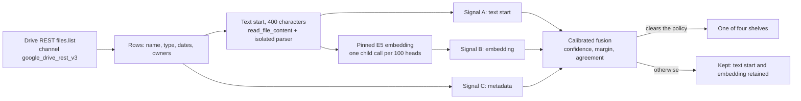

# Drive four-group index: design, evidence and slice 3 plan

Status: slices 1 and 2 are in source on `feat/drive-four-group-index`, dark behind `DRIVE_FOUR_GROUP_INDEX_ENABLED`; nothing is deployed, no route calls the aid, and nothing has been measured on a real Drive. Slice 3 (storage and page) is a plan only. Checked 2026-10-21 against `origin/main` at `5a894a2adf`.

The aim: sort a person's Google Drive files into four groups, keep the index in the person's memory (PKM), and show the four folders with their indexed files on the Google Drive page under Connectors. The groups are virtual: nothing is written to the person's Google Drive. The grouping uses no model that writes text; the declaration is in [Backend Semantic Boundary](../../../consent-protocol/docs/reference/backend-semantic-boundary.md#declared-drive-four-group-organizing-aid-owner-decision).

## Visual Map



## What is built (slices 1 and 2)

| Piece | Where (under `consent-protocol/hushh_mcp/services/`; data files in `drive_groups/data/`) | Notes |
| --- | --- | --- |
| Listing and read timing | `google_drive_rest_transport.py` (`drive_rest.call`), `drive_telemetry.py`, `drive_owner_metadata_index.py` | Channel, fixed tool name, rows, more-pages flag and stage milliseconds per fenced read. See [the measurement recipe](./drive-connection-and-sharing-memory.md#redacted-latency-measurement-of-the-drive-listing). No latency is claimed until a UAT run is made. |
| Text start | `drive_groups/text_head.py` | First 400 characters (200 to 500 allowed) of the parsed text; ligatures folded, control marks dropped; `None` when a scan has no text. |
| Signal A, text start | `drive_groups/linear_model.py`, `features.py`, `text_model.json` | tf-idf over word 1-2 grams and character 3-5 grams, softmax-linear, weights learned. Digits fold to `0`, so no account number or date reaches a feature name. |
| Signal B, embedding | `drive_groups/embedding_model.py`, `embedding_model.json` | Cosine of the pinned `multilingual-e5-small` vector to five class centroids and to the four written group definitions, then a small learned layer. |
| Signal C, metadata | `drive_groups/features.py`, `metadata_model.json` | Name words and grams, extension, MIME type, shared-with-me and owner flags. Folder path and size are not in the fenced listing mask (`LIST_FIELDS`), so they are not used. |
| Fusion | `drive_groups/fusion.py`, `fusion.json` | Log-domain pooling with one learned weight per signal, a Platt map to a confidence, then a policy: confidence, margin over the runner-up, and agreement of the voting signals. A signal with weight 0 neither pools nor votes. |
| Operon | `drive_groups/indexer.py`, `adapters.py` | `index_files(rows, heads=, embedder=)`: reads heads (2 at a time), embeds in batches of 100, places each file. A kept file keeps its text start and vector; a placed file keeps neither. Systemic failures end the run; only a few per-file outcomes read as "no text". |
| Fit and measure | `consent-protocol/scripts/train_drive_groups.py`, `consent-protocol/scripts/eval_drive_groups.py`, `consent-protocol/scripts/build_drive_group_fixtures.py`, `tests/fixtures/drive_groups/synthetic.jsonl` | Offline. scikit-learn and scipy are used for fitting only; both already ship as dependencies of sentence-transformers and neither is imported at runtime. No new dependency was added. |

The working group definitions, kept in `groups.json` and taken from the Drive lab, are: financial statements (bank, credit card, brokerage, loan, tax); non-financial statements (utilities, telecom, medical, education transcripts); insurance statements (policies, premium notices, claims); personal documents (passports, ID cards, certificates, resumes, letters, forms). Non-financial is the vaguest and needs the owner's confirmation.

## Evidence, and its limits

The fit uses 276 invented files from template families. Folds hold out whole families, so the confidence it learns is not flattered by near-copies. The held-out `eval` split has 146 invented files from families the fit never saw (50 of them fit no group, including coursework with a lab and enrollment number, a statement of purpose, a bank-holiday circular, accounting lecture notes and an insurance comparison).

| Held-out result, version `629b0b04a049` | Value |
| --- | --- |
| Placed / correct | 57 / 55 (precision 0.965) |
| Group files placed correctly (recall) | 55 of 96 (0.573); 41 kept |
| Files that fit no group but were placed | 2 of 50 (both on insurance) |
| Calibration error on placed files | 0.067 |
| Files with no text (15) | all kept, reason `no_evidence` |
| Per group, precision / recall | financial 1.00 / 0.96, non-financial 1.00 / 0.25, insurance 0.91 / 0.88, personal 1.00 / 0.21 |

What this does and does not show:

- It is a regression gate. The documents are invented by the same author as the fit, so it says nothing certain about a real Drive. Promotion needs the owner to run `eval_drive_groups.py` on authorized real labels.
- Under unseen layouts, text alone reached 0.65 to 0.70 top-1, the embedding 0.63 to 0.64, and the file name alone 0.33 (chance is 0.30). The fit therefore gave the metadata signal weight 0, so every file without text is kept. Real names are probably more informative than invented ones; refit with real labels before relying on this.
- The written group definitions generalised better than example centroids (out-of-fold log-loss 0.91 against 1.11), which is why the embedding signal uses both.
- Hand-weighted keyword rules failed in the lab because words such as "lab", "cv" and "university" are not group evidence. The learned text signal alone keeps five such trap documents and places two genuine ones (`test_drive_groups.py`).
- Recall is low for non-financial and personal documents on unseen layouts. That is the price of precision first; those files are kept, not lost.
- Fits on private labels must go outside the repository: `train_drive_groups.py` refuses to write the packaged data from any other fixtures unless `--output-dir` is given.

## Run it

From `consent-protocol/`:

```bash
python scripts/build_drive_group_fixtures.py
python scripts/train_drive_groups.py
python scripts/eval_drive_groups.py            # held-out synthetic split
python scripts/eval_drive_groups.py --fixtures /private/labels.jsonl --split all
```

Needs the pinned E5 snapshot in the local Hugging Face cache (`local_files_only`), which is the model the production image bakes. On Windows the isolated parse and embedding children report `processor_unavailable` (no POSIX `resource` module); the fit and eval scripts embed in process, so they run, but Linux CI is the authority for the child path.

## Cost and latency, from the code

- A text start costs one file download (up to 4 MiB) and one isolated parse (25 s limit). The lab measured a median of 0.44 s per PDF parse; that is a lab figure, not a repository measurement.
- Embedding costs one child process per batch of up to 100 text starts; `index_files` runs the batches one after another, and the caller's lease must keep a worker to one run. A code comment in `IsolatedDocumentEmbedding.query` records about 71 s of cold start on the UAT worker's 2-CPU/4-GiB allocation, so 1,000 files is about ten batches of background work, not a request-path step.
- Of the lab's 154 text-capable files, 139 were readable; 12 scanned PDFs and 45 images had no text, and OCR is out of scope. So a real Drive has a meaningful share of files with no text, and the metadata signal matters once real labels exist.

## Slice 3 plan: storage and page (no code yet)

Facts it rests on: PKM is client-side encrypted and the server never holds the vault key, so a server job cannot write PKM while the person is away ([PKM storage ADR](../architecture/pkm-storage-adr.md)). The closest precedent for a derived, non-semantic memory is the receipt memory: the registered writer `gmail_receipt_memory_save_button` (owner-confirmed, web) saves the reserved branch `shopping.receipts_memory` with `exposure_eligibility: false` on its paths, declared in `contracts/pkm/reserved-branches.v1.json` as an entry (`domain`, `branch_prefix`, `owner_feature`, `writer_ids`, `shareable`, `send_to_model`) plus a `writers` item. The semantic path (`saveConnectorMemoryReview` into `addToPKM`) runs model stages and is the wrong writer for this index.

Storage, in order:

1. Sealed server index, so the work can run while the person is away. One table keyed by owner, connection generation and file fingerprint, sealed like `connected_documents` (AES-256-GCM with owner and generation as associated data) and deleted by foreign key and trigger when the connection changes. A row holds the shelf, candidate, confidence, reason, data `version`, `group_source` and the sealed name. For kept files it also holds the text start and embedding for future indexing. A new migration after 367, under migration governance.
2. A background job on the Drive worker, behind the flag and the owner's live grant: list, read heads, embed, place, commit in bounded batches with the existing lease pattern. It reuses `index_files`; the owner and generation fence is the transport's.
3. The browser writes the person's own copy. When the vault is unlocked, the Drive page reads the placements over an owner-authenticated route and writes four group branches plus a kept branch into PKM through a new deterministic, owner-confirmed writer and registry entry (backend and webapp copies stay byte-identical) with `shareable: never` and no path open to third-party requests. PKM holds shelf membership, names and confidence; heads and embeddings stay in the sealed index, because a text start can contain account numbers and does not belong in a shareable memory. Recommended: confirm with the owner.
4. The owner can move a file. A move is stored with `group_source = owner` and wins over the aid on every later run.

Page, in order:

1. A "Folders" section on the Google Drive page in `connectors-panel.tsx`, between Background Drive access and Sharing and approval: four rows with the folder name, period and file count, each opening its files (name, date, open in Drive), and a fifth "Not sorted yet" row for kept files. It reuses `SettingsGroup`, `SettingsRow` and the existing back layering; the mobile layout is a single column of rows with a push-in file list.
2. A new overview feature `drive_four_group_index` beside `drive_document_indexing`, in `connector_feature_admission.py`, `runtime_settings.py`, the overview type in `external-connector-service.ts`, and the deploy files. The existing `DriveCollectionView` stays as it is: that packet pipeline was retired on UAT by migration 360 and its flags are off, which is why the UAT page does not show it.
3. UI contract steps from `AGENTS.md`: `npm run ui:doctor`; add the Search actions and the Back cases (each opened folder is a nested state, registered with `useBackLayer`); `npm run build:ui-contracts` (Back before Search); `npm run verify:ui-contracts`; the owning behavioural tests and the Chromium and WebKit layout pack at mobile and desktop widths, light and dark.

Order of work: migration and sealed store; worker job and owner route with the flag off; the PKM writer and registry entry; the page with its flag off; a UAT run with the owner's account; promotion only after the owner's private evaluation.

## Open decisions

- The four folder display names and the period rule. The senior's example is "Financial Assets (FY 26 Quarter 1st)"; the existing title, created, modified date precedence in `drive_title_dates.py` can supply the period.
- Whether the non-financial group means utilities, telecom, medical and transcripts, as in the lab definition.
- Whether kept files' text starts and embeddings live only in the sealed index (recommended) or also in PKM.
- Registering the flag and the CI test: both touch shared files (`connector_feature_admission.py`, `runtime_settings.py`, `scripts/ops/sync_backend_runtime_secrets.py`, `deploy/backend.cloudbuild.yaml`, `consent-protocol/scripts/test-ci.manifest.txt`). Ask the owner of those files before opening a pull request.
- Whether to evaluate SetFit as signal A. It would add dependencies (check each licence) and was not needed to reach the numbers above.
